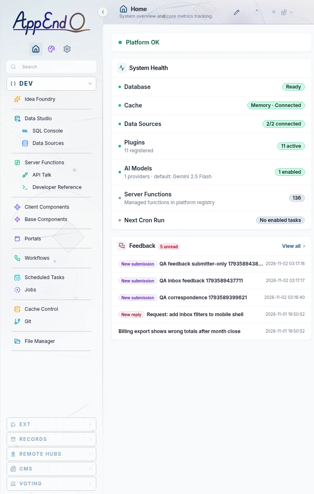
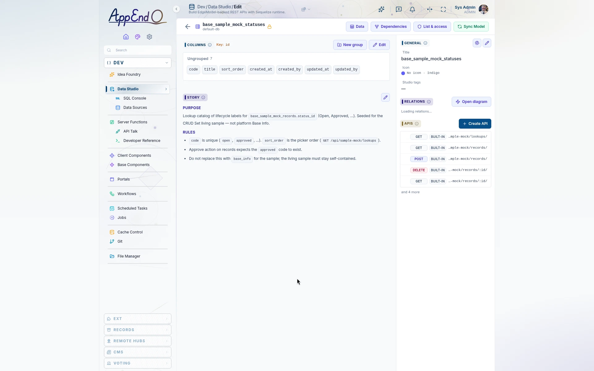
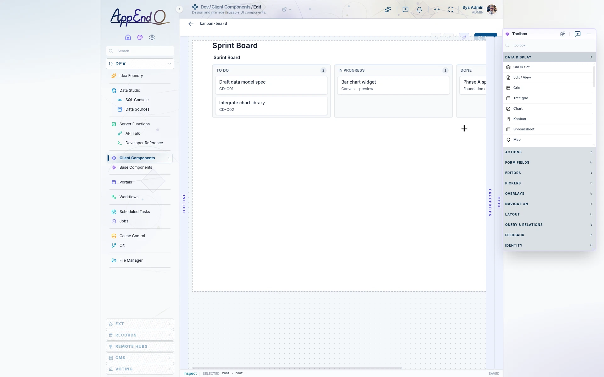
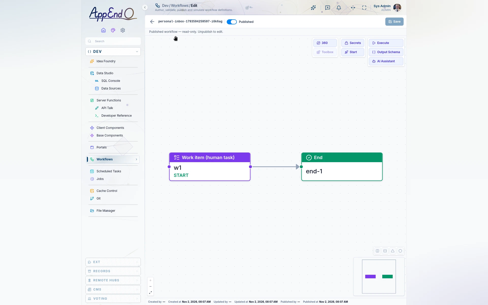
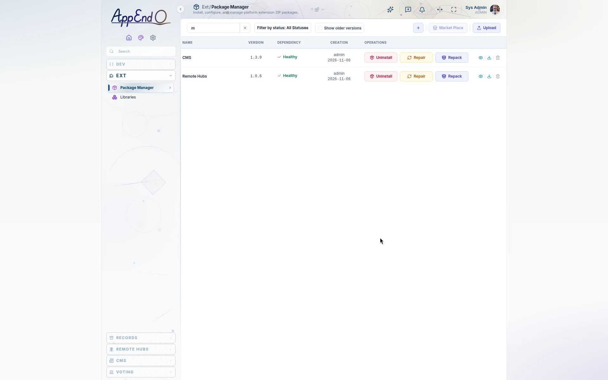
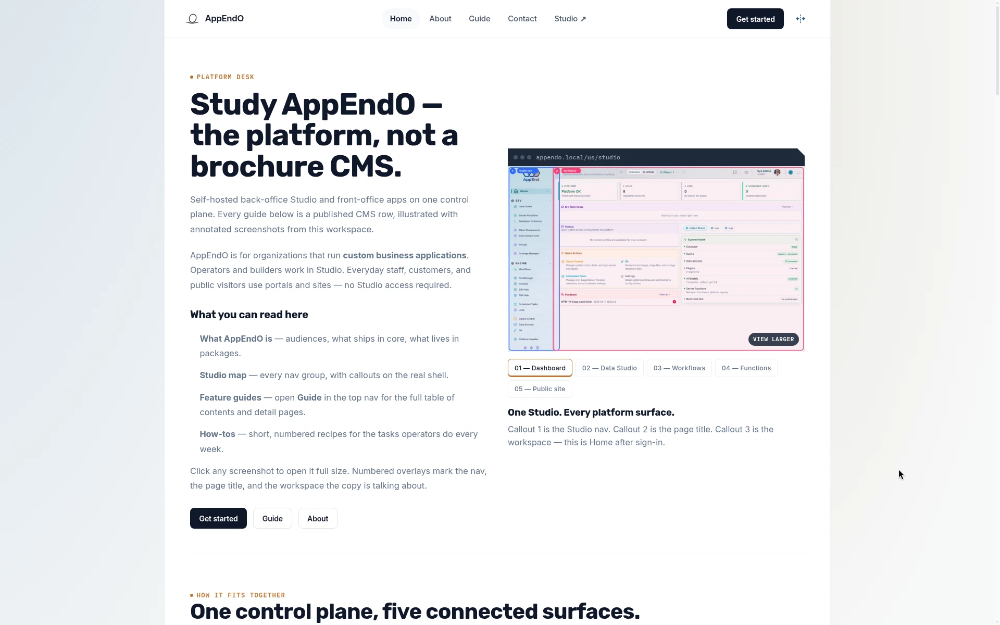

# AppEndO

**Self-hosted back-office studio and front-office portals, on one stack.**

AppEndO is a self-hosted enterprise platform for organizations that run custom business applications. Operators and builders work in the back-office studio (Data Studio, workflows, RBAC, packages, and an in-app AI/MCP agent). Everyday end users — staff, customers, and public visitors — use front-office portals and vertical apps on the same stack. It is platform-first: not a blogging CMS, and not an out-of-the-box ERP.

[](source/docs/LICENSE-FAQ.md)
[](https://github.com/mirshahreza/AppEndO-Release/releases)
[](https://github.com/mirshahreza/AppEndO-Release/stargazers)
[](https://github.com/mirshahreza/AppEndO-Release/issues)

<p align="center">
  
  
</p>
<p align="center">
  
  
</p>
<p align="center">
  
  
</p>

Studio Home is a narrow crop of the sidebar, System Health, and the feedback inbox, shown at its own width. Data Studio is open on a sample model, with its columns and the built-in Data API routes. Client Components shows a kanban canvas and the toolbox. The workflow shot is a published flow with one human task. Package Manager lists CMS and Remote Hubs. The last shot is a public CMS home page on `/us`.

## Why AppEndO

- **One platform for two audiences.** Builders and operators use the studio; end users get portals, forms, and self-service pages — no studio access required.
- **The toolchain ships in core.** Data Studio and Data APIs, a visual UI designer (Client Components, CRUD Set, Base Components), Server Functions, a workflow engine, a Git workspace, and ZIP packages are part of the platform, not paid add-ons.
- **Self-hosted, no per-seat platform fee.** You run it on your own infrastructure. SQL Server is the default and recommended control plane; the install wizard also supports PostgreSQL, MySQL, and SQLite. Extra edge sources can include Oracle, MongoDB, and Redis.
- **Ready-made packages, plus depth when you need it.** Install extensions and vertical apps from the Packages hub (CMS and Remote Hubs ship in the public release). Customize with Server Functions, Data Studio, and workflows.
- **Culture-aware from the start.** Platform experiences route by culture, portal, and page. Culture packs for US, Iran, and Iraq ship as system extensions (locale, calendar, direction, and fonts).
- **An in-app agent that already knows the platform.** AppEndO Agent (Ask / Plan / Agent) ships with 16 built-in MCP packs, designer-local AI, and an inbound MCP host.

## Five-minute quick start

You need [Node.js 22](https://nodejs.org/) and a control-plane database. For a first look, the browser **install wizard** is the recommended path (SQL Server and PostgreSQL are the human-tested first-run engines).

```bash
git clone https://github.com/mirshahreza/AppEndO-Release.git
cd AppEndO-Release/source
cp .env.example .env
npm install
npm run dev
```

Open [http://localhost:3000/install](http://localhost:3000/install). The wizard walks through node capabilities, cache (memory or Redis), database, admin account, and optional email, then applies schema and opens the studio.

The public release also includes a pre-built `dist/server.cjs` if you prefer not to rebuild. That bundle still loads npm packages from `node_modules`. A local PostgreSQL evaluation compose file is described in [Quick start with Docker](#quick-start-with-docker-local-evaluation). SQL Server remains the recommended production control plane.

After a development seed (PostgreSQL CLI `npm run setup` only — or an admin you create in the wizard), change the default credentials before any shared or production use.

## How it compares

AppEndO is **not** a substitute for WordPress (content marketing), Odoo (a full ERP), or Supabase (managed BaaS). Closest relatives are low-code platforms such as Oracle APEX; unlike typical internal-tools builders, it also targets public portals and vertical apps.

| | AppEndO | Retool | Odoo | Oracle APEX | Supabase |
| --- | --- | --- | --- | --- | --- |
| What it is | Self-hosted **studio + portals** platform | Internal-tools builder (mostly SaaS) | ERP / business suite | Low-code app platform on Oracle Database | Backend-as-a-service |
| Visual UI builder | **Yes**, in core (Client Components) | Yes, the product is the builder | Odoo Studio (vendor layer) | Yes, Page Designer in core | No — you build the frontend elsewhere |
| Workflows | **Yes**, designer + durable runtime in core | Plan-dependent | Automated actions + Studio | Approvals / processes in APEX | External / Edge Functions |
| Public portals & vertical apps | **Yes**, first-class front-office | Mostly internal users | Yes (ERP modules + portal users) | Yes, APEX apps | You assemble it yourself |
| Extension model | Installable **ZIP packages** | Limited export; apps live in Retool | Odoo modules | Export/import APEX apps | CLI migrations and functions |
| LOB modules (CRM, HR, …) on day one | **No** — ecosystem packages (CMS ships in this release) | No | **Yes** | No | No |
| License / cost shape | Custom license, self-hosted, **no per-seat platform fee** | SaaS, per builder and internal user | Per internal user (paid editions) | No APEX per-user fee; Oracle DB / OCI billed separately | Freemium cloud, usage-based |

A longer table (including WordPress and ABP Framework) and a pricing snapshot exist in the development README. This public page keeps the short qualitative table. Re-check vendor pricing before any public claim; the last in-repo verification was 2026-06-29.

## Names: AppEnd, AppEndO, and AppEndO-Release

**AppEndO** is the product: the platform and the in-app agent. **AppEndO-Release** is the official public snapshot of that platform (scrubbed source, a production build, and the bundled CMS and Remote Hubs packages). Issues and pull requests belong there. **AppEnd** is not a separate product — it is a legacy/internal label that still appears in a few places, such as the default SQL Server database name `AppEnd` and the development seed login domain `append.os`. Use **AppEndO** in new writing, and point people at **AppEndO-Release** when you mean the public repository.

## License and contributing

AppEndO is **source-available** under a **custom license** (Apache 2.0 text plus Section A terms). It is **not** an OSI-approved open-source license, and it is not standard Apache 2.0: you may self-host, operate official public-facing portals for your own organization, and contribute, but **public Internet hosting of a platform fork is not allowed**. Read the plain-language [License FAQ](source/docs/LICENSE-FAQ.md) and the full `LICENSE` before you adopt or redistribute it.

Bug reports, feature requests, security reports (without exploit or secret details in the issue body), and Code of Conduct reports all go through [GitHub Issues](https://github.com/mirshahreza/AppEndO-Release/issues) on AppEndO-Release. See `CONTRIBUTING.md`, `SECURITY.md`, and `CODE_OF_CONDUCT.md`.

---

# AppEndO — Public release 0.0.17

[](https://github.com/mirshahreza/AppEndO-Release/releases)

This repository is the **official source-available public snapshot** of **AppEndO**: platform source (scrubbed), a **production build**, and **ecosystem ZIPs** you can install from the studio. It is published from the private development monorepo via the **AppEndO-Release** pipeline—not a casual fork of the full product tree.

| Path | Contents |
| --- | --- |
| **`dist/`** | Production server (`server.cjs`) + Vite client assets — run with Node 22 |
| **`source/`** | Scrubbed platform source to rebuild, audit, or contribute (private commercial package paths **removed**) |
| **`packages/`** | Copy of bundled package ZIPs |
| **`cms-*.zip`** · **`remote-hubs-*.zip`** | Same ZIPs at repo root for simple download / hosting |
| **`MANIFEST.json`** | Version, SHA-256 checksums, bundled package ids |
| **`docs/`** | Static landing page (`index.html`) and product screenshots for GitHub Pages |
| **`Dockerfile`** · **`docker-compose.yml`** | PostgreSQL evaluation container (not the production default) |

**Bundled in this release:** `cms`, `remote-hubs`. **Not included:** private commercial vertical packages from the upstream monorepo.

Upstream platform development is maintained privately; **this repository** is the public distribution channel for the source-available platform snapshot, plus CMS and Remote Hubs. Report issues and open pull requests here — see [`CONTRIBUTING.md`](CONTRIBUTING.md).

---

## What is AppEndO?

**AppEndO** is a self-hosted **enterprise platform** for organizations that run custom business applications—not a blogging CMS or out-of-the-box ERP suite. **Operators and builders** use the back-office studio; **everyday end users** use **front-office** portals and vertical apps on the same stack. Public sites, customer portals, and branded experiences share one **relational control plane** (**SQL Server** default and recommended; PostgreSQL, MySQL, and SQLite supported on the install wizard) with optional **multiple external databases**.

The ecosystem is built around **ready-made packages** (extensions and vertical apps) from the Packages hub, plus **Server Functions**, **Data Studio**, and the **Workflow Engine** for deep customization. **Platform experiences** route traffic by culture, portal, and page. AppEndO is **platform-first**: one stack for **back-office + front-office**.

**Control plane (2026):** **SQL Server** is the default and recommended relational database (`settings.example.json`). New `base_*` tables use **Sequelize**; remaining Prisma usage is legacy and not extended in new work.

### Who it's for

| Audience | Typical user | What they do |
| --- | --- | --- |
| **Builders** | Developers, integrators | Data Studio, Server Functions, Client Components, Workflows, custom packages |
| **Operators** | Admins, IT, business owners | Install packages, configure settings, users, roles, org/geo scope |
| **End users** | Staff, customers, public visitors | Portals, forms, work items, self-service—no studio access |

---

## Built-in platform (core install)

| Area | Included out of the box |
| --- | --- |
| **Identity** | Users · roles · JWT (HttpOnly cookies) · OAuth/OIDC · profiles · Function Access Control · Record Policy |
| **Admin shell** | Studio navigation · Home dashboard · RBAC · PWA · Theme Designer · notifications |
| **Front-office** | Portals · vertical apps · culture-localized routes |
| **Data** | Multi-engine control plane · edge data sources · **Data Studio** · **Workbooks** |
| **Development** | Idea Foundry · **Client Components** · **Base Components** · **Server Functions** · **API Talk** · Packages hub · Git workspace |
| **Workflows** | Native **Workflow Engine** (design, run, human tasks, escalation, webhooks, MCP actions) |
| **Operations** | Cache · logs · jobs · cron · File Manager · Platform Transfer · optional **Remote Hubs** (this release) |
| **AI** | In-app agent · MCP packs · designer AI · optional external MCP |
| **Install** | Browser **install wizard** · CLI `npm run setup` for PostgreSQL-only bootstrap |

LOB modules (CRM, HR, commerce, …) are **ecosystem packages**. **CMS** is a shipped editorial package (bundled here).

---

## Features (summary)

- **Identity & access** — RBAC, OAuth/OIDC, Record Policy, Function Access Control  
- **Data Studio & Data API** — Visual models, REST Data APIs, SQL Console  
- **Workflow Engine** — Durable workflows, work items, assignment strategies, four-eyes  
- **Server Functions** — Sandboxed TS/JS APIs with OpenAPI  
- **Client Components & CRUD Set** — Visual UI from Base Components catalog  
- **Packages** — Install/export ZIPs from Package Manager  
- **AI & MCP** — In-app agent, built-in tool packs, inbound MCP host  
- **Settings** — Central config: auth, email, cultures, AI, PWA, attributes  

Full product narrative: see **`source/README.md`** in this release (scrubbed source readme).

---

## Quick start (this release artifact)

### Prerequisites

- [Node.js 22](https://nodejs.org/) and npm. `npm run build` (from `source/`) raises the V8 heap to 8192 MB. The Vite production build exceeds Node's default (~4 GB) heap. Allow about 8 GB of RAM. You do not set `NODE_OPTIONS` yourself.
- A control-plane database (SQL Server recommended; PostgreSQL, MySQL, SQLite via wizard)

### Run the server

Start from **`source/`** after install and build. That directory is the working directory Node uses for `node_modules`, `settings.json`, the generated Prisma client (`src/generated/prisma/client.ts`), and paths baked into `dist/server.cjs`. Do not `cd dist` at the release root and run `node server.cjs`: the release-root `dist/` tree has no `src/` beside it, so boot cannot find those files.

For an **isolated dev clone**, follow **`source/CLONE_PROFILE.md`** and `source/settings.recommended.json` (database **`AppEndORelease`**).

For a generic layout, you may instead copy `source/settings.example.json` → `settings.json`, run the install wizard at `/install`, or use `npm run setup` when using PostgreSQL CLI bootstrap.

From **`source/`** (rebuild or dev):

```bash
cd source
cp .env.example .env
npm install
npm run dev
```

Open [http://localhost:3000/install](http://localhost:3000/install) for first-time setup.

**Never commit** `settings.json`, `.env`, or operator `settings.json.*.tmp` files to this repository.

### Production from source

Run these from `source/` (the directory that contains `package.json`). `npm start` is `node dist/server.cjs` with that directory as the working directory, which is where settings and bundled file paths resolve. The first start compiles `src/generated/prisma/client.runtime.mjs` from the committed Prisma client. That file is generated and is not in git.

```bash
cd source
npm install
npm run build
npm run start
```

The `dist/` directory at the release root is the cut machine's build output. Launch the server from `source/` with `npm start` after the build above.

### Troubleshooting a production boot

If the control-plane database was first set up in development, starting a production build can exit with `APPENDO_CREDENTIAL_MASTER_KEY is required in production`. Set `APPENDO_CREDENTIAL_MASTER_KEY` (32 bytes, 64 hex characters) in the environment for that process, and do not commit it. Run from `source/` after install and build:

```bash
cd source
npm install
npm run build
npm run start
```

Default **development** seed login (change in production):

| Field | Value |
| --- | --- |
| Email | `admin@append.os` |
| Password | `admin123` |

Health: `GET /api/health` · `GET /api/ready`.

---

## Quick start with Docker (local evaluation)

This path is a **local evaluation** compose file for PostgreSQL. It is **not** the production default and **not** a signed-off production image. Production documentation still recommends **SQL Server**.

`dist/server.cjs` is an esbuild bundle with npm packages left external, so the image runs `npm ci` from `source/`. `settings.json` is read from the process working directory. `npm run setup` only bootstraps PostgreSQL, and it returns without creating a database when `settings.example.json` is still SQL Server. The entrypoint writes a PostgreSQL settings file first (the password stays in `PGPASSWORD`, not in the file). Setup runs with `runtime.nodeEnv` set to `development` so the CLI can seed the development admin. The entrypoint then switches that node to `production` and replaces the development JWT secrets, so the process serves the prebuilt `dist/` instead of starting Vite. It starts `node dist/server.cjs` from `source/` so `prisma/schema.prisma` and `dist/` resolve together. A later boot is written to skip setup when `install.completedAt` is already set. That second boot was not exercised here.

```bash
docker compose up --build
```

Open [http://localhost:3000](http://localhost:3000). Published ports are bound to `127.0.0.1` only, because the first boot still has the development seed password. Change that password before you publish port 3000 on any other interface. The image build installs production dependencies (and `tsx`, which setup needs). First boot then runs greenfield setup and can take several minutes. Settings, the credential key, `workspace/`, and `packages-storage/` stay on the `appendo-data` volume. The working directory is that volume, because the app renames a temp file onto `settings.json` and a symlink would be replaced.

Optional RDP sidecar, only after Remote Hubs is installed and you need RDP Hub:

```bash
docker compose --profile rdp up --build
```

Redis is not part of this compose file. Cache stays on the in-process memory driver.

**Status:** local evaluation compose, not a release-gated image. A clean volume has not been signed off here as having reached `GET /api/health` and `GET /api/ready` — run that check before you rely on it. The process runs as root. There is no published image registry. ARM is not covered. Change the development seed password before any shared use.

---

## Bundled packages (install in studio)

| Package | ZIP in this repo | Purpose |
| --- | --- | --- |
| **CMS** | `cms-*.zip` | Editorial content, vocabularies, CMS studio nav |
| **Remote Hubs** | `remote-hubs-*.zip` | File Hub (SFTP/FTP) · SSH Hub · RDP Hub |

Install via **Package Manager** in the studio (upload ZIP or use packaged artifacts under `packages/`). Verify checksums against **`MANIFEST.json`**.

After Remote Hubs install: `npm run remote-hubs:install` equivalent is handled via package install; restart the server. RDP requires `guacd` on the host (see **`source/README.md`** — Remote Hubs section).

---

## Studio map (after install + CMS)

| Group | Pages |
| --- | --- |
| **Home** | Dashboard widgets, pinned pages |
| **Development** | Data Studio · Server Functions · Client Components · Workflows · Jobs · Settings · … |
| **Extensions** | Package Manager · Libraries |
| **Records** | Users · Roles · Base Info · Workbooks · Logs |
| **CMS** | (when CMS package installed) |

---

## Secrets at rest

Production requires `APPENDO_CREDENTIAL_MASTER_KEY` (32 bytes, 64 hex chars). Hub and vault secrets use AES-256-GCM. See **`source/README.md`** — *Secrets at rest*.

```bash
openssl rand -hex 32
```

---

## Documentation in `source/`

| Topic | Path |
| --- | --- |
| Why AppEndO | [Put Reins on AI Coding—and Build Beyond the Demo](source/docs/outreach/why-appendo.md) |
| Why AppEndO (فارسی) | [نسخهٔ فارسی مقاله](source/docs/outreach/why-appendo-fa.md) |
| Architecture | `source/src/ARCHITECTURE.md` |
| Feature map | `source/docs/appendo-features.md` |
| Data Studio | `source/docs/standards/data-studio.md` |
| Packages | `source/docs/standards/package-ui.md` |
| AI / MCP | `source/docs/standards/ai-mcp.md` |
| Contributors | `CONTRIBUTING.md` · `source/AGENTS.md` · `source/docs/LICENSE-FAQ.md` |

---

## License

AppEndO is **source-available** under a **custom license** (Apache 2.0 base + **Section A** terms). It is **not** an OSI-approved open-source license. Read **`LICENSE`** (repository root and `source/LICENSE`) in full before redistribution.

This **AppEndO-Release** repository is the designated **source-available public snapshot** of the platform and the bundled CMS / Remote Hubs artifacts. **Do not** republish private commercial packages that are not part of this release manifest.

---

## Verify this release

```bash
# Example: confirm CMS zip (see MANIFEST.json for exact filename)
sha256sum cms-*.zip
```

Platform version: **0.0.17** · Manifest created: see **`MANIFEST.json`**.

**Issues & contributions:** [GitHub Issues](https://github.com/mirshahreza/AppEndO-Release/issues) and pull requests on **this repo** (tags `vX.Y.Z`). Security: [`SECURITY.md`](SECURITY.md). License FAQ: [`source/docs/LICENSE-FAQ.md`](source/docs/LICENSE-FAQ.md).
