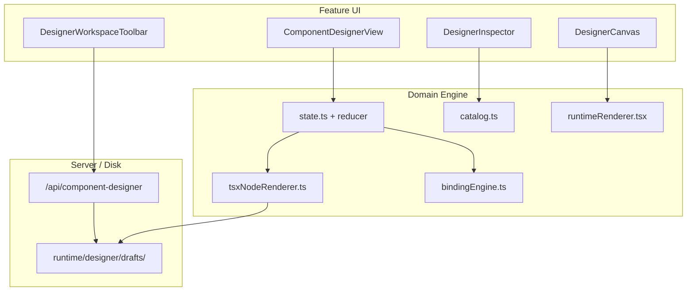
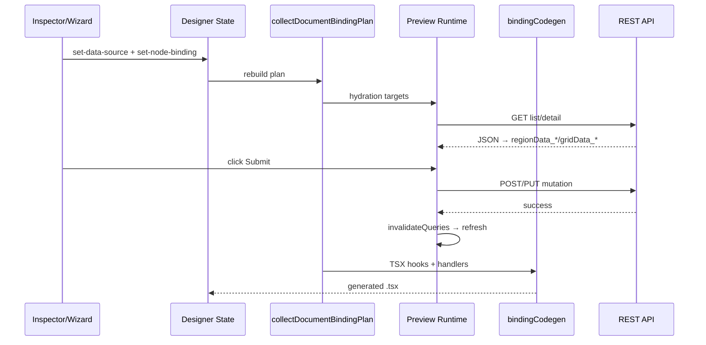

# Component Designer — تحلیل جامع (فنی + UI/UX)

> **تاریخ:** 2026-07-12  
> **دامنه کد:** `src/domain/component-designer/` · `src/features/component-designer/` · `src/server/domain/component-designer/`  
> **مرجع استاندارد:** [`docs/standards/component-designer.md`](../standards/component-designer.md)  
> **ماتریس property:** `src/domain/component-designer/toolboxInventory.ts` · [`component-designer.md`](../standards/component-designer.md)

---

## فهرست

1. [خلاصه اجرایی — Component Designer چیست؟](#1-خلاصه-اجرایی--component-designer-چیست)
2. [معماری فنی — لایه‌ها و جریان داده](#2-معماری-فنی--لایه‌ها-و-جریان-داده)
3. [چیدمان workspace — تحلیل UI/UX](#3-چیدمان-workspace--تحلیل-uiux)
4. [هدر Designer — هر دکمه و رفتار](#4-هدر-designer--هر-دکمه-و-رفتار)
5. [سایدبار چپ — مدیریت کامپوننت‌ها](#5-سایدبار-چپ--مدیریت-کامپوننت‌ها)
6. [Canvas، Inspector، Code، Outline](#6-canvas-inspector-code-outline)
7. [Toolbox — پنجره شناور المنت‌ها](#7-toolbox--پنجره-شناور-المنت‌ها)
8. [Properties مشترک — واژه‌نامه](#8-properties-مشترک--واژه‌نامه)
9. [فهرست کامل 123 المنت + Properties](#9-فهرست-کامل-123-المنت--properties)
10. [Data Binding — کامل (API + المنت + Store)](#10-data-binding--کامل-api--المنت--store)
11. [معماری کد — چطور کار می‌کند](#11-معماری-کد--چطور-کار-می‌کند)
12. [State Model و Reducer Actions](#12-state-model-و-reducer-actions)
13. [Codegen و Code Sync](#13-codegen-و-code-sync)
14. [Preview Runtime](#14-preview-runtime)
15. [Shell Designer و Platform Integration](#15-shell-designer-و-platform-integration)
16. [Publish / Staging / Version History](#16-publish--staging--version-history)
17. [Diagnostics و Validation](#17-diagnostics-و-validation)
18. [Hooks — نقش هر hook](#18-hooks--نقش-هر-hook)
19. [API Server — تمام endpointها](#19-api-server--تمام-endpointها)
20. [دیالوگ‌ها و Wizardها — کامل](#20-دیالوگ‌ها-و-wizardها--کامل)
21. [Palette Categories اضافی (Platform/Shell/Reusable)](#21-palette-categories-اضافی-platformshellreusable)
22. [Grid / Chart / Form — فیچرهای پیشرفته Inspector](#22-grid--chart--form--فیچرهای-پیشرفته-inspector)
23. [Built-in Templates و Presets](#23-built-in-templates-و-presets)
24. [Package Components و Export](#24-package-components-و-export)
25. [میانبرهای صفحه‌کلید](#25-میانبرهای-صفحه‌کلید)

---

## 1. خلاصه اجرایی — Component Designer چیست؟

**Component Designer** محیط بصری ساخت صفحات و کامپوننت‌های React است. کاربر بدون نوشتن دستی TSX، با drag-and-drop المنت‌ها از Toolbox، layout می‌سازد، propertyها را در Inspector تنظیم می‌کند، binding به API/داده اضافه می‌کند، و خروجی را به صورت **JSON + TSX** ذخیره و publish می‌کند.

### از نگاه کاربر (UI/UX)

| جنبه | توضیح |
|------|--------|
| **احساس کلی** | IDE سبک Figma/Webflow: پس‌زمینه workspace خاکستری روشن، پنل‌های سفید با هدر 50px، تایپوگرافی کوچک و فشرده (`text-xs` / `text-[11px]`) |
| **جریان اصلی** | انتخاب/ساخت کامponent ← drag المنت ← انتخاب node ← ویرایش در Inspector ← Preview ← Save ← Publish |
| **شناسه عمومی** | بیرون designer: `folder/name` (مثلاً `general/my-dashboard`) — **نه** draft id |
| **ذخیره‌سازی** | `runtime/designer/drafts/<folder>/` — فایل `.json` + `.tsx` همراه |
| **Preview** | runtime واقعی HeroUI؛ viewport قابل تغییر (Desktop/Tablet/Mobile) |

### از نگاه فنی

| لایه | مسیر | نقش |
|------|------|-----|
| **Feature UI** | `src/features/component-designer/` | React workspace، hooks، dialogs |
| **Domain engine** | `src/domain/component-designer/` | state، catalog، runtime، codegen، binding |
| **Server** | `src/server/domain/component-designer/` | persistence، draft coordinator |
| **API** | `/api/component-designer/*` | CRUD draft، publish، assets |

### آمار Toolbox (2026-07-12)

| شاخص | مقدار |
|------|------:|
| کل المنت‌های palette | **123** |
| دسته‌بندی | 14 category |
| **Form Input Set (با events کامل)** | 14 id (شامل `heroui.tags-input`) |
| باگ parity شناخته‌شده (preview ≠ export) | ~7 |

---

## 2. معماری فنی — لایه‌ها و جریان داده

### 2.1 نمودار لایه‌ها



### 2.2 چهار لایه هر المنت Toolbox

هر المنت palette باید در **۴ لایه** پوشش داده شود:

| لایه | فایل کلیدی | معیار کامل بودن |
|------|------------|-----------------|
| **Catalog** | `catalog.ts` | ثبت در `DESIGNER_PALETTE`، `defaultProps`، `allowedParentTypes` |
| **Runtime (Preview)** | `runtimeRenderer.tsx`, `designerRuntimePreview.tsx` | رندر HeroUI/ویجت واقعی در canvas |
| **Codegen (Export TSX)** | `tsxComponentRegistry.ts`, `tsxNodeRenderer.ts` | TSX معتبر + import صحیح |
| **Inspector** | `inspectorPaletteFields.ts`, `inspectorRegistry.ts` | فیلدهای property + binding toggle |

**Binding** لایه پنجم است (جدا از ۴ لایه بالا).

### 2.3 مدل state

- **Document:** درخت nodeها (`root` → children)
- **هر node:** `type`, `props`, `children[]`, `bindings`
- **Reducer actions:** `insert-palette-item`, `select-node`, `set-node-prop`, `undo`/`redo`, …
- **Code sync:** TSX/JSON از document generate می‌شود؛ ویرایش دستی Monaco flag `tsxDirty`/`jsonDirty` می‌زند

### 2.4 Codegen rules

| نوع prop | رفتار export |
|----------|--------------|
| `tw*` | compile به `className` — در TSX جدا export نمی‌شود |
| `_designer*`, `_listItems`, `textContentMode` | skip |
| `translationKey` | i18n helper |
| `text`, `label`, `title` | children یا prop بسته به component spec |

### 2.5 Preview vs Publish

| حالت | URL / مکانیزم |
|------|----------------|
| **Preview ذخیره‌شده** | `?component=<folder>/<name>` |
| **Preview session (unsaved)** | مسیر session کوتاه‌مدت داخل designer |
| **Staging link** | لینک preview publish نشده |
| **Publish** | version history + lifecycle badge |

---

## 3. چیدمان workspace — تحلیل UI/UX

### 3.1 Layout دسکتاپ (xl+)

```
┌─────────────────┬──┬──────────────────────────────────────┬──┬─────────────────┐
│  Components     │║│  Design Header (folder/name + actions) │║│   Properties    │
│  Sidebar        │║│  ─────────────────────────────────────  │║│   Inspector     │
│  (Pages/Shells) │║│  Align bar (multi-select)              │║│                 │
│                 │║│  Canvas (viewport frame)               │║│                 │
│                 │║│  Metadata footer                       │║│                 │
│                 │║├──────────────────────────────────────┤  │║│                 │
│                 │║│  Code: TSX | JSON | Outline (Monaco)   │  │║│                 │
└─────────────────┴──┴──────────────────────────────────────┴──┴─────────────────┘
         ↑ resize handles (WorkspaceVerticalSplitHandle)
```

- **Palette width / Inspector width / Design-Code split:** قابل resize با drag handle
- **Compact layout (< xl):** پنل‌ها overlay/stack؛ toggle با PanelLeft/PanelRight

### 3.2 رنگ و semantic

| ناحیه | استایل |
|-------|--------|
| Workspace background | `bg-surface-workspace` |
| Panel headers | `h-[50px]`, border slate-200 |
| Active component | نقطه primary + font-bold |
| Unsaved changes | ستاره amber در toolbar |
| Toolbox header | cyan-50/70 — قابل drag |
| Inspector sections | accordion `<details>` با رنگ section-specific |

### 3.3 Responsive behavior

| Viewport tier | رفتار |
|---------------|--------|
| Desktop preset | canvas full width |
| Tablet | frame ~768px centered |
| Mobile | frame ~375px centered |
| Custom | resize handles روی canvas frame |

---

## 4. هدر Designer — هر دکمه و رفتار

هدر ستون Design (وسط) در `ShellPanel` با ارتفاع **50px** قرار دارد.

### 4.1 سمت چپ — هویت کامپوننت

| کنترل | ظاهر | کلیک / تعامل | نتیجه |
|-------|------|--------------|--------|
| **folder** | label monospace `FOLDER` + input inline | تایپ folder؛ double-click برای edit در حالت edit | `sanitizeComponentFolderInput` → commit با blur/Enter → `handleUpdateComponentFolder` |
| **name** | label `NAME` + input inline | تایپ name؛ double-click برای rename | sanitize name → `set-document-name` + `handleRenameComponent` |
| **قفل identity** | input readonly/disabled | وقتی built-in یا package component | folder/name قابل تغییر نیست |
| **Shell folder** | folder=`shell` | disabled | shell layouts در tab جدا |

**UX:** در create mode هر دو field آزاد؛ در edit mode تا double-click readonly با hint «double-click to edit».

### 4.2 Actions میانی

| دکمه | آیکون | وضعیت disabled | کلیک → چه می‌شود |
|------|-------|----------------|------------------|
| **Reload from disk** | RefreshCw (spin هنگام load) | وقتی built-in یا بدون فایل disk | `handleReloadActiveComponentFromDisk` — document از disk بازنویسی، toast |
| **Unsaved indicator** | Star amber | فقط وقتی `hasUnsavedChanges` | نمایشی — tooltip «Unsaved changes» |
| **Undo** | Undo2 | `!canUndo` | `dispatch undo` + reset code از generated |
| **Redo** | Redo2 | `!canRedo` | `dispatch redo` + reset code |
| **Page Access** | KeyRound icon | همیشه فعال | `AccessControlModal` — تنظیم `pageAccess` روی document |
| **Preview** | Eye (confirm intent) | — | `handleRunPreview` → `DesignerPreviewDialog` با runtime واقعی |
| **Workspace Assets** | FolderOpen | — | `DesignerAssetManager` — آپلود/مدیریت `runtime/designer/workspace-assets/` |
| **Keyboard Shortcuts** | CircleHelp | — | `DesignerKeyboardShortcutsDialog` |
| **Viewport** | Monitor/Tablet/Smartphone split | — | Desktop/Tablet/Mobile preset روی canvas frame |
| **Code column toggle** | Code2 | compact: N/A | show/hide ستون Monaco |
| **Inspector toggle** | PanelRight | compact: panel overlay | show/hide Properties |
| **Components panel toggle** | PanelLeft | فقط compact | show/hide sidebar |

### 4.3 Toolbox button

| دکمه | رفتار |
|------|--------|
| **Toolbox** | toggle پنجره floating fixed `z-[60]` — draggable header + resizable corner |
| جستجو داخل toolbox | filter realtime روی 123 المنت |
| دسته‌ها | accordion expand/collapse |
| PaletteCard | drag source برای DnD به canvas |

### 4.4 Save & Publish

| دکمه | شرط فعال | کلیک |
|------|----------|------|
| **Save** (primary) | `canSaveDraft` | create → `DesignerDraftDialog`؛ edit → save مستقیم یا unsaved dialog |
| **Lifecycle badge** | همیشه (draft/saved/published) | نمایشی |
| **Publish** | saved + no unsaved + not built-in/package | `DesignerPublishDiffDialog` → confirm → API publish |
| **Staging** | همان شرط publish | کپی لینک staging preview |
| **Rollback vN** | history موجود | confirm dialog → rollback به version |
| **Add to menu** | draft saved | modal: portal, label, path, parent, order, icon → navigation manifest |

### 4.5 Package badge

اگر کامponent از package باشد: `PackageSourceBadge` کنار actions نمایش داده می‌شود.

---

## 5. سایدبار چپ — مدیریت کامپوننت‌ها

`DesignerPaletteSidebar` — لیست کامponentها (نه toolbox المنت‌ها).

### 5.1 Header actions

| دکمه | Tab Pages | Tab App Shells |
|------|-----------|----------------|
| **+ (Plus)** | `NewLayoutDialog` — preset layout | `handleStartNewLayout('app-shell')` |
| **Wand2** | `AutoFormWizardDialog` — form از API | مخفی |
| **RefreshCw** | reload لیست drafts از API | همان |

### 5.2 Tabs

| Tab | محتوا |
|-----|--------|
| **Pages** | همه folderها به جز `shell` |
| **App Shells** | فقط folder `shell` |

### 5.3 Sort bar

- Sort by: Name, Folder, Created At, Updated At, Created By, Updated By
- Toggle ASC/DESC
- Folder groups: accordion با badge تعداد

### 5.4 هر row کامponent

| تعامل | نتیجه |
|-------|--------|
| **Click row** | `handleLoadComponentFromList` — load draft، ممکن unsaved dialog |
| **Duplicate** | `DesignerDraftDialog` mode duplicate |
| **Delete** | `DesignerDeleteComponentDialog` confirm |
| **Built-in toggle** | نمایش templateهای built-in |
| **Active indicator** | نقطه 5px primary |

### 5.5 Built-in templates

`BuiltInComponentCard` — clone از template از پیش تعریف‌شده (hero-cta، dashboard، …).

---

## 6. Canvas، Inspector، Code، Outline

### 6.1 Canvas (`DesignerCanvasRegion`)

| تعامل | رفتار UI | فنی |
|-------|----------|-----|
| **Click node** | outline آبی + handles | `select-node` |
| **Shift+Click** | multi-select | `additive: true` |
| **Drag from Toolbox** | ghost overlay + drop indicator | `@dnd-kit` |
| **Delete/Backspace** | حذف node انتخابی | `remove-node` |
| **Escape** | select parent | traverse tree |
| **Resize handles** | corner/right/bottom viewport frame | viewport custom size |
| **Empty canvas** | placeholder dashed | CTA برای toolbox |
| **Diagnostics** | badge/error روی node | `diagnosticsByNodeId` |
| **Double-click / context** | open Inspector | `openInspectorForNode` |

**Align bar** (≥2 selected siblings در flex parent):
- Align left → `self-start`
- Align center → `self-center`

### 6.2 Inspector (`DesignerInspector`)

وقتی node انتخاب شود، پنل راست sections زیر را نشان می‌دهد:

| Section | محتوا |
|---------|--------|
| **Header** | نوع node + close |
| **Content / Tag / HeroUI / Tailwind / Global** | prop fields از `resolveInspectorFieldSections` |
| **Data Region** | برای `html.form` و layout container — wizard binding |
| **Grid Binding** | data-grid / app-table-grid |
| **Chart / Viz Binding** | viz.* charts و tree/kanban/… |
| **Interactions** | event bindings (onClick, onChange, …) |
| **Conditionals** | visibility rules |
| **Store** | global designer store bindings |
| **Route Guard / Preview Role** | simulate role در preview |
| **Portal Routes** | auto-propagated routes |
| **Reusable override** | props override برای slot/reusable |

**Binding toggle `{` `}`:** روی فیلدهای bindable — literal vs expression/API path.

**Field layout:** label بالا + 2px gap (`ps-[4px]`, `gap-[2px]`) — مطابق استاندارد پروژه.

### 6.3 Code panel

| Tab | محتوا | ویرایش |
|-----|--------|--------|
| **TSX** | Monaco typescript | dirty flag → sync manual |
| **JSON** | document JSON | dirty flag |
| **Outline** | tree view + search + DnD reorder | همان tree canvas |

### 6.4 Metadata footer

زیر canvas (edit mode): created/updated by/at از `DesignerVersionSummary`.

---

## 7. Toolbox — پنجره شناور المنت‌ها

### 7.1 Categories (14)

| Category | تعداد | کاربرد UI |
|----------|------:|-----------|
| HTML Primitives | 14 | ساختار semantic HTML |
| Layout | 18 | flex/grid/stack/split |
| Tailwind UI Blocks | 8 | containerهای styled |
| HeroUI General | 8 | button, link, chip, … |
| HeroUI Data Display | 9 | card, grid, table, … |
| HeroUI Forms and Inputs | 23 | form controls |
| HeroUI Navigation and Overlays | 8 | tabs, modal, drawer, … |
| Logic | 2 | repeater, visibility |
| Data Visualization | 12 | charts + tree/kanban/… |
| Content & Media | 11 | marketing blocks mock |
| Marketing | 6 | hero, pricing, FAQ, … |
| Feedback & Status | 4 | alert, empty state, … |

### 7.2 Drag & Drop UX

1. کاربر PaletteCard را drag می‌کند
2. `DragOverlay` preview mini
3. drop روی container valid → `insert-palette-item`
4. list-item روی root → auto-wrap در `html.list`
5. HTML5 content model enforce می‌شود (`html5ContentModel.ts`)

---

## 8. Properties مشترک — واژه‌نامه

### 8.1 Global (همه nodeها به جز root)

| Property | کاربرد |
|----------|--------|
| `className` | کلاس Tailwind/CSS — **bindable** |
| `style` | inline CSS string |
| `id` | HTML id |
| `title` | attribute title |
| `lang` | زبان element |
| `dir` | ltr / rtl / auto |
| `tabIndex` | ترتیب focus |
| `role` | ARIA role |
| `ariaLabel` | برچسب accessibility |
| `dataTestId` | selector تست |
| `htmlExtraAttrs` | JSON attrs اضافی |
| `surfaceToken` | token surface design system (containerها) |

### 8.2 Tailwind compiler props (`tw*` — **not bindable**)

| Key | compile به |
|-----|------------|
| `twDisplay` | display |
| `twPosition` | position |
| `twOverflow` | overflow |
| `twPadding` / `twMargin` | spacing |
| `twWidth` / `twHeight` | sizing |
| `twFlexDirection` / `twItems` / `twJustify` / `twGap` | flex |
| `twGridCols` | grid-template-columns |
| `layoutGridDirection` / `layoutGridColumnWidths` | grid پیشرفته |
| `twTextSize` / `twFontWeight` / `twTextAlign` | typography |
| `twRounded` / `twShadow` / `twOpacity` | visual |

### 8.3 Content props

| Key | کاربرد |
|-----|--------|
| `textContentMode` | `literal` vs `translation` |
| `text` | متن نمایشی |
| `translationKey` | کلید i18n |
| `_listItems` | آیتم‌های static list editor |

### 8.4 Form input props (shared)

| Key | کاربرد |
|-----|--------|
| `label` | برچسب field |
| `placeholder` | placeholder |
| `value` | مقدار — **bindable** |
| `isRequired` / `isDisabled` / `isInvalid` | state |
| `errorMessage` | پیام خطا |
| `size` | sm / md / lg |
| `validationRule` / `validationErrorMessage` | اعتبارسنجی |

### 8.5 HeroUI semantic

| Key | کاربرد |
|-----|--------|
| `variant` | visual variant (solid, bordered, …) |
| `color` | semantic color |
| `radius` | border radius |
| `isLoading` | loading state button/dropdown |
| `items` | option list (select, listbox, dropdown) |
| `selectedKeys` | selection state |

---

## 9. فهرست کامل 123 المنت + Properties

> **Legend:**  
> **Def** = defaultProps در catalog  
> **Insp** = فیلدهای Inspector (merged)  
> **Evt** = event در Interactions  
> **Wiz** = wizard panel  
> **RT** = Runtime: DED=dedicated HeroUI, GEN=generic, HTML, MOCK=preview static  

---

### 9.1 HTML Primitives (14)

#### `html.container` — Container
- **UI:** div خالی با min-height؛ container عمومی برای children
- **Def:** `className`
- **Insp اختصاصی:** `surfaceToken` + full tailwind 17
- **Evt/Wiz:** —

#### `html.text` — Text
- **UI:** پارagraph متن
- **Def:** `text`, `className`
- **Insp:** `textContentMode`, `text`, `translationKey`
- **Bind:** `text`, `translationKey`

#### `html.heading` — Heading
- **UI:** عنوان بزرگ (h-level از node type)
- **Def:** `text`, `className`
- **Insp:** همان text fields

#### `html.link` — Link
- **UI:** لینk `<a>`
- **Def:** `text`, `href`, `target`, `rel`, `className`
- **Insp:** + `download`, `referrerPolicy`
- **Bind:** `text`, `href`, `target`, `rel`
- **Gap:** بدون `onClick` event

#### `html.image` — Image
- **Def:** `src`, `alt`, `className`
- **Insp:** + `width`, `height`, `loading`, `decoding`, `srcSet`, `sizes`, `fallbackSrc`, `objectFit`

#### `html.iframe` — Embed / Iframe
- **Def:** `src`, `title`, `width`, `height`, `allowFullScreen`, `className`

#### `html.file-upload` — File Upload
- **UI:** ناحیه dashed upload
- **Def:** `accept`, `multiple`, `className`
- **Gap:** بدون `onChange` / file binding

#### `html.list` / `html.list-item` — List
- **list Def:** `className` — **Insp:** `_listItems`
- **list-item Def:** `text`
- **Gap:** بدون API-driven list items

#### `html.section` / `html.article` / `html.figure` — Semantic containers
- **Def:** `className` — container با surface token

#### `html.table-wrap` — Table Wrapper
- **UI:** div scrollable — **نه** `<table>` واقعی

#### `html.form` — Form
- **Def:** `className`
- **Insp:** `action`, `method`, `enctype`, `target`, `autocomplete`, `noValidate`, `name`
- **Evt:** `onSubmit`
- **Wiz:** **Form Region** (`regionDataSource`)

---

### 9.2 Layout (18)

| ID | Label | Def keys | Insp اختصاصی | Wiz |
|----|-------|----------|--------------|-----|
| `layout.flex-row` | Flex Row | className | twFlexDirection, twItems, twJustify, twGap | Region |
| `layout.flex-column` | Flex Column | className | همان | Region |
| `layout.grid-2` | Grid 2 Columns | className | layoutGridDirection, twGridCols, layoutGridColumnWidths, twGap | Region |
| `layout.grid-3` | Grid 3 Columns | className | همان | Region |
| `layout.columns` | Columns / Row | className | همان | Region |
| `layout.stack-compact` | Stack Compact | className | full tw 17 | Region |
| `layout.stack-relaxed` | Stack Relaxed | className | full tw | Region |
| `layout.center` | Center | className | twItems, twJustify, twGap | Region |
| `layout.wrapper` | Wrapper | className | twWidth, twPadding | Region |
| `layout.scroll` | Scroll Region | className | twOverflow, twHeight | Region |
| `layout.sticky-bar` | Sticky Bar | className | twPosition, twPadding | Region |
| `layout.sidebar` | Sidebar | className | twWidth, twHeight, twFlexDirection, twGap, twPadding | Region |
| `layout.split-pane` | Split Pane | direction, defaultSplit, className | direction, defaultSplit, isDisabled, ariaLabel | Region |
| `layout.separator` | Separator | orientation, className | orientation | — |
| `layout.spacer` | Spacer | size, axis, className | size, axis | — |
| `layout.aspect-ratio` | Aspect Ratio | ratio, className | ratio + *layout container fields اشتباه* | — |
| `layout.sticky` | Sticky Container | offset, className | offset + * | — |
| `layout.overlay` | Overlay Container | overlayLabel, className | overlayLabel + * | — |

**UI/UX:** layoutها اسکلت صفحه را می‌سازند؛ split-pane divider draggable در preview.

---

### 9.3 Tailwind UI Blocks (8)

| ID | Label | UI |
|----|-------|-----|
| `tailwind.card` | Card | container bordered/shadowed |
| `tailwind.card-glass` | Glass Card | glassmorphism |
| `tailwind.hero` | Hero Block | hero section (overlap با marketing.hero-cta) |
| `tailwind.badge-pill` | Badge Pill | pill با text |
| `tailwind.alert` | Alert Block | container alert |
| `tailwind.stat-block` | Stat Block | KPI block |
| `tailwind.pricing` | Pricing Block | pricing layout |
| `tailwind.image-overlay` | Image Overlay | image + overlay |

همه: `className` + surfaceToken + tailwind. عمدتاً **container خالی** برای children.

---

### 9.4 HeroUI General (8)

#### `heroui.button-solid` / `heroui.button-outline`
- **UI:** دکمه HeroUI solid/outline؛ اگر `href` set → render as link
- **Def:** `text`, `href`, `target`, `rel`, `className`
- **Insp HeroUI:** `variant`, `color`, `size`, `radius`, `isDisabled`, `isLoading`
- **Evt:** `onClick`, `onHover`

#### `heroui.link`
- **Evt:** `onHover` فقط — **بدون onClick**

#### `heroui.chip` — Chip
- **Def:** `text`, `className` — **Insp:** variant, color, size — **Evt:** onHover

#### `heroui.avatar` — Avatar
- **Insp:** `text`(fallback), `src`, `alt`, `fallbackSrc`, `size`

#### `heroui.spinner` / `heroui.skeleton`
- Loading placeholders — **Insp:** size / isLoaded

#### `heroui.tooltip-trigger`
- **UI:** trigger با tooltip در preview
- **Gap:** **parity bug** — preview: `<Tooltip>` vs export: generic `<TooltipTrigger>`

---

### 9.5 HeroUI Data Display (9)

#### `heroui.card`
- **Insp:** `title`, `description`, `size`

#### `heroui.accordion-item`
- **Insp:** `title`, `size`

#### `heroui.table` — Table Shell
- **Def:** `className`, `selectionMode`
- **Insp:** size, selectionMode, selectedKeys, isStriped, isHeaderSticky, isLoading, emptyContent, errorContent
- **Gap:** بدون `rows` field — shell only

#### `heroui.data-grid` — Data Grid
- **Def:** columns, gridQueryMode, pageSize, page, total, className
- **Wiz:** Grid (`gridListResource`)
- **Evt:** onSortChange, onPageChange
- **UI:** grid کامل با pagination در preview

#### `heroui.app-table-grid` — App Table Grid
- **Def:** 18 keys (+ presentation, toolbar, sort, listMode, …)
- **Insp:** 22+ fields شامل `toolbarConfig`, `gridId`, `sortOptions`
- **UI:** grid CRUD-grade مطابق AppTableGrid پروژه

#### `heroui.listbox`
- **Def:** `items`, `className`
- **Gap:** بدون onSelectionChange

#### `heroui.progress`
- **Insp:** `value`, `ariaLabel`, `size`

#### `heroui.pagination`
- **Gap:** parity bug (preview div vs export Pagination)؛ بدون onPageChange

#### `heroui.typography-lead`
- **Def:** `text`, `className` — lead paragraph

#### `heroui.field-container`
- Wrapper برای form fields — **Insp:** size

---

### 9.6 HeroUI Forms and Inputs (23)

#### Form Input Set — 14 id با events `onChange`, `onBlur`, `onKeyDown`, `onKeyUp`

| ID | Props اختصاصی کلیدی |
|----|---------------------|
| `heroui.input-text` | label, placeholder, value, type, startContent, endContent, description, isClearable, autoFocus, inputMode, pattern, max/minLength, validationRule, name, readOnly, autoComplete, aiAssist |
| `heroui.textarea` | + minRows, maxRows |
| `heroui.number-input` | + min, max, step |
| `heroui.select` | items(option-items), selectedKeys, isLoading, closeOnSelect |
| `heroui.autocomplete` | allowCustomValue, isLoading, closeOnSelect |
| `heroui.entity-picker` | entityRef, searchParam — Evt: onChange, onBlur |
| `form.date-range` | value — Evt: onChange, onBlur |
| `form.code-editor` | language, theme, editorHeight, lineNumbers, wordWrap, readOnly, minimap, tabSize, fontSize |
| `form.html-editor` | showToolbar + 20 enable* toggles برای rich text toolbar |
| `form.mask-input` | maskKind, maskPreset, maskPattern, maskRegExp, maskDefinitions, maskBlocks, maskNumber*, maskDatePattern, unmask, showMaskFormatHint, … |
| `form.calculator` | decimalPlaces, showKeypad, keypadMode, allowManualInput, min, max, step |
| `heroui.color-control` | showAlpha, presetColors |
| `heroui.date-picker` | calendarSystem, locale, granularity, hourCycle, timeZone, minValue, maxValue, visibleMonths, pageBehavior, hideTimeZone, … |

#### سایر form ids (خارج از Form Input Set)

| ID | UI | Gap |
|----|-----|-----|
| `heroui.checkbox-group` | checkbox group | parity bug؛ بدون onChange |
| `heroui.radio-group` | radio group | parity bug؛ بدون onChange |
| `heroui.switch` | toggle | isSelected bindable؛ **بدون onChange** |
| `heroui.slider` | slider | value bindable؛ **بدون onChange** |
| `heroui.tags-input` | tags | value در def؛ parity issues |
| `form.rating` | MOCK stars | display-only |
| `form.otp-input` | MOCK OTP | display-only |
| `form.time-input` | MOCK | readonly |
| `form.datetime-input` | MOCK | readonly |

---

### 9.7 HeroUI Navigation and Overlays (8)

| ID | Def | Insp کلیدی | Gap |
|----|-----|------------|-----|
| `heroui.tabs` | className | size | بدون tab change event |
| `heroui.breadcrumbs` | className | size | parity bug |
| `heroui.dropdown` | label, items | isLoading, closeOnSelect, isDisabled, size | بدون selection event |
| `heroui.modal` | className | title, isOpen, size, placement, isDismissable, backdrop, scrollBehavior, isKeyboardDismissDisabled | بدون onOpenChange |
| `heroui.alert-dialog` | className | همان overlay fields | بدون onOpenChange |
| `heroui.drawer` | className | isOpen, size, isDismissable, backdrop, … | بدون onOpenChange |
| `heroui.toast` | className | title, description, size | STUB — not real HeroUI Toast |
| `heroui.toolbar` | className | size | — |

**UI/UX:** overlayها در preview با state `isOpen` نمایش داده می‌شوند؛ dismissable backdrop قابل کلیک.

---

### 9.8 Logic (2)

#### `logic.repeater`
- **Def:** `dataPath`, `itemAlias`, `indexAlias`, `className`
- **UI:** children را برای هر item در array تکرار می‌کند
- **Bind:** `dataPath` manual — **بدون wizard**

#### `logic.visibility-container`
- **Def:** `visibleCondition`, `className`
- **UI:** children را conditionally show/hide
- **Insp:** visibleCondition + *layout fields اضافی نویز*

---

### 9.9 Data Visualization (12)

#### Charts (4) — Wizard: `chartDataResource`

| ID | Def extra | UI |
|----|-----------|-----|
| `viz.chart-bar` | orientation, grouped | Bar/column chart |
| `viz.chart-line` | chartVariant (line/area) | Line/area chart |
| `viz.chart-pie` | chartVariant (pie/donut/gauge), valueKey | Pie/donut |
| `viz.chart-sparkline` | chartVariant, height (compact) | Inline sparkline |

**Shared chart props:** `title`, `data`, `seriesKeys`, `xAxisKey`, `showLegend`, `showGrid`, `height`

#### Viz non-chart — Wizard: `vizDataResource`

| ID | Def | UI |
|----|-----|-----|
| `viz.tree-view` | data | Tree hierarchy |
| `viz.tree-select` | label, placeholder, data | Tree dropdown |
| `viz.cascader` | label, placeholder, data | Cascading select |
| `viz.tree-combobox` | label, placeholder, data | Tree + search |
| `viz.timeline` | title, data | Timeline events |
| `viz.gantt` | title, data | Gantt chart |
| `viz.sheet` | title, data | Editable spreadsheet |
| `viz.kanban` | title, data | Kanban board |

**Gap:** tree-select/cascader/sheet/kanban — data bindable ولی onChange/onMove events ندارند.

---

### 9.10 Content & Media (11) — عمدتاً MOCK

| ID | Def | UI |
|----|-----|-----|
| `content.stepper` | steps, activeStep | Step indicator |
| `content.carousel` | title, slides | Carousel static |
| `content.icon` | iconName, size | Lucide icon |
| `content.description-list` | title, data | DL از JSON |
| `content.stat-trend` | label, value, trend, trendDirection | KPI + trend arrow |
| `content.segmented-control` | options, selected | Segmented tabs |
| `content.feature-grid` | title, data | Feature cards از JSON |
| `content.blog-card` | title, data | Blog list |
| `content.team-member` | title, data | Team grid |
| `content.contact-form-block` | title, submitLabel | Mock contact form |
| `content.split-media` | title, mediaSide | Split layout — **Gap:** no mediaSrc |
| `content.cta-banner` | title, description, actionLabel | CTA strip |

**UX:** این ویجت‌ها در preview **non-interactive mock** هستند — `data` معمولاً JSON manual.

---

### 9.11 Marketing (6)

| ID | Def | UI |
|----|-----|-----|
| `marketing.hero-cta` | title, subtitle, primaryCta, secondaryCta | Hero + 2 CTA buttons (static) |
| `marketing.faq-accordion` | title, data | FAQ از JSON |
| `marketing.testimonial-carousel` | title, data | Testimonials |
| `marketing.pricing-table` | title, data | Pricing tiers |
| `marketing.newsletter-signup` | title, placeholder, buttonLabel | Email input readonly + button |

---

### 9.12 Feedback & Status (4)

| ID | Def | UI |
|----|-----|-----|
| `feedback.alert` | title, message, variant | Alert box |
| `feedback.banner` | title, message, variant | Full-width banner |
| `feedback.empty-state` | title, description, actionLabel | Empty state illustration |
| `feedback.result` | title, description, status | Result page (success/error) |

---

## 10. Data Binding — کامل (API + المنت + Store)

Binding سیستم مرکزی Component Designer است که **داده API**، **store سراسری**، **region form**، **grid/chart/viz** و **event handler**ها را به المنت‌ها وصل می‌کند.

### 10.1 دو لایه ذخیره‌سازی Binding

| لایه | محل | محتوا |
|------|-----|--------|
| **Node bindings** | `DesignerNode.binding: Record<string, DesignerBindingDefinition>` | binding per-node: prop، event، region، grid، chart، viz |
| **Document registry** | `DesignerBindingDefinitions` در state | منابع مشترک: `dataSources`, `lovs`, `storeSegments`, `definitions` |

هر دو لایه در history undo/redo snapshot می‌شوند.

### 10.2 `DesignerBindingDefinition` — فیلدهای کلیدی

تعریف در `src/domain/component-designer/types.ts`:

| فیلد | کاربرد |
|------|--------|
| `sourceType` | `static` \| `expression` \| `apiRef` \| `store` \| `regionColumn` |
| `bindingRole` | `property` \| `event` \| `general` |
| `targetProp` / `targetEvent` | prop یا event هدف |
| `dataPath` / `sourcePath` | مسیر در `dataContext` یا منبع |
| `valueMode` | `value` (controlled) یا `defaultValue` (uncontrolled) |
| `fetchEndpoint` | URL GET برای hydration |
| `endpoint` / `endpointRef` | URL mutation |
| `actionType` | POST / PUT / PATCH / DELETE |
| `dataSourceRef` | ارجاع به `bindingDefinitions.dataSources[id]` |
| `lovRef` | ارجاع به LOV registry |
| `column` | نام ستون region (برای `regionColumn`) |
| `regionSubmit` | true → auto DML form region |
| `loadOperation` | `list` \| `detail` |
| `payloadMapping` | map API field → form field / store path |
| `payloadFieldTransforms` | string \| number \| boolean \| commaSeparatedArray |
| `urlParams` | template params در URL → dataPath |
| `queryParams` | query string → store path (grid toolbar) |
| `storeWritePath` | نوشتن در designerStore هنگام event |
| `invalidateQueries` | refresh بعد از mutation موفق |
| `debounceMs` | debounce برای onChange |
| `trueActions` | زنجیره Dynamic Actions |
| `gridDetailFlow` | config grid row → modal detail |
| `requestConfig` | headers, query, body JSON |
| `responseMapping` / `errorMapping` | unwrap پاسخ API |

### 10.3 `sourceType` — رفتار هر نوع

| sourceType | معنی | Preview | Codegen output |
|------------|------|---------|------------------|
| `static` | مقدار ثابت یا metadata region/grid | مقدار literal | literal در JSX |
| `expression` | خواندن از `dataContext` | `[Bound: path]` در design mode | `dataContext?.user?.name` |
| `apiRef` | mutation یا GET از endpoint | fetch live + handler | `designerFetch(...)` + `useDataFetch` |
| `store` | خواندن `designerStore` | مقدار store | `designerStore?.segment?.path` |
| `regionColumn` | فیلد record والد region | `[Region: column]` | `regionData_users?.email` |

### 10.4 الگوهای کلید Binding روی Node

| کلید | Constant | نقش | المنت‌های eligible |
|------|----------|-----|---------------------|
| `prop:{targetProp}` | `propertyBindingKeyForProp()` | bind prop | text, value, src, className, … |
| `event:{targetEvent}` | `eventBindingKeyForEvent()` | bind handler | onClick, onChange, … |
| `store:{segmentId}.{path}` | `storeBindingKeyForPath()` | خواندن store | هر prop bindable |
| `regionDataSource` | `REGION_DATA_SOURCE_BINDING_KEY` | container region | `html.form`, `layout.*` |
| `gridListResource` | `GRID_LIST_RESOURCE_BINDING_KEY` | list fetch grid | data-grid, app-table-grid |
| `chartDataResource` | `CHART_DATA_RESOURCE_BINDING_KEY` | chart data | viz.chart-* |
| `vizDataResource` | `VIZ_DATA_RESOURCE_BINDING_KEY` | viz data | tree, kanban, timeline, … |
| `gridDetailFlow` | `GRID_DETAIL_FLOW_BINDING_KEY` | row → modal | app-table-grid |

**Managed keys** (در UI custom binding generic نمایش داده نمی‌شوند): `prop:`, `event:`, `store:`, `regionDataSource`, `gridListResource` — `inspectorBindingUi.ts`.

### 10.5 Document Registry — منابع مشترک

#### Data Sources (`DataSourceDefinition`)

```typescript
{
  id, name, endpoint, fields[], primaryKey?,
  kind?: 'collection' | 'record' | 'lov' | 'custom',
  operations: { list, detail, create, update, delete },
  responseMapping: { dataPath, arrayPath, totalPath, errorPath }
}
```

- از OpenAPI endpoint با `buildDataSourceFromEndpoint()` ساخته می‌شود
- Wizardها و `BindingResourceQuickConnect` منبع را register/update می‌کنند
- Region/Grid/Chart/Viz به `dataSourceRef` ارجاع می‌دهند

#### LOVs (`LovDefinition`)

```typescript
{ id, name, endpoint, displayValue, returnValue }
```

- برای Select/Autocomplete داخل Data Region
- codegen: `mapDesignerLovItems(lovData_x, returnCol, displayCol)`

#### Store Segments (`DesignerStoreSegment`)

```typescript
{ id, initialValue?, hydrateFrom?, persist?: 'none' | 'session' | 'local' }
```

- slice سراسری designer store
- persist در session/localStorage در runtime export

#### Document-level definitions

کلیدهای named مثل `defaultVisibility` در `definitions` — ویرایش با `BindingDefinitionEditor`.

### 10.6 Property Binding — per-element

**UI:** دکمه `{` `}` کنار فیلد bindable در Inspector → `InspectorPropBindingControl`.

**Value sources:**

| منبع | sourceType | مثال |
|------|------------|------|
| Record field | `regionColumn` | داخل form region → column API |
| Page data | `expression` | `dataContext.orders[0].total` |
| Global store | `store` | `store:selection.countryId` |
| API response | `apiRef` / fetch | GET hydration |
| LOV | `lovRef` | options select |

**Bindable:** string, number, boolean, select — **نه** tw*, option-items editors, columns editors.

**Design mode canvas:** `resolveBoundCanvasPropValue()` → placeholder `[Bound: path]` یا `[Region: column]`.

### 10.7 Data Region Binding (Form)

**Eligible containers:** `html.form` یا هر `layout.*` container (`bindingRegionEngine.ts`).

#### کلید `regionDataSource`

```typescript
createRegionDataSourceBindingDefinition(dataSourceRef, loadOperation?)
```

- container یک Data Source را load می‌کند
- preview/codegen: `useDataFetch` → `regionData_{sanitizedId}`
- `loadOperation: 'detail'` → فیلدها read-only بدون submit

#### Region Column Binding

هر form input داخل region می‌تواند:

```typescript
createRegionColumnBindingDefinition(columnName, targetProp: 'value' | 'placeholder' | ...)
// sourceType: 'regionColumn', column: 'email'
```

codegen: `defaultValue={regionData_users?.email ?? ''}` با `name={nodeId}` برای submit.

#### Region Submit (auto DML)

روی event (`onSubmit`, `onClick`):

```typescript
createRegionSubmitEventBindingDefinition()
// regionSubmit: true
```

`resolveRegionSubmitPlanForEvent()`:
- اگر primaryKey در form → **PUT/PATCH**
- اگر primaryKey خالی → **POST**
- `collectRegionFormFieldMappings()` → payload از inputهای region

**Wizard:** `BindingFormWizardDialog` — scenarios:

| Scenario | رفتار |
|----------|--------|
| `createEdit` | POST یا update بر اساس id |
| `detail` | load only — بدون submit |
| `search` | bind filters → list endpoint |
| `create` / `edit` / `custom` | advanced |

Success behaviors: `refresh`, `none`, `reset`, `toast`, `close`.

### 10.8 Grid Binding

**Eligible:** `heroui.data-grid`, `heroui.app-table-grid`.

#### `gridListResource`

```typescript
createGridListResourceBindingDefinition(dataSourceRef, ...)
```

- list endpoint + pagination/sort store paths
- default store: `gridQuery.page`, `gridQuery.sort`
- `buildGridListBindingWithToolbarQueryParams()` — toolbar search/filter → `queryParams`

**Wizard:** `BindingGridWizardDialog` — Connect → Columns → Done.

**Props همراه:** `columns` (data-grid-columns editor), `page`, `pageSize`, `total`, `gridQueryMode`.

**Events:** `onSortChange`, `onPageChange` → `storeWritePath` یا API.

#### Grid Detail Flow

**Wizard:** `BindingGridDetailWizardDialog`.

```typescript
GridDetailFlowConfig: {
  primaryKeyField, selectionStorePath,
  detailDataSourceRef, detailModalNodeId,
  detailRegionNodeId, rowActionId, rowActionLabel
}
```

- row action column → modal + detail region scaffold
- visibility via `ui.visibility.{nodeId}` store

**Grid advanced inspector:** toolbar config, sort options, rich cell columns, disable rules, action columns — `designerGridToolbarConfig.ts`, `designerGridRichCellColumns.ts`, …

### 10.9 Chart Binding

**Eligible:** `viz.chart-bar`, `viz.chart-line`, `viz.chart-pie`, `viz.chart-sparkline`.

#### `chartDataResource`

- list fetch → `chartData_{nodeId}`
- `transformApiRowsToChartData(rows, chartFieldMapping)`

**Props (روی node، نه binding key):**
- `chartFieldMapping` — category + series + aggregation
- `chartToolbarConfig` — filters → queryParams

**Wizard:** `BindingChartWizardDialog` — Connect → Field mapping → Filters → Done.

### 10.10 Viz Binding (non-chart)

**Eligible:** tree-view, tree-select, cascader, tree-combobox, timeline, gantt, sheet, kanban.

#### `vizDataResource`

- fetch → `vizData_{nodeId}`
- transform: `transformApiRowsToTreeNodes`, kanban columns, timeline events, …

**Props:** `vizFieldMapping`, `vizToolbarConfig`

**Wizard:** `BindingVizWizardDialog`.

### 10.11 Event Binding

**Targets** (`bindingEngine.ts`):

| Event | JSX attr | Label UI |
|-------|----------|----------|
| onSubmit | onSubmit | Form Submit |
| onClick | onClick | Button Click |
| onChange | onChange | Value Change |
| onBlur | onBlur | Focus Lost |
| onHover | **onMouseEnter** | Mouse Enter |
| onKeyDown/onKeyUp | same | Key Down/Up |
| onSortChange/onPageChange | same | Sort/Page Change |

**Action modes** (`InspectorEventBindingPanel`):

| Mode | رفتار |
|------|--------|
| `none` | بدون handler |
| `regionSubmit` | auto region DML |
| `refreshDataSource` | یک dynamic action refresh |
| `dynamicActions` | زنجیره `trueActions` |
| `manual` | endpoint + payloadMapping + storeWritePath |

**Mutation runtime** (`bindingMutationRuntime.ts`):
- `executeDesignerMutation()` — generic REST
- `executeDesignerRegionSubmit()` — form DML
- `executeDesignerValueMutation()` — debounced onChange
- `buildPayloadFromFormData()` — mapping + transforms
- `resolveBindingUrl()` — template `{id}` از store/context

### 10.12 Dynamic Actions (`trueActions`)

Oracle APEX-style — `bindingDynamicActionsEngine.ts`:

| Type | رفتار |
|------|--------|
| `refreshDataSource` | invalidate + refetch data source |
| `setValue` | patch `designerStore` path |
| `showHide` | toggle `ui.visibility.{nodeId}` |

ترکیب با visibility: `resolveCombinedNodeVisibilityCondition()`.

### 10.13 Store Binding

**Read:** کلید `store:segment.path` → `bindingStoreEngine.ts`.

**Write:** `storeWritePath` روی event definition (onChange, onPageChange, …).

**Validation:** `validateStoreDependencies()` — تشخیص cycle read/write.

**Codegen:** `useDesignerStore({ segments })` + `patchDesignerStore`.

### 10.14 LOV Binding

- Region column binding با `lovRef` → fetch جدا `lovData_{nodeId}`
- `bindingLovRegistry.ts` — resolve endpoint + column mapping
- Select options: static items OR bound LOV OR data source list

### 10.15 Repeater (`logic.repeater`)

- **نه** node.binding key — از `props.dataPath` استفاده می‌کند
- `repeaterEngine.ts` — scope `item.*`, `index` در expressions
- children برای هر element array تکرار می‌شوند

### 10.16 Entity Picker

- `entityRef`, `searchParam` props
- codegen جدا: `bindingEntityPickerCodegen.ts` → `loadEntityPickerOptions_{nodeId}`
- events: onChange, onBlur

### 10.17 Visibility Conditions

`node.layout.visibleCondition` — expression:

```
store.selection.id !== null
data.orders.length > 0
```

compile: `store.*` → `designerStore.*`, `data.*` → `dataContext.*`

**Codegen:** `evaluateDesignerCondition(designerStore, dataContext, itemScope, expr)`

**Role access:** `designerNodeVisibilityAccess.ts` + page access + role simulator.

### 10.18 جریان End-to-End — API Binding



#### مرحله 1 — تعریف (UI)

1. کاربر endpoint را از OpenAPI picker انتخاب می‌کند
2. `buildDataSourceFromEndpoint()` → `set-data-source`
3. Wizard/node panel → `set-node-binding` با `dataSourceRef`

#### مرحله 2 — Plan (`collectDocumentBindingPlan`)

خروجی `DocumentBindingPlan`:

- `propertyBindings`, `eventBindings`
- `storeReadBindings`, `storeWriteBindings`
- `regionPlan`, `gridPlan`, `chartPlan`, `vizPlan`
- `fetchConfigMap` (فقط generic GETs — region/grid/chart dedupe جدا)

#### مرحله 3 — Preview

1. `collectPreviewDataSourceHydrationTargets()`
2. `fetchDesignerHydrationData()` — live API
3. `bindingPreviewHandlers` → `bindingMutationRuntime`
4. `DesignerPreviewDialog` — results + logs

#### مرحله 4 — Codegen (`bindingCodegen.ts`)

**Module helpers** (`bindingApiCodegen.ts`):
- `useDataFetch`, `designerFetch`, `resolveBindingUrl`, `mapDesignerLovItems`, …

**Component preamble order:**
1. `useDesignerStore`
2. generic `useDataFetch` → `dataContext`
3. region fetches
4. grid detail handlers
5. grid list fetches
6. chart fetches
7. viz fetches
8. LOV fetches
9. dynamic action fetches
10. `bindingContext` init
11. entity picker hooks
12. event handlers `handleOnClick_{nodeId}`

**Property JSX:**

```tsx
<UiInput defaultValue={regionData_users?.email ?? ''} name="abc123" />
<UiButton onClick={handleOnClick_def456}>Save</UiButton>
```

### 10.19 Binding Diagnostics

`bindingDiagnostics.ts` + UI `BindingHealthSummary`:
- missing endpoint
- unmapped region fields
- missing URL params
- broken data source ref

`BindingRequestPreview` — preview request body قبل از submit.

### 10.20 Reverse Parse (Code → Canvas)

- `bindingExpressionParser.ts` — TSX expression → binding definition
- `jsxReverseParser.ts` + `jsxNodeReconciler.ts`
- `POST /sync/code-to-canvas` — server-side validate
- action: `replace-document-from-code`

---

## 11. معماری کد — چطور کار می‌کند

### 11.1 Entry Points

| فایل | نقش |
|------|-----|
| `ComponentDesignerPage.tsx` | route entry |
| `ComponentDesignerWorkspace.tsx` | URL `?load=` / `?path=`؛ navigation guard؛ AI context |
| `ComponentDesignerView.tsx` | layout 4-column + همه dialogs |
| `ComponentDesignerOutlinePreviewPage.tsx` | standalone preview `?component=` / `?session=` / `?staging=` |
| `DesignerComponentRuntimePage.tsx` | redirect draft id → canonical path |

### 11.2 Orchestration — `useComponentDesignerPage`

```
useDesignerState
  ├─ useDesignerCode (TSX/JSON sync)
  ├─ useDesignerLayout (panels, splits)
  ├─ useDesignerPalette (toolbox catalog)
  ├─ useDesignerPreview
  ├─ useDesignerOutline
  └─ useDesignerInteractions (diagnostics merge)

useDesignerVersions (draft CRUD)
useDesignerPublish (lifecycle)
useDesignerDnD (canvas + outline DnD)
useDesignerViewportPersistence
useDesignerNavigationGuard
```

### 11.3 Document Model

```typescript
DesignerDocument {
  id, name, rootNodeId,
  nodes: Record<string, DesignerNode>,
  pageAccess?: FunctionAccessControl
}

DesignerNode {
  id, type, parentId, children[],
  props: Record<string, unknown>,
  layout?: { visibleCondition?, ... },
  binding?: Record<string, DesignerBindingDefinition>,
  source?: { refType, refId, version, propsOverride }
}
```

### 11.4 Runtime Render Pipeline

```
designerRuntimePreview.tsx
  → collectDocumentBindingPlan()
  → designerPreviewHydration (fetch API data)
  → runtimeRenderer.tsx (per palette id)
    → DesignerRuntimeAppTableGrid, DesignerRuntimeCharts, ...
    → runtimeHeroUiGeneric (generic HeroUI)
    → designerUniversalRuntime (MOCK widgets)
  → bindingPreviewHandlers (real event handlers)
  → isNodeVisibleForRuntime() (conditions + role)
```

### 11.5 Codegen Pipeline

```
codegen.ts
  → generateDesignerTsx(document, bindingDefinitions)
    → tsxNodeRenderer.ts (recursive emit)
    → tsxComponentRegistry.ts (palette id → React tag)
    → bindingCodegen.ts (hooks + handlers preamble)
    → bindingApiCodegen.ts (helper functions)
  → generateDesignerJsonString(document)
```

Companion files on save (`draftTsxExport.ts`):
- `{name}.json` — document
- `{name}.tsx` — generated component
- `{name}.meta.json` — sidecar metadata

---

## 12. State Model و Reducer Actions

`state.ts` — undo/redo history شامل `document` + `bindingDefinitions`.

### تمام `DesignerAction` types

| Action | کاربرد |
|--------|--------|
| `hydrate-document` | load draft از API |
| `restore-viewport` | restore viewport prefs |
| `replace-document-from-code` | code-to-canvas sync |
| `set-sync-diagnostics` / `clear-sync-diagnostics` | Monaco parse errors |
| `select-node` | selection (+ additive multi) |
| `hover-node` | hover highlight |
| `set-document-name` | rename در memory |
| `set-palette-search` | filter toolbox |
| `set-view-mode` | design \| code \| nodetree \| split |
| `set-viewport-preset` / `resize-canvas` / `set-fill-mode` | viewport |
| `insert-palette-item` | drag from toolbox |
| `insert-built-in-template` | preset template subtree |
| `move-node` | reorder reparent |
| `remove-node` | delete |
| `set-node-prop` | inspector field change |
| `set-grid-toolbar-config` | grid toolbar JSON |
| `set-node-layout` | layout props |
| `set-node-visibility` | show/hide flag |
| `set-node-source-settings` | reusable/slot ref |
| `set-node-binding` / `remove-node-binding` | node binding |
| `set-binding-definition` / `remove-binding-definition` | doc-level binding |
| `set-store-segment` / `remove-store-segment` | store registry |
| `set-data-source` / `rename-data-source` / `remove-data-source` | data sources |
| `set-lov` / `remove-lov` | LOV registry |
| `align-nodes-in-flex` | multi-select align |
| `undo` / `redo` | history |
| `validate-document` | run validation rules |
| `sync-list-item-texts` | list `_listItems` sync |
| `set-document-page-access` | page ACL |
| `set-node-visibility-access` | per-node ACL |
| `set-node-visible-condition` | visibility expression |

---

## 13. Codegen و Code Sync

### 13.1 Bidirectional Sync

| جهت | مکانیزم |
|-----|---------|
| Canvas → Code | auto generate on change (debounce 450ms) |
| Code → Canvas | Monaco edit → `replace-document-from-code` |
| Server assist | `POST /sync/code-to-canvas` |

### 13.2 TSX Component Registry

`tsxComponentRegistry.ts` — هر palette id:
- `reactTag` — e.g. `UiButton`, `div`
- `importSpec` — from `@/shared/ui` or HeroUI
- `kind`: library-custom | html | generic

### 13.3 Skip/Merge Rules

Skip in export: `_designer*`, `tw*`, `layoutGridDirection`, `layoutGridColumnWidths`, `textContentMode`, `_listItems`

Merge to className: all `tw*` utilities

---

## 14. Preview Runtime

### 14.1 Preview Modes

| Mode | URL/Trigger |
|------|-------------|
| In-app dialog | Eye button → `DesignerPreviewDialog` |
| New tab saved | `?component=folder/name` |
| Session (unsaved) | `designerPreviewSession.ts` stash |
| Staging token | `?staging=token` (public GET) |
| Embedded | outline preview page embedded mode |

### 14.2 Preview Context

`DesignerPreviewCulturePortalBar` — culture, portal segment, direction (LTR/RTL).

`simulatedPreviewRole` — `buildPreviewDesignerStoreWithRole()` + `DesignerRolePreviewGuard` overlay 403.

### 14.3 Live Canvas Hydration

`DesignerCanvasHydratedDataGrid` + `useDesignerGridListRows` — grid با API واقعی در design canvas.

`designerPreviewHydration.ts` — fetch targets برای bound widgets.

### 14.4 Preview API

`POST /preview/runtime` — execute bindings، return diagnostics + trace logs.

Logs: `runtime/designer/preview-logs/` با retention.

---

## 15. Shell Designer و Platform Integration

### 15.1 App Shells

- Folder: `portal-layouts/` (`SHELL_DRAFT_FOLDER`)
- Tab **App Shells** در sidebar
- Templates: `adminShellLayoutTemplate`, `appShellLayoutTemplate`, `componentAloneLayoutTemplate`
- API: `POST /shells/duplicate`
- Auto-create از URL `?path=portal-layouts/{shellKey}`

### 15.2 Shell Chrome Palette

`shellChromePalette.ts` — sidebar, header, logo, portal menu, sidebar toggle.

Inspector: `DesignerInspectorShellLogoField`, `DesignerInspectorNavigationRefField`.

Preview: `DesignerPreviewPortalShell` frames canvas in shell.

### 15.3 Platform Slots

- `slotPalette.ts` → `platform.slot.*` ids
- Live catalog از `useSlotsCatalogQuery`
- `DesignerSlotPreview` — route outlet placeholder

### 15.4 Platform Navigation

- `navigationComponentPalette.ts` → `platform.nav.*`
- `DesignerPlatformNavPreview` — real `PlatformNavigationHost`
- Props: `SHELL_NAVIGATION_REF_PROP`, `SHELL_NAVIGATION_COMPONENT_KEY_PROP`

### 15.5 Reusable Components

- Published components → `reusablePalette.ts`
- Node `source.refType: 'reusable'` + `propsOverride` editor
- `DesignerReusablePreview` placeholder in canvas

### 15.6 Portal Routes

`DesignerComponentPortalRoutes` — scan runtime bindings برای pageKey.

`DesignerRenameRoutesWarning` — هشدار rename روی N mount.

---

## 16. Publish / Staging / Version History

### Lifecycle States

| State | Badge | معنی |
|-------|-------|------|
| draft | draft | unsaved/new |
| saved | saved | on disk |
| published | published | live in runtime |

### Operations

| Operation | API | UI |
|-----------|-----|-----|
| Publish | POST `/drafts/:id/publish` | Publish + diff dialog |
| Rollback | POST `/drafts/:id/rollback` | vN buttons |
| Staging link | POST `/drafts/:id/staging-preview` | Staging button |
| Diff | GET `/drafts/:id/publish-diff` | pre-publish summary |
| Version load | GET `/drafts/:id?version=N` | history |
| Published loader | `publishLoaderRef.ts` | pinned version ref |

`publishDiff.ts` — node/prop change counts.

---

## 17. Diagnostics و Validation

### Sources

| Source | File | Codes |
|--------|------|-------|
| Document | `validation.ts` | html5-content-model, required-prop, orphan-node |
| Binding | `bindingDiagnostics.ts` | binding-invalid, binding-dependency |
| Code sync | jsx parser | parse-tsx, sync-error |
| Preview | runtime | binding-runtime, preview-timeout |

Merged in `useDesignerInteractions.ts` → badge on nodes + inspector count.

`POST /validate` — server validation.

---

## 18. Hooks — نقش هر hook

| Hook | File | Responsibility |
|------|------|----------------|
| `useComponentDesignerPage` | orchestrator | compose all |
| `useDesignerState` | root state | reducer + sub-hooks |
| `useDesignerVersions` | draft lifecycle | CRUD, unsaved, built-in |
| `useDesignerPublish` | publish | publish/rollback/staging |
| `useDesignerCode` | code panel | TSX/JSON debounce sync |
| `useDesignerDnD` | drag-drop | canvas + outline |
| `useDesignerPreview` | preview | dialog + session URLs |
| `useDesignerPalette` | toolbox | catalog merge + floating UI |
| `useDesignerLayout` | layout | panels, splits, compact |
| `useDesignerOutline` | outline | tree search expand |
| `useDesignerInteractions` | interactions | delete, bindings, diagnostics |
| `useDesignerKeyboardShortcuts` | shortcuts | global key handlers |
| `useDesignerNavigationGuard` | guard | block leave unsaved |
| `useDesignerViewportPersistence` | viewport | autosave per draft |
| `useDesignerOptionItems` | domain | bound select options |
| `useDesignerGridListRows` | domain | grid preview rows |

---

## 19. API Server — تمام endpointها

Base: `/api/component-designer` (**ADMIN** required except staging preview).

| Method | Route | Behavior |
|--------|-------|----------|
| GET | `/drafts` | list + built-ins + package UI |
| POST | `/drafts` | create/duplicate |
| GET | `/drafts/by-path?path=` | load by folder/name |
| GET | `/drafts/:id` | load (?version=N) |
| PUT | `/drafts/:id` | save + TSX export |
| DELETE | `/drafts/:id` | delete |
| GET | `/drafts/:id/versions` | version history |
| GET | `/drafts/:id/publish-state` | lifecycle |
| GET | `/drafts/:id/publish-diff` | unpublished diff |
| POST | `/drafts/:id/publish` | publish |
| POST | `/drafts/:id/rollback` | rollback version |
| POST | `/drafts/:id/staging-preview` | staging token |
| GET | `/preview/staging/:token` | **public** staging payload |
| POST | `/preview/runtime` | binding execution |
| POST | `/validate` | validate document |
| GET | `/catalog/system-components` | system palette |
| GET | `/catalog/reusable-components` | reusable catalog |
| POST | `/sync/code-to-canvas` | parse TSX/JSON |
| POST | `/shells/duplicate` | duplicate shell |

Storage: `runtime/designer/drafts/`, snapshots, preview-logs, exports.

---

## 20. دیالوگ‌ها و Wizardها — کامل

| Dialog/Wizard | File | Steps / Behavior |
|---------------|------|------------------|
| `DesignerDialog` | base shell | native backdrop blur |
| `NewLayoutDialog` | 50+ presets | category picker + mini preview |
| `DesignerDraftDialog` | save/create/duplicate | folder + name |
| `DesignerDeleteComponentDialog` | confirm delete | |
| `DesignerUnsavedChangesDialog` | navigation | save/discard/cancel |
| `DesignerPreviewDialog` | runtime preview | results, logs, role |
| `DesignerPublishDiffDialog` | pre-publish | change summary |
| `DesignerKeyboardShortcutsDialog` | ? key | |
| `ComponentInfoDialog` | metadata | audit info |
| `ExportToPackageWizardDialog` | 3-step | draft, label, slot snippet |
| `AutoFormWizardDialog` | 4-step | API → fields → layout → review |
| `BindingFormWizardDialog` | 3-step | connect → map → done |
| `BindingGridWizardDialog` | 3-step | connect → columns → done |
| `BindingGridDetailWizardDialog` | multi | row action → modal scaffold |
| `BindingChartWizardDialog` | 4-step | connect → mapping → filters → done |
| `BindingVizWizardDialog` | 3-step | connect → mapping → done |
| `DesignerAssetManager` | assets | upload/list/delete/copy URL |
| `AccessControlModal` | page access | FunctionAccessControl |
| Add to menu modal | navigation | portal manifest insert |
| Rollback confirm | publish | version restore |

Shared wizard components: `BindingApiEndpointPicker`, `BindingResourceQuickConnect`, `BindingHealthSummary`, `BindingRequestPreview`, `BindingDataFlowHint`, field mapping steps.

---

## 21. Palette Categories اضافی (Platform/Shell/Reusable)

علاوه بر 123 local toolbox item، catalog dynamic merge می‌شود:

| Category | Source | Examples |
|----------|--------|----------|
| `platform-slots` | slots API | dashboard widgets, route outlet |
| `platform-navigation` | nav catalog | breadcrumbs host, nav menu |
| `shell-chrome` | shell templates | sidebar, header, logo |
| `reusable-components` | published drafts | embedded components |

`useDesignerPalette.ts` — merge local + `GET /catalog/system-components` + reusable.

---

## 22. Grid / Chart / Form — فیچرهای پیشرفته Inspector

| Panel/Field | File | Purpose |
|-------------|------|---------|
| `InspectorDataGridColumnsField` | columns JSON | grid columns |
| `InspectorGridToolbarField` | toolbar config | search/filter/slots |
| `InspectorGridSortOptionsField` | sort options | app-table-grid |
| `InspectorGridRichCellFields` | rich cells | avatar, chip, audit |
| `InspectorGridDisableRuleFields` | disable rules | row/cell disable |
| `InspectorGridActionColumnFields` | action columns | row actions |
| `InspectorChartBindingPanel` | chart wizard entry | |
| `InspectorVizBindingPanel` | viz wizard entry | |
| `InspectorDynamicActionsField` | trueActions editor | |
| `InspectorEventBindingPanel` | event config | tiered builder |
| `InspectorConditionalsPanel` | visibility expr | |
| `InspectorStorePanel` | store segments | |
| `InspectorSharedComponentsPanel` | data sources + LOVs | |
| `BindingDefinitionEditor` | advanced binding JSON | |
| `InspectorOptionItemsField` | static/bound options | |
| `InspectorLayoutGridColumnWidthsField` | grid column widths | |

---

## 23. Built-in Templates و Presets

| Source | Count | Examples |
|--------|------:|---------|
| `newLayoutPresets.tsx` | 50+ | hero-cta, kanban, auth-login, billing |
| First-run wizard | 4 | app-shell, blank, form, dashboard |
| `adminPageTemplates.ts` | 12 | dashboard, users, roles, settings |
| `builtInComponents.ts` | read-only library | sidebar built-in toggle |
| Preset categories | 6 | blank, landing, dashboard, forms, content, app |

`builtInTemplateClone.ts` — insert multi-node subtree from preset.

`toolboxInventory.ts` — `PRESET_WIDGET_PARITY_CHECKLIST` maps preset → palette widget.

---

## 24. Package Components و Export

### Package-sourced drafts

- Merged in draft list via `packageUiCatalog.service.ts`
- `PackageSourceBadge` in UI
- **Guards:** no edit folder/name, no delete, no publish (read-only in designer)

### Export to Package

`ExportToPackageWizardDialog` — generates manifest snippet (not full pipeline in dialog).

### Workspace assets

`DesignerAssetManager` — files at `/assets/workspace/<path>` packed with portal on export.

---

## 25. میانبرهای صفحه‌کلید

| Action | Keys | Category |
|--------|------|----------|
| Save component | Ctrl+S | General |
| Undo | Ctrl+Z | General |
| Redo | Ctrl+Shift+Z | General |
| Run preview | P | View |
| Open shortcuts | ? | View |
| Delete selected node | Delete / Backspace | Canvas |
| Select parent | Escape | Canvas |
| Multi-select | Shift+Click | Canvas |

> Shortcuts در input field یا وقتی modal باز است **غیرفعال** هستند.

Navigation guard: `useDesignerNavigationGuard` + `browserPageReload.ts` intercept F5/Ctrl+R.

---

## پیوست A — مسیرهای فایل کلیدی (Binding)

| موضوع | Path |
|-------|------|
| Binding hub | `src/domain/component-designer/bindingEngine.ts` |
| Region | `src/domain/component-designer/bindingRegionEngine.ts` |
| Grid | `src/domain/component-designer/bindingGridEngine.ts` |
| Grid detail | `src/domain/component-designer/bindingGridDetailEngine.ts` |
| Chart | `src/domain/component-designer/bindingChartEngine.ts` |
| Viz | `src/domain/component-designer/bindingVizEngine.ts` |
| Store | `src/domain/component-designer/bindingStoreEngine.ts` |
| Resource model | `src/domain/component-designer/bindingResourceModel.ts` |
| Mutation runtime | `src/domain/component-designer/bindingMutationRuntime.ts` |
| API codegen | `src/domain/component-designer/bindingApiCodegen.ts` |
| TSX binding codegen | `src/domain/component-designer/bindingCodegen.ts` |
| Dynamic actions | `src/domain/component-designer/bindingDynamicActionsEngine.ts` |
| Preview handlers | `src/domain/component-designer/bindingPreviewHandlers.ts` |
| Preview hydration | `src/domain/component-designer/designerPreviewHydration.ts` |
| Registry | `src/domain/component-designer/bindingRegistry.ts` |
| LOV | `src/domain/component-designer/bindingLovRegistry.ts` |
| Diagnostics | `src/domain/component-designer/bindingDiagnostics.ts` |
| Expression parser | `src/domain/component-designer/bindingExpressionParser.ts` |
| Visibility | `src/domain/component-designer/visibilityConditionEngine.ts` |
| Repeater | `src/domain/component-designer/repeaterEngine.ts` |

## پیوست B — مسیرهای فایل کلیدی (General)

| موضوع | Path |
|-------|------|
| Entry page | `src/features/component-designer/ComponentDesignerPage.tsx` |
| Workspace | `src/features/component-designer/components/ComponentDesignerWorkspace.tsx` |
| Main view | `src/features/component-designer/components/ComponentDesignerView.tsx` |
| Inspector | `src/features/component-designer/components/DesignerInspector.tsx` |
| Types | `src/domain/component-designer/types.ts` |
| State | `src/domain/component-designer/state.ts` |
| Catalog | `src/domain/component-designer/catalog.ts` |
| Codegen entry | `src/domain/component-designer/codegen.ts` |
| Runtime | `src/domain/component-designer/runtimeRenderer.tsx` |
| Client API | `src/shared/api/queries/component-designer.ts` |
| Server routes | `src/server/routes/component-designer.routes.ts` |
| Drafts disk | `runtime/designer/drafts/<folder>/` |
| Workspace assets | `runtime/designer/workspace-assets/` |

## پیوست C — Event Eligibility Matrix (کامل)

| Palette id / condition | Events |
|------------------------|--------|
| `html.form` (tag=form) | onSubmit |
| `heroui.button-solid`, `heroui.button-outline` | onClick, onHover |
| 14 form-input ids (`DESIGNER_FORM_INPUT_PALETTE_ITEM_IDS`) | onChange, onBlur, onKeyDown, onKeyUp, onHover |
| `heroui.data-grid`, `heroui.app-table-grid` | onSortChange, onPageChange |
| `heroui.entity-picker`, `form.date-range` | onChange, onBlur |
| Hover set (`DESIGNER_HOVER_EVENT_PALETTE_ITEM_IDS`) | onHover |

Form Input Set ids (14): `heroui.input-text`, `heroui.textarea`, `heroui.number-input`, `heroui.select`, `heroui.autocomplete`, `heroui.entity-picker`, `heroui.date-picker`, `form.date-range`, `form.code-editor`, `form.html-editor`, `form.mask-input`, `form.calculator`, `heroui.color-control`, `heroui.tags-input`.

---

## پیوست D — چک‌لیست پوشش کامل (بازبینی نهایی)

| حوزه | پوشش در سند | منبع کد |
|------|:-----------:|---------|
| Workspace layout (4 column) | ✅ §3 | `ComponentDesignerView.tsx` |
| Header toolbar (همه دکمه‌ها) | ✅ §4 | `DesignerWorkspaceToolbar.tsx` |
| Sidebar Pages/Shells | ✅ §5 | `DesignerPaletteSidebar.tsx` |
| Canvas DnD + selection | ✅ §6 | `useDesignerDnD.ts`, `DesignerCanvas.tsx` |
| Inspector (همه panels) | ✅ §6, §22 | `DesignerInspector.tsx` |
| Code TSX/JSON/Outline | ✅ §6, §13 | `useDesignerCode.ts` |
| Toolbox 123 المنت | ✅ §7, §9 | `catalog.ts` |
| Property glossary | ✅ §8 | `inspectorRegistry.ts` |
| Property binding per-prop | ✅ §10.6 | `InspectorPropBindingControl` |
| Data Region + auto DML | ✅ §10.7 | `bindingRegionEngine.ts` |
| Grid + detail flow | ✅ §10.8 | `bindingGridEngine.ts`, `bindingGridDetailEngine.ts` |
| Chart binding | ✅ §10.9 | `bindingChartEngine.ts` |
| Viz binding | ✅ §10.10 | `bindingVizEngine.ts` |
| Event binding + mutations | ✅ §10.11 | `bindingMutationRuntime.ts` |
| Dynamic Actions | ✅ §10.12 | `bindingDynamicActionsEngine.ts` |
| Store read/write | ✅ §10.13 | `bindingStoreEngine.ts` |
| LOV registry | ✅ §10.14 | `bindingLovRegistry.ts` |
| Repeater | ✅ §10.15 | `repeaterEngine.ts` |
| Entity picker | ✅ §10.16 | `bindingEntityPickerCodegen.ts` |
| Visibility + role | ✅ §10.17 | `visibilityConditionEngine.ts` |
| API end-to-end flow | ✅ §10.18 | `bindingCodegen.ts` |
| Binding diagnostics | ✅ §10.19 | `bindingDiagnostics.ts` |
| Code reverse parse | ✅ §10.20 | `jsxReverseParser.ts` |
| State/reducer (همه actions) | ✅ §12 | `types.ts`, `state.ts` |
| Codegen pipeline | ✅ §11.5, §13 | `codegen.ts` |
| Preview modes | ✅ §14 | `useDesignerPreview.ts` |
| Shell designer | ✅ §15.1 | `shellDesignerDraft.ts` |
| Platform slots/nav | ✅ §15.3–15.4 | `slotPalette.ts`, `navigationComponentPalette.ts` |
| Reusable components | ✅ §15.5 | `reusablePalette.ts` |
| Portal routes | ✅ §15.6 | `DesignerComponentPortalRoutes.tsx` |
| Publish/staging/rollback | ✅ §16 | `useDesignerPublish.ts` |
| Version history | ✅ §16 | `publishCoordinator.service.ts` |
| Validation/diagnostics | ✅ §17 | `validation.ts` |
| All hooks | ✅ §18 | `hooks/` |
| All API routes (17+) | ✅ §19 | `component-designer.routes.ts` |
| All dialogs/wizards (17+) | ✅ §20 | `components/dialogs/`, wizards |
| Built-in presets (50+) | ✅ §23 | `newLayoutPresets.tsx` |
| Package components | ✅ §24 | `packageUiCatalog.service.ts` |
| Auto-form wizard | ✅ §20 | `AutoFormWizardDialog.tsx` |
| Asset manager | ✅ §4, §20 | `DesignerAssetManager.tsx` |
| Add to menu | ✅ §4 | `DesignerAddToMenuButton.tsx` |
| Keyboard shortcuts | ✅ §25 | `designerKeyboardShortcuts.ts` |
| Translatable text mode | ✅ §8.3 | `translatableTextContent.ts` |
| HTML5 content model | ✅ §7.2 | `html5ContentModel.ts` |
| Grid rich cells/toolbar | ✅ §22 | `designerGridRichCellColumns.ts` |
| Option items (select) | ✅ §10.14 | `useDesignerOptionItems.ts` |

---

*این سند از کد runtime استخراج و در 2026-07-12 با codebase بازبینی شد. برای inventory زنده: `src/domain/component-designer/toolboxInventory.ts` · `toolboxInventory.test.ts`.*
