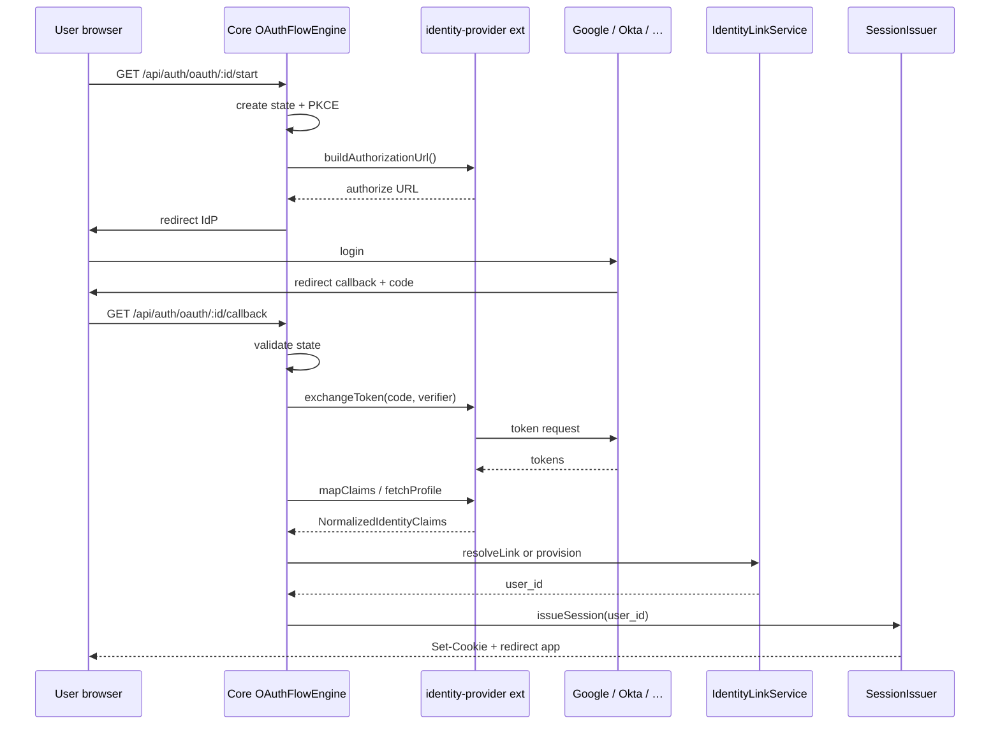

# Identity Engine & Provider Extensions

Authentication **flow** stays in Core. External IdPs are **typed System Extensions** (`type: identity-provider`).

```text
Core Identity Engine
        ↓
Typed Identity Provider Extensions
        ↓
Operator config (settings.json · admin UI)
```

---

## Responsibility split

| Layer | Owns | Does not own |
|-------|------|----------------|
| **Core Identity Engine** | How auth works | IdP-specific URLs, scopes, claim quirks |
| **identity-provider extension** | Which service to talk to | Sessions, DB writes, CSRF/PKCE, provisioning policy |

**Rule:** Core knows **how** authentication works. The provider knows **which service** to call.

---

## Core Identity Engine (stays in Core)

These components **must not** move into the plugin layer:

| Component | Responsibility |
|-----------|----------------|
| `OAuthFlowEngine` | Authorization redirect · callback orchestration |
| `TokenExchangeEngine` | Code → token exchange (delegates HTTP details to provider) |
| `ProviderRegistry` | Resolve enabled `identity-provider` extensions at boot |
| `IdentityLinkService` | Link `(provider_id, subject)` ↔ `base_users` · merge policy |
| `AccountProvisioner` | autoProvision · username/email · role assignment |
| `SessionIssuer` | Issue JWT/cookies via existing `loginSession.service` |
| State / CSRF store | OAuth `state` · PKCE verifier TTL |
| Callback validation | State match · redirect URI allowlist · error mapping |

Planned code layout (incremental — not a rewrite):

```text
src/core/identity/
  ProviderRegistry.ts
  OAuthFlowEngine.ts
  TokenExchangeEngine.ts
  IdentityLinkService.ts
  AccountProvisioner.ts
  stateStore.ts
src/server/services/auth/
  loginSession.service.ts      # existing — SessionIssuer delegates here
  authSettings.service.ts      # operator config
```

Existing M0 paths (`POST /api/auth/login`, register, OTP, sessions) are **unchanged**.

---

## Identity Provider Extension contract

```ts
type IdentityProviderExtension = {
  type: 'identity-provider';
  providerKind: 'oauth' | 'saml';
  id: string;              // e.g. google-oauth · github-oauth · saml-okta
  label: string;
  enabled: boolean;
  trusted: true;           // always true for this type
  signed: true;            // builtin or platform-signed artifact
  capabilities: Array<
    'auth.read' | 'auth.callback' | 'profile.map' | 'claims.map'
  >;
};
```

### Provider adapter surface (extension implements)

OAuth / OIDC providers supply:

- authorization URL builder (scopes, query params, PKCE challenge injection point)
- token endpoint URL + exchange payload shape
- userinfo / profile fetch (or ID token claim parse)
- profile mapping → `NormalizedIdentityClaims`
- claims mapping · provider-specific quirks (e.g. GitHub email scope)

SAML providers supply:

- IdP login redirect URL / AuthnRequest builder
- assertion validation inputs (cert, issuer, audience)
- attribute mapping → `NormalizedIdentityClaims`

### Core calls provider; provider never calls Core internals



---

## Builtin providers (v1 / v1.1 / P4b)

| extension id | providerKind | protocol | Plan |
|--------------|--------------|----------|------|
| `google-oauth` | oauth | OAuth 2 / OIDC | p-21 v1 ✅ |
| `github-oauth` | oauth | OAuth 2 | p-21 v1 ✅ |
| `microsoft-oauth` | oauth | OIDC | p-55 v1.1 ✅ |
| `oidc-generic` | oauth | OIDC | p-55 v1.1 ✅ |
| `apple-oauth` | oauth | OIDC | future extension slot |
| `saml-okta` · `saml-azure-ad` · `saml-google-workspace` · `saml-custom` | saml | SAML 2.0 | p-23 |

All register as `type: identity-provider'` — same registry, different `providerKind` adapter branch.

---

## Operator config (backward compatible)

Admin surface remains `settings.json` → `auth.identityProviders[]` (see `identityProviders.ts`).

| Settings field | Maps to |
|----------------|---------|
| `id` | extension id + `provider_id` in `base_user_identities` |
| `kind` | builtin extension id (`google-oauth`, …) |
| `clientId` / `clientSecret` / `redirectUri` | operator credentials for OAuth extensions |
| `issuerUrl` | OIDC discovery for generic / Microsoft |
| `entryPoint` / `certificate` | SAML extension config (p-23) |
| `enabled` · `autoProvision` · `defaultRoleId` | Core engine policy (not extension) |

Settings CRUD + redact + Test Connection: unchanged admin UX; implementation reads config then resolves extension adapter from `ProviderRegistry`.

---

## Separation from other OAuth flows

| Flow | Extension type | Notes |
|------|------------------|-------|
| App login (this doc) | `identity-provider` | Issues app session |
| Git GitHub OAuth | `integration` (not identity-provider) | Persists git credentials only · [`gitGithubOAuth.service.ts`](../../src/server/services/git/gitGithubOAuth.service.ts) |

Do not share client credentials or redirect URIs between the two.

---

## Security invariants (Core only)

- PKCE + state for all OAuth extensions (v1)
- Merge only when IdP asserts `email_verified`
- `autoProvision` / role assignment enforced in `AccountProvisioner`
- Audit: external login · link denied · provision — Core `sessionAudit.service`
- Extensions: capability allowlist only — no `db.write` · `filesystem.full` · `runtime.override`

---

## Implementation phases (incremental)

### Phase 1 — p-21 (no auth rewrite)

1. Introduce `ProviderRegistry` + engine modules wrapping existing session/link patterns.
2. Ship Google + GitHub as **in-tree** signed `identity-provider` extensions.
3. Keep routes: `GET /api/auth/oauth/:providerId/start|callback`.
4. Keep `auth.identityProviders[]` contract and validators.
5. `npm run test:auth-e2e` green · add `test:auth-oauth`.

### Phase 2 — p-21 v1.1 / p-55 ✅

- Microsoft + OIDC generic extensions registered in `ProviderRegistry`.
- Operator runbook: [`docs/guides/identity-providers-runbook.md`](../guides/identity-providers-runbook.md).

### Phase 3 — p-23

- SAML `providerKind` branch in engine + SAML extensions (Okta, Azure AD, custom).
- Routes: `GET /api/auth/saml/:id/login`, `POST .../acs`, `GET .../metadata`.

### Additional OAuth vendors (in-tree)

- New IdP adapters ship as **in-tree** `identity-provider` System Extensions under `src/core/system-extensions/identity-providers/` — not ZIP packs or marketplace Packages.
- Examples: `microsoft-oauth` · `oidc-generic` · Apple OAuth and other vendors as needed.

---

## Exit criteria (architecture)

- [x] No login/session logic in extension packages — only adapter methods
- [x] `ProviderRegistry` loads before auth routes accept traffic (`initIdentityProviderRuntime` in `bootstrapFullRuntime`)
- [x] Builtin providers: `trusted: true` · `signed: true`
- [x] Marketplace plugins cannot register `identity-provider` type
- [x] Settings + `IdentityProviderKind` remain valid without operator migration

---

## References

- [System Extensions](./system-extensions.md)
- Identity OAuth / providers — shipped (this document)
- [p-23 Enterprise SAML](../../plans/core/next/p-23-enterprise-saml.md)
- Contracts: `src/shared/api/contracts/systemExtensions/types.ts` · `src/shared/api/contracts/auth/identityProviders.ts`
