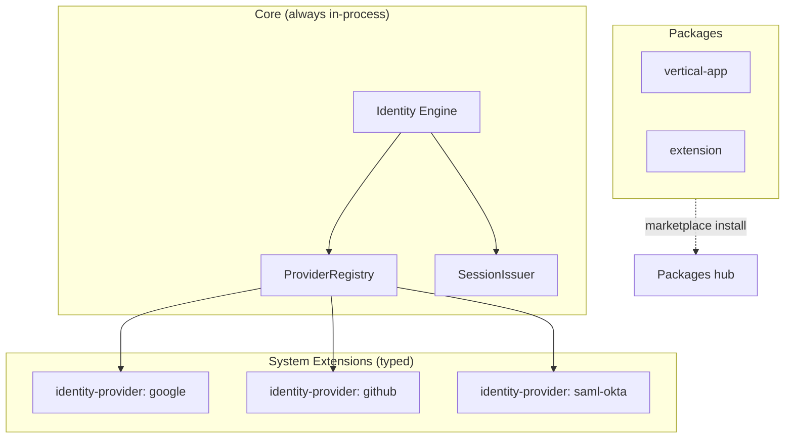

# System Extensions

AppEndO packages platform capabilities in two families: **Packages** (marketplace-driven, user-installed) and **System Extensions** (boot-critical, trusted, typed).

---

## Taxonomy

```ts
type SystemExtensionType =
  | 'feature'
  | 'integration'
  | 'identity-provider'
  | 'culture-pack'
  | 'storage-adapter'
  | 'deployment-adapter';
```

| type | Role | Examples (current / planned) |
|------|------|------------------------------|
| `feature` | Optional core-adjacent capability toggles | Future feature flags delivered as signed packs |
| `integration` | Outbound service connectors (non-login) | Git remote auth helpers · API connectors |
| `identity-provider` | Login IdP adapters (OAuth / SAML) | Google · GitHub · Microsoft · Apple · Okta · Azure AD |
| `culture-pack` | Language · calendar · direction bundles | See [`p-28`](../../plans/core/todo/p-28-platform-culture.md) |
| `storage-adapter` | Pluggable blob/cache backends | Future object-store drivers |
| `deployment-adapter` | Install / update orchestration hooks | Future platform-update hooks ([`p-43`](../../plans/core/next/p-43-platform-updates.md)) |

Contracts: `src/shared/api/contracts/systemExtensions/types.ts`

---

## Packages vs System Extensions

### Packages

| Property | Value |
|----------|--------|
| Install | User/admin via Packages hub · ZIP upload |
| Discovery | Marketplace-driven ([`p-42`](../../plans/core/next/p-42-marketplace.md)) |
| Lifecycle | install · enable · disable · uninstall |
| Trust | Integrity hash on ZIP · sandboxed API/UI runtime |
| Storage | `packages-storage/` |
| Contract | [artifacts.md](./artifacts.md) · [data-model.md](../standards/data-model.md) |

Typical kinds: `extension` · `vertical-app`.

### System Extensions

| Property | Value |
|----------|--------|
| Load | **Before login bootstrap** — server start |
| Trust | **trusted** · **signed** · system-level only |
| Discovery | Built-in registry + optional operator-enabled entries |
| Lifecycle | enable/disable in Settings — **not** marketplace install/uninstall |
| Storage | In-tree builtins (`src/core/system-extensions/`) · future `runtime/system-extensions/` |
| Contract | Per-type adapter interface (see [identity-engine.md](./identity-engine.md)) |

**Rule:** System Extensions must **not** behave like Packages (no Packages hub upload flow, no arbitrary slot/API surface).

---

## Capability boundaries

Extensions declare **allowed** capabilities. The host rejects anything outside the grant.

### Allowed (identity-provider example)

```ts
'auth.read'        // read operator config + public OIDC metadata
'auth.callback'    // participate in OAuth/SAML callback handling via Core orchestration
'profile.map'      // map IdP profile / userinfo to normalized claims
'claims.map'       // map assertion / token claims to AppEndO identity shape
```

### Forbidden (all System Extensions unless explicitly granted later)

```ts
'db.write'           // direct database mutation
'filesystem.full'    // unrestricted filesystem
'runtime.override'   // replace Core engines or middleware
```

Identity providers **never** issue sessions, write users, or manage CSRF/PKCE — Core owns the flow.

---

## Bootstrap sequence

```text
Server boot
  → load SystemExtensionRegistry (typed, signed builtins)
  → merge operator config from settings.json
  → register enabled extensions per type
  → Identity Engine: ProviderRegistry ready before /login routes serve traffic
  → Packages: load after auth stack (existing package runtime)
```



---

## Incremental adoption

| Phase | What ships |
|-------|------------|
| **Now (prep)** | Types + docs + existing `auth.identityProviders[]` contract |
| **p-21** | Identity Engine in Core · Google/GitHub as in-tree `identity-provider` extensions |
| **p-21 v1.1** | `microsoft-oauth` · `oidc-generic` in-tree |
| **p-23** | SAML providers as same extension type (in-tree) |
| **Later** | `culture-pack` · other System Extension ZIP types (same growth model) |

Backward compatibility: `IdentityProviderKind` values in settings (`google-oauth`, `github-oauth`, …) map 1:1 to builtin extension ids during migration. Admin APIs and Settings UI keep the same shape.

---

## References

- [Identity Engine](./identity-engine.md)
- [Package contract (Packages only)](../packages/p-37 package contract section)
- Architecture lock (shipped) — addendum: System Extensions
