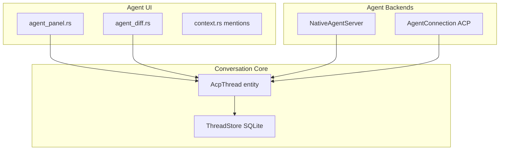

# درس‌های Zed برای AppEndO — Agent · ACP · Tools · Context

> **Benchmark کلی:** [`vibe-coding-benchmarks.md`](./vibe-coding-benchmarks.md)  
> **Mapping فنی:** [`specs/vibe-coding/02-zed-acp-mapping.md`](../../specs/vibe-coding/02-zed-acp-mapping.md)

---

## Zed چیست؟

[Zed](https://github.com/zed-industries/zed) یک code editor با performance بالا (Rust + **GPUI**) از سازندگان **Atom** و **Tree-sitter** است. بخش agent آن از 2025 به بعد حول **Agent Client Protocol (ACP)** و یک thread واحد (`AcpThread`) ساخته شده — native agent و external agent (Gemini CLI، Claude Code، Codex، …) **همان مسیر UI** را طی می‌کنند.

AppEndO IDE نیست؛ ولی **الگوهای harness، context، review و protocol** برای پلتفرم admin داخلی قابل استفاده‌اند.

**تفاوت بنیادی اجرا:** Zed برای verify و run به `TerminalTool` / build محلی تکیه می‌کند؛ AppEndO کد تولیدشده را **در همان runtime زنده** (Server Functions + Component Designer) expose می‌کند — بدون انجین اجرای جدا. جزئیات: [`vibe-coding-benchmarks.md`](./vibe-coding-benchmarks.md) § Unified live runtime.

---

## معماری لایه‌ای agent در Zed

### اجزای کلیدی (crates)

| Crate | نقش |
|-------|-----|
| `crates/agent` | `NativeAgent`، sessions، built-in tools |
| `crates/acp_thread` | `AcpThread` — wrapper protocol + message log |
| `crates/agent_ui` | Agent Panel، diff review، context |
| `crates/agent_servers` | کشف و اتصال agentهای ACP |
| `crates/language` | Tree-sitter — parse و symbol awareness |

---

## Agent Client Protocol (ACP)

- **استاندارد باز** (Apache) برای اتصال هر agent به هر editor host.
- **JSON-RPC** بین host (Zed) و agent process (مثلاً Gemini CLI).
- Zed نقش **host** را دارد: multi-file edit، syntax highlight، tool permission، diff review.

### ACP vs MCP در AppEndO

| | ACP (Zed) | MCP (AppEndO) |
|---|-----------|---------------|
| **محور** | horizontal — agent ↔ editor host | vertical — agent ↔ tools/data |
| **واحد** | conversation thread + edits | tool call + result |
| **معادل AppEndO** | — | built-in packs + external MCP |
| **host بیرونی** | Zed برای Claude/Gemini | **Inbound MCP** `GET/POST/DELETE /api/mcp` |

**نتیجه:** Inbound MCP Host AppEndO از نظر «بیرون آوردن agent به host» شبیه spirit ACP است؛ نیازی به پیاده‌سازی ACP کامل در v1 نیست.

مرجع: [zed.dev/acp](https://zed.dev/acp)

---

## AcpThread — یک thread برای همه

Zed native agent و external ACP agent هر دو به **`AcpThread`** می‌رسند:

- وضعیت: `Idle` · `Pending` · `Streaming` · `Error`
- پیام: `UserMessage` · `AssistantMessage` · tool metadata
- persistence: `ThreadStore` → SQLite

**معادل AppEndO:**

| Zed | AppEndO |
|-----|---------|
| `AcpThread` | chat session + SSE `/api/ai/agent/run` |
| `ThreadMetadataStore` | session title · capability scope |
| `ThreadStore` / `DbThread` | `base_ai_chat_sessions` + traces |

---

## Tool system در Zed

Built-in tools (native agent):

| Zed tool | کار | pack / tool AppEndO |
|----------|-----|---------------------|
| `ReadFileTool` | خواندن buffer/file | `read_file` (`appendo-files`) |
| `GrepTool` | جستجوی متن | `search_codebase` (`appendo-codebase`) |
| `EditFileTool` | ویرایش ساختاریافته | `draft_file_patch` (proposal) |
| `TerminalTool` | shell | **VC-4** `run_tests` (allowlist) |
| `WebSearchTool` | جستجوی وب | `web_search` (`appendo-web`) |
| `fetch` / screenshot | خواندن و دیدن صفحه | `fetch_url` · `screenshot_url` (`appendo-web`) |
| `SpawnAgentTool` | subagent | **VC-7 backlog** |

**Tool permissions:** `ToolPermissionDecision` + settings UI — مشابه `mcpAccess` + `writeRequiresConfirm` در AppEndO.

---

## Mention system — context صریح

کاربر در Zed با `@` فایل، selection یا symbol را به prompt attach می‌کند (`MentionUri`).

**AppEndO امروز:** `AiPageContext` از route/workspace (layoutId، functionName، settings section).

**پیشنهاد p-50 (spec، بدون کد در فاز doc):**

- `@layoutId` / `@functionId` در AiPanel attachments
- enrich `pageContext` وقتی user در Server Functions یا Designer است
- shard workflow: [`vibe-coding-workflows.md`](../standards/vibe-coding-workflows.md)

---

## Multi-buffer diff review (`agent_diff`)

Zed تغییرات agent را در **چند buffer** با syntax highlighting و LSP نشان می‌دهد — review قبل از accept.

**AppEndO امروز:** `VibeProposal` card + changeSet list در `AiPanel`.

**هدف VC-5:** preview چند changeSet (layout + file + server function) در یک surface واحد.

---

## Tree-sitter و indexing

Zed Tree-sitter را در core دارد — chunk boundaries برای context و navigation.

**AppEndO p-50 VC-3:** hybrid index (ripgrep اول؛ semantic fallback؛ optional AST chunk) — **الهام** از Zed، نه fork editor.

---

## Skills و AGENTS.md در repo Zed

Zed repo شامل `.agents/skills` و `AGENTS.md` است — parallel با:

- [`docs/standards/`](../standards/INDEX.md) shards
- [`AGENTS.md`](../../AGENTS.md) hub
- `get_project_standards` tool

---

## Subagents

`SpawnAgentTool` با `MAX_SUBAGENT_DEPTH` — agent فرزند با context جدا.

**AppEndO:** فعلاً single orchestrator؛ subagent در VC-7 backlog (refactor بزرگ).

---

## چه چیزهایی عمداً نمی‌گیریم

| قابلیت Zed | دلیل |
|------------|------|
| GPUI / Rust UI | AppEndO web admin (React) |
| Multiplayer channels | محصول admin نه collab IDE |
| ACP registry / BYO public agents | internal-only |
| Cloud Zed agent hosting | self-hosted instance |

---

## اقدام‌های پیشنهادی برای AppEndO (مرتبط با p-50)

| اولویت | اقدام | فاز |
|--------|-------|-----|
| 1 | مستند ACP↔MCP mapping | doc (این سند + spec 02) |
| 2 | pageContext غنی (Server Functions) | VC-1 |
| 3 | VibeHarness gates | VC-2 |
| 4 | hybrid search | VC-3 |
| 5 | multi-changeSet review UI | VC-5 |
| 6 | mentions در AiPanel | VC-2.5 / VC-5 |

---

## مراجع

- [github.com/zed-industries/zed](https://github.com/zed-industries/zed)
- [Bring Your Own Agent to Zed](https://zed.dev/blog/bring-your-own-agent-to-zed)
- [Agent Client Protocol](https://zed.dev/acp)
- DeepWiki: AI Agent System (crates `agent`, `acp_thread`, `agent_ui`)
