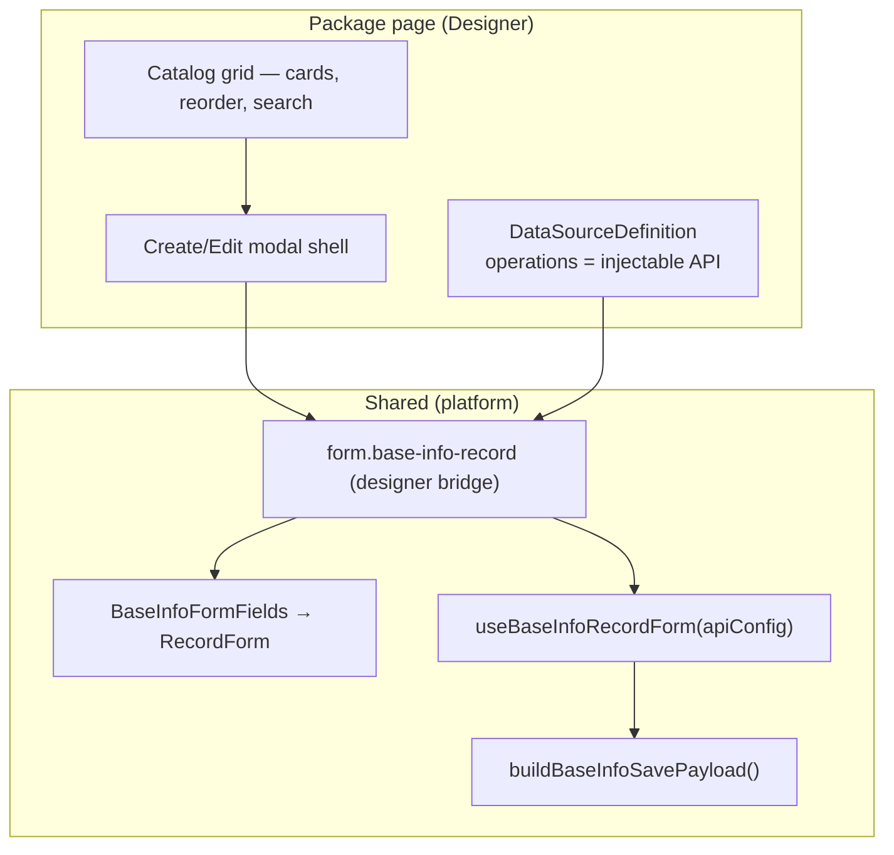

# Package Base Info vocabulary UI

> **Shard:** `package-base-info-vocab` · **Package UI:** [`package-ui.md`](./package-ui.md)

Studio packages store domain LOVs in the Base Info tree. Operators manage those categories from package settings as small catalogs.

**Do not build a second create/edit form for Base Info items.** Reuse the shared Studio form and inject API operations.

## Rule (hard)

| Do | Don't |
|----|-------|
| Reuse the shared Base Info record form (`BaseInfoFormFields` → `RecordForm` / designer bridge `form.base-info-record`) | Copy `BaseInfoFormModal` field layout into designer scaffold nodes (`mountVocabBaseInfoFormBody`-style duplicates) |
| Inject CRUD endpoints via `DataSourceDefinition.operations` on the package vocab data source | Hardcode `/api/base-info` inside package React features |
| Keep list/catalog UI in the package designer page (cards, reorder, filters) | Rebuild tree navigation for flat vocab categories |
| Use `mapBaseInfoListRowToFormRecord` for list row → edit hydration | Hand-map snake_case columns per package |

Applies to every **manageable Base Info category** page under a package settings shell — CMS today; CRM/Commerce/HR vocab pages tomorrow.

## Architecture



### Layers

1. **Form UI (React, single source of truth)**  
   - `src/shared/ui/BaseInfoFormFields.tsx` — `RecordForm` (Base Components Edit / View) with Active on the Flags rail  
   - `src/features/base-info/lib/buildBaseInfoSavePayload.ts` — camelCase API body  
   - `src/shared/lib/baseInfoFormRowMap.ts` — list/detail row → form record  

2. **Modal logic (injectable API)**  
   - `useBaseInfoRecordForm({ api, fixedParentId?, parentLabel? })` — create/edit state without the full tree page  
   - `BaseInfoRecordApiConfig` — list/detail/create/update/delete/move endpoint templates  

3. **Designer bridge (package pages)**  
   - Palette item `form.base-info-record`  
   - Props: `dataSourceRef`, `fixedParentId`, `parentLabel`  
   - Reads `bindingDefinitions.dataSources[dataSourceRef].operations` at runtime  
   - One node replaces an entire hand-built modal body  

4. **Package scaffold (per package)**  
   - Builder function (CMS reference: `buildCmsVocabularyPage` in `scripts/cms-phase3/cmsDesignerScaffold.ts`)  
   - `buildVocabDataSource(title, categoryId, editable)` — returns `DataSourceDefinition` with scoped list + CRUD ops  
   - Modals: empty auto-form shell + **only** `form.base-info-record` in the body  

Studio **Base Info** tree page (`pageKey: base-info`) keeps `useBaseInfoPage` + tree grid + DnD. Package vocab pages use the **flat catalog + shared record form** shape only.

## API injection contract

Packages pass API through `DataSourceDefinition`, not through feature-local fetch helpers.

```ts
// Example — CMS vocabulary (category-scoped Base Info children)
{
  id: 'vocabItems',
  endpoint: '/api/base-info',
  primaryKey: 'id',
  kind: 'collection',
  operations: {
    list:   { method: 'GET',  endpoint: '/api/base-info/children?parentId={categoryId}&includeInactive=true' },
    detail: { method: 'GET',  endpoint: '/api/base-info/:id' },
    create: { method: 'POST', endpoint: '/api/base-info' },
    update: { method: 'PUT',  endpoint: '/api/base-info/:id' },
    delete: { method: 'DELETE', endpoint: '/api/base-info/:id' },
    custom: {
      move: { method: 'POST', endpoint: '/api/base-info/:id/move', label: 'Reorder sibling' },
    },
  },
  responseMapping: { arrayPath: 'items', totalPath: 'count', dataPath: 'items' },
}
```

**Asymmetry (documented):** list/children responses use **snake_case** column keys for grids; detail + create/update bodies use **camelCase** form fields. Grid columns stay snake_case; the shared form bridge stays camelCase.

A future package may point at a different base path (e.g. `/api/crm/lookups`) as long as the payload shape stays Base Info–compatible or the package documents an adapter.

### Vocab-scoped create defaults

| Field | Package vocab behavior |
|-------|-------------------------|
| `parentId` | Fixed to the category node id (`fixedParentId`); hidden on create |
| `parent` display | Read-only category title (`parentLabel`) |
| `childDigits` | Create-only; default `3` (same as Studio Base Info) |
| `shortName` | Not shown in UI; preserve on edit via row hydration (same as Studio) |

## Package settings page shape

Every manageable Base Info category in a package gets a **vocabulary page**:

| Concern | Standard |
|---------|----------|
| Navigation | Under package settings left rail — not a top-level Studio nav item |
| List | Catalog cards (`presentation="cards"`, `cardVariant="catalog"`), concept color from `ui_color`, title + hover actions |
| Reorder | Card reorder → `POST …/move` when editable |
| Create/Edit | Shared `form.base-info-record` inside `5xl` modal shell |
| Delete | Standard confirm dialog on data source delete operation |
| Page size | Small catalogs — no paging footer; `pageSize: 1000` acceptable |

CMS reference pages: Content Tags, Content Types, Statuses, Languages (`buildCmsVocabularyPage`).

## Package plan requirements

When drafting `plans/packages/todo/p-packages-<slug>.md` (appendo-build-new-package-plan skill):

1. In **§6 Base Info**, list every category that needs an operator-managed vocab page.
2. In **§10 UX admin**, for each such category state explicitly: **catalog cards + shared Base Info record form (API via data source)** — not a custom modal form.
3. In **Phase 3**, name the scaffold builder (`build<Package>VocabularyPage` or shared helper) and the data source id (`vocabItems` / per-category id).
4. In **platform alignment**, include: *no duplicate Base Info edit forms; inject API through `DataSourceDefinition`*.

## Implementation checklist (Phase 3)

- [ ] `buildVocabDataSource` (or package equivalent) with injectable `operations`
- [ ] Designer page: settings shell + catalog grid + CRUD overlays
- [ ] Create/edit modal body: **one** `form.base-info-record` node — no hand-built field nodes
- [ ] Contract test: modal field labels match Studio Base Info form
- [ ] Save/restore test: create/update POST/PUT hits injected endpoints with expected payload
- [ ] Remove/replace any legacy `mountVocab*FormBody` duplicate scaffolds

## Related code (reference)

| Asset | Path |
|-------|------|
| Studio form modal | `src/features/base-info/components/BaseInfoFormModal.tsx` |
| Studio page hook | `src/features/base-info/hooks/useBaseInfoPage.tsx` |
| Base Info API queries | `src/shared/api/queries/base-info.ts` |
| Row → form mapping | `src/shared/lib/baseInfoFormRowMap.ts` |
| CMS vocab scaffold | `scripts/cms-phase3/cmsDesignerScaffold.ts` → `buildCmsVocabularyPage`, `buildVocabDataSource` |
| CMS contract tests | `src/domain/component-designer/__tests__/cmsDesignerScaffoldContracts.test.ts` |

## Greenfield

When adopting this pattern in an existing package page that still duplicates the form, **delete the duplicate scaffold fields** and replace with the bridge in the same change — no dual-form fallback, no feature flag between old and new modal bodies.

## Related

Full package list/editor/Phase 3 gate (including when a category is a closed enum with **no** vocab page): [`package-ui.md`](./package-ui.md).

**IDs:** `package.base-info-vocab.shared-form`.
