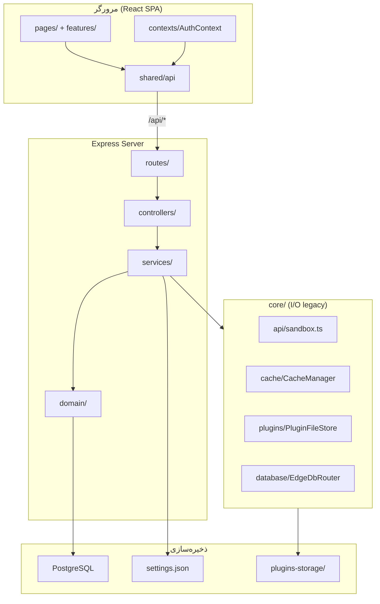
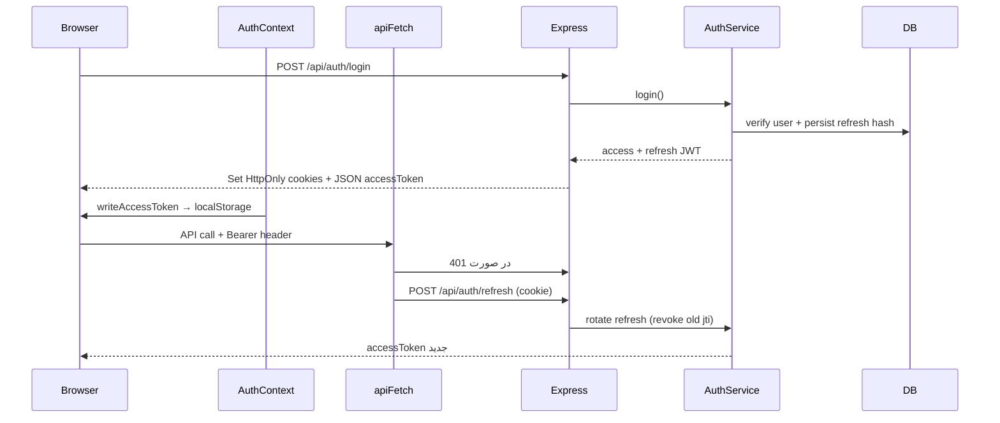
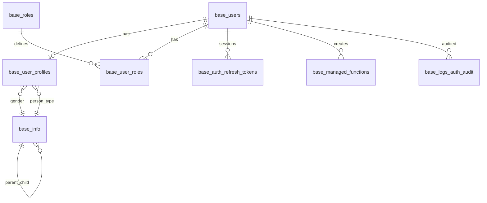

# هاب مستندات AppEndO

**هدف این فایل:** نقطه ورود سریع به مستندات جداشدهٔ معماری و فیچرلیست MVP.  
**زبان فعلی:** فارسی، تا وقتی تیم بخواهد روایت مستندات را فارسی نگه دارد.

## اسناد اصلی

- [معماری محصول](docs/appendo-architecture.md)
- [فیچرلیست MVP](docs/appendo-features.md)
- [معماری سطح کد](src/ARCHITECTURE.md)
- [نقشهٔ مستندات `docs/`](docs/README.md)

## چرا این تقسیم انجام شد؟

- معماری، قراردادهای runtime و deployment باید از لیست قابلیت‌ها جدا باشد.
- فیچرلیست باید از خود MVP و ساختار فعلی کد استخراج شود، نه از روایت معماری.
- این فایل از اینجا به بعد بیشتر نقش index / landing page را دارد.

---

## نسخهٔ قبلی

بخش‌های قدیمی‌تر این فایل هنوز پایین‌تر حفظ شده‌اند تا اگر لازم شد به جزئیات تاریخی یا یادداشت‌های زمینه‌ای برگردیم.

**تاریخ به‌روزرسانی:** ۲۰ خرداد ۱۴۰۵ (۱۰ ژوئن ۲۰۲۶)  
**دامنه:** کل مخزن `AppEndO` — فرانت‌اند React + Vite، بک‌اند Express/Node.js، PostgreSQL  
**منابع:** بررسی مستقیم کد منبع، `src/ARCHITECTURE.md`، `docs/security/rbac-matrix.md`، `AGENTS.md`

---

## فهرست مطالب

1. [AppEndO چیست؟](#۱-appendo-چیست)
2. [پشته فناوری](#۲-پشته-فناوری)
3. [معماری کلی](#۳-معماری-کلی)
4. [ساختار پوشه‌ها و لایه‌ها](#۴-ساختار-پوشه‌ها-و-لایه‌ها)
5. [جریان درخواست: فرانت → بک → دیتابیس](#۵-جریان-درخواست-فرانت--بک--دیتابیس)
6. [صفحات فرانت‌اند و تجربه کاربر](#۶-صفحات-فرانت‌اند-و-تجربه-کاربر)
7. [فیچرها و قابلیت‌ها — شرح تفصیلی](#۷-فیچرها-و-قابلیت‌ها--شرح-تفصیلی)
8. [دیتابیس و ذخیره‌سازی](#۸-دیتابیس-و-ذخیره‌سازی)
9. [API و احراز هویت / مجوزدهی](#۹-api-و-احراز-هویت--مجوزدهی)
10. [شرح فایل‌ها و ماژول‌های کلیدی — مرجع کامل](#۱۰-شرح-فایل‌ها-و-ماژول‌های-کلیدی--مرجع-کامل)
11. [پیکربندی و اجرا](#۱۱-پیکربندی-و-اجرا)
12. [تحلیل معماری و کیفیت](#۱۲-تحلیل-معماری-و-کیفیت)
13. [تحلیل امنیت](#۱۳-تحلیل-امنیت)
14. [بدهی فنی و اولویت‌های بهبود](#۱۴-بدهی-فنی-و-اولویت‌های-بهبود)

---

## ۱. AppEndO چیست؟

**AppEndO** یک **پلتفرم مدیریت سازمانی (Enterprise Admin Platform)** است که به تیم‌های توسعه و عملیات اجازه می‌دهد:

- کاربران، نقش‌ها و دیکشنری‌های پایه را مدیریت کنند
- **Server Function** (کد سمت سرور پویا) بنویسند و در sandbox اجرا کنند
- **پلاگین** نصب/حذف کنند و اکوسیستم را گسترش دهند
- **کامپوننت UI** را به‌صورت بصری طراحی کنند
- منابع داده چندگانه (PostgreSQL، MySQL، MSSQL، MongoDB، Redis، Oracle، SQLite) را پیکربندی کنند
- کش، لاگ و تنظیمات پلتفرم را کنترل کنند
- با **Gemini AI** چت کنند (فقط ADMIN)

### نکته معماری مهم

این پروژه **Next.js نیست**. معماری واقعی:

| لایه | فناوری |
|------|--------|
| کلاینت | SPA تک‌صفحه‌ای (CSR) با React 19 + React Router v7 |
| سرور | Express 4 یکپارچه با کلاینت |
| توسعه | Vite middleware داخل Express (HMR) |
| Production | فایل‌های static از `dist/` + API روی همان پورت |

### وضعیت پروژه

پروژه در **مسیر refactor معماری** است: الگوی **Feature-Sliced Design (FSD)** در کلاینت و **Domain + Services** در سرور. بخشی از زیرساخت قدیمی در `src/core/` باقی مانده؛ orchestration جدید در `src/server/services/` قرار دارد.

---

## ۲. پشته فناوری

### فرانت‌اند

| فناوری | نقش |
|--------|-----|
| React 19 | UI |
| React Router v7 | مسیریابی |
| Vite 6 | Build و dev server |
| TypeScript 5.8 | Type safety |
| TanStack React Query v5 | Server state |
| Tailwind CSS v4 | استایل |
| HeroUI v3 | کامپوننت‌های UI |
| Monaco Editor | ویرایشگر کد Server Functions |
| dnd-kit | Drag-and-drop (Designer، Base Info) |
| Motion | انیمیشن |
| Recharts | نمودار (آماده برای Dashboard) |
| Lucide React | آیکون |

### بک‌اند

| فناوری | نقش |
|--------|-----|
| Node.js + Express 4 | HTTP API |
| tsx | اجرای dev |
| esbuild | Bundle سرور → `dist/server.cjs` |
| jsonwebtoken | JWT access/refresh |
| bcryptjs | Hash رمز عبور |
| cookie-parser | کوکی HttpOnly |
| multer | آپلود ZIP پلاگین |
| pino | لاگ ساخت‌یافته |
| zod | اعتبارسنجی env/settings |

### دیتابیس و داده

| فناوری | نقش |
|--------|-----|
| **PostgreSQL** (`pg`) | دیتابیس اصلی control plane |
| mysql2, mssql, mongodb, oracledb, better-sqlite3, redis | اتصال‌های خارجی via `EdgeDbRouter` |
| `settings.json` | تنظیمات runtime، data sources، logging |
| `plugins-storage/` | فایل‌های پلاگین و draftهای Designer |

### تست

Vitest + Testing Library + jsdom — تست‌ها در `__tests__/` کنار ماژول‌ها

---

## ۳. معماری کلی

### ۳.۱ فلسفه لایه‌بندی

| لایه | مسئولیت | نباید |
|------|---------|-------|
| **Features** (`src/features/`) | UI صفحه، hooks، modal، grid | DB بخواند، فایل I/O، business rule خام |
| **Shared** (`src/shared/`) | API client، query hooks، UI primitives | workflow اختصاصی feature |
| **Server Domain** (`src/server/domain/`) | Types، validation، repository، الگوریتم خالص | HTTP، lock، workflow چندمرحله‌ای |
| **Server Services** (`src/server/services/`) | Orchestration، wiring | God module چند concern |
| **Core** (`src/core/`) | زیرساخت legacy (sandbox، cache، plugin I/O) | orchestration جدید |

### ۳.۲ جهت وابستگی



**قانون طلایی:** `Features → Shared API → Routes/Controllers → Services → Domain`  
Domain **هرگز** از Services یا Features import نمی‌کند.

### ۳.۳ جریان بوت سرور

```
server.ts → src/server/index.ts → bootstrap.ts
  ├── اتصال PostgreSQL + initDB()
  ├── initControlPlanePool()
  ├── ensureDataSourcesSettings / ensurePluginsSettings
  ├── ensurePluginStorageDirs()
  ├── applyBaseMiddleware (cookie, json, logging)
  ├── mountAuthRoutes (قبل از global auth)
  ├── app.use('/api', requireAuth) — با استثناها
  ├── mount سایر routeها
  ├── applyErrorMiddleware
  └── Dev: Vite middleware | Prod: express.static(dist)
```

### ۳.۴ Guard دو لایه (Frontend vs Backend)

| لایه | نقش | امنیت واقعی |
|------|-----|-------------|
| **Frontend** | `ProtectedRoute` + `RequireRoleLayout` — UX و مخفی‌سازی منو | ❌ قابل دور زدن |
| **Backend** | `requireAuth` + `requireRole('ADMIN')` | ✅ enforce واقعی |

**تحلیل:** الگوی defense-in-depth صحیح است؛ frontend فقط راحتی کاربر است. مثلاً `base-info` برای همه کاربران لاگین‌شده در UI قابل دسترس است، اما write فقط ADMIN در API.

---

## ۴. ساختار پوشه‌ها و لایه‌ها

### ۴.۱ ریشه پروژه

```
AppEndO/
├── package.json          # وابستگی‌ها و اسکریپت‌ها
├── tsconfig.json         # TypeScript (@/* alias)
├── vite.config.ts        # Vite + Tailwind؛ HMR از settings.json
├── index.html            # ورود SPA
├── server.ts             # re-export → bootstrap
├── settings.json         # پیکربندی runtime (gitignored)
├── settings.example.json # قالب اولیه
├── public/               # assetهای static
├── scripts/              # db-init، seed، migration پلاگین
├── docs/                 # استانداردها، RBAC، plugin contract
├── plugins-storage/      # runtime: پلاگین‌ها + designer drafts
└── src/                  # کد اصلی
```

### ۴.۲ `src/` — نقشه کامل

```
src/
├── app/                  # Guards و lazy routes
│   ├── guards/
│   │   ├── RequireRole.tsx      # Layout guard نقش ADMIN
│   │   └── roleAccess.ts        # isAdminUser، فیلتر منو
│   └── routes/
│       ├── LazyRoute.tsx        # Suspense wrapper
│       └── lazyPages.tsx        # importهای lazy صفحات سنگین
│
├── features/             # ۱۱ feature slice (FSD)
│   ├── base-info/        # دیکشنری سلسله‌مراتبی
│   ├── cache/            # کنترل کش
│   ├── component-designer/ # طراح بصری UI
│   ├── data-sources/     # منابع داده
│   ├── server-functions/   # IDE و runner توابع
│   ├── logs/             # مشاهده و config لاگ
│   ├── plugins/          # مدیریت پلاگین
│   ├── roles/            # CRUD نقش
│   ├── settings/         # تنظیمات پلتفرم
│   └── users/            # CRUD کاربر
│
├── shared/
│   ├── api/
│   │   ├── client.ts            # apiRequest، ApiError
│   │   ├── authSession.ts       # apiFetch، refresh lock
│   │   ├── queryClient.ts       # TanStack Query
│   │   ├── queries/             # hooks per domain (۱۱ فایل)
│   │   └── contracts/           # DTO types
│   ├── ui/                      # QueryErrorPanel، Button، ...
│   └── theme/                   # پالت accent
│
├── pages/                # ورود نازک route (legacy جزئی)
├── domain/               # منطق خالص client (component-designer)
├── server/               # بک‌اند Express
│   ├── bootstrap.ts
│   ├── app.ts
│   ├── config/           # env.ts، settingsFile.ts
│   ├── constants/        # auth TTLs، cookie names
│   ├── controllers/      # ۱۳ controller
│   ├── routes/           # ۱۳ route module
│   ├── services/         # orchestration
│   ├── domain/           # repositories، algorithms
│   ├── db/               # controlPlane، dataSourcesStore
│   ├── middleware/       # auth، rateLimit، error
│   └── utils/
│
├── core/                 # زیرساخت legacy
│   ├── api/sandbox.ts           # اجرای Server Function (vm)
│   ├── cache/CacheManager.ts
│   ├── database/EdgeDbRouter.ts
│   ├── db/database.ts           # schema + seed
│   ├── plugins/                 # PluginFileStore، ...
│   ├── ai/                      # AiManager، GeminiProvider
│   ├── logging/                 # Logger، PinoRuntime
│   └── slots/SlotRegistry.ts
│
├── components/           # کامپوننت‌های global (AiPanel، ProfileDrawer)
├── contexts/             # AuthContext، AccentThemeContext
├── layouts/              # AdminLayout (shell اصلی)
├── config/               # menu.json، projectStandards.ts
├── hooks/                # useCurrentUserDisplay و ...
├── lib/                  # utils
└── types/                # auth.ts، dataSource.ts
```

### ۴.۳ الگوی استاندارد هر Feature

```
features/<name>/
├── components/     # View، TableGrid، Modal، Toolbar
├── hooks/
│   ├── use<Name>Page.tsx   # composition اصلی
│   └── ...
├── constants.ts
├── types.ts
└── utils.ts
```

**قرارداد نام‌گذاری (AGENTS.md):** `useXPage` + `XPageView` + `XTableGrid`

### ۴.۴ الگوی استاندارد سرور (مرجع: Plugins)

```
plugins.service.ts              → Facade HTTP
pluginLifecycle.service.ts      → Coordinator (install/uninstall)
pluginRegistry.service.ts       → manifest، conflict
pluginDependency.service.ts     → dependency graph
pluginInstallState.service.ts   → state machine
pluginScriptPolicy.service.ts   → allowlist اسکریپت DB
gateways.ts                     → adapter برای تست
server/domain/plugins/          → types، repositories، pure algorithms
```

---

## ۵. جریان درخواست: فرانت → بک → دیتابیس

### ۵.۱ نمونه: ورود کاربر



### ۵.۲ نمونه: لیست کاربران (ADMIN)

1. **فرانت:** `useUsersPage` → `useUsersQuery` از `shared/api/queries/users.ts`
2. **API:** `apiRequest('GET', '/api/users')` با Bearer token
3. **Middleware:** `requireAuth` → `requireRole('ADMIN')` در route
4. **Controller:** `users.controller.ts` → `users.service.ts`
5. **Service:** `userCrud.service.ts` + `userRoleRepository`
6. **DB:** `SELECT` از `base_users` + join نقش‌ها

### ۵.۳ نمونه: اجرای Server Function

1. **فرانت:** Monaco editor + `useServerFunctionRunner` → `POST /api/core/server-functions/execute`
2. **Backend:** `server-function.controller.ts` → `server-function.service.ts`
3. **Core:** `sandbox.ts` — compile با esbuild + اجرا در `node:vm`
4. **DB (اختیاری):** `EdgeDbRouter` برای query به data sources تعریف‌شده در `settings.json`
5. **Cache (اختیاری):** `CacheManager` اگر `cache_enabled` فعال باشد

---

## ۶. صفحات فرانت‌اند و تجربه کاربر

### ۶.۱ Shell اصلی (`AdminLayout`)

کاربر پس از login وارد layout مدیریتی می‌شود:

| بخش UI | عملکرد |
|--------|--------|
| **Sidebar** | منو از `menu.json`؛ آیتم‌های ADMIN برای کاربر عادی فیلتر می‌شوند |
| **Header** | جستجو، fullscreen، accent color، پروفایل |
| **AiPanel** | پنل چت AI (Gemini) — فقط ADMIN |
| **ProfileDrawer** | ویرایش پروفایل شخصی |
| **Slot** | نقطه تزریق UI از پلاگین‌ها (`SlotRegistry`) |
| **Outlet** | محتوای صفحه فعلی |

### ۶.۲ نقشه مسیرها

| مسیر | صفحه | دسترسی UI | Lazy |
|------|------|-----------|------|
| `/login` | Login | عمومی | — |
| `/` | Dashboard | احراز هویت | — |
| `/base-info` | Base Info | احراز هویت | — |
| `/edge` | Server Functions | ADMIN | ✅ |
| `/components` | Component Designer | ADMIN | ✅ |
| `/themes` | Themes | ADMIN | — |
| `/plugins` | Plugins | ADMIN | ✅ |
| `/settings` | Settings | ADMIN | — |
| `/sources` | Data Sources | ADMIN | ✅ |
| `/cache` | Cache Control | ADMIN | ✅ |
| `/logs` | Logs | ADMIN | ✅ |
| `/users` | Users | ADMIN | — |
| `/roles` | Roles | ADMIN | ✅ |

### ۶.۳ آنچه کاربر در هر صفحه می‌بیند

#### Dashboard (`/`)
- وضعیت minimal: پیام «No active widgets loaded»
- آماده برای ویجت‌های آینده از پلاگین‌ها
- **بک‌اند:** فعلاً API اختصاصی ندارد

#### Login (`/login`)
- فرم email/password
- پس از موفقیت → redirect به `/`
- **بک‌اند:** `POST /api/auth/login` — rate limit + bcrypt verify

#### Base Info (`/base-info`)
- درخت سلسله‌مراتبی دیکشنری (مثلاً جنسیت، نوع شخص)
- Drag-and-drop برای جابجایی
- CRUD با modalها (write فقط اگر ADMIN باشد در API)
- **بک‌اند:** `GET /api/base-info/tree` برای همه؛ `POST/PUT/DELETE` فقط ADMIN

#### Server Functions (`/edge`)
- Sidebar لیست توابع
- Monaco editor برای کد TypeScript/JavaScript
- پنل اجرا با test payload
- تنظیمات cache، timeout، memory
- **بک‌اند:** CRUD در `base_managed_functions`؛ اجرا via sandbox

#### Component Designer (`/components`)
- Canvas drag-and-drop
- Palette کامپوننت‌ها
- Inspector properties
- Preview runtime
- Sync code ↔ canvas
- **بک‌اند:** draftها در `plugins-storage/designer/`

#### Themes (`/themes`)
- مدیریت تم‌های بصری accent
- **بک‌اند:** عمدتاً client-side (`AccentThemeContext`)

#### Plugins (`/plugins`)
- لیست پلاگین‌ها با وضعیت install
- آپلود ZIP
- نصب / حذف / reinstall
- Dependency graph
- Plugin Builder (با feature flag)
- **بک‌اند:** `PluginFileStore` + lifecycle coordinator

#### Settings (`/settings`)
- بخش‌های تنظیمات: Edge VM، logging، runtime
- **بک‌اند:** read/write `settings.json`

#### Data Sources (`/sources`)
- جدول اتصالات DB
- تست اتصال (تک، draft، همه)
- **بک‌اند:** `settings.json` → `dataSources[]`

#### Cache Control (`/cache`)
- وضعیت L1 (memory) و L2 (Redis)
- لیست کلیدها، مشاهده، حذف، flush
- **بک‌اند:** `CacheManager`

#### Logs (`/logs`)
- جدول لاگ‌های `base_logs_app`
- فیلتر سطح و context
- config per-method logging
- **بک‌اند:** `logs.service.ts` + `settings.json`

#### Users (`/users`)
- جدول کاربران با paging
- ایجاد / ویرایش / حذف
- قفل / باز کردن حساب
- تخصیص نقش
- Login-as (ADMIN)
- **بک‌اند:** `users.service.ts` + repositories

#### Roles (`/roles`)
- CRUD نقش‌ها
- **بک‌اند:** `roleCrud.service.ts`

---

## ۷. فیچرها و قابلیت‌ها — شرح تفصیلی

این بخش برای هر فیچر توضیح می‌دهد: **چیست**، **در UI چه می‌کند**، **در بک‌اند چه اتفاقی می‌افتد**، **در DB چه می‌نویسد/می‌خواند**، و **چه چیزی جلویش را می‌گیرد**.

---

### ۷.۱ احراز هویت و نشست (Auth)

#### هدف فیچر
مدیریت ورود، خروج، تمدید نشست، و ردیابی رویدادهای امنیتی. پایه تمام دسترسی‌های بعدی است.

#### جریان Login (گام‌به‌گام)

1. کاربر در `/login` ایمیل و رمز را وارد می‌کند → `AuthContext.login()`
2. `POST /api/auth/login` → `login.service.ts`
3. **Rate limit:** کلید `ip+email` در Map in-memory — اگر ۵ شکست در ۱۵ دقیقه → `429 Too Many Failed`
4. **بررسی قفل:** اگر `base_users.locked = 1` → `403 Account is locked`
5. **bcrypt.compareSync** روی `password_hash`
6. در صورت شکست: `incrementLoginFailCount` در DB (برای کاربران غیر builtin) + audit `LOGIN_FAILED`
7. در صورت موفقیت: `clearLoginFailCount` + `issueSessionTokens` → access JWT (۱۵ دقیقه) + refresh JWT (۷ روز)
8. Refresh hash با SHA-256 در `base_auth_refresh_tokens` ذخیره می‌شود
9. کوکی HttpOnly set + accessToken در JSON body
10. `AuthContext` → `writeAccessToken` در localStorage + state کاربر

#### قابلیت‌های جزئی

| قابلیت | فرانت چه می‌کند | بک‌اند چه می‌کند | Guard / محدودیت |
|--------|----------------|-----------------|-----------------|
| **Login** | فرم + redirect به `/` | verify + issue tokens | rate limit IP/email؛ قفل حساب |
| **Refresh** | `apiFetch` خودکار روی 401 | rotate jti؛ revoke قبلی | cookie HttpOnly؛ refresh lock جلوگیری از storm |
| **Logout** | پاک state + redirect | revoke token + clear cookie | — |
| **Me** | bootstrap session | `GET /api/auth/me` | requireAuth |
| **Sessions** | — (فعلاً UI محدود) | list از `base_auth_refresh_tokens` | owner یا ADMIN با `?userId=` |
| **Revoke Session** | — | `DELETE /sessions/:jti` | non-admin فقط jti خودش |
| **Change Password** | ProfileDrawer | bcrypt hash جدید | owner فقط |
| **Login-as** | دکمه در جدول Users | issue token برای userId هدف | ADMIN only |
| **Delete Account** | — | حذف user + profile + tokens | owner |
| **Audit Logs** | — | `base_logs_auth_audit` | my-audit: owner؛ audit-logs: ADMIN |

#### رویدادهای Audit ثبت‌شده
`LOGIN_SUCCESS`، `LOGIN_FAILED`، `LOGIN_BLOCKED`، `LOGIN_RATE_LIMITED`، `LOGOUT`، `REFRESH_SUCCESS`، `REFRESH_FAILED`، `PASSWORD_CHANGED`، `SESSION_REVOKED`

#### فایل‌های این فیچر

| فایل | نقش دقیق |
|------|----------|
| `contexts/AuthContext.tsx` | state `user`، `isAuthenticated`، `isLoading`؛ متدهای login/logout/loginAs؛ `registerAuthFailureListener` |
| `shared/api/authSession.ts` | `apiFetch` با mutex refresh؛ `readAccessToken`/`writeAccessToken`؛ `SessionExpiredError` |
| `server/services/auth/login.service.ts` | orchestration login، login-as، delete account |
| `server/services/auth/loginAttempt.service.ts` | Map in-memory برای brute-force |
| `server/services/auth/refreshToken.service.ts` | `issueSessionTokens`، `rotateRefreshToken`، revoke chain |
| `server/services/auth/token.service.ts` | sign/verify JWT؛ TTL constants |
| `server/services/auth/sessionAudit.service.ts` | `logAuthEvent` → INSERT audit |
| `server/middleware/auth.middleware.ts` | decode Bearer؛ `req.auth = { userId, role, roles }` |
| `server/utils/authCookies.ts` | `setSessionCookies`، `clearSessionCookies` |
| `pages/Login.tsx` | UI فرم ورود |

**تحلیل:** مدل dual-token با rotation استاندارد است. ضعف اصلی: access token همزمان در localStorage (قابل سرقت با XSS) و cookie HttpOnly (که client از آن استفاده نمی‌کند).

---

### ۷.۲ مدیریت کاربران (Users)

#### هدف فیچر
CRUD کامل حساب‌های کاربری، پروفایل، نقش‌ها، قفل حساب، و impersonation برای پشتیبانی.

#### آنچه کاربر ADMIN می‌بیند
- **جدول کاربران** با ستون‌های: نام، ایمیل، نقش‌ها، وضعیت قفل، آخرین login، تصویر پروفایل
- **فیلتر:** جستجوی متنی + فیلتر چند نقش
- **مرتب‌سازی:** بر اساس نام، ایمیل، تاریخ
- **Paging:** اندازه صفحه قابل تنظیم
- **Modalها:** ایجاد، ویرایش فیلدها، ویرایش پروفایل، تخصیص نقش، تغییر رمز، reset رمز، تأیید حذف

#### جریان ایجاد کاربر

1. ADMIN فرم create را پر می‌کند (email، password، roles، پروفایل اختیاری، تصویر)
2. `useUsersMutations.handleCreate` → `POST /api/users`
3. `userCrud.service.ts`: validate email یکتا → bcrypt hash → INSERT `base_users`
4. INSERT `base_user_profiles` با validation کد ملی ۱۰ رقمی، تاریخ تولد
5. `assignUserRoles` → INSERTهای `base_user_roles`
6. تصویر پروفایل: decode base64 → BYTEA در `profile_image_body` + thumbnail XS

#### قابلیت‌های جزئی

| قابلیت | UI | API | DB | Guard |
|--------|-----|-----|-----|-------|
| لیست | `UserTableGrid` + paging | `GET /api/users` | JOIN users+profiles+roles | ADMIN |
| ایجاد | `UserFormModal` create | `POST /api/users` | INSERT users, profiles, roles | ADMIN؛ email unique |
| ویرایش فیلدها | modal edit user-fields | `PUT /api/users/:id/user-fields` | UPDATE base_users | ADMIN |
| ویرایش پروفایل | modal edit profile | `PUT /api/users/:id/profile` | UPDATE base_user_profiles | ADMIN |
| تخصیص نقش | `UserRolesModal` | `PUT /api/users/:id/roles` | DELETE+INSERT roles | ADMIN |
| قفل/باز | toggle در جدول | `PATCH lock/unlock` | UPDATE locked, locked_at | ADMIN؛ builtin محافظت |
| تغییر رمز | modal | `POST change-password` | UPDATE password_hash | ADMIN برای کاربر دیگر |
| Reset رمز | modal | `POST reset-password` | hash جدید | ADMIN |
| حذف | confirm modal | `DELETE /api/users/:id` | CASCADE profiles, roles | ADMIN؛ builtin |
| Login-as | دکمه در ردیف | `POST /api/auth/login-as/:id` | issue new session | ADMIN |
| Gender/Person Type | dropdown در فرم | `GET /api/base-info/options` | read base_info | Auth |

#### معماری Hook (تقسیم مسئولیت)

```
useUsersPage
├── useUsersList      → query، فیلتر، sort، page، gender/person options
├── useUsersModals    → state همه modalها و formها
└── useUsersMutations → create/update/delete/lock/loginAs/password
```

#### فایل‌های سرور

| فایل | کار |
|------|-----|
| `users.service.ts` | Facade — map به sub-services |
| `userCrud.service.ts` | create، update، delete، list |
| `userProfile.service.ts` | پروفایل + تصویر |
| `userRoles.service.ts` | assign/replace roles |
| `userPassword.service.ts` | change/reset password |
| `userLifecycle.service.ts` | lock/unlock |
| `domain/users/userRepository.ts` | SQL خام users |
| `domain/users/userProfileRepository.ts` | SQL profiles |
| `domain/users/userRoleRepository.ts` | SQL roles mapping |

---

### ۷.۳ نقش‌ها (Roles)

#### هدف فیچر
تعریف نقش‌های دسترسی که در JWT و `requireRole` استفاده می‌شوند.

#### آنچه کاربر می‌بیند
- جدول نقش‌ها: نام، توضیح، تعداد کاربران
- Modal ایجاد/ویرایش/حذف
- `QueryErrorPanel` در صورت خطای load

#### جریان CRUD

1. `useRolesPage` → `useRolesQuery` / mutations
2. `roleCrud.service.ts` → `roleRepository.ts`
3. حذف: اگر نقش در `base_user_roles` استفاده شده → خطا

#### Guard
- همه عملیات: `requireRole('ADMIN')`
- نقش‌های builtin (`ADMIN`، `USER`، `DEVELOPER`) در seed ایجاد می‌شوند

#### فایل‌ها

| فایل | نقش |
|------|-----|
| `features/roles/hooks/useRolesPage.tsx` | composition |
| `features/roles/components/RolesTableGrid.tsx` | جدول |
| `features/roles/components/RoleCreateModal.tsx` | ایجاد |
| `features/roles/components/RoleEditModal.tsx` | ویرایش |
| `features/roles/components/RoleDeleteModal.tsx` | حذف با confirm |
| `shared/api/queries/roles.ts` | React Query hooks |
| `server/services/users/roleCrud.service.ts` | business logic |

---

### ۷.۴ Base Info (دیکشنری پایه)

#### هدف فیچر
نگهداری داده‌های مرجع سلسله‌مراتبی (lookup tree) که در سراسر سیستم استفاده می‌شوند — مثلاً جنسیت، نوع شخص، دسته‌بندی‌ها.

#### آنچه کاربر می‌بیند
- **درخت expandable** با lazy-load فرزندان
- **فیلتر زبان:** en / fa / ar برای نمایش title
- **فیلتر root:** محدود کردن به زیردرخت خاص
- **فیلتر عنوان:** جستجو در نام nodeها
- **Drag-and-drop:** جابجایی node بین والدها (با `useMoveBaseInfoMutation`)
- **Modal ایجاد/ویرایش:** title چندزبانه، short_name، view_order، note، metadata، ui_color، ui_html
- **حذف:** با confirm — اگر فرزند دارد محدود می‌شود
- **فعال/غیرفعال:** toggle بدون حذف فیزیکی

#### جریان Load درخت (Lazy)

1. `useBaseInfoPage.loadChildren(parentId)` → `GET /api/base-info/children?parentId=&lang=&root=`
2. state محلی: `rowsById`، `childrenByParent`، `expandedById`، `loadedParents`
3. expand یک node → اگر فرزندان load نشده‌اند → fetch مجدد

#### جریان ایجاد Node

1. ADMIN «Add» می‌زند → modal با parent انتخاب‌شده
2. `POST /api/base-info` → `BaseInfoService.create`
3. `calculateBaseInfoHierarchicalId` یا `zz_insert_base_info_node` در PostgreSQL
4. ID خودکار مثل `100.001.002` تولید می‌شود

#### جریان Move (DnD)

1. drop روی node → `POST /api/base-info/:id/move` با `{ newParentId, position }`
2. بررسی cycle: `findBaseInfoDescendantCycle` — اگر والد جدید descendant خود node باشد → reject
3. `updateBaseInfoSiblingOrder` برای ترتیب

#### قابلیت‌های DB

| عملیات | جدول | توابع PG |
|--------|------|----------|
| Read tree/children | `base_info` | — |
| Create | `base_info` | `zz_calculate_hid`، `zz_insert_base_info_node` |
| Update | `base_info` | `renameBaseInfoSubtree` برای تغییر ID |
| Move | `base_info` | update parent_id + view_order |
| Active toggle | `base_info.is_active` | `setBaseInfoActive` |

#### Guard

| عملیات | Frontend | Backend |
|--------|----------|---------|
| Read | همه authenticated | `requireAuth` |
| Write | UI برای همه (اما API reject) | `requireRole('ADMIN')` |

#### فایل‌ها

| فایل | نقش |
|------|-----|
| `features/base-info/hooks/useBaseInfoPage.tsx` | state درخت + mutations (~430 LOC) |
| `features/base-info/components/BaseInfoTableGrid.tsx` | رندر درخت با DnD |
| `features/base-info/components/BaseInfoFormModal.tsx` | فرم CRUD |
| `server/services/base-info.service.ts` | orchestration |
| `server/domain/base-info/treeRepository.ts` | SQL queries |
| `server/utils/baseInfoValidation.ts` | validation ورودی |
| `components/ui/BaseTreeGrid.tsx` | کامپوننت درخت reusable |

---

### ۷.۵ Server Functions

#### هدف فیچر
نوشتن، ذخیره، و اجرای کد سمت سرور (TypeScript/JavaScript) در محیط sandbox — مشابه serverless functions یا Supabase Server Functions.

#### آنچه کاربر ADMIN می‌بیند

| بخش UI | عملکرد |
|--------|--------|
| **FunctionListSidebar** | لیست توابع با جستجو؛ فیلتر built-in/custom |
| **MonacoEditorPanel** | ویرایشگر کد با syntax highlight |
| **ServerFunctionEditorPanel** | تنظیمات: name، method، path، language، test payload |
| **FunctionCacheConfig** | cache_enabled، TTL، by-param، by-user |
| **TestConsolePanel** | اجرا + نمایش output JSON |
| **Run Config** | انتخاب data source و database override |
| **Logs panel** | لاگ‌های compile/run در session |
| **Settings bulk** | اعمال VM/RAM/timeout به همه توابع |

#### معماری Hook (refactor شده)

```
useServerFunctionsPage
├── useServerFunctionCatalog    → لیست functions + data sources + search
├── useServerFunctionEditor     → draft state، active function، save
├── useServerFunctionSettings   → global defaults، bulk update
├── useServerFunctionRunner     → execute + output
├── useServerFunctionActions    → create/delete/duplicate
├── useServerFunctionLogs       → console log buffer
└── useServerFunctionDraft      → localStorage draft persistence
```

#### جریان Save تابع

1. کاربر کد را ویرایش → `draftFn` state
2. Save → `PUT /api/functions/:id` یا `POST /api/functions`
3. `functions.service.ts` → `functionRepository` → UPSERT `base_managed_functions`
4. فیلدها: `code`، `method`، `path` (unique)، `timeout_ms`، `memory_limit`، `cache_*`

#### جریان Execute

1. `handleRun` در `useServerFunctionRunner`
2. Parse `testPayload` JSON — اگر invalid → خطا در UI
3. تعیین VM mode/RAM/timeout: per-function یا global config
4. انتخاب data source برای `dbQuery` inject
5. **Built-in routes:** اگر path مثل `/api/users` باشد → مستقیم HTTP invoke (بدون sandbox)
6. **Custom/Built-in با DS override:** → `POST /api/core/server-functions/execute`
7. `server-function.service.ts` → `sandbox.ts`:
   - compile با esbuild (TS→JS)
   - ساخت sandbox env: `dbQuery`، `cache`، محدود `console`
   - `vm.createContext` + `script.runInContext` با timeout
8. اگر `cache_enabled`: کلید از namespace + param + user → `CacheManager.get/set`
9. نتیجه JSON به UI برمی‌گردد

#### محدودیت‌های Sandbox

| پارامتر | مقدار | منبع |
|---------|-------|------|
| timeout | ۱۰۰ms – ۱۵s | `clampTimeout` در sandbox.ts |
| memory | per-function یا global | metadata (enforce محدود) |
| language | ts یا js | normalize |
| cache TTL | پیش‌فرض ۱۸۰s | `cache_ttl_ms` |

#### Guard

- UI: `RequireRoleLayout` ADMIN
- API CRUD: `adminOnly` در routes
- Execute: `POST /api/core/server-functions/execute` — ADMIN only
- ⚠️ هر ADMIN compromised = امکان RCE via sandbox

#### فایل‌ها

| لایه | فایل | نقش |
|------|------|-----|
| UI | `ServerFunctionsPageView.tsx` | layout اصلی |
| UI | `MonacoEditorPanel.tsx` | editor |
| UI | `TestConsolePanel.tsx` | runner output |
| Hook | `useServerFunctionRunner.ts` | orchestration اجرا |
| API | `shared/api/queries/server-functions.ts` | mutations + execute |
| Server | `server-function.service.ts` | prepare context، call sandbox |
| Server | `functions.service.ts` | CRUD |
| Core | `core/api/sandbox.ts` | compile + vm execute |
| Core | `core/database/EdgeDbRouter.ts` | multi-DB query |
| DB | `base_managed_functions` | persistence |

---

### ۷.۶ Plugin System

#### هدف فیچر
نصب افزونه‌های third-party یا داخلی که می‌توانند API route، UI slot، و اسکریپت DB اضافه کنند.

#### آنچه کاربر ADMIN می‌بیند

| بخش | عملکرد |
|-----|--------|
| **PluginsToolbar** | فیلتر نام/وضعیت، دکمه upload، builder |
| **جدول پلاگین‌ها** | pluginId، version، installStatus، dependencies |
| **Upload Modal** | انتخاب ZIP → preview manifest → validate |
| **Install Modal** | انتخاب data source، overrideهای api/ui/db |
| **Uninstall Modal** | گزینه اجرای db uninstall scripts |
| **Detail Modal** | تب‌های apis، ui slots، db scripts، events |
| **Dependency Graph** | نمایش وابستگی‌ها |
| **Plugin Builder** | ساخت پلاگین از UI (feature flag) |

#### چرخه حیات Install (گام‌به‌گام)

1. `POST /api/plugins/upload` — multer → `PluginArtifactService` validate ZIP
2. Extract manifest.json → `PluginManifestValidator`
3. ذخیره artifact در `plugins-storage/plugins/<id>/versions/<ver>/`
4. `POST /api/plugins/:id/install` → `pluginLifecycle.service.ts`
5. **Acquire locks:** index lock + plugin lock (جلوگیری از race)
6. **Preflight:** `checkInstallPreflight` — اگر already installed → reject
7. **Conflict detection:** `pluginRegistry.service` — تداخل API path یا UI slot
8. **Dependency check:** وابستگی‌های نصب‌نشده → reject
9. **Script policy:** اسکریپت‌های DB فقط اگر path در allowlist باشد
10. **Execute install scripts** (SQL در data source انتخابی)
11. **Update install state** + emit event + update object registry
12. Release locks

#### چرخه Uninstall

1. بررسی dependants — اگر پلاگین دیگری وابسته است → reject
2. اختیاری: اجرای uninstall scripts
3. حذف registry entries
4. update state به `uninstalled`

#### Script Policy (چه چیزی جلوی اجرا را می‌گیرد)

- فقط pathهایی که با `pluginScriptAllowedPathPrefixes` شروع شوند (مثلاً `db/install/`)
- timeout اجرا: `pluginScriptPolicyTimeoutMs` (پیش‌فرض ۳s)
- override در install modal: allow/deny per api/ui/db

#### ذخیره‌سازی File System

```
plugins-storage/
├── plugins/<pluginId>/
│   ├── versions/<version>/artifact.zip
│   ├── manifest.json
│   └── install-state.json
├── index.json              # فهرست همه پلاگین‌ها
├── object-registry.json    # API routes + UI slots ثبت‌شده
├── events/                 # audit trail عملیات
└── locks/                  # file locks
```

#### UI Extension (Slots)

- `SlotRegistry` — پلاگین‌ها component را در نقاطی مثل sidebar ثبت می‌کنند
- `components/core/Slot.tsx` در `AdminLayout` render می‌کند

#### فایل‌ها

| فایل | نقش |
|------|-----|
| `features/plugins/hooks/usePluginsPage.tsx` | state کامل صفحه (~365 LOC) |
| `features/plugins/components/PluginBuilderModal.tsx` | ساخت پلاگین (~993 LOC) |
| `server/services/plugins.service.ts` | HTTP facade |
| `server/services/plugins/pluginLifecycle.service.ts` | coordinator |
| `server/services/plugins/pluginRegistry.service.ts` | manifest + conflicts |
| `server/services/plugins/pluginDependency.service.ts` | graph |
| `server/services/plugins/pluginInstallState.service.ts` | state machine |
| `server/services/plugins/pluginScriptPolicy.service.ts` | allowlist |
| `core/plugins/PluginFileStore.ts` | FS I/O atomic |
| `core/plugins/DependencyResolver.ts` | topological sort |
| `core/plugins/PluginArtifactService.ts` | ZIP validation |

---

### ۷.۷ Component Designer

#### هدف فیچر
طراحی بصری کامپوننت‌های React قابل استفاده مجدد — با canvas، inspector، codegen، و preview.

#### آنچه کاربر ADMIN می‌بیند

| بخش | عملکرد |
|-----|--------|
| **DesignerPaletteSidebar** | drag کامپوننت‌ها (Container، Text، Button، Image، ...) |
| **DesignerCanvas** | محل قرارگیری nodeها با DnD |
| **DesignerStructureTree** | نمای درختی ساختار |
| **DesignerInspector** | ویرایش props انتخاب‌شده (رنگ، متن، className، ...) |
| **DesignerWorkspaceToolbar** | save، undo، preview، code view، versions |
| **NewLayoutDialog** | شروع از template (admin page، form، ...) |
| **DesignerPreviewDialog** | رندر runtime واقعی |
| **DesignerDraftDialog** | save/load/rename drafts |
| **BindingDefinitionEditor** | data binding بین props |

#### Palette (کاتالوگ کامپوننت‌ها)

تعریف در `domain/component-designer/catalog.ts` — بیش از ۸۰ آیتم شامل:
- **html-primitives:** Container، Text، Heading، Link، Image، Button
- **layout:** Grid، Flex، Stack
- **form:** Input، Select، Checkbox
- **data-display:** Table، Badge، Card
- **heroui:** کامپوننت‌های HeroUI mapped

هر آیتم: `defaultProps`، `allowedParentTypes`، `canHaveChildren`، `nodeType`

#### State Machine

```
useComponentDesignerPage
├── useDesignerState      → reducer اصلی (~952 LOC): nodes، selection، history
├── useDesignerDnD        → drag from palette، reorder، drop zones
├── useDesignerVersions   → save/load versions از server
├── useDesignerCode       → sync code ↔ canvas
├── useDesignerPreview    → runtime render
└── useDesignerInteractions → keyboard shortcuts، selection
```

#### جریان Save Draft

1. `PUT /api/component-designer/drafts/:id`
2. `draftCoordinator.service.ts` → `server/domain/component-designer/draftIo.ts`
3. نوشتن JSON در `plugins-storage/designer/<id>.json`
4. index در `drafts-index.json` + version history

#### جریان Codegen

1. `domain/component-designer/codegen.ts` — traverse node tree → تولید JSX
2. `POST /sync/code-to-canvas` — parse JSX → بازسازی node tree
3. `POST /validate` — بررسی ساختار

#### جریان Preview

1. `POST /preview/runtime` — server کد تولیدشده را در sandbox محدود render می‌کند
2. یا client-side preview در `DesignerPreviewDialog`

#### Guard
- همه APIها: ADMIN
- Draft files: فقط از طریق authenticated API

#### Technical Debt
چهار لایه موازی: `pages/component-designer/`، `domain/component-designer/`، `features/component-designer/`، `server/domain/component-designer/`

---

### ۷.۸ Data Sources

#### هدف فیچر
پیکربندی اتصالات به دیتابیس‌های خارجی که Server Functions و پلاگین‌ها از آن‌ها query می‌زنند.

#### آنچه کاربر می‌بیند
- جدول منابع: نام، نوع (PostgreSQL/MySQL/...)، host، وضعیت اتصال
- Modal فرم: host، port، database، username، password، encrypt، pooling
- دکمه‌های: Test، Test All، Create، Edit، Delete
- `ConnectivityStatusBadge` — connected/disconnected/unknown

#### انواع پشتیبانی‌شده

| Type | Driver |
|------|--------|
| PostgreSQL | pg |
| MySQL | mysql2 |
| MSSQL | mssql |
| MongoDB | mongodb |
| Redis | redis |
| Oracle | oracledb |
| SQLite | better-sqlite3 |

#### جریان Test Connection

1. `POST /api/data-sources/test-draft` — قبل از save
2. `POST /api/data-sources/:id/test` — اتصال موجود
3. `POST /api/data-sources/test-all` — همه sources
4. `dataSourceConnectivity.ts` — TCP + auth probe
5. نتیجه: `{ success, latencyMs, error? }`

#### ذخیره‌سازی
- **نه در PostgreSQL** — در `settings.json` → `dataSources[]`
- `dataSourcesStore.ts` — read/write atomic
- `dataSourceSecrets.ts` — resolve password از env key یا مقدار مستقیم
- یک source باید `isDefault: true` باشد (معمولاً control plane PG)

#### Guard
- همه عملیات: ADMIN
- حذف default source: محدودیت در service

---

### ۷.۹ Cache Control

#### هدف فیچر
مشاهده و مدیریت لایه‌های کش (Memory L1 و Redis L2) که Server Functions و سیستم از آن استفاده می‌کنند.

#### آنچه کاربر می‌بیند
- **CacheEntriesTable:** کلید، layer (L1/L2)، TTL، size
- **فیلتر layer:** checkbox L1/L2
- **جستجوی کلید**
- **View Modal:** مقدار deserialize شده entry
- **Evict تک کلید** یا **Flush All** با confirm modal
- **CacheActionsPanel:** تنظیمات driver

#### جریان List

1. `GET /api/cache` → `cache.service.ts` → `CacheManager.listEntries()`
2. L1: Map in-process
3. L2: Redis SCAN (اگر configured)

#### جریاد Flush

1. `DELETE /api/cache` → پاک L1 + L2
2. UI: `CacheFlushConfirmModal` جلوگیری از حذف تصادفی

#### ارتباط با Server Functions
وقتی function با `cache_enabled=true` اجرا می‌شود، `sandbox.ts` قبل از run کلید می‌سازد:
- namespace (معمولاً path function)
- + hash params (اگر `cache_by_param`)
- + userId (اگر `cache_by_user`)

#### Guard: ADMIN only

---

### ۷.۱۰ Logging

#### هدف فیچر
مشاهده لاگ‌های runtime و پیکربندی اینکه کدام HTTP methodها log شوند.

#### آنچه کاربر می‌بیند
- **LogsTableGrid:** timestamp، level، context، message، actor، duration
- **فیلتر:** level (DEBUG/INFO/WARN/ERROR)، context، جستجوی متن
- **LogDetailModal:** meta_json کامل parse شده
- **Logs config:** per-method enable/disable + minLevel
- **Clear All** با confirm

#### منابع لاگ

| منبع | مقصد | چه چیزی log می‌شود |
|------|------|-------------------|
| Pino runtime | `base_logs_app` | همه `logger.info/warn/error` |
| HTTP middleware | `base_logs_app` | هر API request با payload |
| Auth events | `base_logs_auth_audit` | login/logout/refresh |
| Edge auto-logging | `base_logs_app` | اجرای functions (اگر enabled) |

#### Per-Method Config
در `settings.json` → `logging.methodConfigs`:
```json
"HTTP GET /api/logs": { "enabled": false, "minLevel": "INFO" }
```
جلوگیری از recursive log explosion وقتی خود صفحه logs باز است.

#### فایل‌ها
- `features/logs/hooks/useLogsPage.tsx`
- `features/logs/utils/parseLogParts.ts` — parse message
- `server/services/logs.service.ts`
- `server/domain/logs/appLogRepository.ts`
- `core/logging/PinoRuntime.ts` — sink به DB

---

### ۷.۱۱ Settings

#### هدف فیچر
ویرایش تنظیمات global پلتفرم از UI به‌جای ویرایش دستی `settings.json`.

#### بخش‌های UI (`SettingsNav`)
- **System Config:** port، nodeEnv، JWT (نمایش masked)
- **Edge VM:** vm mode، RAM allocation، timeout، auto-logging
- **Logging:** method configs
- **AI:** rate limit

#### جریان Save
1. `POST /api/settings` با body partial
2. `settings.service.ts` → merge با settings موجود
3. `settingsFile.ts` → write atomic به disk
4. برخی تغییرات نیاز به restart دارند (port، secrets)

#### Guard: ADMIN only

---

### ۷.۱۲ AI Chat

#### هدف فیچر
دستیار AI (Gemini) برای ADMIN در پنل کناری AdminLayout.

#### آنچه کاربر می‌بیند
- **AiPanel:** chat history، input، send
- پاسخ streaming یا batch از Gemini

#### جریان
1. `POST /api/core/ai/chat` با `{ messages: [...] }`
2. `aiChatRateLimiter` — max ۲۰/min per user (قابل تنظیم)
3. `ai.service.ts` → `AiManager` → `GeminiProvider`
4. نیاز به `runtime.geminiApiKey` در settings

#### Guard
- ADMIN role
- Rate limit — اگر exceeded → 429
- بدون API key → خطا در startup warning

---

### ۷.۱۳ Themes & Accent

#### هدف
شخصی‌سازی رنگ accent UI برای تجربه بصری بهتر.

#### آنچه کاربر می‌بیند
- **AccentColorPicker** در header — انتخاب از پالت‌های از پیش تعریف‌شده
- **Themes page** (`/themes`) — مدیریت تم‌ها (ADMIN UI)

#### پیاده‌سازی
- `AccentThemeContext` — CSS variables را update می‌کند
- `shared/theme/` — palette definitions
- عمدتاً client-side — بدون API اختصاصی

---

### ۷.۱۴ Dashboard

#### وضعیت فعلی
صفحه placeholder با پیام «No active widgets loaded». آماده برای:
- ویجت‌های پلاگین via SlotRegistry
- نمودارهای Recharts
- metrics از Server Functions

**API اختصاصی ندارد.**

---

### ۷.۱۵ Profile (پروفایل شخصی)

#### هدف
ویرایش اطلاعات خود کاربر بدون نیاز به صفحه Users.

#### UI
- **ProfileDrawer** در AdminLayout — باز از header
- فیلدها: نام، نام خانوادگی، موبایل، کد ملی، تاریخ تولد، جنسیت، نوع شخص، تصویر

#### API
- `GET /api/profile` — پروفایل owner
- `PUT /api/profile` — update (ADMIN می‌تواند userId در body بدهد)

#### DB
- `base_user_profiles` — UPDATE
- تصویر: BYTEA + mime + size

---

## ۸. دیتابیس و ذخیره‌سازی

### ۸.۱ PostgreSQL — جداول Control Plane

| جدول | ستون‌های کلیدی | کاربرد |
|------|----------------|--------|
| `base_users` | username, email, password_hash, locked, login_fail_count | حساب‌های کاربری |
| `base_user_profiles` | firstname, lastname, national_code, gender_code, profile_image_body (BYTEA) | پروفایل توسعه‌یافته |
| `base_roles` | name, note | تعریف نقش |
| `base_user_roles` | user_id, role_name (PK composite) | نگاشت کاربر↔نقش |
| `base_otp_challenges` | otp_hash, expires_at | OTP (آماده آینده) |
| `base_info` | id (hierarchical), parent_id, title_*, is_active | دیکشنری درختی |
| `base_managed_functions` | code, method, path, cache_*, timeout_ms | Server Functions |
| `base_auth_refresh_tokens` | token_jti, token_hash, replaced_by_jti | نشست‌های refresh |
| `base_logs_auth_audit` | event_type, success, ip_address | audit احراز هویت |
| `base_logs_app` | level, context, message, meta_json | لاگ اپلیکیشن |

### ۸.۲ Seed Data (در `initDB`)

| داده | مقدار |
|------|-------|
| Admin | `admin@append.os` / `admin123` — نقش ADMIN |
| Users | ~۱۰۰ کاربر seed با `user12345` |
| Lookups | Gender (`100.x`)، Person Type (`102.x`) |
| Profile images | از `seedUserPictures.ts` |

### ۸.۳ ذخیره‌سازی فایل‌محور

| مسیر | محتوا | Schema |
|------|-------|--------|
| `plugins-storage/plugins/` | artifacts، manifests | JSON با `schemaVersion` |
| `plugins-storage/designer/` | component drafts | `component-designer-draft` |
| `settings.json` | runtime، dataSources، logging | RuntimeSettings |
| `dist/` | SPA build + server.cjs | production output |

### ۸.۴ ER Diagram (خلاصه)



---

## ۹. API و احراز هویت / مجوزدهی

### ۹.۱ مسیرهای عمومی (بدون auth)

| Method | Path | توضیح |
|--------|------|-------|
| GET | `/api/health` | سلامت سرور |
| GET | `/api/project-standards` | استانداردهای کدنویسی |
| POST | `/api/auth/login` | ورود |
| POST | `/api/auth/refresh` | تمدید access |
| POST | `/api/auth/logout` | خروج |

### ۹.۲ Auth (مختلط)

| Method | Path | دسترسی |
|--------|------|--------|
| POST | `/api/auth/login-as/:id` | ADMIN |
| POST | `/api/auth/change-password` | Owner |
| DELETE | `/api/auth/account` | Owner |
| GET | `/api/auth/me` | Owner |
| GET/DELETE | `/api/auth/sessions*` | Owner / ADMIN |
| GET | `/api/auth/my-audit-logs` | Owner |
| GET | `/api/auth/audit-logs` | ADMIN |

### ۹.۳ سایر APIها (خلاصه)

| Prefix | دسترسی | عملیات |
|--------|--------|--------|
| `/api/profile` | Owner (+ ADMIN برای userId) | GET/PUT پروفایل |
| `/api/base-info` | Read: Auth؛ Write: ADMIN | CRUD درخت |
| `/api/users` | ADMIN | CRUD، lock، roles |
| `/api/roles` | ADMIN | CRUD |
| `/api/data-sources` | ADMIN | CRUD + test |
| `/api/functions` | ADMIN | CRUD Server Functions |
| `/api/core/server-functions/execute` | ADMIN | اجرای sandbox |
| `/api/core/ai/chat` | ADMIN + rate limit | چت Gemini |
| `/api/plugins` | ADMIN | lifecycle |
| `/api/component-designer` | ADMIN | drafts، catalog |
| `/api/cache` | ADMIN | مدیریت کش |
| `/api/logs` | ADMIN | مشاهده و config |
| `/api/settings` | ADMIN | read/write settings |

**مرجع کامل:** `docs/security/rbac-matrix.md`

### ۹.۴ مدل JWT

| Token | TTL | محل ذخیره | Payload |
|-------|-----|-----------|---------|
| Access | ۱۵ دقیقه | localStorage + HttpOnly cookie | userId, role, roles[] |
| Refresh | ۷ روز | HttpOnly cookie فقط | jti (revocable) |

---

## ۱۰. شرح فایل‌ها و ماژول‌های کلیدی — مرجع کامل

### ۱۰.۱ Entry Points و App Shell

| فایل | چه کاری می‌کند | قابلیت‌ها |
|------|----------------|-----------|
| `server.ts` | نقطه ورود `npm run dev/start` | re-export به `src/server/index.ts` |
| `src/main.tsx` | mount React به `#root` | `QueryClientProvider`، `Toaster` global، bootstrap accent از localStorage |
| `src/App.tsx` | تعریف تمام routes | `ProtectedRoute` (redirect به login)، `RequireRoleLayout` (ADMIN routes)، `LazyRoute` برای code splitting |
| `src/server/index.ts` | `startServer()` | فراخوانی bootstrap |
| `src/server/bootstrap.ts` | startup کامل | PG pool، initDB، middleware، mount routes، Vite dev یا static prod |
| `index.html` | SPA shell | `<div id="root">` + script entry |

#### `src/layouts/AdminLayout.tsx`
- Sidebar از `menu.json` با `filterNavItemsByRole` — آیتم‌های ADMIN برای USER مخفی
- Header: search bar، fullscreen toggle، accent picker، profile button
- `AiPanel` — چت Gemini (ADMIN)
- `ProfileDrawer` — ویرایش پروفایل
- `Slot` — render پلاگین UI extensions
- `ErrorBoundary` — catch خطاهای render
- انیمیشن collapse sidebar با Motion

#### `src/app/routes/lazyPages.tsx`
Importهای dynamic برای: ServerFunctions، Plugins، ComponentDesigner، Logs، Cache، Roles، DataSources — کاهش bundle اولیه

#### `src/app/guards/RequireRole.tsx`
- `RequireRoleLayout` — اگر نقش کافی نباشد → redirect به `/`
- `roleAccess.ts` — `isAdminUser()`، `isAdminOnlyNavPath()`، normalize roles

---

### ۱۰.۲ لایه Shared API

#### `src/shared/api/client.ts`
- **`apiRequest(method, path, body?)`** — wrapper اصلی؛ headers JSON؛ parse response
- **`apiGet/apiPost/apiPut/apiDelete`** — shortcuts
- **`ApiError`** — class با `status`، `path`، `bodySnippet` برای debugging
- **`formatQueryError`** / **`formatApiErrorMessage`** — تبدیل error به متن UI
- هر خطای non-2xx → throw (نه silent undefined)

#### `src/shared/api/authSession.ts`
- **`apiFetch`** — جایگزین native fetch با:
  - افزودن `Authorization: Bearer` از localStorage
  - `credentials: 'include'` برای refresh cookie
  - روی 401: acquire refresh lock → `POST /api/auth/refresh` → retry یک‌بار
  - اگر refresh fail → `SessionExpiredError` + notify listeners
- **`registerAuthFailureListener`** — AuthContext logout می‌کند
- **Refresh lock** — جلوگیری از concurrent refresh storms

#### `src/shared/api/queryClient.ts`
- TanStack Query defaults: `retry: false`، `refetchOnWindowFocus: false`

#### `src/shared/api/queries/` — جزئیات هر فایل

| فایل | Hooks / Functions | API Endpoints |
|------|-------------------|---------------|
| `users.ts` | `useUsersQuery`، `useCreateUserMutation`، `useUpdateUserMutation`، `useDeleteUserMutation`، `useLockUserMutation`، `useAssignRolesMutation` | `/api/users/*` |
| `base-info.ts` | `fetchBaseInfoChildren`، `useCreateBaseInfoMutation`، `useMoveBaseInfoMutation` | `/api/base-info/*` |
| `server-functions.ts` | `useFunctionsQuery`، `executeServerFunctionRequest`، CRUD mutations | `/api/functions`، `/api/core/server-functions/execute` |
| `plugins.ts` | `usePluginsGridQuery`، `useInstallPluginMutation`، `useUploadPluginMutation`، `fetchPluginDetail` | `/api/plugins/*` |
| `component-designer.ts` | `useDesignerDraftsQuery`، save/load/version mutations | `/api/component-designer/*` |
| `cache.ts` | `useCacheEntriesQuery`، `useFlushCacheMutation`، `useEvictKeyMutation` | `/api/cache/*` |
| `logs.ts` | `useLogsQuery`، `useLogsConfigQuery`، `useClearLogsMutation` | `/api/logs/*` |
| `data-sources.ts` | `useDataSourcesQuery`، test mutations | `/api/data-sources/*` |
| `roles.ts` | `useRolesQuery`، CRUD mutations | `/api/roles/*` |
| `profile.ts` | `useProfileQuery`، `useUpdateProfileMutation` | `/api/profile` |
| `settings.ts` | `useSettingsQuery`، `useSaveSettingsMutation` | `/api/settings` |

#### `src/shared/api/contracts/`
DTO types مشترک بین UI و API — مثلاً `contracts/server-functions/types.ts`، `contracts/cache/types.ts`

#### `src/shared/ui/`
| کامپوننت | کاربرد |
|----------|--------|
| `QueryErrorPanel` | نمایش خطای load با دکمه retry — الگوی اجباری |
| `AppButton` | دکمه استاندارد |
| `LoadingSpinner` | loading state |
| `ShellPanel` | panel wrapper |

---

### ۱۰.۳ لایه Server — Routes و Controllers

هر route module فقط wiring است؛ منطق در controller → service.

| Route File | Controller | Prefix | Middleware |
|------------|------------|--------|------------|
| `auth.routes.ts` | `auth.controller.ts` | `/api/auth` | mixed |
| `users.routes.ts` | `users.controller.ts` | `/api/users` | adminOnly |
| `base-info.routes.ts` | `base-info.controller.ts` | `/api/base-info` | auth / admin |
| `profile.routes.ts` | `profile.controller.ts` | `/api/profile` | requireAuth |
| `functions.routes.ts` | `functions.controller.ts` | `/api/functions` | adminOnly |
| `server-functions.routes.ts` | `server-function.controller.ts` | `/api/core/server-functions` | adminOnly |
| `plugins.routes.ts` | `plugins.controller.ts` | `/api/plugins` | adminOnly + multer |
| `component-designer.routes.ts` | `component-designer.controller.ts` | `/api/component-designer` | adminOnly |
| `data-sources.routes.ts` | `data-sources.controller.ts` | `/api/data-sources` | adminOnly |
| `cache.routes.ts` | `cache.controller.ts` | `/api/cache` | adminOnly |
| `logs.routes.ts` | `logs.controller.ts` | `/api/logs` | adminOnly |
| `settings.routes.ts` | `settings.controller.ts` | `/api/settings` | adminOnly |
| `ai.routes.ts` | `ai.controller.ts` | `/api/core/ai` | adminOnly + rateLimit |

#### Controllers — الگوی مشترک
- parse `req.body`، `req.params`، `req.query`
- فراخوانی service method
- map `HttpError` به status code
- return `{ success: true, ... }` یا `{ success: false, error }`

---

### ۱۰.۴ لایه Server — Services

| Service | مسئولیت | فایل‌های وابسته |
|---------|---------|-----------------|
| `auth.service.ts` | Facade auth — delegate به login/refresh/audit | auth/* |
| `login.service.ts` | login، login-as، delete account | userRepository، loginAttempt |
| `refreshToken.service.ts` | issue/rotate/revoke tokens | token.service، DB |
| `users.service.ts` | Facade users | userCrud، profile، roles، password |
| `userCrud.service.ts` | list/create/update/delete users | userRepository |
| `userProfile.service.ts` | profile + image BYTEA | userProfileRepository |
| `userRoles.service.ts` | assign roles | userRoleRepository |
| `userPassword.service.ts` | change/reset password | bcrypt |
| `userLifecycle.service.ts` | lock/unlock | userRepository |
| `roleCrud.service.ts` | CRUD roles | roleRepository |
| `base-info.service.ts` | tree CRUD + move + active | treeRepository |
| `functions.service.ts` | CRUD server functions | functionRepository |
| `server-function.service.ts` | execute in sandbox | sandbox.ts، EdgeDbRouter |
| `plugins.service.ts` | Facade plugins | pluginLifecycle coordinator |
| `pluginLifecycle.service.ts` | install/uninstall/reinstall | registry، dependency، locks |
| `component-designer.service.ts` | drafts، validate، preview | draftCoordinator |
| `data-sources.service.ts` | CRUD + test connections | settingsFile |
| `cache.service.ts` | list/evict/flush/settings | CacheManager |
| `logs.service.ts` | list/clear/config | appLogRepository |
| `settings.service.ts` | read/write settings.json | settingsFile |
| `profile.service.ts` | get/update profile | userProfileRepository |
| `ai.service.ts` | chat orchestration | AiManager |

---

### ۱۰.۵ لایه Server — Domain (Repositories)

| Path | محتوا |
|------|-------|
| `domain/users/userRepository.ts` | SQL: getByEmail، getById، create، update، delete، lock |
| `domain/users/userProfileRepository.ts` | SQL: profile CRUD، image bytes |
| `domain/users/userRoleRepository.ts` | SQL: list/assign/remove roles |
| `domain/users/roleRepository.ts` | SQL: roles CRUD |
| `domain/base-info/treeRepository.ts` | SQL: tree queries، insert، move، cycle detection |
| `domain/functions/functionRepository.ts` | SQL: managed functions CRUD |
| `domain/plugins/types.ts` | InstallState، Manifest، LifecycleResult unions |
| `domain/plugins/conflictDetection.ts` | pure: detect API/UI conflicts |
| `domain/plugins/registryBuilder.ts` | pure: build object registry |
| `domain/plugins/scriptPolicy.ts` | pure: evaluate path allowlist |
| `domain/component-designer/drafts.ts` | pure: draft validation |
| `domain/component-designer/draftIo.ts` | FS read/write drafts |
| `domain/logs/appLogRepository.ts` | SQL: insert/query logs |

**قانون:** Repository فقط persistence — بدون lock، بدون event، بدون workflow.

---

### ۱۰.۶ لایه Core (Legacy Infrastructure)

| فایل | چه کاری می‌کند | جزئیات فنی |
|------|----------------|------------|
| `core/db/database.ts` | `initDB(pool)` | CREATE TABLEها، indexes، PG functions، seed users/roles/base_info، migration inline با ALTER |
| `core/api/sandbox.ts` | `executeServerFunction(code, options)` | esbuild transform → vm.Script → runInContext؛ cache key builder؛ timeout clamp 100-15000ms |
| `core/database/EdgeDbRouter.ts` | `createEdgeDbQueryExecutor()` | factory per DB type؛ `query(sql, params, context)` → `{ data, count, source }` |
| `core/cache/CacheManager.ts` | singleton cache | L1 Map + L2 Redis optional؛ get/set/delete/list/flush |
| `core/plugins/PluginFileStore.ts` | FS operations | `ensurePluginStorageDirs`، atomic write، event retention، cleanup tmp |
| `core/plugins/PluginArtifactService.ts` | ZIP handling | validate structure، extract manifest |
| `core/plugins/DependencyResolver.ts` | graph algorithms | topological sort، dependants |
| `core/ai/AiManager.ts` | provider registry | `registerProvider`، `chat(messages)` |
| `core/ai/providers/GeminiProvider.ts` | Gemini API | `@google/genai` wrapper |
| `core/logging/Logger.ts` | facade logging | level filter، method config check |
| `core/logging/PinoRuntime.ts` | Pino + DB sink | INSERT به `base_logs_app` |
| `core/slots/SlotRegistry.ts` | UI extension registry | register/get slots برای پلاگین‌ها |
| `core/functions/managedFunctionPayload.ts` | normalize cache fields | helper برای function metadata |

---

### ۱۰.۷ Feature Files — فهرست کامل به تفکیک

#### Users (`features/users/`)

| فایل | نقش |
|------|-----|
| `hooks/useUsersPage.tsx` | composition اصلی — ترکیب list + modals + mutations |
| `hooks/useUsersList.tsx` | query users، فیلتر، sort، page، load gender/person options |
| `hooks/useUsersModals.tsx` | state همه modalها: create، edit، password، delete |
| `hooks/useUsersMutations.tsx` | handlers: create، save، delete، lock، loginAs |
| `components/UsersPageView.tsx` | layout صفحه |
| `components/UsersWorkspace.tsx` | toolbar + grid container |
| `components/UserTableGrid.tsx` | جدول با action buttons |
| `components/UserFormModal.tsx` | فرم create/edit |
| `components/UserRolesModal.tsx` | checkbox roles |
| `components/UserPasswordModals.tsx` | change/reset password |
| `components/UserDeleteConfirmModal.tsx` | تأیید حذف |
| `components/UserFilterToolbar.tsx` | search + role filter |
| `components/UsersToast.tsx` | feedback messages |
| `constants.ts` | page sizes، default form values |
| `types.ts` | UserRow، FormState، action handler types |

#### Server Functions (`features/server-functions/`)

| فایل | نقش |
|------|-----|
| `hooks/useServerFunctionsPage.tsx` | composition همه sub-hooks |
| `hooks/useServerFunctionCatalog.ts` | load functions list، data sources، search، built-in filter |
| `hooks/useServerFunctionEditor.ts` | active function، draft state، save، path validation |
| `hooks/useServerFunctionRunner.ts` | execute، output، run config (DS override) |
| `hooks/useServerFunctionSettings.ts` | global VM/RAM/timeout، bulk update |
| `hooks/useServerFunctionActions.ts` | create، delete، duplicate function |
| `hooks/useServerFunctionLogs.ts` | console log buffer در UI |
| `hooks/useServerFunctionDraft.ts` | localStorage persistence برای draft |
| `components/ServerFunctionsPageView.tsx` | layout سه‌ستونه |
| `components/MonacoEditorPanel.tsx` | Monaco wrapper |
| `components/TestConsolePanel.tsx` | run button + JSON output |
| `components/FunctionListSidebar.tsx` | لیست توابع |
| `components/FunctionCacheConfig.tsx` | cache toggles |
| `templates.ts` | starter code templates |
| `initialFunctions.ts` | built-in function definitions |
| `mappers.ts` | API DTO ↔ UI model |

#### Plugins (`features/plugins/`)

| فایل | نقش |
|------|-----|
| `hooks/usePluginsPage.tsx` | state کامل: upload، install، uninstall، detail، builder |
| `components/PluginsPageView.tsx` | layout |
| `components/PluginsWorkspace.tsx` | grid + modals container |
| `components/PluginsToolbar.tsx` | filters + actions |
| `components/PluginUploadModal.tsx` | ZIP select + manifest preview |
| `components/PluginInstallModal.tsx` | install options + overrides |
| `components/PluginUninstallModal.tsx` | uninstall confirm + db scripts |
| `components/PluginDeleteModal.tsx` | delete artifact |
| `components/PluginDetailModal.tsx` | tabs: apis، ui، db، events |
| `components/PluginBuilderModal.tsx` | visual plugin builder (~993 LOC) |
| `utils.ts` | `validateManifestPreview` |
| `mappers.ts` | row ↔ detail mapping |

#### Component Designer (`features/component-designer/`)

| فایل | نقش |
|------|-----|
| `hooks/useComponentDesignerPage.tsx` | composition: state + dnd + versions |
| `hooks/useDesignerState.ts` | reducer اصلی (~952 LOC): nodes، selection، undo |
| `hooks/useDesignerDnD.ts` | drag from palette، reorder children |
| `hooks/useDesignerVersions.ts` | save/load/version history |
| `hooks/useDesignerCode.ts` | code editor sync |
| `hooks/useDesignerPreview.ts` | preview dialog state |
| `hooks/useDesignerInteractions.ts` | keyboard، click selection |
| `hooks/useDesignerOutline.ts` | structure tree helpers |
| `components/ComponentDesignerView.tsx` | root view |
| `components/ComponentDesignerWorkspace.tsx` | canvas + inspector layout |
| `components/DesignerCanvas.tsx` | drop zone + node render |
| `components/DesignerPaletteSidebar.tsx` | draggable palette |
| `components/DesignerInspector.tsx` | property editor |
| `components/DesignerStructureTree.tsx` | tree view |
| `inspector/inspectorSchema.ts` | prop field definitions per node type |
| `layout-presets/` | admin templates، built-in components |
| `canvas/canvasNodes.tsx` | render each node type |
| `utils/componentName.ts` | validate/generate component names |

#### Base Info (`features/base-info/`)

| فایل | نقش |
|------|-----|
| `hooks/useBaseInfoPage.tsx` | lazy tree state + CRUD + DnD move |
| `components/BaseInfoPageView.tsx` | layout |
| `components/BaseInfoTableGrid.tsx` | tree grid با expand/collapse |
| `components/BaseInfoFormModal.tsx` | create/edit form |
| `components/BaseInfoDeleteModal.tsx` | delete confirm |
| `components/BaseInfoToolbar.tsx` | lang filter، root filter، add button |
| `constants.ts` | ROOT_KEY، EMPTY_EDIT_FORM |

#### Cache (`features/cache/`)

| فایل | نقش |
|------|-----|
| `hooks/useCachePage.tsx` | list، filter، view، evict، flush |
| `components/CachePageView.tsx` | layout |
| `components/CacheEntriesTable.tsx` | جدول entries |
| `components/CacheViewModal.tsx` | نمایش value |
| `components/CacheFlushConfirmModal.tsx` | confirm flush all |
| `components/CacheToolbar.tsx` | layer filter + search |
| `components/CacheActionsPanel.tsx` | settings |

#### Logs (`features/logs/`)

| فایل | نقش |
|------|-----|
| `hooks/useLogsPage.tsx` | list + filter + config + clear |
| `components/LogsTableGrid.tsx` | جدول لاگ‌ها |
| `components/LogDetailModal.tsx` | meta_json detail |
| `components/LogsClearConfirmModal.tsx` | confirm clear |
| `utils/parseLogParts.ts` | parse log message |
| `mappers.ts` | API row → UI model |

#### Data Sources (`features/data-sources/`)

| فایل | نقش |
|------|-----|
| `hooks/useDataSourcesPage.tsx` | CRUD + test connections |
| `components/DataSourceTable.tsx` | جدول sources |
| `components/DataSourceFormModal.tsx` | create/edit form |
| `components/DataSourceDeleteModal.tsx` | delete confirm |
| `components/ConnectivityStatusBadge.tsx` | status indicator |
| `utils.ts` | form validation helpers |

#### Roles (`features/roles/`)

| فایل | نقش |
|------|-----|
| `hooks/useRolesPage.tsx` | CRUD + QueryErrorPanel pattern |
| `components/RolesTableGrid.tsx` | جدول نقش‌ها |
| `components/RoleCreateModal.tsx` | ایجاد |
| `components/RoleEditModal.tsx` | ویرایش |
| `components/RoleDeleteModal.tsx` | حذف |

#### Settings (`features/settings/`)

| فایل | نقش |
|------|-----|
| `hooks/useSettingsPage.tsx` | load/save settings sections |
| `components/SettingsPageView.tsx` | layout با nav |
| `components/SettingsNav.tsx` | section tabs |
| `components/SettingsWorkspace.tsx` | form container |
| `components/SystemConfigForm.tsx` | runtime fields |
| `mappers.ts` | settings ↔ form state |

---

### ۱۰.۸ Domain Client (`src/domain/component-designer/`)

منطق **خالص** بدون UI — قابل تست بدون React.

| فایل | نقش |
|------|-----|
| `catalog.ts` | DESIGNER_PALETTE — تعریف همه کامپوننت‌های قابل drag |
| `types.ts` | DesignerNode، PaletteItem types |
| `state.ts` | reducer actions برای designer state |
| `codegen.ts` | tree → JSX string |
| `parseCode.ts` | JSX → tree (برای sync) |
| `validate-catalog.ts` | validation palette integrity |
| `runtimeShared.ts` | shared runtime render helpers |
| `__tests__/` | unit tests codegen، catalog |

---

### ۱۰.۹ Components Global (`src/components/`)

| فایل | نقش |
|------|-----|
| `AiPanel.tsx` | UI چت Gemini |
| `ProfileDrawer.tsx` | drawer ویرایش پروفایل |
| `AboutAppModal.tsx` | اطلاعات اپ |
| `AccentColorPicker.tsx` | انتخاب رنگ accent |
| `AppEndLogo.tsx` | لوگو |
| `AppRouteLoading.tsx` | suspense fallback |
| `core/Slot.tsx` | render plugin slot content |
| `ui/ErrorBoundary.tsx` | catch React errors |
| `ui/BaseTreeGrid.tsx` | درخت reusable (Base Info) |

---

### ۱۰.۱۰ Scripts (`scripts/`)

| Script | دستور npm | کاربرد |
|--------|-----------|--------|
| `db-init.ts` | `db:init` | فراخوانی `initDB` روی PostgreSQL |
| `download-seed-pictures.ts` | `db:seed-pictures` | دانلود تصاویر پروفایل seed |
| `verify-seed-users.ts` | — | تأیید کاربران seed |
| `db-reset-users.ts` | — | reset users |
| `migrate-plugins-settings-to-file-store.ts` | `plugin:migrate-settings` | migration یک‌باره legacy |
| `restore-plugin-state-snapshot.ts` | `plugin:restore-snapshot` | rollback پلاگین |
| `generate-plugin-test-suite.ts` | `plugin:test-suite` | تولید تست پلاگین |
| `seed-base-info-dnd-test.ts` | — | seed برای تست DnD |

---

### ۱۰.۱۱ Config و Standards

| فایل | محتوا و کاربرد |
|------|----------------|
| `settings.json` | **تنها منبع runtime config** — DB passwords، JWT secrets، AI key، HMR، edge settings، dataSources، logging |
| `settings.example.json` | قالب — کپی برای شروع |
| `src/server/config/env.ts` | parse settings → `AppEnv` typed؛ fail-fast در production اگر secrets default |
| `src/server/config/settingsFile.ts` | read/write atomic؛ `RuntimeSettings` type |
| `src/config/menu.json` | ساختار sidebar: Dashboard، Core، Operations، Records |
| `src/config/projectStandards.ts` | expose در `/api/project-standards` برای AI agents |
| `vite.config.ts` | React plugin، Tailwind، alias `@/` |
| `AGENTS.md` | canonical policy توسعه |
| `docs/standards/vibe-coding.md` | UI/UX standards انسانی |
| `docs/security/rbac-matrix.md` | ماتریس دسترسی API |
| `docs/plugins/plugin-contract.md` | ساختار manifest پلاگین |

---

### ۱۰.۱۲ Pages (Thin Entries)

| فایل | Route | نقش |
|------|-------|-----|
| `pages/Login.tsx` | `/login` | فرم ورود |
| `pages/Dashboard.tsx` | `/` | placeholder dashboard |
| `pages/BaseInfo.tsx` | `/base-info` | wrap `useBaseInfoPage` |
| `pages/Users.tsx` | `/users` | wrap `useUsersPage` |
| `pages/Settings.tsx` | `/settings` | wrap settings |
| `pages/Themes.tsx` | `/themes` | themes management |
| `pages/ComponentDesigner.tsx` | `/components` | lazy entry به designer |
| `pages/Plugins.tsx` | `/plugins` | lazy entry |
| `app/routes/lazyPages.tsx` | various | lazy imports |

---

## ۱۱. پیکربندی و اجرا

### ۱۱.۱ راه‌اندازی

```bash
npm install
cp settings.example.json settings.json
# ویرایش: password دیتابیس، JWT secrets، geminiApiKey
npm run db:init
npm run dev
```

### ۱۱.۲ بخش‌های `settings.json`

| بخش | فیلدهای مهم |
|-----|-------------|
| `runtime` | port، JWT secrets، geminiApiKey، HMR، rate limits |
| `dataSources[]` | اتصالات DB |
| `logging.methodConfigs` | per-route log enable |
| `serverFunctionVmMode` | نسخه VM |
| `serverFunctionRamAllocation` | MB |
| `serverFunctionTimeout` | ms |
| `plugins[]` | legacy (migrate شده به file store) |

### ۱۱.۳ Production Checklist

- `runtime.nodeEnv = production`
- JWT secrets غیر پیش‌فرض (fail-fast در startup)
- `runtime.geminiApiKey` برای AI
- `npm run build && npm run start`

---

## ۱۲. تحلیل معماری و کیفیت

### ۱۲.۱ نقاط قوت

| موضوع | ارزیابی |
|--------|---------|
| جداسازی HTTP از business | Controllers نازک ✅ |
| Plugin subsystem | Facade + Coordinator — الگوی مرجع ✅ |
| Bootstrap | monolith قبلی شکسته ✅ |
| API client یکپارچه | `apiRequest` + React Query ✅ |
| Auth refresh rotation | jti revoke chain ✅ |
| Lazy loading | صفحات سنگین ✅ |
| TypeScript | `tsc --noEmit` بدون خطا ✅ |
| Test coverage | ~۴۲ فایل — plugins، designer، guards |

### ۱۲.۲ نقاط ضعف

| موضوع | تأثیر |
|--------|-------|
| Component Designer triplication | DRY violation، drift |
| God modules | PluginBuilderModal ~993 LOC، useDesignerState ~952 |
| `core/` vs `server/` coupling | sandbox، cache هنوز legacy |
| Validation محدود | Zod فقط env — bodyها manual |
| In-memory state | rate limit، login lock — non-scalable |
| Test gap | فقدان integration test auth flow |

### ۱۲.۳ SOLID

| اصل | وضعیت |
|-----|--------|
| SRP | ⚠️ جزئی — plugins خوب؛ edge/users ضعیف |
| OCP | ✅ plugin gateways |
| LSP | ✅ coordinator interfaces |
| ISP | ⚠️ برخی service deps سنگین |
| DIP | ✅ `createPluginLifecycleCoordinator(deps?)` |

### ۱۲.۴ امتیاز سلامت

| حوزه | امتیاز (۱–۱۰) |
|------|-------------|
| معماری | ۷.۰ |
| کیفیت کد | ۶.۵ |
| امنیت | ۶.۰ |
| Performance | ۶.۵ |
| Testability | ۶.۰ |
| Documentation | ۸.۰ |
| **میانگین** | **۶.۸** |

---

## ۱۳. تحلیل امنیت

### ۱۳.۱ Controls موجود

| Control | پیاده‌سازی |
|---------|------------|
| Password hashing | bcrypt cost 10 |
| Refresh rotation | hash + jti revoke |
| Login brute-force | 5/15min + DB fail count |
| Cookie flags | httpOnly، sameSite: lax، secure in prod |
| RBAC | requireRole on sensitive routes |
| Session management | list/revoke |
| Audit trail | base_logs_auth_audit |
| Plugin script policy | path prefix allowlist |

### ۱۳.۲ آسیب‌پذیری‌های شناخته‌شده

| سطح | موضوع | توضیح |
|-----|--------|-------|
| 🔴 Critical | Access Token در localStorage | XSS → token theft؛ cookie HttpOnly بی‌استفاده |
| 🔴 Critical | VM Sandbox | node:vm ≠ security boundary؛ admin compromised = RCE |
| 🟠 High | Log sensitive headers | Authorization در HTTP logs |
| 🟠 High | نبود Helmet/CSP | security headers |
| 🟡 Medium | In-memory rate limits | cluster/restart |
| 🟡 Medium | JSON limit 50MB | DoS vector |
| 🟡 Medium | bcrypt.sync | event loop block |

### ۱۳.۳ توصیه‌های فوری

1. حذف access token از localStorage → cookie-only auth
2. جایگزینی sandbox با isolated-vm یا microservice
3. Redact Authorization در logs
4. افزودن helmet + CSP baseline
5. Zod validation در controllers

---

## ۱۴. بدهی فنی و اولویت‌های بهبود

### 🔴 اولویت بالا

| ID | کار | هدف |
|----|-----|-----|
| H1 | Cookie-only auth | حذف localStorage token |
| H2 | Sandbox isolation واقعی | جلوگیری RCE |
| H3 | Redact logs | محافظت credentials |
| H4 | Helmet + CSP | security headers |
| H5 | Zod در controllers | input validation |

### 🟠 اولویت متوسط

| ID | کار |
|----|-----|
| M1 | Decompose mega hooks (edge، users، designer) |
| M2 | Consolidate Component Designer paths |
| M3 | Redis-backed rate limiting |
| M4 | Global error middleware |
| M5 | bcrypt async |
| M6 | Batch role assignment SQL |
| M7 | کاهش JSON limit به 2MB |

### 🟢 اولویت پایین

| ID | کار |
|----|-----|
| L1 | Prefetch lazy routes on hover |
| L2 | React.memo برای grid rows |
| L3 | ESLint + Prettier CI |
| L4 | Integration tests auth |
| L5 | Extract SessionService از auth.service |
| L6 | حذف duplicate tests |

---

## جمع‌بندی

**AppEndO** یک پلتفرم admin enterprise با قابلیت‌های پیشرفته (Server Functions، Plugins، Component Designer، Multi-DB) است که در مسیر بلوغ معماری قرار دارد. از نظر **فرانت‌اند**، کاربر یک shell مدیریتی با sidebar، AI panel و صفحات تخصصی می‌بیند؛ از نظر **بک‌اند**، Express با لایه Routes→Controllers→Services→Domain درخواست‌ها را پردازش می‌کند؛ از نظر **دیتابیس**، PostgreSQL نقش control plane را دارد و فایل‌سیستم (`plugins-storage/`، `settings.json`) داده‌های runtime را نگه می‌دارد.

پروژه برای **dev/staging و تیم داخلی** آماده است. برای **production enterprise** با multi-node و compliance سخت‌گیرانه، اجرای موارد اولویت بالا (به‌ویژه auth token و sandbox) ضروری است.

---

**مراجع داخلی:**
- `src/ARCHITECTURE.md` — source of truth معماری
- `docs/security/rbac-matrix.md` — ماتریس دسترسی API
- `AGENTS.md` — استاندارد توسعه
- `docs/standards/vibe-coding.md` — UI/UX standards
- `docs/plugins/plugin-contract.md` — قرارداد پلاگین

*این مستند بر اساس بررسی مستقیم کد منبع در تاریخ ۹ ژوئن ۲۰۲۶ تهیه شده است.*
