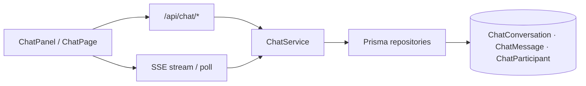

<strong>خلاصه برای operatore:</strong> این سند جزو <strong>plans</strong> است (p-63-internal-chat-system). ستون وضعیت در <a href="./p-00-next-index.md">index مربوطه</a> مرجع «شروع شده / design / تمام» است.

<strong>راهنمای خواندن:</strong> بخش‌های انگلیسی برای agent/dev هستند؛ جداول وضعیت و یادداشت‌های فارسی را اول بخوانید.

# p-63 — Internal Chat System (پیام‌رسانی داخلی)

> **فاز:** CHT · **موکول** (next)  
> **اولویت:** — — ارتباط همکاران داخل پلتفرم · جدا از AiPanel و workflow inbox  
> **وضعیت:** ⬜ — کنترل: [p-00-next-index.md](p-00-next-index.md)  
> **ورود:** `@plans/core/next/p-63-internal-chat-system.md برو جلو`  
> **وابستگی:** Identity providers ✅ · BaseUser/Roles ✅ · Redis cache (اختیاری · multi-node)

---

## هدف

یک **سیستم چت داخلی** برای کاربران احراز هویت‌شدهٔ AppEndO: گفتگوی یک‌به‌یک، کانال گروهی با عضویت کنترل‌شده، تاریخچهٔ پیام، وضعیت خوانده‌شدن، و اعلان درون‌برنامه‌ای — **بدون** جایگزینی [AiPanel](../../../src/features/appendoo/) (چت با Agent) یا [My Work Items](../../../src/features/work-items/) (کار گردش‌کار).

**تعریف موفقیت:** دو کاربر در یک tenant می‌توانند DM بزنند؛ ادمین کانال تیمی بسازد؛ پیام‌ها persist و در shell قابل دسترسی باشند؛ دسترسی فقط برای اعضای مجاز.

---

## وضعیت یک‌خطی

<table dir="rtl">
<thead><tr><th>محور</th><th>وضعیت</th></tr></thead>
<tbody><tr><td><strong>زیرفاز فعال</strong></td><td><strong>CHT-0</strong> — هنوز شروع نشده (Discovery)</td></tr>
<tr><td><strong>کار بعدی</strong></td><td>CHT-0-1 — Reality Audit + تصمیم transport</td></tr>
<tr><td><strong>blocker</strong></td><td>— (منتظر فعال‌سازی از <code dir="ltr" style="unicode-bidi: embed;">next/</code>)</td></tr>
<tr><td><strong>تخمین باقی‌مانده</strong></td><td>۵–۸ هفته</td></tr>
</tbody></table>

---

## کار بعدی (الان)

> **CHT-0-1** — Reality Audit: الگوهای SSE موجود · rate limit · `BaseUser` · navigation registry · multi-node cache — خروجی: [`docs/architecture/p-63-chat-reality-audit.md`](../../../docs/architecture/p-63-chat-reality-audit.md).

---

## پیش‌نیازها

- Identity Engine + session auth ([`identity-engine.md`](../../../docs/architecture/identity-engine.md) ✅)
- Prisma control plane ([`control-plane-prisma.md`](../../../docs/architecture/control-plane-prisma.md) ✅)
- الگوی CRUD/API + `AppTableGrid` + `CreateEditModalShell`
- ترجیحی: جایگاه ثابت آیکون/پنل چت در app shell

---

## محدوده

### Scope IN (v1)

<table dir="rtl">
<thead><tr><th>قابلیت</th><th>شرح</th></tr></thead>
<tbody><tr><td><strong>DM (1:1)</strong></td><td>گفتگوی مستقیم بین دو <code dir="ltr" style="unicode-bidi: embed;">BaseUser</code> در همان tenant</td></tr>
<tr><td><strong>کانال گروهی</strong></td><td>ایجاد توسط ادمین/نقش مجاز · عضویت صریح · نام + توضیح</td></tr>
<tr><td><strong>پیام متنی</strong></td><td>متن ساده · سقف طول · sanitize · timestamp · فرستنده</td></tr>
<tr><td><strong>تاریخچه</strong></td><td>paginated load · cursor بر اساس <code dir="ltr" style="unicode-bidi: embed;">createdAt</code> + <code dir="ltr" style="unicode-bidi: embed;">id</code></td></tr>
<tr><td><strong>خوانده‌شدن</strong></td><td>read receipt per participant (آخرین پیام دیده‌شده)</td></tr>
<tr><td><strong>اعلان درون‌برنامه</strong></td><td>badge unread در nav · toast اختیاری برای پیام جدید در foreground</td></tr>
<tr><td><strong>Realtime سبک</strong></td><td>SSE یا long-poll برای inbox جدید — <strong>بدون</strong> WebSocket اجباری در v1</td></tr>
<tr><td><strong>Admin</strong></td><td>لیست کانال‌ها · افزودن/حذف عضو · آرشیو کانال</td></tr>
<tr><td><strong>دسترسی</strong></td><td>RBAC: فقط اعضای conversation پیام ببینند/بفرستند</td></tr>
<tr><td><strong>Audit</strong></td><td>لاگ ایجاد کانال · حذف عضو · (اختیاری) export برای compliance</td></tr>
</tbody></table>

### Scope OUT (v1)

<table dir="rtl">
<thead><tr><th>خارج از scope</th><th>دلیل</th></tr></thead>
<tbody><tr><td>چت با Agent / vibe coding</td><td>AiPanel — مسیر جدا</td></tr>
<tr><td>Work item comments</td><td>workflow engine — مسیر جدا</td></tr>
<tr><td>فایل/صوت/ویدیو</td><td>فاز بعد (CHT-2)</td></tr>
<tr><td>E2E encryption</td><td>enterprise بعدی</td></tr>
<tr><td>Federation بین tenantها</td><td>multi-tenant آینده</td></tr>
<tr><td>Mobile push (FCM/APNs)</td><td>فاز جدا</td></tr>
<tr><td>Bot framework / slash commands</td><td>بعد از v1 پایدار</td></tr>
<tr><td>جایگزینی ایمیل/Slack خارجی</td><td>integration اختیاری در آینده</td></tr>
</tbody></table>

---

## معماری پیشنهادی (v1)

**مدل داده (پیشنهاد — تأیید در CHT-0-2):**

<table dir="rtl">
<thead><tr><th>Entity</th><th>نقش</th></tr></thead>
<tbody><tr><td><code dir="ltr" style="unicode-bidi: embed;">ChatConversation</code></td><td><code dir="ltr" style="unicode-bidi: embed;">type</code>: <code dir="ltr" style="unicode-bidi: embed;">DM</code> \</td></tr>
<tr><td><code dir="ltr" style="unicode-bidi: embed;">ChatParticipant</code></td><td><code dir="ltr" style="unicode-bidi: embed;">conversationId</code> + <code dir="ltr" style="unicode-bidi: embed;">userId</code> · <code dir="ltr" style="unicode-bidi: embed;">role</code> · <code dir="ltr" style="unicode-bidi: embed;">lastReadMessageId</code></td></tr>
<tr><td><code dir="ltr" style="unicode-bidi: embed;">ChatMessage</code></td><td><code dir="ltr" style="unicode-bidi: embed;">conversationId</code> · <code dir="ltr" style="unicode-bidi: embed;">senderUserId</code> · <code dir="ltr" style="unicode-bidi: embed;">body</code> · <code dir="ltr" style="unicode-bidi: embed;">createdAt</code> · soft-delete</td></tr>
</tbody></table>

**DM dedup:** برای `type=DM`، جفت `(userA, userB)` یک conversation واحد — unique constraint منطقی در service layer.

---

## فازها

### CHT-0 — Discovery & Design

- [ ] **CHT-0-1** Reality Audit — SSE patterns موجود · rate limits · nav registry · multi-node
- [ ] **CHT-0-2** Prisma schema draft + migration strategy (PG + MSSQL parity)
- [ ] **CHT-0-3** API contract (`specs/internal-chat/01-api.md`) — REST + SSE events
- [ ] **CHT-0-4** UX wireframe — پنل کناری vs صفحهٔ کامل · responsive Tier M
- [ ] **CHT-0-5** PO sign-off محدوده v1

**Gate:** CHT-0-5 قبل از migration.

### CHT-1 — Core Backend

- [ ] **CHT-1-1** Prisma models + migration
- [ ] **CHT-1-2** `ChatConversationService` — create DM/channel · membership · archive
- [ ] **CHT-1-3** `ChatMessageService` — send · list · mark read · authorization
- [ ] **CHT-1-4** REST routes + Zod validation + rate limit per user
- [ ] **CHT-1-5** SSE endpoint `GET /api/chat/events` (یا poll fallback) — `message.created` · `read.updated`
- [ ] **CHT-1-6** Unit/integration tests · Postgres + MSSQL smoke

### CHT-2 — UI & Shell Integration

- [ ] **CHT-2-1** `ChatPage` — لیست گفتگوها + thread view (`AppTableGrid` برای admin channels)
- [ ] **CHT-2-2** `ChatPanel` — slide-over یا docked panel در shell
- [ ] **CHT-2-3** Unread badge در navigation (`platform-registry`)
- [ ] **CHT-2-4** Admin: مدیریت کانال و اعضا (`CreateEditModalShell`)
- [ ] **CHT-2-5** E2E smoke: DM + channel + read receipt

### CHT-3 — Hardening (اختیاری v1.1)

- [ ] **CHT-3-1** پیوست فایل کوچک (تصویر/PDF) via file-manager موجود
- [ ] **CHT-3-2** جستجو در تاریخچه
- [ ] **CHT-3-3** retention policy + purge job
- [ ] **CHT-3-4** manual smoke — § لاگ همین سند

---

## امنیت

- هر query فیلتر بر اساس `participant.userId = currentUser`
- Rate limit ارسال پیام (مثلاً ۶۰/min per user)
- Sanitize HTML در body — plain text یا markdown محدود
- کانال عمومی ناشناس ندارد — همه authenticated
- SSRF/IDOR: `conversationId` بدون عضویت → 404 (نه 403 اطلاعاتی)

---

## معیار خروج (DoD v1)

- [ ] DM و channel end-to-end روی PG و MSSQL
- [ ] Unread badge درست به‌روز می‌شود
- [ ] SSE/poll بدون leak به کاربر غیرعضو
- [ ] Admin channel CRUD + membership
- [ ] `npm run test:critical` سبز
- [ ] manual smoke ثبت در § لاگ همین سند

---

## تخمین

<table dir="rtl">
<thead><tr><th>فاز</th><th>مدت</th></tr></thead>
<tbody><tr><td>CHT-0</td><td>۱ هفته</td></tr>
<tr><td>CHT-1</td><td>۲–۳ هفته</td></tr>
<tr><td>CHT-2</td><td>۲–۳ هفته</td></tr>
<tr><td>CHT-3</td><td>۱–۲ هفته (اختیاری)</td></tr>
<tr><td><strong>جمع v1</strong></td><td><strong>۵–۸ هفته</strong></td></tr>
</tbody></table>

---

## ارتباط با سایر پلن‌ها

<table dir="rtl">
<thead><tr><th>پلن</th><th>ارتباط</th></tr></thead>
<tbody><tr><td>Embedded feedback (shipped)</td><td>پاسخ ادمین به تیکت می‌تواند thread چت باز کند (ادغام اختیاری CHT-2+)</td></tr>
<tr><td>App shell</td><td>slot ثابت برای <code dir="ltr" style="unicode-bidi: embed;">ChatPanel</code> در app-layout</td></tr>
<tr><td>Workflow notify</td><td>اعلان Slack/Teams جدا — چت داخلی مکمل است نه جایگزین</td></tr>
</tbody></table>

---

*سند پیاده‌سازی — Internal Chat · CHT · p-63*

