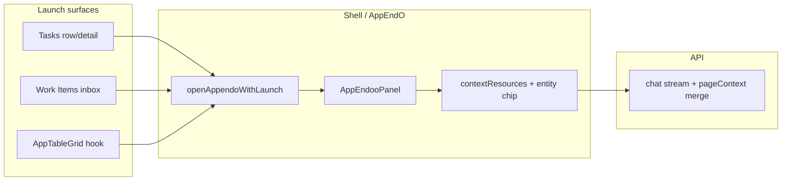

<div dir="rtl" lang="fa" class="hwy-parity-doc">
<style>
  .hwy-parity-doc { text-align: right; unicode-bidi: plaintext; }
  .hwy-parity-doc h1, .hwy-parity-doc h2, .hwy-parity-doc h3, .hwy-parity-doc h4, .hwy-parity-doc p, .hwy-parity-doc li { text-align: right; }
  .hwy-parity-doc table { direction: rtl; text-align: right; width: 100%; border-collapse: collapse; margin: 0.75rem 0; }
  .hwy-parity-doc th, .hwy-parity-doc td { border: 1px solid #c4c4c4; padding: 0.35rem 0.5rem; vertical-align: top; text-align: right; }
  .hwy-parity-doc th { background: #f6f6f6; font-weight: 600; }
  .hwy-parity-doc blockquote { text-align: right; border-right: 3px solid #ccc; border-left: none; padding-right: 1rem; margin-right: 0; }
  .hwy-parity-doc ul, .hwy-parity-doc ol { padding-right: 1.25rem; padding-left: 0; }
  .hwy-parity-doc pre, .hwy-parity-doc code { direction: ltr; text-align: left; unicode-bidi: embed; }
</style>

<p><strong>خلاصه برای operatore:</strong> این سند جزو <strong>plans</strong> است (p-72-ai-backlog). ستون وضعیت در <a href="./p-00-next-index.md">index مربوطه</a> مرجع «شروع شده / design / تمام» است.</p>
<p><strong>راهنمای خواندن:</strong> بخش‌های انگلیسی برای agent/dev هستند؛ جداول وضعیت و یادداشت‌های فارسی را اول بخوانید.</p>


# p-72 — AI Backlog (یکپارچه)

> **وضعیت:** 🟡 — AppEndoo Phase D باز · CACL Discovery · MQA اپراتور  
> **فاز:** AI · **موکول** (next)  
> **کنترل:** [p-00-next-index.md](p-00-next-index.md)  
> **ورود:** `@plans/core/next/p-72-ai-backlog.md برو جلو`  
> **Manual QA:** §۵ این سند (MQA-5/10/12/15/16/18)  
> **Spec:** [`specs/appendoo/spec.md`](../../../specs/appendoo/spec.md) · [`docs/standards/ai-mcp.md`](../../../docs/standards/ai-mcp.md) · [`specs/contextual-ai-chat/01-launch-surfaces-and-contract.md`](../../../specs/contextual-ai-chat/01-launch-surfaces-and-contract.md)

---

## هدف

**یک مرجع واحد** برای همهٔ کارهای AI (موکول در `plans/core/next/`) — AppEndoo agent · contextual chat · EUA · workflow+AI · QA اپراتور · هوک‌های cross-cutting.

AppEndoo V3 (AE-0..22) and V5 (P00–P11) are archived. Active work: make the agent reliable on real models and deepen product intelligence. Consolidates agent reliability overhaul (ex p-63), strategic continuation (ex p-60), and V5 deferred (MQA-18).

**تشخیص agent:** runtime قبلاً مدل را گرسنه نگه می‌داشت (۱k توکن، preview کوچک، regex intent، nudge مصنوعی، dual pipeline) در حالی که governance gates mock-calibrated بودند. Phase A–C بدترین‌ها را بست؛ Phase D باید با مدل زنده ثابت کند.

**قانون تفکیک:**

<table dir="rtl">
<thead><tr><th>حوزه</th><th>این سند</th><th>جدا</th></tr></thead>
<tbody><tr><td>AppEndO operator chat / agent</td><td>✅</td><td>—</td></tr>
<tr><td>Contextual launch از entity</td><td>✅ <a href="#۲--cacl--contextual-ai-chat-launch">§ CACL</a></td><td>—</td></tr>
<tr><td>End-user field assist (EUA)</td><td>✅ MQA-12 · آرشیو p-53</td><td>نه operator chat</td></tr>
<tr><td>چت داخلی همکاران</td><td>—</td><td><a href="p-63-internal-chat-system.md">p-63</a></td></tr>
<tr><td>Workflow engine (غیر-AI)</td><td>ارجاع</td><td><a href="../../../docs/standards/workflow-engine-testing.md"><code dir="ltr" style="unicode-bidi: embed;">workflow-engine-testing.md</code></a></td></tr>
</tbody></table>

---

## وضعیت یک‌خطی

<table dir="rtl">
<thead><tr><th>محور</th><th>وضعیت</th><th>کار بعدی</th><th>blocker</th></tr></thead>
<tbody><tr><td><strong>AppEndoo agent</strong></td><td>🟡 Phases A–C ✅ · D باز</td><td>D1 live provider · D2 E2E واقعی</td><td>EV-3 API key</td></tr>
<tr><td><strong>Contextual chat launch</strong></td><td>⬜ Discovery</td><td>CACL-0-1 spec قرارداد</td><td>تصمیم PO</td></tr>
<tr><td><strong>Product backlog</strong></td><td>⬜ پس از Phase D</td><td>P2 authority UI · P1 telemetry</td><td>Phase D gate</td></tr>
<tr><td><strong>Workflow + AI</strong></td><td>⬜ Phase E</td><td>WFV2-15 · WFV2-13 leftover</td><td>—</td></tr>
<tr><td><strong>Manual QA</strong></td><td>⬜ اپراتور</td><td>MQA-15 smoke · MQA-16 reality</td><td>MQA-16: API key</td></tr>
<tr><td><strong>Cross-cutting hooks</strong></td><td>⬜</td><td>Ask AppEndO روی Task (tsk-package) پس از CACL · Feedback AI triage</td><td>وابسته CACL / p-65</td></tr>
</tbody></table>

---

## نقشهٔ اسناد

<table dir="rtl">
<thead><tr><th>ID</th><th>سند</th><th>نقش در AI</th></tr></thead>
<tbody><tr><td><strong>p-72</strong></td><td><strong>این سند</strong></td><td>AppEndoo agent · CACL · MQA · workflow+AI</td></tr>
<tr><td>tsk</td><td><a href="../../packages/todo/tsk-package/p-packages-task-management.md">Task Management</a></td><td>«Ask AppEndO» روی Task — بک‌لاگ بعد از v1 پکیج</td></tr>
<tr><td>—</td><td>this document §۴</td><td>WFV2-15 agent+approval · WFV2-13 ERROR_TRIGGER leftover · WFV2-16 embedding shipped</td></tr>
</tbody></table>

---

## ۱ — AppEndoo Agent

### Phase A — Stop the bleeding ✅ (2026-07-17)

<table dir="rtl">
<thead><tr><th>Fix</th><th>Change</th></tr></thead>
<tbody><tr><td>A1</td><td>Anthropic/OpenAI <code dir="ltr" style="unicode-bidi: embed;">max_tokens</code> default 1,024 → 8,192</td></tr>
<tr><td>A2</td><td>Provider timeouts 60s → 300s default</td></tr>
<tr><td>A3</td><td>Tool previews raised (<code dir="ltr" style="unicode-bidi: embed;">read_file</code> 40k, generic 8k, observations 12 turns)</td></tr>
<tr><td>A4</td><td><code dir="ltr" style="unicode-bidi: embed;">maxToolCallsPerTurn</code> 5 → 20 · budget 80k → 200k · emergency condensation before hard stop</td></tr>
</tbody></table>

**Note:** Persisted DB settings override defaults until Settings → AI re-saved or migrated.

---

### Phase B — Trust the model ✅ (2026-07-19)

<table dir="rtl">
<thead><tr><th>ID</th><th>Item</th><th>Status</th></tr></thead>
<tbody><tr><td>B0</td><td>V1 direct apply reopened (<code dir="ltr" style="unicode-bidi: embed;">V1_DIRECT_APPLY_REOPENED</code>)</td><td>✅</td></tr>
<tr><td>B0b</td><td>Implement toggle skips LLM intent classifiers</td><td>✅</td></tr>
<tr><td>B1</td><td>Remove regex tool stripping in agent mode — full toolset always (<code dir="ltr" style="unicode-bidi: embed;">resolveTurnExecutionProfile</code> is mode+toggle only; agent = <code dir="ltr" style="unicode-bidi: embed;">agent_implement</code> always)</td><td>✅</td></tr>
<tr><td>B2</td><td>Remove 2× per-turn LLM intent classifier calls + task-decomposition pre-call — zero pre-flight LLM calls</td><td>✅</td></tr>
<tr><td>B3</td><td>Remove fake <code dir="ltr" style="unicode-bidi: embed;">role:user</code> nudge messages → single <code dir="ltr" style="unicode-bidi: embed;">&lt;system-reminder&gt;</code> convention (<code dir="ltr" style="unicode-bidi: embed;">wrapSystemReminder</code>); repair/verify prompts tagged</td><td>✅</td></tr>
<tr><td>B4</td><td>One owner per turn: pipeline only on explicit governed phrases; agent loop owns everything else</td><td>✅</td></tr>
<tr><td>B5</td><td>Policy engine observational (stall = telemetry, never denies); only <code dir="ltr" style="unicode-bidi: embed;">unresolved_unknown_outcome</code> crash-resume deny kept; retrieve gate advisory (<code dir="ltr" style="unicode-bidi: embed;">getRetrieveAdvisory</code>)</td><td>✅</td></tr>
</tbody></table>

**Also:** repair cap 2 → 5; over-cap tool calls get explicit "not executed" results instead of silent slicing.

---

### Phase C — Real context engineering ✅ (2026-07-19)

<table dir="rtl">
<thead><tr><th>ID</th><th>Item</th><th>Status</th></tr></thead>
<tbody><tr><td>C1</td><td>LLM condenser reads real message content (4k/message, 80k total) not 240-char slices; summary cap 8k; compaction is token-pressure-only (72%) — flat history is the default, no more 16-message slicing</td><td>✅</td></tr>
<tr><td>C2</td><td>System prompt now byte-stable across iterations (summary moved to in-band <code dir="ltr" style="unicode-bidi: embed;">&lt;system-reminder&gt;</code> message) — existing <code dir="ltr" style="unicode-bidi: embed;">cache_control</code> breakpoints (AnthropicProvider + promptCacheBreakpoints) now actually hit</td><td>✅</td></tr>
<tr><td>C3</td><td>Single context assembly per iteration (was 3–5); estimator still used for budget (provider <code dir="ltr" style="unicode-bidi: embed;">usage</code> wiring deferred — estimator is now off the reassembly hot path)</td><td>🟡 partial</td></tr>
<tr><td>C4</td><td>Large tool outputs → artifact store (<code dir="ltr" style="unicode-bidi: embed;">toolOutputArtifactStore</code> + <code dir="ltr" style="unicode-bidi: embed;">persistToolOutputArtifactIfLarge</code>) — was already shipped in V5 P09</td><td>✅ pre-existing</td></tr>
</tbody></table>

---

### Phase D — Prove with live model (gate) ⬜

<table dir="rtl">
<thead><tr><th>ID</th><th>Item</th></tr></thead>
<tbody><tr><td>D1</td><td>Resolve EV-3 — configure live provider; re-run all mock trajectories</td></tr>
<tr><td>D2</td><td>10-scenario E2E suite with real model (simple SF, SF+UI, edit, multi-file, ambiguous ask, follow-up, long session/condensation, test repair, read-only in agent mode, large file read)</td></tr>
</tbody></table>

---

### Product backlog (from strategic review)

Priority after Phase D gate:

<table dir="rtl">
<thead><tr><th>ID</th><th>Item</th><th>Priority</th></tr></thead>
<tbody><tr><td>P2</td><td>Show authority level (SCAFFOLD vs validated) in UI</td><td>1</td></tr>
<tr><td>P1/P4</td><td>Persisted telemetry + reject-reason tags + light dashboard</td><td>2</td></tr>
<tr><td>T7</td><td>Governance depth dial (Lean / Auto / Thorough)</td><td>3</td></tr>
<tr><td>T1</td><td>Real semantic retrieval (embeddings, not lexical-only)</td><td>4</td></tr>
<tr><td>T2</td><td>AE-HARDEN checklist for every new capability</td><td>5 (process)</td></tr>
<tr><td>P3</td><td>Prioritize doc-13 depth by usage data</td><td>6</td></tr>
<tr><td>P5</td><td>Convert MQA-15/16 scenarios to golden evals</td><td>7</td></tr>
<tr><td>T3</td><td>Model routing by task complexity + provider fallback</td><td>8</td></tr>
<tr><td>T5</td><td><code dir="ltr" style="unicode-bidi: embed;">proposalOutcomeTelemetry</code> → decision-memory loop</td><td>9</td></tr>
<tr><td>T4</td><td>Real sandbox (container/VM) — needs ADR, overrides D-003</td><td>10</td></tr>
</tbody></table>

### Code evidence

<table dir="rtl">
<thead><tr><th>ID</th><th>Finding</th></tr></thead>
<tbody><tr><td>EV-0</td><td>Bounded path: <code dir="ltr" style="unicode-bidi: embed;">draft_server_function</code> + test + apply — mechanism ✅</td></tr>
<tr><td>EV-1</td><td>Governed macro path cannot plan CREATE_SERVER_FUNCTION — narrow scope</td></tr>
<tr><td>EV-2</td><td>Mock-only E2E — needs D1</td></tr>
<tr><td>EV-3</td><td>Live API key — blocks MQA-16</td></tr>
</tbody></table>

---

### V5 deferred (MQA-18 summary)

<table dir="rtl">
<thead><tr><th>#</th><th>Item</th><th>Blocker</th></tr></thead>
<tbody><tr><td>1</td><td>Residual dual pipeline product decision (P08)</td><td>PO product call</td></tr>
<tr><td>2</td><td>Container/VM sandbox (P09 T4)</td><td>Infra + ADR</td></tr>
<tr><td>3</td><td>V5-19 telemetry auto-tune</td><td>Cross-run buffer + PO policy</td></tr>
<tr><td>4</td><td>V5-16 visual screenshot grader</td><td>EV-3 + capture infra</td></tr>
<tr><td>5</td><td>V5-22 screenshot/Figma input</td><td>EV-3 vision model</td></tr>
<tr><td>6</td><td>V5-25 git-native PR workflow</td><td>Git hosting credentials + ADR</td></tr>
<tr><td>7</td><td>V5-20 per-hunk diff re-plan</td><td>Deep PlanStep integration</td></tr>
</tbody></table>

**Shipped in V5:** V5-17 autonomy tiers · V5-18 critic · V5-21 async execution · V5-23 extension trust · V5-24 plan explainability layer.

---

### Vision (next waves — not urgent)

<table dir="rtl">
<thead><tr><th>ID</th><th>Idea</th></tr></thead>
<tbody><tr><td>V1</td><td>Visual grounding — screenshot grader after builder</td></tr>
<tr><td>V2</td><td>Autonomy tiers per role (extends V5-17)</td></tr>
<tr><td>V3</td><td>Adversarial critic before approval (extends V5-18)</td></tr>
<tr><td>V4</td><td>Auto-tune prompts from telemetry</td></tr>
<tr><td>V5</td><td>Per-hunk approve/reject + local re-plan</td></tr>
<tr><td>V6</td><td>Async/background agent runs</td></tr>
<tr><td>V7</td><td>Multimodal design input</td></tr>
<tr><td>V8</td><td>Third-party package capabilities (extends V5-23)</td></tr>
<tr><td>V9</td><td>"Why this plan" citations (extends V5-24; needs T1)</td></tr>
<tr><td>V10</td><td>Git-native PR output</td></tr>
</tbody></table>

---

### Key files

<table dir="rtl">
<thead><tr><th>File</th><th>Role</th></tr></thead>
<tbody><tr><td><code dir="ltr" style="unicode-bidi: embed;">src/core/ai/providers/AnthropicProvider.ts</code></td><td>Output token cap</td></tr>
<tr><td><code dir="ltr" style="unicode-bidi: embed;">src/core/ai/agent/AgentOrchestrator.ts</code></td><td>Loop, nudges, tool limits</td></tr>
<tr><td><code dir="ltr" style="unicode-bidi: embed;">src/core/ai/agent/AgentRuntime.ts</code></td><td>Pipeline vs agent ownership</td></tr>
<tr><td><code dir="ltr" style="unicode-bidi: embed;">src/core/ai/agent/contextAssembly.ts</code></td><td>History, compaction</td></tr>
<tr><td><code dir="ltr" style="unicode-bidi: embed;">src/core/ai/tools/native/toolObservationCompact.ts</code></td><td>Preview limits</td></tr>
<tr><td><code dir="ltr" style="unicode-bidi: embed;">src/core/ai/intent/detectCodingIntent.ts</code></td><td>Regex routing (remove from hot path)</td></tr>
</tbody></table>

---

### Appendix — VIBE2 infrastructure (ex p-59)

> **Superseded as standalone plan** — orchestration rewrite now tracked in Phases B–D above. Keep RCA tasks if PO wants measurement before more code.

**Problem (why VIBE2 existed):** p-50 v1 code-complete but operator experience weak — wrong intent profile, retrieve gate conflicts, context starvation, mock-green E2E ≠ real success.

**Scope IN:** RCA trace audit · `AgentOrchestrator`/`VibeHarness`/`contextAssembly` · intent routing · retrieval · write pipeline observability.

**Scope OUT:** Public SaaS · fine-tune · full AiPanel UX rewrite.

**VIBE2 task order (if activated):**

<table dir="rtl">
<thead><tr><th>Phase</th><th>Tasks</th><th>Gate</th></tr></thead>
<tbody><tr><td>VIBE2-0</td><td>RCA: failure taxonomy · MQA-5 scenarios · operator traces</td><td>No rewrite until complete</td></tr>
<tr><td>VIBE2-1</td><td>Design sign-off: target architecture</td><td>PO approval</td></tr>
<tr><td>VIBE2-2</td><td>Rewrite orchestration modules</td><td><code dir="ltr" style="unicode-bidi: embed;">test:critical</code> + MQA-5 green</td></tr>
</tbody></table>

**Overlap with this plan:** VIBE2-2 ≈ Phase B–C here (remove regex routing, condenser, trust model). Prefer **this plan** for execution; use VIBE2-0 only if PO wants formal RCA doc first.

---

## ۲ — CACL — Contextual AI Chat Launch

> **فاز:** CACL · **ریلیز:** موکول — برنامه‌ریزی / Discovery  
> **وابستگی:** AppEndO panel ✅ · `AiPageContext` ✅ · [Task Management](../../packages/todo/tsk-package/p-packages-task-management.md) · `my-inbox` (Human Workflow shipped)  
> **مرتبط:** [p-63](p-63-internal-chat-system.md) (چت انسانی — جدا) · EUA field assist (shipped) · `chatContextResources`

### هدف

**یادآوری طراحی:** امروز AppEndO عمدتاً از shell (دکمهٔ header) باز می‌شود و `pageContext` فعلی route/grid/designer را می‌فرستد. اما کاربران باید بتوانند **از خود شیء کاری** (تسک، work item، تیکت، ردیف گرید، نود workflow، …) یک **اقدام صریح «Ask AppEndO» / «Send to chat»** انجام دهند — با پرامپت اولیه (prefill) و context غنی‌تر از «صفحهٔ فعلی».

**تعریف موفقیت (PO — v1 conceptual):**

- حداقل **یک سطح مرجع** (مثلاً Task یا Work Item) دکمه/منوی «Ask AppEndO about this» دارد.
- کلیک → AppEndO panel باز می‌شود (یا session جدید) با **پرامپت پیش‌نویس** + **context attachment** مخصوص آن entity.
- context شامل شناسهٔ entity، عنوان، وضعیت، assignee و خلاصهٔ فیلدهای کلیدی باشد — **بدون** نشت دادهٔ خارج از RBAC کاربر.
- قرارداد **قابل استفادهٔ مجدد** برای ماژول‌های بعدی (Tasks، Work Items، Feedback، …) — نه hardcode یک صفحه.

### وضعیت یک‌خطی

<table dir="rtl">
<thead><tr><th>محور</th><th>وضعیت</th></tr></thead>
<tbody><tr><td><strong>زیرفاز فعال</strong></td><td><strong>CACL-0</strong> — Discovery (هنوز شروع نشده)</td></tr>
<tr><td><strong>کار بعدی</strong></td><td>CACL-0-1 — Inventory سطوح کاندید + الگوهای UX</td></tr>
<tr><td><strong>blocker</strong></td><td>— (طراحی؛ پیاده‌سازی بعد از تصمیم PO)</td></tr>
<tr><td><strong>تخمین v1</strong></td><td>۲–۴ هفته (پس از تثبیت قرارداد)</td></tr>
</tbody></table>

### کار بعدی (الان)

> **CACL-0-1** — فهرست سطوح کاندید + sketch قرارداد `ContextualChatLaunchRequest` — خروجی: [`specs/contextual-ai-chat/01-launch-surfaces-and-contract.md`](../../../specs/contextual-ai-chat/01-launch-surfaces-and-contract.md).

### چرا الان (یادآوری)

<table dir="rtl">
<thead><tr><th>موضوع</th><th>وضعیت فعلی</th><th>شکاف</th></tr></thead>
<tbody><tr><td>AppEndO panel</td><td>shell + <code dir="ltr" style="unicode-bidi: embed;">pageContext</code> از route</td><td><strong>entity-scoped</strong> context نداریم</td></tr>
<tr><td>Tasks (<a href="../../packages/todo/tsk-package/p-packages-task-management.md">tsk-package</a>)</td><td>پلن پکیج فعال · هوک در بک‌لاگ بعد از v1</td><td>فرصت طراحی hook از روز اول</td></tr>
<tr><td>Work Items</td><td>inbox workflow</td><td>«خلاصه کن / پیشنهاد بده» روی یک item</td></tr>
<tr><td>Chat context chips</td><td><code dir="ltr" style="unicode-bidi: embed;">chatContextResources</code> (page, feature, …)</td><td><strong>resource type جدید</strong> برای entity لازم است</td></tr>
<tr><td>EUA field assist</td><td>inline روی فیلد فرم</td><td><strong>نه</strong> جایگزین launch از لیست/جزئیات</td></tr>
</tbody></table>

**قانون:** این بخش دربارهٔ **AppEndO operator chat** است — نه چت داخلی همکاران ([p-63](p-63-internal-chat-system.md)) و نه field-level EUA.

### سطوح کاندید (brainstorm — نیاز به اولویت‌بندی PO)

<table dir="rtl">
<thead><tr><th>سطح</th><th>مثال UX</th><th>context احتمالی</th></tr></thead>
<tbody><tr><td><strong>Task</strong> (<a href="../../packages/todo/tsk-package/p-packages-task-management.md">tsk-package</a>)</td><td>منوی row · detail toolbar</td><td><code dir="ltr" style="unicode-bidi: embed;">taskId</code>, title, status, assignee, due, description</td></tr>
<tr><td><strong>Work Item</strong></td><td>inbox row actions</td><td><code dir="ltr" style="unicode-bidi: embed;">workItemId</code>, workflow key, step, payload summary</td></tr>
<tr><td><strong>Grid row (generic)</strong></td><td>context menu روی <code dir="ltr" style="unicode-bidi: embed;">AppTableGrid</code></td><td><code dir="ltr" style="unicode-bidi: embed;">entityType</code>, <code dir="ltr" style="unicode-bidi: embed;">recordId</code>, visible columns</td></tr>
<tr><td><strong>Feedback ticket</strong> (embedded feedback, shipped)</td><td>triage toolbar</td><td>ticket id, category, thread excerpt</td></tr>
<tr><td><strong>Workflow definition</strong></td><td>node inspector</td><td><code dir="ltr" style="unicode-bidi: embed;">definitionKey</code>, node id, config snapshot</td></tr>
<tr><td><strong>Scheduled job run</strong></td><td>run detail</td><td>job id, last error, cron</td></tr>
<tr><td><strong>Server Function</strong></td><td>editor toolbar (تقویت)</td><td>function name + hash (نیمه‌وجود در <code dir="ltr" style="unicode-bidi: embed;">pageContext</code>)</td></tr>
<tr><td><strong>Component layout</strong></td><td>designer selection</td><td>layout id + node (نیمه‌وجود)</td></tr>
</tbody></table>

### سؤالات باز (باید قبل از کد جواب بدهیم)

#### UX

- [ ] **CACL-Q1** Panel باز شود یا inline mini-composer در همان صفحه؟
- [ ] **CACL-Q2** session جدید هر بار vs ادامهٔ session فعال با context جدید؟
- [ ] **CACL-Q3** پرامپت prefill ثابت (template) vs خالی با فقط context attach؟
- [ ] **CACL-Q4** آیا کاربر بتواند context entity را قبل از ارسال detach کند (مثل chipهای فعلی)؟

#### قرارداد فنی

- [ ] **CACL-Q5** نوع جدید `AiChatContextResourceId` (مثلاً `entity`) یا گسترش `AiPageContext`؟
- [ ] **CACL-Q6** شکل payload: `ContextualChatLaunchDescriptor { source, entityType, entityId, snapshot?, suggestedPrompt?, mode? }`
- [ ] **CACL-Q7** bus سراسری (مثلاً `openAppendoWithLaunch`) vs prop drilling از shell؟
- [ ] **CACL-Q8** deep link: `/studio/...?appendo=...` برای share/bookmark؟

#### امنیت و حاکمیت

- [ ] **CACL-Q9** snapshot در client فقط فیلدهای visible — server دوباره validate کند
- [ ] **CACL-Q10** audit log: «user launched chat from task X»
- [ ] **CACL-Q11** محدودیت حجم context (هم‌تراز `MAX_PROJECT_NOTES_CHARS` / compaction)

#### محصول

- [ ] **CACL-Q12** کدام ۱–۲ سطح برای v1 (پیشنهاد: Work Item + Task وقتی tsk-package به UI رسید)
- [ ] **CACL-Q13** آیا prompt template per entity type در culture/settings قابل تنظیم است؟
- [ ] **CACL-Q14** ارتباط با Agent mode / tools — آیا entity context به tool routing می‌رسد؟

### معماری پیشنهادی (sketch)



**اصل:** هر surface فقط `ContextualChatLaunchDescriptor` emit می‌کند؛ panel مسئول merge با `pageContext` و نمایش chip است.

### زیرفازها

<table dir="rtl">
<thead><tr><th>زیرفاز</th><th>محتوا</th><th>وضعیت</th></tr></thead>
<tbody><tr><td><strong>CACL-0</strong></td><td>Discovery · spec قرارداد · اولویت PO</td><td>⬜ فعال</td></tr>
<tr><td><strong>CACL-1</strong></td><td>Shell API: <code dir="ltr" style="unicode-bidi: embed;">openAppendoWithLaunch</code> · prefill · session policy</td><td>⬜</td></tr>
<tr><td><strong>CACL-2</strong></td><td><code dir="ltr" style="unicode-bidi: embed;">entity</code> context resource · server-side fetch/validate</td><td>⬜</td></tr>
<tr><td><strong>CACL-3</strong></td><td>پیاده‌سازی reference: Work Items و/یا Tasks</td><td>⬜</td></tr>
<tr><td><strong>CACL-4</strong></td><td>اختیاری: generic grid hook · MQA سناریوها</td><td>⬜</td></tr>
</tbody></table>

### چک‌لیست CACL-0 (Discovery)

- [ ] **CACL-0-1** spec [`01-launch-surfaces-and-contract.md`](../../../specs/contextual-ai-chat/01-launch-surfaces-and-contract.md)
- [ ] **CACL-0-2** ممیزی `AppEndooPanel` + `useAiPageContext` — نقاط اتصال
- [ ] **CACL-0-3** مقایسه با Cursor «Add to chat» / Notion AI / Linear — ۱ صفحهٔ notes
- [ ] **CACL-0-4** تصمیم PO: v1 surfaces + UX (Q1–Q4)
- [ ] **CACL-0-5** به‌روزرسانی هوک Ask AppEndO در [tsk-package](../../packages/todo/tsk-package/p-packages-task-management.md) اگر لازم

### خارج از scope (v1)

<table dir="rtl">
<thead><tr><th>موضوع</th><th>دلیل</th></tr></thead>
<tbody><tr><td>چت real-time بین کاربران</td><td><a href="p-63-internal-chat-system.md">p-63</a></td></tr>
<tr><td>ارسال خودکار بدون تأیید کاربر</td><td>خطر privacy</td></tr>
<tr><td>MCP tool جدید per entity</td><td>بعد از قرارداد پایدار</td></tr>
<tr><td>Mobile-only composer</td><td>shell responsive کافی است در v1</td></tr>
</tbody></table>

---

## ۳ — Cross-cutting AI hooks

### Tasks — Ask AppEndO ([tsk-package](../../packages/todo/tsk-package/p-packages-task-management.md))

پس از CACL (بک‌لاگ بعد از v1 پکیج):

- [ ] دکمه/منوی «Ask AppEndO» روی row و detail → `ContextualChatLaunchDescriptor`

### Feedback — AI triage (embedded feedback, shipped)

<table dir="rtl">
<thead><tr><th>Item</th><th>وضعیت</th></tr></thead>
<tbody><tr><td>AI auto-triage / duplicate ML</td><td>فاز بعد — خارج v1</td></tr>
</tbody></table>

---

## ۴ — Workflow + AI

Phase E (آینده):

<table dir="rtl">
<thead><tr><th>ID</th><th>Item</th><th>Status</th></tr></thead>
<tbody><tr><td>WFV2-15</td><td>AI agent with human approval gate</td><td>⬜</td></tr>
<tr><td>WFV2-16</td><td>Embedding + vector search action</td><td>✅ shipped</td></tr>
<tr><td>WFV2-13</td><td><code dir="ltr" style="unicode-bidi: embed;">ERROR_TRIGGER</code> start type</td><td>leftover — EVENT start already covers <code dir="ltr" style="unicode-bidi: embed;">workflow.instance.failed</code></td></tr>
</tbody></table>

**یادداشت:** `data.db-query` (WFV2-6) همان primitiveی است که AI agent tools و Server Functions استفاده می‌کنند.

---

## ۵ — Manual QA — AI

<table dir="rtl">
<thead><tr><th>ID</th><th>حوزه</th><th>وضعیت</th><th>blocker</th></tr></thead>
<tbody><tr><td><strong>MQA-5</strong></td><td>Vibe coding (DEVELOPER)</td><td>☐</td><td>—</td></tr>
<tr><td><strong>MQA-10 §3</strong></td><td>AI providers/models — test connection</td><td>☐</td><td>—</td></tr>
<tr><td><strong>MQA-12</strong></td><td>End-user AI assist (p-53)</td><td>☐ اپراتور</td><td>—</td></tr>
<tr><td><strong>MQA-15</strong></td><td>AppEndoo V4 agent-loop smoke (۳ مرحله زنده)</td><td>☐ اپراتور</td><td>—</td></tr>
<tr><td><strong>MQA-16</strong></td><td>Non-fixture reality check (GAP-2/3)</td><td>☐ اپراتور</td><td><strong>API key</strong></td></tr>
<tr><td><strong>MQA-18</strong></td><td>V5 deferred / P08–P11 تصمیم PO</td><td>☐ PO/اپراتور</td><td>—</td></tr>
</tbody></table>

**MQA-15 smoke زنده (~۱۵ دقیقه):**

1. پرامپت #1 `math.sum-two-numbers` — proposal بدون deadlock
2. پرامپت #5 «با تأیید معمار» — Approve export بعد از verify
3. پرامپت #9 — echo فوری + صف پیام دوم

**MQA-16 نمونهٔ سخت:** `scheduler.sample-heartbeat` — echo-only · بدون input fields · تست کشف تابع بدون page context

**جزئیات چک‌لیست:** همین §۵

---

## ۶ — مرجع shipped

<table dir="rtl">
<thead><tr><th>موضوع</th><th>محتوا</th></tr></thead>
<tbody><tr><td>AppEndoo V3/V4/V5</td><td><a href="../../../specs/appendoo/spec.md"><code dir="ltr" style="unicode-bidi: embed;">specs/appendoo/spec.md</code></a></td></tr>
<tr><td>Vibe coding</td><td><a href="../../../specs/vibe-coding/01-spec.md"><code dir="ltr" style="unicode-bidi: embed;">specs/vibe-coding/01-spec.md</code></a> · <a href="../../../docs/standards/vibe-coding-workflows.md"><code dir="ltr" style="unicode-bidi: embed;">vibe-coding-workflows.md</code></a></td></tr>
<tr><td>EUA field assist</td><td>shipped — MQA-12 in §۵</td></tr>
</tbody></table>

---

## ترتیب اجرا (پیشنهاد)

```
1. AppEndoo Phase D (D1 API key → D2 live E2E)     ← gate اصلی
2. CACL-0 Discovery → CACL-1..3                      ← موازی پس از PO
3. MQA-15/16 اپراتور (پس از D1)
4. Product backlog (P2 → P1 → …)                     ← پس از Phase D
5. TSKM-7 + سطوح CACL اضافی
6. Workflow WFV2-15/16 · Feedback AI triage         ← موج بعد
```

---

## دستورالعمل Agent

1. **«برو جلو»** → اگر blocker API key: **D1** · وگرنه **CACL-0-1** (Discovery).
2. `npm run test:critical` پس از تغییر کد.
3. Manual QA → §۵ این سند.
4. خارج از scope: MCP access control · چت انسانی ([p-63](p-63-internal-chat-system.md)) · vision/git/sandbox بدون PO + ADR.

---

## لاگ

<table dir="rtl">
<thead><tr><th>تاریخ</th><th>خلاصه</th></tr></thead>
<tbody><tr><td>۲۰۲۶-۰۹-۱۵</td><td><strong>p-70 حذف شد</strong> — هوک Task به <a href="../../packages/todo/tsk-package/p-packages-task-management.md">tsk-package</a> اشاره می‌کند</td></tr>
<tr><td>۲۰۲۶-۰۷-۲۰</td><td><strong>p-71 → p-72</strong> — تلفیق CACL در AI Backlog یکپارچه · p-71 حذف</td></tr>
<tr><td>۲۰۲۶-۰۷-۲۰</td><td><strong>p-61 → p-72</strong> — تلفیق AppEndoo backlog در AI Backlog یکپارچه · p-61 حذف</td></tr>
<tr><td>۲۰۲۶-۰۷-۲۰</td><td><strong>p-72 ایجاد</strong> — یکپارچه‌سازی AI از p-61 · p-71 · p-58 · p-60 · p-70 · p-65</td></tr>
<tr><td>۲۰۲۶-۰۷-۲۰</td><td>p-71 ایجاد — Contextual AI Chat Launch</td></tr>
<tr><td>۲۰۲۶-۰۷-۱۹</td><td>Phases B + C shipped (comparative research vs Cursor/Claude Code/Codex). Zero pre-flight LLM calls, full toolset always, no fake nudges, advisory gates, flat history + pressure-only LLM compaction, cache-stable system prompt. Phase D (live model) still open.</td></tr>
<tr><td>۲۰۲۶-۰۷-۱۸</td><td>p-59 merged into AppEndoo appendix (VIBE2) · Phase B partial — v1 apply reopened</td></tr>
<tr><td>۲۰۲۶-۰۷-۱۷</td><td>Phase A shipped — token limits, previews, timeouts</td></tr>
<tr><td>۲۰۲۶-۰۷-۱۶</td><td>V5 pack archived</td></tr>
<tr><td>۲۰۲۶-۰۷-۱۵</td><td>p-53 EUA → done · AppEndoo V5 آرشیو</td></tr>
</tbody></table>

---

*p-72 — AI Backlog یکپارچه · next/*


</div>
