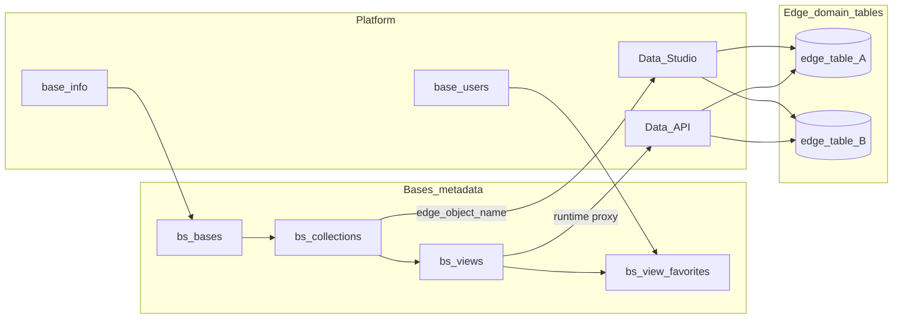
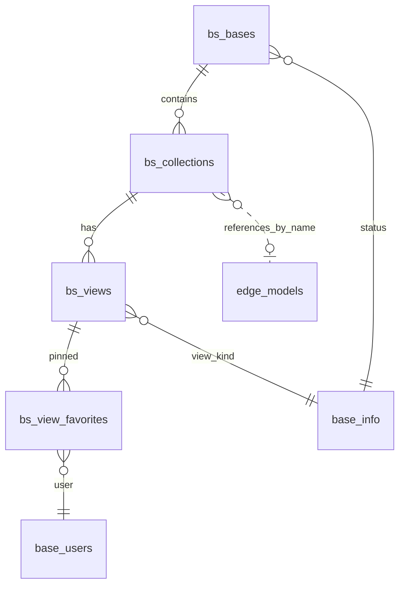

<div dir="rtl" lang="fa" class="hwy-parity-doc">
<style>
  .hwy-parity-doc { text-align: right; unicode-bidi: plaintext; }
  .hwy-parity-doc h1, .hwy-parity-doc h2, .hwy-parity-doc h3, .hwy-parity-doc h4, .hwy-parity-doc p, .hwy-parity-doc li { text-align: right; }
  .hwy-parity-doc table { direction: rtl; text-align: right; width: 100%; border-collapse: collapse; margin: 0.75rem 0; }
  .hwy-parity-doc th, .hwy-parity-doc td { border: 1px solid #c4c4c4; padding: 0.35rem 0.5rem; vertical-align: top; text-align: right; }
  .hwy-parity-doc th { background: #f6f6f6; font-weight: 600; }
  .hwy-parity-doc blockquote { text-align: right; border-right: 3px solid #ccc; border-left: none; padding-right: 1rem; margin-right: 0; }
  .hwy-parity-doc ul, .hwy-parity-doc ol { padding-right: 1.25rem; padding-left: 0; }
  .hwy-parity-doc pre, .hwy-parity-doc code { direction: ltr; text-align: left; unicode-bidi: embed; }
</style>

<p><strong>خلاصه برای operatore:</strong> این سند جزو <strong>plans</strong> است (p-packages-bases). ستون وضعیت در <a href="../p-00-packages-index.md">index مربوطه</a> مرجع «شروع شده / design / تمام» است.</p>
<p><strong>راهنمای خواندن:</strong> بخش‌های انگلیسی برای agent/dev هستند؛ جداول وضعیت و یادداشت‌های فارسی را اول بخوانید.</p>


# p-packages-bases — Bases: پایگاه‌های شبکه‌ای روی Edge (شبیه Airtable)

> **Package:** **Bases** (#117) — [p-packages-backlog.md](../p-packages-backlog.md)  
> **مسیر اجرا:** اسکوپ دامنه در backlog پکیج‌ها (نه zip Package Manager) — کنترل: [p-00-packages-index.md](../p-00-packages-index.md)  
> **وضعیت:** ⬜ design only — پیاده‌سازی نشده  
> **آخرین به‌روزرسانی:** ۲۰۲۶-۰۹-۱۷  
> **وابستگی:** Data Studio (Edge models + studio-meta) · Data API / Sequelize · [`p-127-data-model-query-surfaces`](../../../core/todo/p-127-data-model-query-surfaces.md) (مصرف‌کنندهٔ بعدی — blocker اولیه نیست)  
> **استانداردها:** `AGENTS.md` · [data-model.md](../../../../docs/standards/data-model.md) · [data-studio.md](../../../../docs/standards/data-studio.md) · [package-ui.md](../../../../docs/standards/package-ui.md) · [package-base-info-vocab.md](../../../../docs/standards/package-base-info-vocab.md) · [ui-inspector-rail.md](../../../../docs/standards/ui-inspector-rail.md) · Greenfield · Data Studio / Sequelize

**Bases** پکیج ابزار Studio برای **کار رکوردی شبیه Airtable** روی دادهٔ **از قبل مدل‌شده** است: اپراتور در یک *Base* چند *Collection* (هر کدام = یک Edge model ثبت‌شده) و *View* (Grid · Kanban · Calendar · Gallery) می‌سازد؛ ردیف‌ها همان ردیف‌های فیزیکی جدول Edge هستند — **نه** جدول/ستون ad-hoc و **نه** EAV.

AppEndO **platform-first** است نه Airtable-first: **تعریف اسکیما** مالک **Data Studio** است؛ **picklist** مالک **Base Info**؛ **اتوماسیون** مالک **Workflow Engine**؛ **داشبورد/ویجت** مالک **Dashboard Canvas (Core)**؛ **صفحهٔ فرم عمومی** مالک **Component Designer / Contact Form**؛ **Workbook شخصی FortuneSheet** مالک **`base_workbooks` (Core Records)**. این پکیج فقط **چیدمان · نمای ذخیره‌شده · ورود شبکه‌ای** روی مدل‌های Edge را می‌پوشاند.

بنچمارک (الگو، نه کپی اسکیما): Airtable · Baserow · NocoDB · Grist · Teable (OSS).

### اصل سخت: Bases بخشی از Core نیست — و Package Manager zip هم مسیر ساخت نیست

<table dir="rtl">
<thead><tr><th>کار</th><th>مسیر درست (developer-built)</th></tr></thead>
<tbody><tr><td>جداول متادیتای Base/Collection/View</td><td><strong>Data Studio</strong> (Edge models <code dir="ltr" style="unicode-bidi: embed;">bs_*</code> + studio-meta)</td></tr>
<tr><td>LOV وضعیت Base</td><td><strong>Base Info</strong> زیر روت <strong>Bases</strong></td></tr>
<tr><td>دادهٔ رکورد (سلول‌ها)</td><td><strong>همان جدول Edge ثبت‌شده</strong> — خواندن/نوشتن از <strong>Data API + Sequelize</strong> روی آن objectName</td></tr>
<tr><td>منطق دامنه (ثبت collection · resolve view · duplicate view)</td><td><strong>Server Functions</strong> روی <code dir="ltr" style="unicode-bidi: embed;">bs_*</code> — <strong>نه</strong> <code dir="ltr" style="unicode-bidi: embed;">db.query</code></td></tr>
<tr><td>UI Grid/Kanban/Calendar</td><td><strong>Client Components</strong> (<code dir="ltr" style="unicode-bidi: embed;">loaderKind: "designer"</code>) + Base Components</td></tr>
<tr><td>صفحات / URL</td><td><strong>Platform Pages + Navigation</strong> — گروه <strong><code dir="ltr" style="unicode-bidi: embed;">Bases</code></strong> در Studio</td></tr>
</tbody></table>

**ممنوع (سخت):** Package Manager zip · `db.query` · seed در `controlPlaneSeed` · `src/core/packages/bases/` · موتور «کاربر جدول بسازد» · `attributes jsonb` باز روی رکورد دامنه · duplicate storage ردیف‌ها در `bs_*` · اتصال خارجی DB به‌عنوان مسیر ساخت این پکیج (Data Sources از قبل مالک wiring است).

### دسترسی داده (سخت) — فقط Sequelize

- متادیتا: Edge models `bs_bases` · `bs_collections` · `bs_views` · `bs_view_favorites`.
- رکوردهای collection: Sequelize روی **Edge model هدف** (`objectName` ثبت‌شده) — همان قرارداد Data API.
- `config_json` روی `bs_views` فقط **spec نمای** (فیلتر · مرتب‌سازی · ستون‌های visible · mapping کانبان/تقویم) — **نه** payload رکورد.

### خارج از ساخت اولیهٔ اپلیکیشن (سخت)

تا پیاده‌سازی صریح این پلن: **هیچ** `bs_*` · Base Info Bases · nav · UI · scaffold.

```
@plans/packages/todo/bases-package برو جلو
@plans/packages/todo/bases-package فاز ۱ بساز
@plans/packages/todo/bases-package فاز ۲ بساز
@plans/packages/todo/bases-package زیر‌فاز 3a بساز
@plans/packages/todo/bases-package فاز N را رولبک کن
@plans/packages/todo/bases-package از فاز N به بعد را رولبک کن
```

**پلن‌های اجرایی مجزا:** [README.md](./README.md) · [پرامپت‌ها](./bases-phase-execution-prompts.md) · [فاز ۱](./p-bases-phase-1-database-and-meta.md) · [فاز ۲](./p-bases-phase-2-server-api.md) · [3a](./p-bases-phase-3a-nav-and-bases.md) · [3b](./p-bases-phase-3b-grid-runtime.md) · [3c](./p-bases-phase-3c-kanban-gallery.md) · [3d](./p-bases-phase-3d-calendar-favorites.md)

---

## هدف اصلی

Bases یک کار دارد: **ثبت Base → اتصال Collection به Edge model → ساخت View ذخیره‌شده → ویرایش/مرور رکوردها در UI شبکه‌ای (و نمای‌های مشتق)** بدون ساخت اسکیمای جدید.

<table dir="rtl">
<thead><tr><th>دغدغه</th><th>مالک</th></tr></thead>
<tbody><tr><td>تعریف جدول · ستون · association · studio-meta</td><td><strong>Data Studio</strong></td></tr>
<tr><td>مقدار انتخابی / وضعیت کسب‌وکاری LOV</td><td><strong>Base Info</strong> (روت هر پکیج دامنه)</td></tr>
<tr><td>فیلتر/جستجوی پیشرفته · predefined query · نقش‌محور where</td><td><strong>p-127 Data Model Query Surfaces</strong> (Core) — Bases v1 فیلتر view را در <code dir="ltr" style="unicode-bidi: embed;">config_json</code> نگه می‌دارد؛ پس از p-127 می‌تواند به query id ارجاع دهد</td></tr>
<tr><td>اتوماسیون · webhook · زنجیره تأیید</td><td><strong>Workflow Engine</strong></td></tr>
<tr><td>فرم embed · صفحهٔ پرتال</td><td><strong>Component Designer · Portals</strong></td></tr>
<tr><td>داشبورد تحلیلی · pivot</td><td><strong>Dashboard Canvas · Data API Pivot</strong></td></tr>
<tr><td>فایل/پیوست سلول</td><td><strong>File Manager</strong> (ستون FK فایل روی مدل Edge — نه سلول binary در Bases)</td></tr>
<tr><td>Spreadsheet شخصی · فرمول FortuneSheet</td><td><strong><code dir="ltr" style="unicode-bidi: embed;">base_workbooks</code> (Core)</strong> — Workbooks تحت Records</td></tr>
<tr><td>CRM/Task/… دامنهٔ کسب‌وکاری</td><td>پکیج‌های عملیاتی — Bases فقط <strong>لایهٔ نمای</strong> روی مدل‌های مجاز</td></tr>
<tr><td>NatQL / پرس طبیعی DB</td><td><strong>NatQL (#22)</strong></td></tr>
<tr><td>هر picklist متادیتای Bases</td><td>Base Info زیر روت <strong>Bases</strong></td></tr>
</tbody></table>

---

## اصل ساخت: developer-built (جداول · سرور · کلاینت)

*اگر یک مهندس این را از صفر می‌نوشت، آیا کاربر نهایی جدول SQL می‌سازد؟* — **خیر.** دولوپر در Data Studio مدل می‌سازد؛ اپراتور در Bases آن مدل را **ثبت** و **نما** می‌سازد (الگوی NocoDB روی DB موجود، نه Baserow با اسکیمای خودش).

### جداول (مدل داده)

- پیشوند `bs_`؛ بدون `base_` روی جداول دامنهٔ این پکیج.
- **چهار جدول متادیتا** — رکورد دامنهٔ کپی نمی‌شود.
- `bs_collections.edge_object_name` = `objectName` یک Edge model موجود (اعتبارسنجی در `register-collection`).
- `bs_views.config_json` = JSON معتبر schema-versioned (v1) — فیلتر Data API DSL · sort · `visibleColumns[]` · `kanban.statusColumn` · `calendar.startColumn` · `gallery.titleColumn` · `gallery.imageColumn`.
- **جدول `bs_records` وجود ندارد** — تلهٔ Airtable/Baserow.
- **جدول per-field type وجود ندارد** — تلهٔ custom-field engine.

### لایهٔ سرور

- CRUD `bs_*` + `duplicate-view` · `set-default-view` · `resolve-view` (merge studio-meta columns + view config → column spec برای UI).
- Proxy list/read/write رکورد: `GET/POST/PATCH/DELETE /api/{edgeObjectName}` با **Record Policy** و package access همان Data API.
- `GET /api/bs/collections/:id/record-count` برای badge (count واقعی، نه page size).

### لایهٔ کلاینت

- گروه nav **`Bases`**.
- Bases = catalog cards؛ داخل Base = catalog cards برای Collections؛ View باز = **full-height grid** (پیش‌فرض) یا Kanban/Calendar/Gallery.
- ادیتور Base/Collection/View = main سفید + inspector rail ([ui-inspector-rail.md](../../../../docs/standards/ui-inspector-rail.md)).
- سلول‌های قابل ویرایش: map به widget از studio-meta (`formWidget` روی association/column) — inline PATCH تک‌فیلد با toast + refresh region.



---

## دردهای کلاسیک Airtable و تصمیم‌های ما

<table dir="rtl">
<thead><tr><th>درد کلاسیک</th><th>علت</th><th>تصمیم AppEndO Bases</th></tr></thead>
<tbody><tr><td>Base = اسکیمای جدا + lock-in SaaS</td><td>هر Base جدول فیزیکی خودش</td><td>Base فقط <strong>گروه‌بندی متادیتا</strong>؛ داده روی Edge موجود</td></tr>
<tr><td>Custom field engine / فرمول در سلول</td><td>EAV و sync شکسته</td><td><strong>بدون</strong> فیلد سفارشی در Bases؛ فرمول → Workbooks یا v2 صریح</td></tr>
<tr><td>چند View = کپی داده</td><td>snapshot per view</td><td>View = <strong>config_json</strong> روی همان collection</td></tr>
<tr><td>Kanban ستون جدا از status واقعی</td><td>drift با CRM/Task</td><td>Kanban فقط روی ستون <code dir="ltr" style="unicode-bidi: embed;">*_code</code> <strong>واقعی</strong> مدل — اپراتور در config ستون را انتخاب می‌کند</td></tr>
<tr><td>Calendar روی فیلدهای ساختگی</td><td>رکورد event duplicate</td><td>Calendar view فقط روی ستون <code dir="ltr" style="unicode-bidi: embed;">date</code>/<code dir="ltr" style="unicode-bidi: embed;">datetime</code> <strong>موجود</strong> — نه Calendar package</td></tr>
<tr><td>Automation builder داخل Base</td><td>duplicate Workflow</td><td><strong>خارج v1</strong> — لینک به Workflow بعداً</td></tr>
<tr><td>Interface Designer / Form view SaaS</td><td>duplicate Designer</td><td>Form view v1 = <strong>read-only gallery + deep link</strong> به CrudSet موجود؛ form builder نه</td></tr>
<tr><td>Permission per-base پیچیده Airtable</td><td>matrix نقش×فیلد</td><td>v1 <strong>Studio package access</strong> + Record Policy مدل Edge؛ matrix فیلد v2</td></tr>
<tr><td>Real-time cursor همزمان</td><td>infra سنگین</td><td>v1 <strong>بدون</strong> presence؛ refresh بعد از save</td></tr>
<tr><td>API rate limit / export lock-in</td><td>SaaS</td><td>همان Data API پلتفرم — بدون لایه دوم</td></tr>
<tr><td>Import CSV ساخت جدول</td><td>schema drift</td><td><strong>خارج v1</strong> — import داده = ETL/اسکریپت دولوپر</td></tr>
<tr><td>Linked record بدون FK فیزیکی</td><td>orphan links</td><td>فقط associationهای <strong>wired</strong> در Edge — UI link picker از <code dir="ltr" style="unicode-bidi: embed;">belongsTo</code>/<code dir="ltr" style="unicode-bidi: embed;">belongsToMany</code></td></tr>
<tr><td>Gallery بدون ستون تصویر</td><td>UX خالی</td><td>Gallery نیازمند <code dir="ltr" style="unicode-bidi: embed;">imageColumn</code> (file FK یا url) در config — otherwise block با پیام</td></tr>
<tr><td>Gantt / Timeline</td><td>scope عظیم</td><td><strong>خارج v1</strong> — Kanban + Calendar + Grid + Gallery</td></tr>
<tr><td>Comments روی رکورد</td><td>duplicate timeline</td><td>v1 <strong>record event log</strong> موجود پلتفرم — دکمهٔ «History» در toolbar view، نه جدول <code dir="ltr" style="unicode-bidi: embed;">bs_comments</code></td></tr>
<tr><td>Personal spreadsheet vs team base</td><td>اشتباه محصول</td><td><strong><code dir="ltr" style="unicode-bidi: embed;">base_workbooks</code> جدا</strong> — در nav Bases تکرار نمی‌شود</td></tr>
</tbody></table>

---

## اطلاعات پایه (Base Info) — ریشهٔ Bases

```
Base Info
└── Bases                              ← روت پکیج (seed هنگام پیاده‌سازی)
    ├── Base Status                    ← status_code (bs_bases)
    │   └── Active, Archived
    └── View Kind                      ← view_kind_code (bs_views) · badge فقط
        └── Grid, Kanban, Calendar, Gallery
```

قواعد: یک روت · هر `*_code` یک دسته · آیتم‌ها فرزند مستقیم دسته · `ui_html` با Lucide · options با `root=<category id>`.

**صریحاً نوع فیلد Edge نیستند:** View Kind فقط نوع **نمای UI** است — نه نوع ستون دامنه.

### صفحات واژگان vs enum بسته

<table dir="rtl">
<thead><tr><th>دسته</th><th>صفحه Settings</th><th>دلیل</th></tr></thead>
<tbody><tr><td>Base Status</td><td>❌</td><td><code dir="ltr" style="unicode-bidi: embed;">archived</code> فیلتر پیش‌فرض؛ archive از action</td></tr>
<tr><td>View Kind</td><td>❌</td><td>چهار kind ثابت — UI view picker از shortName قفل</td></tr>
</tbody></table>

### دسته: Base Status → `status_code` (`bs_bases`)

<table dir="rtl">
<thead><tr><th>#</th><th>Title</th><th>shortName</th><th>Lucide</th><th>نقش</th></tr></thead>
<tbody><tr><td>1</td><td>Active</td><td><code dir="ltr" style="unicode-bidi: embed;">active</code></td><td><code dir="ltr" style="unicode-bidi: embed;">Database</code></td><td>پیش‌فرض</td></tr>
<tr><td>2</td><td>Archived</td><td><code dir="ltr" style="unicode-bidi: embed;">archived</code></td><td><code dir="ltr" style="unicode-bidi: embed;">Archive</code></td><td>پنهان در لیست پیش‌فرض</td></tr>
</tbody></table>

---

## مدل دامنه

### تصمیم

1. **`bs_bases`** — ظرف منطقی (مثل Airtable Base) برای اپراتور.
2. **`bs_collections`** — ثبت یک Edge `objectName` داخل Base با عنوان نمایشی.
3. **`bs_views`** — نمای ذخیره‌شده (kind + config_json) روی یک collection.
4. **`bs_view_favorites`** — پین view برای کاربر (`user_id` + `view_id`).

**وجود ندارد:** `bs_fields` · `bs_records` · `bs_automations` · `bs_interfaces` · duplicate جدول دامنهٔ Edge.



### `bs_bases` — workspace

<table dir="rtl">
<thead><tr><th>#</th><th>Column</th><th>Native</th><th>Runtime</th><th>Null</th><th>نقش</th></tr></thead>
<tbody><tr><td>1</td><td>id</td><td>uuid</td><td>UUID</td><td>N</td><td>PK</td></tr>
<tr><td>2</td><td>slug</td><td>varchar(64)</td><td>STRING</td><td>N</td><td>UNIQUE · <code dir="ltr" style="unicode-bidi: embed;">LATIN_SLUG_RE</code></td></tr>
<tr><td>3</td><td>title</td><td>varchar(200)</td><td>STRING</td><td>N</td><td>نام نمایشی</td></tr>
<tr><td>4</td><td>status_code</td><td>varchar(32)</td><td>STRING</td><td>N</td><td>FK → Base Status</td></tr>
<tr><td>5</td><td>icon</td><td>varchar(64)</td><td>STRING</td><td>Y</td><td>Lucide name</td></tr>
<tr><td>6</td><td>note</td><td>text</td><td>TEXT</td><td>Y</td><td>remark اپراتور</td></tr>
<tr><td>7</td><td>created_by</td><td>uuid</td><td>UUID</td><td>Y</td><td>audit</td></tr>
<tr><td>8</td><td>created_at</td><td>timestamptz</td><td>DATE</td><td>N</td><td>audit</td></tr>
<tr><td>9</td><td>updated_by</td><td>uuid</td><td>UUID</td><td>Y</td><td>audit</td></tr>
<tr><td>10</td><td>updated_at</td><td>timestamptz</td><td>DATE</td><td>N</td><td>audit</td></tr>
</tbody></table>

**قواعد:** `slug` immutable بعد از create · archive = `status_code` → `archived` · لیست پیش‌فرض فقط `active`.

### `bs_collections` — registered Edge collection

<table dir="rtl">
<thead><tr><th>#</th><th>Column</th><th>Native</th><th>Runtime</th><th>Null</th><th>نقش</th></tr></thead>
<tbody><tr><td>1</td><td>id</td><td>uuid</td><td>UUID</td><td>N</td><td>PK</td></tr>
<tr><td>2</td><td>base_id</td><td>uuid</td><td>UUID</td><td>N</td><td>FK → bs_bases</td></tr>
<tr><td>3</td><td>edge_object_name</td><td>varchar(128)</td><td>STRING</td><td>N</td><td>UNIQUE per base · نام Edge model</td></tr>
<tr><td>4</td><td>title</td><td>varchar(200)</td><td>STRING</td><td>N</td><td>عنوان در UI Base</td></tr>
<tr><td>5</td><td>sort_order</td><td>int</td><td>INTEGER</td><td>N</td><td>default 0</td></tr>
<tr><td>6</td><td>primary_column</td><td>varchar(128)</td><td>STRING</td><td>Y</td><td>override ستون عنوان؛ null = <code dir="ltr" style="unicode-bidi: embed;">labels.title</code> از studio-meta</td></tr>
<tr><td>7</td><td>note</td><td>text</td><td>TEXT</td><td>Y</td><td></td></tr>
<tr><td>8</td><td>created_by</td><td>uuid</td><td>UUID</td><td>Y</td><td></td></tr>
<tr><td>9</td><td>created_at</td><td>timestamptz</td><td>DATE</td><td>N</td><td></td></tr>
<tr><td>10</td><td>updated_by</td><td>uuid</td><td>UUID</td><td>Y</td><td></td></tr>
<tr><td>11</td><td>updated_at</td><td>timestamptz</td><td>DATE</td><td>N</td><td></td></tr>
</tbody></table>

**قواعد:** `edge_object_name` **قفل** بعد از create (تغییر = delete + create جدید) · ثبت فقط اگر Edge model published/synced · حذف collection → cascade views + favorites.

### `bs_views` — saved view

<table dir="rtl">
<thead><tr><th>#</th><th>Column</th><th>Native</th><th>Runtime</th><th>Null</th><th>نقش</th></tr></thead>
<tbody><tr><td>1</td><td>id</td><td>uuid</td><td>UUID</td><td>N</td><td>PK</td></tr>
<tr><td>2</td><td>collection_id</td><td>uuid</td><td>UUID</td><td>N</td><td>FK → bs_collections</td></tr>
<tr><td>3</td><td>slug</td><td>varchar(64)</td><td>STRING</td><td>N</td><td>UNIQUE per collection</td></tr>
<tr><td>4</td><td>title</td><td>varchar(200)</td><td>STRING</td><td>N</td><td></td></tr>
<tr><td>5</td><td>view_kind_code</td><td>varchar(32)</td><td>STRING</td><td>N</td><td>FK → View Kind</td></tr>
<tr><td>6</td><td>is_default</td><td>boolean</td><td>BOOLEAN</td><td>N</td><td>default false · یک default per collection</td></tr>
<tr><td>7</td><td>config_json</td><td>jsonb</td><td>JSON</td><td>N</td><td>spec نمای (schema v1)</td></tr>
<tr><td>8</td><td>note</td><td>text</td><td>TEXT</td><td>Y</td><td></td></tr>
<tr><td>9</td><td>created_by</td><td>uuid</td><td>UUID</td><td>Y</td><td></td></tr>
<tr><td>10</td><td>created_at</td><td>timestamptz</td><td>DATE</td><td>N</td><td></td></tr>
<tr><td>11</td><td>updated_by</td><td>uuid</td><td>UUID</td><td>Y</td><td></td></tr>
<tr><td>12</td><td>updated_at</td><td>timestamptz</td><td>DATE</td><td>N</td><td></td></tr>
</tbody></table>

**قواعد:** `view_kind_code` قفل بعد از create · `set-default-view` atomic · `duplicate-view` کپی slug با suffix · validate `config_json` against kind + column existence on target model.

### `bs_view_favorites` — pinned view

<table dir="rtl">
<thead><tr><th>#</th><th>Column</th><th>Native</th><th>Runtime</th><th>Null</th><th>نقش</th></tr></thead>
<tbody><tr><td>1</td><td>user_id</td><td>uuid</td><td>UUID</td><td>N</td><td>PK part · FK base_users</td></tr>
<tr><td>2</td><td>view_id</td><td>uuid</td><td>UUID</td><td>N</td><td>PK part · FK bs_views</td></tr>
<tr><td>3</td><td>created_at</td><td>timestamptz</td><td>DATE</td><td>N</td><td></td></tr>
</tbody></table>

**قواعد:** UNIQUE (user_id, view_id) · حذف view → cascade.

### Edge model associations — کاننیکال

<table dir="rtl">
<thead><tr><th>model</th><th>kind</th><th>target</th><th>FK / through</th><th>as</th></tr></thead>
<tbody><tr><td>bs_bases</td><td>belongsTo</td><td>base_info</td><td>status_code</td><td>status</td></tr>
<tr><td>bs_bases</td><td>hasMany</td><td>bs_collections</td><td>base_id</td><td>collections</td></tr>
<tr><td>bs_collections</td><td>belongsTo</td><td>bs_bases</td><td>base_id</td><td>base</td></tr>
<tr><td>bs_collections</td><td>hasMany</td><td>bs_views</td><td>collection_id</td><td>views</td></tr>
<tr><td>bs_views</td><td>belongsTo</td><td>bs_collections</td><td>collection_id</td><td>collection</td></tr>
<tr><td>bs_views</td><td>belongsTo</td><td>base_info</td><td>view_kind_code</td><td>view_kind</td></tr>
<tr><td>bs_views</td><td>hasMany</td><td>bs_view_favorites</td><td>view_id</td><td>favorites</td></tr>
<tr><td>bs_view_favorites</td><td>belongsTo</td><td>bs_views</td><td>view_id</td><td>view</td></tr>
<tr><td>bs_view_favorites</td><td>belongsTo</td><td>base_users</td><td>user_id</td><td>user</td></tr>
</tbody></table>

**ممنوع هنگام wiring:** relation روی `edge_object_name` به‌عنوان belongsTo جعلی به Edge (فقط string reference + runtime resolve) · دو belongsToMany معکوس برای همان junction · اتکا به suggest FK بدون association صریح روی `bs_*`.

---

## Data Studio / studio-meta — قرارداد کامل مدلر (فاز ۱)

<table dir="rtl">
<thead><tr><th>لایه</th><th>محل</th><th>محتوا</th></tr></thead>
<tbody><tr><td>EdgeModel</td><td><code dir="ltr" style="unicode-bidi: embed;">runtime/edge-models</code></td><td>columns · PK · associations · labels</td></tr>
<tr><td>studio-meta</td><td><code dir="ltr" style="unicode-bidi: embed;">runtime/edge-model-studio-meta</code></td><td>tags · columnMeta · associationMeta · extensions.story</td></tr>
</tbody></table>

قواعد seed: sparse · بدون Ungrouped · `*_code` روی association · `targetFilter` با id واقعی category · rollback model → حذف studio-meta.

### کاتالوگ قابلیت‌های مدلر

<table dir="rtl">
<thead><tr><th>قابلیت</th><th>Bases</th></tr></thead>
<tbody><tr><td>Column groups</td><td>Identity · Status · Spec · Audit</td></tr>
<tr><td>Story per model</td><td>✅ انگلیسی</td></tr>
<tr><td>Search roles</td><td>title/slug روی bases/collections/views</td></tr>
<tr><td>Form widgets</td><td>text · textarea · switch · json editor برای config</td></tr>
<tr><td>Associations tab</td><td>کامل طبق جدول بالا</td></tr>
</tbody></table>

### هویت مدل‌ها (EdgeModel.labels + tags)

<table dir="rtl">
<thead><tr><th>objectName</th><th>title</th><th>icon</th><th>color</th><th>tags</th></tr></thead>
<tbody><tr><td>bs_bases</td><td>Base</td><td>Database</td><td>slate</td><td>bases, metadata</td></tr>
<tr><td>bs_collections</td><td>Base Collection</td><td>Table</td><td>blue</td><td>bases, metadata</td></tr>
<tr><td>bs_views</td><td>Base View</td><td>LayoutGrid</td><td>violet</td><td>bases, metadata</td></tr>
<tr><td>bs_view_favorites</td><td>View Favorite</td><td>Star</td><td>amber</td><td>bases, metadata</td></tr>
</tbody></table>

### `bs_bases` — Story · گروه‌ها · ستون‌ها · ریلیشن‌ها

```markdown
## Purpose
Operator workspace grouping registered Edge collections and saved views (Airtable-like "base" without owning schema).

## Lifecycle
Create with slug + title → register collections → archive when retired.

## Rules
Slug immutable. Data rows live on Edge tables, not here.
```

<table dir="rtl">
<thead><tr><th>گروه</th><th>ستون‌ها</th></tr></thead>
<tbody><tr><td>Identity</td><td>slug, title, icon</td></tr>
<tr><td>Status</td><td>status_code</td></tr>
<tr><td>Documentation</td><td>note</td></tr>
<tr><td>Audit</td><td>created_by, created_at, updated_by, updated_at</td></tr>
</tbody></table>

columnMeta: `slug` required · searchRole title · `status_code` on association `status` belongsTo Base Status · `icon` optional.

associationMeta: `status` · `collections` hasMany.

### `bs_collections` — Story · گروه‌ها · ستون‌ها · ریلیشن‌ها

```markdown
## Purpose
Links a Base to one Edge objectName. Display title for operators; runtime uses Edge model for columns and Data API for rows.

## Lifecycle
Register after Edge model exists → add views → edge_object_name locked.

## Rules
UNIQUE (base_id, edge_object_name). Deleting removes views only, never Edge table data.
```

<table dir="rtl">
<thead><tr><th>گروه</th><th>ستون‌ها</th></tr></thead>
<tbody><tr><td>Placement</td><td>base_id, sort_order</td></tr>
<tr><td>Target</td><td>edge_object_name, primary_column</td></tr>
<tr><td>Identity</td><td>title</td></tr>
<tr><td>Documentation</td><td>note</td></tr>
<tr><td>Audit</td><td>created_by, created_at, updated_by, updated_at</td></tr>
</tbody></table>

associationMeta: `base` belongsTo · `views` hasMany.

### `bs_views` — Story · گروه‌ها · ستون‌ها · ریلیشن‌ها

```markdown
## Purpose
Saved presentation (grid/kanban/calendar/gallery) over one collection. config_json holds filters, sorts, and column visibility — not record payloads.

## Lifecycle
Create with kind + config → optional default → operators open runtime route.

## Rules
view_kind_code locked after create. config_json validated server-side against target Edge columnMeta.
```

<table dir="rtl">
<thead><tr><th>گروه</th><th>ستون‌ها</th></tr></thead>
<tbody><tr><td>Identity</td><td>slug, title, view_kind_code, is_default</td></tr>
<tr><td>Spec</td><td>config_json</td></tr>
<tr><td>Placement</td><td>collection_id</td></tr>
<tr><td>Documentation</td><td>note</td></tr>
<tr><td>Audit</td><td>created_by, created_at, updated_by, updated_at</td></tr>
</tbody></table>

associationMeta: `collection` belongsTo · `view_kind` belongsTo View Kind · `favorites` hasMany.

### `bs_view_favorites` — Story · گروه‌ها · ستون‌ها · ریلیشن‌ها

```markdown
## Purpose
Per-user pinned views for quick entry from Base home.

## Lifecycle
Toggle star on view → insert/delete favorite row.

## Rules
Composite PK (user_id, view_id). No duplicate favorites.
```

associationMeta: `view` belongsTo · `user` belongsTo base_users.

### پذیرش بصری در Data Studio

1. هر مدل Story + groups · بدون Ungrouped معنادار  
2. Relations tab = جدول associations  
3. LOV روی association  
4. Rollback → حذف studio-meta  
5. باز کردن View: JSON editor برای config با schema hint  

---

## خارج از اسکوپ (سخت)

- ساخت جدول/ستون توسط اپراتور (Airtable schema UI) → **Data Studio**
- Formula · scripting سلول → **Workbooks** / backlog
- Automation · webhook در Base → **Workflow Engine**
- Interface/Form builder SaaS → **Component Designer**
- اتصال DB خارجی به‌عنوان feature این پکیج → **Data Sources** (دولوپر)
- Gantt · Timeline · Map view v1
- Real-time collaborative cursors
- Comment thread جدا → **record event log**
- Matrix permission per-field
- Import CSV که schema بسازد
- Duplicate `base_workbooks`
- p-127 implementation (فقط **مصرف** بعد از ship)
- `db.query` · Package zip · bootstrap seed

---

## UX ادمین

گروه nav: **`Bases`** — `nav.group.bases`.

<table dir="rtl">
<thead><tr><th>Route</th><th>نقش</th></tr></thead>
<tbody><tr><td><code dir="ltr" style="unicode-bidi: embed;">bases</code></td><td>کاتالوگ Baseها</td></tr>
<tr><td><code dir="ltr" style="unicode-bidi: embed;">bases/edit/{id}</code></td><td>ادیتور Base</td></tr>
<tr><td><code dir="ltr" style="unicode-bidi: embed;">bases/{baseId}/collections</code></td><td>کارت Collectionهای همان Base</td></tr>
<tr><td><code dir="ltr" style="unicode-bidi: embed;">bases/collections/edit/{id}</code></td><td>ادیتور Collection (ثبت Edge)</td></tr>
<tr><td><code dir="ltr" style="unicode-bidi: embed;">bases/views/edit/{id}</code></td><td>ادیتور View (config)</td></tr>
<tr><td><code dir="ltr" style="unicode-bidi: embed;">bases/open/{viewId}</code></td><td><strong>runtime</strong> Grid/Kanban/Calendar/Gallery</td></tr>
<tr><td><code dir="ltr" style="unicode-bidi: embed;">bases/settings</code></td><td>*(v1 خالی — همه enum بسته)*</td></tr>
</tbody></table>

### Cards vs table

<table dir="rtl">
<thead><tr><th>صفحه</th><th>Presentation</th><th>دلیل</th></tr></thead>
<tbody><tr><td>Bases list</td><td><strong>catalog cards</strong></td><td>title + status + collection count</td></tr>
<tr><td>Collections in base</td><td><strong>catalog cards</strong></td><td>title + edge_object_name + view count</td></tr>
<tr><td>Views on collection editor</td><td><strong>table</strong></td><td>kind · default · slug · updated — مقایسهٔ ستونی</td></tr>
<tr><td>Runtime grid</td><td><strong>table/grid</strong> (<code dir="ltr" style="unicode-bidi: embed;">AppTableGrid</code>)</td><td>چگالی بالا · inline edit</td></tr>
<tr><td>Runtime kanban</td><td><strong>UiKanbanBoard</strong></td><td>ستون از status column</td></tr>
<tr><td>Runtime gallery</td><td><strong>catalog cards</strong></td><td>title + image field</td></tr>
</tbody></table>

### Closed vs manageable

<table dir="rtl">
<thead><tr><th>دسته</th><th>Settings page</th></tr></thead>
<tbody><tr><td>Base Status · View Kind</td><td><strong>none</strong></td></tr>
</tbody></table>

### Runtime Grid — ASCII

```
┌─ Toolbar: Back · View title · Save view config · Filter · Search · Add record · History ─┐
├─ Main: AppTableGrid (inline edit) · footer sort field + direction · paging ────────────┤
└─ Optional split: Kanban = UiKanbanBoard full height ────────────────────────────────────┘
```

### ادیتور View — ASCII (inspector rail)

```
┌─ Action bar: Back · slug · title · Save · Open runtime · Duplicate · Set default ─────┐
├─ Main (white)                              │ Inspector rail (~370px)                  │
│  FormSection "View"                        │  Placement: Base · Collection (locked)   │
│    title · slug (create only)              │  Kind chip (locked after create)         │
│  FormSection "Kind" (create dialog only)   │  Default: is_default switch              │
│  FormSection "Config"                    │  Audit: created/updated                  │
│    kind-specific fields + JSON advanced    │  Related: record count badge → modal     │
│  FormSection "Columns" (grid only)         │  Favorites count badge                   │
│    visible column picker from meta         │                                          │
└──────────────────────────────────────────┴──────────────────────────────────────────┘
```

- Pre-create View: dialog **Kind** + title → POST → `bases/views/edit/{id}`.
- `view_kind_code` و `collection_id` **قفل** در rail بعد از create.
- موفقیت مودال: close → toast → refresh rail + lists.

### نگاشت صفحه → الگو / Base Components

<table dir="rtl">
<thead><tr><th>صفحه</th><th>الگو</th><th>BC sections</th></tr></thead>
<tbody><tr><td>Bases list</td><td>CMS Libraries cards</td><td><code dir="ltr" style="unicode-bidi: embed;">toolbar</code> · <code dir="ltr" style="unicode-bidi: embed;">grid</code> catalog · <code dir="ltr" style="unicode-bidi: embed;">confirm</code></td></tr>
<tr><td>Base editor</td><td>Idea Foundry rail</td><td><code dir="ltr" style="unicode-bidi: embed;">text-fields</code> · <code dir="ltr" style="unicode-bidi: embed;">choice-fields</code> · <code dir="ltr" style="unicode-bidi: embed;">toast</code></td></tr>
<tr><td>Collections list</td><td>catalog cards</td><td><code dir="ltr" style="unicode-bidi: embed;">grid</code> cards</td></tr>
<tr><td>Collection editor</td><td>rail + pick Edge model</td><td><code dir="ltr" style="unicode-bidi: embed;">selection-fields</code> · <code dir="ltr" style="unicode-bidi: embed;">text-fields</code></td></tr>
<tr><td>Views list (on collection)</td><td>Users grid</td><td><code dir="ltr" style="unicode-bidi: embed;">grid</code> · footer sort</td></tr>
<tr><td>View editor</td><td>rail + JSON</td><td><code dir="ltr" style="unicode-bidi: embed;">text-fields</code> · <code dir="ltr" style="unicode-bidi: embed;">textarea</code> · <code dir="ltr" style="unicode-bidi: embed;">choice-fields</code> · <code dir="ltr" style="unicode-bidi: embed;">json</code>/<code dir="ltr" style="unicode-bidi: embed;">codes</code></td></tr>
<tr><td>Runtime grid</td><td>Data Studio dense list</td><td><code dir="ltr" style="unicode-bidi: embed;">grid</code> · <code dir="ltr" style="unicode-bidi: embed;">text-fields</code> search · footer sort</td></tr>
<tr><td>Runtime kanban</td><td>tsk Tasks pattern</td><td><code dir="ltr" style="unicode-bidi: embed;">kanban</code> · <code dir="ltr" style="unicode-bidi: embed;">UiKanbanBoard</code></td></tr>
<tr><td>Runtime calendar</td><td>Calendar month shell</td><td><code dir="ltr" style="unicode-bidi: embed;">date-fields</code> · <code dir="ltr" style="unicode-bidi: embed;">grid</code> list side panel</td></tr>
<tr><td>Runtime gallery</td><td>catalog cards</td><td><code dir="ltr" style="unicode-bidi: embed;">grid</code> cardVariant catalog · <code dir="ltr" style="unicode-bidi: embed;">media</code></td></tr>
</tbody></table>

### قواعد UX (اجباری)

1. لیست/ویرایش جدا — runtime فقط از view id.  
2. Bases/Collections = catalog cards؛ Views table با `GridPagingFooter` sort (`updated_at` desc).  
3. انگلیسی UI؛ culture keys: `nav.group.bases`, `nav.bases`, `nav.bases-open`.  
4. Record count از API — نه length صفحه.  
5. `publishedFormAssist: false`.  
6. Inline edit فقط برای ستون‌هایی که studio-meta `formWidget` قابل inline دارد — بقیه → row action «Open» به CrudSet/designer edit اگر وجود دارد.  
7. Workbooks در nav این پکیج **نمایش داده نمی‌شود**.

### Phase 3 — sub-phases · scaffold · پذیرش

**مسیر scaffold:** `scripts/bases-phase3/` (الگو: `scripts/cms-phase3/`) — `basesDesignerScaffold.ts` · `basesPagesScaffold.ts` · `install-bases-phase3.ts` · contract tests.

<table dir="rtl">
<thead><tr><th>زیر‌فاز</th><th>محتوا</th><th>پذیرش</th></tr></thead>
<tbody><tr><td><strong>3a</strong></td><td>گروه nav <code dir="ltr" style="unicode-bidi: embed;">Bases</code> · صفحات Bases list + Base editor · Base Info seed</td><td>HTTP smoke · sidebar group</td></tr>
<tr><td><strong>3b</strong></td><td>Collection register + View editor + <strong>Grid runtime</strong> (طلایی)</td><td>browser: create base → register <code dir="ltr" style="unicode-bidi: embed;">tsk_tasks</code> demo → grid edit one cell → toast</td></tr>
<tr><td><strong>3c</strong></td><td>Kanban + Gallery runtime</td><td>Kanban drag status · gallery cards</td></tr>
<tr><td><strong>3d</strong></td><td>Calendar runtime + favorites pin</td><td>month view · star toggle</td></tr>
</tbody></table>

**Agent:** قبل از scaffold → `package-ui.md` + `/studio/base-components` · rollback per sub-phase · Auto-CRUD ممنوع.

**Living references:** Users list (footer sort) · CMS vocab cards · tsk Kanban · Idea Foundry rail.

---

## شکل API (headless)

Envelope استاندارد Data API.

### Bases

<table dir="rtl">
<thead><tr><th>Method</th><th>Path</th><th>نقش</th></tr></thead>
<tbody><tr><td>GET</td><td><code dir="ltr" style="unicode-bidi: embed;">/api/bs/bases</code></td><td>list · filter status</td></tr>
<tr><td>GET</td><td><code dir="ltr" style="unicode-bidi: embed;">/api/bs/bases/:id</code></td><td>detail + <code dir="ltr" style="unicode-bidi: embed;">collectionCount</code></td></tr>
<tr><td>POST</td><td><code dir="ltr" style="unicode-bidi: embed;">/api/bs/bases</code></td><td>create</td></tr>
<tr><td>PATCH</td><td><code dir="ltr" style="unicode-bidi: embed;">/api/bs/bases/:id</code></td><td>title/icon/note — <strong>رد</strong> slug</td></tr>
<tr><td>POST</td><td><code dir="ltr" style="unicode-bidi: embed;">/api/bs/bases/:id/archive</code></td><td>archived</td></tr>
</tbody></table>

### Collections

<table dir="rtl">
<thead><tr><th>Method</th><th>Path</th><th>نقش</th></tr></thead>
<tbody><tr><td>GET</td><td><code dir="ltr" style="unicode-bidi: embed;">/api/bs/bases/:baseId/collections</code></td><td>list</td></tr>
<tr><td>GET</td><td><code dir="ltr" style="unicode-bidi: embed;">/api/bs/collections/:id</code></td><td>detail + <code dir="ltr" style="unicode-bidi: embed;">viewCount</code> + resolved edge labels</td></tr>
<tr><td>POST</td><td><code dir="ltr" style="unicode-bidi: embed;">/api/bs/collections</code></td><td>register (<code dir="ltr" style="unicode-bidi: embed;">edge_object_name</code> validate)</td></tr>
<tr><td>PATCH</td><td><code dir="ltr" style="unicode-bidi: embed;">/api/bs/collections/:id</code></td><td>title/sort_order/primary_column/note</td></tr>
<tr><td>DELETE</td><td><code dir="ltr" style="unicode-bidi: embed;">/api/bs/collections/:id</code></td><td>cascade views</td></tr>
</tbody></table>

### Views

<table dir="rtl">
<thead><tr><th>Method</th><th>Path</th><th>نقش</th></tr></thead>
<tbody><tr><td>GET</td><td><code dir="ltr" style="unicode-bidi: embed;">/api/bs/collections/:collectionId/views</code></td><td>list</td></tr>
<tr><td>GET</td><td><code dir="ltr" style="unicode-bidi: embed;">/api/bs/views/:id</code></td><td>detail + resolved column spec</td></tr>
<tr><td>GET</td><td><code dir="ltr" style="unicode-bidi: embed;">/api/bs/views/:id/resolve</code></td><td>merged meta for runtime</td></tr>
<tr><td>POST</td><td><code dir="ltr" style="unicode-bidi: embed;">/api/bs/views</code></td><td>create</td></tr>
<tr><td>PATCH</td><td><code dir="ltr" style="unicode-bidi: embed;">/api/bs/views/:id</code></td><td>title/config_json/is_default/note — <strong>رد</strong> kind/slug/collection</td></tr>
<tr><td>POST</td><td><code dir="ltr" style="unicode-bidi: embed;">/api/bs/views/:id/duplicate</code></td><td>clone</td></tr>
<tr><td>POST</td><td><code dir="ltr" style="unicode-bidi: embed;">/api/bs/views/:id/set-default</code></td><td>atomic default</td></tr>
<tr><td>DELETE</td><td><code dir="ltr" style="unicode-bidi: embed;">/api/bs/views/:id</code></td><td></td></tr>
</tbody></table>

### Favorites

<table dir="rtl">
<thead><tr><th>Method</th><th>Path</th><th>نقش</th></tr></thead>
<tbody><tr><td>POST</td><td><code dir="ltr" style="unicode-bidi: embed;">/api/bs/views/:id/favorite</code></td><td>toggle favorite for session user</td></tr>
</tbody></table>

### Records (proxy)

<table dir="rtl">
<thead><tr><th>Method</th><th>Path</th><th>نقش</th></tr></thead>
<tbody><tr><td>*</td><td><code dir="ltr" style="unicode-bidi: embed;">/api/{edgeObjectName}</code></td><td>همان Data API — فیلتر/sort از view resolve روی query string</td></tr>
</tbody></table>

---

## هم‌راستایی با پلتفرم

- Bases built-in نیست — مسیر developer-built Studio.
- Sequelize فقط — بدون `db.query`.
- خارج از bootstrap.
- یک Base Info root **Bases** · enum بسته بدون vocab page.
- چهار جدول `bs_*` · داده روی Edge.
- `edge_object_name` و `view_kind_code` قفل بعد از create.
- Inspector rail طبق ui-inspector-rail.
- Grid footer sort روی runtime list.
- Kanban = `UiKanbanBoard`.
- مصرف آیندهٔ p-127 برای predefined query id در `config_json` — نه پیاده‌سازی موازی.

---

## فازهای پیاده‌سازی (۳ فاز)

> جزئیات اجرایی هر فاز: [README.md](./README.md).

### فاز ۱ — Database & information

**سند:** [p-bases-phase-1-database-and-meta.md](./p-bases-phase-1-database-and-meta.md)

**هدف:** `bs_*` + associations + Base Info Bases + studio-meta کامل.

- **ممنوع:** API · UI · nav · proxy handlers.
- **خروجی پذیرش:** مدل‌ها در Data Studio با Story و associations wired.
- **رولبک فاز ۱:** حذف edge models + Base Info subtree + studio-meta (نه فایل پلن).

### فاز ۲ — Server API (Sequelize)

**سند:** [p-bases-phase-2-server-api.md](./p-bases-phase-2-server-api.md)

**هدف:** CRUD `bs_*` · `resolve-view` · `register-collection` validate · favorites · related counts.

- **ممنوع:** `db.query` · UI.
- **خروجی پذیرش:** contract tests روی resolve + archive + default view.
- **رولبک فاز ۲:** حذف server functions مربوط — جداول فاز ۱ می‌مانند تا رولبک صریح.

### فاز ۳ — Studio UI

**اسناد:** [3a](./p-bases-phase-3a-nav-and-bases.md) · [3b](./p-bases-phase-3b-grid-runtime.md) · [3c](./p-bases-phase-3c-kanban-gallery.md) · [3d](./p-bases-phase-3d-calendar-favorites.md)

**هدف:** sub-phases 3a–3d طبق §UX · scaffold `scripts/bases-phase3/`.

- **ممنوع:** Auto-CRUD · duplicate Base Info form · raw HTML inputs.
- **خروجی پذیرش:** generalized checklist `package-ui.md` + live-verify مرورگر برای grid inline edit.
- **رولبک فاز ۳:** حذف drafts/nav/pages scaffold — server/data طبق دستور جدا.

### چرخهٔ اصلاح پلن (عمدی)

توقف · رولبک لایهٔ وابسته‌تر اول · اصلاح سند · ساخت مجدد. پلن منبع حقیقت می‌ماند.

**قواعد عامل:** یک sub-phase در هر درخواست مگر خلاف آن خواسته شود · `npm run test:critical` پس از کد · Base Components قبل از scaffold.

<table dir="rtl">
<thead><tr><th>فاز</th><th>وضعیت</th></tr></thead>
<tbody><tr><td>۱ — DB &amp; meta</td><td>⬜</td></tr>
<tr><td>۲ — API</td><td>⬜</td></tr>
<tr><td>۳a — nav + bases</td><td>⬜</td></tr>
<tr><td>۳b — grid runtime</td><td>⬜</td></tr>
<tr><td>۳c — kanban + gallery</td><td>⬜</td></tr>
<tr><td>۳d — calendar + favorites</td><td>⬜</td></tr>
</tbody></table>

---

این سند تا بازپیاده‌سازی منبع حقیقت است؛ بار پذیرش: «ماژول Sequelize/Data Studio با متادیتای Base» — نه هستهٔ Core، نه zip Package Manager، نه کلون Airtable با اسکیمای ad-hoc.

</div>
