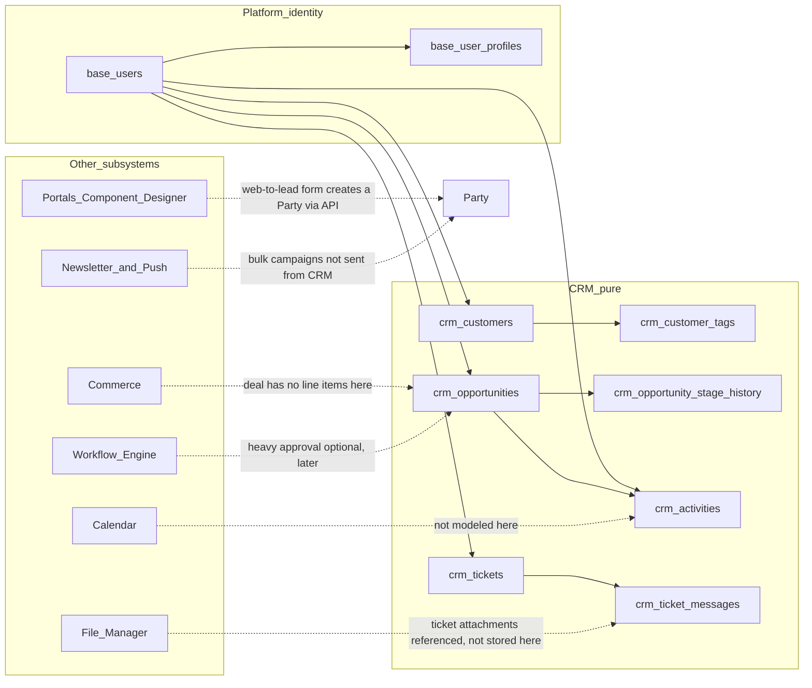
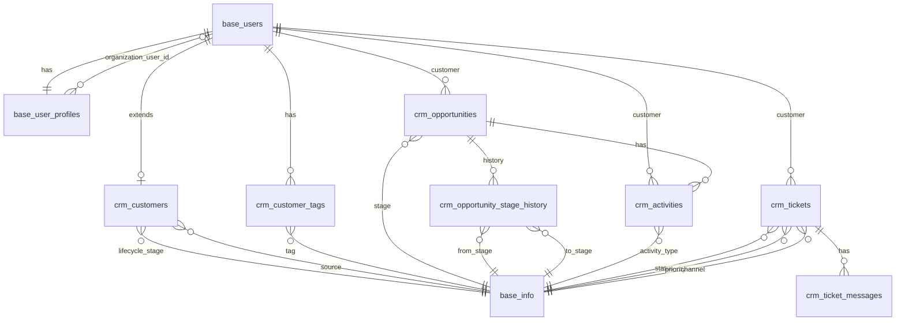
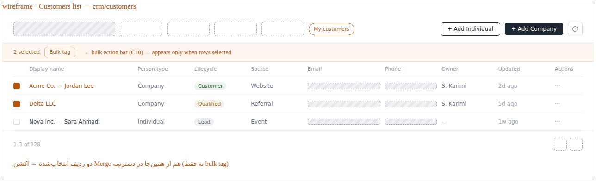
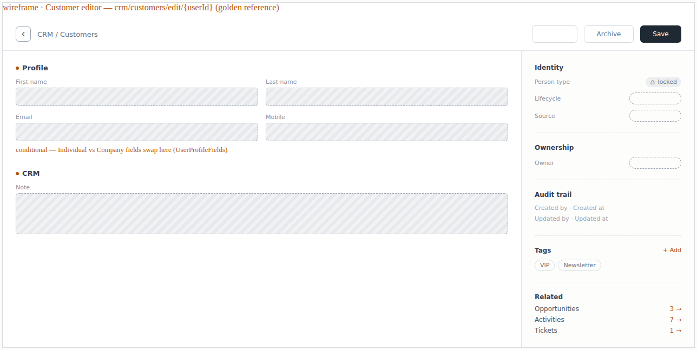
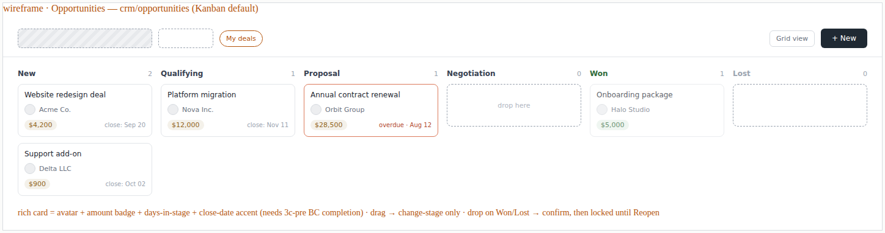
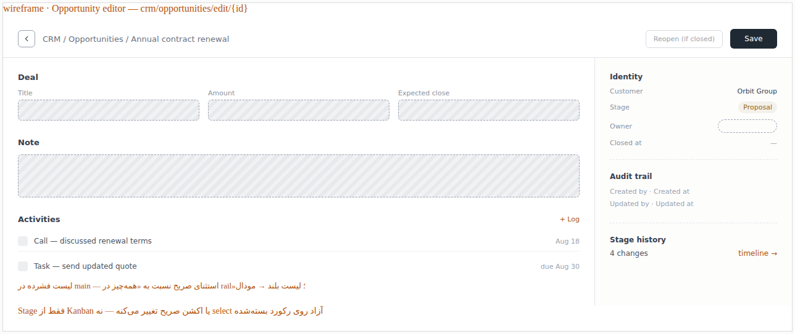
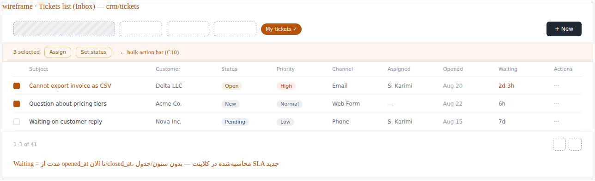
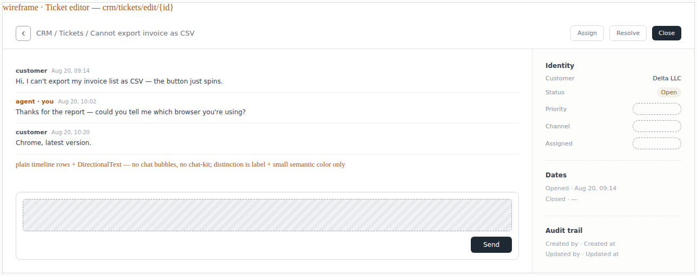
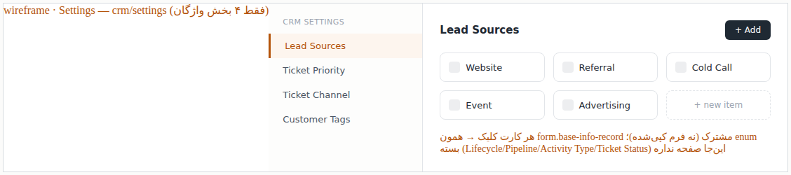

<div dir="rtl" lang="fa" class="hwy-parity-doc">
<style>
  .hwy-parity-doc { text-align: right; unicode-bidi: plaintext; }
  .hwy-parity-doc h1, .hwy-parity-doc h2, .hwy-parity-doc h3, .hwy-parity-doc h4, .hwy-parity-doc p, .hwy-parity-doc li { text-align: right; }
  .hwy-parity-doc table { direction: rtl; text-align: right; width: 100%; border-collapse: collapse; margin: 0.75rem 0; }
  .hwy-parity-doc th, .hwy-parity-doc td { border: 1px solid #c4c4c4; padding: 0.35rem 0.5rem; vertical-align: top; text-align: right; }
  .hwy-parity-doc th { background: #f6f6f6; font-weight: 600; }
  .hwy-parity-doc blockquote { text-align: right; border-right: 3px solid #ccc; border-left: none; padding-right: 1rem; margin-right: 0; }
  .hwy-parity-doc ul, .hwy-parity-doc ol { padding-right: 1.25rem; padding-left: 0; }
  .hwy-parity-doc pre, .hwy-parity-doc code { direction: ltr; text-align: left; unicode-bidi: embed; }
</style>

<p><strong>خلاصه برای operatore:</strong> این سند جزو <strong>plans</strong> است (p-packages-crm). ستون وضعیت در <a href="../p-00-packages-index.md">index مربوطه</a> مرجع «شروع شده / design / تمام» است.</p>
<p><strong>راهنمای خواندن:</strong> بخش‌های انگلیسی برای agent/dev هستند؛ جداول وضعیت و یادداشت‌های فارسی را اول بخوانید.</p>


# p-packages-crm — CRM & Support: دایرکتوری مشتری · خط لولهٔ فروش · تیکت پشتیبانی

> **Package:** **CRM & Support** (#11) — [p-packages-backlog.md](../p-packages-backlog.md)
> **اولویت پیاده‌سازی:** 16 — package track
> **پوشه اجرا:** [`plans/packages/todo/crm-package/`](./) — [پرامپت‌های فاز](crm-phase-execution-prompts.md) · [بررسی و بنچمارک](crm-plan-review-and-benchmark.md)
> **مسیر اجرا:** اسکوپ دامنه در backlog پکیج‌ها (نه zip Package Manager · نه feature built-in) — کنترل: [p-00-packages-index.md](../p-00-packages-index.md)
> **وضعیت:** ⬜ **design only (v2)** — خروجی پیاده‌سازی فاز ۱–۳ رولبک شد (۲۰۲۶-۰۸-۳۰)؛ v1 (`crm_parties`) رولبک ۲۰۲۶-۰۸-۰۸؛ مشتری = `base_users` + `base_user_profiles` + `crm_customers` طبق [`identity-profile.md`](../../../../docs/standards/identity-profile.md)
> **آخرین به‌روزرسانی:** ۲۰۲۶-۰۸-۳۰ — رولبک کامل خروجی (۳d…۳a → ۲ → ۱)؛ ۳c-pre پلتفرمی (`UiKanbanBoard`) باقی ماند · اسکریپت‌های `scripts/crm-phase*` و این سند پاک نشدند
> **وابستگی:** — (پیوست‌های تیکت به File Manager ارجاع می‌دهند؛ File Manager الزامی برای شروع نیست)
> **استانداردها:** `AGENTS.md` · [`identity-profile.md`](../../../../docs/standards/identity-profile.md) · [`package-ui.md`](../../../../docs/standards/package-ui.md) · [`package-base-info-vocab.md`](../../../../docs/standards/package-base-info-vocab.md) · [deep-linking.md](../../../../docs/standards/deep-linking.md) · [data-model.md](../../../../docs/standards/data-model.md) · Greenfield · Data Studio / Sequelize

قرارداد طراحی برای پکیج **CRM & Support** (مشتریان User+Profile · فرصت فروش · تیکت پشتیبانی).
AppEndO **platform-first** است نه CRM-first ([README](../../../../README.md)): این اسکوپ فقط رهگیری رابطه با مشتری/سازمان و رسیدگی به درخواست پشتیبانی است — تقویم/رزرو، محصول/قیمت/فاکتور، فرم وب و صفحهٔ سایت، و کمپین ایمیل انبوه را داخل خودش جمع نمی‌کند.

### اصل سخت: مثل کار یک دولوپر داخل AppEndO — نه قابلیت built-in پلتفرم

کلمهٔ **Package** اینجا یعنی **اسکوپ دامنه در backlog** — **نه** zip Package Manager و **نه** ماژول `core:*` / feature هسته.

**تست پذیرش تحویل:** اگر یک دولوپر همان کار را فقط با UI Studio (Data Studio · Base Info · Server Functions · Client Components · **Platform Pages / Navigation**) انجام می‌داد، خروجی باید **همان شکل** را داشته باشد — در Server Functions به‌عنوان function سفارشی دیده شود، در Client Components به‌عنوان کامپوننت سفارشی دیده شود، و همهٔ صفحات CRM در **نویگیشن اصلی Studio** داخل **یک گروه مستقل به نام همان پلن (`CRM`)** ظاهر شوند — **نه** پرتال/segment جدا، **نه** قاطی‌شده زیر Records/Operations/Development. چیزی که فقط در `src/features/crm` + `core:Crm` + `mountCrmRoutes` زندگی کند **رد است**.

<table dir="rtl">
<thead><tr><th>کار</th><th>مسیر درست (developer-built)</th></tr></thead>
<tbody><tr><td>جداول / associations / studio-meta</td><td><strong>Data Studio</strong> (Edge models + Sequelize)</td></tr>
<tr><td>LOVها</td><td><strong>Base Info</strong> زیر روت CRM</td></tr>
<tr><td>API / منطق دامنه</td><td><strong>Server Functions</strong> سفارشی روی Edge / Sequelize (<code dir="ltr" style="unicode-bidi: embed;">DATA_API</code> یا معادل غیر-<code dir="ltr" style="unicode-bidi: embed;">db.query</code>) — در Studio → Server Functions <strong>قابل دیدن و ویرایش</strong>؛ <strong>نه</strong> route Express چسبیده به bootstrap به‌عنوان built-in</td></tr>
<tr><td>UI لیست و جزئیات</td><td><strong>Client Components</strong> (Component Designer) — کامپوننت‌ها در Studio → <strong>Client Components</strong> لیست شوند؛ publish → page-module با <code dir="ltr" style="unicode-bidi: embed;">loaderKind: "designer"</code></td></tr>
<tr><td>صفحات / URL</td><td><strong>Platform Pages + route bindings</strong> — سه جفت binding جدا (Customers · Opportunities · Tickets) + Settings؛ هرکدام مثل Workflows: لیست + <code dir="ltr" style="unicode-bidi: embed;">…/edit/*</code></td></tr>
<tr><td>ناوبری اصلی</td><td>گروه مستقل <strong>CRM</strong> در <code dir="ltr" style="unicode-bidi: embed;">studio</code> navigation — <strong>نه</strong> Records · <strong>نه</strong> Operations · <strong>نه</strong> Development</td></tr>
</tbody></table>

**ممنوع (سخت — تکرار قبلی باعث رولبک می‌شود):**

1. `core:Crm` · `loaderKind: "core"` · ثبت در `resolvers.ts` / `lazyPages.tsx`
2. `src/features/crm/` به‌عنوان feature هستهٔ Studio
3. `mountCrmRoutes` / هر route ثابت CRM داخل `bootstrapFullRuntime` به‌عنوان API built-in پلتفرم
4. Server Functions از نوع / برچسب **built-in** برای منطق CRM — باید مثل function ساخته‌شدهٔ اپ دیده شود
5. UI فقط با React feature بدون اینکه کامپوننت در **Client Components** ظاهر شود
6. **لیست و ویرایش روی یک صفحه / split-pane** — ممنوع؛ فقط دیپ‌لینک لیست → `…/edit/{id}` (برای هر سه کاتالوگ)
7. ناوبری CRM زیر Records / Operations / Development — باید **گروه مستقل CRM**
8. Package Manager zip install · `db.query` · seed داخل `controlPlaneSeed` / bootstrap
9. `src/core/packages/crm/` به‌عنوان ماژول هسته

### دسترسی داده (سخت) — فقط Sequelize / Edge — نه `db.query`

- منبع حقیقت مدل: Edge models جدول‌های `crm_*` در Data Studio.
- خواندن/نوشتن از **Sequelize Edge** (از جمله از داخل Server Functions با موتور سازگار Sequelize / `DATA_API`) — **`db.query` ممنوع**.
- منطق دامنه (تغییر مرحلهٔ فرصت + ثبت تاریخچه، merge دو customer، باز/بستن تیکت، افزودن پیام) در همان لایهٔ function/سرویس Sequelize — نه SQL خام sandbox.

### ناوبری Studio — گروه مستقل CRM (سخت · صریح · هم‌تراز CMS)

- همهٔ صفحات پکیج فقط زیر heading ناوبری **`CRM`** در Studio (`studio` portal) — Customers · Opportunities · Tickets · Settings (واژگان).
- **ممنوع:** قاطی کردن آیتم‌های CRM داخل Records / Operations / Development؛ پرتال جدا برای CRM.
- Studio گروه را با کلید `nav.group.<heading-lowercase>` ترجمه می‌کند → **`nav.group.crm`: `CRM`**. اگر ثبت نشود UI کلید خام را نشان می‌دهد — **رد است**.
- جداکنندهٔ منطقی: کاتالوگ‌های عملیاتی → separator → Settings/Vocabulary.
- chrome لیست/فرم از **الگوی بصری** صفحات Records (Users/Roles) کپی می‌شود — ولی **جای ناوبری** گروه CRM است، نه خود Records.

### مسیریابی و ناوبری (سخت)

سه کاتالوگ مستقل + Settings، با deep-link ([deep-linking.md](../../../../docs/standards/deep-linking.md)):

<table dir="rtl">
<thead><tr><th>کاتالوگ</th><th>لیست / صفحه</th><th>ویرایش</th><th>برچسب آیتم در shell</th></tr></thead>
<tbody><tr><td>Customers</td><td><code dir="ltr" style="unicode-bidi: embed;">crm/customers</code></td><td><code dir="ltr" style="unicode-bidi: embed;">crm/customers/edit/{userId}</code></td><td>profile display name</td></tr>
<tr><td>Opportunities</td><td><code dir="ltr" style="unicode-bidi: embed;">crm/opportunities</code> (پیش‌فرض Kanban)</td><td><code dir="ltr" style="unicode-bidi: embed;">crm/opportunities/edit/{id}</code></td><td><code dir="ltr" style="unicode-bidi: embed;">title</code></td></tr>
<tr><td>Tickets</td><td><code dir="ltr" style="unicode-bidi: embed;">crm/tickets</code> (Inbox)</td><td><code dir="ltr" style="unicode-bidi: embed;">crm/tickets/edit/{id}</code></td><td><code dir="ltr" style="unicode-bidi: embed;">subject</code></td></tr>
<tr><td>Settings / vocab</td><td><code dir="ltr" style="unicode-bidi: embed;">crm/settings</code></td><td>— (مودال واژگان)</td><td>—</td></tr>
</tbody></table>

- الگوی binding: Workflows (`…` + `…/edit/*` با `nav: null` روی edit). **شناسهٔ ادیتور مشتری = `user_id`** (نه id جدول extension).
- هدر shell ادیتور: `{nav group} / {list label}` (بدون آیتم) — هویت آیتم در content header؛ hook روی workspace، نه پنل تو در تو؛ برگشت = `WorkspaceBackIcon`.
- Culture keys انگلیسی (حداقل): `nav.group.crm` · `nav.crm-customers` · `nav.crm-opportunities` · `nav.crm-tickets` · `nav.crm-settings` (مقادیر: `CRM` · `Customers` · `Opportunities` · `Tickets` · `Settings`).

### خارج از ساخت اولیهٔ اپلیکیشن (سخت)

- **ممنوع در ساخت اولیه:** جداول `crm_*` · edge models · Base Info CRM · functions/UI/nav CRM · هر seed استارتاپ.
- **مجاز فقط وقتی:** دستور صریح پیاده‌سازی این پلن.
- اپ تازه بعد از bootstrap باید **بدون** هیچ اثری از CRM باشد.

### دستور اجرا برای عامل (سخت · لازم نیست کاربر جزئیات را یادش باشد)

کاربر کافی است یکی از این‌ها را بگوید؛ **ترتیب، پیش‌نیازها، و استاندارد UI داخل همین سند است** — عامل نباید منتظر یادآوری جدا بماند.

```
@plans/packages/todo/crm-package برو جلو
@plans/packages/todo/crm-package فاز ۱ بساز
@plans/packages/todo/crm-package فاز ۲ بساز
@plans/packages/todo/crm-package زیر‌فاز 3a بساز
@plans/packages/todo/crm-package زیر‌فاز 3c-pre بساز
@plans/packages/todo/crm-package فاز N را رولبک کن
@plans/packages/todo/crm-package از فاز N به بعد را رولبک کن
```

**معنی «برو جلو»:** جدول «وضعیت اجرا» پایین سند را بخوان؛ **اولین ردیف ⬜** را بساز (ترتیب سخت زیر). بعد از پذیرش همان ردیف، وضعیت را ✅ کن و اگر کاربر نگفته «فقط همین»، همان نوبت یا نوبت بعد روی ردیف بعدی نرو مگر صریح بگوید «ادامه بده / برو جلو» دوباره — پیش‌فرض امن: **یک ردیف در هر درخواست** مگر کاربر چند فاز را با هم بخواهد.

**ترتیب سخت ساخت (هرگز جابه‌جا یا پرش بدون پذیرش قبلی):**

<table dir="rtl">
<thead><tr><th>#</th><th>کار</th><th>شرط شروع</th></tr></thead>
<tbody><tr><td>۱</td><td>فاز ۱ — دیتابیس · Base Info · studio-meta</td><td>—</td></tr>
<tr><td>۲</td><td>فاز ۲ — Server Functions + live HTTP</td><td>فاز ۱ ✅</td></tr>
<tr><td>۳a</td><td>Nav گروه CRM + <code dir="ltr" style="unicode-bidi: embed;">crm/settings</code> + واژگان</td><td>فاز ۲ ✅</td></tr>
<tr><td>۳b</td><td>Customers list + editor (طلایی)</td><td>۳a ✅</td></tr>
<tr><td>۳c-pre</td><td>تکمیل BC مشترک <code dir="ltr" style="unicode-bidi: embed;">UiKanbanBoard</code>/<code dir="ltr" style="unicode-bidi: embed;">DesignerVizKanban</code> (کارت غنی) — پلتفرمی، مشترک با Task Management؛ اگر آنجا قبلاً ساخته شده رد شود</td><td>۳b ✅</td></tr>
<tr><td>۳c</td><td>Opportunities (<code dir="ltr" style="unicode-bidi: embed;">viz.kanban</code> → <code dir="ltr" style="unicode-bidi: embed;">UiKanbanBoard</code> + wiring + bulk actions جدول)</td><td>۳c-pre ✅</td></tr>
<tr><td>۳d</td><td>Tickets inbox + feed/reply + bulk actions + My tickets</td><td>۳c ✅</td></tr>
</tbody></table>

**ترتیب رولبک:** برعکس وابستگی — UI/nav → functions → داده.

**بارگذاری اجباری برای عامل (خودکار، بدون اینکه کاربر بگوید):**

1. همیشه این پلن را منبع حقیقت بدان.
2. از **اولین کار UI (۳a به بعد)** و قبل از هر scaffold:
   - [`docs/standards/package-ui.md`](../../../../docs/standards/package-ui.md) را کامل رعایت کن (گیت Phase 3 · Base Components · polish).
   - [`docs/standards/package-base-info-vocab.md`](../../../../docs/standards/package-base-info-vocab.md) برای واژگان.
   - `/studio/base-components` یا `get_feature_graph({ pageKey: "base-components" })` را باز کن؛ هر کنترل = بخش BC نام‌برده در §UX این سند.
3. فاز ۱–۲: [`data-model.md`](../../../../docs/standards/data-model.md) · Sequelize-only · بدون `db.query` · بدون bootstrap seed.
4. **ممنوع بدون یادآوری کاربر:** پرش به فاز ۳ قبل از ۱/۲ · همهٔ صفحات UI در یک پرامپت · Auto-CRUD · `core:Crm` · HTML خام · Kanban دست‌نویس · حباب چت محصولی.

**پاسخ کوتاه عامل بعد از هر «برو جلو»:** بگو کدام ردیف را می‌سازی، پیش‌نیازها سبزند یا نه، و کدام استانداردها را بار کردی — بعد اجرا کن.
---

## هدف اصلی

CRM & Support فقط یک کار دارد: **دایرکتوری‌سازی مخاطب/سازمان → پیشبرد فرصت فروش در پایپ‌لاین → رسیدگی به تیکت پشتیبانی**.

زیرسیستم‌های دیگر بیرون می‌مانند؛ CRM فقط در صورت نیاز به آن‌ها **ارجاع** می‌دهد:

<table dir="rtl">
<thead><tr><th>دغدغه</th><th>مالک</th></tr></thead>
<tbody><tr><td>رویداد / جلسه / رزرو</td><td>Calendar</td></tr>
<tr><td>محصول / قیمت / موجودی / فاکتور</td><td>Commerce</td></tr>
<tr><td>فرم وب‌به‌سرنخ / صفحهٔ لندینگ / سایت</td><td>Portals · Component Designer</td></tr>
<tr><td>کمپین ایمیل انبوه / Web Push</td><td>Newsletter &amp; Push</td></tr>
<tr><td>زنجیرهٔ تأیید چندمرحله‌ای سنگین (مثلاً تأیید تخفیف بزرگ)</td><td>Workflow Engine (اختیاری، بعداً)</td></tr>
<tr><td>کتابخانهٔ عمومی فایل / پیوست حجیم تیکت</td><td>File Manager</td></tr>
<tr><td>هر picklist / مقدار انتخابی</td><td>Base Info (این پکیج روت و دسته‌های خودش را دارد؛ Base Info فقط ذخیره‌سازی است)</td></tr>
<tr><td>گفتگوی زنده real-time (وب‌سوکت، typing indicator، تحویل push)</td><td>زیرساخت پیام‌رسانی داخلی (بعداً) — CRM فقط رشتهٔ پیام را ذخیره می‌کند</td></tr>
</tbody></table>

**مشتری اینجا ساخته می‌شود، نه در جدول هویت موازی:** برخلاف v1 (`crm_parties` — رولبک شد)، در v2 **مشتری = کاربر پلتفرم** (`base_users` + `base_user_profiles`) به‌علاوهٔ یک ردیف extension در `crm_customers`. سایر زیرسیستم‌ها (Commerce، Forum، …) در صورت نیاز به «مشتری/عضو»، به **`base_users.id`** (یا extension دامنهٔ خودشان) ارجاع می‌دهند — نه جدول contact موازی با نام/ایمیل/تلفن تکراری.

---

## معماری v2 — مشتری = User + Profile + Extension

> **مرجع سخت:** [`identity-profile.md`](../../../../docs/standards/identity-profile.md) · skill [`platform-identity-persons.md`](../../../../.claude/skills/appendo-build-new-package-plan/references/platform-identity-persons.md)

<table dir="rtl">
<thead><tr><th>v1 (رولبک)</th><th>v2 (این سند)</th></tr></thead>
<tbody><tr><td><code dir="ltr" style="unicode-bidi: embed;">crm_parties</code> با <code dir="ltr" style="unicode-bidi: embed;">display_name</code> / email / phone</td><td><strong><code dir="ltr" style="unicode-bidi: embed;">crm_customers</code></strong> — فقط <code dir="ltr" style="unicode-bidi: embed;">user_id</code> UNIQUE + فیلدهای CRM (<code dir="ltr" style="unicode-bidi: embed;">lifecycle_stage_code</code>, <code dir="ltr" style="unicode-bidi: embed;">source_code</code>, <code dir="ltr" style="unicode-bidi: embed;">owner_id</code>, <code dir="ltr" style="unicode-bidi: embed;">note</code>)</td></tr>
<tr><td><code dir="ltr" style="unicode-bidi: embed;">party_kind_code</code> در Base Info CRM</td><td><strong><code dir="ltr" style="unicode-bidi: embed;">person_type_code</code></strong> روی <code dir="ltr" style="unicode-bidi: embed;">base_user_profiles</code> (<code dir="ltr" style="unicode-bidi: embed;">100.2.1</code> Individual · <code dir="ltr" style="unicode-bidi: embed;">100.2.2</code> Company)</td></tr>
<tr><td>Create party + kind در dialog CRM</td><td><strong>Add Individual / Add Company</strong> (الگوی Users) → نقش <code dir="ltr" style="unicode-bidi: embed;">CUSTOMER</code> → ردیف <code dir="ltr" style="unicode-bidi: embed;">crm_customers</code></td></tr>
<tr><td>Nav Parties</td><td>Nav <strong>Customers</strong> (<code dir="ltr" style="unicode-bidi: embed;">crm/customers</code>)</td></tr>
<tr><td><code dir="ltr" style="unicode-bidi: embed;">party_id</code> (v1) روی opps/tickets/activities</td><td><strong><code dir="ltr" style="unicode-bidi: embed;">customer_user_id</code> → <code dir="ltr" style="unicode-bidi: embed;">base_users.id</code></strong></td></tr>
<tr><td><code dir="ltr" style="unicode-bidi: embed;">organization_id</code> روی party</td><td><strong><code dir="ltr" style="unicode-bidi: embed;">organization_user_id</code></strong> روی <code dir="ltr" style="unicode-bidi: embed;">base_user_profiles</code> (پلتفرم)</td></tr>
<tr><td>سرنخ ناشناس بدون login</td><td>v2: <strong>همان User</strong> با lifecycle Lead — جدول prospect جدا در v2 نیست</td></tr>
</tbody></table>

**تست developer-built:** اگر دولوپر مشتری را می‌ساخت، اول User می‌ساخت — CRM فقط extension و رابطه‌های فروش/پشتیبانی را اضافه می‌کند.

---

## اصل ساخت: developer-built (جداول · سرور · کلاینت)

این پلن **باید** طوری ساخته شود که خروجی نهایی شبیه کد یک دولوپر دامنه باشد: قابل‌خواندن، صریح، قابل‌دیباگ، بدون موتور پلاگین و بدون لایهٔ «CRM جادویی». هر تصمیم اسکیما / API / UI را با این تست بسنج: *اگر یک مهندس بک‌اند/فرانت معمولی این دامنه را از صفر می‌نوشت، همین را می‌نوشت؟*

### جداول (مدل داده)

- ستون‌های **نام‌دار و ثابت** روی جدول واقعی — نه custom-field engine / `attributes` jsonb باز / آبجکت سفارشی نامحدود (پرهیز از دام Salesforce با صدها فیلد سفارشی per object).
- نام‌گذاری مثل کد اپ: `*_code` برای Base Info، `*_id` برای FK جدول عادی؛ پیشوند دامنه `crm_`؛ بدون پیشوند `base_` روی جداول دامنه.
- **User + extension** برای مشتری (`crm_customers` 1:1 با `base_users`) — هویت روی profile؛ نه `crm_parties` با `party_kind_code`.
- **یک شکل رکورد** برای تعامل گذشته و کار زمان‌بندی‌شده (`crm_activities` با `activity_type_code`) — نه جدول جدا برای Call/Email/Meeting/Task.
- تاریخچهٔ باریک و عمدی: فقط تغییر مرحلهٔ فرصت فروش snapshot می‌شود (`crm_opportunity_stage_history`) — نه لاگ حسابرسی نامحدود روی همه‌چیز.
- بدون فیلد polymorphic (`related_type` / `related_id`) — هر FK صریح و به یک جدول مشخص است.

### لایهٔ سرور

- منطق دامنه به‌صورت **Server Functions سفارشی** روی **Sequelize Edge models** — در Studio قابل دیدن؛ **نه** built-in · نه Express mount هسته · نه `db.query`.
- قوانین دامنه صریح: تغییر مرحلهٔ فرصت (+ نوشتن تاریخچه)، merge دو customer، باز/پاسخ/بستن/بازکردن تیکت، ثبت activity.
- payload تخت از ستون‌های جدول اصلی (+ joins associations)؛ بدون envelope تودرتوی اضافه.

### لایهٔ کلاینت

- کامپوننت‌ها در **Client Components** (Component Designer) ساخته و publish می‌شوند — باید در همان صفحهٔ Studio دیده شوند.
- سه جفت صفحهٔ جدا با دیپ‌لینک: **Customers**، **Opportunities** (نمای پیش‌فرض Kanban = `UiKanbanBoard`)، **Tickets** (نمای Inbox) — هرکدام لیست + ویرایش جدا، نه split-pane.
- ناوبری لیست‌ها + Settings در گروه مستقل **CRM**.
- **فقط Base Components** برای همهٔ کنترل‌ها؛ کپی انگلیسی؛ LOV از Base Info.



---

## دردهای کلاسیک CRM و تصمیم‌های ما

<table dir="rtl">
<thead><tr><th>درد کلاسیک</th><th>علت</th><th>تصمیم AppEndO CRM</th></tr></thead>
<tbody><tr><td>Lead/Contact/Account سه‌شاخه + ویزارد Convert سنگین (الگوی Salesforce/SuiteCRM)</td><td>جدا نگه‌داشتن «ناشناخته» از «شناخته‌شده» با سه آبجکت موازی</td><td>یک <strong>User</strong> + <code dir="ltr" style="unicode-bidi: embed;">crm_customers</code> با <code dir="ltr" style="unicode-bidi: embed;">lifecycle_stage_code</code>؛ بدون ویزارد Convert — Lead → Customer فقط تغییر LOV</td></tr>
<tr><td>Contact و Account معمولاً دو جدول با فیلدهای تکراری (نام، ایمیل، تلفن)</td><td>تفکیک شخص/سازمان به‌صورت اسکیمای جدا</td><td>هویت روی <strong><code dir="ltr" style="unicode-bidi: embed;">base_user_profiles</code></strong>؛ <code dir="ltr" style="unicode-bidi: embed;">person_type_code</code>؛ فیلدهای مشترک یک‌بار</td></tr>
<tr><td>سرنخ تکراری از چند کانال (فرم، ایمپورت، دستی)</td><td>ورود بدون کنترل real-time روی چند مسیر</td><td>v1: بدون dedupe خودکار فازی؛ فقط اکشن <strong>Merge</strong> دستی و صریح</td></tr>
<tr><td>صدها فیلد/آبجکت سفارشی (Salesforce تا ۸۰۰ فیلد per object)</td><td>موتور EAV/متادیتا برای پاسخ به نیاز هر مشتری</td><td>ستون نام‌دار ثابت روی extension؛ بدون custom-field engine؛ حقیقی/حقوقی فقط <code dir="ltr" style="unicode-bidi: embed;">person_type_code</code> پلتفرم</td></tr>
<tr><td>Pipeline چندگانه و سفارشی per team</td><td>هر تیم فرآیند فروش خودش را می‌خواهد</td><td>v1: یک دستهٔ Pipeline Stages مشترک سراسری در Base Info؛ چندپایپ‌لاین → بک‌لاگ فاز بعد</td></tr>
<tr><td>کپی فرآیند کاغذی گیج‌کننده مستقیم داخل ابزار</td><td>نبود بازطراحی فرآیند قبل از دیجیتالی‌سازی</td><td><code dir="ltr" style="unicode-bidi: embed;">stage_code</code> محدود و صریح (New → … → Won/Lost)؛ Won/Lost مراحل پایانی‌اند</td></tr>
<tr><td>مقدار فعلی مرحله overwrite می‌شود و گزارش سرعت پایپ‌لاین (velocity) ممکن نیست</td><td>ذخیرهٔ فقط وضعیت جاری بدون تاریخچه</td><td><code dir="ltr" style="unicode-bidi: embed;">crm_opportunity_stage_history</code> append-only به‌ازای هر تغییر مرحله</td></tr>
<tr><td>Activity/Task/Call/Email/Note در جدول‌های جدا و ناهمگون</td><td>هر ویژگی جدید = آبجکت جدید</td><td>یک جدول <code dir="ltr" style="unicode-bidi: embed;">crm_activities</code> با <code dir="ltr" style="unicode-bidi: embed;">activity_type_code</code> مشترک؛ <code dir="ltr" style="unicode-bidi: embed;">due_at</code>/<code dir="ltr" style="unicode-bidi: embed;">completed_at</code> تفاوت لاگ گذشته و کار زمان‌بندی‌شده را پوشش می‌دهد</td></tr>
<tr><td>تیکت جدید به‌جای ادامهٔ همان گفتگو (رفتار osTicket)</td><td>سادگی پیاده‌سازی به‌جای مدل thread واقعی</td><td><code dir="ltr" style="unicode-bidi: embed;">crm_tickets</code> + <code dir="ltr" style="unicode-bidi: embed;">crm_ticket_messages</code> پیوسته؛ باز/بسته فقط <code dir="ltr" style="unicode-bidi: embed;">status_code</code> را عوض می‌کند</td></tr>
<tr><td>پیوست حجیم تیکت داخل جدول اصلی گفتگو</td><td>راحتی اولیهٔ توسعه‌دهنده</td><td>پیوست از طریق <strong>File Manager</strong> (ارجاع بیرونی)، نه ستون bytea داخل <code dir="ltr" style="unicode-bidi: embed;">crm_ticket_messages</code></td></tr>
<tr><td>زنجیرهٔ فیلد <code dir="ltr" style="unicode-bidi: embed;">related_type</code>/<code dir="ltr" style="unicode-bidi: embed;">related_id</code> برای اتصال Activity به هر چیزی</td><td>تلاش برای یک جدول Activity «عمومی» برای کل پلتفرم</td><td>دو FK صریح (<code dir="ltr" style="unicode-bidi: embed;">customer_user_id</code>, <code dir="ltr" style="unicode-bidi: embed;">opportunity_id</code> nullable) — بدون polymorphism</td></tr>
<tr><td>چت زنده به‌عنوان یک زیرسیستم کامل وب‌سوکت داخل CRM</td><td>ادغام بیش‌ازحد قابلیت بلادرنگ در دامنهٔ دیگر</td><td>v1: فقط ذخیرهٔ پیام (<code dir="ltr" style="unicode-bidi: embed;">crm_ticket_messages</code>)؛ تحویل بلادرنگ/typing/push بک‌لاگ بعدی</td></tr>
<tr><td>هویت کارمند فروش/پشتیبانی به‌عنوان customer موازی</td><td>دنبال‌کردن الگوی «همه یک Contact هستند»</td><td>کاربر پلتفرم = <code dir="ltr" style="unicode-bidi: embed;">base_users</code> (<code dir="ltr" style="unicode-bidi: embed;">owner_id</code> / <code dir="ltr" style="unicode-bidi: embed;">assigned_to</code>)؛ <code dir="ltr" style="unicode-bidi: embed;">crm_customers</code> فقط مشتریان با نقش CUSTOMER</td></tr>
<tr><td>جدول <code dir="ltr" style="unicode-bidi: embed;">crm_parties</code> جدا از User (v1)</td><td>تکرار نام/ایمیل/تلفن و دو واژگان حقیقی/حقوقی</td><td><strong>رولبک v1</strong> — v2: User + Profile + extension؛ یک <code dir="ltr" style="unicode-bidi: embed;">person_type_code</code></td></tr>
</tbody></table>

---

## بنچمارک با نمونه‌های جهانی و تصمیم نهایی

جدول «دردهای کلاسیک» بالا مرزهای عمدی این پکیج را در برابر Salesforce/SuiteCRM/osTicket (پیچیدگی بیش‌ازحد، EAV، سه‌شاخهٔ Lead/Contact/Account) مشخص کرده. این بخش الگوهای **مثبت** ابزارهای سبک و مدرن‌تر — Pipedrive · HubSpot · Close · Zendesk · Intercom · Help Scout — و همچنین دو نمونهٔ enterprise کلاسیک‌تر (Microsoft Dynamics CRM · SugarCRM) را در برابر همان مرزها می‌سنجد؛ همان روشی که برای [p-packages-task-management.md](../tsk-package/p-packages-task-management.md) اجرا شد. هیچ‌کدام قاعدهٔ سخت بالا را نمی‌شکنند.

<table dir="rtl">
<thead><tr><th>الگو</th><th>منبع</th><th>تصمیم v1</th><th>دلیل</th></tr></thead>
<tbody><tr><td>Bulk select + bulk status/assignee/tag روی جدول Customers/Tickets</td><td>HubSpot · Zendesk</td><td>✅ اضافه شد</td><td><code dir="ltr" style="unicode-bidi: embed;">AppTableGrid</code> از قبل <code dir="ltr" style="unicode-bidi: embed;">selectionMode="multiple"</code> دارد (<a href="../../../../src/shared/ui/AppTableGrid.tsx#L181">AppTableGrid.tsx:181</a>) — فقط wiring دامنه، بدون BC جدید؛ جزئیات در C10</td></tr>
<tr><td>کارت کانبان غنی روی Opportunities (customer avatar · amount badge · days-in-stage · close-date accent)</td><td>Pipedrive · HubSpot deal cards</td><td>✅ اضافه شد — نیازمند همان تکمیل BC که برای Task Management سند شد</td><td>امروز <code dir="ltr" style="unicode-bidi: embed;">UiKanbanCard</code> فقط <code dir="ltr" style="unicode-bidi: embed;">id</code>/<code dir="ltr" style="unicode-bidi: embed;">title</code>/<code dir="ltr" style="unicode-bidi: embed;">description</code> دارد — کافی نیست برای «title · customer · amount» که همین سند هم می‌خواهد؛ جزئیات در §کار پایه‌ای Base Components</td></tr>
<tr><td>«My tickets» / «My deals» quick filter</td><td>Zendesk · Pipedrive</td><td>✅ اضافه شد (فیلتر <code dir="ltr" style="unicode-bidi: embed;">assigned_to</code>/<code dir="ltr" style="unicode-bidi: embed;">owner_id</code> = current user)</td><td>تغییر کم‌هزینه؛ الگوی تأیید‌شده در پلن Task Management</td></tr>
<tr><td>نشان «مدت انتظار» روی تیکت (از <code dir="ltr" style="unicode-bidi: embed;">opened_at</code> محاسبه می‌شود، نه ستون SLA جدید)</td><td>Zendesk/Intercom SLA breach badge</td><td>✅ نسخهٔ سبک اضافه شد</td><td>فقط عدد مشتق‌شده در کلاینت از <code dir="ltr" style="unicode-bidi: embed;">opened_at</code>/<code dir="ltr" style="unicode-bidi: embed;">closed_at</code> موجود — <strong>بدون</strong> ستون/جدول SLA جدید (که خودش نیازمند business-hours/escalation است و زودهنگام خواهد بود)</td></tr>
<tr><td>Search روی Customers شامل نام + ایمیل + شماره</td><td>همه</td><td>✅ گسترش جزئی</td><td>از قبل join پروفایل موجود بود؛ فقط match فیلد جست‌وجو گسترده شد</td></tr>
<tr><td>هشدار duplicate نرم (non-blocking) در لحظهٔ Create Customer وقتی ایمیل/موبایل با یک user موجود یکی است</td><td>Microsoft Dynamics CRM · SugarCRM</td><td>✅ اضافه شد</td><td>فقط یک query ساده روی email/phone قبل از submit + پیام «Possible existing customer: X — continue anyway?»؛ <strong>بدون</strong> dedupe خودکار/فازی — همان مرز «Merge فقط دستی» حفظ می‌شود؛ جزئیات در §صفحهٔ لیست Customers و C1</td></tr>
<tr><td>Business Process Flow / stage checklist اجباری روی هر مرحله</td><td>Microsoft Dynamics CRM</td><td>❌ v1</td><td>مخالف مستقیم اصل «بدون موتور جادویی»؛ همان تصمیم رد Workflow Engine</td></tr>
<tr><td>Territory / assignment rule خودکار</td><td>Microsoft Dynamics CRM</td><td>❌ v1 → بک‌لاگ</td><td>نیازمند rule engine جدا، هم‌راستا با رد SLA escalation</td></tr>
<tr><td>Outlook / Email two-way sync</td><td>Microsoft Dynamics CRM · SugarCRM</td><td>❌ v1 (از قبل رد شده — inbound فقط از Portals/بعداً)</td><td>تأیید مجدد</td></tr>
<tr><td>Command palette سراسری (<code dir="ltr" style="unicode-bidi: embed;">⌘K</code>)</td><td>Linear (به‌عنوان الگوی متقاطع)</td><td>❌ v1</td><td>Primitive پلتفرمی مشترک، نه مال یک پکیج — همان تصمیم پلن Task Management</td></tr>
<tr><td>Saved / shared list views</td><td>Salesforce · HubSpot</td><td>❌ v1 → بک‌لاگ</td><td>نیازمند جدول/مکانیزم جدید خارج از هفت جدول تصمیم‌گرفته‌شده</td></tr>
<tr><td>SLA / first-response timer با escalation</td><td>Zendesk · Intercom</td><td>❌ v1 → بک‌لاگ</td><td>نیازمند business hours + escalation rule engine — دام «موتور جادویی» که سند صریحاً رد کرده</td></tr>
<tr><td>Email-to-ticket خودکار / two-way sync صندوق ایمیل</td><td>Zendesk · Help Scout</td><td>❌ v1 (از قبل رد شده — inbound فقط از Portals/بعداً)</td><td>تأیید مجدد</td></tr>
<tr><td>Lead scoring خودکار/AI</td><td>HubSpot</td><td>❌ v1 (از قبل رد شده)</td><td>تأیید مجدد</td></tr>
</tbody></table>

**نتیجه:** پنج مورد روی UX این v1 اثر می‌گذارند — bulk actions · کارت Kanban غنی · «My tickets» filter · نشان مدت‌انتظار · هشدار duplicate نرم — و هرپنج بدون شکستن جدول «ممنوع (سخت)» بالا قابل‌ساختن‌اند. یکی از آن‌ها (کارت غنی) دقیقاً همان تکمیل BC است که Task Management هم به آن نیاز دارد — یک‌بار ساخته می‌شود، هر دو پکیج مصرف می‌کنند. بقیهٔ الگوهای Dynamics/Sugar (business process flow، territory، email sync) آگاهانه رد شدند چون همان مرزهای «بدون موتور جادویی» / «بدون sync دوطرفهٔ ایمیل» را که سند از ابتدا کشیده بود نقض می‌کنند.

---

## اطلاعات پایه (Base Info) — ریشهٔ CRM

در **اطلاعات پایه** ابتدا یک **روت** ساخته می‌شود به نام **CRM**.

بعد، هر جا در دامنه فیلد `*_code` داریم که باید به اطلاعات پایه وصل شود، زیر همان روت CRM یک **دسته** ساخته می‌شود و **آیتم‌های مربوطه** زیر همان دسته قرار می‌گیرند — نه ریشهٔ جدا برای هر LOV.

```
Base Info
└── CRM                          ← روت پکیج
    ├── Lifecycle Stages          ← دسته ← lifecycle_stage_code (crm_customers)
    │   └── Lead, Qualified, Customer, Lost
    ├── Lead Sources               ← دسته ← source_code
    │   └── Website, Referral, Cold Call, Event, Advertising, Import, Other
    ├── Pipeline Stages            ← دسته ← stage_code
    │   └── New, Qualifying, Proposal, Negotiation, Won, Lost
    ├── Activity Types             ← دسته ← activity_type_code
    │   └── Call, Email, Meeting, Note, Task
    ├── Ticket Status               ← دسته ← status_code (crm_tickets)
    │   └── New, Open, Pending, Resolved, Closed
    ├── Ticket Priority             ← دسته ← priority_code
    │   └── Low, Normal, High, Urgent
    ├── Ticket Channel              ← دسته ← channel_code
    │   └── Email, Phone, Web Form, Chat, Social
    └── Customer Tags                  ← دسته ← tag_code (via crm_customer_tags)
        └── VIP, Cold, Newsletter, …
```

**خارج از روت CRM (پلتفرم):** `person_type_code` زیر Base Info `100.2` (Individual / Company) — [`identity-profile.md`](../../../../docs/standards/identity-profile.md).

قواعد:

1. فقط **یک روت** برای پکیج: عنوان `CRM` (seed **فقط هنگام پیاده‌سازی پکیج**؛ نه در bootstrap اولیهٔ اپ؛ id نهایی از همان seed پکیج).
2. به‌ازای هر اتصال `*_code` → Base Info، یک **دسته** زیر CRM.
3. مقادیر قابل‌انتخاب = **فرزندان مستقیم همان دسته** (آیتم‌ها).
4. FK ستون‌های `*_code` به `base_info.id` همان آیتم اشاره می‌کند؛ UI options با `root=` همان **دسته** (نه روت CRM مگر برای مرور درختی).
5. عنوان‌ها انگلیسی؛ `shortName` لاتین؛ `ui_html` مثلاً `<i data-lucide="…"></i>`.

اگر بعداً `*_code` جدیدی به دامنه اضافه شد: دستهٔ جدید زیر CRM + آیتم‌ها — روت جدید نساز.

### صفحات واژگان vs enum بسته (سخت · هم‌راستا با CMS / `package-ui`)

<table dir="rtl">
<thead><tr><th>دسته</th><th>صفحهٔ واژگان زیر Settings CRM</th><th>دلیل</th></tr></thead>
<tbody><tr><td><strong>Person type (platform <code dir="ltr" style="unicode-bidi: embed;">100.2</code>)</strong></td><td>❌ ندارد</td><td>مالک پلتفرم — Users create Individual/Company</td></tr>
<tr><td><strong>Lifecycle Stages</strong></td><td>❌ ندارد</td><td>Merge/آرشیو و چرخهٔ دامنه روی <code dir="ltr" style="unicode-bidi: embed;">lead</code>/<code dir="ltr" style="unicode-bidi: embed;">qualified</code>/<code dir="ltr" style="unicode-bidi: embed;">customer</code>/<code dir="ltr" style="unicode-bidi: embed;">lost</code> قفل است</td></tr>
<tr><td><strong>Pipeline Stages</strong></td><td>❌ ندارد</td><td><code dir="ltr" style="unicode-bidi: embed;">Won</code>/<code dir="ltr" style="unicode-bidi: embed;">Lost</code> پایانی‌اند؛ <code dir="ltr" style="unicode-bidi: embed;">change-stage</code> / Kanban روی shortNameها قفل است</td></tr>
<tr><td><strong>Activity Types</strong></td><td>❌ ندارد</td><td><code dir="ltr" style="unicode-bidi: embed;">task</code> رفتار <code dir="ltr" style="unicode-bidi: embed;">due_at</code> را تعیین می‌کند</td></tr>
<tr><td><strong>Ticket Status</strong></td><td>❌ ندارد</td><td>Assign/Resolve/Close/Reopen روی shortNameها قفل است</td></tr>
<tr><td><strong>Lead Sources</strong></td><td>✅ catalog + <code dir="ltr" style="unicode-bidi: embed;">form.base-info-record</code></td><td>LOV قابل‌گسترش اپراتور</td></tr>
<tr><td><strong>Ticket Priority</strong></td><td>✅</td><td>LOV قابل‌گسترش</td></tr>
<tr><td><strong>Ticket Channel</strong></td><td>✅</td><td>LOV قابل‌گسترش</td></tr>
<tr><td><strong>Customer Tags</strong></td><td>✅</td><td>برچسب آزاد اپراتور</td></tr>
</tbody></table>

مقادیر enum بسته فقط از seed فاز ۱؛ در UI به‌صورت select/badge/Kanban column. **ممنوع:** ساخت صفحه/آیتم nav برای enum بسته.

### Person type — پلتفرم (`base_user_profiles.person_type_code`)

**در Base Info CRM seed نمی‌شود.** مقادیر از روت پلتفرم `100.2`:

<table dir="rtl">
<thead><tr><th>Code</th><th>Meaning</th><th>UI</th></tr></thead>
<tbody><tr><td><code dir="ltr" style="unicode-bidi: embed;">100.2.1</code></td><td>Natural person</td><td>Add Individual</td></tr>
<tr><td><code dir="ltr" style="unicode-bidi: embed;">100.2.2</code></td><td>Legal entity</td><td>Add Company</td></tr>
</tbody></table>

قفل بعد از create؛ فیلدهای شرطی طبق [`identity-profile.md`](../../../../docs/standards/identity-profile.md). پیوند Individual→Company: `organization_user_id` روی profile.

### دسته: Lifecycle Stages → `lifecycle_stage_code`

<table dir="rtl">
<thead><tr><th>#</th><th>Title</th><th>shortName</th><th>Lucide icon</th><th>نقش</th></tr></thead>
<tbody><tr><td>1</td><td>Lead</td><td><code dir="ltr" style="unicode-bidi: embed;">lead</code></td><td><code dir="ltr" style="unicode-bidi: embed;">Sprout</code></td><td>تازه شناسایی‌شده؛ هنوز واجد شرایط نیست</td></tr>
<tr><td>2</td><td>Qualified</td><td><code dir="ltr" style="unicode-bidi: embed;">qualified</code></td><td><code dir="ltr" style="unicode-bidi: embed;">BadgeCheck</code></td><td>واجد شرایط پیگیری فروش</td></tr>
<tr><td>3</td><td>Customer</td><td><code dir="ltr" style="unicode-bidi: embed;">customer</code></td><td><code dir="ltr" style="unicode-bidi: embed;">Handshake</code></td><td>حداقل یک فرصت Won یا رابطهٔ فعال دارد</td></tr>
<tr><td>4</td><td>Lost</td><td><code dir="ltr" style="unicode-bidi: embed;">lost</code></td><td><code dir="ltr" style="unicode-bidi: embed;">UserX</code></td><td>پیگیری متوقف شد / ریزش کرد</td></tr>
</tbody></table>

### دسته: Lead Sources → `source_code`

<table dir="rtl">
<thead><tr><th>#</th><th>Title</th><th>shortName</th><th>Lucide icon</th></tr></thead>
<tbody><tr><td>1</td><td>Website</td><td><code dir="ltr" style="unicode-bidi: embed;">website</code></td><td><code dir="ltr" style="unicode-bidi: embed;">Globe</code></td></tr>
<tr><td>2</td><td>Referral</td><td><code dir="ltr" style="unicode-bidi: embed;">referral</code></td><td><code dir="ltr" style="unicode-bidi: embed;">Users</code></td></tr>
<tr><td>3</td><td>Cold Call</td><td><code dir="ltr" style="unicode-bidi: embed;">cold_call</code></td><td><code dir="ltr" style="unicode-bidi: embed;">Phone</code></td></tr>
<tr><td>4</td><td>Event</td><td><code dir="ltr" style="unicode-bidi: embed;">event</code></td><td><code dir="ltr" style="unicode-bidi: embed;">CalendarDays</code></td></tr>
<tr><td>5</td><td>Advertising</td><td><code dir="ltr" style="unicode-bidi: embed;">advertising</code></td><td><code dir="ltr" style="unicode-bidi: embed;">Megaphone</code></td></tr>
<tr><td>6</td><td>Import</td><td><code dir="ltr" style="unicode-bidi: embed;">import</code></td><td><code dir="ltr" style="unicode-bidi: embed;">Upload</code></td></tr>
<tr><td>7</td><td>Other</td><td><code dir="ltr" style="unicode-bidi: embed;">other</code></td><td><code dir="ltr" style="unicode-bidi: embed;">CircleEllipsis</code></td></tr>
</tbody></table>

**admin UI:** catalog cards + shared Base Info record form (`form.base-info-record`); API via `DataSourceDefinition` — نه مودال فیلد کپی‌شده.

### دسته: Pipeline Stages → `stage_code`

<table dir="rtl">
<thead><tr><th>#</th><th>Title</th><th>shortName</th><th>Lucide icon</th><th>نقش</th></tr></thead>
<tbody><tr><td>1</td><td>New</td><td><code dir="ltr" style="unicode-bidi: embed;">new</code></td><td><code dir="ltr" style="unicode-bidi: embed;">Sparkle</code></td><td>فرصت تازه ثبت‌شده</td></tr>
<tr><td>2</td><td>Qualifying</td><td><code dir="ltr" style="unicode-bidi: embed;">qualifying</code></td><td><code dir="ltr" style="unicode-bidi: embed;">SearchCheck</code></td><td>در حال ارزیابی صلاحیت</td></tr>
<tr><td>3</td><td>Proposal</td><td><code dir="ltr" style="unicode-bidi: embed;">proposal</code></td><td><code dir="ltr" style="unicode-bidi: embed;">FileText</code></td><td>پیشنهاد ارسال شد</td></tr>
<tr><td>4</td><td>Negotiation</td><td><code dir="ltr" style="unicode-bidi: embed;">negotiation</code></td><td><code dir="ltr" style="unicode-bidi: embed;">Scale</code></td><td>مذاکره روی شرایط</td></tr>
<tr><td>5</td><td>Won</td><td><code dir="ltr" style="unicode-bidi: embed;">won</code></td><td><code dir="ltr" style="unicode-bidi: embed;">Trophy</code></td><td><strong>پایانی</strong> — بسته‌شده به نفع فروش</td></tr>
<tr><td>6</td><td>Lost</td><td><code dir="ltr" style="unicode-bidi: embed;">lost</code></td><td><code dir="ltr" style="unicode-bidi: embed;">XCircle</code></td><td><strong>پایانی</strong> — بسته‌شده بدون فروش</td></tr>
</tbody></table>

### دسته: Activity Types → `activity_type_code`

<table dir="rtl">
<thead><tr><th>#</th><th>Title</th><th>shortName</th><th>Lucide icon</th><th>نقش</th></tr></thead>
<tbody><tr><td>1</td><td>Call</td><td><code dir="ltr" style="unicode-bidi: embed;">call</code></td><td><code dir="ltr" style="unicode-bidi: embed;">Phone</code></td><td>تماس تلفنی (گذشته یا زمان‌بندی‌شده)</td></tr>
<tr><td>2</td><td>Email</td><td><code dir="ltr" style="unicode-bidi: embed;">email</code></td><td><code dir="ltr" style="unicode-bidi: embed;">Mail</code></td><td>ایمیل رد و بدل‌شده</td></tr>
<tr><td>3</td><td>Meeting</td><td><code dir="ltr" style="unicode-bidi: embed;">meeting</code></td><td><code dir="ltr" style="unicode-bidi: embed;">Users</code></td><td>جلسه (زمان‌بندی واقعی مال Calendar است؛ اینجا فقط لاگ)</td></tr>
<tr><td>4</td><td>Note</td><td><code dir="ltr" style="unicode-bidi: embed;">note</code></td><td><code dir="ltr" style="unicode-bidi: embed;">StickyNote</code></td><td>یادداشت داخلی</td></tr>
<tr><td>5</td><td>Task</td><td><code dir="ltr" style="unicode-bidi: embed;">task</code></td><td><code dir="ltr" style="unicode-bidi: embed;">ListTodo</code></td><td>کار زمان‌بندی‌شده (<code dir="ltr" style="unicode-bidi: embed;">due_at</code> پر است)</td></tr>
</tbody></table>

### دسته: Ticket Status → `status_code`

<table dir="rtl">
<thead><tr><th>#</th><th>Title</th><th>shortName</th><th>Lucide icon</th><th>نقش</th></tr></thead>
<tbody><tr><td>1</td><td>New</td><td><code dir="ltr" style="unicode-bidi: embed;">new</code></td><td><code dir="ltr" style="unicode-bidi: embed;">CircleDot</code></td><td>تازه رسیده؛ هنوز assign نشده</td></tr>
<tr><td>2</td><td>Open</td><td><code dir="ltr" style="unicode-bidi: embed;">open</code></td><td><code dir="ltr" style="unicode-bidi: embed;">FolderOpen</code></td><td>در حال رسیدگی</td></tr>
<tr><td>3</td><td>Pending</td><td><code dir="ltr" style="unicode-bidi: embed;">pending</code></td><td><code dir="ltr" style="unicode-bidi: embed;">Clock</code></td><td>منتظر پاسخ مشتری</td></tr>
<tr><td>4</td><td>Resolved</td><td><code dir="ltr" style="unicode-bidi: embed;">resolved</code></td><td><code dir="ltr" style="unicode-bidi: embed;">CheckCircle2</code></td><td>حل شد؛ منتظر تأیید بسته‌شدن</td></tr>
<tr><td>5</td><td>Closed</td><td><code dir="ltr" style="unicode-bidi: embed;">closed</code></td><td><code dir="ltr" style="unicode-bidi: embed;">Archive</code></td><td>بسته — تاریخچه می‌ماند؛ reopen مجاز</td></tr>
</tbody></table>

### دسته: Ticket Priority → `priority_code`

<table dir="rtl">
<thead><tr><th>#</th><th>Title</th><th>shortName</th><th>Lucide icon</th></tr></thead>
<tbody><tr><td>1</td><td>Low</td><td><code dir="ltr" style="unicode-bidi: embed;">low</code></td><td><code dir="ltr" style="unicode-bidi: embed;">ArrowDown</code></td></tr>
<tr><td>2</td><td>Normal</td><td><code dir="ltr" style="unicode-bidi: embed;">normal</code></td><td><code dir="ltr" style="unicode-bidi: embed;">Minus</code></td></tr>
<tr><td>3</td><td>High</td><td><code dir="ltr" style="unicode-bidi: embed;">high</code></td><td><code dir="ltr" style="unicode-bidi: embed;">ArrowUp</code></td></tr>
<tr><td>4</td><td>Urgent</td><td><code dir="ltr" style="unicode-bidi: embed;">urgent</code></td><td><code dir="ltr" style="unicode-bidi: embed;">TriangleAlert</code></td></tr>
</tbody></table>

**admin UI:** catalog cards + shared Base Info record form (`form.base-info-record`); API via `DataSourceDefinition`.

### دسته: Ticket Channel → `channel_code`

<table dir="rtl">
<thead><tr><th>#</th><th>Title</th><th>shortName</th><th>Lucide icon</th><th>نقش</th></tr></thead>
<tbody><tr><td>1</td><td>Email</td><td><code dir="ltr" style="unicode-bidi: embed;">email</code></td><td><code dir="ltr" style="unicode-bidi: embed;">Mail</code></td><td>تیکت از ایمیل رسیده</td></tr>
<tr><td>2</td><td>Phone</td><td><code dir="ltr" style="unicode-bidi: embed;">phone</code></td><td><code dir="ltr" style="unicode-bidi: embed;">Phone</code></td><td>تیکت از تماس تلفنی رسیده</td></tr>
<tr><td>3</td><td>Web Form</td><td><code dir="ltr" style="unicode-bidi: embed;">web_form</code></td><td><code dir="ltr" style="unicode-bidi: embed;">FileText</code></td><td>فرم تماس روی سایت (Portals می‌سازد؛ CRM فقط دریافت‌کننده است)</td></tr>
<tr><td>4</td><td>Chat</td><td><code dir="ltr" style="unicode-bidi: embed;">chat</code></td><td><code dir="ltr" style="unicode-bidi: embed;">MessageCircle</code></td><td>برچسب کانال؛ <strong>بدون</strong> زیرسیستم چت زندهٔ v1</td></tr>
<tr><td>5</td><td>Social</td><td><code dir="ltr" style="unicode-bidi: embed;">social</code></td><td><code dir="ltr" style="unicode-bidi: embed;">Share2</code></td><td>شبکهٔ اجتماعی</td></tr>
</tbody></table>

**admin UI:** catalog cards + shared Base Info record form (`form.base-info-record`); API via `DataSourceDefinition`.

### دسته: Customer Tags → `tag_code`

فهرست قابل‌انتخاب — **بدون جدول `crm_tags`**. تخت؛ مدیریت در Base Info؛ اتصال با `crm_customer_tags.tag_code` → `base_info.id` آیتم زیر همین دسته.

<table dir="rtl">
<thead><tr><th>#</th><th>Title</th><th>shortName</th><th>Lucide icon</th></tr></thead>
<tbody><tr><td>1</td><td>VIP</td><td><code dir="ltr" style="unicode-bidi: embed;">vip</code></td><td><code dir="ltr" style="unicode-bidi: embed;">Star</code></td></tr>
<tr><td>2</td><td>Cold</td><td><code dir="ltr" style="unicode-bidi: embed;">cold</code></td><td><code dir="ltr" style="unicode-bidi: embed;">Snowflake</code></td></tr>
<tr><td>3</td><td>Newsletter Subscriber</td><td><code dir="ltr" style="unicode-bidi: embed;">newsletter_subscriber</code></td><td><code dir="ltr" style="unicode-bidi: embed;">Mail</code></td></tr>
<tr><td>4</td><td>Partner</td><td><code dir="ltr" style="unicode-bidi: embed;">partner</code></td><td><code dir="ltr" style="unicode-bidi: embed;">Handshake</code></td></tr>
<tr><td>5</td><td>Reseller</td><td><code dir="ltr" style="unicode-bidi: embed;">reseller</code></td><td><code dir="ltr" style="unicode-bidi: embed;">Repeat</code></td></tr>
<tr><td>6</td><td>High Value</td><td><code dir="ltr" style="unicode-bidi: embed;">high_value</code></td><td><code dir="ltr" style="unicode-bidi: embed;">Gem</code></td></tr>
<tr><td>7</td><td>At Risk</td><td><code dir="ltr" style="unicode-bidi: embed;">at_risk</code></td><td><code dir="ltr" style="unicode-bidi: embed;">AlertTriangle</code></td></tr>
<tr><td>8</td><td>Do Not Contact</td><td><code dir="ltr" style="unicode-bidi: embed;">do_not_contact</code></td><td><code dir="ltr" style="unicode-bidi: embed;">BellOff</code></td></tr>
</tbody></table>

**admin UI:** catalog cards + shared Base Info record form (`form.base-info-record`); API via `DataSourceDefinition`.

### صریحاً `crm_parties` نیستند (خارج از این جدول)

<table dir="rtl">
<thead><tr><th>مورد</th><th>مالک</th></tr></thead>
<tbody><tr><td>کاربر داخلی پلتفرم (فروشنده، پشتیبان)</td><td><code dir="ltr" style="unicode-bidi: embed;">base_users</code> — از طریق <code dir="ltr" style="unicode-bidi: embed;">owner_id</code> / <code dir="ltr" style="unicode-bidi: embed;">assigned_to</code>، نه رکورد customer موازی</td></tr>
<tr><td>محصول / سفارش / فاکتور</td><td>Commerce</td></tr>
<tr><td>رویداد / جلسهٔ زمان‌بندی‌شده</td><td>Calendar</td></tr>
<tr><td>بازدیدکنندهٔ ناشناس سایت</td><td>خارج از اسکوپ (تحلیل‌گر بعدی، در صورت نیاز)</td></tr>
</tbody></table>

---

## مدل دامنه

> **developer-built:** اسکیما مثل مدل دامنهٔ دست‌نویس — جدول و ستون صریح؛ بدون meta لایه و بدون «قابلیت CRM» پنهان. جزئیات اصل ساخت در بخش بالا.

### تصمیم

1. **`crm_customers`** — extension 1:1 با `base_users`؛ فقط فیلدهای CRM (lifecycle، source، owner، note)
2. **`crm_customer_tags`** — واسط `user_id` ↔ تگ Base Info
3. `crm_opportunities` — فرصت فروش در پایپ‌لاین (بدون آیتم‌های خط سفارش — آن‌ها مال Commerce‌اند)
4. `crm_opportunity_stage_history` — **فقط تاریخچه**؛ هر تغییر `stage_code` یک ردیف
5. `crm_activities` — یک شکل رکورد برای تعامل گذشته و کار زمان‌بندی‌شده (`call`/`email`/`meeting`/`note`/`task`)
6. `crm_tickets` — واحد درخواست پشتیبانی
7. `crm_ticket_messages` — رشتهٔ پیام تیکت (فقط ذخیره؛ بدون تحویل بلادرنگ)

جداول `crm_parties`، `crm_leads`، `crm_contacts`، `crm_accounts`، `crm_tasks`، `crm_pipelines` **وجود ندارند** (v1 `crm_parties` رولبک شد).
`lifecycle_stage_code` / `source_code` / `stage_code` / `activity_type_code` / `status_code` / `priority_code` / `channel_code` / `tag_code` از Base Info CRM.
`person_type_code` از پلتفرم (`100.2`) — نه CRM.
Won/Lost دو مقدار پایانی همان دستهٔ `Pipeline Stages` هستند — ستون وضعیت جدا برای «بسته/باز بودن» فرصت نداریم.



### `crm_customers` — extension مشتری (1:1 با user)

<table dir="rtl">
<thead><tr><th>#</th><th>Column</th><th>Native</th><th>Runtime</th><th>Null</th><th>نقش</th></tr></thead>
<tbody><tr><td>1</td><td><code dir="ltr" style="unicode-bidi: embed;">id</code></td><td><code dir="ltr" style="unicode-bidi: embed;">bigint</code></td><td><code dir="ltr" style="unicode-bidi: embed;">INTEGER</code></td><td>no</td><td>PK</td></tr>
<tr><td>2</td><td><code dir="ltr" style="unicode-bidi: embed;">user_id</code></td><td><code dir="ltr" style="unicode-bidi: embed;">bigint</code></td><td><code dir="ltr" style="unicode-bidi: embed;">INTEGER</code></td><td>no</td><td>UNIQUE → <code dir="ltr" style="unicode-bidi: embed;">base_users.id</code></td></tr>
<tr><td>3</td><td><code dir="ltr" style="unicode-bidi: embed;">lifecycle_stage_code</code></td><td><code dir="ltr" style="unicode-bidi: embed;">text</code></td><td><code dir="ltr" style="unicode-bidi: embed;">STRING</code></td><td>yes</td><td>→ Base Info · CRM / Lifecycle Stages</td></tr>
<tr><td>4</td><td><code dir="ltr" style="unicode-bidi: embed;">source_code</code></td><td><code dir="ltr" style="unicode-bidi: embed;">text</code></td><td><code dir="ltr" style="unicode-bidi: embed;">STRING</code></td><td>yes</td><td>→ Base Info · CRM / Lead Sources</td></tr>
<tr><td>5</td><td><code dir="ltr" style="unicode-bidi: embed;">owner_id</code></td><td><code dir="ltr" style="unicode-bidi: embed;">bigint</code></td><td><code dir="ltr" style="unicode-bidi: embed;">INTEGER</code></td><td>yes</td><td>→ <code dir="ltr" style="unicode-bidi: embed;">base_users.id</code>؛ فروشنده مسئول</td></tr>
<tr><td>6</td><td><code dir="ltr" style="unicode-bidi: embed;">note</code></td><td><code dir="ltr" style="unicode-bidi: embed;">text</code></td><td><code dir="ltr" style="unicode-bidi: embed;">STRING</code></td><td>yes</td><td>یادداشت داخلی CRM</td></tr>
<tr><td>7</td><td><code dir="ltr" style="unicode-bidi: embed;">created_by</code></td><td><code dir="ltr" style="unicode-bidi: embed;">bigint</code></td><td><code dir="ltr" style="unicode-bidi: embed;">INTEGER</code></td><td>yes</td><td>→ <code dir="ltr" style="unicode-bidi: embed;">base_users.id</code></td></tr>
<tr><td>8</td><td><code dir="ltr" style="unicode-bidi: embed;">created_at</code></td><td><code dir="ltr" style="unicode-bidi: embed;">timestamp with time zone</code></td><td><code dir="ltr" style="unicode-bidi: embed;">DATE</code></td><td>yes</td><td>زمان ایجاد</td></tr>
<tr><td>9</td><td><code dir="ltr" style="unicode-bidi: embed;">updated_by</code></td><td><code dir="ltr" style="unicode-bidi: embed;">bigint</code></td><td><code dir="ltr" style="unicode-bidi: embed;">INTEGER</code></td><td>yes</td><td>→ <code dir="ltr" style="unicode-bidi: embed;">base_users.id</code></td></tr>
<tr><td>10</td><td><code dir="ltr" style="unicode-bidi: embed;">updated_at</code></td><td><code dir="ltr" style="unicode-bidi: embed;">timestamp with time zone</code></td><td><code dir="ltr" style="unicode-bidi: embed;">DATE</code></td><td>yes</td><td>زمان به‌روزرسانی</td></tr>
</tbody></table>

**هویت (خواندنی از join):** `person_type_code`, نام، ایمیل، موبایل، `company_name`, … از `base_user_profiles` / `base_users` — **ستون تکراری در این جدول نیست.**

قواعد:

- **Create:** Add Individual / Add Company (Users) → assign role `CUSTOMER` → INSERT `crm_customers` با `user_id`.
- **Duplicate warning (نرم، non-blocking):** قبل از submit دیالوگ Create، یک query ساده روی ایمیل/موبایل ورودی در برابر `base_user_profiles` بزن؛ اگر match پیدا شد پیام «Possible existing customer: {display name} — continue anyway?» نشان بده؛ ادامه یا لغو دست اپراتور است — **بدون** block خودکار و **بدون** dedupe فازی/AI (مرز v1 حفظ می‌شود؛ همان بنچمارک Dynamics/Sugar در §بنچمارک با نمونه‌های جهانی).
- **`person_type_code` بعد از create قفل** (پلتفرم) — CRM editor آن را فقط read-only در rail نشان می‌دهد.
- Individual→Company: `organization_user_id` روی profile (پلتفرم) — نه FK روی `crm_customers`.
- **`owner_id`:** در v1 محدودیت نقش ندارد — هر `base_users` قابل انتخاب است (بدون فیلتر به نقش SALES/SUPPORT). اگر پلتفرم بعداً نقش اختصاصی فروش/پشتیبانی معرفی کرد، فیلتر لیست انتخاب owner به همان نقش‌ها بک‌لاگ می‌شود.
- **Archive:** ≡ `lifecycle_stage_code` = **`lost`** — بدون `archived_at` جدا. لیست پیش‌فرض Lost را پنهان می‌کند.
- **Merge دستی:** دو customer با user جدا — اکشن اپراتور: FKها به `survivor_user_id`؛ loser user → archive flow پلتفرم + lifecycle Lost (جزئیات در فاز ۲). **اتمیک باشد:** همهٔ FK-moveها (`crm_opportunities.customer_user_id`، `crm_activities.customer_user_id`، `crm_tickets.customer_user_id`، `crm_customer_tags.user_id`) + آرشیو loser در **یک تراکنش Sequelize** با قفل ردیف (`SELECT ... FOR UPDATE` روی هر دو `crm_customers`) انجام شود — وگرنه رکورد تازه‌ای که هم‌زمان با merge روی loser ساخته می‌شود (مثلاً تیکت جدید از یک درخواست موازی) به survivor منتقل نمی‌شود و یتیم می‌ماند. سناریوی پذیرش فاز ۲ (#۲) همین را تست می‌کند.
- Create defaults: `lifecycle_stage` → Lead؛ person type در wizard Users.

### `crm_customer_tags` — واسط user ↔ تگ Base Info

<table dir="rtl">
<thead><tr><th>#</th><th>Column</th><th>Native</th><th>Runtime</th><th>Null</th><th>نقش</th></tr></thead>
<tbody><tr><td>1</td><td><code dir="ltr" style="unicode-bidi: embed;">user_id</code></td><td><code dir="ltr" style="unicode-bidi: embed;">bigint</code></td><td><code dir="ltr" style="unicode-bidi: embed;">INTEGER</code></td><td>no</td><td>→ <code dir="ltr" style="unicode-bidi: embed;">base_users.id</code> · بخشی از PK مرکب</td></tr>
<tr><td>2</td><td><code dir="ltr" style="unicode-bidi: embed;">tag_code</code></td><td><code dir="ltr" style="unicode-bidi: embed;">text</code></td><td><code dir="ltr" style="unicode-bidi: embed;">TEXT</code></td><td>no</td><td>→ <code dir="ltr" style="unicode-bidi: embed;">base_info.id</code> (CRM / Customer Tags) · بخشی از PK مرکب</td></tr>
</tbody></table>

PK مرکب: `(user_id, tag_code)`. فهرست قابل‌انتخاب در UI از `/api/base-info/options?root=<id دستهٔ Customer Tags>`.

### `crm_opportunities` — فرصت فروش در پایپ‌لاین

<table dir="rtl">
<thead><tr><th>#</th><th>Column</th><th>Native</th><th>Runtime</th><th>Null</th><th>نقش</th></tr></thead>
<tbody><tr><td>1</td><td><code dir="ltr" style="unicode-bidi: embed;">id</code></td><td><code dir="ltr" style="unicode-bidi: embed;">bigint</code></td><td><code dir="ltr" style="unicode-bidi: embed;">INTEGER</code></td><td>no</td><td>PK</td></tr>
<tr><td>2</td><td><code dir="ltr" style="unicode-bidi: embed;">customer_user_id</code></td><td><code dir="ltr" style="unicode-bidi: embed;">bigint</code></td><td><code dir="ltr" style="unicode-bidi: embed;">INTEGER</code></td><td>no</td><td>→ <code dir="ltr" style="unicode-bidi: embed;">base_users.id</code>؛ مشتری معامله</td></tr>
<tr><td>3</td><td><code dir="ltr" style="unicode-bidi: embed;">title</code></td><td><code dir="ltr" style="unicode-bidi: embed;">text</code></td><td><code dir="ltr" style="unicode-bidi: embed;">STRING</code></td><td>no</td><td>نام فرصت/معامله</td></tr>
<tr><td>4</td><td><code dir="ltr" style="unicode-bidi: embed;">stage_code</code></td><td><code dir="ltr" style="unicode-bidi: embed;">text</code></td><td><code dir="ltr" style="unicode-bidi: embed;">STRING</code></td><td>yes</td><td>→ Base Info · CRM / Pipeline Stages</td></tr>
<tr><td>5</td><td><code dir="ltr" style="unicode-bidi: embed;">amount</code></td><td><code dir="ltr" style="unicode-bidi: embed;">numeric(18,2)</code></td><td><code dir="ltr" style="unicode-bidi: embed;">DECIMAL</code></td><td>yes</td><td>ارزش معامله (ارز پیش‌فرض پلتفرم؛ چندارزی v1 نیست)</td></tr>
<tr><td>6</td><td><code dir="ltr" style="unicode-bidi: embed;">expected_close_date</code></td><td><code dir="ltr" style="unicode-bidi: embed;">date</code></td><td><code dir="ltr" style="unicode-bidi: embed;">DATEONLY</code></td><td>yes</td><td>تاریخ تخمینی بسته‌شدن</td></tr>
<tr><td>7</td><td><code dir="ltr" style="unicode-bidi: embed;">closed_at</code></td><td><code dir="ltr" style="unicode-bidi: embed;">timestamp with time zone</code></td><td><code dir="ltr" style="unicode-bidi: embed;">DATE</code></td><td>yes</td><td>زمان رسیدن به مرحلهٔ پایانی (Won/Lost)</td></tr>
<tr><td>8</td><td><code dir="ltr" style="unicode-bidi: embed;">owner_id</code></td><td><code dir="ltr" style="unicode-bidi: embed;">bigint</code></td><td><code dir="ltr" style="unicode-bidi: embed;">INTEGER</code></td><td>yes</td><td>→ <code dir="ltr" style="unicode-bidi: embed;">base_users.id</code></td></tr>
<tr><td>9</td><td><code dir="ltr" style="unicode-bidi: embed;">note</code></td><td><code dir="ltr" style="unicode-bidi: embed;">text</code></td><td><code dir="ltr" style="unicode-bidi: embed;">STRING</code></td><td>yes</td><td>یادداشت داخلی</td></tr>
<tr><td>10</td><td><code dir="ltr" style="unicode-bidi: embed;">created_by</code></td><td><code dir="ltr" style="unicode-bidi: embed;">bigint</code></td><td><code dir="ltr" style="unicode-bidi: embed;">INTEGER</code></td><td>yes</td><td>audit</td></tr>
<tr><td>11</td><td><code dir="ltr" style="unicode-bidi: embed;">created_at</code></td><td><code dir="ltr" style="unicode-bidi: embed;">timestamp with time zone</code></td><td><code dir="ltr" style="unicode-bidi: embed;">DATE</code></td><td>yes</td><td>audit</td></tr>
<tr><td>12</td><td><code dir="ltr" style="unicode-bidi: embed;">updated_by</code></td><td><code dir="ltr" style="unicode-bidi: embed;">bigint</code></td><td><code dir="ltr" style="unicode-bidi: embed;">INTEGER</code></td><td>yes</td><td>audit</td></tr>
<tr><td>13</td><td><code dir="ltr" style="unicode-bidi: embed;">updated_at</code></td><td><code dir="ltr" style="unicode-bidi: embed;">timestamp with time zone</code></td><td><code dir="ltr" style="unicode-bidi: embed;">DATE</code></td><td>yes</td><td>audit</td></tr>
</tbody></table>

قواعد:

- `stage_code` فقط از دستهٔ Pipeline Stages؛ **Won** و **Lost** مراحل **پایانی**‌اند — رسیدن به یکی از این دو، `closed_at` را پر می‌کند.
- بعد از بسته‌شدن، تغییر مستقیم `stage_code` مجاز نیست؛ فقط اکشن صریح **Reopen** (`closed_at = null` و بازگشت به آخرین مرحلهٔ غیرپایانی) اجازهٔ ادامه می‌دهد.
- هر تغییر `stage_code` (شامل مقداردهی اول) → یک ردیف در `crm_opportunity_stage_history`؛ این نوشتن مسئولیت لایهٔ سرور است، نه ادیت مستقیم دو جدول از کلاینت. `change-stage` باید در یک تراکنش، ردیف `crm_opportunities` را قفل کند (`SELECT ... FOR UPDATE`)، `stage_code` فعلی را از همان ردیف قفل‌شده بخواند (نه از payload کلاینت) و بعد تاریخچه را بنویسد — دو درگ هم‌زمان روی یک فرصت (مثلاً از دو تب) نباید ترتیب تاریخچه را خراب کنند یا یکی را lost update کنند.
- ترجیح با آرشیو/Lost بر hard-delete.

### `crm_opportunity_stage_history` — فقط تاریخچهٔ تغییر مرحله

<table dir="rtl">
<thead><tr><th>#</th><th>Column</th><th>Native</th><th>Runtime</th><th>Null</th><th>نقش</th></tr></thead>
<tbody><tr><td>1</td><td><code dir="ltr" style="unicode-bidi: embed;">id</code></td><td><code dir="ltr" style="unicode-bidi: embed;">bigint</code></td><td><code dir="ltr" style="unicode-bidi: embed;">INTEGER</code></td><td>no</td><td>PK</td></tr>
<tr><td>2</td><td><code dir="ltr" style="unicode-bidi: embed;">opportunity_id</code></td><td><code dir="ltr" style="unicode-bidi: embed;">bigint</code></td><td><code dir="ltr" style="unicode-bidi: embed;">INTEGER</code></td><td>no</td><td>→ <code dir="ltr" style="unicode-bidi: embed;">crm_opportunities.id</code></td></tr>
<tr><td>3</td><td><code dir="ltr" style="unicode-bidi: embed;">from_stage_code</code></td><td><code dir="ltr" style="unicode-bidi: embed;">text</code></td><td><code dir="ltr" style="unicode-bidi: embed;">STRING</code></td><td>yes</td><td>→ Base Info · Pipeline Stages؛ <code dir="ltr" style="unicode-bidi: embed;">null</code> برای اولین مقداردهی</td></tr>
<tr><td>4</td><td><code dir="ltr" style="unicode-bidi: embed;">to_stage_code</code></td><td><code dir="ltr" style="unicode-bidi: embed;">text</code></td><td><code dir="ltr" style="unicode-bidi: embed;">STRING</code></td><td>no</td><td>→ Base Info · Pipeline Stages</td></tr>
<tr><td>5</td><td><code dir="ltr" style="unicode-bidi: embed;">changed_by</code></td><td><code dir="ltr" style="unicode-bidi: embed;">bigint</code></td><td><code dir="ltr" style="unicode-bidi: embed;">INTEGER</code></td><td>yes</td><td>→ <code dir="ltr" style="unicode-bidi: embed;">base_users.id</code></td></tr>
<tr><td>6</td><td><code dir="ltr" style="unicode-bidi: embed;">changed_at</code></td><td><code dir="ltr" style="unicode-bidi: embed;">timestamp with time zone</code></td><td><code dir="ltr" style="unicode-bidi: embed;">DATE</code></td><td>no</td><td>زمان تغییر</td></tr>
</tbody></table>

قواعد:

- Append-only؛ ردیف‌های موجود ادیت/حذف نمی‌شوند.
- منبع گزارش سرعت پایپ‌لاین (pipeline velocity) — نه از `crm_opportunities.stage_code` تنها.
- حذف/آرشیو یک opportunity → cascade روی ردیف‌های تاریخچهٔ همان opportunity.

### `crm_activities` — تعامل گذشته + کار زمان‌بندی‌شده

<table dir="rtl">
<thead><tr><th>#</th><th>Column</th><th>Native</th><th>Runtime</th><th>Null</th><th>نقش</th></tr></thead>
<tbody><tr><td>1</td><td><code dir="ltr" style="unicode-bidi: embed;">id</code></td><td><code dir="ltr" style="unicode-bidi: embed;">bigint</code></td><td><code dir="ltr" style="unicode-bidi: embed;">INTEGER</code></td><td>no</td><td>PK</td></tr>
<tr><td>2</td><td><code dir="ltr" style="unicode-bidi: embed;">customer_user_id</code></td><td><code dir="ltr" style="unicode-bidi: embed;">bigint</code></td><td><code dir="ltr" style="unicode-bidi: embed;">INTEGER</code></td><td>no</td><td>→ <code dir="ltr" style="unicode-bidi: embed;">base_users.id</code></td></tr>
<tr><td>3</td><td><code dir="ltr" style="unicode-bidi: embed;">opportunity_id</code></td><td><code dir="ltr" style="unicode-bidi: embed;">bigint</code></td><td><code dir="ltr" style="unicode-bidi: embed;">INTEGER</code></td><td>yes</td><td>→ <code dir="ltr" style="unicode-bidi: embed;">crm_opportunities.id</code>؛ در صورت مرتبط بودن با یک معاملهٔ خاص</td></tr>
<tr><td>4</td><td><code dir="ltr" style="unicode-bidi: embed;">activity_type_code</code></td><td><code dir="ltr" style="unicode-bidi: embed;">text</code></td><td><code dir="ltr" style="unicode-bidi: embed;">STRING</code></td><td>yes</td><td>→ Base Info · CRM / Activity Types</td></tr>
<tr><td>5</td><td><code dir="ltr" style="unicode-bidi: embed;">subject</code></td><td><code dir="ltr" style="unicode-bidi: embed;">text</code></td><td><code dir="ltr" style="unicode-bidi: embed;">STRING</code></td><td>no</td><td>خلاصهٔ یک‌خطی</td></tr>
<tr><td>6</td><td><code dir="ltr" style="unicode-bidi: embed;">note</code></td><td><code dir="ltr" style="unicode-bidi: embed;">text</code></td><td><code dir="ltr" style="unicode-bidi: embed;">STRING</code></td><td>yes</td><td>جزئیات</td></tr>
<tr><td>7</td><td><code dir="ltr" style="unicode-bidi: embed;">due_at</code></td><td><code dir="ltr" style="unicode-bidi: embed;">timestamp with time zone</code></td><td><code dir="ltr" style="unicode-bidi: embed;">DATE</code></td><td>yes</td><td>فقط برای <code dir="ltr" style="unicode-bidi: embed;">activity_type=task</code> زمان‌بندی‌شده</td></tr>
<tr><td>8</td><td><code dir="ltr" style="unicode-bidi: embed;">completed_at</code></td><td><code dir="ltr" style="unicode-bidi: embed;">timestamp with time zone</code></td><td><code dir="ltr" style="unicode-bidi: embed;">DATE</code></td><td>yes</td><td>زمان انجام/ثبت</td></tr>
<tr><td>9</td><td><code dir="ltr" style="unicode-bidi: embed;">owner_id</code></td><td><code dir="ltr" style="unicode-bidi: embed;">bigint</code></td><td><code dir="ltr" style="unicode-bidi: embed;">INTEGER</code></td><td>yes</td><td>→ <code dir="ltr" style="unicode-bidi: embed;">base_users.id</code></td></tr>
<tr><td>10</td><td><code dir="ltr" style="unicode-bidi: embed;">created_by</code></td><td><code dir="ltr" style="unicode-bidi: embed;">bigint</code></td><td><code dir="ltr" style="unicode-bidi: embed;">INTEGER</code></td><td>yes</td><td>audit</td></tr>
<tr><td>11</td><td><code dir="ltr" style="unicode-bidi: embed;">created_at</code></td><td><code dir="ltr" style="unicode-bidi: embed;">timestamp with time zone</code></td><td><code dir="ltr" style="unicode-bidi: embed;">DATE</code></td><td>yes</td><td>audit</td></tr>
<tr><td>12</td><td><code dir="ltr" style="unicode-bidi: embed;">updated_by</code></td><td><code dir="ltr" style="unicode-bidi: embed;">bigint</code></td><td><code dir="ltr" style="unicode-bidi: embed;">INTEGER</code></td><td>yes</td><td>audit</td></tr>
<tr><td>13</td><td><code dir="ltr" style="unicode-bidi: embed;">updated_at</code></td><td><code dir="ltr" style="unicode-bidi: embed;">timestamp with time zone</code></td><td><code dir="ltr" style="unicode-bidi: embed;">DATE</code></td><td>yes</td><td>audit</td></tr>
</tbody></table>

قواعد:

- یک شکل رکورد هم برای لاگ گذشته (`completed_at` پر، `due_at` معمولاً خالی) و هم کار زمان‌بندی‌شده (`due_at` پر، `completed_at` خالی تا انجام) — بدون جدول جدای `crm_tasks`.
- `customer_user_id` همیشه اجباری؛ `opportunity_id` اختیاری.
- بدون فیلد polymorphic — فقط دو FK صریح.

### `crm_tickets` — واحد درخواست پشتیبانی

<table dir="rtl">
<thead><tr><th>#</th><th>Column</th><th>Native</th><th>Runtime</th><th>Null</th><th>نقش</th></tr></thead>
<tbody><tr><td>1</td><td><code dir="ltr" style="unicode-bidi: embed;">id</code></td><td><code dir="ltr" style="unicode-bidi: embed;">bigint</code></td><td><code dir="ltr" style="unicode-bidi: embed;">INTEGER</code></td><td>no</td><td>PK</td></tr>
<tr><td>2</td><td><code dir="ltr" style="unicode-bidi: embed;">customer_user_id</code></td><td><code dir="ltr" style="unicode-bidi: embed;">bigint</code></td><td><code dir="ltr" style="unicode-bidi: embed;">INTEGER</code></td><td>no</td><td>→ <code dir="ltr" style="unicode-bidi: embed;">base_users.id</code></td></tr>
<tr><td>3</td><td><code dir="ltr" style="unicode-bidi: embed;">subject</code></td><td><code dir="ltr" style="unicode-bidi: embed;">text</code></td><td><code dir="ltr" style="unicode-bidi: embed;">STRING</code></td><td>no</td><td>موضوع تیکت</td></tr>
<tr><td>4</td><td><code dir="ltr" style="unicode-bidi: embed;">status_code</code></td><td><code dir="ltr" style="unicode-bidi: embed;">text</code></td><td><code dir="ltr" style="unicode-bidi: embed;">STRING</code></td><td>yes</td><td>→ Base Info · CRM / Ticket Status</td></tr>
<tr><td>5</td><td><code dir="ltr" style="unicode-bidi: embed;">priority_code</code></td><td><code dir="ltr" style="unicode-bidi: embed;">text</code></td><td><code dir="ltr" style="unicode-bidi: embed;">STRING</code></td><td>yes</td><td>→ Base Info · CRM / Ticket Priority</td></tr>
<tr><td>6</td><td><code dir="ltr" style="unicode-bidi: embed;">channel_code</code></td><td><code dir="ltr" style="unicode-bidi: embed;">text</code></td><td><code dir="ltr" style="unicode-bidi: embed;">STRING</code></td><td>yes</td><td>→ Base Info · CRM / Ticket Channel</td></tr>
<tr><td>7</td><td><code dir="ltr" style="unicode-bidi: embed;">assigned_to</code></td><td><code dir="ltr" style="unicode-bidi: embed;">bigint</code></td><td><code dir="ltr" style="unicode-bidi: embed;">INTEGER</code></td><td>yes</td><td>→ <code dir="ltr" style="unicode-bidi: embed;">base_users.id</code></td></tr>
<tr><td>8</td><td><code dir="ltr" style="unicode-bidi: embed;">opened_at</code></td><td><code dir="ltr" style="unicode-bidi: embed;">timestamp with time zone</code></td><td><code dir="ltr" style="unicode-bidi: embed;">DATE</code></td><td>no</td><td>زمان باز شدن</td></tr>
<tr><td>9</td><td><code dir="ltr" style="unicode-bidi: embed;">closed_at</code></td><td><code dir="ltr" style="unicode-bidi: embed;">timestamp with time zone</code></td><td><code dir="ltr" style="unicode-bidi: embed;">DATE</code></td><td>yes</td><td>زمان بسته‌شدن (آخرین بار)</td></tr>
<tr><td>10</td><td><code dir="ltr" style="unicode-bidi: embed;">created_by</code></td><td><code dir="ltr" style="unicode-bidi: embed;">bigint</code></td><td><code dir="ltr" style="unicode-bidi: embed;">INTEGER</code></td><td>yes</td><td>audit</td></tr>
<tr><td>11</td><td><code dir="ltr" style="unicode-bidi: embed;">created_at</code></td><td><code dir="ltr" style="unicode-bidi: embed;">timestamp with time zone</code></td><td><code dir="ltr" style="unicode-bidi: embed;">DATE</code></td><td>yes</td><td>audit</td></tr>
<tr><td>12</td><td><code dir="ltr" style="unicode-bidi: embed;">updated_by</code></td><td><code dir="ltr" style="unicode-bidi: embed;">bigint</code></td><td><code dir="ltr" style="unicode-bidi: embed;">INTEGER</code></td><td>yes</td><td>audit</td></tr>
<tr><td>13</td><td><code dir="ltr" style="unicode-bidi: embed;">updated_at</code></td><td><code dir="ltr" style="unicode-bidi: embed;">timestamp with time zone</code></td><td><code dir="ltr" style="unicode-bidi: embed;">DATE</code></td><td>yes</td><td>audit</td></tr>
</tbody></table>

قواعد:

- بستن/بازکردن تیکت فقط `status_code` (+ `closed_at`) را عوض می‌کند؛ برای ادامهٔ همان گفتگو تیکت جدید ساخته نمی‌شود.
- پیام جدید همیشه به `crm_ticket_messages` همان تیکت اضافه می‌شود، حتی بعد از Resolved (که وضعیت را به Open برمی‌گرداند اگر مشتری دوباره پیام بدهد).
- پیوست‌ها از طریق ارجاع به File Manager — بدون ستون فایل داخل این جدول یا `crm_ticket_messages`.

### `crm_ticket_messages` — رشتهٔ پیام تیکت

<table dir="rtl">
<thead><tr><th>#</th><th>Column</th><th>Native</th><th>Runtime</th><th>Null</th><th>نقش</th></tr></thead>
<tbody><tr><td>1</td><td><code dir="ltr" style="unicode-bidi: embed;">id</code></td><td><code dir="ltr" style="unicode-bidi: embed;">bigint</code></td><td><code dir="ltr" style="unicode-bidi: embed;">INTEGER</code></td><td>no</td><td>PK</td></tr>
<tr><td>2</td><td><code dir="ltr" style="unicode-bidi: embed;">ticket_id</code></td><td><code dir="ltr" style="unicode-bidi: embed;">bigint</code></td><td><code dir="ltr" style="unicode-bidi: embed;">INTEGER</code></td><td>no</td><td>→ <code dir="ltr" style="unicode-bidi: embed;">crm_tickets.id</code></td></tr>
<tr><td>3</td><td><code dir="ltr" style="unicode-bidi: embed;">author_id</code></td><td><code dir="ltr" style="unicode-bidi: embed;">bigint</code></td><td><code dir="ltr" style="unicode-bidi: embed;">INTEGER</code></td><td>yes</td><td>→ <code dir="ltr" style="unicode-bidi: embed;">base_users.id</code>؛ <strong><code dir="ltr" style="unicode-bidi: embed;">null</code> یعنی پیام از طرف مشتری (<code dir="ltr" style="unicode-bidi: embed;">customer_user_id</code> تیکت) است</strong></td></tr>
<tr><td>4</td><td><code dir="ltr" style="unicode-bidi: embed;">body</code></td><td><code dir="ltr" style="unicode-bidi: embed;">text</code></td><td><code dir="ltr" style="unicode-bidi: embed;">TEXT</code></td><td>no</td><td>متن پیام</td></tr>
<tr><td>5</td><td><code dir="ltr" style="unicode-bidi: embed;">created_at</code></td><td><code dir="ltr" style="unicode-bidi: embed;">timestamp with time zone</code></td><td><code dir="ltr" style="unicode-bidi: embed;">DATE</code></td><td>no</td><td>زمان ارسال</td></tr>
</tbody></table>

قواعد:

- پیام‌ها **immutable** — بعد از ارسال ادیت نمی‌شوند (v1)؛ اصلاح = پیام جدید.
- ترتیب نمایش: `created_at` صعودی (مثل یک نوار گفتگو).
- حذف تیکت → cascade حذف پیام‌ها.
- تحویل بلادرنگ (وب‌سوکت/push/typing indicator) خارج از اسکوپ v1 — فقط ذخیره و خواندن استاندارد صفحه.

> **پیوند Individual→Company:** روی `base_user_profiles.organization_user_id` → `base_users.id` (پلتفرم) — **نه** self-FK روی `crm_customers`.

### Edge model associations — کاننیکال

<table dir="rtl">
<thead><tr><th>مدل</th><th>kind</th><th>target</th><th>through / FK</th><th><code dir="ltr" style="unicode-bidi: embed;">as</code> (الزامی)</th></tr></thead>
<tbody><tr><td><code dir="ltr" style="unicode-bidi: embed;">crm_customers</code></td><td><code dir="ltr" style="unicode-bidi: embed;">belongsTo</code></td><td><code dir="ltr" style="unicode-bidi: embed;">base_users</code></td><td><code dir="ltr" style="unicode-bidi: embed;">user_id</code></td><td><code dir="ltr" style="unicode-bidi: embed;">user</code></td></tr>
<tr><td><code dir="ltr" style="unicode-bidi: embed;">crm_customers</code></td><td><code dir="ltr" style="unicode-bidi: embed;">belongsTo</code></td><td><code dir="ltr" style="unicode-bidi: embed;">base_info</code></td><td><code dir="ltr" style="unicode-bidi: embed;">lifecycle_stage_code</code></td><td><code dir="ltr" style="unicode-bidi: embed;">lifecycle_stage</code></td></tr>
<tr><td><code dir="ltr" style="unicode-bidi: embed;">crm_customers</code></td><td><code dir="ltr" style="unicode-bidi: embed;">belongsTo</code></td><td><code dir="ltr" style="unicode-bidi: embed;">base_info</code></td><td><code dir="ltr" style="unicode-bidi: embed;">source_code</code></td><td><code dir="ltr" style="unicode-bidi: embed;">source</code></td></tr>
<tr><td><code dir="ltr" style="unicode-bidi: embed;">crm_customers</code></td><td><code dir="ltr" style="unicode-bidi: embed;">belongsTo</code></td><td><code dir="ltr" style="unicode-bidi: embed;">base_users</code></td><td><code dir="ltr" style="unicode-bidi: embed;">owner_id</code></td><td><code dir="ltr" style="unicode-bidi: embed;">owner</code></td></tr>
<tr><td><code dir="ltr" style="unicode-bidi: embed;">crm_customers</code></td><td><code dir="ltr" style="unicode-bidi: embed;">belongsTo</code></td><td><code dir="ltr" style="unicode-bidi: embed;">base_users</code></td><td><code dir="ltr" style="unicode-bidi: embed;">created_by</code></td><td><code dir="ltr" style="unicode-bidi: embed;">createdByUser</code></td></tr>
<tr><td><code dir="ltr" style="unicode-bidi: embed;">crm_customers</code></td><td><code dir="ltr" style="unicode-bidi: embed;">belongsTo</code></td><td><code dir="ltr" style="unicode-bidi: embed;">base_users</code></td><td><code dir="ltr" style="unicode-bidi: embed;">updated_by</code></td><td><code dir="ltr" style="unicode-bidi: embed;">updatedByUser</code></td></tr>
<tr><td><code dir="ltr" style="unicode-bidi: embed;">crm_customers</code></td><td><code dir="ltr" style="unicode-bidi: embed;">hasMany</code></td><td><code dir="ltr" style="unicode-bidi: embed;">crm_customer_tags</code></td><td><code dir="ltr" style="unicode-bidi: embed;">user_id</code></td><td><code dir="ltr" style="unicode-bidi: embed;">tags</code></td></tr>
<tr><td><code dir="ltr" style="unicode-bidi: embed;">crm_customer_tags</code></td><td><code dir="ltr" style="unicode-bidi: embed;">belongsTo</code></td><td><code dir="ltr" style="unicode-bidi: embed;">base_users</code></td><td><code dir="ltr" style="unicode-bidi: embed;">user_id</code></td><td><code dir="ltr" style="unicode-bidi: embed;">customer</code></td></tr>
<tr><td><code dir="ltr" style="unicode-bidi: embed;">crm_customer_tags</code></td><td><code dir="ltr" style="unicode-bidi: embed;">belongsTo</code></td><td><code dir="ltr" style="unicode-bidi: embed;">base_info</code></td><td><code dir="ltr" style="unicode-bidi: embed;">tag_code</code></td><td><code dir="ltr" style="unicode-bidi: embed;">tag</code></td></tr>
<tr><td><code dir="ltr" style="unicode-bidi: embed;">crm_opportunities</code></td><td><code dir="ltr" style="unicode-bidi: embed;">belongsTo</code></td><td><code dir="ltr" style="unicode-bidi: embed;">base_users</code></td><td><code dir="ltr" style="unicode-bidi: embed;">customer_user_id</code></td><td><code dir="ltr" style="unicode-bidi: embed;">customer</code></td></tr>
<tr><td><code dir="ltr" style="unicode-bidi: embed;">crm_opportunities</code></td><td><code dir="ltr" style="unicode-bidi: embed;">belongsTo</code></td><td><code dir="ltr" style="unicode-bidi: embed;">base_info</code></td><td><code dir="ltr" style="unicode-bidi: embed;">stage_code</code></td><td><code dir="ltr" style="unicode-bidi: embed;">stage</code></td></tr>
<tr><td><code dir="ltr" style="unicode-bidi: embed;">crm_opportunities</code></td><td><code dir="ltr" style="unicode-bidi: embed;">belongsTo</code></td><td><code dir="ltr" style="unicode-bidi: embed;">base_users</code></td><td><code dir="ltr" style="unicode-bidi: embed;">owner_id</code></td><td><code dir="ltr" style="unicode-bidi: embed;">owner</code></td></tr>
<tr><td><code dir="ltr" style="unicode-bidi: embed;">crm_opportunities</code></td><td><code dir="ltr" style="unicode-bidi: embed;">belongsTo</code></td><td><code dir="ltr" style="unicode-bidi: embed;">base_users</code></td><td><code dir="ltr" style="unicode-bidi: embed;">created_by</code></td><td><code dir="ltr" style="unicode-bidi: embed;">createdByUser</code></td></tr>
<tr><td><code dir="ltr" style="unicode-bidi: embed;">crm_opportunities</code></td><td><code dir="ltr" style="unicode-bidi: embed;">belongsTo</code></td><td><code dir="ltr" style="unicode-bidi: embed;">base_users</code></td><td><code dir="ltr" style="unicode-bidi: embed;">updated_by</code></td><td><code dir="ltr" style="unicode-bidi: embed;">updatedByUser</code></td></tr>
<tr><td><code dir="ltr" style="unicode-bidi: embed;">crm_opportunities</code></td><td><code dir="ltr" style="unicode-bidi: embed;">hasMany</code></td><td><code dir="ltr" style="unicode-bidi: embed;">crm_opportunity_stage_history</code></td><td><code dir="ltr" style="unicode-bidi: embed;">opportunity_id</code></td><td><code dir="ltr" style="unicode-bidi: embed;">stageHistory</code></td></tr>
<tr><td><code dir="ltr" style="unicode-bidi: embed;">crm_opportunities</code></td><td><code dir="ltr" style="unicode-bidi: embed;">hasMany</code></td><td><code dir="ltr" style="unicode-bidi: embed;">crm_activities</code></td><td><code dir="ltr" style="unicode-bidi: embed;">opportunity_id</code></td><td><code dir="ltr" style="unicode-bidi: embed;">activities</code></td></tr>
<tr><td><code dir="ltr" style="unicode-bidi: embed;">crm_opportunity_stage_history</code></td><td><code dir="ltr" style="unicode-bidi: embed;">belongsTo</code></td><td><code dir="ltr" style="unicode-bidi: embed;">crm_opportunities</code></td><td><code dir="ltr" style="unicode-bidi: embed;">opportunity_id</code></td><td><code dir="ltr" style="unicode-bidi: embed;">opportunity</code></td></tr>
<tr><td><code dir="ltr" style="unicode-bidi: embed;">crm_opportunity_stage_history</code></td><td><code dir="ltr" style="unicode-bidi: embed;">belongsTo</code></td><td><code dir="ltr" style="unicode-bidi: embed;">base_info</code></td><td><code dir="ltr" style="unicode-bidi: embed;">from_stage_code</code></td><td><code dir="ltr" style="unicode-bidi: embed;">fromStage</code></td></tr>
<tr><td><code dir="ltr" style="unicode-bidi: embed;">crm_opportunity_stage_history</code></td><td><code dir="ltr" style="unicode-bidi: embed;">belongsTo</code></td><td><code dir="ltr" style="unicode-bidi: embed;">base_info</code></td><td><code dir="ltr" style="unicode-bidi: embed;">to_stage_code</code></td><td><code dir="ltr" style="unicode-bidi: embed;">toStage</code></td></tr>
<tr><td><code dir="ltr" style="unicode-bidi: embed;">crm_opportunity_stage_history</code></td><td><code dir="ltr" style="unicode-bidi: embed;">belongsTo</code></td><td><code dir="ltr" style="unicode-bidi: embed;">base_users</code></td><td><code dir="ltr" style="unicode-bidi: embed;">changed_by</code></td><td><code dir="ltr" style="unicode-bidi: embed;">changedByUser</code></td></tr>
<tr><td><code dir="ltr" style="unicode-bidi: embed;">crm_activities</code></td><td><code dir="ltr" style="unicode-bidi: embed;">belongsTo</code></td><td><code dir="ltr" style="unicode-bidi: embed;">base_users</code></td><td><code dir="ltr" style="unicode-bidi: embed;">customer_user_id</code></td><td><code dir="ltr" style="unicode-bidi: embed;">customer</code></td></tr>
<tr><td><code dir="ltr" style="unicode-bidi: embed;">crm_activities</code></td><td><code dir="ltr" style="unicode-bidi: embed;">belongsTo</code></td><td><code dir="ltr" style="unicode-bidi: embed;">crm_opportunities</code></td><td><code dir="ltr" style="unicode-bidi: embed;">opportunity_id</code></td><td><code dir="ltr" style="unicode-bidi: embed;">opportunity</code></td></tr>
<tr><td><code dir="ltr" style="unicode-bidi: embed;">crm_activities</code></td><td><code dir="ltr" style="unicode-bidi: embed;">belongsTo</code></td><td><code dir="ltr" style="unicode-bidi: embed;">base_info</code></td><td><code dir="ltr" style="unicode-bidi: embed;">activity_type_code</code></td><td><code dir="ltr" style="unicode-bidi: embed;">activity_type</code></td></tr>
<tr><td><code dir="ltr" style="unicode-bidi: embed;">crm_activities</code></td><td><code dir="ltr" style="unicode-bidi: embed;">belongsTo</code></td><td><code dir="ltr" style="unicode-bidi: embed;">base_users</code></td><td><code dir="ltr" style="unicode-bidi: embed;">owner_id</code></td><td><code dir="ltr" style="unicode-bidi: embed;">owner</code></td></tr>
<tr><td><code dir="ltr" style="unicode-bidi: embed;">crm_activities</code></td><td><code dir="ltr" style="unicode-bidi: embed;">belongsTo</code></td><td><code dir="ltr" style="unicode-bidi: embed;">base_users</code></td><td><code dir="ltr" style="unicode-bidi: embed;">created_by</code></td><td><code dir="ltr" style="unicode-bidi: embed;">createdByUser</code></td></tr>
<tr><td><code dir="ltr" style="unicode-bidi: embed;">crm_activities</code></td><td><code dir="ltr" style="unicode-bidi: embed;">belongsTo</code></td><td><code dir="ltr" style="unicode-bidi: embed;">base_users</code></td><td><code dir="ltr" style="unicode-bidi: embed;">updated_by</code></td><td><code dir="ltr" style="unicode-bidi: embed;">updatedByUser</code></td></tr>
<tr><td><code dir="ltr" style="unicode-bidi: embed;">crm_tickets</code></td><td><code dir="ltr" style="unicode-bidi: embed;">belongsTo</code></td><td><code dir="ltr" style="unicode-bidi: embed;">base_users</code></td><td><code dir="ltr" style="unicode-bidi: embed;">customer_user_id</code></td><td><code dir="ltr" style="unicode-bidi: embed;">customer</code></td></tr>
<tr><td><code dir="ltr" style="unicode-bidi: embed;">crm_tickets</code></td><td><code dir="ltr" style="unicode-bidi: embed;">belongsTo</code></td><td><code dir="ltr" style="unicode-bidi: embed;">base_info</code></td><td><code dir="ltr" style="unicode-bidi: embed;">status_code</code></td><td><code dir="ltr" style="unicode-bidi: embed;">status</code></td></tr>
<tr><td><code dir="ltr" style="unicode-bidi: embed;">crm_tickets</code></td><td><code dir="ltr" style="unicode-bidi: embed;">belongsTo</code></td><td><code dir="ltr" style="unicode-bidi: embed;">base_info</code></td><td><code dir="ltr" style="unicode-bidi: embed;">priority_code</code></td><td><code dir="ltr" style="unicode-bidi: embed;">priority</code></td></tr>
<tr><td><code dir="ltr" style="unicode-bidi: embed;">crm_tickets</code></td><td><code dir="ltr" style="unicode-bidi: embed;">belongsTo</code></td><td><code dir="ltr" style="unicode-bidi: embed;">base_info</code></td><td><code dir="ltr" style="unicode-bidi: embed;">channel_code</code></td><td><code dir="ltr" style="unicode-bidi: embed;">channel</code></td></tr>
<tr><td><code dir="ltr" style="unicode-bidi: embed;">crm_tickets</code></td><td><code dir="ltr" style="unicode-bidi: embed;">belongsTo</code></td><td><code dir="ltr" style="unicode-bidi: embed;">base_users</code></td><td><code dir="ltr" style="unicode-bidi: embed;">assigned_to</code></td><td><code dir="ltr" style="unicode-bidi: embed;">assignedToUser</code></td></tr>
<tr><td><code dir="ltr" style="unicode-bidi: embed;">crm_tickets</code></td><td><code dir="ltr" style="unicode-bidi: embed;">belongsTo</code></td><td><code dir="ltr" style="unicode-bidi: embed;">base_users</code></td><td><code dir="ltr" style="unicode-bidi: embed;">created_by</code></td><td><code dir="ltr" style="unicode-bidi: embed;">createdByUser</code></td></tr>
<tr><td><code dir="ltr" style="unicode-bidi: embed;">crm_tickets</code></td><td><code dir="ltr" style="unicode-bidi: embed;">belongsTo</code></td><td><code dir="ltr" style="unicode-bidi: embed;">base_users</code></td><td><code dir="ltr" style="unicode-bidi: embed;">updated_by</code></td><td><code dir="ltr" style="unicode-bidi: embed;">updatedByUser</code></td></tr>
<tr><td><code dir="ltr" style="unicode-bidi: embed;">crm_tickets</code></td><td><code dir="ltr" style="unicode-bidi: embed;">hasMany</code></td><td><code dir="ltr" style="unicode-bidi: embed;">crm_ticket_messages</code></td><td><code dir="ltr" style="unicode-bidi: embed;">ticket_id</code></td><td><code dir="ltr" style="unicode-bidi: embed;">messages</code></td></tr>
<tr><td><code dir="ltr" style="unicode-bidi: embed;">crm_ticket_messages</code></td><td><code dir="ltr" style="unicode-bidi: embed;">belongsTo</code></td><td><code dir="ltr" style="unicode-bidi: embed;">crm_tickets</code></td><td><code dir="ltr" style="unicode-bidi: embed;">ticket_id</code></td><td><code dir="ltr" style="unicode-bidi: embed;">ticket</code></td></tr>
<tr><td><code dir="ltr" style="unicode-bidi: embed;">crm_ticket_messages</code></td><td><code dir="ltr" style="unicode-bidi: embed;">belongsTo</code></td><td><code dir="ltr" style="unicode-bidi: embed;">base_users</code></td><td><code dir="ltr" style="unicode-bidi: embed;">author_id</code></td><td><code dir="ltr" style="unicode-bidi: embed;">author</code></td></tr>
</tbody></table>

**نام‌گذاری `as`:**
- جمع‌های دامنه: `tags` / `opportunities` / `activities` / `tickets` / `stageHistory` / `messages`
- LOVهای Base Info CRM: stem بدون `_code` (`lifecycle_stage` / `source` / `stage` / `fromStage` / `toStage` / `activity_type` / `status` / `priority` / `channel` / `tag`)
- customer join: `customer` (همیشه → `base_users` via `customer_user_id` یا `user_id`)
- audit/رول users: camelCase از نقش ستون (`owner` / `assignedToUser` / `changedByUser` / `createdByUser` / `updatedByUser` / `author`)

> **چرا `*User` نه فقط camelCase ستون:** Sequelize اجازه نمی‌دهد alias یک association با نام یک attribute واقعی روی همان مدل یکی باشد (`created_at`/`updated_at`/`assigned_to`/`changed_by` → attribute `createdBy`/`updatedBy`/`assignedTo`/`changedBy` از قبل روی مدل هست). یک association با همان `as` باعث خطای runtime «Naming collision between attribute … and association …» می‌شود — تأیید‌شده حین فاز ۲ (۲۰۲۶-۰۸-۲۹). برای همین این چهار مورد (که ستون‌شان دقیقاً همان نام camelCase را دارد) پسوند `User` می‌گیرند؛ بقیهٔ association ها (`owner`, `customer`, `user`, `author`, `tag`, …) چون به ستون‌ FK جدا (`owner_id`→`ownerId`) اشاره می‌کنند، تداخلی ندارند و بدون پسوند می‌مانند.

**ممنوع هنگام wiring / بازسازی:**

1. جدول `crm_parties` یا contact موازی با نام/ایمیل/تلفن تکراری
2. دستهٔ Party Kinds در Base Info CRM وقتی `person_type_code` پلتفرم وجود دارد
3. FK عمومی `related_type`/`related_id` روی `crm_activities` به‌جای دو FK صریح
4. حذف `crm_opportunity_stage_history` و اتکا به `updated_at` روی `crm_opportunities` برای گزارش سرعت پایپ‌لاین
5. ساخت جداول + seed Base Info بدون wiring صریح `belongsTo` برای ستون‌های `*_code`
6. تکیه به «suggest از physical FK در UI» به‌جای ثبت صریح association

### Indexes (کارایی) — طبق الگوهای پرس‌وجوی واقعی این سند

<table dir="rtl">
<thead><tr><th>جدول</th><th>ایندکس</th><th>برای کدام کوئری</th></tr></thead>
<tbody><tr><td><code dir="ltr" style="unicode-bidi: embed;">crm_customers</code></td><td>UNIQUE <code dir="ltr" style="unicode-bidi: embed;">(user_id)</code></td><td>یکتایی extension — از قبل جزو قواعد</td></tr>
<tr><td><code dir="ltr" style="unicode-bidi: embed;">crm_customers</code></td><td><code dir="ltr" style="unicode-bidi: embed;">(lifecycle_stage_code)</code></td><td>فیلتر لیست Customers + hide Lost پیش‌فرض</td></tr>
<tr><td><code dir="ltr" style="unicode-bidi: embed;">crm_customers</code></td><td><code dir="ltr" style="unicode-bidi: embed;">(owner_id)</code></td><td>فیلتر «My customers»</td></tr>
<tr><td><code dir="ltr" style="unicode-bidi: embed;">crm_customer_tags</code></td><td><code dir="ltr" style="unicode-bidi: embed;">(tag_code)</code></td><td>شمارش/فیلتر معکوس از صفحهٔ Customer Tags</td></tr>
<tr><td><code dir="ltr" style="unicode-bidi: embed;">crm_opportunities</code></td><td><code dir="ltr" style="unicode-bidi: embed;">(stage_code)</code></td><td>برد کانبان: فچ ستون‌های Pipeline Stages</td></tr>
<tr><td><code dir="ltr" style="unicode-bidi: embed;">crm_opportunities</code></td><td><code dir="ltr" style="unicode-bidi: embed;">(customer_user_id)</code></td><td>Related opportunities در rail مشتری</td></tr>
<tr><td><code dir="ltr" style="unicode-bidi: embed;">crm_opportunities</code></td><td><code dir="ltr" style="unicode-bidi: embed;">(owner_id)</code></td><td>فیلتر «My deals»</td></tr>
<tr><td><code dir="ltr" style="unicode-bidi: embed;">crm_opportunity_stage_history</code></td><td><code dir="ltr" style="unicode-bidi: embed;">(opportunity_id, changed_at)</code></td><td>timeline + گزارش pipeline velocity</td></tr>
<tr><td><code dir="ltr" style="unicode-bidi: embed;">crm_activities</code></td><td><code dir="ltr" style="unicode-bidi: embed;">(customer_user_id, due_at)</code></td><td>یادآوری کارهای زمان‌بندی‌شده</td></tr>
<tr><td><code dir="ltr" style="unicode-bidi: embed;">crm_activities</code></td><td><code dir="ltr" style="unicode-bidi: embed;">(opportunity_id)</code></td><td>Activities compact در ادیتور Opportunity</td></tr>
<tr><td><code dir="ltr" style="unicode-bidi: embed;">crm_tickets</code></td><td><code dir="ltr" style="unicode-bidi: embed;">(status_code, assigned_to)</code></td><td>فیلتر پیش‌فرض Inbox (باز + «My tickets»)</td></tr>
<tr><td><code dir="ltr" style="unicode-bidi: embed;">crm_tickets</code></td><td><code dir="ltr" style="unicode-bidi: embed;">(customer_user_id)</code></td><td>Related tickets در rail مشتری</td></tr>
<tr><td><code dir="ltr" style="unicode-bidi: embed;">crm_ticket_messages</code></td><td><code dir="ltr" style="unicode-bidi: embed;">(ticket_id, created_at)</code></td><td>ترتیب صعودی feed هر تیکت</td></tr>
</tbody></table>

---

## Data Studio / studio-meta — قرارداد کامل مدلر (فاز ۱)

> **v2:** مدل‌های `crm_customers` و `crm_customer_tags` جایگزین v1 `crm_parties` / `crm_party_tags` شدند. Story و columnMeta را از §مدل دامنه بالا بساز؛ association مشتری همیشه به `base_users` (نه جدول contact موازی).

هدف: هر جدول `crm_*` در مدلر **خوانا، دسته‌بندی‌شده، و دارای Story دامنه‌ای** باشد — نه لیست تخت ستون‌ها.
این بخش منبع حقیقت برای seed استودیو-متا در فاز ۱ است (جدا از bootstrap اپ).

### مرز ذخیره‌سازی

<table dir="rtl">
<thead><tr><th>لایه</th><th>کجا</th><th>چه چیزی</th></tr></thead>
<tbody><tr><td>EdgeModel</td><td><code dir="ltr" style="unicode-bidi: embed;">runtime/edge-models</code></td><td>ستون‌ها، PK، <code dir="ltr" style="unicode-bidi: embed;">associations</code>، <code dir="ltr" style="unicode-bidi: embed;">labels.title/icon/color</code></td></tr>
<tr><td>studio-meta</td><td><code dir="ltr" style="unicode-bidi: embed;">runtime/edge-model-studio-meta</code></td><td><code dir="ltr" style="unicode-bidi: embed;">tags</code> · <code dir="ltr" style="unicode-bidi: embed;">columnMeta[]</code> · <code dir="ltr" style="unicode-bidi: embed;">associationMeta[]</code> · <code dir="ltr" style="unicode-bidi: embed;">extensions</code></td></tr>
<tr><td>extensions</td><td>داخل studio-meta</td><td><code dir="ltr" style="unicode-bidi: embed;">story</code> (Markdown) · <code dir="ltr" style="unicode-bidi: embed;">columnGroupOrder</code> · <code dir="ltr" style="unicode-bidi: embed;">columnGroupPresentation</code></td></tr>
</tbody></table>

قواعد seed:

1. **Sparse:** ویجت Auto، `searchRole: none`، لیبل `translate(col)` دست‌نخورده، و note خالی را persist نکن.
2. **گروه‌ها اجباری:** هیچ ستون معناداری نباید در Ungrouped بماند.
3. **`*_code`:** ویجت فرم روی **association** (`belongsTo`) تنظیم می‌شود نه روی خود ستون به‌صورت `select` استاتیک.
4. **`targetFilter`:** برای LOVهای Base Info حتماً `parent_id = <id دسته>` (+ `is_active = true`)؛ id دسته را هنگام seed از درخت CRM resolve کن — hardcode نکن.
5. **Story:** انگلیسی · Markdown · منطق دامنه و قیود — نه توضیح بدیهی ستون‌به‌ستون.
6. **رولبک:** همراه حذف edge model، studio-meta همان `edgeModelId` هم پاک شود.

### کاتالوگ قابلیت‌های مدلر (تعیین تکلیف برای CRM)

<table dir="rtl">
<thead><tr><th>قابلیت</th><th>تصمیم CRM</th></tr></thead>
<tbody><tr><td>Model <code dir="ltr" style="unicode-bidi: embed;">labels.title/icon/color</code></td><td>اجباری برای هر ۷ مدل — جدول زیر</td></tr>
<tr><td>Model <code dir="ltr" style="unicode-bidi: embed;">tags</code></td><td><code dir="ltr" style="unicode-bidi: embed;">crm</code> + تگ نقش (<code dir="ltr" style="unicode-bidi: embed;">customer</code> / <code dir="ltr" style="unicode-bidi: embed;">tag</code> / <code dir="ltr" style="unicode-bidi: embed;">opportunity</code> / <code dir="ltr" style="unicode-bidi: embed;">history</code> / <code dir="ltr" style="unicode-bidi: embed;">activity</code> / <code dir="ltr" style="unicode-bidi: embed;">ticket</code> / <code dir="ltr" style="unicode-bidi: embed;">message</code>)</td></tr>
<tr><td><code dir="ltr" style="unicode-bidi: embed;">extensions.story</code></td><td>اجباری — متن Story هر مدل در همین سند</td></tr>
<tr><td>Column groups + <code dir="ltr" style="unicode-bidi: embed;">columnGroupOrder</code> + presentation (icon/color)</td><td>اجباری طبق جداول گروه</td></tr>
<tr><td><code dir="ltr" style="unicode-bidi: embed;">columnMeta.displayLabel</code></td><td>فقط وقتی Title Case پیش‌فرض گمراه‌کننده است؛ وگرنه omit</td></tr>
<tr><td><code dir="ltr" style="unicode-bidi: embed;">columnMeta.icon</code></td><td>برای ستون‌های کلیدی بله؛ audit فرعی اختیاری</td></tr>
<tr><td><code dir="ltr" style="unicode-bidi: embed;">columnMeta.formWidget</code> (+ props)</td><td>صریح طبق جدول ستون؛ Auto فقط جایی که نوع DB کافی است</td></tr>
<tr><td><code dir="ltr" style="unicode-bidi: embed;">columnMeta.required</code></td><td>فقط برای nullableهایی که در فرم دامنه اجباری‌اند</td></tr>
<tr><td><code dir="ltr" style="unicode-bidi: embed;">columnMeta.searchRole</code></td><td><code dir="ltr" style="unicode-bidi: embed;">basic</code> / <code dir="ltr" style="unicode-bidi: embed;">advanced</code> / omit(<code dir="ltr" style="unicode-bidi: embed;">none</code>) طبق جدول</td></tr>
<tr><td><code dir="ltr" style="unicode-bidi: embed;">columnMeta.developerNotes</code> / <code dir="ltr" style="unicode-bidi: embed;">interfaceNotes</code></td><td>فقط برای قیود غیربدیهی (person_type conditional fields، stage پایانی، immutable messages)</td></tr>
<tr><td><code dir="ltr" style="unicode-bidi: embed;">associationMeta.formWidget</code></td><td>kind-specific طبق جدول ریلیشن</td></tr>
<tr><td><code dir="ltr" style="unicode-bidi: embed;">associationMeta.attachedFields</code></td><td>برای Base Info: <code dir="ltr" style="unicode-bidi: embed;">title</code> (+ <code dir="ltr" style="unicode-bidi: embed;">ui_html</code> در صورت نیاز)؛ برای users: <code dir="ltr" style="unicode-bidi: embed;">username</code></td></tr>
<tr><td><code dir="ltr" style="unicode-bidi: embed;">associationMeta.targetFilter</code></td><td>برای هر LOV به دستهٔ مربوط زیر روت CRM</td></tr>
<tr><td><code dir="ltr" style="unicode-bidi: embed;">associationMeta.displayLabel</code> / <code dir="ltr" style="unicode-bidi: embed;">icon</code></td><td>اجباری برای ریلیشن‌های دامنه</td></tr>
<tr><td>Diagram layout</td><td><strong>seed نشود</strong> (runtime اپراتور)</td></tr>
<tr><td>Data API routes</td><td>فاز ۲ — نه فاز ۱</td></tr>
</tbody></table>

### هویت مدل‌ها (EdgeModel.labels + tags)

<table dir="rtl">
<thead><tr><th>objectName</th><th>title</th><th>icon</th><th>color</th><th>tags</th></tr></thead>
<tbody><tr><td><code dir="ltr" style="unicode-bidi: embed;">crm_customers</code></td><td>CRM Customers</td><td><code dir="ltr" style="unicode-bidi: embed;">lucide:contact</code></td><td><code dir="ltr" style="unicode-bidi: embed;">text-sky-600</code></td><td><code dir="ltr" style="unicode-bidi: embed;">crm</code>, <code dir="ltr" style="unicode-bidi: embed;">customer</code></td></tr>
<tr><td><code dir="ltr" style="unicode-bidi: embed;">crm_customer_tags</code></td><td>CRM Customer Tags</td><td><code dir="ltr" style="unicode-bidi: embed;">lucide:tags</code></td><td><code dir="ltr" style="unicode-bidi: embed;">text-emerald-600</code></td><td><code dir="ltr" style="unicode-bidi: embed;">crm</code>, <code dir="ltr" style="unicode-bidi: embed;">tag</code></td></tr>
<tr><td><code dir="ltr" style="unicode-bidi: embed;">crm_opportunities</code></td><td>CRM Opportunities</td><td><code dir="ltr" style="unicode-bidi: embed;">lucide:target</code></td><td><code dir="ltr" style="unicode-bidi: embed;">text-indigo-600</code></td><td><code dir="ltr" style="unicode-bidi: embed;">crm</code>, <code dir="ltr" style="unicode-bidi: embed;">opportunity</code></td></tr>
<tr><td><code dir="ltr" style="unicode-bidi: embed;">crm_opportunity_stage_history</code></td><td>CRM Opportunity Stage History</td><td><code dir="ltr" style="unicode-bidi: embed;">lucide:history</code></td><td><code dir="ltr" style="unicode-bidi: embed;">text-amber-600</code></td><td><code dir="ltr" style="unicode-bidi: embed;">crm</code>, <code dir="ltr" style="unicode-bidi: embed;">history</code></td></tr>
<tr><td><code dir="ltr" style="unicode-bidi: embed;">crm_activities</code></td><td>CRM Activities</td><td><code dir="ltr" style="unicode-bidi: embed;">lucide:activity</code></td><td><code dir="ltr" style="unicode-bidi: embed;">text-violet-600</code></td><td><code dir="ltr" style="unicode-bidi: embed;">crm</code>, <code dir="ltr" style="unicode-bidi: embed;">activity</code></td></tr>
<tr><td><code dir="ltr" style="unicode-bidi: embed;">crm_tickets</code></td><td>CRM Tickets</td><td><code dir="ltr" style="unicode-bidi: embed;">lucide:life-buoy</code></td><td><code dir="ltr" style="unicode-bidi: embed;">text-rose-600</code></td><td><code dir="ltr" style="unicode-bidi: embed;">crm</code>, <code dir="ltr" style="unicode-bidi: embed;">ticket</code></td></tr>
<tr><td><code dir="ltr" style="unicode-bidi: embed;">crm_ticket_messages</code></td><td>CRM Ticket Messages</td><td><code dir="ltr" style="unicode-bidi: embed;">lucide:message-square</code></td><td><code dir="ltr" style="unicode-bidi: embed;">text-orange-600</code></td><td><code dir="ltr" style="unicode-bidi: embed;">crm</code>, <code dir="ltr" style="unicode-bidi: embed;">ticket</code>, <code dir="ltr" style="unicode-bidi: embed;">message</code></td></tr>
</tbody></table>

---

### `crm_customers` — Story · گروه‌ها · ستون‌ها · ریلیشن‌ها

> v2 Story خلاصه — جزئیات ستون در §مدل دامنه.

```markdown
## Purpose

`crm_customers` is the 1:1 CRM extension for a platform user (`base_users` + `base_user_profiles`). Identity fields live on the profile; this table holds CRM lifecycle, source, owner, and note only.

## Lifecycle

1. **Create** — Add Individual / Add Company (Users) → role CUSTOMER → insert extension row with `lifecycle_stage = Lead`.
2. **Qualify / progress** — operator updates lifecycle; opportunities and activities link via `customer_user_id`.
3. **Archive** — `lifecycle_stage = Lost` (no separate archive column).

## Rules of thumb

- `person_type_code` is platform-owned and locked after create.
- Individual→company link: `organization_user_id` on profile, not on this table.
- Internal staff are `base_users` with sales/support roles — not rows here unless they are also customers.
```

#### گروه‌های ستون (v2)

<table dir="rtl">
<thead><tr><th>#</th><th>Group</th><th>icon</th><th>color</th><th>ستون‌ها (ترتیب)</th></tr></thead>
<tbody><tr><td>1</td><td>Link</td><td><code dir="ltr" style="unicode-bidi: embed;">lucide:link</code></td><td><code dir="ltr" style="unicode-bidi: embed;">text-sky-600</code></td><td><code dir="ltr" style="unicode-bidi: embed;">id</code>, <code dir="ltr" style="unicode-bidi: embed;">user_id</code></td></tr>
<tr><td>2</td><td>CRM lifecycle</td><td><code dir="ltr" style="unicode-bidi: embed;">lucide:sprout</code></td><td><code dir="ltr" style="unicode-bidi: embed;">text-indigo-600</code></td><td><code dir="ltr" style="unicode-bidi: embed;">lifecycle_stage_code</code>, <code dir="ltr" style="unicode-bidi: embed;">source_code</code></td></tr>
<tr><td>3</td><td>Ownership &amp; note</td><td><code dir="ltr" style="unicode-bidi: embed;">lucide:user-cog</code></td><td><code dir="ltr" style="unicode-bidi: embed;">text-amber-600</code></td><td><code dir="ltr" style="unicode-bidi: embed;">owner_id</code>, <code dir="ltr" style="unicode-bidi: embed;">note</code></td></tr>
<tr><td>4</td><td>Audit</td><td><code dir="ltr" style="unicode-bidi: embed;">lucide:clock-3</code></td><td><code dir="ltr" style="unicode-bidi: embed;">text-slate-600</code></td><td><code dir="ltr" style="unicode-bidi: embed;">created_by</code>, <code dir="ltr" style="unicode-bidi: embed;">created_at</code>, <code dir="ltr" style="unicode-bidi: embed;">updated_by</code>, <code dir="ltr" style="unicode-bidi: embed;">updated_at</code></td></tr>
</tbody></table>

> ستون‌های هویت روی `base_user_profiles` — در UI از join می‌آیند، نه در این جدول.

#### `associationMeta` (خلاصه v2)

<table dir="rtl">
<thead><tr><th>as</th><th>kind</th><th>target</th><th>notes</th></tr></thead>
<tbody><tr><td><code dir="ltr" style="unicode-bidi: embed;">user</code></td><td>belongsTo</td><td><code dir="ltr" style="unicode-bidi: embed;">base_users</code></td><td><code dir="ltr" style="unicode-bidi: embed;">user_id</code></td></tr>
<tr><td><code dir="ltr" style="unicode-bidi: embed;">lifecycle_stage</code></td><td>belongsTo</td><td><code dir="ltr" style="unicode-bidi: embed;">base_info</code></td><td></td></tr>
<tr><td><code dir="ltr" style="unicode-bidi: embed;">source</code></td><td>belongsTo</td><td><code dir="ltr" style="unicode-bidi: embed;">base_info</code></td><td></td></tr>
<tr><td><code dir="ltr" style="unicode-bidi: embed;">owner</code></td><td>belongsTo</td><td><code dir="ltr" style="unicode-bidi: embed;">base_users</code></td><td></td></tr>
<tr><td><code dir="ltr" style="unicode-bidi: embed;">tags</code></td><td>hasMany</td><td><code dir="ltr" style="unicode-bidi: embed;">crm_customer_tags</code></td><td></td></tr>
</tbody></table>

`relationKey` در seed = `id` همان association (نه فقط `as`).

---

### `crm_customer_tags` — Story · گروه‌ها · ستون‌ها · ریلیشن‌ها

#### Story

```markdown
## Purpose

Junction between customer (`base_users.id`) and Base Info tags under **CRM / Customer Tags**.

## Rules

- Composite PK `(user_id, tag_code)` — no surrogate id.
```

#### گروه‌ها

<table dir="rtl">
<thead><tr><th>#</th><th>Group</th><th>icon</th><th>color</th><th>ستون‌ها</th></tr></thead>
<tbody><tr><td>1</td><td>Link</td><td><code dir="ltr" style="unicode-bidi: embed;">lucide:link</code></td><td><code dir="ltr" style="unicode-bidi: embed;">text-emerald-600</code></td><td><code dir="ltr" style="unicode-bidi: embed;">user_id</code>, <code dir="ltr" style="unicode-bidi: embed;">tag_code</code></td></tr>
</tbody></table>

#### `associationMeta`

<table dir="rtl">
<thead><tr><th>as</th><th>kind</th><th>displayLabel</th><th>formWidget</th><th>attachedFields</th><th>targetFilter</th></tr></thead>
<tbody><tr><td><code dir="ltr" style="unicode-bidi: embed;">customer</code></td><td>belongsTo</td><td>Customer</td><td><code dir="ltr" style="unicode-bidi: embed;">lookup</code></td><td>profile display name</td><td>—</td></tr>
<tr><td><code dir="ltr" style="unicode-bidi: embed;">tag</code></td><td>belongsTo</td><td>Tag</td><td><code dir="ltr" style="unicode-bidi: embed;">select</code></td><td><code dir="ltr" style="unicode-bidi: embed;">title</code>→<code dir="ltr" style="unicode-bidi: embed;">tag_code_title</code></td><td><code dir="ltr" style="unicode-bidi: embed;">parent_id = &lt;Customer Tags&gt;</code> · <code dir="ltr" style="unicode-bidi: embed;">is_active = true</code></td></tr>
</tbody></table>

---

### `crm_opportunities` — Story · گروه‌ها · ستون‌ها · ریلیشن‌ها

#### Story

```markdown
## Purpose

`crm_opportunities` is a sales deal in progress for a customer (`base_users` via `customer_user_id`). It carries a value, an expected close date, and a current pipeline `stage`. It does not carry product line items — that belongs to Commerce.

## Lifecycle

1. **Create** — `stage = New`; set `customer`, `title`, and optionally `amount` / `expected_close_date`.
2. **Progress** — move `stage` forward (`Qualifying` → `Proposal` → `Negotiation`). Every stage change (including the initial one) writes a row to `crm_opportunity_stage_history`.
3. **Close** — reaching `Won` or `Lost` (the two terminal stages) stamps `closed_at`. Stage becomes locked.
4. **Reopen** — an explicit action clears `closed_at` and returns the opportunity to its last non-terminal stage.

## Rules of thumb

- Single default-currency `amount`; multi-currency is out of scope v1.
- Prefer `Lost` + history over hard-delete.
- Reporting on pipeline velocity reads `crm_opportunity_stage_history`, never `updated_at` on this row.
```

#### گروه‌های ستون

<table dir="rtl">
<thead><tr><th>#</th><th>Group</th><th>icon</th><th>color</th><th>ستون‌ها (ترتیب)</th></tr></thead>
<tbody><tr><td>1</td><td>Identity</td><td><code dir="ltr" style="unicode-bidi: embed;">lucide:fingerprint</code></td><td><code dir="ltr" style="unicode-bidi: embed;">text-sky-600</code></td><td><code dir="ltr" style="unicode-bidi: embed;">id</code>, <code dir="ltr" style="unicode-bidi: embed;">customer_user_id</code>, <code dir="ltr" style="unicode-bidi: embed;">title</code></td></tr>
<tr><td>2</td><td>Pipeline</td><td><code dir="ltr" style="unicode-bidi: embed;">lucide:target</code></td><td><code dir="ltr" style="unicode-bidi: embed;">text-indigo-600</code></td><td><code dir="ltr" style="unicode-bidi: embed;">stage_code</code>, <code dir="ltr" style="unicode-bidi: embed;">amount</code>, <code dir="ltr" style="unicode-bidi: embed;">expected_close_date</code>, <code dir="ltr" style="unicode-bidi: embed;">closed_at</code></td></tr>
<tr><td>3</td><td>Ownership &amp; note</td><td><code dir="ltr" style="unicode-bidi: embed;">lucide:user-cog</code></td><td><code dir="ltr" style="unicode-bidi: embed;">text-amber-600</code></td><td><code dir="ltr" style="unicode-bidi: embed;">owner_id</code>, <code dir="ltr" style="unicode-bidi: embed;">note</code></td></tr>
<tr><td>4</td><td>Audit</td><td><code dir="ltr" style="unicode-bidi: embed;">lucide:clock-3</code></td><td><code dir="ltr" style="unicode-bidi: embed;">text-slate-600</code></td><td><code dir="ltr" style="unicode-bidi: embed;">created_by</code>, <code dir="ltr" style="unicode-bidi: embed;">created_at</code>, <code dir="ltr" style="unicode-bidi: embed;">updated_by</code>, <code dir="ltr" style="unicode-bidi: embed;">updated_at</code></td></tr>
</tbody></table>

#### `columnMeta`

<table dir="rtl">
<thead><tr><th>column</th><th>group</th><th>sort</th><th>formWidget</th><th>props / notes</th><th>searchRole</th><th>required</th><th>icon</th></tr></thead>
<tbody><tr><td><code dir="ltr" style="unicode-bidi: embed;">id</code></td><td>Identity</td><td>10</td><td><code dir="ltr" style="unicode-bidi: embed;">hidden</code></td><td>PK</td><td>—</td><td>(schema)</td><td><code dir="ltr" style="unicode-bidi: embed;">lucide:hash</code></td></tr>
<tr><td><code dir="ltr" style="unicode-bidi: embed;">customer_user_id</code></td><td>Identity</td><td>20</td><td><code dir="ltr" style="unicode-bidi: embed;">lookup</code></td><td>relation <code dir="ltr" style="unicode-bidi: embed;">customer</code></td><td><code dir="ltr" style="unicode-bidi: embed;">basic</code></td><td>yes</td><td><code dir="ltr" style="unicode-bidi: embed;">lucide:contact</code></td></tr>
<tr><td><code dir="ltr" style="unicode-bidi: embed;">title</code></td><td>Identity</td><td>30</td><td><code dir="ltr" style="unicode-bidi: embed;">text</code></td><td><code dir="ltr" style="unicode-bidi: embed;">maxLength</code>≈200</td><td><code dir="ltr" style="unicode-bidi: embed;">basic</code></td><td>yes</td><td><code dir="ltr" style="unicode-bidi: embed;">lucide:type</code></td></tr>
<tr><td><code dir="ltr" style="unicode-bidi: embed;">stage_code</code></td><td>Pipeline</td><td>40</td><td><code dir="ltr" style="unicode-bidi: embed;">lookup</code></td><td>relation <code dir="ltr" style="unicode-bidi: embed;">stage</code>; developerNotes: Won/Lost are terminal, locked after close</td><td><code dir="ltr" style="unicode-bidi: embed;">basic</code></td><td>yes</td><td><code dir="ltr" style="unicode-bidi: embed;">lucide:target</code></td></tr>
<tr><td><code dir="ltr" style="unicode-bidi: embed;">amount</code></td><td>Pipeline</td><td>50</td><td><code dir="ltr" style="unicode-bidi: embed;">number</code></td><td><code dir="ltr" style="unicode-bidi: embed;">precision</code>=18, <code dir="ltr" style="unicode-bidi: embed;">scale</code>=2</td><td><code dir="ltr" style="unicode-bidi: embed;">advanced</code></td><td>—</td><td><code dir="ltr" style="unicode-bidi: embed;">lucide:banknote</code></td></tr>
<tr><td><code dir="ltr" style="unicode-bidi: embed;">expected_close_date</code></td><td>Pipeline</td><td>60</td><td><code dir="ltr" style="unicode-bidi: embed;">date</code></td><td></td><td><code dir="ltr" style="unicode-bidi: embed;">advanced</code></td><td>—</td><td><code dir="ltr" style="unicode-bidi: embed;">lucide:calendar-clock</code></td></tr>
<tr><td><code dir="ltr" style="unicode-bidi: embed;">closed_at</code></td><td>Pipeline</td><td>70</td><td><code dir="ltr" style="unicode-bidi: embed;">datetime</code></td><td>server-maintained</td><td>—</td><td>—</td><td><code dir="ltr" style="unicode-bidi: embed;">lucide:calendar-check</code></td></tr>
<tr><td><code dir="ltr" style="unicode-bidi: embed;">owner_id</code></td><td>Ownership &amp; note</td><td>80</td><td><code dir="ltr" style="unicode-bidi: embed;">lookup</code></td><td>relation <code dir="ltr" style="unicode-bidi: embed;">owner</code></td><td><code dir="ltr" style="unicode-bidi: embed;">basic</code></td><td>—</td><td><code dir="ltr" style="unicode-bidi: embed;">lucide:user-cog</code></td></tr>
<tr><td><code dir="ltr" style="unicode-bidi: embed;">note</code></td><td>Ownership &amp; note</td><td>90</td><td><code dir="ltr" style="unicode-bidi: embed;">multiline</code></td><td><code dir="ltr" style="unicode-bidi: embed;">rows</code>=3</td><td>—</td><td>—</td><td><code dir="ltr" style="unicode-bidi: embed;">lucide:sticky-note</code></td></tr>
<tr><td><code dir="ltr" style="unicode-bidi: embed;">created_by</code></td><td>Audit</td><td>100</td><td><code dir="ltr" style="unicode-bidi: embed;">lookup</code></td><td>relation <code dir="ltr" style="unicode-bidi: embed;">createdByUser</code></td><td>—</td><td>—</td><td><code dir="ltr" style="unicode-bidi: embed;">lucide:user</code></td></tr>
<tr><td><code dir="ltr" style="unicode-bidi: embed;">created_at</code></td><td>Audit</td><td>110</td><td><code dir="ltr" style="unicode-bidi: embed;">datetime</code></td><td>server</td><td>—</td><td>—</td><td><code dir="ltr" style="unicode-bidi: embed;">lucide:clock</code></td></tr>
<tr><td><code dir="ltr" style="unicode-bidi: embed;">updated_by</code></td><td>Audit</td><td>120</td><td><code dir="ltr" style="unicode-bidi: embed;">lookup</code></td><td>relation <code dir="ltr" style="unicode-bidi: embed;">updatedByUser</code></td><td>—</td><td>—</td><td><code dir="ltr" style="unicode-bidi: embed;">lucide:user-pen</code></td></tr>
<tr><td><code dir="ltr" style="unicode-bidi: embed;">updated_at</code></td><td>Audit</td><td>130</td><td><code dir="ltr" style="unicode-bidi: embed;">datetime</code></td><td>server</td><td>—</td><td>—</td><td><code dir="ltr" style="unicode-bidi: embed;">lucide:clock</code></td></tr>
</tbody></table>

#### `associationMeta`

<table dir="rtl">
<thead><tr><th>as</th><th>kind</th><th>displayLabel</th><th>icon</th><th>formWidget</th><th>attachedFields</th><th>targetFilter</th></tr></thead>
<tbody><tr><td><code dir="ltr" style="unicode-bidi: embed;">customer</code></td><td>belongsTo</td><td>Customer</td><td><code dir="ltr" style="unicode-bidi: embed;">lucide:contact</code></td><td><code dir="ltr" style="unicode-bidi: embed;">lookup</code></td><td>profile display name</td><td>—</td></tr>
<tr><td><code dir="ltr" style="unicode-bidi: embed;">stage</code></td><td>belongsTo</td><td>Stage</td><td><code dir="ltr" style="unicode-bidi: embed;">lucide:target</code></td><td><code dir="ltr" style="unicode-bidi: embed;">select</code></td><td><code dir="ltr" style="unicode-bidi: embed;">title</code>→<code dir="ltr" style="unicode-bidi: embed;">stage_code_title</code></td><td><code dir="ltr" style="unicode-bidi: embed;">parent_id = &lt;Pipeline Stages&gt;</code> · <code dir="ltr" style="unicode-bidi: embed;">is_active = true</code></td></tr>
<tr><td><code dir="ltr" style="unicode-bidi: embed;">owner</code></td><td>belongsTo</td><td>Owner</td><td><code dir="ltr" style="unicode-bidi: embed;">lucide:user-cog</code></td><td><code dir="ltr" style="unicode-bidi: embed;">lookup</code></td><td><code dir="ltr" style="unicode-bidi: embed;">username</code>→<code dir="ltr" style="unicode-bidi: embed;">owner_id_username</code></td><td>—</td></tr>
<tr><td><code dir="ltr" style="unicode-bidi: embed;">createdByUser</code></td><td>belongsTo</td><td>Created by</td><td><code dir="ltr" style="unicode-bidi: embed;">lucide:user</code></td><td><code dir="ltr" style="unicode-bidi: embed;">lookup</code></td><td><code dir="ltr" style="unicode-bidi: embed;">username</code>→<code dir="ltr" style="unicode-bidi: embed;">created_by_username</code></td><td>—</td></tr>
<tr><td><code dir="ltr" style="unicode-bidi: embed;">updatedByUser</code></td><td>belongsTo</td><td>Updated by</td><td><code dir="ltr" style="unicode-bidi: embed;">lucide:user-pen</code></td><td><code dir="ltr" style="unicode-bidi: embed;">lookup</code></td><td><code dir="ltr" style="unicode-bidi: embed;">username</code>→<code dir="ltr" style="unicode-bidi: embed;">updated_by_username</code></td><td>—</td></tr>
<tr><td><code dir="ltr" style="unicode-bidi: embed;">stageHistory</code></td><td>hasMany</td><td>Stage history</td><td><code dir="ltr" style="unicode-bidi: embed;">lucide:history</code></td><td><code dir="ltr" style="unicode-bidi: embed;">relatedGrid</code></td><td>—</td><td>—</td></tr>
<tr><td><code dir="ltr" style="unicode-bidi: embed;">activities</code></td><td>hasMany</td><td>Activities</td><td><code dir="ltr" style="unicode-bidi: embed;">lucide:activity</code></td><td><code dir="ltr" style="unicode-bidi: embed;">relatedGrid</code></td><td>—</td><td>—</td></tr>
</tbody></table>

---

### `crm_opportunity_stage_history` — Story · گروه‌ها · ستون‌ها · ریلیشن‌ها

#### Story

```markdown
## Purpose

Append-only history of `stage_code` transitions on `crm_opportunities`. Written by the server whenever a stage changes (including the initial stage on create, where `from_stage` is null). Powers pipeline velocity reporting.

## Rules

- Rows are never edited or deleted directly; only inserted.
- Deleting an opportunity cascades its stage-history rows.
```

#### گروه‌ها

<table dir="rtl">
<thead><tr><th>#</th><th>Group</th><th>icon</th><th>color</th><th>ستون‌ها</th></tr></thead>
<tbody><tr><td>1</td><td>Identity</td><td><code dir="ltr" style="unicode-bidi: embed;">lucide:fingerprint</code></td><td><code dir="ltr" style="unicode-bidi: embed;">text-amber-600</code></td><td><code dir="ltr" style="unicode-bidi: embed;">id</code>, <code dir="ltr" style="unicode-bidi: embed;">opportunity_id</code></td></tr>
<tr><td>2</td><td>Transition</td><td><code dir="ltr" style="unicode-bidi: embed;">lucide:git-commit-horizontal</code></td><td><code dir="ltr" style="unicode-bidi: embed;">text-indigo-600</code></td><td><code dir="ltr" style="unicode-bidi: embed;">from_stage_code</code>, <code dir="ltr" style="unicode-bidi: embed;">to_stage_code</code></td></tr>
<tr><td>3</td><td>Audit</td><td><code dir="ltr" style="unicode-bidi: embed;">lucide:clock-3</code></td><td><code dir="ltr" style="unicode-bidi: embed;">text-slate-600</code></td><td><code dir="ltr" style="unicode-bidi: embed;">changed_by</code>, <code dir="ltr" style="unicode-bidi: embed;">changed_at</code></td></tr>
</tbody></table>

#### `columnMeta`

<table dir="rtl">
<thead><tr><th>column</th><th>group</th><th>sort</th><th>formWidget</th><th>searchRole</th><th>required</th><th>icon</th></tr></thead>
<tbody><tr><td><code dir="ltr" style="unicode-bidi: embed;">id</code></td><td>Identity</td><td>10</td><td><code dir="ltr" style="unicode-bidi: embed;">hidden</code></td><td>—</td><td>(schema)</td><td><code dir="ltr" style="unicode-bidi: embed;">lucide:hash</code></td></tr>
<tr><td><code dir="ltr" style="unicode-bidi: embed;">opportunity_id</code></td><td>Identity</td><td>20</td><td><code dir="ltr" style="unicode-bidi: embed;">lookup</code></td><td><code dir="ltr" style="unicode-bidi: embed;">basic</code></td><td>(schema)</td><td><code dir="ltr" style="unicode-bidi: embed;">lucide:target</code></td></tr>
<tr><td><code dir="ltr" style="unicode-bidi: embed;">from_stage_code</code></td><td>Transition</td><td>30</td><td><code dir="ltr" style="unicode-bidi: embed;">lookup</code></td><td><code dir="ltr" style="unicode-bidi: embed;">advanced</code></td><td>—</td><td><code dir="ltr" style="unicode-bidi: embed;">lucide:circle-dashed</code></td></tr>
<tr><td><code dir="ltr" style="unicode-bidi: embed;">to_stage_code</code></td><td>Transition</td><td>40</td><td><code dir="ltr" style="unicode-bidi: embed;">lookup</code></td><td><code dir="ltr" style="unicode-bidi: embed;">basic</code></td><td>(schema)</td><td><code dir="ltr" style="unicode-bidi: embed;">lucide:circle-dot</code></td></tr>
<tr><td><code dir="ltr" style="unicode-bidi: embed;">changed_by</code></td><td>Audit</td><td>50</td><td><code dir="ltr" style="unicode-bidi: embed;">lookup</code></td><td>—</td><td>—</td><td><code dir="ltr" style="unicode-bidi: embed;">lucide:user</code></td></tr>
<tr><td><code dir="ltr" style="unicode-bidi: embed;">changed_at</code></td><td>Audit</td><td>60</td><td><code dir="ltr" style="unicode-bidi: embed;">datetime</code></td><td><code dir="ltr" style="unicode-bidi: embed;">advanced</code></td><td>—</td><td><code dir="ltr" style="unicode-bidi: embed;">lucide:clock</code></td></tr>
</tbody></table>

#### `associationMeta`

<table dir="rtl">
<thead><tr><th>as</th><th>kind</th><th>displayLabel</th><th>formWidget</th><th>attachedFields</th><th>targetFilter</th></tr></thead>
<tbody><tr><td><code dir="ltr" style="unicode-bidi: embed;">opportunity</code></td><td>belongsTo</td><td>Opportunity</td><td><code dir="ltr" style="unicode-bidi: embed;">lookup</code></td><td><code dir="ltr" style="unicode-bidi: embed;">title</code>→<code dir="ltr" style="unicode-bidi: embed;">opportunity_id_title</code></td><td>—</td></tr>
<tr><td><code dir="ltr" style="unicode-bidi: embed;">fromStage</code></td><td>belongsTo</td><td>From stage</td><td><code dir="ltr" style="unicode-bidi: embed;">select</code></td><td><code dir="ltr" style="unicode-bidi: embed;">title</code>→<code dir="ltr" style="unicode-bidi: embed;">from_stage_code_title</code></td><td><code dir="ltr" style="unicode-bidi: embed;">parent_id = &lt;Pipeline Stages&gt;</code></td></tr>
<tr><td><code dir="ltr" style="unicode-bidi: embed;">toStage</code></td><td>belongsTo</td><td>To stage</td><td><code dir="ltr" style="unicode-bidi: embed;">select</code></td><td><code dir="ltr" style="unicode-bidi: embed;">title</code>→<code dir="ltr" style="unicode-bidi: embed;">to_stage_code_title</code></td><td><code dir="ltr" style="unicode-bidi: embed;">parent_id = &lt;Pipeline Stages&gt;</code></td></tr>
<tr><td><code dir="ltr" style="unicode-bidi: embed;">changedByUser</code></td><td>belongsTo</td><td>Changed by</td><td><code dir="ltr" style="unicode-bidi: embed;">lookup</code></td><td><code dir="ltr" style="unicode-bidi: embed;">username</code>→<code dir="ltr" style="unicode-bidi: embed;">changed_by_username</code></td><td>—</td></tr>
</tbody></table>

---

### `crm_activities` — Story · گروه‌ها · ستون‌ها · ریلیشن‌ها

#### Story

```markdown
## Purpose

`crm_activities` is one shared record shape for both a logged past interaction (call, email, meeting, note) and a scheduled to-do (`task`). `activity_type_code` labels the kind; there is no separate `crm_tasks` table.

## Lifecycle

- **Log a past interaction** — `completed_at` is set at creation; `due_at` usually stays empty.
- **Schedule a task** — `due_at` is set at creation; `completed_at` stays empty until done.
- **Complete a task** — set `completed_at`.

## Rules

- `customer_user_id` is always required; `opportunity_id` is set only when the activity relates to a specific deal.
- No polymorphic `related_type` / `related_id` — always these two explicit FKs.
- Meeting scheduling itself (calendar invites, reminders) is owned by Calendar; this row is only the CRM-side log.
```

#### گروه‌ها

<table dir="rtl">
<thead><tr><th>#</th><th>Group</th><th>icon</th><th>color</th><th>ستون‌ها</th></tr></thead>
<tbody><tr><td>1</td><td>Identity</td><td><code dir="ltr" style="unicode-bidi: embed;">lucide:fingerprint</code></td><td><code dir="ltr" style="unicode-bidi: embed;">text-violet-600</code></td><td><code dir="ltr" style="unicode-bidi: embed;">id</code>, <code dir="ltr" style="unicode-bidi: embed;">customer_user_id</code>, <code dir="ltr" style="unicode-bidi: embed;">opportunity_id</code>, <code dir="ltr" style="unicode-bidi: embed;">activity_type_code</code></td></tr>
<tr><td>2</td><td>Content</td><td><code dir="ltr" style="unicode-bidi: embed;">lucide:pen-line</code></td><td><code dir="ltr" style="unicode-bidi: embed;">text-indigo-600</code></td><td><code dir="ltr" style="unicode-bidi: embed;">subject</code>, <code dir="ltr" style="unicode-bidi: embed;">note</code></td></tr>
<tr><td>3</td><td>Schedule</td><td><code dir="ltr" style="unicode-bidi: embed;">lucide:calendar-clock</code></td><td><code dir="ltr" style="unicode-bidi: embed;">text-amber-600</code></td><td><code dir="ltr" style="unicode-bidi: embed;">due_at</code>, <code dir="ltr" style="unicode-bidi: embed;">completed_at</code>, <code dir="ltr" style="unicode-bidi: embed;">owner_id</code></td></tr>
<tr><td>4</td><td>Audit</td><td><code dir="ltr" style="unicode-bidi: embed;">lucide:clock-3</code></td><td><code dir="ltr" style="unicode-bidi: embed;">text-slate-600</code></td><td><code dir="ltr" style="unicode-bidi: embed;">created_by</code>, <code dir="ltr" style="unicode-bidi: embed;">created_at</code>, <code dir="ltr" style="unicode-bidi: embed;">updated_by</code>, <code dir="ltr" style="unicode-bidi: embed;">updated_at</code></td></tr>
</tbody></table>

#### `columnMeta`

<table dir="rtl">
<thead><tr><th>column</th><th>group</th><th>sort</th><th>formWidget</th><th>props / notes</th><th>searchRole</th><th>required</th><th>icon</th></tr></thead>
<tbody><tr><td><code dir="ltr" style="unicode-bidi: embed;">id</code></td><td>Identity</td><td>10</td><td><code dir="ltr" style="unicode-bidi: embed;">hidden</code></td><td>PK</td><td>—</td><td>(schema)</td><td><code dir="ltr" style="unicode-bidi: embed;">lucide:hash</code></td></tr>
<tr><td><code dir="ltr" style="unicode-bidi: embed;">customer_user_id</code></td><td>Identity</td><td>20</td><td><code dir="ltr" style="unicode-bidi: embed;">lookup</code></td><td>relation <code dir="ltr" style="unicode-bidi: embed;">customer</code></td><td><code dir="ltr" style="unicode-bidi: embed;">basic</code></td><td>yes</td><td><code dir="ltr" style="unicode-bidi: embed;">lucide:contact</code></td></tr>
<tr><td><code dir="ltr" style="unicode-bidi: embed;">opportunity_id</code></td><td>Identity</td><td>30</td><td><code dir="ltr" style="unicode-bidi: embed;">lookup</code></td><td>relation <code dir="ltr" style="unicode-bidi: embed;">opportunity</code></td><td><code dir="ltr" style="unicode-bidi: embed;">advanced</code></td><td>—</td><td><code dir="ltr" style="unicode-bidi: embed;">lucide:target</code></td></tr>
<tr><td><code dir="ltr" style="unicode-bidi: embed;">activity_type_code</code></td><td>Identity</td><td>40</td><td><code dir="ltr" style="unicode-bidi: embed;">lookup</code></td><td>relation <code dir="ltr" style="unicode-bidi: embed;">activity_type</code></td><td><code dir="ltr" style="unicode-bidi: embed;">basic</code></td><td>yes</td><td><code dir="ltr" style="unicode-bidi: embed;">lucide:shapes</code></td></tr>
<tr><td><code dir="ltr" style="unicode-bidi: embed;">subject</code></td><td>Content</td><td>50</td><td><code dir="ltr" style="unicode-bidi: embed;">text</code></td><td><code dir="ltr" style="unicode-bidi: embed;">maxLength</code>≈200</td><td><code dir="ltr" style="unicode-bidi: embed;">basic</code></td><td>yes</td><td><code dir="ltr" style="unicode-bidi: embed;">lucide:type</code></td></tr>
<tr><td><code dir="ltr" style="unicode-bidi: embed;">note</code></td><td>Content</td><td>60</td><td><code dir="ltr" style="unicode-bidi: embed;">multiline</code></td><td><code dir="ltr" style="unicode-bidi: embed;">rows</code>=3</td><td><code dir="ltr" style="unicode-bidi: embed;">advanced</code></td><td>—</td><td><code dir="ltr" style="unicode-bidi: embed;">lucide:align-left</code></td></tr>
<tr><td><code dir="ltr" style="unicode-bidi: embed;">due_at</code></td><td>Schedule</td><td>70</td><td><code dir="ltr" style="unicode-bidi: embed;">datetime</code></td><td>set when <code dir="ltr" style="unicode-bidi: embed;">activity_type=task</code></td><td><code dir="ltr" style="unicode-bidi: embed;">advanced</code></td><td>—</td><td><code dir="ltr" style="unicode-bidi: embed;">lucide:calendar-clock</code></td></tr>
<tr><td><code dir="ltr" style="unicode-bidi: embed;">completed_at</code></td><td>Schedule</td><td>80</td><td><code dir="ltr" style="unicode-bidi: embed;">datetime</code></td><td></td><td><code dir="ltr" style="unicode-bidi: embed;">advanced</code></td><td>—</td><td><code dir="ltr" style="unicode-bidi: embed;">lucide:calendar-check</code></td></tr>
<tr><td><code dir="ltr" style="unicode-bidi: embed;">owner_id</code></td><td>Schedule</td><td>90</td><td><code dir="ltr" style="unicode-bidi: embed;">lookup</code></td><td>relation <code dir="ltr" style="unicode-bidi: embed;">owner</code></td><td><code dir="ltr" style="unicode-bidi: embed;">basic</code></td><td>—</td><td><code dir="ltr" style="unicode-bidi: embed;">lucide:user-cog</code></td></tr>
<tr><td><code dir="ltr" style="unicode-bidi: embed;">created_by</code></td><td>Audit</td><td>100</td><td><code dir="ltr" style="unicode-bidi: embed;">lookup</code></td><td>relation <code dir="ltr" style="unicode-bidi: embed;">createdByUser</code></td><td>—</td><td>—</td><td><code dir="ltr" style="unicode-bidi: embed;">lucide:user</code></td></tr>
<tr><td><code dir="ltr" style="unicode-bidi: embed;">created_at</code></td><td>Audit</td><td>110</td><td><code dir="ltr" style="unicode-bidi: embed;">datetime</code></td><td>server</td><td>—</td><td>—</td><td><code dir="ltr" style="unicode-bidi: embed;">lucide:clock</code></td></tr>
<tr><td><code dir="ltr" style="unicode-bidi: embed;">updated_by</code></td><td>Audit</td><td>120</td><td><code dir="ltr" style="unicode-bidi: embed;">lookup</code></td><td>relation <code dir="ltr" style="unicode-bidi: embed;">updatedByUser</code></td><td>—</td><td>—</td><td><code dir="ltr" style="unicode-bidi: embed;">lucide:user-pen</code></td></tr>
<tr><td><code dir="ltr" style="unicode-bidi: embed;">updated_at</code></td><td>Audit</td><td>130</td><td><code dir="ltr" style="unicode-bidi: embed;">datetime</code></td><td>server</td><td>—</td><td>—</td><td><code dir="ltr" style="unicode-bidi: embed;">lucide:clock</code></td></tr>
</tbody></table>

#### `associationMeta`

<table dir="rtl">
<thead><tr><th>as</th><th>kind</th><th>displayLabel</th><th>icon</th><th>formWidget</th><th>attachedFields</th><th>targetFilter</th></tr></thead>
<tbody><tr><td><code dir="ltr" style="unicode-bidi: embed;">customer</code></td><td>belongsTo</td><td>Customer</td><td><code dir="ltr" style="unicode-bidi: embed;">lucide:contact</code></td><td><code dir="ltr" style="unicode-bidi: embed;">lookup</code></td><td>profile display name</td><td>—</td></tr>
<tr><td><code dir="ltr" style="unicode-bidi: embed;">opportunity</code></td><td>belongsTo</td><td>Opportunity</td><td><code dir="ltr" style="unicode-bidi: embed;">lucide:target</code></td><td><code dir="ltr" style="unicode-bidi: embed;">lookup</code></td><td><code dir="ltr" style="unicode-bidi: embed;">title</code>→<code dir="ltr" style="unicode-bidi: embed;">opportunity_id_title</code></td><td>—</td></tr>
<tr><td><code dir="ltr" style="unicode-bidi: embed;">activity_type</code></td><td>belongsTo</td><td>Activity type</td><td><code dir="ltr" style="unicode-bidi: embed;">lucide:shapes</code></td><td><code dir="ltr" style="unicode-bidi: embed;">buttonGroup</code></td><td><code dir="ltr" style="unicode-bidi: embed;">title</code>→<code dir="ltr" style="unicode-bidi: embed;">activity_type_code_title</code></td><td><code dir="ltr" style="unicode-bidi: embed;">parent_id = &lt;Activity Types&gt;</code> · <code dir="ltr" style="unicode-bidi: embed;">is_active = true</code></td></tr>
<tr><td><code dir="ltr" style="unicode-bidi: embed;">owner</code></td><td>belongsTo</td><td>Owner</td><td><code dir="ltr" style="unicode-bidi: embed;">lucide:user-cog</code></td><td><code dir="ltr" style="unicode-bidi: embed;">lookup</code></td><td><code dir="ltr" style="unicode-bidi: embed;">username</code>→<code dir="ltr" style="unicode-bidi: embed;">owner_id_username</code></td><td>—</td></tr>
<tr><td><code dir="ltr" style="unicode-bidi: embed;">createdByUser</code></td><td>belongsTo</td><td>Created by</td><td><code dir="ltr" style="unicode-bidi: embed;">lucide:user</code></td><td><code dir="ltr" style="unicode-bidi: embed;">lookup</code></td><td><code dir="ltr" style="unicode-bidi: embed;">username</code>→<code dir="ltr" style="unicode-bidi: embed;">created_by_username</code></td><td>—</td></tr>
<tr><td><code dir="ltr" style="unicode-bidi: embed;">updatedByUser</code></td><td>belongsTo</td><td>Updated by</td><td><code dir="ltr" style="unicode-bidi: embed;">lucide:user-pen</code></td><td><code dir="ltr" style="unicode-bidi: embed;">lookup</code></td><td><code dir="ltr" style="unicode-bidi: embed;">username</code>→<code dir="ltr" style="unicode-bidi: embed;">updated_by_username</code></td><td>—</td></tr>
</tbody></table>

---

### `crm_tickets` — Story · گروه‌ها · ستون‌ها · ریلیشن‌ها

#### Story

```markdown
## Purpose

`crm_tickets` is one support case for a customer (`customer_user_id` → `base_users`). The conversation itself lives in `crm_ticket_messages` — this row only tracks status/priority/channel/assignment metadata.

## Lifecycle

1. **Open** — created with `status = New`, `opened_at` stamped.
2. **Work** — `status` moves to `Open` / `Pending` (waiting on customer) as an agent works it; `assigned_to` is set.
3. **Resolve** — `status = Resolved`.
4. **Close** — `status = Closed`, `closed_at` stamped.
5. **Reopen** — if the customer replies again (new row in `crm_ticket_messages`) after `Resolved`/`Closed`, `status` moves back to `Open` and `closed_at` clears — a new ticket is never created for the same conversation.

## Rules

- Attachments are referenced via File Manager, never stored as bytes on this table or on messages.
- `channel_code` is a label only; there is no live-chat/websocket subsystem behind the `Chat` value in v1.
```

#### گروه‌های ستون

<table dir="rtl">
<thead><tr><th>#</th><th>Group</th><th>icon</th><th>color</th><th>ستون‌ها (ترتیب)</th></tr></thead>
<tbody><tr><td>1</td><td>Identity</td><td><code dir="ltr" style="unicode-bidi: embed;">lucide:fingerprint</code></td><td><code dir="ltr" style="unicode-bidi: embed;">text-rose-600</code></td><td><code dir="ltr" style="unicode-bidi: embed;">id</code>, <code dir="ltr" style="unicode-bidi: embed;">customer_user_id</code>, <code dir="ltr" style="unicode-bidi: embed;">subject</code></td></tr>
<tr><td>2</td><td>Triage</td><td><code dir="ltr" style="unicode-bidi: embed;">lucide:list-checks</code></td><td><code dir="ltr" style="unicode-bidi: embed;">text-indigo-600</code></td><td><code dir="ltr" style="unicode-bidi: embed;">status_code</code>, <code dir="ltr" style="unicode-bidi: embed;">priority_code</code>, <code dir="ltr" style="unicode-bidi: embed;">channel_code</code>, <code dir="ltr" style="unicode-bidi: embed;">assigned_to</code></td></tr>
<tr><td>3</td><td>Timing</td><td><code dir="ltr" style="unicode-bidi: embed;">lucide:calendar-clock</code></td><td><code dir="ltr" style="unicode-bidi: embed;">text-amber-600</code></td><td><code dir="ltr" style="unicode-bidi: embed;">opened_at</code>, <code dir="ltr" style="unicode-bidi: embed;">closed_at</code></td></tr>
<tr><td>4</td><td>Audit</td><td><code dir="ltr" style="unicode-bidi: embed;">lucide:clock-3</code></td><td><code dir="ltr" style="unicode-bidi: embed;">text-slate-600</code></td><td><code dir="ltr" style="unicode-bidi: embed;">created_by</code>, <code dir="ltr" style="unicode-bidi: embed;">created_at</code>, <code dir="ltr" style="unicode-bidi: embed;">updated_by</code>, <code dir="ltr" style="unicode-bidi: embed;">updated_at</code></td></tr>
</tbody></table>

#### `columnMeta`

<table dir="rtl">
<thead><tr><th>column</th><th>group</th><th>sort</th><th>formWidget</th><th>props / notes</th><th>searchRole</th><th>required</th><th>icon</th></tr></thead>
<tbody><tr><td><code dir="ltr" style="unicode-bidi: embed;">id</code></td><td>Identity</td><td>10</td><td><code dir="ltr" style="unicode-bidi: embed;">hidden</code></td><td>PK</td><td>—</td><td>(schema)</td><td><code dir="ltr" style="unicode-bidi: embed;">lucide:hash</code></td></tr>
<tr><td><code dir="ltr" style="unicode-bidi: embed;">customer_user_id</code></td><td>Identity</td><td>20</td><td><code dir="ltr" style="unicode-bidi: embed;">lookup</code></td><td>relation <code dir="ltr" style="unicode-bidi: embed;">customer</code></td><td><code dir="ltr" style="unicode-bidi: embed;">basic</code></td><td>yes</td><td><code dir="ltr" style="unicode-bidi: embed;">lucide:contact</code></td></tr>
<tr><td><code dir="ltr" style="unicode-bidi: embed;">subject</code></td><td>Identity</td><td>30</td><td><code dir="ltr" style="unicode-bidi: embed;">text</code></td><td><code dir="ltr" style="unicode-bidi: embed;">maxLength</code>≈200</td><td><code dir="ltr" style="unicode-bidi: embed;">basic</code></td><td>yes</td><td><code dir="ltr" style="unicode-bidi: embed;">lucide:type</code></td></tr>
<tr><td><code dir="ltr" style="unicode-bidi: embed;">status_code</code></td><td>Triage</td><td>40</td><td><code dir="ltr" style="unicode-bidi: embed;">lookup</code></td><td>relation <code dir="ltr" style="unicode-bidi: embed;">status</code></td><td><code dir="ltr" style="unicode-bidi: embed;">basic</code></td><td>yes</td><td><code dir="ltr" style="unicode-bidi: embed;">lucide:circle-dot</code></td></tr>
<tr><td><code dir="ltr" style="unicode-bidi: embed;">priority_code</code></td><td>Triage</td><td>50</td><td><code dir="ltr" style="unicode-bidi: embed;">lookup</code></td><td>relation <code dir="ltr" style="unicode-bidi: embed;">priority</code></td><td><code dir="ltr" style="unicode-bidi: embed;">basic</code></td><td>yes</td><td><code dir="ltr" style="unicode-bidi: embed;">lucide:flag</code></td></tr>
<tr><td><code dir="ltr" style="unicode-bidi: embed;">channel_code</code></td><td>Triage</td><td>60</td><td><code dir="ltr" style="unicode-bidi: embed;">lookup</code></td><td>relation <code dir="ltr" style="unicode-bidi: embed;">channel</code></td><td><code dir="ltr" style="unicode-bidi: embed;">advanced</code></td><td>—</td><td><code dir="ltr" style="unicode-bidi: embed;">lucide:radio</code></td></tr>
<tr><td><code dir="ltr" style="unicode-bidi: embed;">assigned_to</code></td><td>Triage</td><td>70</td><td><code dir="ltr" style="unicode-bidi: embed;">lookup</code></td><td>relation <code dir="ltr" style="unicode-bidi: embed;">assignedToUser</code></td><td><code dir="ltr" style="unicode-bidi: embed;">basic</code></td><td>—</td><td><code dir="ltr" style="unicode-bidi: embed;">lucide:user-cog</code></td></tr>
<tr><td><code dir="ltr" style="unicode-bidi: embed;">opened_at</code></td><td>Timing</td><td>80</td><td><code dir="ltr" style="unicode-bidi: embed;">datetime</code></td><td>server</td><td><code dir="ltr" style="unicode-bidi: embed;">advanced</code></td><td>—</td><td><code dir="ltr" style="unicode-bidi: embed;">lucide:calendar-plus</code></td></tr>
<tr><td><code dir="ltr" style="unicode-bidi: embed;">closed_at</code></td><td>Timing</td><td>90</td><td><code dir="ltr" style="unicode-bidi: embed;">datetime</code></td><td>server-maintained</td><td>—</td><td>—</td><td><code dir="ltr" style="unicode-bidi: embed;">lucide:calendar-check</code></td></tr>
<tr><td><code dir="ltr" style="unicode-bidi: embed;">created_by</code></td><td>Audit</td><td>100</td><td><code dir="ltr" style="unicode-bidi: embed;">lookup</code></td><td>relation <code dir="ltr" style="unicode-bidi: embed;">createdByUser</code></td><td>—</td><td>—</td><td><code dir="ltr" style="unicode-bidi: embed;">lucide:user</code></td></tr>
<tr><td><code dir="ltr" style="unicode-bidi: embed;">created_at</code></td><td>Audit</td><td>110</td><td><code dir="ltr" style="unicode-bidi: embed;">datetime</code></td><td>server</td><td>—</td><td>—</td><td><code dir="ltr" style="unicode-bidi: embed;">lucide:clock</code></td></tr>
<tr><td><code dir="ltr" style="unicode-bidi: embed;">updated_by</code></td><td>Audit</td><td>120</td><td><code dir="ltr" style="unicode-bidi: embed;">lookup</code></td><td>relation <code dir="ltr" style="unicode-bidi: embed;">updatedByUser</code></td><td>—</td><td>—</td><td><code dir="ltr" style="unicode-bidi: embed;">lucide:user-pen</code></td></tr>
<tr><td><code dir="ltr" style="unicode-bidi: embed;">updated_at</code></td><td>Audit</td><td>130</td><td><code dir="ltr" style="unicode-bidi: embed;">datetime</code></td><td>server</td><td>—</td><td>—</td><td><code dir="ltr" style="unicode-bidi: embed;">lucide:clock</code></td></tr>
</tbody></table>

#### `associationMeta`

<table dir="rtl">
<thead><tr><th>as</th><th>kind</th><th>displayLabel</th><th>icon</th><th>formWidget</th><th>attachedFields</th><th>targetFilter</th></tr></thead>
<tbody><tr><td><code dir="ltr" style="unicode-bidi: embed;">customer</code></td><td>belongsTo</td><td>Customer</td><td><code dir="ltr" style="unicode-bidi: embed;">lucide:contact</code></td><td><code dir="ltr" style="unicode-bidi: embed;">lookup</code></td><td>profile display name</td><td>—</td></tr>
<tr><td><code dir="ltr" style="unicode-bidi: embed;">status</code></td><td>belongsTo</td><td>Status</td><td><code dir="ltr" style="unicode-bidi: embed;">lucide:circle-dot</code></td><td><code dir="ltr" style="unicode-bidi: embed;">select</code></td><td><code dir="ltr" style="unicode-bidi: embed;">title</code>→<code dir="ltr" style="unicode-bidi: embed;">status_code_title</code></td><td><code dir="ltr" style="unicode-bidi: embed;">parent_id = &lt;Ticket Status&gt;</code> · <code dir="ltr" style="unicode-bidi: embed;">is_active = true</code></td></tr>
<tr><td><code dir="ltr" style="unicode-bidi: embed;">priority</code></td><td>belongsTo</td><td>Priority</td><td><code dir="ltr" style="unicode-bidi: embed;">lucide:flag</code></td><td><code dir="ltr" style="unicode-bidi: embed;">buttonGroup</code></td><td><code dir="ltr" style="unicode-bidi: embed;">title</code>→<code dir="ltr" style="unicode-bidi: embed;">priority_code_title</code></td><td><code dir="ltr" style="unicode-bidi: embed;">parent_id = &lt;Ticket Priority&gt;</code> · <code dir="ltr" style="unicode-bidi: embed;">is_active = true</code></td></tr>
<tr><td><code dir="ltr" style="unicode-bidi: embed;">channel</code></td><td>belongsTo</td><td>Channel</td><td><code dir="ltr" style="unicode-bidi: embed;">lucide:radio</code></td><td><code dir="ltr" style="unicode-bidi: embed;">select</code></td><td><code dir="ltr" style="unicode-bidi: embed;">title</code>→<code dir="ltr" style="unicode-bidi: embed;">channel_code_title</code></td><td><code dir="ltr" style="unicode-bidi: embed;">parent_id = &lt;Ticket Channel&gt;</code> · <code dir="ltr" style="unicode-bidi: embed;">is_active = true</code></td></tr>
<tr><td><code dir="ltr" style="unicode-bidi: embed;">assignedToUser</code></td><td>belongsTo</td><td>Assigned to</td><td><code dir="ltr" style="unicode-bidi: embed;">lucide:user-cog</code></td><td><code dir="ltr" style="unicode-bidi: embed;">lookup</code></td><td><code dir="ltr" style="unicode-bidi: embed;">username</code>→<code dir="ltr" style="unicode-bidi: embed;">assigned_to_username</code></td><td>—</td></tr>
<tr><td><code dir="ltr" style="unicode-bidi: embed;">createdByUser</code></td><td>belongsTo</td><td>Created by</td><td><code dir="ltr" style="unicode-bidi: embed;">lucide:user</code></td><td><code dir="ltr" style="unicode-bidi: embed;">lookup</code></td><td><code dir="ltr" style="unicode-bidi: embed;">username</code>→<code dir="ltr" style="unicode-bidi: embed;">created_by_username</code></td><td>—</td></tr>
<tr><td><code dir="ltr" style="unicode-bidi: embed;">updatedByUser</code></td><td>belongsTo</td><td>Updated by</td><td><code dir="ltr" style="unicode-bidi: embed;">lucide:user-pen</code></td><td><code dir="ltr" style="unicode-bidi: embed;">lookup</code></td><td><code dir="ltr" style="unicode-bidi: embed;">username</code>→<code dir="ltr" style="unicode-bidi: embed;">updated_by_username</code></td><td>—</td></tr>
<tr><td><code dir="ltr" style="unicode-bidi: embed;">messages</code></td><td>hasMany</td><td>Messages</td><td><code dir="ltr" style="unicode-bidi: embed;">lucide:message-square</code></td><td><code dir="ltr" style="unicode-bidi: embed;">relatedGrid</code></td><td>—</td><td>—</td></tr>
</tbody></table>

---

### `crm_ticket_messages` — Story · گروه‌ها · ستون‌ها · ریلیشن‌ها

#### Story

```markdown
## Purpose

Append-only thread of messages on a `crm_tickets` row. `author_id = null` marks a message from the customer (`customer_user_id` on the ticket); a non-null `author_id` marks an agent (`base_users`) reply.

## Rules

- Messages are immutable after creation in v1 — corrections are new messages, not edits.
- Ordered by `created_at` ascending, like a conversation feed.
- Deleting a ticket cascades its messages.
- **v1 Studio UI** only posts **agent** replies (`author_id = current user`). Customer-authored rows (`author_id = null`) may exist when created by Portals/inbound later; auto-reopen on customer message is a server rule for that path — not a Studio create path in v1.
- No real-time delivery (websocket/push/typing indicator) here — storage and standard page read/refresh only.
- **System events (assign/status change) are NOT rows in this table in v1** — they are not shown in the message feed at all; only agent/customer replies live here. If a system-event timeline is wanted later, it is a separate backlog decision (either a new lightweight event table or a `message_type_code` column added at that time) — not part of this table's contract now.
```

#### گروه‌ها

<table dir="rtl">
<thead><tr><th>#</th><th>Group</th><th>icon</th><th>color</th><th>ستون‌ها</th></tr></thead>
<tbody><tr><td>1</td><td>Message</td><td><code dir="ltr" style="unicode-bidi: embed;">lucide:message-square</code></td><td><code dir="ltr" style="unicode-bidi: embed;">text-orange-600</code></td><td><code dir="ltr" style="unicode-bidi: embed;">id</code>, <code dir="ltr" style="unicode-bidi: embed;">ticket_id</code>, <code dir="ltr" style="unicode-bidi: embed;">author_id</code>, <code dir="ltr" style="unicode-bidi: embed;">body</code>, <code dir="ltr" style="unicode-bidi: embed;">created_at</code></td></tr>
</tbody></table>

#### `columnMeta`

<table dir="rtl">
<thead><tr><th>column</th><th>group</th><th>sort</th><th>formWidget</th><th>props / notes</th><th>searchRole</th><th>required</th><th>icon</th></tr></thead>
<tbody><tr><td><code dir="ltr" style="unicode-bidi: embed;">id</code></td><td>Message</td><td>10</td><td><code dir="ltr" style="unicode-bidi: embed;">hidden</code></td><td>PK</td><td>—</td><td>(schema)</td><td><code dir="ltr" style="unicode-bidi: embed;">lucide:hash</code></td></tr>
<tr><td><code dir="ltr" style="unicode-bidi: embed;">ticket_id</code></td><td>Message</td><td>20</td><td><code dir="ltr" style="unicode-bidi: embed;">lookup</code></td><td>relation <code dir="ltr" style="unicode-bidi: embed;">ticket</code></td><td><code dir="ltr" style="unicode-bidi: embed;">basic</code></td><td>yes</td><td><code dir="ltr" style="unicode-bidi: embed;">lucide:life-buoy</code></td></tr>
<tr><td><code dir="ltr" style="unicode-bidi: embed;">author_id</code></td><td>Message</td><td>30</td><td><code dir="ltr" style="unicode-bidi: embed;">lookup</code></td><td>relation <code dir="ltr" style="unicode-bidi: embed;">author</code>; <code dir="ltr" style="unicode-bidi: embed;">null</code> = customer message</td><td><code dir="ltr" style="unicode-bidi: embed;">basic</code></td><td>—</td><td><code dir="ltr" style="unicode-bidi: embed;">lucide:user</code></td></tr>
<tr><td><code dir="ltr" style="unicode-bidi: embed;">body</code></td><td>Message</td><td>40</td><td><code dir="ltr" style="unicode-bidi: embed;">multiline</code></td><td><code dir="ltr" style="unicode-bidi: embed;">rows</code>=4</td><td><code dir="ltr" style="unicode-bidi: embed;">advanced</code></td><td>yes</td><td><code dir="ltr" style="unicode-bidi: embed;">lucide:message-square</code></td></tr>
<tr><td><code dir="ltr" style="unicode-bidi: embed;">created_at</code></td><td>Message</td><td>50</td><td><code dir="ltr" style="unicode-bidi: embed;">datetime</code></td><td>server</td><td><code dir="ltr" style="unicode-bidi: embed;">advanced</code></td><td>—</td><td><code dir="ltr" style="unicode-bidi: embed;">lucide:clock</code></td></tr>
</tbody></table>

#### `associationMeta`

<table dir="rtl">
<thead><tr><th>as</th><th>kind</th><th>displayLabel</th><th>formWidget</th><th>attachedFields</th></tr></thead>
<tbody><tr><td><code dir="ltr" style="unicode-bidi: embed;">ticket</code></td><td>belongsTo</td><td>Ticket</td><td><code dir="ltr" style="unicode-bidi: embed;">lookup</code></td><td><code dir="ltr" style="unicode-bidi: embed;">subject</code>→<code dir="ltr" style="unicode-bidi: embed;">ticket_id_subject</code></td></tr>
<tr><td><code dir="ltr" style="unicode-bidi: embed;">author</code></td><td>belongsTo</td><td>Author</td><td><code dir="ltr" style="unicode-bidi: embed;">lookup</code></td><td><code dir="ltr" style="unicode-bidi: embed;">username</code>→<code dir="ltr" style="unicode-bidi: embed;">author_id_username</code></td></tr>
</tbody></table>

---

### پذیرش بصری در Data Studio

1. Columns در گروه‌های نام‌دار با accent/icon دیده می‌شوند؛ Ungrouped خالی است.
2. Story در inspector پر است و منطق دامنه را می‌گوید.
3. Relations بج + ویجت/attachedFields مطابق جداول بالا.
4. LOVهای `*_code` با `targetFilter` فقط آیتم‌های دستهٔ خود را نشان می‌دهند (نه کل درخت Base Info).
5. Individual→company (`organization_user_id` on profile) در UI مدلر CRM به‌درستی مستند شده — نه self-FK روی `crm_customers`.
6. General: title/icon/color/tags مطابق جدول هویت.

---

## خارج از اسکوپ (سخت)

- رویداد / جلسه / رزرو → **Calendar**
- محصول / قیمت / موجودی / آیتم خط سفارش / فاکتور → **Commerce**
- فرم وب‌به‌سرنخ / صفحهٔ لندینگ / سایت → **Portals · Component Designer**
- کمپین ایمیل انبوه / Web Push → **Newsletter & Push**
- زنجیرهٔ تأیید چندمرحله‌ای سنگین (مثلاً تأیید تخفیف بزرگ روی یک فرصت) → **Workflow Engine** (اختیاری، بعداً)
- کتابخانهٔ عمومی فایل / پیوست حجیم تیکت → **File Manager** (ارجاع، نه bytea داخل CRM)
- چند Pipeline سفارشی per team → بک‌لاگ فاز بعد؛ v1 فقط یک دستهٔ Pipeline Stages مشترک
- dedupe خودکار/فازی/AI برای customer تکراری → v2 فقط اکشن Merge دستی
- چندارزی (multi-currency) روی `amount` → بک‌لاگ فاز بعد؛ v1 یک ارز پیش‌فرض پلتفرم
- گفتگوی زنده real-time (وب‌سوکت، typing indicator، push فوری) → بک‌لاگ فاز بعد؛ v1 فقط ذخیرهٔ `crm_ticket_messages`
- حساب کاربری self-service برای مشتری (ورود مستقیم به portal پشتیبانی) → خارج از اسکوپ
- امتیازدهی خودکار سرنخ (lead scoring / AI) → بک‌لاگ AI جدا، نه core این پلن
- گزارش‌ساز/داشبورد BI اختصاصی → مصرف‌کنندهٔ جدا (گزارش‌گیری عمومی پلتفرم)
- **لیست مستقل Activities** در ناوبری v1 → خارج؛ فقط مودال Log از Party/Opportunity (+ summary در rail). صفحهٔ Tasks جدا → بک‌لاگ
- ورود پیام مشتری از Studio → خارج؛ inbound مشتری از Portals/بعداً
- Command palette سراسری (`⌘K`) · Saved/shared list views · SLA timer با escalation · Email-to-ticket خودکار — همگی بررسی و رد شدند در §بنچمارک با نمونه‌های جهانی

همچنین: حضور CRM در **ساخت اولیه / bootstrap اپ** خارج از اسکوپ تحویل پلتفرم است — CRM فقط opt-in پکیج است.

---

## گروه‌بندی فیلدها — از مدل تا لیست و فرم (سخت)

فیلدها **یک‌بار در studio-meta** گروه‌بندی می‌شوند (`columnGroupOrder`) و تا آخر خط مصرف می‌شوند:

1. **لیست:** ترتیب ستون‌ها ≈ ترتیب گروه‌ها (هویت → صفات → وضعیت → audit → اکشن).
2. **فرم/ادیتور:** سکشن‌های `FormSection` با همان نام گروه‌ها (یا نگاشت صریح main/rail در UX).
3. **API `?view=`:** summary ≈ Identity + Status؛ detail ≈ همه به‌جز سنگین/داخلی.
4. فیلد بدون گروه → اول این سند اصلاح شود، بعد کد.

---

## UX ادمین (Studio → گروه CRM)

> **developer-built در Client Components روی پرتال Studio:** لیست/ویرایش Customers · Opportunities · Tickets + Settings/واژگان؛ ناوبری فقط گروه مستقل **CRM** — نه Records؛ نه split-pane؛ نه `core:Crm`.  
> **منبع قرارداد UI:** [`package-ui.md`](../../../../docs/standards/package-ui.md) · **Base Components** `/studio/base-components` · مرجع زنده: Users / Data Studio modeler / CMS Phase 3 scaffold.
> **وایرفریم‌ها:** هر ۷ صفحهٔ زیر یک تصویر وایرفریم دارد (`assets/wireframes/`) — این تصاویر فقط **چیدمان، گروه‌بندی فیلد، و سلسله‌مراتب اطلاعات** را نشون می‌دن؛ رنگ، فونت، radius، border و استایل واقعی همیشه از Base Components واقعی پروژه میان، نه از این تصاویر (که عمداً به سبک خاکستری/wireframe ساده شدن تا با استایل واقعی اشتباه گرفته نشن).

### اصل سخت: فقط Base Components (هر کنترل)

تمام کنترل‌های تعاملی و chrome صفحات CRM **باید** از کاتالوگ Base Components برداشته شوند — همان نمونهٔ زندهٔ بخش مربوطه (کامپوننت، props، size، intent).

<table dir="rtl">
<thead><tr><th>الزام</th><th>ممنوع</th></tr></thead>
<tbody><tr><td><code dir="ltr" style="unicode-bidi: embed;">AppButton</code> / <code dir="ltr" style="unicode-bidi: embed;">WorkspaceBackIcon</code> / <code dir="ltr" style="unicode-bidi: embed;">ToolbarSearchInput</code> / <code dir="ltr" style="unicode-bidi: embed;">ToolbarRefreshButton</code></td><td>دکمه یا back دست‌ساز</td></tr>
<tr><td><code dir="ltr" style="unicode-bidi: embed;">AppTableGrid</code> + <code dir="ltr" style="unicode-bidi: embed;">GridPagingFooter</code></td><td>جدول HTML خام</td></tr>
<tr><td><strong><code dir="ltr" style="unicode-bidi: embed;">UiKanbanBoard</code></strong> (بخش <code dir="ltr" style="unicode-bidi: embed;">kanban</code>) برای Opportunities</td><td>Kanban CSS/ستون دست‌نویس پکیج</td></tr>
<tr><td><code dir="ltr" style="unicode-bidi: embed;">CreateEditModalShell</code> · <code dir="ltr" style="unicode-bidi: embed;">FormSection</code> · <code dir="ltr" style="unicode-bidi: embed;">FormField</code> · <code dir="ltr" style="unicode-bidi: embed;">UiInput</code> · <code dir="ltr" style="unicode-bidi: embed;">UiTextarea</code> · <code dir="ltr" style="unicode-bidi: embed;">UiSelect</code> / combobox · <code dir="ltr" style="unicode-bidi: embed;">UiCheckbox</code></td><td><code dir="ltr" style="unicode-bidi: embed;">&lt;input&gt;</code> / <code dir="ltr" style="unicode-bidi: embed;">&lt;textarea&gt;</code> / <code dir="ltr" style="unicode-bidi: embed;">&lt;select&gt;</code> / checkbox بومی</td></tr>
<tr><td><code dir="ltr" style="unicode-bidi: embed;">ConfirmDialogShell</code> · <code dir="ltr" style="unicode-bidi: embed;">DestructiveConfirmBody</code></td><td><code dir="ltr" style="unicode-bidi: embed;">window.confirm</code></td></tr>
<tr><td><code dir="ltr" style="unicode-bidi: embed;">AppToast</code> (top-center)</td><td>toast گوشه‌ای اختصاصی</td></tr>
<tr><td><code dir="ltr" style="unicode-bidi: embed;">form.base-info-record</code> برای واژگان</td><td>فرم Base Info کپی‌شده در scaffold</td></tr>
<tr><td>اگر Designer نتواند export موجود BC را emit کند → <strong>پل generic پلتفرم</strong> به همان BC</td><td>ویجت پایهٔ محلی داخل CRM</td></tr>
</tbody></table>

**پیش از هر زیر‌فاز ۳:** عامل باید بخش‌های BC مربوط را باز کند (`get_feature_graph` / `/studio/base-components`) و در scaffold/لاگ، section id را نام ببرد.

### نگاشت کنترل CRM → بخش Base Components

<table dir="rtl">
<thead><tr><th>سطح CRM</th><th>بخش BC</th><th>Export / نمونه</th></tr></thead>
<tbody><tr><td>Toolbar لیست‌ها</td><td><code dir="ltr" style="unicode-bidi: embed;">toolbar</code> · <code dir="ltr" style="unicode-bidi: embed;">search</code> · <code dir="ltr" style="unicode-bidi: embed;">buttons</code></td><td>search debounce · Create <code dir="ltr" style="unicode-bidi: embed;">intent="create"</code> · Refresh</td></tr>
<tr><td>Customers / Tickets grid</td><td><code dir="ltr" style="unicode-bidi: embed;">grid</code> · <code dir="ltr" style="unicode-bidi: embed;">grid-paging</code></td><td><code dir="ltr" style="unicode-bidi: embed;">AppTableGrid</code> · footer</td></tr>
<tr><td>Opportunities board</td><td><strong><code dir="ltr" style="unicode-bidi: embed;">kanban</code></strong> · palette <strong><code dir="ltr" style="unicode-bidi: embed;">viz.kanban</code></strong></td><td><strong><code dir="ltr" style="unicode-bidi: embed;">UiKanbanBoard</code></strong> (+ confirm Won/Lost از <code dir="ltr" style="unicode-bidi: embed;">confirm</code>)</td></tr>
<tr><td>Create dialogs</td><td><code dir="ltr" style="unicode-bidi: embed;">create-edit</code> · <code dir="ltr" style="unicode-bidi: embed;">form-fields</code> · <code dir="ltr" style="unicode-bidi: embed;">dialog</code></td><td>shell + <code dir="ltr" style="unicode-bidi: embed;">FormSection</code> + fields <code dir="ltr" style="unicode-bidi: embed;">sm</code></td></tr>
<tr><td>Party/Opp/Ticket editors</td><td><code dir="ltr" style="unicode-bidi: embed;">form-fields</code> · <code dir="ltr" style="unicode-bidi: embed;">buttons</code> · <code dir="ltr" style="unicode-bidi: embed;">chip</code></td><td>main fields · action bar · tag chips</td></tr>
<tr><td>Ticket reply + feed</td><td><code dir="ltr" style="unicode-bidi: embed;">form-fields</code> · <code dir="ltr" style="unicode-bidi: embed;">buttons</code></td><td><strong><code dir="ltr" style="unicode-bidi: embed;">UiTextarea</code></strong> + Send · ردیف‌ها: stack + <strong>DirectionalText</strong> (نه حباب چت)</td></tr>
<tr><td>Merge / Archive / Delete / Won-Lost</td><td><code dir="ltr" style="unicode-bidi: embed;">confirm</code></td><td>danger / semantic confirm</td></tr>
<tr><td>Success/error</td><td><code dir="ltr" style="unicode-bidi: embed;">toast</code></td><td><code dir="ltr" style="unicode-bidi: embed;">AppToast</code></td></tr>
<tr><td>Vocab catalog</td><td><code dir="ltr" style="unicode-bidi: embed;">grid</code> catalog · <code dir="ltr" style="unicode-bidi: embed;">create-edit</code> · <code dir="ltr" style="unicode-bidi: embed;">form.base-info-record</code></td><td>shared Base Info form</td></tr>
<tr><td>Empty rail / loading</td><td><code dir="ltr" style="unicode-bidi: embed;">loading-error-empty</code> · <code dir="ltr" style="unicode-bidi: embed;">skeleton</code></td><td>placeholder خط‌چین · نه صفحه سفید</td></tr>
<tr><td>Back در ادیتور</td><td><code dir="ltr" style="unicode-bidi: embed;">buttons</code></td><td><code dir="ltr" style="unicode-bidi: embed;">WorkspaceBackIcon</code> فقط</td></tr>
<tr><td>Date fields</td><td><code dir="ltr" style="unicode-bidi: embed;">date-time</code></td><td>expected close / due</td></tr>
</tbody></table>

### الگوی مرجع رابط (سخت)

chrome صفحات گروه **Records** (Users · Roles · …) و ادیتور مدل Data Studio نمونه‌های موفق این اپ‌اند؛ هر صفحهٔ CRM باید از آن‌ها **الگوبرداری بصری** کند — ولی آیتم ناوبری زیر گروه **CRM** است.

<table dir="rtl">
<thead><tr><th>الگو</th><th>مرجع کد</th></tr></thead>
<tbody><tr><td>شل لیست + toolbar + grid</td><td><code dir="ltr" style="unicode-bidi: embed;">UsersPageView.tsx</code> · <code dir="ltr" style="unicode-bidi: embed;">UserFilterToolbar.tsx</code> · <code dir="ltr" style="unicode-bidi: embed;">UserTableGrid.tsx</code></td></tr>
<tr><td>مودال CRUD</td><td><code dir="ltr" style="unicode-bidi: embed;">CreateEditModalShell</code> · <code dir="ltr" style="unicode-bidi: embed;">RoleCreateModal.tsx</code></td></tr>
<tr><td>کاتالوگ واژگان</td><td>CMS <code dir="ltr" style="unicode-bidi: embed;">buildCmsVocabularyPage</code> · <code dir="ltr" style="unicode-bidi: embed;">cardVariant="catalog"</code></td></tr>
<tr><td>ادیتور main + rail</td><td><code dir="ltr" style="unicode-bidi: embed;">EdgeModelModelerSidePanel.tsx</code> · <code dir="ltr" style="unicode-bidi: embed;">RelationBadge</code> · CMS Contents editor</td></tr>
<tr><td>Settings shell + vocab</td><td>CMS settings left-rail · <code dir="ltr" style="unicode-bidi: embed;">SettingsFormGroup</code> فقط اگر فیلد تنظیمات واقعی باشد</td></tr>
<tr><td>Scaffold Designer</td><td><code dir="ltr" style="unicode-bidi: embed;">scripts/cms-phase3/</code> → <code dir="ltr" style="unicode-bidi: embed;">scripts/crm-phase3/</code> (نه Auto-CRUD)</td></tr>
</tbody></table>

**قید Designer (سخت):** صفحات CRM با Component Designer ساخته می‌شوند، ولی **قرارداد بصری = Base Components** است.

<table dir="rtl">
<thead><tr><th>نیاز CRM</th><th>منبع SoT</th><th>کار باقی‌مانده</th></tr></thead>
<tbody><tr><td><strong>Kanban</strong> + drag → <code dir="ltr" style="unicode-bidi: embed;">change-stage</code> + confirm Won/Lost</td><td>BC <strong><code dir="ltr" style="unicode-bidi: embed;">kanban</code></strong> → <strong><code dir="ltr" style="unicode-bidi: embed;">UiKanbanBoard</code></strong> · palette Designer از قبل: <strong><code dir="ltr" style="unicode-bidi: embed;">viz.kanban</code></strong> (<code dir="ltr" style="unicode-bidi: embed;">DesignerVizKanban</code> / <code dir="ltr" style="unicode-bidi: embed;">DesignerRuntimeKanban</code>)</td><td><strong>تکمیل یک‌بارهٔ BC مشترک</strong> (§کار پایه‌ای Base Components) + wiring دامنه (drop→function · Won/Lost confirm/lock). <strong>ممنوع:</strong> ساخت board موازی یا CSS ستون دست‌نویس</td></tr>
<tr><td><strong>Message feed + reply</strong></td><td>Reply: <code dir="ltr" style="unicode-bidi: embed;">UiTextarea</code> + Send · ردیف پیام: stack زمانی ساده + <strong>DirectionalText</strong> (BC <code dir="ltr" style="unicode-bidi: embed;">form-fields</code>) — نه حباب چت محصولی؛ Chat History مرجع thread نیست</td><td>بدون raw textarea؛ بدون kit حباب جدید</td></tr>
<tr><td>مودال create/edit / confirm</td><td>BC <code dir="ltr" style="unicode-bidi: embed;">create-edit</code> · <code dir="ltr" style="unicode-bidi: embed;">confirm</code> · <code dir="ltr" style="unicode-bidi: embed;">dialog</code></td><td>قابلیت generic اگر کم بود — الگو ضعیف نمی‌شود</td></tr>
<tr><td>Rail MetaField / RelationBadge / empty placeholder</td><td>کپی از <code dir="ltr" style="unicode-bidi: embed;">EdgeModelModelerSidePanel.tsx</code> · <code dir="ltr" style="unicode-bidi: embed;">RelationBadge</code> · <code dir="ltr" style="unicode-bidi: embed;">MODELER_EMPTY_STATE_CLASS</code> (همان CMS)</td><td><strong>اختراع MetaField جدید ممنوع</strong></td></tr>
</tbody></table>

### کار پایه‌ای Base Components لازم پیش از ۳c (یک‌بار · مشترک با Task Management)

همان بررسی کدی که برای [p-packages-task-management.md](../tsk-package/p-packages-task-management.md) انجام شد اینجا هم صدق می‌کند: `viz.kanban` امروز فقط `id`/`title`/`description` روی کارت دارد ([`UiKanbanBoard.tsx:29`](../../../../src/shared/ui/UiKanbanBoard.tsx#L29)) — کافی نیست برای کارت Opportunity که همین سند از قبل «title · customer display · amount» خواسته (§صفحهٔ لیست Opportunities). این یک تکمیل **پلتفرمی مشترک** است، نه کد اختصاصی CRM — اگر ۳c-pre قبلاً برای Task Management ساخته شده باشد، اینجا فقط دوباره‌استفاده می‌شود؛ اگر CRM زودتر به این فاز برسد، همان کار اینجا انجام و در Task Management هم مصرف می‌شود.

<table dir="rtl">
<thead><tr><th>فایل</th><th>تکمیل لازم (یک‌بار)</th></tr></thead>
<tbody><tr><td><a href="../../../../src/shared/ui/UiKanbanBoard.tsx"><code dir="ltr" style="unicode-bidi: embed;">UiKanbanBoard.tsx</code></a> — <code dir="ltr" style="unicode-bidi: embed;">UiKanbanCard</code></td><td><code dir="ltr" style="unicode-bidi: embed;">badges?: { label; tone? }[]</code> (مثل days-in-stage) · <code dir="ltr" style="unicode-bidi: embed;">avatar?: { label; tone? }</code> (customer) · <code dir="ltr" style="unicode-bidi: embed;">meta?: string</code> (close date) · `accent?: 'default' \</td></tr>
<tr><td>همان فایل — <code dir="ltr" style="unicode-bidi: embed;">UiKanbanBoardProps</code></td><td><code dir="ltr" style="unicode-bidi: embed;">coloredColumns?: boolean</code> — اگر هنوز اضافه نشده</td></tr>
<tr><td><a href="../../../../src/domain/component-designer/DesignerRuntimeKanban.tsx"><code dir="ltr" style="unicode-bidi: embed;">DesignerRuntimeKanban.tsx</code></a> (<code dir="ltr" style="unicode-bidi: embed;">DesignerVizKanban</code>)</td><td>پاس‌کاری کامل <code dir="ltr" style="unicode-bidi: embed;">showCardCount</code>/<code dir="ltr" style="unicode-bidi: embed;">density</code>/<code dir="ltr" style="unicode-bidi: embed;">tone</code>/<code dir="ltr" style="unicode-bidi: embed;">columnWidth</code>/<code dir="ltr" style="unicode-bidi: embed;">columnLayout</code>/<code dir="ltr" style="unicode-bidi: embed;">showDescriptions</code>/<code dir="ltr" style="unicode-bidi: embed;">height</code> از <code dir="ltr" style="unicode-bidi: embed;">node.props</code> — اگر هنوز اضافه نشده</td></tr>
<tr><td><a href="../../../../src/domain/component-designer/visualizationDataModel.ts"><code dir="ltr" style="unicode-bidi: embed;">visualizationDataModel.ts</code></a> (<code dir="ltr" style="unicode-bidi: embed;">DesignerKanbanCard</code>)</td><td>همگام با تکمیل <code dir="ltr" style="unicode-bidi: embed;">UiKanbanCard</code></td></tr>
</tbody></table>

**نکتهٔ فنی برای پیاده‌ساز 3c (Won/Lost confirm):** `DesignerVizKanban` وضعیت برد را خوش‌بینانه لوکال نگه می‌دارد (`setBoard`) و فقط وقتی `data` ورودی از board لوکال «جلوتر» نیست جایگزینش می‌کند (`isBoardAheadOfResolved`). اگر اپراتور در `ConfirmDialogShell` روی Cancel بزند، صرفاً پاس‌دادن دوبارهٔ همان JSON کارت را برنمی‌گرداند — رفرنس/کلید `data` باید عوض شود یا یک مسیر revert صریح اضافه شود (همان نکته‌ای که در پلن Task Management برای Cancelled ثبت شد).

**ممنوع:** ساخت کارت کانبان اختصاصی CRM با CSS دست‌نویس به‌جای تکمیل BC مشترک.

**چک‌لیست پذیرش رابط** — همهٔ ردیف‌های baseline در [`package-ui.md`](../../../../docs/standards/package-ui.md) (از جمله ۲۱–۲۴ Base Components / polish) به‌علاوه:

<table dir="rtl">
<thead><tr><th>#</th><th>قاعدهٔ دامنه CRM</th></tr></thead>
<tbody><tr><td>C1</td><td>Customers create: <strong>Add Individual / Add Company</strong> (الگوی Users) → duplicate warning نرم اگر email/phone تکراری → role CUSTOMER → extension row → <code dir="ltr" style="unicode-bidi: embed;">crm/customers/edit/{userId}</code>؛ <code dir="ltr" style="unicode-bidi: embed;">person_type_code</code> فقط MetaField قفل در rail</td></tr>
<tr><td>C2</td><td>Opportunities Kanban = palette <strong><code dir="ltr" style="unicode-bidi: embed;">viz.kanban</code></strong> → <strong><code dir="ltr" style="unicode-bidi: embed;">UiKanbanBoard</code></strong>؛ drag فقط از Server Function <code dir="ltr" style="unicode-bidi: embed;">change-stage</code>؛ Won/Lost → confirm سپس قفل drag تا Reopen</td></tr>
<tr><td>C3</td><td>Ticket editor = feed stack + <strong>DirectionalText</strong> + reply <strong><code dir="ltr" style="unicode-bidi: embed;">UiTextarea</code></strong>؛ متادیتا فقط rail؛ بدون ادیت پیام قبلی؛ بدون حباب چت محصولی</td></tr>
<tr><td>C4</td><td>Merge فقط از لیست Customers (دو انتخاب)؛ نه از داخل ادیتور تکی</td></tr>
<tr><td>C5</td><td>Log activity = مودال فشرده از ادیتور Customer/Opportunity؛ نه صفحهٔ جدا؛ <strong>بدون</strong> nav Activities در v1</td></tr>
<tr><td>C6</td><td>Related روی Customer = ردیف خلاصهٔ شمارنده در rail با badge واقعی API → مودال/ناوبری؛ برای Company همچنین <strong>N linked individuals →</strong> (از <code dir="ltr" style="unicode-bidi: embed;">organization_user_id</code>)</td></tr>
<tr><td>C7</td><td>Archive ≡ <code dir="ltr" style="unicode-bidi: embed;">lifecycle_stage = Lost</code>؛ بدون ستون archive جدا</td></tr>
<tr><td>C8</td><td><code dir="ltr" style="unicode-bidi: embed;">nav.group.crm</code> + culture keys لیست‌شده در §مسیریابی ثبت شده‌اند</td></tr>
<tr><td>C9</td><td>هر کنترل صفحه به بخش Base Components نگاشت شده؛ بدون HTML خام / ویجت پایهٔ محلی</td></tr>
<tr><td>C10</td><td>نمای جدول Customers/Tickets: <code dir="ltr" style="unicode-bidi: embed;">AppTableGrid selectionMode="multiple"</code> + نوار bulk action (مثلاً bulk tag روی Customers، bulk assign/status روی Tickets) روی ردیف‌های انتخاب‌شده؛ از همان endpointهای تک‌رکوردی — <strong>بدون</strong> endpoint bulk جدید در v1</td></tr>
<tr><td>C11</td><td>Tickets: فیلتر «My tickets» (<code dir="ltr" style="unicode-bidi: embed;">assigned_to</code> = current user) + نشان «مدت انتظار» روی ردیف/کارت، محاسبه‌شده در کلاینت از <code dir="ltr" style="unicode-bidi: embed;">opened_at</code> (و <code dir="ltr" style="unicode-bidi: embed;">closed_at</code> اگر بسته) — بدون ستون/جدول SLA جدید. Opportunities: فیلتر «My deals» (<code dir="ltr" style="unicode-bidi: embed;">owner_id</code> = current user) و کارت کانبان غنی طبق تکمیل BC (customer avatar · amount badge · days-in-stage · close-date accent)</td></tr>
</tbody></table>

**نگاشت صفحات CRM به الگو:**

<table dir="rtl">
<thead><tr><th>صفحه</th><th>الگو</th><th>تفاوت مجاز</th></tr></thead>
<tbody><tr><td>Customers list</td><td>Users list (join projection)</td><td>فیلتر person_type/lifecycle/source/owner/tag؛ <strong>Add Individual / Add Company</strong>؛ Merge؛ Edit → deep link</td></tr>
<tr><td>Customers editor</td><td>Users profile + CRM rail</td><td>main = <code dir="ltr" style="unicode-bidi: embed;">UserProfileFields</code> (شرطی) + CRM note؛ rail = person_type (locked) / lifecycle / source / owner / audit / tags / related</td></tr>
<tr><td>Opportunities list</td><td><strong>Kanban اول‌کلاس</strong> + toggle Users-style grid</td><td>ستون = Pipeline Stages</td></tr>
<tr><td>Opportunities editor</td><td>modeler main+rail</td><td>main = Deal/Note + compact Activities log؛ rail = Identity/Audit/Stage history summary</td></tr>
<tr><td>Tickets list</td><td>Users/Logs inbox</td><td>فیلتر status/priority/channel/assigned</td></tr>
<tr><td>Tickets editor</td><td>modeler + chat feed</td><td>rail FormSections؛ reply = <code dir="ltr" style="unicode-bidi: embed;">UiTextarea</code></td></tr>
<tr><td>Settings <code dir="ltr" style="unicode-bidi: embed;">crm/settings</code></td><td>CMS settings shell</td><td><strong>فقط</strong> ۴ بخش واژگان — بدون General خالی</td></tr>
<tr><td>Vocab (۴)</td><td>CMS vocabulary</td><td><code dir="ltr" style="unicode-bidi: embed;">form.base-info-record</code></td></tr>
</tbody></table>

### صفحهٔ لیست Customers — `crm/customers` (P1+P2+P3)


*تصویر ۱ — وایرفریم لیست Customers (چیدمان، نه ظاهر نهایی؛ رنگ/فونت/border واقعی از Base Components می‌آید)*

- شل Users کامل؛ toolbar چپ = search (روی نام، ایمیل، شماره — همان join query) + فیلتر person_type / lifecycle / source / owner / tag + «My customers» (`owner_id` = current user)؛ راست = **Add Individual** · **Add Company** + Refresh.
- ستون‌ها: Display name (link→edit) · Person type · Lifecycle · Source · Email · Phone · Owner · Updated · Actions (Edit · Archive).
- **مرتب‌سازی پیش‌فرض:** `updated_at` نزولی (جدیدترین بالا).
- `presentation="auto"`؛ `GridPagingFooter`؛ server query (join user + profile + extension)؛ `selectionMode="multiple"` + نوار bulk action (مثلاً bulk tag) روی ردیف‌های انتخاب‌شده (C10).
- Create → wizard Users (Individual/Company) → duplicate warning اگر email/phone تکراری بود (بالا) → POST user + profile + `crm_customers` → `crm/customers/edit/{userId}`.
- دو ردیف انتخاب‌شده → اکشن **Merge** (confirm) → Server Function merge.
- کلیک ردیف / Edit → deep link (`userId`).

### صفحهٔ ویرایش Customer — `crm/customers/edit/{userId}` (P9+P10 · طلایی)


*تصویر ۲ — وایرفریم ادیتور Customer (main+rail، صفحهٔ طلایی/الگوی مرجع سه صفحهٔ دیگر)*

```
┌─ Action bar (Save · Archive[=Lost]) ────────────────────────────────────────┐
├─ Main (white · scroll)                     │ Rail w-80 border-s bg-white     │
│  FormSection "Profile"                     │  FormSection "Identity"         │
│    UserProfileFields (conditional)         │    Person type (locked)         │
│    Individual / Company fields             │    Lifecycle · Source           │
│  FormSection "CRM"                           │    [Edit lifecycle/source]    │
│    note                                    │  ── divider ──                  │
│                                            │  FormSection "Ownership"        │
│                                            │    Owner                        │
│                                            │  ── divider ──                  │
│                                            │  FormSection "Audit trail"      │
│                                            │  FormSection "Tags"      [+Add] │
│                                            │  FormSection "Related"          │
│                                            │    N opportunities / activities │
│                                            │    N tickets →                  │
│                                            │    (company) N individuals →    │
└────────────────────────────────────────────┴─────────────────────────────────┘
```

- `person_type_code` در Identity **قفل** (پلتفرم)؛ profile fields از `UserProfileFields` / `isProfileFieldVisibleForPersonType`.
- Tags = چیپ + Add از دستهٔ Customer Tags.
- Related = count واقعی (`GET …/customers/:userId/related-counts`).

### صفحهٔ لیست Opportunities — `crm/opportunities` (Kanban + grid)


*تصویر ۳ — وایرفریم بورد Kanban (کارت غنی: avatar + amount badge + close-date accent — نیازمند تکمیل BC در 3c-pre)*

- پیش‌فرض **Kanban**: ستون‌ها = آیتم‌های Pipeline Stages؛ کارت = title + avatar/initials customer + amount badge + close-date meta (accent `danger` وقتی `expected_close_date` گذشته و مرحله باز است) — طبق §کار پایه‌ای Base Components.
- Drag بین ستون‌ها → فقط `change-stage` Server Function (+ history row).
- Drop روی Won/Lost → `ConfirmDialogShell` → set `closed_at`؛ در صورت Cancel، برد باید **دقیقاً** به آرایش قبل از drag برگردد — این مسیر باید با یک تست صریح پوشش داده شود، نه فقط توضیح متنی (نکتهٔ فنی revert + الزام تست در §کار پایه‌ای Base Components و پذیرش 3c-pre)؛ بعد از پایانی، drag غیرفعال تا **Reopen**.
- Toggle toolbar به نمای جدول (Users-style): فیلتر owner/stage/expected close + «My deals» (`owner_id` = current user)؛ `selectionMode="multiple"` + bulk action روی ستون‌های قابل bulk (مثلاً owner) — C10؛ Edit → deep link.
- **مرتب‌سازی پیش‌فرض نمای جدول:** `updated_at` نزولی.
- Create → dialog: Customer (lookup) · Title · Stage (پیش‌فرض New) · Amount? → POST → edit route.

### صفحهٔ ویرایش Opportunity — `crm/opportunities/edit/{id}`


*تصویر ۴ — وایرفریم ادیتور Opportunity (Activities compact در main — استثنای صریح نسبت به قاعدهٔ کلی rail)*

```
┌─ Action bar (Save · Reopen if closed) ──────────────────────────────────────┐
├─ Main                                      │ Rail                            │
│  FormSection "Deal"                        │  FormSection "Identity"         │
│    Title · Amount · Expected close         │    Customer · Stage · Owner        │
│  FormSection "Note"                        │    Closed at (if any)           │
│    note یا placeholder                     │  FormSection "Audit trail"      │
│  FormSection "Activities"         [+ Log]  │  FormSection "Stage history"    │
│    compact list (استثنا: لاگ کاری در main) │    N changes → (dialog timeline)│
│    empty → placeholder کلیک‌پذیر           │                                 │
└────────────────────────────────────────────┴─────────────────────────────────┘
```

- Stage در rail؛ تغییر از Kanban یا اکشن صریح — نه select آزاد روی رکورد بسته‌شده.
- Activities compact در main مجاز است (استثنای صریح نسبت به «همهٔ مجموعه در rail»)؛ لیست خیلی بلند → همان مودال.

### صفحهٔ لیست Tickets — `crm/tickets` (Inbox · P1+P2+P3)


*تصویر ۵ — وایرفریم Inbox تیکت‌ها (ستون Waiting محاسبه‌شده در کلاینت — بدون فیلد جدید)*

- فیلتر status (پیش‌فرض مجموعهٔ باز: New/Open/Pending) · priority · channel · assigned + «My tickets» (`assigned_to` = current user، پیش‌فرض روشن — C11).
- ستون‌ها: Subject (link) · Customer · Status · Priority · Channel · Assigned · Opened · **Waiting** (مدت از `opened_at` تا الان یا `closed_at`، محاسبه‌شده در کلاینت — بدون فیلد جدید) · Actions.
- **مرتب‌سازی پیش‌فرض:** `opened_at` نزولی (تازه‌ترین بالا).
- `selectionMode="multiple"` + نوار bulk action (Assign/Status) روی ردیف‌های انتخاب‌شده (C10).
- Create → dialog: Customer · Subject · Priority · Channel → POST → edit.
- Search عنوان صندوق روی `subject` **و** نام/ایمیل مشتری (join همان query لیست).

### صفحهٔ ویرایش Ticket — `crm/tickets/edit/{id}` (chat + rail)


*تصویر ۶ — وایرفریم ادیتور Ticket (نوار زمانی ساده — عمداً بدون حباب چت)*

```
┌─ Action bar (Assign · Resolve · Close / Reopen) ────────────────────────────┐
├─ Main: message feed (created_at ↑)         │ Rail                            │
│  [customer] …                              │  FormSection "Identity"         │
│  [agent] …                                 │    Customer · Status · Priority    │
│  ┌ Reply ─────────────────────────────┐    │    Channel · Assigned           │
│  │ UiTextarea                  [Send] │    │  FormSection "Dates"            │
│  └────────────────────────────────────┘    │    Opened / Closed              │
│                                            │  FormSection "Audit trail"      │
└────────────────────────────────────────────┴─────────────────────────────────┘
```

- Send → Server Function `reply` (agent)؛ بدون ادیت/حذف پیام قبلی در v1.
- وضعیت فقط از action bar.
- **قرارداد ردیف پیام (سخت):** لیست زمانی ساده (نه حباب‌های محصول چت، نه kit جدید، نه الگوی صفحهٔ Chat History که گرید Records است). متن بدنه با **DirectionalText** / props جهت از BC `form-fields`؛ تمایز customer/agent فقط با لیبل فشرده + رنگ معنایی کوچک (نه کارت رنگی بزرگ).

### Settings + واژگان — `crm/settings` (گروه CRM)


*تصویر ۷ — وایرفریم Settings (فقط ۴ بخش واژگان قابل‌گسترش؛ enum بسته این‌جا صفحه ندارد)*

- Route: **`crm/settings`** — shell چپ با **فقط** چهار بخش: Lead Sources · Ticket Priority · Ticket Channel · Customer Tags.
- **بدون** سکشن General خالی و بدون جدول `crm_settings` در v1.
- هر بخش = P4 catalog + P8 shared form؛ DS ids مثلاً `vocabLeadSources` / `vocabTicketPriority` / `vocabTicketChannel` / `vocabCustomerTags`.
- Enumهای بسته در این shell **نیستند**.
- بعد از separator از Tickets در nav گروه CRM.

### قواعد UX (اجباری)

1. جداسازی لیست / ویرایش — فقط دیپ‌لینک برای سه کاتالوگ اصلی.
2. الگوی بصری Records + `package-ui` — چک‌لیست baseline اجباری؛ ناوبری = گروه **CRM**.
3. Opportunities Kanban اول‌کلاس؛ نوشتن stage فقط از Server Function؛ قید Designer بالا.
4. Won/Lost قفل drag تا Reopen.
5. Ticket = نوار گفتگو؛ متادیتا در rail؛ reply = `UiTextarea`.
6. Tags روی Customer = چیپ در rail.
7. Merge فقط از لیست Customers.
8. Log activity = مودال فشرده؛ بدون صفحهٔ Activities در nav.
9. هیچ گردش «کپی دستی id».
10. موفقیت مودال: close → toast → refresh.
11. کپی UI انگلیسی؛ `nav.group.crm` ثبت شود.
12. `publishedFormAssist: false` روی صفحات designer پکیج.
13. Archive = lifecycle Lost (C7)؛ `person_type_code` بعد از create قفل (C1 · پلتفرم).
14. **فقط Base Components** (C9) — قبل از scaffold بخش BC را باز کن؛ polish از [`package-ui.md` §UI polish](../../../../docs/standards/package-ui.md).
15. Opportunities board = `UiKanbanBoard`؛ ticket reply = `UiTextarea` — بدون کنترل موازی.
16. Bulk actions روی Customers/Tickets/Opportunities فقط از endpointهای تک‌رکوردی موجود (C10) — بدون endpoint bulk جدید در v1.
17. «My customers» / «My deals» / «My tickets» = فیلتر `owner_id`/`assigned_to` = current user، نه صفحهٔ جدا.

---

## شکل API (headless) — از مسیر Server Functions

> **developer-built:** مسیرها قرارداد رفتارند؛ نام function/folder در Server Functions آزاد است تا وقتی URL پایدار بماند — **نه** Express mount هسته · **نه** `db.query`.

**دسترسی (v1، صریح):** همهٔ endpointهای زیر فقط برای کاربر لاگین‌شدهٔ Studio با دسترسی پکیج CRM هستند — بدون نقش اختصاصی SALES/SUPPORT جدا در v1 (هم‌راستا با تصمیم `owner_id`/`assigned_to` بدون محدودیت نقش در §مدل دامنه). یعنی Merge، Reopen، Assign، Resolve/Close همگی فقط پشت همان دسترسی سطح-پکیج قرار دارند، نه یک RBAC ریزتر per-action. اگر بعداً نیاز به تفکیک نقش (مثلاً فقط manager بتواند Merge کند) پیدا شد، این خودش یک تصمیم صریح جدا در این سند است، نه چیزی که پیاده‌ساز موقع کدنویسی حدس بزند.

**پیش‌نیازهای پلتفرمی که فاز ۲ برآورده کرد (نه ساخت CRM، ولی لازم برای اجرا):**

1. نقش **`CUSTOMER`** روی `base_roles` — قبلاً وجود نداشت؛ `install-crm-phase2.ts` آن را idempotent seed می‌کند (`ensureCustomerRoleSeeded`). بدون آن، `POST /api/users` با `roles: ['CUSTOMER']` رد می‌شود.
2. ستون **`organization_user_id`** روی `base_user_profiles` — `identity-profile.md` آن را به‌عنوان قرارداد پلتفرم مستند کرده بود ولی روی دیتابیس واقعی (تازه bootstrap‌شده ۲۰۲۶-۰۸-۲۹) وجود نداشت؛ به‌صورت migration افزایشی و reviewed اضافه شد (نه Prisma، طبق `data-model.md`) تا لینک Individual→Company و شمارندهٔ «N linked individuals» (C6) واقعی کار کند.

**Customer create (v1، دو مرحله‌ای — نه یک endpoint اتمیک):** چون Server Function سفارشی (edge-domain-action) داخل یک VM sandbox بدون دسترسی به bcrypt/`require` اجرا می‌شود، نمی‌تواند خودش `base_users.password_hash` را بسازد. جریان واقعی: (۱) کلاینت (Phase 3 UI) مستقیماً `POST /api/users` پلتفرم را با `personTypeCode` + `roles: ['CUSTOMER']` صدا می‌زند (همان چیزی که صفحهٔ Users استفاده می‌کند) و `userId` را می‌گیرد؛ (۲) سپس `POST /api/crm/customers` را با همان `userId` صدا می‌زند تا فقط ردیف extension ساخته شود. `POST /api/users` پشت `requireRole('ADMIN')` است — یعنی اپراتور Studio که Add Individual/Company را می‌زند باید ADMIN باشد (در عمل کاربران Studio همینطورند).

> **دام پلتفرمی کشف‌شده حین ۳b:** `POST /api/users` فیلد singular `role` را اگر غایب باشد به `DEFAULT_ASSIGNABLE_ROLE` (`DEVELOPER`) پیش‌فرض می‌دهد و **همیشه** آن را با `roles[]` ادغام می‌کند (`normalizeRolesInput` در `src/server/utils/usersHelpers.ts`) — یعنی فقط فرستادن `roles: ['CUSTOMER']` کافی نیست؛ بدون فرستادن صریح `role: ''` هم، کاربر تازه‌ساز CUSTOMER **و** DEVELOPER می‌گیرد (تأیید‌شده با تست زنده قبل و بعد از فیکس). هر فرم Designer دیگری که به `POST /api/users` می‌نویسد باید همین `role: ''` مخفی را هم بفرستد.

**پیش‌نیاز مکانیکی خلق مشتری (فاز ۳b، تأیید‌شده با خواندن کد تولیدشدهٔ `.tsx`):** ساخت مشتری با یک زنجیرهٔ دو-مرحله‌ای `callMutation` روی همان مودال ساخته می‌شود — `regionSubmit` فرم اول (`POST /api/users`) با `responseStorePath` پاسخ را در store ذخیره می‌کند، سپس یک `callMutation` دوم (`POST /api/crm/customers`) با `mutationBody: { userId: '{newCustomerUser.data.id}' }` template را resolve می‌کند، و در پایان `navigate` به `crm/customers/edit/{newCustomerUser.data.id}`. اگر `DataSourceDefinition.primaryKey` یک مودال standalone-create روی یکی از فیلدهای همان فرم تنظیم شود (مثلاً `survivorUserId` روی مودال Merge)، codegen آن مقدار را به انتهای URL اضافه می‌کند (رفتار «update-by-id»)؛ برای مودال‌های body-only باید `primaryKey` روی نامی بگذارید که هرگز submit نمی‌شود (مثلاً `'id'`).

### Customers

<table dir="rtl">
<thead><tr><th>Method</th><th>Path</th><th>نقش</th></tr></thead>
<tbody><tr><td><code dir="ltr" style="unicode-bidi: embed;">GET</code></td><td><code dir="ltr" style="unicode-bidi: embed;">/api/crm/customers</code></td><td>list + filter (person_type · lifecycle · source · owner · tag) · join user/profile</td></tr>
<tr><td><code dir="ltr" style="unicode-bidi: embed;">GET</code></td><td><code dir="ltr" style="unicode-bidi: embed;">/api/crm/customers/:userId</code></td><td>detail (user + profile + extension)</td></tr>
<tr><td><code dir="ltr" style="unicode-bidi: embed;">GET</code></td><td><code dir="ltr" style="unicode-bidi: embed;">/api/crm/customers/:userId/related-counts</code></td><td><code dir="ltr" style="unicode-bidi: embed;">{ opportunities, activities, tickets, individuals }</code> برای badge rail</td></tr>
<tr><td><code dir="ltr" style="unicode-bidi: embed;">POST</code></td><td><code dir="ltr" style="unicode-bidi: embed;">/api/crm/customers</code></td><td>create user+profile+extension (یا orchestrate Users create + extension)</td></tr>
<tr><td><code dir="ltr" style="unicode-bidi: embed;">PATCH</code></td><td><code dir="ltr" style="unicode-bidi: embed;">/api/crm/customers/:userId</code></td><td>update extension + profile fields — <strong>رد</strong> تغییر <code dir="ltr" style="unicode-bidi: embed;">person_type_code</code></td></tr>
<tr><td><code dir="ltr" style="unicode-bidi: embed;">POST</code></td><td><code dir="ltr" style="unicode-bidi: embed;">/api/crm/customers/merge</code></td><td>body: <code dir="ltr" style="unicode-bidi: embed;">{ survivorUserId, loserUserId }</code> — FK move + loser archive</td></tr>
<tr><td><code dir="ltr" style="unicode-bidi: embed;">POST</code></td><td><code dir="ltr" style="unicode-bidi: embed;">/api/crm/customers/:userId/archive</code></td><td>set lifecycle Lost</td></tr>
<tr><td><code dir="ltr" style="unicode-bidi: embed;">PUT</code></td><td><code dir="ltr" style="unicode-bidi: embed;">/api/crm/customers/:userId/tags</code></td><td>sync tag set</td></tr>
</tbody></table>

### Opportunities

<table dir="rtl">
<thead><tr><th>Method</th><th>Path</th><th>نقش</th></tr></thead>
<tbody><tr><td><code dir="ltr" style="unicode-bidi: embed;">GET</code></td><td><code dir="ltr" style="unicode-bidi: embed;">/api/crm/opportunities</code></td><td>list / Kanban board payload by stage</td></tr>
<tr><td><code dir="ltr" style="unicode-bidi: embed;">GET</code></td><td><code dir="ltr" style="unicode-bidi: embed;">/api/crm/opportunities/:id</code></td><td>detail + stage history summary count</td></tr>
<tr><td><code dir="ltr" style="unicode-bidi: embed;">POST</code></td><td><code dir="ltr" style="unicode-bidi: embed;">/api/crm/opportunities</code></td><td>create (default stage New)</td></tr>
<tr><td><code dir="ltr" style="unicode-bidi: embed;">PATCH</code></td><td><code dir="ltr" style="unicode-bidi: embed;">/api/crm/opportunities/:id</code></td><td>update fields (نه stage وقتی closed)</td></tr>
<tr><td><code dir="ltr" style="unicode-bidi: embed;">POST</code></td><td><code dir="ltr" style="unicode-bidi: embed;">/api/crm/opportunities/:id/change-stage</code></td><td>body <code dir="ltr" style="unicode-bidi: embed;">{ toStageCode }</code> — writes history · Won/Lost sets <code dir="ltr" style="unicode-bidi: embed;">closed_at</code></td></tr>
<tr><td><code dir="ltr" style="unicode-bidi: embed;">POST</code></td><td><code dir="ltr" style="unicode-bidi: embed;">/api/crm/opportunities/:id/reopen</code></td><td>clear <code dir="ltr" style="unicode-bidi: embed;">closed_at</code> · restore non-terminal stage</td></tr>
</tbody></table>

### Activities

<table dir="rtl">
<thead><tr><th>Method</th><th>Path</th><th>نقش</th></tr></thead>
<tbody><tr><td><code dir="ltr" style="unicode-bidi: embed;">GET</code></td><td><code dir="ltr" style="unicode-bidi: embed;">/api/crm/activities</code></td><td>list by <code dir="ltr" style="unicode-bidi: embed;">customerUserId</code> / <code dir="ltr" style="unicode-bidi: embed;">opportunityId</code></td></tr>
<tr><td><code dir="ltr" style="unicode-bidi: embed;">POST</code></td><td><code dir="ltr" style="unicode-bidi: embed;">/api/crm/activities</code></td><td>log or schedule</td></tr>
<tr><td><code dir="ltr" style="unicode-bidi: embed;">PATCH</code></td><td><code dir="ltr" style="unicode-bidi: embed;">/api/crm/activities/:id</code></td><td>e.g. set <code dir="ltr" style="unicode-bidi: embed;">completed_at</code></td></tr>
</tbody></table>

### Tickets & messages

<table dir="rtl">
<thead><tr><th>Method</th><th>Path</th><th>نقش</th></tr></thead>
<tbody><tr><td><code dir="ltr" style="unicode-bidi: embed;">GET</code></td><td><code dir="ltr" style="unicode-bidi: embed;">/api/crm/tickets</code></td><td>inbox list + filters</td></tr>
<tr><td><code dir="ltr" style="unicode-bidi: embed;">GET</code></td><td><code dir="ltr" style="unicode-bidi: embed;">/api/crm/tickets/:id</code></td><td>detail</td></tr>
<tr><td><code dir="ltr" style="unicode-bidi: embed;">POST</code></td><td><code dir="ltr" style="unicode-bidi: embed;">/api/crm/tickets</code></td><td>create</td></tr>
<tr><td><code dir="ltr" style="unicode-bidi: embed;">POST</code></td><td><code dir="ltr" style="unicode-bidi: embed;">/api/crm/tickets/:id/assign</code></td><td>body <code dir="ltr" style="unicode-bidi: embed;">{ assignedTo }</code></td></tr>
<tr><td><code dir="ltr" style="unicode-bidi: embed;">POST</code></td><td><code dir="ltr" style="unicode-bidi: embed;">/api/crm/tickets/:id/resolve</code></td><td>status Resolved</td></tr>
<tr><td><code dir="ltr" style="unicode-bidi: embed;">POST</code></td><td><code dir="ltr" style="unicode-bidi: embed;">/api/crm/tickets/:id/close</code></td><td>status Closed · <code dir="ltr" style="unicode-bidi: embed;">closed_at</code></td></tr>
<tr><td><code dir="ltr" style="unicode-bidi: embed;">POST</code></td><td><code dir="ltr" style="unicode-bidi: embed;">/api/crm/tickets/:id/reopen</code></td><td>back to Open · clear <code dir="ltr" style="unicode-bidi: embed;">closed_at</code></td></tr>
<tr><td><code dir="ltr" style="unicode-bidi: embed;">GET</code></td><td><code dir="ltr" style="unicode-bidi: embed;">/api/crm/tickets/:id/messages</code></td><td>thread ascending</td></tr>
<tr><td><code dir="ltr" style="unicode-bidi: embed;">POST</code></td><td><code dir="ltr" style="unicode-bidi: embed;">/api/crm/tickets/:id/messages</code></td><td>agent reply (<code dir="ltr" style="unicode-bidi: embed;">author_id</code> = current user)</td></tr>
</tbody></table>

پاسخ تخت پایدار برای Client Components.
**ممنوع:** `db.query` · built-in · `mountCrmRoutes` در bootstrap.

---

## هم‌راستایی با پلتفرم

- CRM **built-in / core نیست**؛ تحویل = Data Studio · Base Info · **Server Functions سفارشی** · **Client Components** · Platform Pages/Nav · گروه مستقل **CRM**.
- دسترسی داده: **فقط Sequelize / Edge models** — `db.query` مردود.
- سه کاتالوگ + Settings، لیست/ویرایش **دیپ‌لینک**؛ ناوبری در گروه **CRM** (نه Records).
- در **حالت اولیهٔ اپ** حضور ندارد؛ bootstrap / `controlPlaneSeed` نباید CRM بسازد.
- Person type / lifecycle / pipeline / activity type / ticket status = **enum بسته** (person type مالک پلتفرم)؛ Sources / Priority / Channel / Customer Tags = واژگان با فرم مشترک Base Info در `crm/settings`.
- جداول edge/domain بدون پیشوند `base_`.
- مشتری = User + profile + extension؛ `person_type_code` بعد از create **قفل** (پلتفرم).
- یک شکل رکورد برای فعالیت/کار؛ بدون nav مستقل Activities در v1.
- تاریخچهٔ مرحلهٔ فرصت append-only.
- تیکت = رشتهٔ پیام؛ Studio فقط agent reply.
- پیوست از File Manager؛ بدون bytea.
- کپی UI انگلیسی؛ `nav.group.crm` اجباری.
- studio-meta فاز ۱ اجباری.
- UI از [`package-ui.md`](../../../../docs/standards/package-ui.md)؛ بدون Auto-CRUD؛ scaffold `scripts/crm-phase3/`؛ قید Designer برای Kanban/chat.
- Archive = lifecycle Lost؛ بدون ستون archive جدا.

---

## فازهای پیاده‌سازی (۳ فاز · زیر‌فازهای UI)

> **اپراتور:** فقط `@plans/packages/todo/crm-package برو جلو` کافی است — ترتیب و بارگذاری `package-ui` / Base Components در §«دستور اجرا برای عامل» بالا قفل شده؛ لازم نیست جداگانه یادآوری کنی.

ترتیب سخت ساخت: **۱ → ۲ → ۳a → ۳b → ۳c-pre → ۳c → ۳d**.
ترتیب رولبک: **۳d…۳a → ۲ → ۱** (۳c-pre پلتفرمی است؛ رولبکش فقط اگر مصرف‌کنندهٔ دیگری — مثل Task Management — به آن وابسته نباشد).

**قبل از هر کار UI (۳a+):** عامل **خودش** [`package-ui.md`](../../../../docs/standards/package-ui.md) + §Base Components این سند + `/studio/base-components` را بار می‌کند. Kanban = palette **`viz.kanban`** → **`UiKanbanBoard`** (§کار پایه‌ای Base Components پیش از 3c، سپس فقط wiring دامنه).

### فاز ۱ — ایجاد دیتابیس و اطلاعات

هدف: اسکیما + Base Info + edge associations + studio-meta از **Data Studio**.

- هفت جدول `crm_*` و associations طبق همین سند (شامل `crm_activities.updatedByUser`) — **`crm_customers` + `crm_customer_tags`** نه `crm_parties`
- Base Info روت CRM + **۸** دسته/آیتم‌ها (بدون Party Kinds — `person_type` پلتفرم)؛ enum بسته بدون صفحه
- studio-meta کامل + **پذیرش بصری** (§پذیرش بصری در Data Studio — هر ۶ بند)
- **ممنوع:** Package zip · `src/core/packages/crm/` · seed bootstrap

خروجی پذیرش: مدل‌ها در Data Studio با گروه‌ها/Story/Relations درست؛ LOVها در Base Info؛ Ungrouped خالی.

**رولبک فاز ۱:** studio-meta · edge models · جداول `crm_*` · درخت Base Info CRM.

### فاز ۲ — Server Functions (Sequelize · غیر-built-in)

هدف: منطق دامنه روی Edge Sequelize؛ URLهای §شکل API.

سناریوهای پذیرش (حداقل):

1. `POST/GET` customers · PATCH rejects `person_type_code` · archive → Lost
2. merge: FKها به survivor user · loser archive · **اتمیک در یک تراکنش با row lock** — رکوردی که هم‌زمان با merge روی loser ساخته می‌شود هم منتقل می‌شود (concurrency test)
3. `related-counts` اعداد واقعی برمی‌گرداند
4. `change-stage` history می‌نویسد؛ Won/Lost → `closed_at`؛ reopen پاک می‌کند؛ **دو `change-stage` هم‌زمان روی یک فرصت** → تاریخچهٔ سازگار بدون lost update (concurrency test)
5. ticket assign/resolve/close/reopen · messages agent-only append
6. همه با توکن ادمین واقعی ۲۰۰ (یا ۴xx عمدی برای kind lock)

**ممنوع:** `db.query` · `mountCrmRoutes` · built-in

**رولبک فاز ۲:** حذف functions؛ جداول فاز ۱ بمانند مگر «از فاز ۱ به بعد».

### فاز ۳ — Client Components + Pages + Nav (گروه CRM · دیپ‌لینک)

هدف: UI در Client Components؛ `loaderKind: "designer"`؛ گروه ناوبری **CRM**.

**مسیر scaffold:** `scripts/crm-phase3/` (الگوی `scripts/cms-phase3/`).  
**ممنوع:** Auto-CRUD · `core:Crm` · `src/features/crm` تحویل · split-pane · nav خارج گروه CRM · فرم Base Info دست‌ساز · شروع 3c/3d بدون primitive یا deferral ثبت‌شده.

#### زیر‌فاز 3a — Nav + Settings + واژگان

- گروه `CRM` + `nav.group.crm` + keys لیست‌شده
- `crm/settings` با ۴ vocab page
- **پذیرش:** CRUD واژگان زنده؛ enum بسته صفحه ندارد؛ culture درست

#### زیر‌فاز 3b — Customers (طلایی)

- List (join projection) + Add Individual/Company + editor main/rail · Merge · Tags · Related counts · Archive=Lost
- **پذیرش:** package-ui + C1/C4–C8؛ browser روی `crm/customers` + edit؛ contract test

#### زیر‌فاز 3c-pre — تکمیل BC مشترک Kanban (پیش‌نیاز 3c)

- تکمیل `UiKanbanCard`/`UiKanbanBoardProps` در `src/shared/ui/UiKanbanBoard.tsx` + پاس‌کاری کامل پراپ‌ها در `DesignerRuntimeKanban.tsx` + همگام‌سازی `DesignerKanbanCard` طبق §کار پایه‌ای Base Components. اگر این کار قبلاً برای Task Management انجام شده، این زیرفاز صرفاً تأیید می‌شود و رد می‌شود (کار تکراری ممنوع).
- **پذیرش:** تست واحد BC سبز؛ کارت قدیمی (فقط title/description) بدون شکستن رندر می‌شود؛ **و** یک تست صریح برای مسیر «drag → drop روی Won/Lost → Cancel در ConfirmDialogShell → برد دقیقاً به آرایش قبل از drag برمی‌گردد» — این تست باید قبل از فیکس قرمز باشد (چون `DesignerVizKanban` امروز optimistic local state را روی Cancel درست sync نمی‌کند) و بعد از تکمیل سبز شود. بدون این تست، 3c-pre تمام‌شده حساب نمی‌شود.
- خارج از `scripts/crm-phase3/` — تغییر پلتفرمی مشترک.

#### زیر‌فاز 3c — Opportunities

- Kanban (کارت غنی از 3c-pre) + grid با bulk actions + editor (پس از قید Designer)
- **پذیرش:** C2 · C10 · C11؛ live-verify change-stage + Won/Lost confirm با revert صحیح

#### زیر‌فاز 3d — Tickets

- Inbox (My tickets + waiting badge + bulk actions) + chat editor (پس از قید Designer)
- **پذیرش:** C3 · C10 · C11؛ reply append-only

**Live-verify فاز ۳ (نام‌دار):** مرورگر روی `crm/customers` · `…/edit/{userId}` · `crm/opportunities` · `crm/tickets` · `crm/settings` (+ هر vocab section) + HTTP فاز ۲ سبز.

**رولبک فاز ۳ / زیر‌فاز:** فقط خروجی همان لایه.

---

### چرخهٔ اصلاح پلن (عمدی)

هدف: خطای طراحی را در **همین سند** درست کنیم، بعد دوباره بسازیم — نه وصله روی UI غلط.

1. **توقف و رولبک** — فاز / زیر‌فاز را نام ببر.
2. **اصلاح پلن** — همین فایل منبع حقیقت بماند.
3. **ساخت دوباره** — «فاز N» یا «زیر‌فاز 3x».

قواعد عامل (agent):

- وقتی کاربر می‌گوید **«برو جلو»** بدون نام فاز: جدول وضعیت اجرا → **اولین ⬜** را طبق ترتیب سخت بساز (یک ردیف در هر درخواست مگر خلافش گفته شود).
- از ۳a به بعد **حتماً** `package-ui` + Base Components را بار کن — حتی اگر کاربر یادآوری نکرد.
- رولبک خروجی پیاده‌سازی را پاک می‌کند؛ **این سند را پاک نکن**.
- greenfield؛ بدون dual-format.
- **هرگز** CRM در bootstrap / zip / `db.query` / `core:Crm` / `src/features/crm` / built-in functions.
- **هرگز** UI بدون Client Components و بدون `loaderKind: "designer"`.
- **هرگز** list+editor روی یک URL؛ **هرگز** ناوبری خارج از گروه **CRM**.
- **هرگز** Auto-CRUD / فرم واژگان کپی‌شده / تغییر `person_type_code` بعد از create / raw HTML input / ویجت پایهٔ محلی خارج از Base Components.
- **هرگز** Kanban دست‌نویس وقتی `viz.kanban` → `UiKanbanBoard` هست؛ **هرگز** پرش فاز بدون ✅ قبلی.
- قبل از ادعای اتمام زیر‌فاز: contract test + live-verify + تأیید نگاشت کنترل→BC.

وضعیت اجرا:

<table dir="rtl">
<thead><tr><th>فاز</th><th>وضعیت</th></tr></thead>
<tbody><tr><td>۱ دیتابیس و اطلاعات</td><td>⬜ رولبک ۲۰۲۶-۰۸-۳۰ (<code dir="ltr" style="unicode-bidi: embed;">crm:phase1:rollback</code> — جداول <code dir="ltr" style="unicode-bidi: embed;">crm_*</code> · edge models · studio-meta · Base Info CRM)</td></tr>
<tr><td>۲ Server Functions (Sequelize)</td><td>⬜ رولبک ۲۰۲۶-۰۸-۳۰ (<code dir="ltr" style="unicode-bidi: embed;">crm:phase2:rollback</code> — DATA_API + domain actions؛ نقش <code dir="ltr" style="unicode-bidi: embed;">CUSTOMER</code> باقی ماند)</td></tr>
<tr><td>۳a Nav + واژگان</td><td>⬜ رولبک ۲۰۲۶-۰۸-۳۰ (گروه ناوبری CRM · route bindings · page-modules · drafts)</td></tr>
<tr><td>۳b Customers (طلایی)</td><td>⬜ رولبک ۲۰۲۶-۰۸-۳۰</td></tr>
<tr><td>۳c-pre تکمیل BC مشترک Kanban</td><td>✅ پلتفرمی — رولبک نشد (<code dir="ltr" style="unicode-bidi: embed;">UiKanbanBoard</code> مشترک با Task Management)</td></tr>
<tr><td>۳c Opportunities (Kanban + bulk actions)</td><td>⬜ رولبک ۲۰۲۶-۰۸-۳۰</td></tr>
<tr><td>۳d Tickets (بولک + My tickets + waiting badge)</td><td>⬜ رولبک ۲۰۲۶-۰۸-۳۰</td></tr>
<tr><td>Live-verify فاز ۳</td><td>⬜</td></tr>
</tbody></table>

> v2 خروجی فاز ۱–۳ رولبک شد (۲۰۲۶-۰۸-۳۰). v1 (`crm_parties`) قبلاً رولبک شده بود. ردیف‌های ✅ قبلی دیگر معتبر نیستند — به‌جز ۳c-pre پلتفرمی.

---

تا قبل از پیاده‌سازی، این سند منبع حقیقت است. پذیرش کلی: خروجی شبیه کار دولوپر با Data Studio + Server Functions + Client Components + **گروه ناوبری CRM** — نه feature هسته، نه built-in، نه zip، نه list+editor روی یک صفحه — و UI گیت [`package-ui.md`](../../../../docs/standards/package-ui.md) را پاس می‌کند.

</div>
