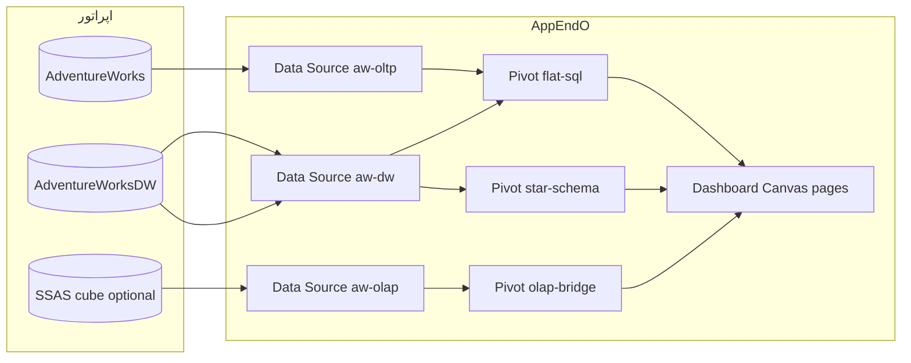

<div dir="rtl" lang="fa" class="hwy-parity-doc">
<style>
  .hwy-parity-doc { text-align: right; unicode-bidi: plaintext; }
  .hwy-parity-doc h1, .hwy-parity-doc h2, .hwy-parity-doc h3, .hwy-parity-doc h4, .hwy-parity-doc p, .hwy-parity-doc li { text-align: right; }
  .hwy-parity-doc table { direction: rtl; text-align: right; width: 100%; border-collapse: collapse; margin: 0.75rem 0; }
  .hwy-parity-doc th, .hwy-parity-doc td { border: 1px solid #c4c4c4; padding: 0.35rem 0.5rem; vertical-align: top; text-align: right; }
  .hwy-parity-doc th { background: #f6f6f6; font-weight: 600; }
  .hwy-parity-doc blockquote { text-align: right; border-right: 3px solid #ccc; border-left: none; padding-right: 1rem; margin-right: 0; }
  .hwy-parity-doc ul, .hwy-parity-doc ol { padding-right: 1.25rem; padding-left: 0; }
  .hwy-parity-doc pre, .hwy-parity-doc code { direction: ltr; text-align: left; unicode-bidi: embed; }
</style>

<p><strong>خلاصه برای operatore:</strong> این سند جزو <strong>plans</strong> است (p-packages-adventureworks-showcase). ستون وضعیت در <a href="./p-00-packages-index.md">index مربوطه</a> مرجع «شروع شده / design / تمام» است.</p>
<p><strong>راهنمای خواندن:</strong> بخش‌های انگلیسی برای agent/dev هستند؛ جداول وضعیت و یادداشت‌های فارسی را اول بخوانید.</p>


# p-packages-adventureworks-showcase — AdventureWorks Showcase: شوکیس OLTP / DW / ROLAP / OLAP

> **Package:** **AdventureWorks Showcase** (#51) — [p-packages-backlog.md](p-packages-backlog.md)  
> **اولویت پیاده‌سازی:** 16 — پکیج اختیاری · design only  
> **مسیر اجرا:** اسکوپ دامنه در backlog پکیج‌ها (نه zip به‌عنوان مسیر *ساخت*) — کنترل: [p-00-packages-index.md](p-00-packages-index.md)  
> **وضعیت:** ⬜ design only — پیاده‌سازی نشده  
> **آخرین به‌روزرسانی:** ۲۰۲۶-۰۹-۱۱  
> **وابستگی:** Dashboard Canvas ✅ · Pivot / `flat-sql` ✅ · ROLAP star-schema ✅ · OLAP Bridge ✅ (اختیاری در runtime) · Data Studio introspection  
> **خواهر Core:** بوم‌های باندل اولیه روی `base_*` (p-120 بسته شد) — [`platform-ops-dashboards.md`](../../../docs/standards/platform-ops-dashboards.md)  
> **استانداردها:** `AGENTS.md` · [data-model.md](../../../docs/standards/data-model.md) · [personalizable-dashboard-canvas.md](../../../docs/standards/personalizable-dashboard-canvas.md) · [rolap-star-schema.md](../../../docs/standards/rolap-star-schema.md) · [olap-bridge.md](../../../docs/standards/olap-bridge.md) · Greenfield · Package UI

AppEndO **platform-first** است نه AdventureWorks-first. این پکیج **نمونهٔ نمایش تکنیک** است: به Commerce / CRM / هویت پلتفرم / XMLA سرور / انبارساز ETL دست نمی‌زند. دیتابیس نمونهٔ مایکروسافت را اپراتور خودش restore می‌کند؛ پکیج فایل `.bak` را توزیع نمی‌کند.

### اصل سخت: Showcase بخشی از Core نیست — و Package Manager zip هم مسیر ساخت نیست

<table dir="rtl">
<thead><tr><th>کار</th><th>مسیر درست</th></tr></thead>
<tbody><tr><td>مدل جدول‌های AW / AWDW</td><td>Data Studio Edge models روی Data Source اپراتور</td></tr>
<tr><td>مکعب ROLAP</td><td>studio-meta <code dir="ltr" style="unicode-bidi: embed;">cubeMeasure</code> / <code dir="ltr" style="unicode-bidi: embed;">cubeDimension</code> روی fact موجود</td></tr>
<tr><td>API Pivot</td><td>Data API <code dir="ltr" style="unicode-bidi: embed;">kind: 'pivot'</code></td></tr>
<tr><td>صفحات بوم</td><td>Client Components + Platform Pages / <code dir="ltr" style="unicode-bidi: embed;">navigation_patches</code></td></tr>
<tr><td>LOV اگر لازم شد</td><td>Base Info — یک root</td></tr>
</tbody></table>

**ممنوع:** seed در `controlPlaneSeed` / ویزارد نصب؛ ماژول دائمی `src/core/packages/adventureworks`؛ `db.query` برای دامنه؛ Prisma؛ قاطی کردن با صفحات p-120.

### دسترسی داده (سخت) — فقط Sequelize / EdgeDbRouter

خواندن فروش و ابعاد از Edge models روی SQL Server اپراتور. نوشتن به جداول AdventureWorks در v1 **نیست** (شوکیس فقط‌خواندنی). OLAP فقط از طریق Data Source نوع `OLAP Bridge` موجود.

### خارج از ساخت اولیهٔ اپلیکیشن (سخت)

نصب تازهٔ AppEndO **صفر** رد از این پکیج ندارد تا فازهایش پیاده و (در پایان) به‌صورت پکیج قابل‌نصب بسته‌بندی شود. باندل اولیه مال p-120 است.

```
@plans/packages/todo/p-packages-adventureworks-showcase.md برو جلو
@plans/packages/todo/p-packages-adventureworks-showcase.md فاز N بساز
@plans/packages/todo/p-packages-adventureworks-showcase.md فاز N را رولبک کن
```

---

## هدف اصلی

نشان دادن اینکه **یک بوم و یک قرارداد Pivot** روی چهار لایهٔ دادهٔ کلاسیک مایکروسافت کار می‌کند:

1. **OLTP** — `AdventureWorks` نرمال‌شده (سفارش، محصول) با `source.kind: 'flat-sql'`
2. **DW** — `AdventureWorksDW` ستاره‌ای به‌صورت جدول fact/dim با `flat-sql` روی fact (و فیلتر بعد)
3. **ROLAP** — همان DW با annotation مکعب و `source.kind: 'star-schema'`
4. **OLAP** — مکعب/مدل جدولی SSAS نمونه با `source.kind: 'olap-bridge'` اگر Bridge پیکربندی شده باشد

اگر Bridge نباشد، صفحات OLAP مثل هر Data Source مرده رفتار می‌کنند — نصب پکیج شکست نمی‌خورد.

<table dir="rtl">
<thead><tr><th>دغدغه</th><th>مالک</th></tr></thead>
<tbody><tr><td>بوم، فیلتر، تب، combo، اشتراک</td><td>Core Dashboard Canvas</td></tr>
<tr><td>کامپایلر star-schema</td><td>Core <code dir="ltr" style="unicode-bidi: embed;">rolap-star-schema</code></td></tr>
<tr><td>XMLA / MDX / DAX</td><td>Core <code dir="ltr" style="unicode-bidi: embed;">olap-bridge</code> + سرویس Bridge جدا (ویندوز)</td></tr>
<tr><td>هویت شخص AW (<code dir="ltr" style="unicode-bidi: embed;">Person.Person</code>)</td><td>نمونهٔ ایزوله — به <code dir="ltr" style="unicode-bidi: embed;">base_users</code> / identity-profile <strong>وصل نمی‌شود</strong></td></tr>
<tr><td>فروش واقعی محصول</td><td>Commerce backlog — این پکیج فروش AppEndO نیست</td></tr>
<tr><td>ساخت انبار / ETL / SCD</td><td>خارج — DW از قبل ساختهٔ مایکروسافت است</td></tr>
<tr><td>بوم‌های Jobs/Users خود Studio</td><td>p-120</td></tr>
</tbody></table>

---

## تحقیق دامنه (کوتاه)

محصولات مرجع تکنیک: Microsoft sample DBs + SSAS tabular/multidimensional tutorials؛ Metabase/Superset/Lightdash برای «یک لایهٔ معنایی، چند منبع». OSS جایگزین انبار: هیچ‌کدام AdventureWorks را جایگزین نمی‌کنند — همان `.bak` رسمی.

<table dir="rtl">
<thead><tr><th>درد کلاسیک</th><th>تصمیم این پکیج</th></tr></thead>
<tbody><tr><td>قاطی کردن OLTP و DW در یک اتصال</td><td>دو Data Source جدا (<code dir="ltr" style="unicode-bidi: embed;">aw-oltp</code>, <code dir="ltr" style="unicode-bidi: embed;">aw-dw</code>)</td></tr>
<tr><td>فرض وجود SSAS</td><td>OLAP اختیاری</td></tr>
<tr><td>توزیع چندصد مگابایت <code dir="ltr" style="unicode-bidi: embed;">.bak</code></td><td>هرگز؛ README انگلیسی: لینک GitHub microsoft/sql-server-samples</td></tr>
<tr><td>Snowflake / سلسله DimProduct</td><td>v1 star تمیز: fact → dim مستقیم؛ سلسلهٔ محصول اگر چند hop است در ROLAP v1 نیاور (شارد: بدون snowflake)</td></tr>
<tr><td>Mongo/ES در این شوکیس</td><td>خارج — اپراتور OLTP/DW/OLAP/ROLAP خواست</td></tr>
</tbody></table>

نسخهٔ هدف مستند: **AdventureWorks2022** و **AdventureWorksDW2022** (اسکیما از ۲۰۱۲ پایدار است؛ ۲۰۲۵ هم نام جدول‌های هسته یکی است). اپراتور می‌تواند ۲۰۱۹/۲۰۲۵ بدهد اگر نام fact/dim یکی باشد.

---

## پیش‌نیاز اپراتور (نه کار کد)

<table dir="rtl">
<thead><tr><th>منبع</th><th>نقش</th><th>اجباری؟</th></tr></thead>
<tbody><tr><td>SQL Server با <code dir="ltr" style="unicode-bidi: embed;">AdventureWorks</code></td><td>OLTP</td><td>بله برای صفحات OLTP</td></tr>
<tr><td>SQL Server با <code dir="ltr" style="unicode-bidi: embed;">AdventureWorksDW</code></td><td>DW + ROLAP</td><td>بله برای صفحات انبار</td></tr>
<tr><td>SSAS + <a href="https://github.com/Microsoft/sql-server-samples/releases/tag/adventureworks-analysis-services">AdventureWorks AS samples</a> + Bridge</td><td>OLAP</td><td>خیر</td></tr>
<tr><td>AppEndO با Dashboard Canvas شیپ‌شده</td><td>بوم</td><td>بله</td></tr>
</tbody></table>

اعتبارنامه داخل Credential Vault موجود پلتفرم؛ کلید Bridge طبق `olap-bridge.md`.

---

## مدل دادهٔ این پکیج

**جدول دامنهٔ جدید با پیشوند `awx_` در v1 نداریم.** مالک داده مایکروسافت است. AppEndO فقط Edge model + studio-meta + Designer JSON می‌سازد.

### OLTP — مدل‌های Edge (حداقل)

<table dir="rtl">
<thead><tr><th>مدل</th><th>جدول فیزیکی (schema.table)</th><th>نقش</th></tr></thead>
<tbody><tr><td><code dir="ltr" style="unicode-bidi: embed;">aw_sales_order_header</code></td><td><code dir="ltr" style="unicode-bidi: embed;">Sales.SalesOrderHeader</code></td><td>fact عملیاتی</td></tr>
<tr><td><code dir="ltr" style="unicode-bidi: embed;">aw_sales_order_detail</code></td><td><code dir="ltr" style="unicode-bidi: embed;">Sales.SalesOrderDetail</code></td><td>خط سفارش</td></tr>
<tr><td><code dir="ltr" style="unicode-bidi: embed;">aw_product</code></td><td><code dir="ltr" style="unicode-bidi: embed;">Production.Product</code></td><td>بعد محصول</td></tr>
<tr><td><code dir="ltr" style="unicode-bidi: embed;">aw_customer</code></td><td><code dir="ltr" style="unicode-bidi: embed;">Sales.Customer</code></td><td>مشتری OLTP</td></tr>
</tbody></table>

Pivot روی هدر (مبلغ، وضعیت، تاریخ سفارش) و در صورت نیاز detail. Person/Employee در v1 لازم نیست.

### DW — مدل‌های Edge (حداقل)

<table dir="rtl">
<thead><tr><th>مدل</th><th>جدول</th><th>نقش مکعب</th></tr></thead>
<tbody><tr><td><code dir="ltr" style="unicode-bidi: embed;">aw_fact_internet_sales</code></td><td><code dir="ltr" style="unicode-bidi: embed;">dbo.FactInternetSales</code></td><td>fact · <code dir="ltr" style="unicode-bidi: embed;">cubeMeasure</code> روی <code dir="ltr" style="unicode-bidi: embed;">SalesAmount</code>, <code dir="ltr" style="unicode-bidi: embed;">OrderQuantity</code>, <code dir="ltr" style="unicode-bidi: embed;">TaxAmt</code></td></tr>
<tr><td><code dir="ltr" style="unicode-bidi: embed;">aw_dim_date</code></td><td><code dir="ltr" style="unicode-bidi: embed;">dbo.DimDate</code></td><td>زمان · <code dir="ltr" style="unicode-bidi: embed;">isTimeDimension</code></td></tr>
<tr><td><code dir="ltr" style="unicode-bidi: embed;">aw_dim_product</code></td><td><code dir="ltr" style="unicode-bidi: embed;">dbo.DimProduct</code></td><td>محصول — فقط سطوح مستقیم روی خود dim (بدون hop به subcategory در v1 اگر association جدا است)</td></tr>
<tr><td><code dir="ltr" style="unicode-bidi: embed;">aw_dim_customer</code></td><td><code dir="ltr" style="unicode-bidi: embed;">dbo.DimCustomer</code></td><td>مشتری</td></tr>
<tr><td><code dir="ltr" style="unicode-bidi: embed;">aw_dim_territory</code></td><td><code dir="ltr" style="unicode-bidi: embed;">dbo.DimSalesTerritory</code></td><td>منطقه</td></tr>
</tbody></table>

`FactResellerSales` اختیاری فاز بعد — v1 یک ستاره کافی است.

### OLAP

بدون Edge model. یک Data Source `OLAP Bridge` با catalog/cube نمونه (Internet Sales). فیلدهای `PivotSpec` opaque مطابق metadata Bridge.

### Base Info

در v1 **لازم نیست** (هیچ `*_code` دامنهٔ خودمان). اگر برچسب وضعیت سفارش OLTP خواستیم، از مقدار ستون خود AW استفاده می‌کنیم نه LOV موازی.

---

## صفحات شوکیس (v1)

گروه ناوبری پکیج (heading = `AdventureWorks`) فقط بعد از نصب/پیاده روی Studio ظاهر می‌شود.

<table dir="rtl">
<thead><tr><th>pageKey</th><th>عنوان انگلیسی</th><th>تکنیک که باید دیده شود</th></tr></thead>
<tbody><tr><td><code dir="ltr" style="unicode-bidi: embed;">awx-oltp-sales</code></td><td>OLTP sales orders</td><td><code dir="ltr" style="unicode-bidi: embed;">flat-sql</code> · روند سفارش · وضعیت · فیلتر تاریخ · drill-down به خط</td></tr>
<tr><td><code dir="ltr" style="unicode-bidi: embed;">awx-oltp-product</code></td><td>OLTP product mix</td><td><code dir="ltr" style="unicode-bidi: embed;">flat-sql</code> روی Product + فروش در صورت join اعلام‌شده در domain/joinablePairs</td></tr>
<tr><td><code dir="ltr" style="unicode-bidi: embed;">awx-dw-internet</code></td><td>DW internet sales (tables)</td><td><code dir="ltr" style="unicode-bidi: embed;">flat-sql</code> روی fact با فیلدهای denormalized محدود یا فقط کلید+مقدار — صادقانه: اگر fact بدون join dim فقیر است، ویجت‌ها measure خام‌اند و لینک به صفحهٔ ROLAP دارند</td></tr>
<tr><td><code dir="ltr" style="unicode-bidi: embed;">awx-rolap-internet</code></td><td>ROLAP internet sales</td><td><strong><code dir="ltr" style="unicode-bidi: embed;">star-schema</code></strong> · سلسلهٔ تاریخ · منطقه · نسبت <code dir="ltr" style="unicode-bidi: embed;">SalesAmount</code> derived اگر دو measure باشد</td></tr>
<tr><td><code dir="ltr" style="unicode-bidi: embed;">awx-olap-internet</code></td><td>SSAS internet sales</td><td><strong><code dir="ltr" style="unicode-bidi: embed;">olap-bridge</code></strong> · همان KPIها اگر Bridge باشد</td></tr>
<tr><td><code dir="ltr" style="unicode-bidi: embed;">awx-compare</code></td><td>Compare layers</td><td>Dashboard Links + در صورت <code dir="ltr" style="unicode-bidi: embed;">joinablePairs</code> یک combo (دانهٔ ماه) — وگرنه سه KPI جدا با متن که grain یکسان نیست را join اجباری نکن</td></tr>
</tbody></table>

هر صفحه empty/error انگلیسی وقتی DS نیست.

کپی UI انگلیسی. کارت در برابر جدول: این صفحات بوم‌اند نه CRUD؛ Phase 3 از جنس CRUD Set **نیست**.

---

## معماری اتصال



---

## UX / Package UI

- صفحات `loaderKind: "designer"` — **نه** `core:AdventureWorks` و نه `src/features/adventureworks` دائمی.
- ناوبری: `capabilities.navigation_patches` روی Studio (heading بسته).
- ادیتور عمیق/CRUD/واکب Base Info برای این پکیج **نداریم** — گیت package-ui برای فرم رکورد اینجا N/A است؛ به‌جایش: هر بوم domain whitelist + living preview در Designer.
- Scaffold اسکریپت در صورت نیاز: `scripts/awx-showcase/` برای upsert مدل/صفحه (الگوی cms-phase3 فقط جایی که واقعاً repeat باشد). رولبک = حذف Edge models + pages + nav patch همین پکیج.

---

## فازها

<table dir="rtl">
<thead><tr><th>فاز</th><th>کار</th><th>وضعیت</th></tr></thead>
<tbody><tr><td><strong>0</strong></td><td>قرارداد نام Data Source، فهرست جدول ۲۰۲۲، README بازیابی <code dir="ltr" style="unicode-bidi: embed;">.bak</code>، deny snowflake</td><td>⬜</td></tr>
<tr><td><strong>1</strong></td><td>Edge models OLTP + Pivot + بوم <code dir="ltr" style="unicode-bidi: embed;">awx-oltp-sales</code> / <code dir="ltr" style="unicode-bidi: embed;">awx-oltp-product</code></td><td>⬜</td></tr>
<tr><td><strong>2</strong></td><td>Edge models DW + association fact→dims + بوم <code dir="ltr" style="unicode-bidi: embed;">awx-dw-internet</code></td><td>⬜</td></tr>
<tr><td><strong>3</strong></td><td>cube annotation + بوم <code dir="ltr" style="unicode-bidi: embed;">awx-rolap-internet</code></td><td>⬜</td></tr>
<tr><td><strong>4</strong></td><td>Data Source OLAP اختیاری + بوم <code dir="ltr" style="unicode-bidi: embed;">awx-olap-internet</code> + <code dir="ltr" style="unicode-bidi: embed;">awx-compare</code></td><td>⬜</td></tr>
<tr><td><strong>5</strong></td><td>navigation_patches + بسته‌بندی Package Builder (تحویل اختیاری بعد از ساخت Studio)</td><td>⬜</td></tr>
</tbody></table>

**کار بعدی:** فاز ۰ بعد از «شروع کن». Package فعال CRM را عوض نمی‌کند.

---

## NEVER

- `.bak` یا دیتای مایکروسافت را در ریپو/zip نگذار.
- Person AW را به Users پلتفرم map نکن.
- بدون Bridge نصب را fail نکن.
- XMLA سرور داخل Node نساز.
- star snowflake در v1.
- این صفحات را در ویزارد نصب / باندل اولیه (p-120) seed نکن.
- Mongo/Elasticsearch را «برای کامل بودن» به این شوکیس اضافه نکن.

---

## لاگ پلن

<table dir="rtl">
<thead><tr><th>تاریخ</th><th>رویداد</th></tr></thead>
<tbody><tr><td>۲۰۲۶-۰۹-۱۱</td><td>پیش‌نویس اول — شوکیس پکیج، جدا از Insights باندل اولیه</td></tr>
</tbody></table>

</div>
