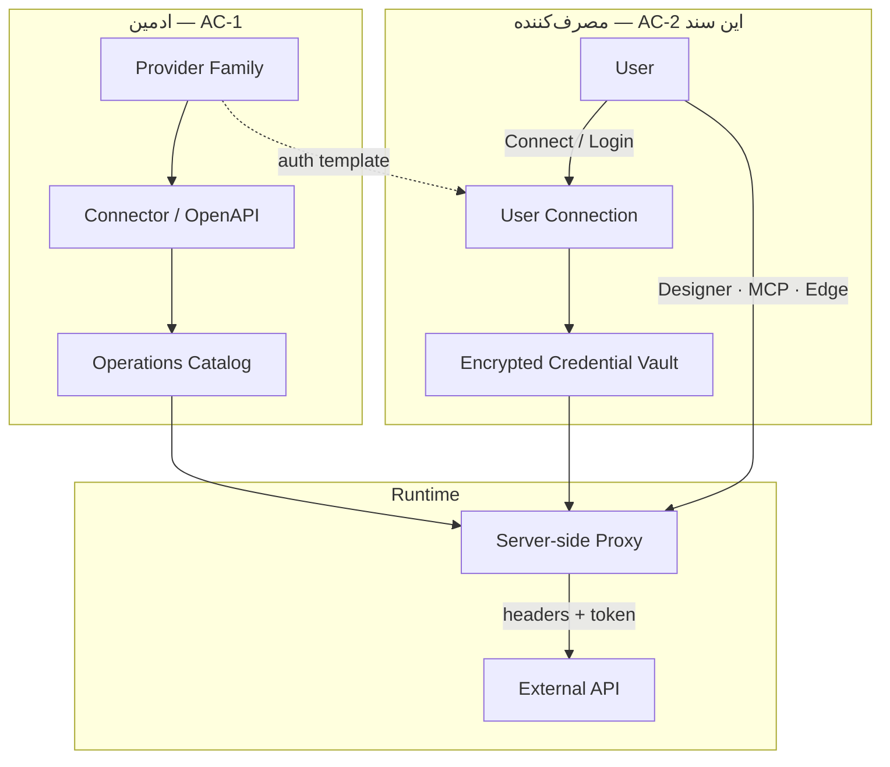
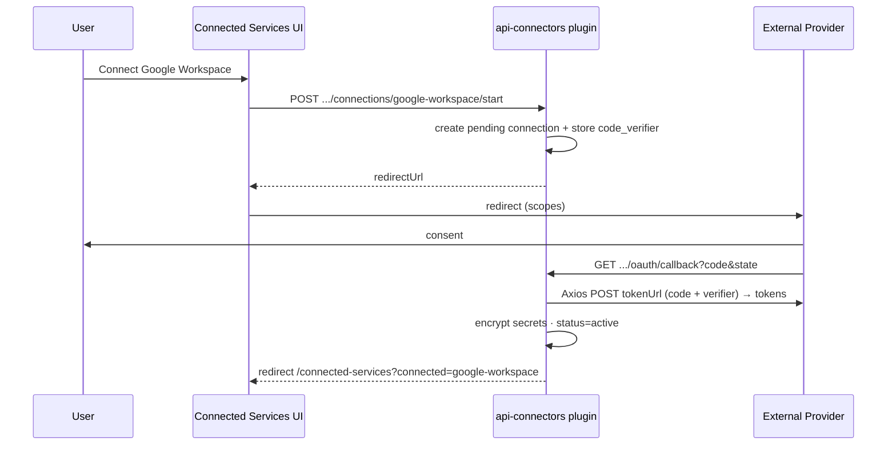

<div dir="rtl" lang="fa" class="hwy-parity-doc">
<style>
  .hwy-parity-doc { text-align: right; unicode-bidi: plaintext; }
  .hwy-parity-doc h1, .hwy-parity-doc h2, .hwy-parity-doc h3, .hwy-parity-doc h4, .hwy-parity-doc p, .hwy-parity-doc li { text-align: right; }
  .hwy-parity-doc table { direction: rtl; text-align: right; width: 100%; border-collapse: collapse; margin: 0.75rem 0; }
  .hwy-parity-doc th, .hwy-parity-doc td { border: 1px solid #c4c4c4; padding: 0.35rem 0.5rem; vertical-align: top; text-align: right; }
  .hwy-parity-doc th { background: #f6f6f6; font-weight: 600; }
  .hwy-parity-doc blockquote { text-align: right; border-right: 3px solid #ccc; border-left: none; padding-right: 1rem; margin-right: 0; }
  .hwy-parity-doc ul, .hwy-parity-doc ol { padding-right: 1.25rem; padding-left: 0; }
  .hwy-parity-doc pre, .hwy-parity-doc code { direction: ltr; text-align: left; unicode-bidi: embed; }
</style>

<p><strong>خلاصه برای operatore:</strong> این سند جزو <strong>plans</strong> است (p-packages-api-connectors). ستون وضعیت در <a href="./p-00-packages-index.md">index مربوطه</a> مرجع «شروع شده / design / تمام» است.</p>
<p><strong>راهنمای خواندن:</strong> بخش‌های انگلیسی برای agent/dev هستند؛ جداول وضعیت و یادداشت‌های فارسی را اول بخوانید.</p>


# p-packages-api-connectors — API Connectors: اتصال کاربر و اعتبارسنجی بیرونی

> **Package:** #48 **API Connectors** — [p-packages-backlog.md](p-packages-backlog.md)  
> **اولویت پیاده‌سازی:** 15 — package track
> **فاز:** AC-2 *(Consumer Connections)* — مکمل AC-1 *(کاتالوگ ادمین · OpenAPI · پروکسی)*  
> **مسیر اجرا:** Package — **خارج از** فازهای هسته `p-NN` · کنترل: [p-00-packages-index.md](p-00-packages-index.md)  
> **وضعیت:** ⬜ AC-1 (موتور پروکسی) در [p-96 PDK-8](../../core/next/p-96-native-dev-platform.md) ساخته و تأیید شد (۲۰۲۶-۰۸-۲۶) — دیگر blocker نیست؛ آماده برای شروع AC-2 روی همان موتور  
> **وابستگی:** p-08 ✅ · p-12 ✅ · p-21 *(اختیاری — reuse OAuth engine)* · Payment Gateways (#3) *(الگوی ذخیره کلید ادمین)* · **جدا از** p-21 (OAuth ورود به AppEndO)  
> **مرز هسته:** موتور HTTP/OpenAPI توکار در [p-96 PDK-8](../../core/next/p-96-native-dev-platform.md) — این پکیج کاتالوگ SaaS + vault per-user است نه موتور پروکسی دوم. موتور واقعی: `src/server/services/http-connections/` (store + executor + رمزنگاری AES-256-GCM اختصاصی) + پل sandbox `connectors.call()`. **محدودیت شناخته‌شده:** v1 موتور فقط `authKind: none/apiKey/bearer/basic` را پشتیبانی می‌کند — OAuth client-credentials کامل (token endpoint، کش/رفرش) ساخته نشده؛ اگر AC-2 به آن نیاز دارد باید جدا اضافه شود

---

## هدف

وقتی ادمین **خانواده‌ای از APIهای بیرونی** (Provider Family) به کاتالوگ اضافه می‌کند، **مصرف‌کنندگان** (کاربران نهایی پلتفرم) باید بتوانند **خودشان را به آن سرویس معرفی کنند** — لاگین OAuth، وارد کردن API Key، یا Basic — تا سیستم **اعتبارنامه per-user** را امن ذخیره کند و از آن به بعد در هر فراخوانی API، **هدر و پارامتر احراز هویت مناسب** را از سمت سرور تزریق کند.

این سند **لایه مصرف‌کننده** پلاگین API Connectors است؛ کاتالوگ OpenAPI، import، و پروکسی ادمین در AC-1 تعریف می‌شود — اینجا تمرکز روی **Connect · Scope · Credential vault · Runtime inject** است.

---

## مسئله (شکاف فعلی)

<table dir="rtl">
<thead><tr><th>لایه</th><th>امروز</th><th>نیاز</th></tr></thead>
<tbody><tr><td>کاتالوگ API</td><td>در backlog پلاگین #49 — تعریف مفهومی</td><td>ادمین خانواده + عملیات import می‌کند</td></tr>
<tr><td>احراز هویت بیرونی</td><td>فقط <code dir="ltr" style="unicode-bidi: embed;">auth.identityProviders</code> برای <strong>ورود به AppEndO</strong> (p-21)</td><td>OAuth/API Key برای <strong>فراخوانی API ثالث</strong></td></tr>
<tr><td>ذخیره کلید</td><td>الگوی admin-only (درگاه پرداخت، data source)</td><td><strong>per-user</strong> encrypted vault</td></tr>
<tr><td>UI</td><td>—</td><td>صفحه/slot «اتصالات من» + prompt در Designer/Agent</td></tr>
<tr><td>Runtime</td><td>پروکسی پلاگین (<code dir="ltr" style="unicode-bidi: embed;">pluginApiProxy</code>) فقط JWT AppEndO</td><td>resolve connection کاربر + inject header قبل از HTTP بیرونی</td></tr>
</tbody></table>

---

## مفاهیم کلیدی



<table dir="rtl">
<thead><tr><th>مفهوم</th><th>تعریف</th><th>مثال</th></tr></thead>
<tbody><tr><td><strong>Provider Family</strong></td><td>دسته سرویس‌های بیرونی با <strong>یک الگوی احراز هویت مشترک</strong></td><td><code dir="ltr" style="unicode-bidi: embed;">google-workspace</code> · <code dir="ltr" style="unicode-bidi: embed;">stripe</code> · <code dir="ltr" style="unicode-bidi: embed;">slack</code></td></tr>
<tr><td><strong>Connector</strong></td><td>یک import OpenAPI داخل خانواده (base URL + spec)</td><td><code dir="ltr" style="unicode-bidi: embed;">google-calendar-v3</code></td></tr>
<tr><td><strong>Operation</strong></td><td>یک endpoint پارس‌شده از OpenAPI</td><td><code dir="ltr" style="unicode-bidi: embed;">GET /calendars/{id}/events</code></td></tr>
<tr><td><strong>Auth Template</strong></td><td>نحوه ساخت هدر/کوئری از credential (روی Family)</td><td><code dir="ltr" style="unicode-bidi: embed;">Authorization: Bearer {{accessToken}}</code></td></tr>
<tr><td><strong>User Connection</strong></td><td>binding کاربر AppEndO ↔ Family + وضعیت + scopes</td><td>user#42 ↔ <code dir="ltr" style="unicode-bidi: embed;">google-workspace</code> · active</td></tr>
<tr><td><strong>Effective Scopes</strong></td><td>مجوزهای OAuth یا capabilityهای عملیاتی مجاز</td><td><code dir="ltr" style="unicode-bidi: embed;">calendar.read</code> · <code dir="ltr" style="unicode-bidi: embed;">calendar.write</code></td></tr>
<tr><td><strong>Connection Mode</strong></td><td><code dir="ltr" style="unicode-bidi: embed;">user</code> (هر کاربر خودش) · <code dir="ltr" style="unicode-bidi: embed;">shared</code> (ادمین — فقط ops سیستمی)</td><td>CRM webhook vs تقویم شخصی</td></tr>
</tbody></table>

**تفاوت با p-21:** p-21 کاربر را **به AppEndO** لاگین می‌کند؛ این پلاگین به AppEndO اجازه می‌دهد **به جای کاربر** با API بیرونی صحبت کند (delegated access).

---

## محدوده

### Scope IN

<table dir="rtl">
<thead><tr><th>#</th><th>قابلیت</th><th>شرح</th></tr></thead>
<tbody><tr><td>1</td><td><strong>Provider Family catalog</strong></td><td>CRUD خانواده: label، آیکون، auth kind، OAuth endpoints، scope پیش‌فرض</td></tr>
<tr><td>2</td><td><strong>Auth kinds</strong></td><td><code dir="ltr" style="unicode-bidi: embed;">api_key</code> · <code dir="ltr" style="unicode-bidi: embed;">bearer_static</code> · <code dir="ltr" style="unicode-bidi: embed;">basic</code> · <code dir="ltr" style="unicode-bidi: embed;">oauth2_auth_code</code> (+ PKCE) · <code dir="ltr" style="unicode-bidi: embed;">custom_headers</code></td></tr>
<tr><td>3</td><td><strong>Connect UI</strong></td><td>صفحه «اتصالات من» + modal Connect per family · نمایش وضعیت/scopes/انقضا</td></tr>
<tr><td>4</td><td><strong>OAuth connect flow</strong></td><td>start → redirect provider → callback → ذخیره token + refresh</td></tr>
<tr><td>5</td><td><strong>Manual credential</strong></td><td>فرم امن برای API Key / Bearer / Basic (بدون نمایش مجدد plaintext)</td></tr>
<tr><td>6</td><td><strong>Credential vault</strong></td><td>encrypt at rest · redact در API · rotation/refresh</td></tr>
<tr><td>7</td><td><strong>Runtime resolver</strong></td><td>قبل از هر outbound call: <code dir="ltr" style="unicode-bidi: embed;">userId + familyId → connection → headers</code></td></tr>
<tr><td>8</td><td><strong>Token refresh</strong></td><td>OAuth refresh_token خودکار قبل از call یا در background job</td></tr>
<tr><td>9</td><td><strong>Scope enforcement</strong></td><td>عملیات OpenAPI به scopes نیاز دارد؛ بدون scope → 403 + UI راهنما</td></tr>
<tr><td>10</td><td><strong>Disconnect / Revoke</strong></td><td>قطع اتصال · revoke در provider (اگر پشتیبانی شد) · audit</td></tr>
<tr><td>11</td><td><strong>Designer integration</strong></td><td>ویجت/فرم bound به operation: اگر connection نیست → CTA Connect</td></tr>
<tr><td>12</td><td><strong>MCP integration</strong></td><td>tool فراخوانی operation فقط با connection فعال کاربر جاری</td></tr>
<tr><td>13</td><td><strong>Role policy</strong></td><td>کدام نقش‌ها حق Connect به کدام family را دارند</td></tr>
<tr><td>14</td><td><strong>Audit</strong></td><td>connect · disconnect · refresh_fail · proxy_denied_scope</td></tr>
</tbody></table>

### Scope OUT

- ورود OAuth به AppEndO (همان p-21)
- marketplace انتشار connector pack → [p-42](../../core/next/p-42-marketplace.md)
- mTLS / client certificate (v2)
- `oauth2_client_credentials` سراسری بدون binding کاربر (v2 — service account جدا)
- فراخوانی مستقیم از مرورگر به API بیرونی با token کاربر (همیشه server proxy)
- auto-migration credential قدیمی (greenfield — یک فرمت)

---

## معماری لایه‌ها

```
┌─────────────────────────────────────────────────────────────┐
│  UI: Connected Services · Designer prompt · Agent MCP       │
└───────────────────────────┬─────────────────────────────────┘
                            │ /api/packages/api-connectors/...
┌───────────────────────────▼─────────────────────────────────┐
│  Connection Service: resolve · refresh · scope check · audit  │
└───────────────────────────┬─────────────────────────────────┘
                            │
┌───────────────────────────▼─────────────────────────────────┐
│  Outbound Proxy: Axios · SSRF guard · header inject · rate    │
└───────────────────────────┬─────────────────────────────────┘
                            │ HTTPS only (Axios)
┌───────────────────────────▼─────────────────────────────────┐
│  External Provider API                                      │
└─────────────────────────────────────────────────────────────┘
```

### HTTP Client — Axios (اجباری)

تمام فراخوانی‌های HTTP **سرور → Provider بیرونی** در پلاگین `api-connectors` **فقط** از **Axios** انجام می‌شود. `fetch`، `node:http`، یا clientهای ad-hoc در `plugins/api-connectors/server/` **ممنوع** است.

<table dir="rtl">
<thead><tr><th>لایه</th><th>Client</th><th>قاعده</th></tr></thead>
<tbody><tr><td>UI پلاگین → <code dir="ltr" style="unicode-bidi: embed;">/api/packages/api-connectors/...</code></td><td><code dir="ltr" style="unicode-bidi: embed;">apiGet</code> / <code dir="ltr" style="unicode-bidi: embed;">apiPost</code> / <code dir="ltr" style="unicode-bidi: embed;">apiDelete</code> در <code dir="ltr" style="unicode-bidi: embed;">src/shared/api/queries/apiConnectors.ts</code></td><td><strong>نه Axios</strong> — همان F-16 (<code dir="ltr" style="unicode-bidi: embed;">apiRequest</code> → <code dir="ltr" style="unicode-bidi: embed;">apiFetch</code>)</td></tr>
<tr><td>سرور پلاگین → Provider (proxy · OAuth token · refresh · revoke · test)</td><td>Axios via <code dir="ltr" style="unicode-bidi: embed;">acOutboundHttp</code></td><td><strong>Axios اجباری</strong></td></tr>
</tbody></table>

**Dependency:** `axios` در root [`package.json`](../../../package.json).

**Wrapper مشترک:** `plugins/api-connectors/server/outbound/acOutboundHttp.ts` — یا در host (`src/server/services/package-runtime/apiConnectors/acOutboundHttp.ts`) اگر sandbox پلاگین به Axios/`mcpUrlGuard` دسترسی نداشته باشد *(تصمیم نهایی در AC-1 lock شود)*.

```ts
// acOutboundHttp — axios instance با:
// - baseURL از connector catalog (caller نمی‌تواند host را override کند)
// - timeout پیش‌فرض 30s (override per operation)
// - maxRedirects: 0 (SSRF — مشابه createSsrfGuardedFetch)
// - validate URL قبل از request (reuse isBlockedIpAddress / DNS guard از mcpUrlGuard)
// - interceptors: inject auth headers · redact secrets در log
// - responseType بر اساس Content-Type
// - export typed helpers: acGet, acPost, acPut, acPatch, acDelete
```

**OAuth token exchange / refresh / revoke:** همان instance یا `acOAuthHttp.ts` با `Content-Type: application/x-www-form-urlencoded` برای `tokenUrl` / `revokeUrl`.

#### SSRF با Axios

Reuse منطق موجود از [`src/server/services/ai/mcp/mcpUrlGuard.ts`](../../../src/server/services/ai/mcp/mcpUrlGuard.ts):

- URL نهایی = `connector.baseUrl` + resolved path از operation catalog
- DNS resolution check برای hostname
- block private IP / loopback
- `maxRedirects: 0` در Axios config
- v1: **HTTPS only** (مگر family admin صریحاً http allow کند — پیش‌فرض: فقط HTTPS)

اگر پلاگین در sandbox اجرا می‌شود، helper SSRF + Axios instance در host (`src/server/services/package-runtime/apiConnectors/`) قرار می‌گیرد و handler پلاگین آن را صدا می‌زند.

### اصل امنیتی

1. **هیچ secret در client persist نشود** — فقط وضعیت connection و scopes عمومی.
2. **همه outbound از سرور** — `api-connectors` proxy؛ URL از catalog + operation path.
3. **Outbound HTTP فقط via Axios + SSRF guard** — هیچ `fetch(` در `api-connectors/server/`.
4. **SSRF:** base URL ثابت از connector؛ path فقط از operation catalog؛ block private IP.
5. **Encrypt:** `APP_CREDENTIALS_ENCRYPTION_KEY` (env) — AES-256-GCM per row.
6. **Redact:** GET API هرگز `accessToken` / `apiKey` برنگرداند — فقط `hasApiKey: true`.

---

## Auth kinds (قرارداد Family)

```ts
type ApiConnectorAuthKind =
  | 'none'
  | 'api_key'
  | 'bearer_static'
  | 'basic'
  | 'oauth2_auth_code'
  | 'custom_headers';

type ApiConnectorAuthTemplate = {
  kind: ApiConnectorAuthKind;
  // api_key
  apiKeyLocation?: 'header' | 'query';
  apiKeyName?: string;           // e.g. X-API-Key, api_key
  apiKeyPrefix?: string;         // e.g. "Bearer " for header
  // oauth2
  authorizationUrl?: string;
  tokenUrl?: string;
  revokeUrl?: string;
  defaultScopes?: string[];
  pkceRequired?: boolean;        // default true
  // custom_headers
  headerTemplates?: Array<{ name: string; valueTemplate: string }>;
  // همه: valueTemplate از {{accessToken}} | {{apiKey}} | {{username}} | {{password}}
};
```

### نگاشت OpenAPI securitySchemes

هنگام import OpenAPI، parser سعی می‌کند `securitySchemes` را به `AuthTemplate` نگاشت دهد:

<table dir="rtl">
<thead><tr><th>OpenAPI</th><th>Auth kind</th></tr></thead>
<tbody><tr><td><code dir="ltr" style="unicode-bidi: embed;">apiKey</code> (header/query)</td><td><code dir="ltr" style="unicode-bidi: embed;">api_key</code></td></tr>
<tr><td><code dir="ltr" style="unicode-bidi: embed;">http</code> + <code dir="ltr" style="unicode-bidi: embed;">bearer</code></td><td><code dir="ltr" style="unicode-bidi: embed;">bearer_static</code> یا <code dir="ltr" style="unicode-bidi: embed;">oauth2_auth_code</code> اگر <code dir="ltr" style="unicode-bidi: embed;">oauth2</code> flow</td></tr>
<tr><td><code dir="ltr" style="unicode-bidi: embed;">http</code> + <code dir="ltr" style="unicode-bidi: embed;">basic</code></td><td><code dir="ltr" style="unicode-bidi: embed;">basic</code></td></tr>
<tr><td><code dir="ltr" style="unicode-bidi: embed;">oauth2</code> authorizationCode</td><td><code dir="ltr" style="unicode-bidi: embed;">oauth2_auth_code</code></td></tr>
<tr><td>چند scheme</td><td>Family یک <strong>primary</strong> + operation-level override در AC-1</td></tr>
</tbody></table>

---

## مدل داده (پیشنهادی)

پیشوند جداول پلاگین: `ac_` (api connectors). نصب via `db_objects` در manifest پلاگین `api-connectors`.

### `ac_provider_families`

```sql
CREATE TABLE ac_provider_families (
  id              TEXT PRIMARY KEY,              -- slug: google-workspace
  label           TEXT NOT NULL,
  description     TEXT,
  icon_key        TEXT,                          -- base-info ui_html یا lucide
  auth_kind       TEXT NOT NULL,
  auth_template   JSONB NOT NULL,                -- ApiConnectorAuthTemplate
  connection_mode TEXT NOT NULL DEFAULT 'user',  -- user | shared
  enabled         BOOLEAN NOT NULL DEFAULT true,
  sort_order      INT NOT NULL DEFAULT 0,
  created_at      TIMESTAMPTZ NOT NULL DEFAULT now(),
  created_by      INT REFERENCES base_users(id),
  updated_at      TIMESTAMPTZ NOT NULL DEFAULT now(),
  updated_by      INT REFERENCES base_users(id)
);
```

### `ac_connectors` · `ac_operations`

(خلاصه — جزئیات AC-1)

```sql
CREATE TABLE ac_connectors (
  id              TEXT PRIMARY KEY,
  family_id       TEXT NOT NULL REFERENCES ac_provider_families(id) ON DELETE CASCADE,
  label           TEXT NOT NULL,
  base_url        TEXT NOT NULL,
  openapi_source  TEXT,                          -- path or hash ref
  enabled         BOOLEAN NOT NULL DEFAULT true,
  ...
);

CREATE TABLE ac_operations (
  id              TEXT PRIMARY KEY,              -- connectorId::operationKey
  connector_id    TEXT NOT NULL REFERENCES ac_connectors(id) ON DELETE CASCADE,
  method          TEXT NOT NULL,
  path_template   TEXT NOT NULL,
  required_scopes TEXT[] NOT NULL DEFAULT '{}',
  ...
);
```

### `ac_user_connections`

```sql
CREATE TABLE ac_user_connections (
  id              UUID PRIMARY KEY DEFAULT gen_random_uuid(),
  user_id         INT NOT NULL REFERENCES base_users(id) ON DELETE CASCADE,
  family_id       TEXT NOT NULL REFERENCES ac_provider_families(id) ON DELETE CASCADE,
  status          TEXT NOT NULL DEFAULT 'pending',
  -- pending | active | expired | revoked | error
  granted_scopes  TEXT[] NOT NULL DEFAULT '{}',
  external_account_id TEXT,                      -- provider user id / email hint
  external_account_label TEXT,                   -- "mohsen@gmail.com" — نمایش UI
  token_expires_at TIMESTAMPTZ,
  last_refresh_at TIMESTAMPTZ,
  last_error      TEXT,
  connected_at    TIMESTAMPTZ,
  disconnected_at TIMESTAMPTZ,
  created_at      TIMESTAMPTZ NOT NULL DEFAULT now(),
  created_by      INT REFERENCES base_users(id),
  updated_at      TIMESTAMPTZ NOT NULL DEFAULT now(),
  updated_by      INT REFERENCES base_users(id),
  UNIQUE (user_id, family_id)
);
```

### `ac_connection_secrets`

```sql
CREATE TABLE ac_connection_secrets (
  connection_id   UUID PRIMARY KEY REFERENCES ac_user_connections(id) ON DELETE CASCADE,
  ciphertext      BYTEA NOT NULL,
  nonce           BYTEA NOT NULL,
  key_version     INT NOT NULL DEFAULT 1,
  updated_at      TIMESTAMPTZ NOT NULL DEFAULT now()
);
```

**Payload رمزشده (JSON قبل از encrypt):**

```ts
type ConnectionSecretPayload = {
  apiKey?: string;
  accessToken?: string;
  refreshToken?: string;
  username?: string;
  password?: string;
  custom?: Record<string, string>;
};
```

### `ac_role_family_grants`

```sql
CREATE TABLE ac_role_family_grants (
  id          SERIAL PRIMARY KEY,
  role_name   TEXT NOT NULL REFERENCES base_roles(name) ON DELETE CASCADE,
  family_id   TEXT NOT NULL REFERENCES ac_provider_families(id) ON DELETE CASCADE,
  can_connect BOOLEAN NOT NULL DEFAULT true,
  UNIQUE (role_name, family_id)
);
```

### `ac_connection_audit`

```sql
CREATE TABLE ac_connection_audit (
  id              BIGSERIAL PRIMARY KEY,
  connection_id   UUID REFERENCES ac_user_connections(id) ON DELETE SET NULL,
  user_id         INT NOT NULL,
  family_id       TEXT NOT NULL,
  event_type      TEXT NOT NULL,
  -- connected | disconnected | refresh_ok | refresh_fail | scope_denied | proxy_call
  success         BOOLEAN NOT NULL,
  meta_json       JSONB,
  created_at      TIMESTAMPTZ NOT NULL DEFAULT now()
);
```

---

## جریان Connect (OAuth2 + PKCE)



### state / CSRF

- `state` = signed payload: `{ userId, familyId, connectionId, nonce, exp }`
- TTL کوتاه (۱۰ دقیقه)
- callback فقط HTTPS · redirect URI ثبت‌شده per family

### Manual connect (API Key)

```
User → Connect modal → POST .../connections/:familyId/manual
  → validate template fields
  → optional test call via acOutboundHttp (GET health operation)
  → encrypt · status=active
```

---

## API (پلاگین)

Base: `/api/packages/api-connectors`

### مصرف‌کننده (Auth)

<table dir="rtl">
<thead><tr><th>Method</th><th>Path</th><th>شرح</th></tr></thead>
<tbody><tr><td>GET</td><td><code dir="ltr" style="unicode-bidi: embed;">/families</code></td><td>خانواده‌های قابل اتصال برای نقش کاربر (enabled + grant)</td></tr>
<tr><td>GET</td><td><code dir="ltr" style="unicode-bidi: embed;">/connections</code></td><td>لیست connectionهای کاربر جاری (بدون secret)</td></tr>
<tr><td>GET</td><td><code dir="ltr" style="unicode-bidi: embed;">/connections/:familyId</code></td><td>وضعیت یک family</td></tr>
<tr><td>POST</td><td><code dir="ltr" style="unicode-bidi: embed;">/connections/:familyId/start</code></td><td>شروع OAuth</td></tr>
<tr><td>GET</td><td><code dir="ltr" style="unicode-bidi: embed;">/oauth/callback</code></td><td>callback عمومی (state-bound)</td></tr>
<tr><td>POST</td><td><code dir="ltr" style="unicode-bidi: embed;">/connections/:familyId/manual</code></td><td>API Key / Basic</td></tr>
<tr><td>POST</td><td><code dir="ltr" style="unicode-bidi: embed;">/connections/:familyId/test</code></td><td>تست اتصال</td></tr>
<tr><td>DELETE</td><td><code dir="ltr" style="unicode-bidi: embed;">/connections/:familyId</code></td><td>disconnect + revoke اختیاری</td></tr>
<tr><td>POST</td><td><code dir="ltr" style="unicode-bidi: embed;">/proxy/:operationId</code></td><td>اجرای operation با inject credential</td></tr>
</tbody></table>

### ادمین (ADMIN)

<table dir="rtl">
<thead><tr><th>Method</th><th>Path</th><th>شرح</th></tr></thead>
<tbody><tr><td>CRUD</td><td><code dir="ltr" style="unicode-bidi: embed;">/admin/families</code></td><td>خانواده‌ها</td></tr>
<tr><td>CRUD</td><td><code dir="ltr" style="unicode-bidi: embed;">/admin/connectors</code></td><td>OpenAPI connectors</td></tr>
<tr><td>GET</td><td><code dir="ltr" style="unicode-bidi: embed;">/admin/operations</code></td><td>کاتالوگ عملیات</td></tr>
<tr><td>PUT</td><td><code dir="ltr" style="unicode-bidi: embed;">/admin/role-grants/:roleName</code></td><td>کدام family برای نقش</td></tr>
<tr><td>GET</td><td><code dir="ltr" style="unicode-bidi: embed;">/admin/audit</code></td><td>لاگ اتصال/فراخوانی</td></tr>
</tbody></table>

### نمونه پاسخ `GET /connections`

```json
{
  "success": true,
  "data": [
    {
      "familyId": "google-workspace",
      "label": "Google Workspace",
      "status": "active",
      "externalAccountLabel": "user@gmail.com",
      "grantedScopes": ["calendar.read", "calendar.write"],
      "tokenExpiresAt": "2026-06-18T10:00:00Z",
      "connectedAt": "2026-06-01T08:00:00Z"
    }
  ]
}
```

---

## Runtime: Header injection

```ts
async function buildOutboundAuthHeaders(
  family: ProviderFamily,
  secret: ConnectionSecretPayload,
  operation: Operation,
): Promise<Record<string, string>> {
  // 1. refresh if oauth2 && expires soon (Axios POST to tokenUrl via acOAuthHttp)
  // 2. apply auth_template
  // 3. merge operation-level security override
  // 4. return headers (never log values)
}
```

### Proxy execution

```
POST /proxy/:operationId
  body: { pathParams?, query?, body? }
  → auth: requireAuth (user JWT)
  → load operation + connector + family
  → check ac_role_family_grants
  → resolve ac_user_connections (status=active)
  → check required_scopes ⊆ granted_scopes
  → decrypt ac_connection_secrets
  → build URL = connector.baseUrl + resolved path
  → SSRF validate (acOutboundHttp pre-request hook)
  → acOutboundHttp.request({ method, url, headers, data }) with injected auth
  → audit ac_connection_audit (proxy_call)
  → return { success, data, status, headers? (filtered) }
```

**حالت `connection_mode: shared`:** فقط ADMIN یا service role؛ credential ادمین در `ac_user_connections` با `user_id = NULL` و flag `is_shared` (یا جدول جدا `ac_shared_connections`) — v1 می‌تواند فقط `user` mode را ship کند.

---

## UI — صفحه «اتصالات من» (Scopes)

مسیر پیشنهادی: `ui_routes` پلاگین — مثلاً `/studio/connected-services` (یا slot پلاگین `api-connectors.profile.integrations`).

### Layout

<table dir="rtl">
<thead><tr><th>بخش</th><th>محتوا</th></tr></thead>
<tbody><tr><td>Header</td><td>عنوان · توضیح کوتاه · Refresh</td></tr>
<tr><td>Grid کارت</td><td>یک کارت per family: آیکون · نام · وضعیت badge · scopes chips</td></tr>
<tr><td>حالت disconnected</td><td>دکمه <code dir="ltr" style="unicode-bidi: embed;">Connect</code> (<code dir="ltr" style="unicode-bidi: embed;">intent="confirm"</code>)</td></tr>
<tr><td>حالت active</td><td><code dir="ltr" style="unicode-bidi: embed;">Disconnect</code> (destructive confirm) · <code dir="ltr" style="unicode-bidi: embed;">Test</code> · <code dir="ltr" style="unicode-bidi: embed;">Reconnect</code></td></tr>
<tr><td>حالت expired</td><td>banner amber · <code dir="ltr" style="unicode-bidi: embed;">Reconnect</code></td></tr>
<tr><td>Modal Connect</td><td>OAuth redirect یا فرم فیلدها per auth kind</td></tr>
</tbody></table>

### استاندارد UI

- `AppTableGrid` یا کارت‌های `AppSurfaceBox` tone=`cyan`
- فرم Connect: `CreateEditModalShell` · label-over-input · `UiCheckbox` برای scopes اختیاری
- Disconnect: confirmation modal (نه `window.confirm`)
- `AppToast` top-center برای موفقیت/خطا
- **API calls UI:** فراخوانی‌های UI به API پلاگین از [`src/shared/api/queries/apiConnectors.ts`](../../../src/shared/api/queries/apiConnectors.ts) با `apiRequest` / `apiGet` / `apiPost` — **نه** Axios مستقیم در `plugins/api-connectors/ui/` (F-16)

### Designer — Operation binding

وقتی ویجت به `operationId` bind شده:

```
render()
  → GET /connections?familyId=...
  → if status !== active → inline banner + دکمه Connect (opens modal or navigates)
  → else → call proxy on submit
```

### Agent MCP tool

```ts
// tool: api_connector_call
// input: { operationId, params }
// precheck: user connection active + scope
// write methods: confirm gate (مثل سایر write tools)
```

---

## سیاست Scope

<table dir="rtl">
<thead><tr><th>سطح</th><th>منبع</th></tr></thead>
<tbody><tr><td>OAuth scopes</td><td>از consent provider · ذخیره در <code dir="ltr" style="unicode-bidi: embed;">granted_scopes</code></td></tr>
<tr><td>Operation required</td><td><code dir="ltr" style="unicode-bidi: embed;">ac_operations.required_scopes</code> از OpenAPI</td></tr>
<tr><td>Effective</td><td><code dir="ltr" style="unicode-bidi: embed;">required ⊆ granted</code> وگرنه 403</td></tr>
</tbody></table>

**UI scopes:** هنگام Connect، scopes قابل انتخاب (اگر provider اجازه دهد) با `UiCheckbox` — حداقل `defaultScopes` family.

**نقش:** `ac_role_family_grants` — family جدید بدون grant → کاربر عادی نمی‌بیند (opt-in مثل p-18).

---

## وابستگی با فازهای دیگر

```
p-08 Extension runtime ✅
  └── Plugin api-connectors (AC-1 catalog — آینده)
        └── AC-2 User Connections ⬜ (این سند)
              ├── p-21 OAuth engine (reuse token exchange · اختیاری)
              ├── p-12 ui_routes (صفحه connected-services)
              ├── p-18 MCP (grant family برای agent — اختیاری v1.1)
              └── پلاگین‌های مصرف‌کننده: CRM · Calendar · Workflow · ...
```

<table dir="rtl">
<thead><tr><th>مصرف‌کننده</th><th>نحوه استفاده</th></tr></thead>
<tbody><tr><td>Workflow Engine (#18)</td><td>action node «Call external API» → operationId + actor connection</td></tr>
<tr><td>Calendar AMS (#14)</td><td>sync تقویم Google/Outlook per provider</td></tr>
<tr><td>Commerce (#15)</td><td>Stripe family — هر tenant کلید خودش</td></tr>
<tr><td>Agent Chat</td><td>MCP pack <code dir="ltr" style="unicode-bidi: embed;">api-connectors</code></td></tr>
</tbody></table>

---

## فازبندی پیاده‌سازی

<table dir="rtl">
<thead><tr><th>فاز</th><th>محتوا</th><th>تخمین</th></tr></thead>
<tbody><tr><td><strong>AC-2a</strong></td><td>DDL · encrypt vault · manual api_key/bearer · <code dir="ltr" style="unicode-bidi: embed;">axios</code> dep · <code dir="ltr" style="unicode-bidi: embed;">acOutboundHttp</code> scaffold + SSRF adapter</td><td>۱ هفته</td></tr>
<tr><td><strong>AC-2b</strong></td><td>OAuth PKCE flow · refresh · callback</td><td>۱.۵ هفته</td></tr>
<tr><td><strong>AC-2c</strong></td><td>Connected Services UI · role grants</td><td>۱ هفته</td></tr>
<tr><td><strong>AC-2d</strong></td><td>Proxy inject + scope enforce + audit</td><td>۱ هفته</td></tr>
<tr><td><strong>AC-2e</strong></td><td>Designer binding + MCP tool + tests</td><td>۱ هفته</td></tr>
</tbody></table>

**جمع:** ۵–۶ هفته (بعد از AC-1 پایه)

---

## معیار خروج

- [ ] **07.1** DDL نصب از manifest · encrypt/decrypt roundtrip
- [ ] **07.2** ادمین family با `oauth2_auth_code` + `api_key` CRUD
- [ ] **07.3** کاربر USER: Connect OAuth end-to-end (حداقل یک provider تست: GitHub/Google)
- [ ] **07.4** کاربر: manual API Key · test · disconnect با confirm
- [ ] **07.5** Proxy: operation call با header صحیح · scope denied → 403
- [ ] **07.6** Token refresh خودکار قبل از expiry
- [ ] **07.7** UI Connected Services مطابق استاندارد HeroUI/AppButton
- [ ] **07.8** Secrets هرگز در GET API · audit connect/disconnect/call
- [ ] **07.9** SSRF: block private IP · فقط catalog URL
- [ ] **07.10** تست: `apiConnectors.connections.test.ts` · proxy integration
- [ ] **07.11** Outbound HTTP فقط Axios: grep/lint — هیچ `fetch(` در `api-connectors/server/` · تست‌ها mock Axios (`vi.mock('axios')` یا `axios-mock-adapter`)

---

## تست

```bash
npm run test:critical
# اضافه:
# apiConnectors.connection.service.test.ts
# apiConnectors.proxy.service.test.ts   — mock Axios (vi.mock('axios') یا axios-mock-adapter)
# apiConnectors.oauth.callback.test.ts  — mock Axios token exchange / refresh
# apiConnectors.outboundHttp.test.ts    — SSRF guard + redirect block
```

<table dir="rtl">
<thead><tr><th>سناریو</th><th>انتظار</th></tr></thead>
<tbody><tr><td>Connect OAuth موفق</td><td>status=active · scopes ذخیره · secret رمز</td></tr>
<tr><td>API Key نامعتبر</td><td>test fail · status=error · last_error</td></tr>
<tr><td>Operation بدون scope</td><td>proxy 403 · audit scope_denied</td></tr>
<tr><td>Disconnect</td><td>secret حذف · status=revoked</td></tr>
<tr><td>نقش بدون grant</td><td>family در لیست نیست</td></tr>
<tr><td>Token منقضی + refresh fail</td><td>status=expired · UI Reconnect</td></tr>
</tbody></table>

---

## فایل‌های کلیدی (پیش‌بینی)

<table dir="rtl">
<thead><tr><th>مسیر</th><th>نقش</th></tr></thead>
<tbody><tr><td><code dir="ltr" style="unicode-bidi: embed;">plugins/api-connectors/manifest.json</code></td><td>db_objects · apis · ui_routes · mcp_servers</td></tr>
<tr><td><code dir="ltr" style="unicode-bidi: embed;">plugins/api-connectors/ui/</code></td><td>Connected Services UI · admin families</td></tr>
<tr><td><code dir="ltr" style="unicode-bidi: embed;">plugins/api-connectors/server/</code></td><td>connection · oauth · proxy · vault handlers</td></tr>
<tr><td><code dir="ltr" style="unicode-bidi: embed;">plugins/api-connectors/server/outbound/acOutboundHttp.ts</code></td><td>Axios instance · SSRF guard · typed HTTP helpers</td></tr>
<tr><td><code dir="ltr" style="unicode-bidi: embed;">plugins/api-connectors/server/outbound/acOAuthHttp.ts</code></td><td>OAuth token exchange / refresh / revoke (form-urlencoded)</td></tr>
<tr><td><code dir="ltr" style="unicode-bidi: embed;">src/server/services/package-runtime/apiConnectors/</code></td><td>host-side outbound helpers (اگر sandbox محدود باشد)</td></tr>
<tr><td><code dir="ltr" style="unicode-bidi: embed;">src/shared/api/queries/apiConnectors.ts</code></td><td>TanStack Query hooks · <code dir="ltr" style="unicode-bidi: embed;">apiRequest</code> برای UI</td></tr>
<tr><td><code dir="ltr" style="unicode-bidi: embed;">src/shared/api/contracts/package-manifest/apiConnectors/</code></td><td>types · Zod validators (shared با host)</td></tr>
<tr><td><code dir="ltr" style="unicode-bidi: embed;">docs/architecture/artifacts.md</code></td><td>راهنمای نصب family نمونه</td></tr>
</tbody></table>

---

## نمونه Provider Family (Stripe — API Key)

```json
{
  "id": "stripe",
  "label": "Stripe",
  "authKind": "api_key",
  "authTemplate": {
    "kind": "api_key",
    "apiKeyLocation": "header",
    "apiKeyName": "Authorization",
    "apiKeyPrefix": "Bearer "
  },
  "connectionMode": "user",
  "defaultScopes": ["charges.read", "charges.write"]
}
```

کاربر در UI کلید `sk_test_...` را وارد می‌کند → encrypt → بعداً ویجت «لیست پرداخت‌ها» proxy را صدا می‌زند.

---

## نمونه Provider Family (Google — OAuth)

```json
{
  "id": "google-workspace",
  "label": "Google Workspace",
  "authKind": "oauth2_auth_code",
  "authTemplate": {
    "kind": "oauth2_auth_code",
    "authorizationUrl": "https://accounts.google.com/o/oauth2/v2/auth",
    "tokenUrl": "https://oauth2.googleapis.com/token",
    "defaultScopes": [
      "https://www.googleapis.com/auth/calendar.readonly",
      "https://www.googleapis.com/auth/calendar.events"
    ],
    "pkceRequired": true
  },
  "connectionMode": "user"
}
```

**توجه:** `clientId` / `clientSecret` اپ Google در سطح **family admin config** (مثل identity provider) ذخیره می‌شود — encrypted admin-side؛ جدا از per-user token.

---

## به‌روزرسانی استاندارد (پس از پیاده‌سازی)

- `docs/standards/INDEX.md` — بخش API Connectors / outbound proxy: **سرور → Provider بیرونی = Axios فقط** (`acOutboundHttp`); UI → plugin API = `apiRequest` (F-16)
- `src/config/projectStandards.ts` — قوانین UI Connected Services + outbound Axios policy
- `docs/security/rbac-matrix.md` — routes پلاگین
- [p-packages-backlog.md](p-packages-backlog.md) — ارجاع AC-2

---

*سند پیاده‌سازی Package — API Connectors · Consumer Connections · p-packages-api-connectors*


</div>
