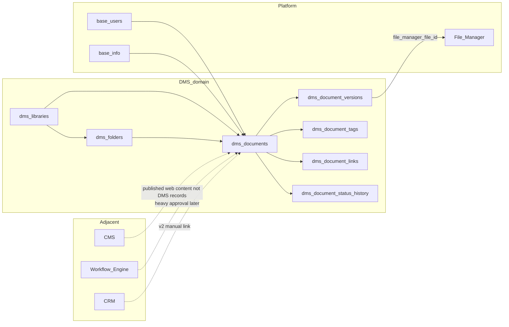
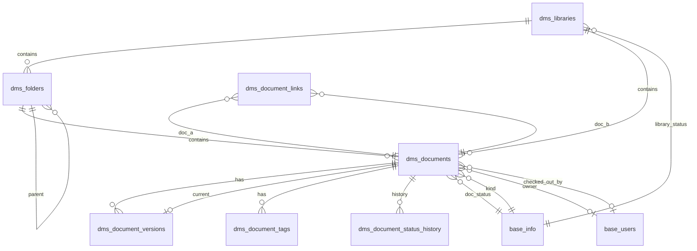

<div dir="rtl" lang="fa" class="hwy-parity-doc">
<style>
  .hwy-parity-doc { text-align: right; unicode-bidi: plaintext; }
  .hwy-parity-doc h1, .hwy-parity-doc h2, .hwy-parity-doc h3, .hwy-parity-doc h4, .hwy-parity-doc p, .hwy-parity-doc li { text-align: right; }
  .hwy-parity-doc table { direction: rtl; text-align: right; width: 100%; border-collapse: collapse; margin: 0.75rem 0; }
  .hwy-parity-doc th, .hwy-parity-doc td { border: 1px solid #c4c4c4; padding: 0.35rem 0.5rem; vertical-align: top; text-align: right; }
  .hwy-parity-doc th { background: #f6f6f6; font-weight: 600; }
  .hwy-parity-doc blockquote { text-align: right; border-right: 3px solid #ccc; border-left: none; padding-right: 1rem; margin-right: 0; }
  .hwy-parity-doc ul, .hwy-parity-doc ol { padding-right: 1.25rem; padding-left: 0; }
  .hwy-parity-doc pre, .hwy-parity-doc code { direction: ltr; text-align: left; unicode-bidi: embed; }
</style>

<p><strong>خلاصه برای operatore:</strong> این سند جزو <strong>plans</strong> است (p-packages-dms). ستون وضعیت در <a href="./p-00-packages-index.md">index مربوطه</a> مرجع «شروع شده / design / تمام» است.</p>
<p><strong>راهنمای خواندن:</strong> بخش‌های انگلیسی برای agent/dev هستند؛ جداول وضعیت و یادداشت‌های فارسی را اول بخوانید.</p>


# p-packages-dms — DMS: کتابخانه · پوشه · سند · نسخه · کنترل

> **Package:** **DMS** (#17) — [p-packages-backlog.md](p-packages-backlog.md)  
> **مسیر اجرا:** اسکوپ دامنه در backlog پکیج‌ها (نه zip Package Manager) — کنترل: [p-00-packages-index.md](p-00-packages-index.md)  
> **وضعیت:** ⬜ design only — پیاده‌سازی نشده  
> **آخرین به‌روزرسانی:** ۲۰۲۶-۰۹-۱۵  
> **وابستگی:** — (بایت فایل از **File Manager (#1)** ارجاع می‌شود؛ File Hub (#49) برای ذخیرهٔ remote اختیاری است — blocker اولیه نیست)  
> **استانداردها:** `AGENTS.md` · [data-model.md](../../../docs/standards/data-model.md) · [package-ui.md](../../../docs/standards/package-ui.md) · [package-base-info-vocab.md](../../../docs/standards/package-base-info-vocab.md) · [ui-inspector-rail.md](../../../docs/standards/ui-inspector-rail.md) · Greenfield · Data Studio / Sequelize

**DMS (Document Management System)** پکیج عملیاتی Studio برای **ثبت متادیتا · نسخه‌بندی · وضعیت کنترل‌شده · جستجو و بازیابی** اسناد سازمانی است — نه میزبانی محتوای وب منتشر‌شده و نه جایگزین کلاینت دسکتاپ فایل.

AppEndO **platform-first** است نه DMS-first: این پکیج فقط چرخهٔ **بارگذاری/ثبت → نسخه → بازبینی/تأیید ساده → انتشار/بایگانی** را می‌پوشاند و عمداً **OCR/طبقه‌بندی AI**، **eSign**، **همگام‌سازی in-place با SharePoint بدون کپی**، **RBAC سطح فایل پیچیده**، و **فرآیند تأیید چندمرحله‌ای سنگین** را داخل خودش نمی‌گیرد.

بنچمارک (الگو، نه کپی اسکیما): Microsoft SharePoint · M-Files · OpenText Documentum · Alfresco (تجاری/OSS) · OpenKM (OSS).

### اصل سخت: DMS بخشی از Core نیست — و Package Manager zip هم مسیر ساخت نیست

<table dir="rtl">
<thead><tr><th>کار</th><th>مسیر درست (developer-built)</th></tr></thead>
<tbody><tr><td>جداول / associations / studio-meta</td><td><strong>Data Studio</strong> (Edge models + Sequelize)</td></tr>
<tr><td>LOVها</td><td><strong>Base Info</strong> زیر روت <strong>DMS</strong></td></tr>
<tr><td>API / منطق دامنه (upload version · checkout · change-status · supersede)</td><td><strong>Server Functions</strong> روی Edge Sequelize — <strong>نه</strong> <code dir="ltr" style="unicode-bidi: embed;">db.query</code></td></tr>
<tr><td>UI لیست/ادیتور/مرور پوشه</td><td><strong>Client Components</strong> (<code dir="ltr" style="unicode-bidi: embed;">loaderKind: "designer"</code>)</td></tr>
<tr><td>صفحات / URL</td><td><strong>Platform Pages + route bindings</strong> — گروه <strong><code dir="ltr" style="unicode-bidi: embed;">Documents</code></strong> در Studio</td></tr>
<tr><td>بایت فایل</td><td><strong>File Manager</strong> (<code dir="ltr" style="unicode-bidi: embed;">file_manager_file_id</code> روی نسخه) — <strong>نه</strong> <code dir="ltr" style="unicode-bidi: embed;">bytea</code> روی جدول سند</td></tr>
</tbody></table>

**ممنوع (سخت):** Package Manager zip · `db.query` · seed در `controlPlaneSeed` · `src/core/packages/dms/` · `src/features/dms/` به‌عنوان feature هسته · duplicate media library داخل پکیج · EAV/custom-field engine · federated connector بدون اسکیمأ صریح در فاز بعدی.

### دسترسی داده (سخت) — فقط Sequelize

- منبع حقیقت: Edge models جدول‌های `dms_*`.
- خواندن/نوشتن فقط Sequelize Edge — **`db.query` ممنوع**.
- آپلود فایل: handler دامنه فایل را در File Manager می‌نویسد، سپس ردیف `dms_document_versions` با `file_manager_file_id` + checksum.

### خارج از ساخت اولیهٔ اپلیکیشن (سخت)

تا پیاده‌سازی صریح این پلن: **هیچ** `dms_*` · Base Info DMS · nav · UI · worker.

```
@plans/packages/todo/p-packages-dms.md برو جلو
@plans/packages/todo/p-packages-dms.md فاز ۱ بساز
@plans/packages/todo/p-packages-dms.md فاز ۲ بساز
@plans/packages/todo/p-packages-dms.md زیر‌فاز 3a بساز
@plans/packages/todo/p-packages-dms.md فاز N را رولبک کن
@plans/packages/todo/p-packages-dms.md از فاز N به بعد را رولبک کن
```

---

## هدف اصلی

DMS یک کار دارد: **کتابخانهٔ ظرف → پوشهٔ ساختاریافته → رکورد سند با متادیتا → نسخه‌های غیرقابل‌تغییر فایل → انتقال وضعیت کنترل‌شده تا Published/Archived**.

<table dir="rtl">
<thead><tr><th>دغدغه</th><th>مالک</th></tr></thead>
<tbody><tr><td>محتوای وب · وبلاگ · صفحهٔ سایت</td><td><strong>CMS (#12)</strong> · Portals · Component Designer</td></tr>
<tr><td>پیوست تیکت/تسک/ایمیل</td><td><strong>CRM · Task · Mail Hub</strong> — ارجاع <code dir="ltr" style="unicode-bidi: embed;">file_manager_file_id</code>؛ نه duplicate رکورد سند</td></tr>
<tr><td>کتابخانهٔ عمومی فایل سرور (مرور مسیر)</td><td><strong>File Manager (#1)</strong></td></tr>
<tr><td>File Hub / SSH / RDP</td><td><strong>Remote Hubs (#49)</strong></td></tr>
<tr><td>تقویم · قرار · retention reminder رویدادی</td><td><strong>Calendar (#14)</strong> — v1 فقط <code dir="ltr" style="unicode-bidi: embed;">expires_at</code> روی سند</td></tr>
<tr><td>تأیید چندمرحله‌ای · SLA · inbox انسانی</td><td><strong>Workflow Engine</strong> / Human Workflow — v1 فقط <code dir="ltr" style="unicode-bidi: embed;">change-status</code> ساده</td></tr>
<tr><td>خبرنامه · ایمیل انبوه</td><td><strong>Newsletter (#7)</strong></td></tr>
<tr><td>قرارداد CRM روی مشتری</td><td><strong>CRM (#11)</strong> — لینک دستی v2؛ v1 بدون FK polymorphic</td></tr>
<tr><td>OCR · auto-classify · Aino-style AI</td><td>لایهٔ AI پلتفرم (<a href="../../../core/next/p-72-ai-backlog.md">p-72</a>) — خارج از اسکیما v1</td></tr>
<tr><td>eSign · DocuSign</td><td>خارج از v1</td></tr>
<tr><td>هر picklist</td><td>Base Info (این پکیج روت و دسته‌های خودش را دارد)</td></tr>
<tr><td>پیش‌نمایش PDF/Office در UI</td><td><strong><code dir="ltr" style="unicode-bidi: embed;">UiDocumentViewer</code></strong> (BC shipped) — wiring در ادیتور سند</td></tr>
</tbody></table>

---

## اصل ساخت: developer-built (جداول · سرور · کلاینت)

*اگر یک مهندس دامنه این سیستم را از صفر می‌نوشت، همین شکل را می‌نوشت؟* — رد هر «موتور ECM» با meta-table و attribute jsonb باز.

### جداول (مدل داده)

- پیشوند `dms_`؛ بدون `base_` روی جداول دامنه.
- **یک شکل رکورد سند** (`dms_documents`) — تفاوت Contract/Policy با `kind_code`، نه جدول per نوع (تلهٔ SharePoint Content Type explosion).
- **نسخه immutable** (`dms_document_versions`) — هر آپلود/انتشار major = ردیف جدید؛ ویرایش in-place روی فایل ممنوع.
- پوشه = `dms_folders` درخت یک‌کتابخانه‌ای؛ **نه** site collection بی‌نهایت SharePoint در v1.
- بایت فقط در File Manager؛ DMS متادیتا + pointer.
- تاریخچهٔ وضعیت باریک: `dms_document_status_history` روی هر `status_code` change.
- لینک سند↔سند با junction نرمال‌شده (`id_a < id_b`) — **نه** `related_type`/`related_id` polymorphic.

### لایهٔ سرور

- Server Functions: `assign-document-number` اتمیک per library · `upload-version` · `checkout`/`checkin` · `change-status` · `supersede`.
- `document_key` = `{library.slug}-{document_number}` محاسبه‌ای — ستون ذخیره نمی‌شود.
- جستجو: `title` · `document_key` · `original_filename` آخرین نسخه (join).

### لایهٔ کلاینت

- گروه nav **`Documents`** (`nav.group.documents`).
- Libraries = catalog cards؛ Documents = **table/grid** (چگالی بالا)؛ Browse = tree پوشه + لیست اسناد همان پوشه.
- ادیتور سند: main + inspector rail ([ui-inspector-rail.md](../../../docs/standards/ui-inspector-rail.md)) · preview با `UiDocumentViewer` برای PDF.



---

## دردهای کلاسیک DMS و تصمیم‌های ما

<table dir="rtl">
<thead><tr><th>درد کلاسیک</th><th>علت</th><th>تصمیم AppEndO DMS</th></tr></thead>
<tbody><tr><td>Site/Library/Folder/Document Set/Content Type هر کدام مدل جدا (SharePoint)</td><td>رشد سلسله‌مراتب قبل از اولین سند</td><td><strong>سه لایه:</strong> <code dir="ltr" style="unicode-bidi: embed;">library</code> → <code dir="ltr" style="unicode-bidi: embed;">folder</code> (اختیاری) → <code dir="ltr" style="unicode-bidi: embed;">document</code>؛ بدون document set table</td></tr>
<tr><td>پوشهٔ عمیق تنها راه یافتن (folder-only ECM)</td><td>فرهنگ فایل‌شبکه</td><td><strong>متادیتا + جستجو</strong> اول؛ پوشه برای سازماندهی اپراتور — نه جایگزین metadata (الگوی M-Files بدون connector federated در v1)</td></tr>
<tr><td>نسخه روی همان فایل overwrite</td><td>از بین رفتن audit</td><td><strong><code dir="ltr" style="unicode-bidi: embed;">dms_document_versions</code> append-only</strong>؛ <code dir="ltr" style="unicode-bidi: embed;">current_version_id</code> روی سند</td></tr>
<tr><td>Content type = اسکیمای جدا per نوع</td><td>انفجار maintenance</td><td><strong><code dir="ltr" style="unicode-bidi: embed;">kind_code</code> برچسب</strong> — همان ستون‌ها برای همه kinds</td></tr>
<tr><td>ACL per-folder inheritance شکسته</td><td>پیچیدگی SharePoint permissions</td><td>v1 <strong>Studio package access فقط</strong> — بدون ACL سطح سند؛ Record Policy بعدی</td></tr>
<tr><td>Check-out گم‌شده قفل دائمی</td><td>فرآیند ضعیف</td><td><code dir="ltr" style="unicode-bidi: embed;">checked_out_by_id</code> + <code dir="ltr" style="unicode-bidi: embed;">checked_out_at</code>؛ <strong>check-in اجباری</strong> قبل از upload نسخه جدید مگر admin force</td></tr>
<tr><td>Federated view بدون کپی (M-Files)</td><td>connector per system</td><td><strong>خارج v1</strong> — فقط File Manager pointer؛ federated = فاز جدا</td></tr>
<tr><td>OCR/classify در اسکیما</td><td>موتور AI داخل DB</td><td>خارج — hook بعدی از AI پلتفرم</td></tr>
<tr><td>Workflow graphical داخل ECM</td><td>duplicate Workflow Engine</td><td>v1 <strong><code dir="ltr" style="unicode-bidi: embed;">change-status</code> + history</strong>؛ زنجیره سنگین → Workflow</td></tr>
<tr><td>Retention legal hold در ۱۲ جدول</td><td>over-engineering compliance</td><td><code dir="ltr" style="unicode-bidi: embed;">retention_class_code</code> + <code dir="ltr" style="unicode-bidi: embed;">expires_at</code> + archive status — legal hold v2</td></tr>
<tr><td>eSign envelope روی سند</td><td>دامنه قرارداد جدا</td><td>خارج v1</td></tr>
<tr><td>Duplicate binary در DB</td><td>راحتی upload</td><td><strong>هرگز bytea</strong> — File Manager</td></tr>
<tr><td>Full-text index خودساز</td><td>Elasticsearch در هر پکیج</td><td>v1 جستجوی عنوان/کلید/filename؛ full-text v2 با search provider پلتفرم</td></tr>
<tr><td>Related CRM record polymorphic FK</td><td>EAV relationship</td><td>v1 <strong>فقط doc↔doc</strong> در <code dir="ltr" style="unicode-bidi: embed;">dms_document_links</code>؛ cross-module لینک دستی v2</td></tr>
<tr><td>برچسب آزاد = جدول <code dir="ltr" style="unicode-bidi: embed;">dms_labels</code></td><td>duplicate Base Info</td><td><strong>Document Labels</strong> زیر Base Info + junction</td></tr>
</tbody></table>

---

## اطلاعات پایه (Base Info) — ریشهٔ DMS

```
Base Info
└── DMS                              ← روت پکیج (seed هنگام پیاده‌سازی)
    ├── Library Status               ← status_code (dms_libraries)
    │   └── Active, Archived
    ├── Document Status              ← status_code (dms_documents) · چرخهٔ کنترل
    │   └── Draft, In Review, Approved, Published, Superseded, Archived
    ├── Document Kinds               ← kind_code
    │   └── General, Contract, Policy, Invoice, Form
    ├── Confidentiality Levels       ← confidentiality_code
    │   └── Public, Internal, Confidential, Restricted
    ├── Retention Classes            ← retention_class_code
    │   └── 1 Year, 3 Years, 7 Years, Permanent
    ├── Document Labels              ← tag_code (via dms_document_tags)
    │   └── Legal, Finance, HR, Engineering, …
    └── Document Link Types          ← link_type_code (dms_document_links)
        └── Related, Supersedes, See Also
```

قواعد: یک روت · هر `*_code` یک دسته · آیتم‌ها فرزند مستقیم دسته · `ui_html` با Lucide · options با `root=<category id>`.

### صفحات واژگان vs enum بسته

<table dir="rtl">
<thead><tr><th>دسته</th><th>صفحه Settings</th><th>دلیل</th></tr></thead>
<tbody><tr><td>Library Status</td><td>❌</td><td><code dir="ltr" style="unicode-bidi: embed;">archived</code> فیلتر پیش‌فرض</td></tr>
<tr><td>Document Status</td><td>❌</td><td><code dir="ltr" style="unicode-bidi: embed;">change-status</code> و انتشار روی shortName قفل (<code dir="ltr" style="unicode-bidi: embed;">published</code>/<code dir="ltr" style="unicode-bidi: embed;">archived</code>/<code dir="ltr" style="unicode-bidi: embed;">superseded</code> پایانی)</td></tr>
<tr><td>Document Kinds</td><td>❌ v1</td><td>پنج kind seed ثابت — گسترش = بک‌لاگ</td></tr>
<tr><td>Confidentiality Levels</td><td>❌</td><td>ترتیب حساسیت در badge رنگ قفل است</td></tr>
<tr><td>Document Link Types</td><td>❌</td><td>سه نوع لینک seed ثابت</td></tr>
<tr><td>Retention Classes</td><td>✅ catalog + <code dir="ltr" style="unicode-bidi: embed;">form.base-info-record</code></td><td>اپراتور retention را گسترش می‌دهد</td></tr>
<tr><td>Document Labels</td><td>✅ catalog + <code dir="ltr" style="unicode-bidi: embed;">form.base-info-record</code></td><td>برچسب آزاد</td></tr>
</tbody></table>

### دسته: Library Status → `status_code` (`dms_libraries`)

<table dir="rtl">
<thead><tr><th>#</th><th>Title</th><th>shortName</th><th>Lucide</th><th>نقش</th></tr></thead>
<tbody><tr><td>1</td><td>Active</td><td><code dir="ltr" style="unicode-bidi: embed;">active</code></td><td><code dir="ltr" style="unicode-bidi: embed;">Library</code></td><td>پیش‌فرض</td></tr>
<tr><td>2</td><td>Archived</td><td><code dir="ltr" style="unicode-bidi: embed;">archived</code></td><td><code dir="ltr" style="unicode-bidi: embed;">Archive</code></td><td>پنهان در لیست پیش‌فرض</td></tr>
</tbody></table>

### دسته: Document Status → `status_code` (`dms_documents`)

<table dir="rtl">
<thead><tr><th>#</th><th>Title</th><th>shortName</th><th>Lucide</th><th>نقش</th></tr></thead>
<tbody><tr><td>1</td><td>Draft</td><td><code dir="ltr" style="unicode-bidi: embed;">draft</code></td><td><code dir="ltr" style="unicode-bidi: embed;">FileEdit</code></td><td>پیش‌فرض create · editable</td></tr>
<tr><td>2</td><td>In Review</td><td><code dir="ltr" style="unicode-bidi: embed;">in_review</code></td><td><code dir="ltr" style="unicode-bidi: embed;">SearchCheck</code></td><td>منتظر بازبینی</td></tr>
<tr><td>3</td><td>Approved</td><td><code dir="ltr" style="unicode-bidi: embed;">approved</code></td><td><code dir="ltr" style="unicode-bidi: embed;">BadgeCheck</code></td><td>تأیید شده · آماده publish</td></tr>
<tr><td>4</td><td>Published</td><td><code dir="ltr" style="unicode-bidi: embed;">published</code></td><td><code dir="ltr" style="unicode-bidi: embed;">Globe</code></td><td><strong>نسخهٔ جاری قابل مصرف</strong></td></tr>
<tr><td>5</td><td>Superseded</td><td><code dir="ltr" style="unicode-bidi: embed;">superseded</code></td><td><code dir="ltr" style="unicode-bidi: embed;">FileStack</code></td><td>جایگزین شده</td></tr>
<tr><td>6</td><td>Archived</td><td><code dir="ltr" style="unicode-bidi: embed;">archived</code></td><td><code dir="ltr" style="unicode-bidi: embed;">Archive</code></td><td><strong>پایانی</strong></td></tr>
</tbody></table>

### دسته: Document Kinds → `kind_code`

<table dir="rtl">
<thead><tr><th>#</th><th>Title</th><th>shortName</th><th>Lucide</th></tr></thead>
<tbody><tr><td>1</td><td>General</td><td><code dir="ltr" style="unicode-bidi: embed;">general</code></td><td><code dir="ltr" style="unicode-bidi: embed;">File</code></td></tr>
<tr><td>2</td><td>Contract</td><td><code dir="ltr" style="unicode-bidi: embed;">contract</code></td><td><code dir="ltr" style="unicode-bidi: embed;">FileSignature</code></td></tr>
<tr><td>3</td><td>Policy</td><td><code dir="ltr" style="unicode-bidi: embed;">policy</code></td><td><code dir="ltr" style="unicode-bidi: embed;">ScrollText</code></td></tr>
<tr><td>4</td><td>Invoice</td><td><code dir="ltr" style="unicode-bidi: embed;">invoice</code></td><td><code dir="ltr" style="unicode-bidi: embed;">Receipt</code></td></tr>
<tr><td>5</td><td>Form</td><td><code dir="ltr" style="unicode-bidi: embed;">form</code></td><td><code dir="ltr" style="unicode-bidi: embed;">FileInput</code></td></tr>
</tbody></table>

### دسته: Confidentiality Levels → `confidentiality_code`

<table dir="rtl">
<thead><tr><th>#</th><th>Title</th><th>shortName</th><th>Lucide</th></tr></thead>
<tbody><tr><td>1</td><td>Public</td><td><code dir="ltr" style="unicode-bidi: embed;">public</code></td><td><code dir="ltr" style="unicode-bidi: embed;">Eye</code></td></tr>
<tr><td>2</td><td>Internal</td><td><code dir="ltr" style="unicode-bidi: embed;">internal</code></td><td><code dir="ltr" style="unicode-bidi: embed;">Building2</code></td></tr>
<tr><td>3</td><td>Confidential</td><td><code dir="ltr" style="unicode-bidi: embed;">confidential</code></td><td><code dir="ltr" style="unicode-bidi: embed;">Shield</code></td></tr>
<tr><td>4</td><td>Restricted</td><td><code dir="ltr" style="unicode-bidi: embed;">restricted</code></td><td><code dir="ltr" style="unicode-bidi: embed;">ShieldAlert</code></td></tr>
</tbody></table>

### دسته: Retention Classes → `retention_class_code` (manageable)

<table dir="rtl">
<thead><tr><th>#</th><th>Title</th><th>shortName</th><th>Lucide</th></tr></thead>
<tbody><tr><td>1</td><td>1 Year</td><td><code dir="ltr" style="unicode-bidi: embed;">y1</code></td><td><code dir="ltr" style="unicode-bidi: embed;">Calendar</code></td></tr>
<tr><td>2</td><td>3 Years</td><td><code dir="ltr" style="unicode-bidi: embed;">y3</code></td><td><code dir="ltr" style="unicode-bidi: embed;">CalendarDays</code></td></tr>
<tr><td>3</td><td>7 Years</td><td><code dir="ltr" style="unicode-bidi: embed;">y7</code></td><td><code dir="ltr" style="unicode-bidi: embed;">CalendarRange</code></td></tr>
<tr><td>4</td><td>Permanent</td><td><code dir="ltr" style="unicode-bidi: embed;">permanent</code></td><td><code dir="ltr" style="unicode-bidi: embed;">Infinity</code></td></tr>
</tbody></table>

### دسته: Document Labels → `tag_code` (manageable)

Seed اولیه: Legal · Finance · HR · Engineering · Operations — اپراتور در `dms/settings/labels` گسترش می‌دهد.

### دسته: Document Link Types → `link_type_code`

<table dir="rtl">
<thead><tr><th>#</th><th>Title</th><th>shortName</th><th>Lucide</th></tr></thead>
<tbody><tr><td>1</td><td>Related</td><td><code dir="ltr" style="unicode-bidi: embed;">related</code></td><td><code dir="ltr" style="unicode-bidi: embed;">Link</code></td></tr>
<tr><td>2</td><td>Supersedes</td><td><code dir="ltr" style="unicode-bidi: embed;">supersedes</code></td><td><code dir="ltr" style="unicode-bidi: embed;">Replace</code></td></tr>
<tr><td>3</td><td>See Also</td><td><code dir="ltr" style="unicode-bidi: embed;">see_also</code></td><td><code dir="ltr" style="unicode-bidi: embed;">BookMarked</code></td></tr>
</tbody></table>

---

## مدل دامنه

### تصمیم

1. **`dms_libraries`** — ظرف سازمانی (title، slug، status)
2. **`dms_folders`** — درخت پوشه داخل یک library
3. **`dms_documents`** — رکورد سند + متادیتا + checkout + اشاره به نسخهٔ جاری
4. **`dms_document_versions`** — نسخه‌های فایل immutable
5. **`dms_document_tags`** — junction سند ↔ برچسب Base Info
6. **`dms_document_links`** — لینک سند↔سند نرمال‌شده
7. **`dms_document_status_history`** — تاریخچهٔ تغییر وضعیت

**وجود ندارند:** `dms_content_types`, `dms_acl_entries`, `dms_workflows`, `dms_ocr_jobs`, `dms_signatures`, `dms_federated_sources`, `dms_document_sets`, `attributes` jsonb باز.



### `dms_libraries`

<table dir="rtl">
<thead><tr><th>#</th><th>Column</th><th>Native</th><th>Runtime</th><th>Null</th><th>نقش</th></tr></thead>
<tbody><tr><td>1</td><td><code dir="ltr" style="unicode-bidi: embed;">id</code></td><td><code dir="ltr" style="unicode-bidi: embed;">bigint</code></td><td><code dir="ltr" style="unicode-bidi: embed;">INTEGER</code></td><td>no</td><td>PK</td></tr>
<tr><td>2</td><td><code dir="ltr" style="unicode-bidi: embed;">title</code></td><td><code dir="ltr" style="unicode-bidi: embed;">text</code></td><td><code dir="ltr" style="unicode-bidi: embed;">STRING</code></td><td>no</td><td>نام</td></tr>
<tr><td>3</td><td><code dir="ltr" style="unicode-bidi: embed;">slug</code></td><td><code dir="ltr" style="unicode-bidi: embed;">text</code></td><td><code dir="ltr" style="unicode-bidi: embed;">STRING</code></td><td>no</td><td>UNIQUE · <code dir="ltr" style="unicode-bidi: embed;">LATIN_SLUG_RE</code></td></tr>
<tr><td>4</td><td><code dir="ltr" style="unicode-bidi: embed;">status_code</code></td><td><code dir="ltr" style="unicode-bidi: embed;">text</code></td><td><code dir="ltr" style="unicode-bidi: embed;">STRING</code></td><td>yes</td><td>→ Library Status</td></tr>
<tr><td>5</td><td><code dir="ltr" style="unicode-bidi: embed;">note</code></td><td><code dir="ltr" style="unicode-bidi: embed;">text</code></td><td><code dir="ltr" style="unicode-bidi: embed;">STRING</code></td><td>yes</td><td></td></tr>
<tr><td>6</td><td><code dir="ltr" style="unicode-bidi: embed;">next_document_number</code></td><td><code dir="ltr" style="unicode-bidi: embed;">integer</code></td><td><code dir="ltr" style="unicode-bidi: embed;">INTEGER</code></td><td>no</td><td>شمارندهٔ اتمیک · default 1</td></tr>
<tr><td>7</td><td><code dir="ltr" style="unicode-bidi: embed;">created_by</code></td><td><code dir="ltr" style="unicode-bidi: embed;">bigint</code></td><td><code dir="ltr" style="unicode-bidi: embed;">INTEGER</code></td><td>yes</td><td>audit</td></tr>
<tr><td>8</td><td><code dir="ltr" style="unicode-bidi: embed;">created_at</code></td><td><code dir="ltr" style="unicode-bidi: embed;">timestamptz</code></td><td><code dir="ltr" style="unicode-bidi: embed;">DATE</code></td><td>yes</td><td></td></tr>
<tr><td>9</td><td><code dir="ltr" style="unicode-bidi: embed;">updated_by</code></td><td><code dir="ltr" style="unicode-bidi: embed;">bigint</code></td><td><code dir="ltr" style="unicode-bidi: embed;">INTEGER</code></td><td>yes</td><td></td></tr>
<tr><td>10</td><td><code dir="ltr" style="unicode-bidi: embed;">updated_at</code></td><td><code dir="ltr" style="unicode-bidi: embed;">timestamptz</code></td><td><code dir="ltr" style="unicode-bidi: embed;">DATE</code></td><td>yes</td><td></td></tr>
</tbody></table>

قواعد: Create dialog Title + slug → `active`. `slug` بعد از create **قفل**. Archive = `archived`. `next_document_number` فقط سرور.

### `dms_folders`

<table dir="rtl">
<thead><tr><th>#</th><th>Column</th><th>Native</th><th>Runtime</th><th>Null</th><th>نقش</th></tr></thead>
<tbody><tr><td>1</td><td><code dir="ltr" style="unicode-bidi: embed;">id</code></td><td><code dir="ltr" style="unicode-bidi: embed;">bigint</code></td><td><code dir="ltr" style="unicode-bidi: embed;">INTEGER</code></td><td>no</td><td>PK</td></tr>
<tr><td>2</td><td><code dir="ltr" style="unicode-bidi: embed;">library_id</code></td><td><code dir="ltr" style="unicode-bidi: embed;">bigint</code></td><td><code dir="ltr" style="unicode-bidi: embed;">INTEGER</code></td><td>no</td><td>→ library</td></tr>
<tr><td>3</td><td><code dir="ltr" style="unicode-bidi: embed;">parent_id</code></td><td><code dir="ltr" style="unicode-bidi: embed;">bigint</code></td><td><code dir="ltr" style="unicode-bidi: embed;">INTEGER</code></td><td>yes</td><td>خودارجاع · ریشه = null</td></tr>
<tr><td>4</td><td><code dir="ltr" style="unicode-bidi: embed;">title</code></td><td><code dir="ltr" style="unicode-bidi: embed;">text</code></td><td><code dir="ltr" style="unicode-bidi: embed;">STRING</code></td><td>no</td><td></td></tr>
<tr><td>5</td><td><code dir="ltr" style="unicode-bidi: embed;">slug</code></td><td><code dir="ltr" style="unicode-bidi: embed;">text</code></td><td><code dir="ltr" style="unicode-bidi: embed;">STRING</code></td><td>no</td><td>UNIQUE per <code dir="ltr" style="unicode-bidi: embed;">(library_id, parent_id, slug)</code></td></tr>
<tr><td>6</td><td><code dir="ltr" style="unicode-bidi: embed;">sort_order</code></td><td><code dir="ltr" style="unicode-bidi: embed;">integer</code></td><td><code dir="ltr" style="unicode-bidi: embed;">INTEGER</code></td><td>yes</td><td>ترتیب خواهر</td></tr>
<tr><td>7</td><td><code dir="ltr" style="unicode-bidi: embed;">created_by</code></td><td><code dir="ltr" style="unicode-bidi: embed;">bigint</code></td><td><code dir="ltr" style="unicode-bidi: embed;">INTEGER</code></td><td>yes</td><td></td></tr>
<tr><td>8</td><td><code dir="ltr" style="unicode-bidi: embed;">created_at</code></td><td><code dir="ltr" style="unicode-bidi: embed;">timestamptz</code></td><td><code dir="ltr" style="unicode-bidi: embed;">DATE</code></td><td>yes</td><td></td></tr>
<tr><td>9</td><td><code dir="ltr" style="unicode-bidi: embed;">updated_by</code></td><td><code dir="ltr" style="unicode-bidi: embed;">bigint</code></td><td><code dir="ltr" style="unicode-bidi: embed;">INTEGER</code></td><td>yes</td><td></td></tr>
<tr><td>10</td><td><code dir="ltr" style="unicode-bidi: embed;">updated_at</code></td><td><code dir="ltr" style="unicode-bidi: embed;">timestamptz</code></td><td><code dir="ltr" style="unicode-bidi: embed;">DATE</code></td><td>yes</td><td></td></tr>
</tbody></table>

قواعد: عمق درخت v1 **حداکثر ۸ سطح** — سرور رد می‌کند. حذف پوشه فقط وقتی خالی (صفر سند + صفر زیرپوشه) یا انتقال دستی.

### `dms_documents`

<table dir="rtl">
<thead><tr><th>#</th><th>Column</th><th>Native</th><th>Runtime</th><th>Null</th><th>نقش</th></tr></thead>
<tbody><tr><td>1</td><td><code dir="ltr" style="unicode-bidi: embed;">id</code></td><td><code dir="ltr" style="unicode-bidi: embed;">bigint</code></td><td><code dir="ltr" style="unicode-bidi: embed;">INTEGER</code></td><td>no</td><td>PK</td></tr>
<tr><td>2</td><td><code dir="ltr" style="unicode-bidi: embed;">library_id</code></td><td><code dir="ltr" style="unicode-bidi: embed;">bigint</code></td><td><code dir="ltr" style="unicode-bidi: embed;">INTEGER</code></td><td>no</td><td>قفل بعد از create</td></tr>
<tr><td>3</td><td><code dir="ltr" style="unicode-bidi: embed;">folder_id</code></td><td><code dir="ltr" style="unicode-bidi: embed;">bigint</code></td><td><code dir="ltr" style="unicode-bidi: embed;">INTEGER</code></td><td>yes</td><td>null = ریشهٔ library</td></tr>
<tr><td>4</td><td><code dir="ltr" style="unicode-bidi: embed;">document_number</code></td><td><code dir="ltr" style="unicode-bidi: embed;">integer</code></td><td><code dir="ltr" style="unicode-bidi: embed;">INTEGER</code></td><td>no</td><td>UNIQUE <code dir="ltr" style="unicode-bidi: embed;">(library_id, document_number)</code></td></tr>
<tr><td>5</td><td><code dir="ltr" style="unicode-bidi: embed;">title</code></td><td><code dir="ltr" style="unicode-bidi: embed;">text</code></td><td><code dir="ltr" style="unicode-bidi: embed;">STRING</code></td><td>no</td><td></td></tr>
<tr><td>6</td><td><code dir="ltr" style="unicode-bidi: embed;">kind_code</code></td><td><code dir="ltr" style="unicode-bidi: embed;">text</code></td><td><code dir="ltr" style="unicode-bidi: embed;">STRING</code></td><td>yes</td><td>→ Document Kinds · <strong>قفل بعد از create</strong></td></tr>
<tr><td>7</td><td><code dir="ltr" style="unicode-bidi: embed;">status_code</code></td><td><code dir="ltr" style="unicode-bidi: embed;">text</code></td><td><code dir="ltr" style="unicode-bidi: embed;">STRING</code></td><td>yes</td><td>→ Document Status</td></tr>
<tr><td>8</td><td><code dir="ltr" style="unicode-bidi: embed;">confidentiality_code</code></td><td><code dir="ltr" style="unicode-bidi: embed;">text</code></td><td><code dir="ltr" style="unicode-bidi: embed;">STRING</code></td><td>yes</td><td></td></tr>
<tr><td>9</td><td><code dir="ltr" style="unicode-bidi: embed;">retention_class_code</code></td><td><code dir="ltr" style="unicode-bidi: embed;">text</code></td><td><code dir="ltr" style="unicode-bidi: embed;">STRING</code></td><td>yes</td><td></td></tr>
<tr><td>10</td><td><code dir="ltr" style="unicode-bidi: embed;">owner_id</code></td><td><code dir="ltr" style="unicode-bidi: embed;">bigint</code></td><td><code dir="ltr" style="unicode-bidi: embed;">INTEGER</code></td><td>yes</td><td>→ <code dir="ltr" style="unicode-bidi: embed;">base_users</code></td></tr>
<tr><td>11</td><td><code dir="ltr" style="unicode-bidi: embed;">current_version_id</code></td><td><code dir="ltr" style="unicode-bidi: embed;">bigint</code></td><td><code dir="ltr" style="unicode-bidi: embed;">INTEGER</code></td><td>yes</td><td>→ <code dir="ltr" style="unicode-bidi: embed;">dms_document_versions</code></td></tr>
<tr><td>12</td><td><code dir="ltr" style="unicode-bidi: embed;">checked_out_by_id</code></td><td><code dir="ltr" style="unicode-bidi: embed;">bigint</code></td><td><code dir="ltr" style="unicode-bidi: embed;">INTEGER</code></td><td>yes</td><td>checkout</td></tr>
<tr><td>13</td><td><code dir="ltr" style="unicode-bidi: embed;">checked_out_at</code></td><td><code dir="ltr" style="unicode-bidi: embed;">timestamptz</code></td><td><code dir="ltr" style="unicode-bidi: embed;">DATE</code></td><td>yes</td><td></td></tr>
<tr><td>14</td><td><code dir="ltr" style="unicode-bidi: embed;">effective_at</code></td><td><code dir="ltr" style="unicode-bidi: embed;">date</code></td><td><code dir="ltr" style="unicode-bidi: embed;">DATEONLY</code></td><td>yes</td><td></td></tr>
<tr><td>15</td><td><code dir="ltr" style="unicode-bidi: embed;">expires_at</code></td><td><code dir="ltr" style="unicode-bidi: embed;">date</code></td><td><code dir="ltr" style="unicode-bidi: embed;">DATEONLY</code></td><td>yes</td><td></td></tr>
<tr><td>16</td><td><code dir="ltr" style="unicode-bidi: embed;">note</code></td><td><code dir="ltr" style="unicode-bidi: embed;">text</code></td><td><code dir="ltr" style="unicode-bidi: embed;">TEXT</code></td><td>yes</td><td></td></tr>
<tr><td>17</td><td><code dir="ltr" style="unicode-bidi: embed;">created_by</code></td><td><code dir="ltr" style="unicode-bidi: embed;">bigint</code></td><td><code dir="ltr" style="unicode-bidi: embed;">INTEGER</code></td><td>yes</td><td></td></tr>
<tr><td>18</td><td><code dir="ltr" style="unicode-bidi: embed;">created_at</code></td><td><code dir="ltr" style="unicode-bidi: embed;">timestamptz</code></td><td><code dir="ltr" style="unicode-bidi: embed;">DATE</code></td><td>yes</td><td></td></tr>
<tr><td>19</td><td><code dir="ltr" style="unicode-bidi: embed;">updated_by</code></td><td><code dir="ltr" style="unicode-bidi: embed;">bigint</code></td><td><code dir="ltr" style="unicode-bidi: embed;">INTEGER</code></td><td>yes</td><td></td></tr>
<tr><td>20</td><td><code dir="ltr" style="unicode-bidi: embed;">updated_at</code></td><td><code dir="ltr" style="unicode-bidi: embed;">timestamptz</code></td><td><code dir="ltr" style="unicode-bidi: embed;">DATE</code></td><td>yes</td><td></td></tr>
</tbody></table>

قواعد:

- Create: dialog **Library** (locked if from browse) · **Kind** · **Title** → POST → `dms/documents/edit/{id}` — **بدون** `edit/new`.
- `kind_code` قفل بعد از create (تعیین‌کنندهٔ workflow آینده — v1 همان ادیتور).
- `status` فقط از `change-status` — نه PATCH مستقیم.
- `document_key` = `{library.slug}-{document_number}` در API.
- Checkout: فقط یک checkout فعال؛ upload version نیازمند checkout توسط همان user یا force admin.
- Published: نسخهٔ جاری immutable — تغییر = نسخهٔ جدید + optionally supersede سند قبلی از لینک.

### `dms_document_versions`

<table dir="rtl">
<thead><tr><th>#</th><th>Column</th><th>Native</th><th>Runtime</th><th>Null</th><th>نقش</th></tr></thead>
<tbody><tr><td>1</td><td><code dir="ltr" style="unicode-bidi: embed;">id</code></td><td><code dir="ltr" style="unicode-bidi: embed;">bigint</code></td><td><code dir="ltr" style="unicode-bidi: embed;">INTEGER</code></td><td>no</td><td>PK</td></tr>
<tr><td>2</td><td><code dir="ltr" style="unicode-bidi: embed;">document_id</code></td><td><code dir="ltr" style="unicode-bidi: embed;">bigint</code></td><td><code dir="ltr" style="unicode-bidi: embed;">INTEGER</code></td><td>no</td><td></td></tr>
<tr><td>3</td><td><code dir="ltr" style="unicode-bidi: embed;">version_number</code></td><td><code dir="ltr" style="unicode-bidi: embed;">integer</code></td><td><code dir="ltr" style="unicode-bidi: embed;">INTEGER</code></td><td>no</td><td>UNIQUE per document · از 1</td></tr>
<tr><td>4</td><td><code dir="ltr" style="unicode-bidi: embed;">is_major</code></td><td><code dir="ltr" style="unicode-bidi: embed;">boolean</code></td><td><code dir="ltr" style="unicode-bidi: embed;">BOOLEAN</code></td><td>no</td><td>default true</td></tr>
<tr><td>5</td><td><code dir="ltr" style="unicode-bidi: embed;">file_manager_file_id</code></td><td><code dir="ltr" style="unicode-bidi: embed;">uuid</code></td><td><code dir="ltr" style="unicode-bidi: embed;">UUID</code></td><td>no</td><td>→ File Manager</td></tr>
<tr><td>6</td><td><code dir="ltr" style="unicode-bidi: embed;">original_filename</code></td><td><code dir="ltr" style="unicode-bidi: embed;">text</code></td><td><code dir="ltr" style="unicode-bidi: embed;">STRING</code></td><td>no</td><td></td></tr>
<tr><td>7</td><td><code dir="ltr" style="unicode-bidi: embed;">mime_type</code></td><td><code dir="ltr" style="unicode-bidi: embed;">text</code></td><td><code dir="ltr" style="unicode-bidi: embed;">STRING</code></td><td>yes</td><td></td></tr>
<tr><td>8</td><td><code dir="ltr" style="unicode-bidi: embed;">byte_size</code></td><td><code dir="ltr" style="unicode-bidi: embed;">bigint</code></td><td><code dir="ltr" style="unicode-bidi: embed;">INTEGER</code></td><td>yes</td><td></td></tr>
<tr><td>9</td><td><code dir="ltr" style="unicode-bidi: embed;">checksum_sha256</code></td><td><code dir="ltr" style="unicode-bidi: embed;">text</code></td><td><code dir="ltr" style="unicode-bidi: embed;">STRING</code></td><td>yes</td><td></td></tr>
<tr><td>10</td><td><code dir="ltr" style="unicode-bidi: embed;">change_summary</code></td><td><code dir="ltr" style="unicode-bidi: embed;">text</code></td><td><code dir="ltr" style="unicode-bidi: embed;">TEXT</code></td><td>yes</td><td></td></tr>
<tr><td>11</td><td><code dir="ltr" style="unicode-bidi: embed;">created_by</code></td><td><code dir="ltr" style="unicode-bidi: embed;">bigint</code></td><td><code dir="ltr" style="unicode-bidi: embed;">INTEGER</code></td><td>yes</td><td></td></tr>
<tr><td>12</td><td><code dir="ltr" style="unicode-bidi: embed;">created_at</code></td><td><code dir="ltr" style="unicode-bidi: embed;">timestamptz</code></td><td><code dir="ltr" style="unicode-bidi: embed;">DATE</code></td><td>no</td><td></td></tr>
</tbody></table>

قواعد: append-only · حذف ممنوع در v1 · rollback فقط با supersede/archive سند.

### `dms_document_tags`

PK `(document_id, tag_code)` → `base_info` Document Labels.

### `dms_document_links`

<table dir="rtl">
<thead><tr><th>#</th><th>Column</th><th>Type</th><th>نقش</th></tr></thead>
<tbody><tr><td>1</td><td><code dir="ltr" style="unicode-bidi: embed;">document_id_a</code></td><td>bigint</td><td>کمترین id جفت</td></tr>
<tr><td>2</td><td><code dir="ltr" style="unicode-bidi: embed;">document_id_b</code></td><td>bigint</td><td>بیشترین id</td></tr>
<tr><td>3</td><td><code dir="ltr" style="unicode-bidi: embed;">link_type_code</code></td><td>text</td><td>→ Link Types</td></tr>
</tbody></table>

UNIQUE `(document_id_a, document_id_b, link_type_code)` · on write normalize `a < b`.

### `dms_document_status_history`

<table dir="rtl">
<thead><tr><th>Column</th><th>نقش</th></tr></thead>
<tbody><tr><td><code dir="ltr" style="unicode-bidi: embed;">id</code></td><td>PK</td></tr>
<tr><td><code dir="ltr" style="unicode-bidi: embed;">document_id</code></td><td>FK</td></tr>
<tr><td><code dir="ltr" style="unicode-bidi: embed;">from_status_code</code></td><td>nullable first</td></tr>
<tr><td><code dir="ltr" style="unicode-bidi: embed;">to_status_code</code></td><td>required</td></tr>
<tr><td><code dir="ltr" style="unicode-bidi: embed;">changed_by</code></td><td>user</td></tr>
<tr><td><code dir="ltr" style="unicode-bidi: embed;">changed_at</code></td><td>timestamp</td></tr>
</tbody></table>

### Edge model associations — کاننیکال

<table dir="rtl">
<thead><tr><th>مدل</th><th>kind</th><th>target</th><th>FK</th><th><code dir="ltr" style="unicode-bidi: embed;">as</code></th></tr></thead>
<tbody><tr><td><code dir="ltr" style="unicode-bidi: embed;">dms_libraries</code></td><td>belongsTo</td><td>base_info</td><td>status_code</td><td>status</td></tr>
<tr><td><code dir="ltr" style="unicode-bidi: embed;">dms_libraries</code></td><td>hasMany</td><td>dms_folders</td><td>library_id</td><td>folders</td></tr>
<tr><td><code dir="ltr" style="unicode-bidi: embed;">dms_libraries</code></td><td>hasMany</td><td>dms_documents</td><td>library_id</td><td>documents</td></tr>
<tr><td><code dir="ltr" style="unicode-bidi: embed;">dms_folders</code></td><td>belongsTo</td><td>dms_libraries</td><td>library_id</td><td>library</td></tr>
<tr><td><code dir="ltr" style="unicode-bidi: embed;">dms_folders</code></td><td>belongsTo</td><td>dms_folders</td><td>parent_id</td><td>parent</td></tr>
<tr><td><code dir="ltr" style="unicode-bidi: embed;">dms_folders</code></td><td>hasMany</td><td>dms_folders</td><td>parent_id</td><td>subfolders</td></tr>
<tr><td><code dir="ltr" style="unicode-bidi: embed;">dms_folders</code></td><td>hasMany</td><td>dms_documents</td><td>folder_id</td><td>documents</td></tr>
<tr><td><code dir="ltr" style="unicode-bidi: embed;">dms_documents</code></td><td>belongsTo</td><td>dms_libraries</td><td>library_id</td><td>library</td></tr>
<tr><td><code dir="ltr" style="unicode-bidi: embed;">dms_documents</code></td><td>belongsTo</td><td>dms_folders</td><td>folder_id</td><td>folder</td></tr>
<tr><td><code dir="ltr" style="unicode-bidi: embed;">dms_documents</code></td><td>belongsTo</td><td>base_info</td><td>kind_code</td><td>kind</td></tr>
<tr><td><code dir="ltr" style="unicode-bidi: embed;">dms_documents</code></td><td>belongsTo</td><td>base_info</td><td>status_code</td><td>status</td></tr>
<tr><td><code dir="ltr" style="unicode-bidi: embed;">dms_documents</code></td><td>belongsTo</td><td>base_info</td><td>confidentiality_code</td><td>confidentiality</td></tr>
<tr><td><code dir="ltr" style="unicode-bidi: embed;">dms_documents</code></td><td>belongsTo</td><td>base_info</td><td>retention_class_code</td><td>retentionClass</td></tr>
<tr><td><code dir="ltr" style="unicode-bidi: embed;">dms_documents</code></td><td>belongsTo</td><td>base_users</td><td>owner_id</td><td>owner</td></tr>
<tr><td><code dir="ltr" style="unicode-bidi: embed;">dms_documents</code></td><td>belongsTo</td><td>base_users</td><td>checked_out_by_id</td><td>checkedOutBy</td></tr>
<tr><td><code dir="ltr" style="unicode-bidi: embed;">dms_documents</code></td><td>belongsTo</td><td>dms_document_versions</td><td>current_version_id</td><td>currentVersion</td></tr>
<tr><td><code dir="ltr" style="unicode-bidi: embed;">dms_documents</code></td><td>hasMany</td><td>dms_document_versions</td><td>document_id</td><td>versions</td></tr>
<tr><td><code dir="ltr" style="unicode-bidi: embed;">dms_documents</code></td><td>hasMany</td><td>dms_document_tags</td><td>document_id</td><td>tags</td></tr>
<tr><td><code dir="ltr" style="unicode-bidi: embed;">dms_documents</code></td><td>hasMany</td><td>dms_document_status_history</td><td>document_id</td><td>statusHistory</td></tr>
<tr><td><code dir="ltr" style="unicode-bidi: embed;">dms_document_versions</code></td><td>belongsTo</td><td>dms_documents</td><td>document_id</td><td>document</td></tr>
<tr><td><code dir="ltr" style="unicode-bidi: embed;">dms_document_tags</code></td><td>belongsTo</td><td>dms_documents</td><td>document_id</td><td>document</td></tr>
<tr><td><code dir="ltr" style="unicode-bidi: embed;">dms_document_tags</code></td><td>belongsTo</td><td>base_info</td><td>tag_code</td><td>tag</td></tr>
<tr><td><code dir="ltr" style="unicode-bidi: embed;">dms_document_links</code></td><td>belongsTo</td><td>dms_documents</td><td>document_id_a</td><td>documentA</td></tr>
<tr><td><code dir="ltr" style="unicode-bidi: embed;">dms_document_links</code></td><td>belongsTo</td><td>dms_documents</td><td>document_id_b</td><td>documentB</td></tr>
<tr><td><code dir="ltr" style="unicode-bidi: embed;">dms_document_links</code></td><td>belongsTo</td><td>base_info</td><td>link_type_code</td><td>linkType</td></tr>
</tbody></table>

**ممنوع:** دو belongsToMany معکوس برای links · polymorphic related · suggest-from-FK بدون wiring · bytea content.

---

## Data Studio / studio-meta — قرارداد کامل مدلر (فاز ۱)

### مرز ذخیره‌سازی

<table dir="rtl">
<thead><tr><th>لایه</th><th>کجا</th><th>چه</th></tr></thead>
<tbody><tr><td>EdgeModel</td><td><code dir="ltr" style="unicode-bidi: embed;">runtime/edge-models</code></td><td>columns · PK · associations · labels</td></tr>
<tr><td>studio-meta</td><td><code dir="ltr" style="unicode-bidi: embed;">runtime/edge-model-studio-meta</code></td><td>tags · columnMeta · associationMeta · extensions.story</td></tr>
</tbody></table>

قواعد seed: sparse · گروه اجباری · widget `*_code` روی association · targetFilter با id resolve‌شده از seed · story انگلیسی · rollback meta با model.

### کاتالوگ قابلیت‌های مدلر

<table dir="rtl">
<thead><tr><th>قابلیت</th><th>DMS</th></tr></thead>
<tbody><tr><td>Story per table</td><td>✅ همهٔ ۷ جدول</td></tr>
<tr><td>columnGroupOrder</td><td>✅ Identity · Location · Control · File · Audit</td></tr>
<tr><td>Relation picker in forms</td><td>✅ library · folder · owner · tags</td></tr>
<tr><td>Search roles</td><td>documents: title + number؛ versions: filename</td></tr>
</tbody></table>

### هویت مدل‌ها (EdgeModel.labels)

<table dir="rtl">
<thead><tr><th>objectName</th><th>title</th><th>icon</th><th>color</th><th>tags</th></tr></thead>
<tbody><tr><td>dms_libraries</td><td>Library</td><td><code dir="ltr" style="unicode-bidi: embed;">Library</code></td><td>slate</td><td>dms</td></tr>
<tr><td>dms_folders</td><td>Folder</td><td><code dir="ltr" style="unicode-bidi: embed;">Folder</code></td><td>slate</td><td>dms</td></tr>
<tr><td>dms_documents</td><td>Document</td><td><code dir="ltr" style="unicode-bidi: embed;">FileText</code></td><td>blue</td><td>dms</td></tr>
<tr><td>dms_document_versions</td><td>Document Version</td><td><code dir="ltr" style="unicode-bidi: embed;">FileStack</code></td><td>indigo</td><td>dms</td></tr>
<tr><td>dms_document_tags</td><td>Document Tag</td><td><code dir="ltr" style="unicode-bidi: embed;">Tag</code></td><td>violet</td><td>dms</td></tr>
<tr><td>dms_document_links</td><td>Document Link</td><td><code dir="ltr" style="unicode-bidi: embed;">Link</code></td><td>gray</td><td>dms</td></tr>
<tr><td>dms_document_status_history</td><td>Status History</td><td><code dir="ltr" style="unicode-bidi: embed;">History</code></td><td>amber</td><td>dms</td></tr>
</tbody></table>

### `dms_libraries` — Story · گروه‌ها · ستون‌ها · ریلیشن‌ها

```markdown
## Purpose
Organizational vault for controlled documents. One library scopes document numbers and folder trees.

## Lifecycle
Created active → documents added → archived hides from default lists.

## Rules
Slug immutable after create. Document numbers are per-library via next_document_number.
```

<table dir="rtl">
<thead><tr><th>گروه</th><th>ستون‌ها</th></tr></thead>
<tbody><tr><td>Identity</td><td>title, slug, status_code</td></tr>
<tr><td>Operations</td><td>next_document_number (hidden in UI forms)</td></tr>
<tr><td>Note</td><td>note</td></tr>
<tr><td>Audit</td><td>created_by, created_at, updated_by, updated_at</td></tr>
</tbody></table>

columnMeta نمونه: `title` form text required search contains · `slug` text LATIN · `status_code` via association `status` select · `next_document_number` hidden admin-only.

associationMeta: `status` belongsTo base_info targetFilter Library Status category · `folders` hasMany · `documents` hasMany.

### `dms_folders` — Story · گروه‌ها · ستون‌ها · ریلیشن‌ها

```markdown
## Purpose
Hierarchical folder within a single library for operator organization; not a security boundary in v1.

## Lifecycle
Created under library or parent folder → documents placed → deleted only when empty.

## Rules
Max depth 8. Slug unique among siblings.
```

گروه‌ها: Identity (title, slug, library_id, parent_id) · Order (sort_order) · Audit.

### `dms_documents` — Story · گروه‌ها · ستون‌ها · ریلیشن‌ها

```markdown
## Purpose
Controlled document record: metadata, lifecycle status, checkout, pointer to current immutable file version.

## Lifecycle
Draft → review → approved → published. Superseded/archived terminals. Each file change creates a new version row.

## Rules
Status changes append history. Binary bytes live in File Manager only. kind_code locked after create.
```

گروه‌ها: Identity · Location (library_id, folder_id, document_number) · Classification (kind, status, confidentiality, retention) · Ownership (owner_id) · Control (checkout fields, effective/expires) · Note · Audit.

associationMeta برای همه LOVها + `currentVersion` belongsTo versions + `versions` hasMany.

### `dms_document_versions` — Story · گروه‌ها · ستون‌ها · ریلیشن‌ها

```markdown
## Purpose
Immutable file snapshot for a document. References File Manager for bytes.

## Lifecycle
Append-only on upload. version_number monotonic per document.

## Rules
No in-place file replacement. checksum_sha256 stored when provided by upload pipeline.
```

گروه‌ها: Version (version_number, is_major, change_summary) · File (file_manager_file_id, original_filename, mime_type, byte_size, checksum_sha256) · Audit.

### `dms_document_tags` — Story · گروه‌ها · ستون‌ها · ریلیشن‌ها

```markdown
## Purpose
Many-to-many between documents and Base Info Document Labels.

## Lifecycle
Rows added/removed when operator edits label set on a document.

## Rules
Composite PK (document_id, tag_code). tag_code points at Base Info label item id.
```

<table dir="rtl">
<thead><tr><th>گروه</th><th>ستون‌ها</th></tr></thead>
<tbody><tr><td>Link</td><td>document_id, tag_code</td></tr>
</tbody></table>

columnMeta: both required · hidden in standalone CRUD (managed from document editor). associationMeta: `document` belongsTo · `tag` belongsTo base_info (Document Labels category filter).

### `dms_document_links` — Story · گروه‌ها · ستون‌ها · ریلیشن‌ها

```markdown
## Purpose
Symmetric document-to-document relationships (related, supersedes, see also).

## Lifecycle
Created from document editor link modal; normalized pair on write.

## Rules
document_id_a < document_id_b always. UNIQUE (a,b,link_type_code).
```

<table dir="rtl">
<thead><tr><th>گروه</th><th>ستون‌ها</th></tr></thead>
<tbody><tr><td>Endpoints</td><td>document_id_a, document_id_b</td></tr>
<tr><td>Type</td><td>link_type_code</td></tr>
</tbody></table>

associationMeta: `documentA` · `documentB` belongsTo documents · `linkType` belongsTo Link Types LOV.

### `dms_document_status_history` — Story · گروه‌ها · ستون‌ها · ریلیشن‌ها

```markdown
## Purpose
Append-only audit of document status transitions for compliance reporting.

## Lifecycle
One row per change-status call (including initial draft assignment).

## Rules
Rows never updated or deleted. from_status null on first row only.
```

<table dir="rtl">
<thead><tr><th>گروه</th><th>ستون‌ها</th></tr></thead>
<tbody><tr><td>Transition</td><td>from_status_code, to_status_code, changed_at</td></tr>
<tr><td>Actor</td><td>changed_by</td></tr>
</tbody></table>

associationMeta: `document` belongsTo · `fromStatus` · `toStatus` belongsTo Document Status · `changedBy` belongsTo base_users.

### پذیرش بصری در Data Studio

1. هر مدل Story + groups + zero Ungrouped meaningful columns  
2. Relations tab = association catalog بالا  
3. LOV widgets روی association نه ستون خام  
4. Rollback edge model → حذف studio-meta  
5. باز کردن Document در مدلر: current version relation visible  
6. Folder self-tree wiring `parent`/`subfolders` یک جفت  

---

## خارج از اسکوپ (سخت)

- CMS · صفحات وب · بلاگ
- Federated ECM / M-Files-style in-place connectors
- OCR · auto-metadata · AI classify در v1
- eSign · legal hold پیشرفته
- ACL per document/folder (v1 = package-level Studio access)
- Workflow graphical designer داخل DMS
- CRM/Project polymorphic attachment FK
- Full-text Elasticsearch index داخل پکیج
- Duplicate File Manager UI
- Newsletter · Mail Hub body storage
- `db.query` · Package zip · bootstrap seed

---

## UX ادمین

گروه nav: **`Documents`** — `nav.group.documents`: `Documents`.

<table dir="rtl">
<thead><tr><th>Route</th><th>نقش</th></tr></thead>
<tbody><tr><td><code dir="ltr" style="unicode-bidi: embed;">dms/libraries</code></td><td>کاتالوگ کتابخانه</td></tr>
<tr><td><code dir="ltr" style="unicode-bidi: embed;">dms/libraries/edit/{id}</code></td><td>ادیتور کتابخانه</td></tr>
<tr><td><code dir="ltr" style="unicode-bidi: embed;">dms/browse/{libraryId}</code></td><td>tree پوشه + لیست اسناد پوشهٔ انتخاب‌شده</td></tr>
<tr><td><code dir="ltr" style="unicode-bidi: embed;">dms/documents</code></td><td>لیست سراسری اسناد (table)</td></tr>
<tr><td><code dir="ltr" style="unicode-bidi: embed;">dms/documents/edit/{id}</code></td><td>ادیتور سند (طلایی)</td></tr>
<tr><td><code dir="ltr" style="unicode-bidi: embed;">dms/settings</code></td><td>Retention Classes + Document Labels</td></tr>
</tbody></table>

### Cards vs table

<table dir="rtl">
<thead><tr><th>صفحه</th><th>Presentation</th><th>دلیل</th></tr></thead>
<tbody><tr><td>Libraries</td><td><strong>catalog cards</strong> all viewports</td><td>title + status + doc count</td></tr>
<tr><td>Browse documents in folder</td><td><strong>table</strong></td><td>ستون‌های kind/status/version/owner/updated</td></tr>
<tr><td>All documents</td><td><strong>table</strong> + <code dir="ltr" style="unicode-bidi: embed;">GridPagingFooter</code> sort</td><td>اسکن چگال</td></tr>
<tr><td>Settings vocab</td><td><strong>catalog cards</strong></td><td>الگوی CMS vocab</td></tr>
</tbody></table>

### Closed vs manageable (UX)

<table dir="rtl">
<thead><tr><th>دسته</th><th>Settings page</th></tr></thead>
<tbody><tr><td>Library Status · Document Status · Kinds · Confidentiality · Link Types</td><td><strong>none</strong></td></tr>
<tr><td>Retention Classes · Document Labels</td><td><code dir="ltr" style="unicode-bidi: embed;">dms/settings</code> sections</td></tr>
</tbody></table>

### صفحهٔ ادیتور سند — ASCII (inspector rail)

```
┌─ Action bar: Back · KEY · title · Save · Checkout/Checkin · Upload version · Publish ─┐
├─ Main (white)                              │ Inspector rail (~370px)                  │
│  FormSection "Preview"                     │  Identity: Key, Library (locked), Kind   │
│    UiDocumentViewer (PDF) or placeholder │    (locked), Status chip                 │
│  FormSection "Document"                  │  Classification: Confidentiality,        │
│    Title · Note                          │    Retention                             │
│  FormSection "Dates"                     │  Ownership: Owner                        │
│    effective_at · expires_at               │  Control: Checked out by/at              │
│  FormSection "Versions"          [Upload]│  Dates: Effective, Expires               │
│    table: ver · file · size · by · at    │  Labels [+Add] chips                     │
│  FormSection "Related documents" [+Link] │  Audit trail                             │
│    compact list + link modal             │  Related: N versions · N links → modals  │
└──────────────────────────────────────────┴──────────────────────────────────────────┘
```

- Pre-create: dialog Library · Kind · Title → POST → `dms/documents/edit/{id}`.
- `kind_code` و `library_id` **قفل** در rail.
- Status تغییر از action bar / `change-status` — نه select آزاد در main.
- Upload version: modal file picker → File Manager upload → `upload-version` → refresh preview + versions table.
- Checkout دیگر user → upload **رد** مگر force (admin v1 همان package access).
- موفقیت مودال: close → toast → refresh rail + versions + preview.

### نگاشت صفحه → الگو / Base Components

<table dir="rtl">
<thead><tr><th>صفحه</th><th>الگو</th><th>BC sections</th></tr></thead>
<tbody><tr><td>Libraries list</td><td>Users-style shell + <strong>catalog cards</strong></td><td><code dir="ltr" style="unicode-bidi: embed;">toolbar</code> · <code dir="ltr" style="unicode-bidi: embed;">grid</code> cards · <code dir="ltr" style="unicode-bidi: embed;">confirm</code></td></tr>
<tr><td>Library editor</td><td>Idea Foundry rail</td><td><code dir="ltr" style="unicode-bidi: embed;">text-fields</code> · <code dir="ltr" style="unicode-bidi: embed;">choice-fields</code> · <code dir="ltr" style="unicode-bidi: embed;">toast</code></td></tr>
<tr><td>Browse</td><td>Tree + table split</td><td><code dir="ltr" style="unicode-bidi: embed;">tree</code> (folder) · <code dir="ltr" style="unicode-bidi: embed;">grid</code> table · <code dir="ltr" style="unicode-bidi: embed;">toolbar</code></td></tr>
<tr><td>Documents list</td><td>Users grid P3</td><td><code dir="ltr" style="unicode-bidi: embed;">grid</code> · footer sort · <code dir="ltr" style="unicode-bidi: embed;">text-fields</code> search</td></tr>
<tr><td>Document editor</td><td>P9 rail + preview</td><td><code dir="ltr" style="unicode-bidi: embed;">document-viewer</code> · <code dir="ltr" style="unicode-bidi: embed;">text-fields</code> · <code dir="ltr" style="unicode-bidi: embed;">textarea</code> · <code dir="ltr" style="unicode-bidi: embed;">date-fields</code> · <code dir="ltr" style="unicode-bidi: embed;">upload</code>/<code dir="ltr" style="unicode-bidi: embed;">file</code> · <code dir="ltr" style="unicode-bidi: embed;">confirm</code></td></tr>
<tr><td>Settings vocab</td><td>CMS P8</td><td><code dir="ltr" style="unicode-bidi: embed;">form.base-info-record</code> injected DS</td></tr>
</tbody></table>

### قواعد UX (اجباری)

1. لیست/ویرایش جدا — deep link only.  
2. Libraries cards؛ Documents table با footer sort (`updated_at` desc default).  
3. انگلیسی UI؛ culture keys: `nav.group.documents`, `nav.dms-libraries`, `nav.dms-documents`, `nav.dms-browse`, `nav.dms-settings`.  
4. بدون bytea؛ preview PDF via `UiDocumentViewer`.  
5. Version list از API واقعی — badge counts از `related-counts` endpoint.  
6. `publishedFormAssist: false` on designer pages.  
7. Vocab = shared Base Info form — no duplicate modals.  

---

## شکل API (headless)

Envelope استاندارد Data Studio. Filter DSL روی list endpoints.

### Libraries

<table dir="rtl">
<thead><tr><th>Method</th><th>Path</th><th>نقش</th></tr></thead>
<tbody><tr><td>GET</td><td><code dir="ltr" style="unicode-bidi: embed;">/api/dms/libraries</code></td><td>list</td></tr>
<tr><td>GET</td><td><code dir="ltr" style="unicode-bidi: embed;">/api/dms/libraries/:id</code></td><td>detail + <code dir="ltr" style="unicode-bidi: embed;">documentCount</code></td></tr>
<tr><td>POST</td><td><code dir="ltr" style="unicode-bidi: embed;">/api/dms/libraries</code></td><td>create</td></tr>
<tr><td>PATCH</td><td><code dir="ltr" style="unicode-bidi: embed;">/api/dms/libraries/:id</code></td><td>title/note/status — <strong>رد</strong> slug</td></tr>
<tr><td>POST</td><td><code dir="ltr" style="unicode-bidi: embed;">/api/dms/libraries/:id/archive</code></td><td>archived</td></tr>
</tbody></table>

### Folders

<table dir="rtl">
<thead><tr><th>Method</th><th>Path</th><th>نقش</th></tr></thead>
<tbody><tr><td>GET</td><td><code dir="ltr" style="unicode-bidi: embed;">/api/dms/libraries/:libraryId/folders</code></td><td>tree flat or nested DTO</td></tr>
<tr><td>POST</td><td><code dir="ltr" style="unicode-bidi: embed;">/api/dms/folders</code></td><td>create</td></tr>
<tr><td>PATCH</td><td><code dir="ltr" style="unicode-bidi: embed;">/api/dms/folders/:id</code></td><td>title/sort_order/parent (validate depth)</td></tr>
<tr><td>DELETE</td><td><code dir="ltr" style="unicode-bidi: embed;">/api/dms/folders/:id</code></td><td>empty only</td></tr>
</tbody></table>

### Documents

<table dir="rtl">
<thead><tr><th>Method</th><th>Path</th><th>نقش</th></tr></thead>
<tbody><tr><td>GET</td><td><code dir="ltr" style="unicode-bidi: embed;">/api/dms/documents</code></td><td>list + filters + search (title, key, filename)</td></tr>
<tr><td>GET</td><td><code dir="ltr" style="unicode-bidi: embed;">/api/dms/documents/:id</code></td><td>detail + computed <code dir="ltr" style="unicode-bidi: embed;">document_key</code> + counts</td></tr>
<tr><td>GET</td><td><code dir="ltr" style="unicode-bidi: embed;">/api/dms/documents/:id/related-counts</code></td><td><code dir="ltr" style="unicode-bidi: embed;">{ versions, links, tags }</code></td></tr>
<tr><td>POST</td><td><code dir="ltr" style="unicode-bidi: embed;">/api/dms/documents</code></td><td>create — assigns <code dir="ltr" style="unicode-bidi: embed;">document_number</code></td></tr>
<tr><td>PATCH</td><td><code dir="ltr" style="unicode-bidi: embed;">/api/dms/documents/:id</code></td><td>title/note/owner/folder/dates/confidentiality/retention/tags — <strong>رد</strong> library/kind/status</td></tr>
<tr><td>POST</td><td><code dir="ltr" style="unicode-bidi: embed;">/api/dms/documents/:id/change-status</code></td><td>history + rules (e.g. publish requires version)</td></tr>
<tr><td>POST</td><td><code dir="ltr" style="unicode-bidi: embed;">/api/dms/documents/:id/checkout</code></td><td>set checkout</td></tr>
<tr><td>POST</td><td><code dir="ltr" style="unicode-bidi: embed;">/api/dms/documents/:id/checkin</code></td><td>clear checkout</td></tr>
<tr><td>POST</td><td><code dir="ltr" style="unicode-bidi: embed;">/api/dms/documents/:id/upload-version</code></td><td>multipart → FM + version row + set current</td></tr>
<tr><td>GET</td><td><code dir="ltr" style="unicode-bidi: embed;">/api/dms/documents/:id/versions</code></td><td>list versions</td></tr>
<tr><td>GET</td><td><code dir="ltr" style="unicode-bidi: embed;">/api/dms/documents/:id/status-history</code></td><td>timeline</td></tr>
<tr><td>PUT</td><td><code dir="ltr" style="unicode-bidi: embed;">/api/dms/documents/:id/links</code></td><td>sync doc-doc links (normalized)</td></tr>
</tbody></table>

---

## هم‌راستایی با پلتفرم

- DMS built-in نیست — developer-built Data Studio path.
- Sequelize only — no `db.query`.
- خارج از bootstrap seed.
- یک Base Info root **DMS** · enum بسته بدون صفحه vocab.
- هفت جدول `dms_*` · فایل در File Manager.
- `kind_code` قفل بعد از create · status از `change-status`.
- Inspector rail طبق ui-inspector-rail — نه FormSection rail مدلر.
- studio-meta فاز ۱ اجباری برای هر جدول.
- Phase 3: `scripts/dms-phase3/` · sub-phases 3a–3d · live-verify.
- Record Policy / ACL آینده — v1 package gate فقط.

---

## فازهای پیاده‌سازی (۳ فاز · زیر‌فازهای UI)

ترتیب: **۱ → ۲ → ۳a → ۳b → ۳c → ۳d**. رولبک برعکس.

### فاز ۱ — دیتابیس و اطلاعات

- ۷ جدول + associations + Base Info DMS + studio-meta کامل  
- **ممنوع:** zip · bootstrap seed  
- **پذیرش:** Data Studio visual checklist §پذیرش بصری  

**رولبک فاز ۱:** meta · models · tables · Base Info tree.

### فاز ۲ — Server Functions

- Endpoints §شکل API · atomic document_number · upload-version · checkout · change-status  
- **ممنوع:** `db.query`  
- **پذیرش:** HTTP tests — publish without version = 4xx · concurrent document numbers unique · checkout blocks other user upload  

**رولبک فاز ۲:** حذف functions.

### فاز ۳ — UI

**Scaffold:** `scripts/dms-phase3/` (الگو `scripts/cms-phase3/`).

#### 3a — Nav `Documents` + Settings vocab (Retention + Labels)

#### 3b — Libraries catalog + editor (golden)

#### 3c — Documents table + document editor + `UiDocumentViewer` + versions/upload/checkout

#### 3d — Browse tree (`dms/browse/{libraryId}`) + folder CRUD

**Live-verify:** libraries · document edit · upload version · checkout · settings vocab · browse tree.

**ممنوع:** Auto-CRUD · raw HTML inputs · duplicate Base Info forms · list+edit same URL.

---

### چرخهٔ اصلاح پلن (عمدی)

1. توقف و رولبک لایهٔ نام‌برده.  
2. اصلاح همین سند.  
3. ساخت مجدد از فاز اصلاح‌شده.

قواعد عامل: «برو جلو» = اولین ⬜ در جدول وضعیت · از ۳a بارگذاری `package-ui.md` + Base Components · greenfield.

<table dir="rtl">
<thead><tr><th>فاز</th><th>وضعیت</th></tr></thead>
<tbody><tr><td>۱ دیتابیس و اطلاعات</td><td>⬜</td></tr>
<tr><td>۲ Server Functions</td><td>⬜</td></tr>
<tr><td>۳a Nav + واژگان</td><td>⬜</td></tr>
<tr><td>۳b Libraries</td><td>⬜</td></tr>
<tr><td>۳c Documents + editor</td><td>⬜</td></tr>
<tr><td>۳d Browse + folders</td><td>⬜</td></tr>
<tr><td>Live-verify فاز ۳</td><td>⬜</td></tr>
</tbody></table>

---

این سند تا بازپیاده‌سازی منبع حقیقت است؛ معیار پذیرش: «ماژول Sequelize/Data Studio ساختهٔ دولوپر» — نه core feature · نه zip · نه sandbox SQL.

</div>
