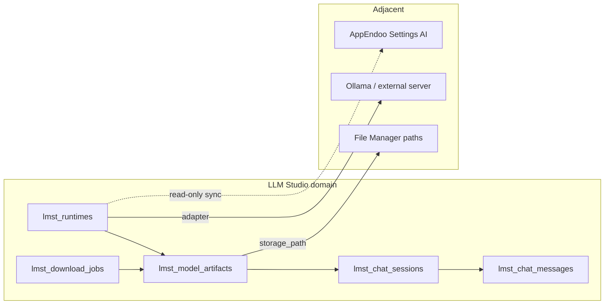
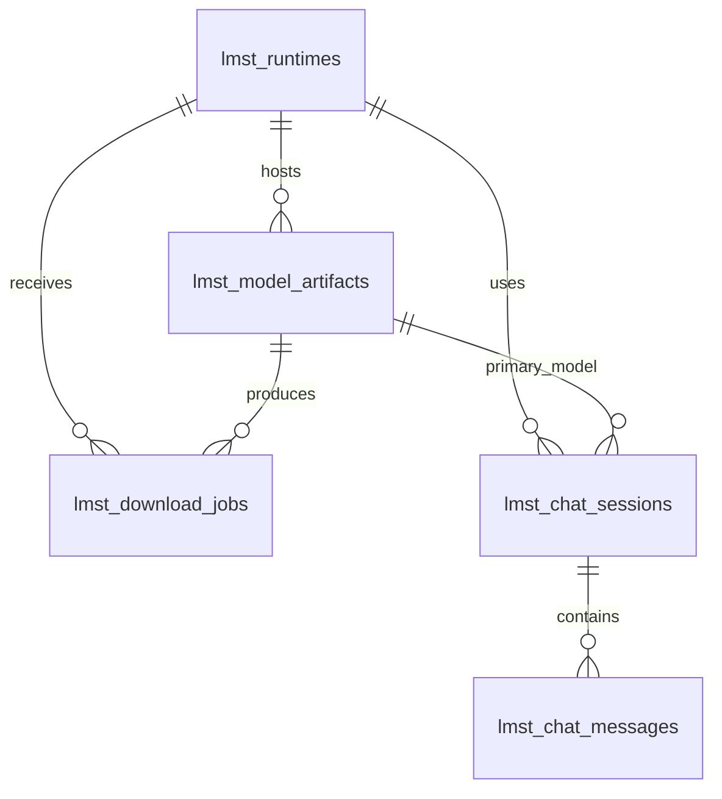

<div dir="rtl" lang="fa" class="hwy-parity-doc">
<style>
  .hwy-parity-doc { text-align: right; unicode-bidi: plaintext; }
  .hwy-parity-doc h1, .hwy-parity-doc h2, .hwy-parity-doc h3, .hwy-parity-doc h4, .hwy-parity-doc p, .hwy-parity-doc li { text-align: right; }
  .hwy-parity-doc table { direction: rtl; text-align: right; width: 100%; border-collapse: collapse; margin: 0.75rem 0; }
  .hwy-parity-doc th, .hwy-parity-doc td { border: 1px solid #c4c4c4; padding: 0.35rem 0.5rem; vertical-align: top; text-align: right; }
  .hwy-parity-doc th { background: #f6f6f6; font-weight: 600; }
  .hwy-parity-doc blockquote { text-align: right; border-right: 3px solid #ccc; border-left: none; padding-right: 1rem; margin-right: 0; }
  .hwy-parity-doc ul, .hwy-parity-doc ol { padding-right: 1.25rem; padding-left: 0; }
  .hwy-parity-doc pre, .hwy-parity-doc code { direction: ltr; text-align: left; unicode-bidi: embed; }
</style>

<p><strong>خلاصه برای operatore:</strong> این سند جزو <strong>plans</strong> است (p-packages-llm-studio). ستون وضعیت در <a href="./p-00-packages-index.md">index مربوطه</a> مرجع «شروع شده / design / تمام» است.</p>
<p><strong>راهنمای خواندن:</strong> بخش‌های انگلیسی برای agent/dev هستند؛ جداول وضعیت و یادداشت‌های فارسی را اول بخوانید.</p>


# p-packages-llm-studio — LLM Studio: کشف · دانلود · چت · سرو محلی

> **Package:** **LLM Studio** (#116) — [p-packages-backlog.md](p-packages-backlog.md)  
> **مسیر اجرا:** اسکوپ دامنه در backlog پکیج‌ها (نه zip Package Manager) — کنترل: [p-00-packages-index.md](p-00-packages-index.md)  
> **وضعیت:** ⬜ design only — پیاده‌سازی نشده  
> **آخرین به‌روزرسانی:** ۲۰۲۶-۰۹-۱۷  
> **وابستگی:** **File Manager (#1)** برای مسیر ذخیرهٔ وزن‌ها (ارجاع مسیر · نه blocker اولیه) · تنظیمات **Engine → AI Models** برای اتصال Ollama موجود (هم‌زیستی · نه duplicate vault)  
> **استانداردها:** `AGENTS.md` · [data-model.md](../../../docs/standards/data-model.md) · [package-ui.md](../../../docs/standards/package-ui.md) · [ai-mcp.md](../../../docs/standards/ai-mcp.md) · Greenfield · Data Studio / Sequelize

**LLM Studio** ابزار Studio برای کار با مدل‌های زبانی **روی زیرساخت خود اپراتور** — کشف کاتالوگ (Hugging Face / شناسهٔ ثابت) · دانلود و نگه‌داری فایل · چت Playground · مقایسهٔ چند مدل · و **Developer API** سازگار با OpenAI (`/v1/chat/completions`) از طریق runtimeهای ثبت‌شده — شبیه [LM Studio](https://lmstudio.ai/) · [Ollama](https://ollama.com/) · [Jan](https://jan.ai/) · [GPT4All](https://www.nomic.ai/gpt4all) · [LocalAI](https://localai.io/) (الگو، نه کپی اسکیما).

AppEndO **platform-first** است نه desktop-LLM-first: **AppEndoo** · capability packs · MCP سراسری · و کاتالوگ provider ابری در Settings همچنان مالک «عامل توسعهٔ پلتفرم» می‌مانند؛ این پکیج فقط **زمین بازی محلی + سرو inference برای تیم** را می‌پوشاند و عمداً **fine-tune** · **میزبانی مدل SaaS** · **جایگزینی کامل AppEndoo** · و **نصب خودکار درایور GPU روی کلاینت مرورگر** را داخل خودش نمی‌گیرد.

### اصل سخت: LLM Studio بخشی از Core نیست — و Package Manager zip هم مسیر ساخت نیست

<table dir="rtl">
<thead><tr><th>کار</th><th>مسیر درست (developer-built)</th></tr></thead>
<tbody><tr><td>جداول / associations / studio-meta</td><td><strong>Data Studio</strong> (Edge models + Sequelize)</td></tr>
<tr><td>LOVهای کوتاه</td><td><strong>Base Info</strong> زیر روت LLM Studio</td></tr>
<tr><td>دانلود · load/unload · inference</td><td><strong>Server Functions</strong> + worker روی همان host/edge — <strong>نه</strong> <code dir="ltr" style="unicode-bidi: embed;">db.query</code></td></tr>
<tr><td>مسیر فایل روی دیسک</td><td><strong>File Manager</strong> workspace یا مسیر پیکربندی‌شدهٔ سرور (metadata در DB)</td></tr>
<tr><td>UI Playground · Discover</td><td><strong>Client Components</strong> — workspace چت + کاتالوگ</td></tr>
<tr><td>صفحات / nav</td><td><strong>Platform Pages</strong> — گروه <strong><code dir="ltr" style="unicode-bidi: embed;">LLM Studio</code></strong> در Studio</td></tr>
</tbody></table>

**ممنوع (سخت):** Package Manager zip · `db.query` · seed در `controlPlaneSeed` · `src/core/packages/llm-studio/` · اجرای GGUF داخل مرورگر · fork جدا از `OllamaProvider` برای AppEndoo بدون قرارداد مشترک · ذخیرهٔ API token plaintext در جدول دامنه.

### دسترسی داده (سخت) — فقط Sequelize

- وضعیت runtime، job دانلود، session چت: Edge + Sequelize.
- inference streaming از worker/adapter — UI فقط SSE/WebSocket consumer؛ بدون فراخوانی مستقیم localhost کاربر از مرورگر (CORS/امنیت).

### خارج از ساخت اولیهٔ اپلیکیشن (سخت)

تا پیاده‌سازی صریح این پلن: **هیچ** `lmst_*` · Base Info LLM Studio · nav · UI · worker inference.

```
@plans/packages/todo/p-packages-llm-studio.md برو جلو
@plans/packages/todo/p-packages-llm-studio.md فاز ۱ بساز
@plans/packages/todo/p-packages-llm-studio.md فاز ۲ بساز
@plans/packages/todo/p-packages-llm-studio.md زیر‌فاز 3a بساز
@plans/packages/todo/p-packages-llm-studio.md فاز N را رولبک کن
```

---

## هدف اصلی

**ثبت runtime → کشف/دانلود مدل → load در runtime → چت Playground / سرو OpenAI-compatible برای توسعه‌دهنده** — با جداسازی worker inference از UI (الگوی LM Studio: Developer tab + `lms server start` معادل سرور AppEndO).

<table dir="rtl">
<thead><tr><th>دغدغه</th><th>مالک</th></tr></thead>
<tbody><tr><td>Agent چندابزاری AppEndoo · draft_* · orchestrator</td><td><strong>Platform AppEndoo</strong> (<a href="../../core/next/p-72-ai-backlog.md">p-72-ai-backlog</a>)</td></tr>
<tr><td>کاتالوگ provider ابری · API key · مدل‌های GPT/Anthropic در Settings</td><td><strong>Engine → AI Models</strong> (موجود)</td></tr>
<tr><td>Ollama به‌عنوان provider AppEndoo</td><td><strong><code dir="ltr" style="unicode-bidi: embed;">OllamaProvider</code></strong> — LLM Studio <strong>ثبت/سلامت</strong> همان endpoint را mirror می‌کند؛ duplicate config ممنوع</td></tr>
<tr><td>MCP سراسری اپ · <code dir="ltr" style="unicode-bidi: embed;">mcp.json</code></td><td><strong>Platform MCP</strong> (<a href="../../../docs/standards/ai-mcp.md">ai-mcp.md</a>) — v1 فقط «پروکسی dev»؛ ادغام chat+MCP در Playground <strong>فاز ۳c</strong></td></tr>
<tr><td>Embedding محلی workflow</td><td><strong>localEmbeddingsModelLifecycle</strong> (Core) — OUT از اسکوپ Playground</td></tr>
<tr><td>RAG سند در Component Designer</td><td><strong>Contextual AI</strong> — OUT v1؛ Playground فقط متن آزاد</td></tr>
<tr><td>Fine-tune · DPO · Foundry</td><td><strong>خارج</strong> — اپراتور ابزار جدا</td></tr>
<tr><td>مانیتورینگ GPU کلاستر</td><td><strong>Infra Management (#113)</strong> — badge سادهٔ health در rail کافی است v1</td></tr>
</tbody></table>

---

## اصل ساخت: developer-built

- **یک شکل رکورد مدل** (`lmst_model_artifacts`) برای GGUF/MLX/ONNX ثبت‌شده — تفاوت با `format_code` + `quant_label`، نه جدول per فرمت.
- **Adapter per runtime kind** (`ollama` · `openai_compatible` · `llama_cpp_worker` · `lm_studio_bridge`) — نه JSON آزاد EAV.
- **دانلود = job** (`lmst_download_jobs`) — UI poll progress؛ worker می‌نویسد روی دیسک و artifact را می‌سازد.



---

## دردهای کلاسیک ابزار LLM محلی و تصمیم‌های ما

<table dir="rtl">
<thead><tr><th>درد کلاسیک</th><th>علت</th><th>تصمیم AppEndO LLM Studio</th></tr></thead>
<tbody><tr><td>مدل ۷۰GB روی لپ‌تاپ ۸GB RAM دانلود می‌شود</td><td>کشف بدون «Compatibility check»</td><td>قبل از enqueue دانلود: <code dir="ltr" style="unicode-bidi: embed;">compatibility_code</code> از seed + هشدار RAM/VRAM از runtime probe · اپراتور تأیید صریح</td></tr>
<tr><td>چند UI برای همان Ollama</td><td>Settings + LM Studio جدا</td><td>یک <code dir="ltr" style="unicode-bidi: embed;">base_url</code> canonical per runtime · sync health از همان probe · لینک «Open in Settings» فقط خواندنی</td></tr>
<tr><td>OpenAI SDK به localhost می‌زند اما CORS/ auth</td><td>سرور dev بدون token</td><td><code dir="ltr" style="unicode-bidi: embed;">lmst_runtimes</code> پروفایل <code dir="ltr" style="unicode-bidi: embed;">api_token_secret_ref</code> (vault platform) · bind <code dir="ltr" style="unicode-bidi: embed;">127.0.0.1</code> پیش‌فرض</td></tr>
<tr><td>تاریخچه چت بی‌نهایت در DB</td><td>هر پیام full context ذخیره</td><td><code dir="ltr" style="unicode-bidi: embed;">lmst_chat_messages</code> متن کامل · session <code dir="ltr" style="unicode-bidi: embed;">context_mode_code</code> (stateful API در فاز ۲b) · prune دستی</td></tr>
<tr><td>Quantization گیج‌کننده</td><td>ده‌ها نام Q4_K_M</td><td>LOV بسته <strong>Quantization label</strong> برای نمایش · فایل واقعی از manifest دانلود</td></tr>
<tr><td>دانلود نیمه‌کاره corrupt</td><td>قطع شبکه</td><td>job <code dir="ltr" style="unicode-bidi: embed;">failed</code> + resume از <code dir="ltr" style="unicode-bidi: embed;">bytes_received</code> وقتی adapter پشتیبانی کند</td></tr>
<tr><td>«یک اپ برای همه چیز»</td><td>LM Studio + IDE + Agent</td><td>Playground <strong>بدون</strong> ابزار AppEndoo؛ AppEndoo از Settings همان runtime را به‌عنوان provider انتخاب می‌کند</td></tr>
<tr><td>Multi-model compare پرحافظه</td><td>دو مدل loaded</td><td>UI «Compare» حداکثر ۲ مدل · سرور queue یا رد با پیام واضح</td></tr>
<tr><td>Hugging Face URL دستی خطرناک</td><td>SSRF</td><td>دانلود فقط از allowlist host (<code dir="ltr" style="unicode-bidi: embed;">huggingface.co</code> · کاتالوگ داخلی) — validate در boundary</td></tr>
<tr><td>MCP در چت محلی</td><td>LM Studio 0.4 integrations</td><td>v1 OUT · ۳c: integrations فقط از MCP platform موجود با token</td></tr>
<tr><td>Fine-tune داخل همان UI</td><td>scope explosion</td><td>OUT — لینک مستندات خارجی</td></tr>
<tr><td>اجرا در مرورگر با WebGPU</td><td>ناپایدار · امنیت</td><td>OUT — inference همیشه server-side adapter</td></tr>
<tr><td>لاگ prompt در production بدون RBAC</td><td>نشت داده</td><td>Record Policy روی session/message · پیش‌فرض private per user</td></tr>
</tbody></table>

---

## اطلاعات پایه (Base Info) — ریشهٔ LLM Studio

```
Base Info
└── LLM Studio
    ├── Runtime Kind           → runtime_kind_code        (seed · بسته)
    ├── Model Format           → model_format_code        (seed · بسته)
    ├── Runtime Health         → runtime_health_code      (seed · بسته)
    ├── Compatibility Tier     → compatibility_code       (seed · بسته)
    ├── Context Mode           → context_mode_code        (seed · بسته)
    └── Model Tags             → model_tag_code           (مدیریت اپراتور)
```

1. یک روت **LLM Studio** — seed فقط هنگام پیاده‌سازی.
2. هر `*_code` = یک دسته مستقیم زیر روت.
3. دسته‌های بسته **بدون** صفحه vocab (badge در UI).
4. **Model Tags** — Settings vocabulary page.

### دسته: Runtime Kind → `runtime_kind_code` (بسته)

<table dir="rtl">
<thead><tr><th>#</th><th>Title</th><th>shortName</th><th>Lucide</th><th>نقش</th></tr></thead>
<tbody><tr><td>1</td><td>Ollama</td><td><code dir="ltr" style="unicode-bidi: embed;">ollama</code></td><td><code dir="ltr" style="unicode-bidi: embed;">Server</code></td><td>API محلی Ollama</td></tr>
<tr><td>2</td><td>OpenAI compatible</td><td><code dir="ltr" style="unicode-bidi: embed;">openai_compatible</code></td><td><code dir="ltr" style="unicode-bidi: embed;">Plug</code></td><td>LM Studio · LocalAI · vLLM</td></tr>
<tr><td>3</td><td>Llama.cpp worker</td><td><code dir="ltr" style="unicode-bidi: embed;">llama_cpp_worker</code></td><td><code dir="ltr" style="unicode-bidi: embed;">Cpu</code></td><td>worker داخلی AppEndO (فاز ۲b)</td></tr>
<tr><td>4</td><td>LM Studio bridge</td><td><code dir="ltr" style="unicode-bidi: embed;">lm_studio_bridge</code></td><td><code dir="ltr" style="unicode-bidi: embed;">Laptop</code></td><td>اتصال به LM Studio روی همان ماشین</td></tr>
</tbody></table>

### دسته: Model Format → `model_format_code` (بسته)

<table dir="rtl">
<thead><tr><th>#</th><th>Title</th><th>shortName</th><th>Lucide</th></tr></thead>
<tbody><tr><td>1</td><td>GGUF</td><td><code dir="ltr" style="unicode-bidi: embed;">gguf</code></td><td><code dir="ltr" style="unicode-bidi: embed;">FileBox</code></td></tr>
<tr><td>2</td><td>MLX</td><td><code dir="ltr" style="unicode-bidi: embed;">mlx</code></td><td><code dir="ltr" style="unicode-bidi: embed;">Apple</code></td></tr>
<tr><td>3</td><td>ONNX</td><td><code dir="ltr" style="unicode-bidi: embed;">onnx</code></td><td><code dir="ltr" style="unicode-bidi: embed;">Boxes</code></td></tr>
<tr><td>4</td><td>Ollama manifest</td><td><code dir="ltr" style="unicode-bidi: embed;">ollama_manifest</code></td><td><code dir="ltr" style="unicode-bidi: embed;">Package</code></td></tr>
</tbody></table>

### دسته: Runtime Health → `runtime_health_code` (بسته)

<table dir="rtl">
<thead><tr><th>#</th><th>Title</th><th>shortName</th><th>Lucide</th></tr></thead>
<tbody><tr><td>1</td><td>Healthy</td><td><code dir="ltr" style="unicode-bidi: embed;">healthy</code></td><td><code dir="ltr" style="unicode-bidi: embed;">CircleCheck</code></td></tr>
<tr><td>2</td><td>Unreachable</td><td><code dir="ltr" style="unicode-bidi: embed;">unreachable</code></td><td><code dir="ltr" style="unicode-bidi: embed;">WifiOff</code></td></tr>
<tr><td>3</td><td>Degraded</td><td><code dir="ltr" style="unicode-bidi: embed;">degraded</code></td><td><code dir="ltr" style="unicode-bidi: embed;">TriangleAlert</code></td></tr>
<tr><td>4</td><td>Unknown</td><td><code dir="ltr" style="unicode-bidi: embed;">unknown</code></td><td><code dir="ltr" style="unicode-bidi: embed;">CircleHelp</code></td></tr>
</tbody></table>

### دسته: Compatibility Tier → `compatibility_code` (بسته)

<table dir="rtl">
<thead><tr><th>#</th><th>Title</th><th>shortName</th><th>Lucide</th><th>نقش</th></tr></thead>
<tbody><tr><td>1</td><td>Likely OK</td><td><code dir="ltr" style="unicode-bidi: embed;">likely_ok</code></td><td><code dir="ltr" style="unicode-bidi: embed;">ThumbsUp</code></td><td>probe سبز</td></tr>
<tr><td>2</td><td>May be slow</td><td><code dir="ltr" style="unicode-bidi: embed;">may_slow</code></td><td><code dir="ltr" style="unicode-bidi: embed;">Gauge</code></td><td>RAM tight</td></tr>
<tr><td>3</td><td>Not recommended</td><td><code dir="ltr" style="unicode-bidi: embed;">not_recommended</code></td><td><code dir="ltr" style="unicode-bidi: embed;">Ban</code></td><td>block دانلود unless override</td></tr>
</tbody></table>

### دسته: Context Mode → `context_mode_code` (بسته)

<table dir="rtl">
<thead><tr><th>#</th><th>Title</th><th>shortName</th><th>Lucide</th></tr></thead>
<tbody><tr><td>1</td><td>Full history</td><td><code dir="ltr" style="unicode-bidi: embed;">full_history</code></td><td><code dir="ltr" style="unicode-bidi: embed;">List</code></td></tr>
<tr><td>2</td><td>Stateful server</td><td><code dir="ltr" style="unicode-bidi: embed;">stateful_server</code></td><td><code dir="ltr" style="unicode-bidi: embed;">Database</code></td></tr>
</tbody></table>

### دسته: Model Tags → `model_tag_code` (مدیریت‌پذیر)

**Admin UI:** `llm-studio/settings/tags` · catalog cards · `form.base-info-record` · API inject روی `DataSourceDefinition`.

---

## مدل دامنه

### تصمیم

1. **`lmst_runtimes`** — endpoint inference ثبت‌شده + health + تنظیمات سرو dev.
2. **`lmst_model_artifacts`** — فایل/مانفیست مدل روی دیسک + متادیتا کاتالوگ.
3. **`lmst_download_jobs`** — دانلود غیرهمزمان از HF/کاتالوگ.
4. **`lmst_chat_sessions`** — thread Playground (یک مدل یا compare).
5. **`lmst_chat_messages`** — پیام‌های user/assistant/system.

**وجود ندارند:** جدول جدا per provider · `attributes` jsonb باز · ذخیرهٔ وزن در DB · جدول fine-tune run · fork `base_users` برای «پروفایل چت».



### `lmst_runtimes` — runtime inference

<table dir="rtl">
<thead><tr><th>#</th><th>Column</th><th>Native</th><th>Runtime</th><th>Null</th><th>نقش</th></tr></thead>
<tbody><tr><td>1</td><td>id</td><td>UUID</td><td>UUID</td><td>N</td><td>PK</td></tr>
<tr><td>2</td><td>title</td><td>TEXT</td><td>STRING</td><td>N</td><td>نمایش</td></tr>
<tr><td>3</td><td>slug</td><td>TEXT</td><td>STRING</td><td>N</td><td>UNIQUE · <code dir="ltr" style="unicode-bidi: embed;">LATIN_SLUG_RE</code></td></tr>
<tr><td>4</td><td>runtime_kind_code</td><td>TEXT</td><td>STRING</td><td>N</td><td>LOV</td></tr>
<tr><td>5</td><td>base_url</td><td>TEXT</td><td>STRING</td><td>N</td><td>e.g. <code dir="ltr" style="unicode-bidi: embed;">http://127.0.0.1:11434</code></td></tr>
<tr><td>6</td><td>runtime_health_code</td><td>TEXT</td><td>STRING</td><td>N</td><td>LOV</td></tr>
<tr><td>7</td><td>is_dev_server_enabled</td><td>BOOLEAN</td><td>BOOLEAN</td><td>N</td><td>معادل «Start server»</td></tr>
<tr><td>8</td><td>dev_bind_host</td><td>TEXT</td><td>STRING</td><td>Y</td><td>default loopback</td></tr>
<tr><td>9</td><td>dev_port</td><td>INT</td><td>INTEGER</td><td>Y</td><td></td></tr>
<tr><td>10</td><td>api_token_secret_ref</td><td>TEXT</td><td>STRING</td><td>Y</td><td>ref vault · نه plaintext</td></tr>
<tr><td>11</td><td>last_probe_at</td><td>TIMESTAMPTZ</td><td>DATE</td><td>Y</td><td></td></tr>
<tr><td>12</td><td>probe_detail_json</td><td>JSONB</td><td>JSON</td><td>Y</td><td>VRAM/RAM hint</td></tr>
<tr><td>13</td><td>note</td><td>TEXT</td><td>STRING</td><td>Y</td><td></td></tr>
<tr><td>14</td><td>created_by / created_at / updated_by / updated_at</td><td>…</td><td>…</td><td>Y/N</td><td>audit</td></tr>
</tbody></table>

**قواعد:** `slug` بعد از create قفل؛ حذف runtime با مدل loaded = soft-disable + force unload؛ probe دوره‌ای از worker.

### `lmst_model_artifacts` — مدل محلی

<table dir="rtl">
<thead><tr><th>#</th><th>Column</th><th>Native</th><th>Runtime</th><th>Null</th><th>نقش</th></tr></thead>
<tbody><tr><td>1</td><td>id</td><td>UUID</td><td>UUID</td><td>N</td><td>PK</td></tr>
<tr><td>2</td><td>runtime_id</td><td>UUID</td><td>UUID</td><td>N</td><td>FK</td></tr>
<tr><td>3</td><td>catalog_identifier</td><td>TEXT</td><td>STRING</td><td>N</td><td>e.g. <code dir="ltr" style="unicode-bidi: embed;">meta-llama/Llama-3.2-3B-GGUF</code></td></tr>
<tr><td>4</td><td>display_title</td><td>TEXT</td><td>STRING</td><td>N</td><td></td></tr>
<tr><td>5</td><td>model_format_code</td><td>TEXT</td><td>STRING</td><td>N</td><td>LOV</td></tr>
<tr><td>6</td><td>quant_label</td><td>TEXT</td><td>STRING</td><td>Y</td><td>e.g. <code dir="ltr" style="unicode-bidi: embed;">Q4_K_M</code></td></tr>
<tr><td>7</td><td>compatibility_code</td><td>TEXT</td><td>STRING</td><td>N</td><td>LOV</td></tr>
<tr><td>8</td><td>storage_path</td><td>TEXT</td><td>STRING</td><td>N</td><td>مسیر نسبی workspace</td></tr>
<tr><td>9</td><td>byte_size</td><td>BIGINT</td><td>BIGINT</td><td>Y</td><td></td></tr>
<tr><td>10</td><td>is_loaded</td><td>BOOLEAN</td><td>BOOLEAN</td><td>N</td><td></td></tr>
<tr><td>11</td><td>loaded_at</td><td>TIMESTAMPTZ</td><td>DATE</td><td>Y</td><td></td></tr>
<tr><td>12</td><td>default_params_json</td><td>JSONB</td><td>JSON</td><td>Y</td><td>temperature · max_tokens</td></tr>
<tr><td>13</td><td>note</td><td>TEXT</td><td>STRING</td><td>Y</td><td></td></tr>
<tr><td>14</td><td>created_by / created_at / updated_by / updated_at</td><td>…</td><td>…</td><td>Y/N</td><td></td></tr>
</tbody></table>

**قواعد:** UNIQUE `(runtime_id, catalog_identifier, quant_label)`؛ unload قبل از حذف فایل؛ `storage_path` validate تحت root مجاز.

### `lmst_download_jobs`

<table dir="rtl">
<thead><tr><th>#</th><th>Column</th><th>Native</th><th>Runtime</th><th>Null</th><th>نقش</th></tr></thead>
<tbody><tr><td>1</td><td>id</td><td>UUID</td><td>UUID</td><td>N</td><td>PK</td></tr>
<tr><td>2</td><td>runtime_id</td><td>UUID</td><td>UUID</td><td>N</td><td>FK</td></tr>
<tr><td>3</td><td>catalog_identifier</td><td>TEXT</td><td>STRING</td><td>N</td><td></td></tr>
<tr><td>4</td><td>quant_label</td><td>TEXT</td><td>STRING</td><td>Y</td><td></td></tr>
<tr><td>5</td><td>status_code</td><td>TEXT</td><td>STRING</td><td>N</td><td><code dir="ltr" style="unicode-bidi: embed;">queued</code>/<code dir="ltr" style="unicode-bidi: embed;">running</code>/<code dir="ltr" style="unicode-bidi: embed;">completed</code>/<code dir="ltr" style="unicode-bidi: embed;">failed</code>/<code dir="ltr" style="unicode-bidi: embed;">cancelled</code> (بسته در کد · نه LOV)</td></tr>
<tr><td>6</td><td>bytes_total</td><td>BIGINT</td><td>BIGINT</td><td>Y</td><td></td></tr>
<tr><td>7</td><td>bytes_received</td><td>BIGINT</td><td>BIGINT</td><td>Y</td><td></td></tr>
<tr><td>8</td><td>artifact_id</td><td>UUID</td><td>UUID</td><td>Y</td><td>FK پس از complete</td></tr>
<tr><td>9</td><td>error_message</td><td>TEXT</td><td>TEXT</td><td>Y</td><td></td></tr>
<tr><td>10</td><td>created_by / created_at / updated_at</td><td>…</td><td>…</td><td>Y/N</td><td></td></tr>
</tbody></table>

### `lmst_chat_sessions`

<table dir="rtl">
<thead><tr><th>#</th><th>Column</th><th>Native</th><th>Runtime</th><th>Null</th><th>نقش</th></tr></thead>
<tbody><tr><td>1</td><td>id</td><td>UUID</td><td>UUID</td><td>N</td><td>PK</td></tr>
<tr><td>2</td><td>owner_user_id</td><td>UUID</td><td>UUID</td><td>N</td><td>FK <code dir="ltr" style="unicode-bidi: embed;">base_users</code></td></tr>
<tr><td>3</td><td>runtime_id</td><td>UUID</td><td>UUID</td><td>N</td><td>FK</td></tr>
<tr><td>4</td><td>primary_model_id</td><td>UUID</td><td>UUID</td><td>N</td><td>FK artifact</td></tr>
<tr><td>5</td><td>compare_model_id</td><td>UUID</td><td>UUID</td><td>Y</td><td>optional A/B</td></tr>
<tr><td>6</td><td>title</td><td>TEXT</td><td>STRING</td><td>N</td><td></td></tr>
<tr><td>7</td><td>context_mode_code</td><td>TEXT</td><td>STRING</td><td>N</td><td>LOV</td></tr>
<tr><td>8</td><td>server_session_key</td><td>TEXT</td><td>STRING</td><td>Y</td><td>stateful API</td></tr>
<tr><td>9</td><td>last_message_at</td><td>TIMESTAMPTZ</td><td>DATE</td><td>Y</td><td></td></tr>
<tr><td>10</td><td>note</td><td>TEXT</td><td>STRING</td><td>Y</td><td></td></tr>
</tbody></table>

### `lmst_chat_messages`

<table dir="rtl">
<thead><tr><th>#</th><th>Column</th><th>Native</th><th>Runtime</th><th>Null</th><th>نقش</th></tr></thead>
<tbody><tr><td>1</td><td>id</td><td>UUID</td><td>UUID</td><td>N</td><td>PK</td></tr>
<tr><td>2</td><td>session_id</td><td>UUID</td><td>UUID</td><td>N</td><td>FK</td></tr>
<tr><td>3</td><td>role_code</td><td>TEXT</td><td>STRING</td><td>N</td><td><code dir="ltr" style="unicode-bidi: embed;">system</code>/<code dir="ltr" style="unicode-bidi: embed;">user</code>/<code dir="ltr" style="unicode-bidi: embed;">assistant</code> (بسته در کد)</td></tr>
<tr><td>4</td><td>content_text</td><td>TEXT</td><td>TEXT</td><td>N</td><td></td></tr>
<tr><td>5</td><td>model_artifact_id</td><td>UUID</td><td>UUID</td><td>Y</td><td>برای compare</td></tr>
<tr><td>6</td><td>token_count_prompt</td><td>INT</td><td>INTEGER</td><td>Y</td><td></td></tr>
<tr><td>7</td><td>token_count_completion</td><td>INT</td><td>INTEGER</td><td>Y</td><td></td></tr>
<tr><td>8</td><td>latency_ms</td><td>INT</td><td>INTEGER</td><td>Y</td><td></td></tr>
<tr><td>9</td><td>created_at</td><td>TIMESTAMPTZ</td><td>DATE</td><td>N</td><td></td></tr>
</tbody></table>

### Edge model associations — کاننیکال

<table dir="rtl">
<thead><tr><th>Model</th><th>kind</th><th>target</th><th>FK / through</th><th>as</th></tr></thead>
<tbody><tr><td>lmst_runtimes</td><td>belongsTo</td><td>Base Info runtime_kind</td><td>runtime_kind_code</td><td>runtime_kind</td></tr>
<tr><td>lmst_runtimes</td><td>belongsTo</td><td>Base Info runtime_health</td><td>runtime_health_code</td><td>runtime_health</td></tr>
<tr><td>lmst_runtimes</td><td>hasMany</td><td>lmst_model_artifacts</td><td>runtime_id</td><td>models</td></tr>
<tr><td>lmst_runtimes</td><td>hasMany</td><td>lmst_download_jobs</td><td>runtime_id</td><td>download_jobs</td></tr>
<tr><td>lmst_runtimes</td><td>hasMany</td><td>lmst_chat_sessions</td><td>runtime_id</td><td>chat_sessions</td></tr>
<tr><td>lmst_model_artifacts</td><td>belongsTo</td><td>lmst_runtimes</td><td>runtime_id</td><td>runtime</td></tr>
<tr><td>lmst_model_artifacts</td><td>belongsTo</td><td>Base Info model_format</td><td>model_format_code</td><td>model_format</td></tr>
<tr><td>lmst_model_artifacts</td><td>belongsTo</td><td>Base Info compatibility</td><td>compatibility_code</td><td>compatibility</td></tr>
<tr><td>lmst_download_jobs</td><td>belongsTo</td><td>lmst_runtimes</td><td>runtime_id</td><td>runtime</td></tr>
<tr><td>lmst_download_jobs</td><td>belongsTo</td><td>lmst_model_artifacts</td><td>artifact_id</td><td>artifact</td></tr>
<tr><td>lmst_chat_sessions</td><td>belongsTo</td><td>base_users</td><td>owner_user_id</td><td>owner</td></tr>
<tr><td>lmst_chat_sessions</td><td>belongsTo</td><td>lmst_runtimes</td><td>runtime_id</td><td>runtime</td></tr>
<tr><td>lmst_chat_sessions</td><td>belongsTo</td><td>lmst_model_artifacts</td><td>primary_model_id</td><td>primary_model</td></tr>
<tr><td>lmst_chat_sessions</td><td>belongsTo</td><td>lmst_model_artifacts</td><td>compare_model_id</td><td>compare_model</td></tr>
<tr><td>lmst_chat_sessions</td><td>belongsTo</td><td>Base Info context_mode</td><td>context_mode_code</td><td>context_mode</td></tr>
<tr><td>lmst_chat_sessions</td><td>hasMany</td><td>lmst_chat_messages</td><td>session_id</td><td>messages</td></tr>
<tr><td>lmst_chat_messages</td><td>belongsTo</td><td>lmst_chat_sessions</td><td>session_id</td><td>session</td></tr>
<tr><td>lmst_chat_messages</td><td>belongsTo</td><td>lmst_model_artifacts</td><td>model_artifact_id</td><td>model_artifact</td></tr>
</tbody></table>

**ممنوع:** دو belongsToMany برای همان رابطه · suggest-from-FK بدون wiring · ذخیرهٔ blob مدل در ستون.

---

## Data Studio / studio-meta — قرارداد کامل مدلر (فاز ۱)

### مرز ذخیره‌سازی

<table dir="rtl">
<thead><tr><th>لایه</th><th>کجا</th><th>چه</th></tr></thead>
<tbody><tr><td>EdgeModel</td><td><code dir="ltr" style="unicode-bidi: embed;">runtime/edge-models</code></td><td>columns · PK · associations · labels</td></tr>
<tr><td>studio-meta</td><td><code dir="ltr" style="unicode-bidi: embed;">runtime/edge-model-studio-meta</code></td><td>tags · columnMeta · associationMeta · extensions.story</td></tr>
</tbody></table>

قواعد seed: sparse · گروه اجباری · widget `*_code` روی association · targetFilter با id resolve از seed · story انگلیسی · rollback meta با model.

### کاتالوگ قابلیت‌های مدلر

<table dir="rtl">
<thead><tr><th>قابلیت</th><th>LLM Studio</th></tr></thead>
<tbody><tr><td>Story per table</td><td>✅ هر ۵ جدول</td></tr>
<tr><td>columnGroupOrder</td><td>✅ Identity · Endpoint · Model file · Job progress · Chat · Audit</td></tr>
<tr><td>associationMeta widgets</td><td>✅ همهٔ <code dir="ltr" style="unicode-bidi: embed;">*_code</code></td></tr>
<tr><td>extensions.story</td><td>✅ انگلیسی Purpose/Lifecycle/Rules</td></tr>
</tbody></table>

### هویت مدل‌ها (EdgeModel.labels + tags)

<table dir="rtl">
<thead><tr><th>objectName</th><th>title</th><th>icon</th><th>color</th><th>tags</th></tr></thead>
<tbody><tr><td>lmst_runtimes</td><td>LLM runtimes</td><td>Server</td><td>violet</td><td>llm, runtime</td></tr>
<tr><td>lmst_model_artifacts</td><td>LLM models</td><td>Brain</td><td>indigo</td><td>llm, model</td></tr>
<tr><td>lmst_download_jobs</td><td>Model downloads</td><td>Download</td><td>blue</td><td>llm, job</td></tr>
<tr><td>lmst_chat_sessions</td><td>Chat sessions</td><td>MessageSquare</td><td>slate</td><td>llm, chat</td></tr>
<tr><td>lmst_chat_messages</td><td>Chat messages</td><td>MessagesSquare</td><td>slate</td><td>llm, chat</td></tr>
</tbody></table>

### `lmst_runtimes` — Story · گروه‌ها · ستون‌ها · ریلیشن‌ها

```markdown
## Purpose
Registered local or bridge inference endpoint (Ollama, OpenAI-compatible, etc.) with health probes and optional dev API server flags.

## Lifecycle
Created via wizard → probed periodically → dev server toggled without deleting row → disabled when unreachable persists.

## Rules
Slug locked after create; base_url validated; secrets by reference only; no model bytes on this row.
```

<table dir="rtl">
<thead><tr><th>گروه</th><th>ستون‌ها</th></tr></thead>
<tbody><tr><td>Identity</td><td>title, slug, note</td></tr>
<tr><td>Endpoint</td><td>runtime_kind_code, base_url, runtime_health_code</td></tr>
<tr><td>Dev server</td><td>is_dev_server_enabled, dev_bind_host, dev_port, api_token_secret_ref</td></tr>
<tr><td>Probe</td><td>last_probe_at, probe_detail_json</td></tr>
<tr><td>Audit</td><td>created_by, created_at, updated_by, updated_at</td></tr>
</tbody></table>

<table dir="rtl">
<thead><tr><th>column</th><th>group</th><th>formWidget</th><th>searchRole</th><th>notes</th></tr></thead>
<tbody><tr><td>title</td><td>Identity</td><td>text</td><td>contains</td><td></td></tr>
<tr><td>slug</td><td>Identity</td><td>text</td><td>eq</td><td>locked after create in UI</td></tr>
<tr><td>runtime_kind_code</td><td>Endpoint</td><td>(on association)</td><td>eq</td><td>belongsTo runtime_kind</td></tr>
<tr><td>base_url</td><td>Endpoint</td><td>text</td><td>none</td><td>URL validate</td></tr>
<tr><td>runtime_health_code</td><td>Endpoint</td><td>(on association)</td><td>eq</td><td>read-only in form</td></tr>
<tr><td>is_dev_server_enabled</td><td>Dev server</td><td>switch</td><td>none</td><td></td></tr>
<tr><td>dev_bind_host</td><td>Dev server</td><td>text</td><td>none</td><td></td></tr>
<tr><td>dev_port</td><td>Dev server</td><td>number</td><td>none</td><td></td></tr>
<tr><td>api_token_secret_ref</td><td>Dev server</td><td>text</td><td>none</td><td>mask display</td></tr>
</tbody></table>

<table dir="rtl">
<thead><tr><th>as</th><th>kind</th><th>displayLabel</th><th>formWidget</th><th>targetFilter</th></tr></thead>
<tbody><tr><td>runtime_kind</td><td>belongsTo</td><td>Runtime kind</td><td>select</td><td>category Runtime Kind id</td></tr>
<tr><td>runtime_health</td><td>belongsTo</td><td>Health</td><td>select</td><td>category Runtime Health id</td></tr>
</tbody></table>

*(ستون‌های audit و associationهای hasMany در seed فاز ۱ مثل Task Management کامل می‌شوند.)*

### `lmst_model_artifacts` — Story · گروه‌ها

```markdown
## Purpose
On-disk model file or manifest tracked per runtime with format, quantization label, and load state.

## Lifecycle
Appears from completed download or manual register → load/unload via adapter → delete only when unloaded and no active session.

## Rules
storage_path under allowed root; compatibility tier may block download; is_loaded mutually exclusive per runtime memory policy (adapter enforced).
```

گروه‌ها: Identity · Catalog · File · Load state · Params · Audit. associationMeta: `runtime`, `model_format`, `compatibility`.

### `lmst_download_jobs` — Story · گروه‌ها

```markdown
## Purpose
Async download from allowlisted catalog/Hugging Face identifiers into a model artifact.

## Lifecycle
queued → running (bytes_received) → completed (artifact_id set) or failed/cancelled.

## Rules
One active download per (runtime_id, catalog_identifier, quant_label); resume when adapter supports.
```

### `lmst_chat_sessions` / `lmst_chat_messages`

Storyهای مشابه: session = Playground thread with optional compare model; messages append-only with role and optional per-model artifact for A/B.

### پذیرش بصری در Data Studio

1. Import/sync هر ۵ مدل بدون ستون ungrouped.
2. هر `*_code` روی association wired با targetFilter درست.
3. Rollback یک مدل → حذف studio-meta همان objectName.

---

## خارج از اسکوپ (سخت)

- Fine-tuning · DPO · RLHF · training job scheduler
- میزبانی مدل ابری (فقط bridge به endpoint موجود)
- جایگزینی UI/ابزارهای **AppEndoo** (Playground جدا از Agent panel)
- دانلود از URL arbitrary (غیر allowlist)
- اجرای inference در مرورگر (WebGPU/WASM مدل کامل)
- ادغام خودکار با CRM/DMS/Workflow
- `llmster` headless binary shipping داخل repo (اپراتور نصب خارجی · bridge فقط)
- RAG multi-document در v1
- MCP integrations در چت قبل از sub-phase ۳c

---

## UX ادمین

**شکل اصلی:** دو workspace — **Discover + My Models** (کاتالوگ) و **Playground** (چت) — به‌علاوه **Runtime settings** (ادیتور عمیق).

```
┌─────────────────────────────────────────────────────────────────────────┐
│ Toolbar: Discover · My Models · Playground · Developer API · Refresh    │
├──────────────────────┬──────────────────────────────────────────────────┤
│ Session list (cards) │ Chat main (messages + composer)                  │
│ or Model catalog     │ Compare: split assistant columns when 2 models   │
└──────────────────────┴──────────────────────────────────────────────────┘
```

<table dir="rtl">
<thead><tr><th>صفحه</th><th>presentation</th><th>دلیل</th></tr></thead>
<tbody><tr><td>Runtimes (settings)</td><td><strong>catalog cards</strong></td><td>عنوان + kind + health · ~۳ attribute</td></tr>
<tr><td>My Models</td><td><strong>catalog cards</strong></td><td>عنوان + format + quant + loaded badge</td></tr>
<tr><td>Download jobs (modal/list)</td><td><strong>table</strong> + paging + footer sort</td><td>ستون‌های progress · status · bytes</td></tr>
<tr><td>Chat sessions sidebar</td><td><strong>catalog cards</strong></td><td>عنوان + last_message_at</td></tr>
<tr><td>Chat messages (inside session)</td><td><strong>stack</strong> (not grid)</td><td>تراکم گفتگو</td></tr>
</tbody></table>

### Runtime editor — ASCII (deep)

```
Main (white, FormSection):
  Identity: title
  Endpoint: base_url (editable), dev server toggle, bind host, port
  Developer: copy OpenAI base URL snippet, link "View server logs" (modal)
Footer: Save · Probe now · Enable/disable dev server

Inspector rail (370px, ui-inspector-rail):
  Runtime kind (locked)
  Health + last probe
  Loaded models count (API badge)
  Storage root (read-only path)
  Settings AI link (read-only) when kind=ollama
```

**Pre-create runtime:** dialog **Kind** + **Title** + **base_url** → POST → `llm-studio/runtimes/edit/{id}` — kind قفل بعد از create.

### Playground session

**Pre-create:** dialog **Runtime** + **Primary model** (+ optional Compare) + **Title** → persist → `llm-studio/playground/{sessionId}`.

Main: message stack + composer (`text-fields` multiline) · params drawer (temperature, max tokens) از `default_params_json`.

Rail: context mode · models (locked) · token totals · latency آخرین پاسخ.

Header actions: **Clear context** (confirm) · **Export JSON** (v2) · badge message count.

### closed enum vs manageable

<table dir="rtl">
<thead><tr><th>فیلد</th><th>نوع</th><th>صفحه vocab</th></tr></thead>
<tbody><tr><td>runtime_kind_code</td><td>بسته</td><td>—</td></tr>
<tr><td>model_format_code</td><td>بسته</td><td>—</td></tr>
<tr><td>runtime_health_code</td><td>بسته</td><td>—</td></tr>
<tr><td>compatibility_code</td><td>بسته</td><td>—</td></tr>
<tr><td>context_mode_code</td><td>بسته</td><td>—</td></tr>
<tr><td>model_tag_code</td><td>manageable</td><td><code dir="ltr" style="unicode-bidi: embed;">llm-studio/settings/tags</code></td></tr>
<tr><td>download job status</td><td>بسته (کد)</td><td>—</td></tr>
<tr><td>message role</td><td>بسته (کد)</td><td>—</td></tr>
</tbody></table>

### Page → living reference

<table dir="rtl">
<thead><tr><th>Page</th><th>Reference</th></tr></thead>
<tbody><tr><td>Runtime catalog</td><td>Users-style catalog cards + health chips</td></tr>
<tr><td>Runtime editor</td><td>Idea Foundry <code dir="ltr" style="unicode-bidi: embed;">IdeaFoundryViewRail.tsx</code></td></tr>
<tr><td>Model catalog</td><td><code dir="ltr" style="unicode-bidi: embed;">DevelopmentCatalogCardGrid</code> / <code dir="ltr" style="unicode-bidi: embed;">presentation="cards"</code> <code dir="ltr" style="unicode-bidi: embed;">cardVariant="catalog"</code></td></tr>
<tr><td>Download jobs table</td><td>Server Functions list + <code dir="ltr" style="unicode-bidi: embed;">GridPagingFooter</code> sort</td></tr>
<tr><td>Playground</td><td>AppEndoo chat layout (read-only reference for stream UX) — <strong>بدون</strong> reuse Agent tools</td></tr>
<tr><td>Tags vocab</td><td>CMS <code dir="ltr" style="unicode-bidi: embed;">buildCmsVocabularyPage</code> pattern</td></tr>
</tbody></table>

### Control → Base Components

<table dir="rtl">
<thead><tr><th>UI</th><th>BC section</th></tr></thead>
<tbody><tr><td>Toolbar Discover/Playground</td><td><code dir="ltr" style="unicode-bidi: embed;">toolbar</code></td></tr>
<tr><td>Runtime/model cards</td><td><code dir="ltr" style="unicode-bidi: embed;">grid</code> catalog variant</td></tr>
<tr><td>Download jobs grid</td><td><code dir="ltr" style="unicode-bidi: embed;">grid</code> + paging footer sort</td></tr>
<tr><td>Composer</td><td><code dir="ltr" style="unicode-bidi: embed;">text-fields</code></td></tr>
<tr><td>Params temperature/max tokens</td><td><code dir="ltr" style="unicode-bidi: embed;">text-fields</code> / <code dir="ltr" style="unicode-bidi: embed;">choice-fields</code></td></tr>
<tr><td>Load/unload/delete model</td><td><code dir="ltr" style="unicode-bidi: embed;">confirm</code> + <code dir="ltr" style="unicode-bidi: embed;">toast</code></td></tr>
<tr><td>Dev server toggle</td><td><code dir="ltr" style="unicode-bidi: embed;">choice-fields</code> switch</td></tr>
<tr><td>Probe / download</td><td><code dir="ltr" style="unicode-bidi: embed;">toolbar</code> actions + <code dir="ltr" style="unicode-bidi: embed;">toast</code></td></tr>
</tbody></table>

---

## شکل API (headless)

Base: `/api/llm-studio/...` · envelope استاندارد Data Studio

<table dir="rtl">
<thead><tr><th>Method</th><th>Path</th><th>نقش</th></tr></thead>
<tbody><tr><td>GET</td><td><code dir="ltr" style="unicode-bidi: embed;">/api/llm-studio/runtimes</code></td><td>لیست</td></tr>
<tr><td>POST</td><td><code dir="ltr" style="unicode-bidi: embed;">/api/llm-studio/runtimes</code></td><td>ایجاد</td></tr>
<tr><td>GET/PATCH/DELETE</td><td><code dir="ltr" style="unicode-bidi: embed;">/api/llm-studio/runtimes/:id</code></td><td></td></tr>
<tr><td>POST</td><td><code dir="ltr" style="unicode-bidi: embed;">/api/llm-studio/runtimes/:id/probe</code></td><td>health</td></tr>
<tr><td>POST</td><td><code dir="ltr" style="unicode-bidi: embed;">/api/llm-studio/runtimes/:id/dev-server</code></td><td>start/stop</td></tr>
<tr><td>GET</td><td><code dir="ltr" style="unicode-bidi: embed;">/api/llm-studio/models</code></td><td>filter runtime · loaded</td></tr>
<tr><td>POST</td><td><code dir="ltr" style="unicode-bidi: embed;">/api/llm-studio/models/register</code></td><td>مسیر دستی</td></tr>
<tr><td>POST</td><td><code dir="ltr" style="unicode-bidi: embed;">/api/llm-studio/models/:id/load</code></td><td>load</td></tr>
<tr><td>POST</td><td><code dir="ltr" style="unicode-bidi: embed;">/api/llm-studio/models/:id/unload</code></td><td>unload</td></tr>
<tr><td>DELETE</td><td><code dir="ltr" style="unicode-bidi: embed;">/api/llm-studio/models/:id</code></td><td>حذف پس از unload</td></tr>
<tr><td>GET</td><td><code dir="ltr" style="unicode-bidi: embed;">/api/llm-studio/catalog/search</code></td><td>کشف کاتالوگ</td></tr>
<tr><td>POST</td><td><code dir="ltr" style="unicode-bidi: embed;">/api/llm-studio/downloads</code></td><td>enqueue job</td></tr>
<tr><td>GET</td><td><code dir="ltr" style="unicode-bidi: embed;">/api/llm-studio/downloads/:id</code></td><td>progress</td></tr>
<tr><td>POST</td><td><code dir="ltr" style="unicode-bidi: embed;">/api/llm-studio/downloads/:id/cancel</code></td><td></td></tr>
<tr><td>GET</td><td><code dir="ltr" style="unicode-bidi: embed;">/api/llm-studio/sessions</code></td><td>Playground sessions</td></tr>
<tr><td>POST</td><td><code dir="ltr" style="unicode-bidi: embed;">/api/llm-studio/sessions</code></td><td>ایجاد</td></tr>
<tr><td>GET/DELETE</td><td><code dir="ltr" style="unicode-bidi: embed;">/api/llm-studio/sessions/:id</code></td><td></td></tr>
<tr><td>GET</td><td><code dir="ltr" style="unicode-bidi: embed;">/api/llm-studio/sessions/:id/messages</code></td><td></td></tr>
<tr><td>POST</td><td><code dir="ltr" style="unicode-bidi: embed;">/api/llm-studio/sessions/:id/chat</code></td><td>streaming completion</td></tr>
<tr><td>POST</td><td><code dir="ltr" style="unicode-bidi: embed;">/api/llm-studio/v1/chat/completions</code></td><td>OpenAI-compatible dev proxy (when dev server on)</td></tr>
</tbody></table>

---

## هم‌راستایی با پلتفرم

- خارج از bootstrap · Sequelize-only · یک روت Base Info **LLM Studio**
- AppEndoo از Settings مدل انتخاب می‌کند؛ این پکیج runtime/artifact را مدیریت می‌کند
- Nav گروه **`LLM Studio`**: `llm-studio/discover` · `llm-studio/playground` · `llm-studio/settings`
- culture keys انگلیسی: `nav.group.llm-studio` · `nav.llm-discover` · `nav.llm-playground` · `nav.llm-settings`
- Record Policy: session/message per `owner_user_id`
- Phase 3 scaffold: `scripts/llm-studio-phase3/` · ممنوع Auto-CRUD
- Inference adapters در `src/server/services/llm-studio/` (نه core package zip)

---

## فازهای پیاده‌سازی (۳ فاز)

### فاز ۱ — Database · Base Info · studio-meta

جداول `lmst_*` · associations کاننیکال · LOV seed · studio-meta کامل (Story + groups + columnMeta + associationMeta برای هر ۵ جدول).

**ممنوع:** UI · worker دانلود · proxy dev.

**خروجی:** Data Studio import سبز · Base Info tree.

**رولبک فاز ۱:** drop `lmst_*` · meta · LOV root.

### فاز ۲ — Adapters · jobs · API

<table dir="rtl">
<thead><tr><th>Sub</th><th>محتوا</th></tr></thead>
<tbody><tr><td><strong>2a</strong></td><td>Probe + Ollama + <code dir="ltr" style="unicode-bidi: embed;">openai_compatible</code> adapter · CRUD runtimes/models · catalog search stub</td></tr>
<tr><td><strong>2b</strong></td><td>Download worker · load/unload · chat session/message · stream <code dir="ltr" style="unicode-bidi: embed;">sessions/:id/chat</code></td></tr>
<tr><td><strong>2c</strong></td><td>Dev OpenAI proxy · token auth · rate limit loopback</td></tr>
</tbody></table>

**ممنوع:** Client Components Playground.

**خروجی:** curl به `/v1/chat/completions` روی runtime تست · دانلود یک مدل کوچک smoke.

**رولبک فاز ۲:** services · routes · workers · نگه‌داشتن schema طبق دستور.

### فاز ۳ — Studio UI (sub-phased)

<table dir="rtl">
<thead><tr><th>Sub</th><th>محتوا</th></tr></thead>
<tbody><tr><td><strong>3a</strong></td><td>Nav · runtimes catalog + editor · tags vocab · runtime wizard</td></tr>
<tr><td><strong>3b</strong></td><td>Discover + My Models catalog · download UX · load/unload — <strong>طلایی</strong></td></tr>
<tr><td><strong>3c</strong></td><td>Playground workspace · compare دو مدل · jobs table modal</td></tr>
<tr><td><strong>3d</strong></td><td>Developer tab (API snippet · server toggle · log stream modal)</td></tr>
</tbody></table>

**Scaffold:** `scripts/llm-studio-phase3/llmStudioDesignerScaffold.ts` · `buildLlmStudioVocabularyPage` · contract tests · live-verify (HTTP probe + browser Playground send).

**Acceptance:** چک‌لیست [`package-ui.md`](../../../docs/standards/package-ui.md) + Base Components map بالا.

### چرخهٔ اصلاح پلن

توقف → رولبک لایهٔ وابسته → اصلاح این سند → بازسازی از پلن. سند منبع حقیقت می‌ماند.

**قواعد عامل:** فاز UI بدون gate §UX · رولبک زیر‌فاز قبل از redesign · vocab از فرم مشترک Base Info.

### وضعیت اجرا

<table dir="rtl">
<thead><tr><th>فاز</th><th>وضعیت</th></tr></thead>
<tbody><tr><td>۱ — DB · meta · LOV</td><td>⬜</td></tr>
<tr><td>۲a — Runtimes · probe · models CRUD</td><td>⬜</td></tr>
<tr><td>۲b — Download · chat API</td><td>⬜</td></tr>
<tr><td>۲c — Dev OpenAI proxy</td><td>⬜</td></tr>
<tr><td>۳a — Nav · runtimes · tags</td><td>⬜</td></tr>
<tr><td>۳b — Discover · models catalog</td><td>⬜</td></tr>
<tr><td>۳c — Playground · compare</td><td>⬜</td></tr>
<tr><td>۳d — Developer API UI</td><td>⬜</td></tr>
</tbody></table>

---

این سند تا بازپیاده‌سازی منبع حقیقت است؛ معیار پذیرش: «ماژول Sequelize/Data Studio ساختهٔ دولوپر» — نه feature همیشه‌روی core، نه zip نصب‌پذیر، نه sandbox `db.query`.

</div>
