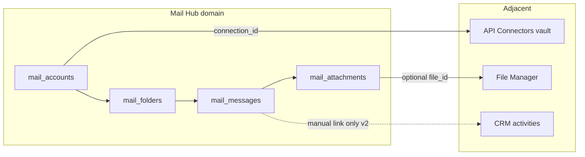
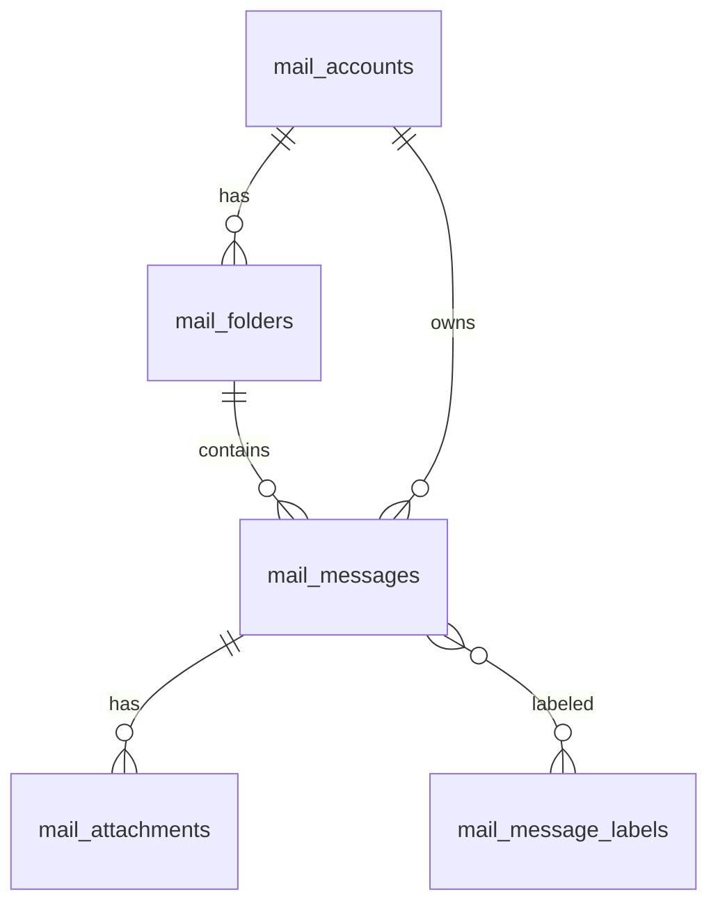

<div dir="rtl" lang="fa" class="hwy-parity-doc">
<style>
  .hwy-parity-doc { text-align: right; unicode-bidi: plaintext; }
  .hwy-parity-doc h1, .hwy-parity-doc h2, .hwy-parity-doc h3, .hwy-parity-doc h4, .hwy-parity-doc p, .hwy-parity-doc li { text-align: right; }
  .hwy-parity-doc table { direction: rtl; text-align: right; width: 100%; border-collapse: collapse; margin: 0.75rem 0; }
  .hwy-parity-doc th, .hwy-parity-doc td { border: 1px solid #c4c4c4; padding: 0.35rem 0.5rem; vertical-align: top; text-align: right; }
  .hwy-parity-doc th { background: #f6f6f6; font-weight: 600; }
  .hwy-parity-doc blockquote { text-align: right; border-right: 3px solid #ccc; border-left: none; padding-right: 1rem; margin-right: 0; }
  .hwy-parity-doc ul, .hwy-parity-doc ol { padding-right: 1.25rem; padding-left: 0; }
  .hwy-parity-doc pre, .hwy-parity-doc code { direction: ltr; text-align: left; unicode-bidi: embed; }
</style>

<p><strong>خلاصه برای operatore:</strong> این سند جزو <strong>plans</strong> است (p-packages-mail-hub). ستون وضعیت در <a href="./p-00-packages-index.md">index مربوطه</a> مرجع «شروع شده / design / تمام» است.</p>
<p><strong>راهنمای خواندن:</strong> بخش‌های انگلیسی برای agent/dev هستند؛ جداول وضعیت و یادداشت‌های فارسی را اول بخوانید.</p>


# p-packages-mail-hub — Mail Hub: صندوق یکپارچه · چند حساب · خواندن و ارسال

> **Package:** **Mail Hub** (#52) — [p-packages-backlog.md](p-packages-backlog.md)  
> **مسیر اجرا:** اسکوپ دامنه در backlog پکیج‌ها (نه zip Package Manager) — کنترل: [p-00-packages-index.md](p-00-packages-index.md)  
> **وضعیت:** ⬜ design only — پیاده‌سازی نشده  
> **آخرین به‌روزرسانی:** ۲۰۲۶-۰۹-۱۵  
> **وابستگی:** **API Connectors (#48)** برای OAuth و vault per-user · **File Manager (#1)** برای پیوست‌های بزرگ (ارجاع، نه blocker اولیه)  
> **استانداردها:** `AGENTS.md` · [data-model.md](../../../docs/standards/data-model.md) · [package-ui.md](../../../docs/standards/package-ui.md) · Greenfield · Data Studio / Sequelize

**Mail Hub** ابزار Studio برای اتصال چند حساب ایمیل (Gmail · Microsoft 365/Outlook · IMAP عمومی) و کار در یک **Unified Inbox** شبیه Outlook/Mailbird — بدون جایگزینی کلاینت دسکتاپ و بدون میزبانی صندوق.

AppEndO **platform-first** است نه mail-client-first: این پکیج فقط **خواندن · سینک · جستجو · نوشتن/ارسال** شخصی/تیمی داخل Studio را می‌پوشاند و عمداً **CRM activity sync دوطرفه**، **خبرنامهٔ انبوه**، **تقویم/قرار**، **قوانین پیچیدهٔ سمت سرور**، و **میزبانی SMTP** را داخل خودش نمی‌گیرد.

بنچمارک محصولات (الگو، نه کپی اسکیما): Microsoft Outlook (کلاسیک/New) · Mailbird · eM Client · Canary Mail · Thunderbird · Mailspring (+ mailsync OSS).

### اصل سخت: Mail Hub بخشی از Core نیست — و Package Manager zip هم مسیر ساخت نیست

<table dir="rtl">
<thead><tr><th>کار</th><th>مسیر درست (developer-built)</th></tr></thead>
<tbody><tr><td>جداول / associations / studio-meta</td><td><strong>Data Studio</strong> (Edge models + Sequelize)</td></tr>
<tr><td>LOVهای کوتاه</td><td><strong>Base Info</strong> زیر روت Mail Hub</td></tr>
<tr><td>OAuth / token / refresh</td><td><strong>API Connectors (#48)</strong> — <code dir="ltr" style="unicode-bidi: embed;">user_connection_id</code> روی حساب</td></tr>
<tr><td>سینک IMAP/Graph · ارسال</td><td><strong>Server Functions</strong> + worker/job روی Sequelize — <strong>نه</strong> <code dir="ltr" style="unicode-bidi: embed;">db.query</code></td></tr>
<tr><td>UI صندوق</td><td><strong>Client Components</strong> — یک workspace سه‌ستونه + ادیتور حساب</td></tr>
<tr><td>صفحات / nav</td><td><strong>Platform Pages</strong> — گروه <strong><code dir="ltr" style="unicode-bidi: embed;">Mail</code></strong> در Studio</td></tr>
</tbody></table>

**ممنوع (سخت):** Package Manager zip · `db.query` · seed در `controlPlaneSeed` · `src/core/packages/mail-hub/` · ذخیرهٔ plaintext password در جدول دامنه · فراخوانی مستقیم provider از مرورگر با token کاربر · duplicate vault OAuth جدا از AC-2.

### دسترسی داده (سخت) — فقط Sequelize

- کش پیام/پوشه روی Edge؛ سینک worker فقط از طریق Sequelize همان مدل‌ها.
- بدنهٔ پیام: lazy fetch — ردیف هدر زود، `body_*` بعد از باز کردن thread.

### خارج از ساخت اولیهٔ اپلیکیشن (سخت)

تا پیاده‌سازی صریح این پلن: **هیچ** `mail_*` · Base Info Mail Hub · nav · UI · worker.

```
@plans/packages/todo/p-packages-mail-hub.md برو جلو
@plans/packages/todo/p-packages-mail-hub.md فاز ۱ بساز
@plans/packages/todo/p-packages-mail-hub.md فاز ۲ بساز
@plans/packages/todo/p-packages-mail-hub.md زیر‌فاز 3a بساز
@plans/packages/todo/p-packages-mail-hub.md فاز N را رولبک کن
```

---

## هدف اصلی

**اتصال حساب → سینک پوشه/پیام → یک صندوق واحد → خواندن/پاسخ/ارسال** — با جداسازی worker سینک از UI (الگوی Mailspring: UI فقط task می‌فرستد، worker می‌نویسد).

<table dir="rtl">
<thead><tr><th>دغدغه</th><th>مالک</th></tr></thead>
<tbody><tr><td>OAuth · refresh token · encrypt credential</td><td><strong>API Connectors (#48)</strong></td></tr>
<tr><td>فایل پیوست بزرگ · آپلود</td><td><strong>File Manager (#1)</strong></td></tr>
<tr><td>لاگ تماس/ایمیل روی مشتری · تیکت</td><td><strong>CRM (#11)</strong> — inbound دوطرفه عمداً OUT</td></tr>
<tr><td>دعوتنامه/تقویم</td><td><strong>Calendar (#14)</strong></td></tr>
<tr><td>ایمیل انبوه/خبرنامه</td><td><strong>Newsletter (#7)</strong></td></tr>
<tr><td>قوانین چندمرحله‌ای تأیید</td><td><strong>Workflow Engine</strong> (بعداً)</td></tr>
<tr><td>فرم تماس سایت</td><td><strong>Contact Form (#4)</strong></td></tr>
</tbody></table>

---

## اصل ساخت: developer-built

- **یک شکل رکورد پیام** (`mail_messages`) برای inbox/sent/draft — تفاوت با `folder_id` + flagها، نه جدول جدا per نوع.
- **Adapter per provider** (`gmail` · `microsoft_graph` · `imap`) در سرویس سینک — نه EAV تنظیمات.
- **Worker جدا per account** (یا queue job با `account_id`) — خطای auth یک حساب بقیه را خراب نکند.



---

## دردهای کلاسیک کلاینت ایمیل و تصمیم‌های ما

<table dir="rtl">
<thead><tr><th>درد کلاسیک</th><th>علت</th><th>تصمیم AppEndO Mail Hub</th></tr></thead>
<tbody><tr><td>پیام‌ها «ناپدید» می‌شوند بعد از سینک</td><td>QRESYNC/VANISHED نادرست بعضی سرورها (Mailspring #1948)</td><td>حذف محلی فقط با تأیید UID + <code dir="ltr" style="unicode-bidi: embed;">UIDVALIDITY</code>؛ fallback CONDSTORE + deep scan دوره‌ای؛ لاگ <code dir="ltr" style="unicode-bidi: embed;">sync_anomaly</code></td></tr>
<tr><td>UI و سینک روی یک DB قفل می‌کنند</td><td>نوشتن همزمان از UI و IMAP</td><td>UI <strong>read-mostly</strong>؛ mutate فقط via <code dir="ltr" style="unicode-bidi: embed;">mail_tasks</code> API → worker؛ Sequelize transaction در worker</td></tr>
<tr><td>Gmail label در برابر پوشه IMAP</td><td>مدل متفاوت provider</td><td>Adapter <code dir="ltr" style="unicode-bidi: embed;">gmail</code> از X-GM-LABELS + Inbox/All Mail محدود؛ label اپ = <code dir="ltr" style="unicode-bidi: embed;">mail_labels</code> جدا از پوشه سرور</td></tr>
<tr><td>نگه‌داری token در جدول mail</td><td>امنیت و refresh تکراری</td><td>فقط <code dir="ltr" style="unicode-bidi: embed;">api_connectors_user_connection_id</code> + health از AC</td></tr>
<tr><td>Outlook «همه‌چیز در یک»</td><td>Graph + Teams + SharePoint</td><td>v1 فقط <strong>mail</strong> subgraph؛ Teams chat OUT</td></tr>
<tr><td>قوانین سمت کلاینت پیچیده</td><td>شبیه Outlook rules</td><td>v1: فیلتر ذخیره‌شده + جستجو؛ <strong>بدون</strong> rule engine سرور</td></tr>
<tr><td>آفلاین کامل دسکتاپ</td><td>نیاز native cache</td><td>v1 <strong>وب‌اول</strong> — cache سرور؛ offline PWA OUT</td></tr>
<tr><td>ادغام CRM خودکار</td><td>scope explosion</td><td>OUT v1؛ دکمه «Copy link» / export دستی؛ CRM خودش email sync ندارد (تأیید مرز CRM v2)</td></tr>
<tr><td>Hosting صندوق</td><td>SaaS mail server</td><td>OUT — فقط client به provider موجود</td></tr>
<tr><td>Unified inbox بدون حساب</td><td>UX خالی</td><td>حداقل یک حساب قبل از inbox؛ wizard Connect در 3a</td></tr>
</tbody></table>

---

## اطلاعات پایه (Base Info) — ریشهٔ Mail Hub

```
Base Info
└── Mail Hub
    ├── Provider Kind          → provider_kind_code   (seed · بسته)
    ├── Folder Role            → folder_role_code     (seed · بسته)
    ├── Sync Health            → sync_health_code     (seed · بسته)
    └── Message Labels         → label_code           (مدیریت اپراتور)
```

1. یک روت **Mail Hub** — seed فقط هنگام پیاده‌سازی.
2. هر `*_code` = یک دسته مستقیم زیر روت.
3. `Provider Kind` / `Folder Role` / `Sync Health` **بسته** — بدون صفحه واژگان (badge فقط).
4. `Message Labels` **مدیریت‌پذیر** — Settings.

### دسته: Provider Kind → `provider_kind_code` (بسته)

<table dir="rtl">
<thead><tr><th>#</th><th>Title</th><th>shortName</th><th>Lucide</th><th>نقش</th></tr></thead>
<tbody><tr><td>1</td><td>Gmail</td><td><code dir="ltr" style="unicode-bidi: embed;">gmail</code></td><td><code dir="ltr" style="unicode-bidi: embed;">Mail</code></td><td>Google OAuth + Gmail API/IMAP</td></tr>
<tr><td>2</td><td>Microsoft 365</td><td><code dir="ltr" style="unicode-bidi: embed;">microsoft_graph</code></td><td><code dir="ltr" style="unicode-bidi: embed;">Mailbox</code></td><td>Graph mail</td></tr>
<tr><td>3</td><td>Generic IMAP</td><td><code dir="ltr" style="unicode-bidi: embed;">imap</code></td><td><code dir="ltr" style="unicode-bidi: embed;">Server</code></td><td>IMAP/SMTP دستی + AC credential</td></tr>
</tbody></table>

### دسته: Folder Role → `folder_role_code` (بسته)

<table dir="rtl">
<thead><tr><th>#</th><th>Title</th><th>shortName</th><th>Lucide</th></tr></thead>
<tbody><tr><td>1</td><td>Inbox</td><td><code dir="ltr" style="unicode-bidi: embed;">inbox</code></td><td><code dir="ltr" style="unicode-bidi: embed;">Inbox</code></td></tr>
<tr><td>2</td><td>Sent</td><td><code dir="ltr" style="unicode-bidi: embed;">sent</code></td><td><code dir="ltr" style="unicode-bidi: embed;">Send</code></td></tr>
<tr><td>3</td><td>Drafts</td><td><code dir="ltr" style="unicode-bidi: embed;">drafts</code></td><td><code dir="ltr" style="unicode-bidi: embed;">FileEdit</code></td></tr>
<tr><td>4</td><td>Trash</td><td><code dir="ltr" style="unicode-bidi: embed;">trash</code></td><td><code dir="ltr" style="unicode-bidi: embed;">Trash2</code></td></tr>
<tr><td>5</td><td>Archive</td><td><code dir="ltr" style="unicode-bidi: embed;">archive</code></td><td><code dir="ltr" style="unicode-bidi: embed;">Archive</code></td></tr>
<tr><td>6</td><td>Custom</td><td><code dir="ltr" style="unicode-bidi: embed;">custom</code></td><td><code dir="ltr" style="unicode-bidi: embed;">Folder</code></td></tr>
</tbody></table>

### دسته: Sync Health → `sync_health_code` (بسته)

<table dir="rtl">
<thead><tr><th>#</th><th>Title</th><th>shortName</th><th>Lucide</th></tr></thead>
<tbody><tr><td>1</td><td>Healthy</td><td><code dir="ltr" style="unicode-bidi: embed;">healthy</code></td><td><code dir="ltr" style="unicode-bidi: embed;">CircleCheck</code></td></tr>
<tr><td>2</td><td>Syncing</td><td><code dir="ltr" style="unicode-bidi: embed;">syncing</code></td><td><code dir="ltr" style="unicode-bidi: embed;">RefreshCw</code></td></tr>
<tr><td>3</td><td>Auth required</td><td><code dir="ltr" style="unicode-bidi: embed;">auth_required</code></td><td><code dir="ltr" style="unicode-bidi: embed;">KeyRound</code></td></tr>
<tr><td>4</td><td>Error</td><td><code dir="ltr" style="unicode-bidi: embed;">error</code></td><td><code dir="ltr" style="unicode-bidi: embed;">CircleAlert</code></td></tr>
</tbody></table>

### دسته: Message Labels → `label_code` (مدیریت‌پذیر)

**Admin UI:** catalog cards در `mail/settings/labels` · فرم `form.base-info-record` · API inject روی `DataSourceDefinition`.

---

## مدل دامنه

### تصمیم

1. `mail_accounts` — binding کاربر ↔ provider + تنظیمات نمایش/سینک.
2. `mail_folders` — آینه پوشه per account + نقش canonical.
3. `mail_messages` — هدر + metadata + body lazy + thread key.
4. `mail_message_labels` — junction پیام ↔ label اپ (many-to-many).
5. `mail_attachments` — metadata پیوست؛ محتوا در File Manager یا inline کوچک.

**وجود ندارد:** جدول جدا برای Draft/Sent · جدول contact موازی platform · ذخیره token · جدول rule engine.



### `mail_accounts` — حساب متصل

<table dir="rtl">
<thead><tr><th>#</th><th>Column</th><th>Native</th><th>Runtime</th><th>Null</th><th>نقش</th></tr></thead>
<tbody><tr><td>1</td><td>id</td><td>UUID</td><td>UUID</td><td>N</td><td>PK</td></tr>
<tr><td>2</td><td>owner_user_id</td><td>UUID</td><td>UUID</td><td>N</td><td>FK <code dir="ltr" style="unicode-bidi: embed;">base_users</code></td></tr>
<tr><td>3</td><td>display_name</td><td>TEXT</td><td>STRING</td><td>N</td><td>UI</td></tr>
<tr><td>4</td><td>email_address</td><td>TEXT</td><td>STRING</td><td>N</td><td>هویت ارسال</td></tr>
<tr><td>5</td><td>provider_kind_code</td><td>TEXT</td><td>STRING</td><td>N</td><td>LOV</td></tr>
<tr><td>6</td><td>api_connectors_connection_id</td><td>UUID</td><td>UUID</td><td>Y</td><td>FK vault AC</td></tr>
<tr><td>7</td><td>sync_health_code</td><td>TEXT</td><td>STRING</td><td>N</td><td>LOV</td></tr>
<tr><td>8</td><td>unified_inbox_enabled</td><td>BOOLEAN</td><td>BOOLEAN</td><td>N</td><td>default true</td></tr>
<tr><td>9</td><td>accent_color</td><td>TEXT</td><td>STRING</td><td>Y</td><td>رنگ حساب در لیست</td></tr>
<tr><td>10</td><td>last_sync_at</td><td>TIMESTAMPTZ</td><td>DATE</td><td>Y</td><td></td></tr>
<tr><td>11</td><td>sync_cursor_json</td><td>JSONB</td><td>JSON</td><td>Y</td><td>MODSEQ/UID state</td></tr>
<tr><td>12</td><td>note</td><td>TEXT</td><td>STRING</td><td>Y</td><td></td></tr>
<tr><td>13</td><td>created_by / created_at / updated_by / updated_at</td><td>…</td><td>…</td><td>Y/N</td><td>audit</td></tr>
</tbody></table>

**قواعد:** یک `owner_user_id` + `email_address` UNIQUE؛ قطع اتصال = soft-disable + revoke در AC؛ بدون password column.

### `mail_folders` — پوشه

<table dir="rtl">
<thead><tr><th>#</th><th>Column</th><th>Native</th><th>Runtime</th><th>Null</th><th>نقش</th></tr></thead>
<tbody><tr><td>1</td><td>id</td><td>UUID</td><td>UUID</td><td>N</td><td>PK</td></tr>
<tr><td>2</td><td>account_id</td><td>UUID</td><td>UUID</td><td>N</td><td>FK</td></tr>
<tr><td>3</td><td>folder_role_code</td><td>TEXT</td><td>STRING</td><td>N</td><td>LOV</td></tr>
<tr><td>4</td><td>remote_path</td><td>TEXT</td><td>STRING</td><td>N</td><td>IMAP path / Graph id</td></tr>
<tr><td>5</td><td>display_name</td><td>TEXT</td><td>STRING</td><td>N</td><td></td></tr>
<tr><td>6</td><td>uid_validity</td><td>BIGINT</td><td>BIGINT</td><td>Y</td><td>IMAP</td></tr>
<tr><td>7</td><td>highest_modseq</td><td>BIGINT</td><td>BIGINT</td><td>Y</td><td>CONDSTORE</td></tr>
<tr><td>8</td><td>sort_order</td><td>INT</td><td>INTEGER</td><td>N</td><td></td></tr>
<tr><td>9</td><td>note</td><td>TEXT</td><td>STRING</td><td>Y</td><td></td></tr>
</tbody></table>

### `mail_messages` — پیام

<table dir="rtl">
<thead><tr><th>#</th><th>Column</th><th>Native</th><th>Runtime</th><th>Null</th><th>نقش</th></tr></thead>
<tbody><tr><td>1</td><td>id</td><td>UUID</td><td>UUID</td><td>N</td><td>PK</td></tr>
<tr><td>2</td><td>account_id</td><td>UUID</td><td>UUID</td><td>N</td><td>FK</td></tr>
<tr><td>3</td><td>folder_id</td><td>UUID</td><td>UUID</td><td>N</td><td>FK</td></tr>
<tr><td>4</td><td>remote_uid</td><td>TEXT</td><td>STRING</td><td>Y</td><td>provider id</td></tr>
<tr><td>5</td><td>thread_key</td><td>TEXT</td><td>STRING</td><td>Y</td><td>unified thread</td></tr>
<tr><td>6</td><td>subject</td><td>TEXT</td><td>STRING</td><td>Y</td><td></td></tr>
<tr><td>7</td><td>from_json</td><td>JSONB</td><td>JSON</td><td>N</td><td><code dir="ltr" style="unicode-bidi: embed;">{name,email}</code></td></tr>
<tr><td>8</td><td>to_json</td><td>JSONB</td><td>JSON</td><td>Y</td><td>array</td></tr>
<tr><td>9</td><td>cc_json</td><td>JSONB</td><td>JSON</td><td>Y</td><td></td></tr>
<tr><td>10</td><td>sent_at</td><td>TIMESTAMPTZ</td><td>DATE</td><td>Y</td><td></td></tr>
<tr><td>11</td><td>snippet</td><td>TEXT</td><td>STRING</td><td>Y</td><td>لیست</td></tr>
<tr><td>12</td><td>body_text</td><td>TEXT</td><td>TEXT</td><td>Y</td><td>lazy</td></tr>
<tr><td>13</td><td>body_html</td><td>TEXT</td><td>TEXT</td><td>Y</td><td>lazy</td></tr>
<tr><td>14</td><td>is_read</td><td>BOOLEAN</td><td>BOOLEAN</td><td>N</td><td></td></tr>
<tr><td>15</td><td>is_flagged</td><td>BOOLEAN</td><td>BOOLEAN</td><td>N</td><td></td></tr>
<tr><td>16</td><td>is_draft</td><td>BOOLEAN</td><td>BOOLEAN</td><td>N</td><td></td></tr>
<tr><td>17</td><td>has_attachments</td><td>BOOLEAN</td><td>BOOLEAN</td><td>N</td><td></td></tr>
<tr><td>18</td><td>search_vector</td><td>TSVECTOR</td><td>—</td><td>Y</td><td>optional Phase 2</td></tr>
<tr><td>19</td><td>note</td><td>TEXT</td><td>STRING</td><td>Y</td><td></td></tr>
</tbody></table>

**قواعد:** UNIQUE `(folder_id, remote_uid)` وقتی remote_uid پر است؛ انتقال پوشه = update `folder_id` نه duplicate.

### `mail_message_labels` — junction

<table dir="rtl">
<thead><tr><th>#</th><th>Column</th><th>Native</th><th>Runtime</th><th>Null</th></tr></thead>
<tbody><tr><td>1</td><td>message_id</td><td>UUID</td><td>UUID</td><td>N</td></tr>
<tr><td>2</td><td>label_code</td><td>TEXT</td><td>STRING</td><td>N</td></tr>
<tr><td>—</td><td>UNIQUE (message_id, label_code)</td><td></td><td></td><td></td></tr>
</tbody></table>

### `mail_attachments`

<table dir="rtl">
<thead><tr><th>#</th><th>Column</th><th>Native</th><th>Runtime</th><th>Null</th><th>نقش</th></tr></thead>
<tbody><tr><td>1</td><td>id</td><td>UUID</td><td>UUID</td><td>N</td><td>PK</td></tr>
<tr><td>2</td><td>message_id</td><td>UUID</td><td>UUID</td><td>N</td><td>FK</td></tr>
<tr><td>3</td><td>file_name</td><td>TEXT</td><td>STRING</td><td>N</td><td></td></tr>
<tr><td>4</td><td>mime_type</td><td>TEXT</td><td>STRING</td><td>Y</td><td></td></tr>
<tr><td>5</td><td>size_bytes</td><td>BIGINT</td><td>BIGINT</td><td>Y</td><td></td></tr>
<tr><td>6</td><td>file_manager_file_id</td><td>UUID</td><td>UUID</td><td>Y</td><td>FK File Manager</td></tr>
<tr><td>7</td><td>inline_content_id</td><td>TEXT</td><td>STRING</td><td>Y</td><td>CID</td></tr>
</tbody></table>

### Edge model associations — کاننیکال

<table dir="rtl">
<thead><tr><th>Model</th><th>kind</th><th>target</th><th>FK / through</th><th>as</th></tr></thead>
<tbody><tr><td>mail_accounts</td><td>belongsTo</td><td>base_users</td><td>owner_user_id</td><td>owner</td></tr>
<tr><td>mail_accounts</td><td>belongsTo</td><td>Base Info provider_kind</td><td>provider_kind_code</td><td>provider_kind</td></tr>
<tr><td>mail_accounts</td><td>belongsTo</td><td>Base Info sync_health</td><td>sync_health_code</td><td>sync_health</td></tr>
<tr><td>mail_folders</td><td>belongsTo</td><td>mail_accounts</td><td>account_id</td><td>account</td></tr>
<tr><td>mail_folders</td><td>belongsTo</td><td>Base Info folder_role</td><td>folder_role_code</td><td>folder_role</td></tr>
<tr><td>mail_messages</td><td>belongsTo</td><td>mail_accounts</td><td>account_id</td><td>account</td></tr>
<tr><td>mail_messages</td><td>belongsTo</td><td>mail_folders</td><td>folder_id</td><td>folder</td></tr>
<tr><td>mail_messages</td><td>hasMany</td><td>mail_attachments</td><td>message_id</td><td>attachments</td></tr>
<tr><td>mail_messages</td><td>belongsToMany</td><td>(label via junction)</td><td>mail_message_labels</td><td>labels</td></tr>
</tbody></table>

---

## Data Studio / studio-meta — قرارداد مدلر (فاز ۱)

همان قرارداد پلتفرم (EdgeModel + studio-meta sparse · گروه‌بندی اجباری · widget روی association برای `*_code`).

<table dir="rtl">
<thead><tr><th>objectName</th><th>title</th><th>icon</th><th>color</th><th>tags</th></tr></thead>
<tbody><tr><td>mail_accounts</td><td>Mail accounts</td><td>Mailbox</td><td>blue</td><td>mail, account</td></tr>
<tr><td>mail_folders</td><td>Mail folders</td><td>Folder</td><td>slate</td><td>mail</td></tr>
<tr><td>mail_messages</td><td>Mail messages</td><td>Mail</td><td>indigo</td><td>mail</td></tr>
<tr><td>mail_attachments</td><td>Mail attachments</td><td>Paperclip</td><td>slate</td><td>mail</td></tr>
</tbody></table>

هر مدل: Story انگلیسی (Purpose / Lifecycle / Rules) · گروه‌های Identity · Sync · Content · Flags · Audit · columnMeta + associationMeta کامل در پیاده‌سازی فاز ۱ (هم‌تراز Task/CMS — عامل هنگام seed از Task Management الگو بگیرد).

**پذیرش بصری:** مدلر بدون ستون ungrouped · هر FK مهم wired · تست import/sync association در Data Studio.

---

## خارج از اسکوپ (سخت)

- میزبانی دامنه/SMTP · ساخت `@company.com` mailbox
- کلاینت دسکتاپ native · MAPI/COM Windows
- Exchange on-prem بدون Graph (v2)
- CRM two-way email sync · auto ticket from inbox
- Newsletter / campaign · tracking pixel انبوه
- Calendar RSVP · free-busy
- Rules engine سمت سرور (forward auto پیچیده)
- S/MIME · PGP E2E (v2)
- خواندن ایمیل از localStorage/token در browser

---

## UX ادمین

**شکل اصلی:** workspace سه‌ستونه (Outlook-like) — **نه** لیست CRUD ساده.

```
┌──────────────────────────────────────────────────────────────────┐
│ Toolbar: Compose · Search · Sync now · Account picker · Settings │
├──────────┬─────────────────────┬─────────────────────────────────┤
│ Folder   │ Message list        │ Reading pane / Compose          │
│ tree +   │ (table: density)    │ (DirectionalText HTML + reply)  │
│ accounts │ sort in footer      │                                 │
└──────────┴─────────────────────┴─────────────────────────────────┘
```

<table dir="rtl">
<thead><tr><th>صفحه</th><th>presentation</th><th>دلیل</th></tr></thead>
<tbody><tr><td>Unified message list</td><td><strong>table</strong> + paging footer + sort</td><td>ستون‌های Subject · From · Account · Date · Flags</td></tr>
<tr><td>Connected accounts (settings)</td><td><strong>catalog cards</strong></td><td>عنوان + provider + health badge</td></tr>
<tr><td>Message labels vocab</td><td><strong>catalog cards</strong></td><td>sparse LOV</td></tr>
<tr><td>Account deep editor</td><td>main + <strong>inspector rail</strong></td><td>تنظیمات حساب</td></tr>
</tbody></table>

### Account editor — ASCII

```
Main: Identity (display name, email read-only) · Sync (unified inbox toggle) · Folders (read-only tree)
Rail: Provider kind (locked) · Sync health · Last sync · Connection (link AC) · Accent color
Footer: Save · Disconnect · Test connection
```

**Pre-create:** Connect wizard (provider → OAuth AC modal یا IMAP form) → persist account → `mail/accounts/edit/{id}`.

### closed enum vs manageable

<table dir="rtl">
<thead><tr><th>فیلد</th><th>نوع</th><th>صفحه vocab</th></tr></thead>
<tbody><tr><td>provider_kind_code</td><td>بسته</td><td>—</td></tr>
<tr><td>folder_role_code</td><td>بسته</td><td>—</td></tr>
<tr><td>sync_health_code</td><td>بسته</td><td>—</td></tr>
<tr><td>label_code</td><td>manageable</td><td><code dir="ltr" style="unicode-bidi: embed;">mail/settings/labels</code></td></tr>
</tbody></table>

### Control → Base Components

<table dir="rtl">
<thead><tr><th>UI</th><th>BC section</th></tr></thead>
<tbody><tr><td>Toolbar compose/search/sync</td><td><code dir="ltr" style="unicode-bidi: embed;">toolbar</code></td></tr>
<tr><td>Folder tree</td><td><code dir="ltr" style="unicode-bidi: embed;">selection-fields</code> / tree pattern</td></tr>
<tr><td>Message grid</td><td><code dir="ltr" style="unicode-bidi: embed;">grid</code> + <code dir="ltr" style="unicode-bidi: embed;">GridPagingFooter</code> + sort controls</td></tr>
<tr><td>Reading pane</td><td><code dir="ltr" style="unicode-bidi: embed;">directional-text</code> / rich read-only</td></tr>
<tr><td>Compose</td><td><code dir="ltr" style="unicode-bidi: embed;">text-fields</code> · <code dir="ltr" style="unicode-bidi: embed;">rich-text</code> (if in catalog)</td></tr>
<tr><td>Connect / Disconnect</td><td><code dir="ltr" style="unicode-bidi: embed;">confirm</code> + <code dir="ltr" style="unicode-bidi: embed;">toast</code></td></tr>
<tr><td>Account color</td><td><code dir="ltr" style="unicode-bidi: embed;">choice-fields</code></td></tr>
</tbody></table>

---

## شکل API (headless)

Base: `/api/mail/...` (Server Functions · envelope استاندارد)

<table dir="rtl">
<thead><tr><th>Method</th><th>Path</th><th>نقش</th></tr></thead>
<tbody><tr><td>GET</td><td><code dir="ltr" style="unicode-bidi: embed;">/api/mail/accounts</code></td><td>حساب‌های کاربر</td></tr>
<tr><td>POST</td><td><code dir="ltr" style="unicode-bidi: embed;">/api/mail/accounts</code></td><td>ایجاد پس از Connect</td></tr>
<tr><td>GET/PATCH/DELETE</td><td><code dir="ltr" style="unicode-bidi: embed;">/api/mail/accounts/:id</code></td><td></td></tr>
<tr><td>POST</td><td><code dir="ltr" style="unicode-bidi: embed;">/api/mail/accounts/:id/sync</code></td><td>enqueue sync</td></tr>
<tr><td>GET</td><td><code dir="ltr" style="unicode-bidi: embed;">/api/mail/folders?accountId=</code></td><td>tree</td></tr>
<tr><td>GET</td><td><code dir="ltr" style="unicode-bidi: embed;">/api/mail/messages</code></td><td>filter folder/unified/search</td></tr>
<tr><td>GET</td><td><code dir="ltr" style="unicode-bidi: embed;">/api/mail/messages/:id</code></td><td>detail + lazy body fetch</td></tr>
<tr><td>PATCH</td><td><code dir="ltr" style="unicode-bidi: embed;">/api/mail/messages/:id</code></td><td>read/flag/move</td></tr>
<tr><td>POST</td><td><code dir="ltr" style="unicode-bidi: embed;">/api/mail/messages/send</code></td><td>send / reply</td></tr>
<tr><td>POST</td><td><code dir="ltr" style="unicode-bidi: embed;">/api/mail/messages/draft</code></td><td>save draft</td></tr>
<tr><td>GET</td><td><code dir="ltr" style="unicode-bidi: embed;">/api/mail/attachments/:id/download</code></td><td>stream via server</td></tr>
</tbody></table>

---

## هم‌راستایی با پلتفرم

- خارج از bootstrap · Sequelize-only · یک روت Base Info
- Credential فقط AC-2 · worker جدا · UI read-mostly
- Nav گروه **`Mail`**: `mail` (inbox) · `mail/settings`
- culture keys انگلیسی: `nav.group.mail` · `nav.mail-inbox` · `nav.mail-settings`
- Phase 3 scaffold: `scripts/mail-hub-phase3/` · ممنوع Auto-CRUD

---

## فازهای پیاده‌سازی

### فاز ۱ — Database · Base Info · studio-meta

جداول · associations · LOV seed · studio-meta کامل.

**ممنوع:** UI · worker · route bootstrap.

**خروجی:** Data Studio import سبز · Base Info tree Mail Hub.

**رولبک فاز ۱:** drop `mail_*` · meta · LOV root.

### فاز ۲ — Sync engine · API

Adapters (gmail · microsoft_graph · imap) · job queue per account · CRUD API بالا · CONDSTORE/deep-scan policy · integrate AC resolver.

**ممنوع:** Client Components inbox.

**خروجی:** live HTTP list messages پس از sync دستی · send smoke on test account.

**رولبک فاز ۲:** functions · workers · نگه‌داشتن یا حذف داده طبق دستور.

### فاز ۳ — Studio UI (sub-phased)

<table dir="rtl">
<thead><tr><th>Sub</th><th>محتوا</th></tr></thead>
<tbody><tr><td><strong>3a</strong></td><td>Nav Mail · settings · accounts catalog · Connect flow · labels vocab</td></tr>
<tr><td><strong>3b</strong></td><td>Unified inbox workspace (grid + folder tree + reading pane) — <strong>طلایی</strong></td></tr>
<tr><td><strong>3c</strong></td><td>Compose/reply · search · bulk mark read/archive · attachment upload → File Manager</td></tr>
</tbody></table>

**Scaffold:** `scripts/mail-hub-phase3/mailHubDesignerScaffold.ts` · `buildMailVocabularyPage` · contract tests · live-verify browser.

**Page → reference map**

<table dir="rtl">
<thead><tr><th>Page</th><th>Living reference</th></tr></thead>
<tbody><tr><td>Accounts settings</td><td>Users list cards + CMS settings vocab</td></tr>
<tr><td>Account editor</td><td>Idea Foundry inspector rail</td></tr>
<tr><td>Inbox workspace</td><td>custom — toolbar/grid از Server Functions list patterns</td></tr>
<tr><td>Compose</td><td>RecordForm sections (بدون rail)</td></tr>
</tbody></table>

### چرخهٔ اصلاح پلن

توقف → رولبک لایه → اصلاح سند → بازسازی. پلن منبع حقیقت می‌ماند.

### وضعیت اجرا

<table dir="rtl">
<thead><tr><th>فاز</th><th>وضعیت</th></tr></thead>
<tbody><tr><td>۱ — DB · meta · LOV</td><td>⬜</td></tr>
<tr><td>۲ — Sync · API</td><td>⬜</td></tr>
<tr><td>۳a — Nav · accounts · vocab</td><td>⬜</td></tr>
<tr><td>۳b — Inbox workspace</td><td>⬜</td></tr>
<tr><td>۳c — Compose · search · bulk</td><td>⬜</td></tr>
</tbody></table>

---

این سند تا بازنویسی عمدی، معیار پذیرش است: دامنهٔ Sequelize/Data Studio شبیه کار دستی دولوپر — نه core built-in — نه zip پکیج — نه SQL خام sandbox.

</div>
