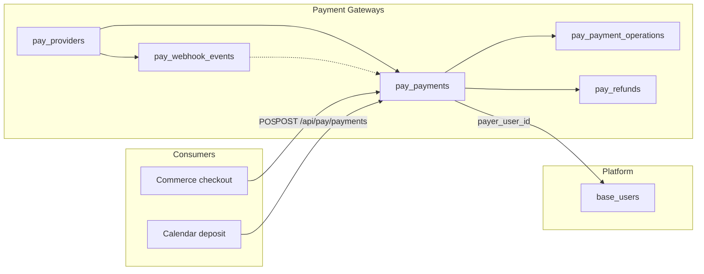
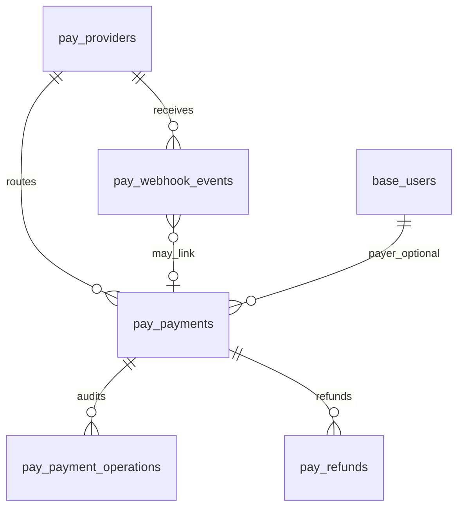

<div dir="rtl" lang="fa" class="hwy-parity-doc">
<style>
  .hwy-parity-doc { text-align: right; unicode-bidi: plaintext; }
  .hwy-parity-doc h1, .hwy-parity-doc h2, .hwy-parity-doc h3, .hwy-parity-doc h4, .hwy-parity-doc p, .hwy-parity-doc li { text-align: right; }
  .hwy-parity-doc table { direction: rtl; text-align: right; width: 100%; border-collapse: collapse; margin: 0.75rem 0; }
  .hwy-parity-doc th, .hwy-parity-doc td { border: 1px solid #c4c4c4; padding: 0.35rem 0.5rem; vertical-align: top; text-align: right; }
  .hwy-parity-doc th { background: #f6f6f6; font-weight: 600; }
  .hwy-parity-doc blockquote { text-align: right; border-right: 3px solid #ccc; border-left: none; padding-right: 1rem; margin-right: 0; }
  .hwy-parity-doc ul, .hwy-parity-doc ol { padding-right: 1.25rem; padding-left: 0; }
  .hwy-parity-doc pre, .hwy-parity-doc code { direction: ltr; text-align: left; unicode-bidi: embed; }
</style>

<p><strong>خلاصه برای operatore:</strong> این سند جزو <strong>plans</strong> است (p-packages-payment-gateways). ستون وضعیت در <a href="./p-00-packages-index.md">index مربوطه</a> مرجع «شروع شده / design / تمام» است.</p>
<p><strong>راهنمای خواندن:</strong> بخش‌های انگلیسی برای agent/dev هستند؛ جداول وضعیت و یادداشت‌های فارسی را اول بخوانید.</p>


# p-packages-payment-gateways — Payment Gateways: درگاه ایرانی و بین‌المللی · پرداخت · webhook

> **Package:** **Payment Gateways** (#3) — [p-packages-backlog.md](p-packages-backlog.md)  
> **مسیر اجرا:** اسکوپ دامنه در backlog پکیج‌ها (نه zip Package Manager) — کنترل: [p-00-packages-index.md](p-00-packages-index.md)  
> **وضعیت:** ⬜ design only — پیاده‌سازی نشده  
> **آخرین به‌روزرسانی:** ۲۰۲۶-۰۹-۱۵  
> **وابستگی:** — (Commerce #15 و Calendar #14 **مصرف‌کننده** هستند؛ این پکیج برای شروع آن‌ها blocker نیست، ولی checkout واقعی بدون پیاده‌سازی این پکیج یا mock دستی ممکن نیست)  
> **استانداردها:** `AGENTS.md` · [data-model.md](../../../docs/standards/data-model.md) · [package-ui.md](../../../docs/standards/package-ui.md) · [package-base-info-vocab.md](../../../docs/standards/package-base-info-vocab.md) · Greenfield · Data Studio / Sequelize

**Payment Gateways** لایهٔ **ارکستراسیون پرداخت tenant-level** در Studio است: پذیرنده درگاه‌های ایرانی (redirect + verify) و بین‌المللی (intent + webhook) را پیکربندی می‌کند، پرداخت نرمال‌شده با idempotency و audit ثبت می‌شود، و ماژول‌های دیگر (اولاً Commerce) فقط API headless این پکیج را صدا می‌زنند — نه SDK مستقیم Stripe/Zarinpal در feature خودشان.

AppEndO **platform-first** است نه PSP-first: این پکیج **فاکتور · سبد · موجودی · حسابداری · اشتراک دوره‌ای · marketplace split · کارت ذخیره‌شده per-user** را داخل خودش نمی‌گیرد؛ credential درگاه **admin-only encrypted** است (الگوی [p-packages-api-connectors](p-packages-api-connectors.md) برای vault **per-user** جدا است).

بنچمارک (الگو، نه کپی اسکیما): Stripe · Adyen · PayPal/Braintree (تجاری) · [payment-core](https://github.com/dalpras/payment-core) · [blue-samarth/payment-service](https://github.com/blue-samarth/payment-service) (OSS) · زرین‌پال · آیدی‌پی · زیبال/وندار (ایران).

### اصل سخت: Payment Gateways بخشی از Core نیست — و Package Manager zip هم مسیر ساخت نیست

<table dir="rtl">
<thead><tr><th>کار</th><th>مسیر درست (developer-built)</th></tr></thead>
<tbody><tr><td>جداول / associations / studio-meta</td><td><strong>Data Studio</strong> (Edge models + Sequelize)</td></tr>
<tr><td>LOVهای وضعیت/نوع</td><td><strong>Base Info</strong> زیر روت Payment Gateways</td></tr>
<tr><td>رمز درگاه (merchant_id · API key · webhook secret)</td><td><strong>Server Functions</strong> + encrypt at rest در <code dir="ltr" style="unicode-bidi: embed;">pay_providers</code> — <strong>admin-only</strong> · هرگز به مرورگر</td></tr>
<tr><td>Adapter هر PSP</td><td><strong>Server Functions</strong> (registry بر اساس <code dir="ltr" style="unicode-bidi: embed;">provider_kind_code</code>) — نه پلاگین zip</td></tr>
<tr><td>Webhook عمومی</td><td><strong>Route ثابت</strong> <code dir="ltr" style="unicode-bidi: embed;">POST /api/pay/webhooks/:providerSlug</code> با verify امضا — خارج از JWT کاربر</td></tr>
<tr><td>UI پیکربندی/مانیتور</td><td><strong>Client Components</strong> + Platform Pages</td></tr>
<tr><td>صفحات / nav</td><td>گروه <strong><code dir="ltr" style="unicode-bidi: embed;">Payments</code></strong> در Studio</td></tr>
</tbody></table>

**ممنوع (سخت):**

1. Package Manager zip · `db.query` · seed در `controlPlaneSeed` · `src/core/packages/payment-gateways/`
2. ذخیرهٔ PAN/CVV یا کارت خام — فقط hosted/redirect درگاه
3. duplicate vault OAuth per-user (مالک: API Connectors #48)
4. منطق verify/webhook داخل Commerce/Calendar — فقط فراخوانی API این پکیج
5. marketplace plugin per bank در v1 — adapterهای built-in + `provider_kind_code` بسته
6. Auto-CRUD برای UI عملیاتی
7. برگرداندن secret در `GET` provider (فقط «configured» boolean + fingerprint)

### دسترسی داده (سخت) — فقط Sequelize

- منبع حقیقت: Edge models `pay_*`.
- ایجاد پرداخت، redirect URL، verify، capture/refund، پردازش webhook: Sequelize + سرویس adapter — **نه** SQL sandbox.
- idempotency key و `external_event_id` webhook با **UNIQUE** در DB قبل از side effect بیرونی.

### خارج از ساخت اولیهٔ اپلیکیشن (سخت)

تا پیاده‌سازی صریح این پلن: **هیچ** `pay_*` · Base Info Payment Gateways · nav · webhook route · adapter.

```
@plans/packages/todo/p-packages-payment-gateways.md برو جلو
@plans/packages/todo/p-packages-payment-gateways.md فاز ۱ بساز
@plans/packages/todo/p-packages-payment-gateways.md فاز ۲ بساز
@plans/packages/todo/p-packages-payment-gateways.md زیر‌فاز 3a بساز
@plans/packages/todo/p-packages-payment-gateways.md فاز N را رولبک کن
@plans/packages/todo/p-packages-payment-gateways.md از فاز N به بعد را رولبک کن
```

**معنی «برو جلو»:** اولین ردیف ⬜ در «وضعیت اجرا» — پیش‌فرض یک ردیف در هر درخواست.

<table dir="rtl">
<thead><tr><th>#</th><th>کار</th><th>شرط شروع</th></tr></thead>
<tbody><tr><td>۱</td><td>فاز ۱ — DB · Base Info · studio-meta</td><td>—</td></tr>
<tr><td>۲</td><td>فاز ۲ — Adapters · API · webhook</td><td>فاز ۱ ✅</td></tr>
<tr><td>۳a</td><td>Nav Payments · settings (در صورت vocab)</td><td>فاز ۲ ✅</td></tr>
<tr><td>۳b</td><td>Providers catalog + editor (طلایی)</td><td>۳a ✅</td></tr>
<tr><td>۳c</td><td>Payments monitor + payment detail + webhook inbox</td><td>۳b ✅</td></tr>
</tbody></table>

---

## هدف اصلی

**پیکربندی درگاه → ایجاد پرداخت idempotent → هدایت/تأیید → webhook/out-of-order safe → refund محدود** — با یک شکل رکورد `pay_payments` برای همهٔ PSPها.

<table dir="rtl">
<thead><tr><th>دغدغه</th><th>مالک</th></tr></thead>
<tbody><tr><td>سفارش · خط فاکتور · مالیات · انبار</td><td><strong>Commerce (#15)</strong></td></tr>
<tr><td>رزرو/بیعانه قرار</td><td><strong>Calendar (#14)</strong> — فقط <code dir="ltr" style="unicode-bidi: embed;">client_reference</code></td></tr>
<tr><td>مشتری/پرداخت‌کننده به‌عنوان هویت</td><td><strong><code dir="ltr" style="unicode-bidi: embed;">base_users</code> + profile</strong> — FK اختیاری <code dir="ltr" style="unicode-bidi: embed;">payer_user_id</code></td></tr>
<tr><td>OAuth اتصال شخصی به SaaS</td><td><strong>API Connectors (#48)</strong> — نه credential درگاه tenant</td></tr>
<tr><td>دفتر کل · تسویه بانکی · reconciliation حسابداری</td><td><strong>Accounting</strong> (بعداً) — export از <code dir="ltr" style="unicode-bidi: embed;">pay_payment_operations</code></td></tr>
<tr><td>workflow تأیید چندمرحله‌ای refund</td><td><strong>Workflow Engine</strong> (بعداً)</td></tr>
<tr><td>خبرنامه/صورتحساب دوره‌ای</td><td><strong>Newsletter / Billing</strong> (بعداً)</td></tr>
</tbody></table>

---

## اصل ساخت: developer-built

*اگر دولوپر همین دامنه را دستی می‌ساخت، یک جدول Payment + Operations + Webhook dedup + Provider config می‌نوشت — نه EAV تنظیمات بانک و نه جدول جدا per زرین‌پال/Stripe.*

### جداول (مدل داده)

- یک **`pay_payments`** برای هر تلاش پرداخت؛ تفاوت ایرانی/بین‌المللی با `flow_kind_code` و فیلدهای provider خارجی، نه جدول مجزا.
- **`pay_providers`**: نمونهٔ پیکربندی (مثلاً «Zarinpal Production») + blob رمزگذاری‌شده.
- **`pay_payment_operations`**: audit immutable (هر verify، webhook، refund).
- **`pay_webhook_events`**: dedup رویداد PSP.
- **`pay_refunds`**: بازپرداخت قابل ردیابی برای Commerce (جمع refundها + idempotency).

### لایهٔ سرور

- `PaymentAdapter` interface: `createSession` · `parseCallback` · `verify` · `capture` · `refund` · `verifyWebhook` · `parseWebhook`.
- Registry: `provider_kind_code` → adapter class (v1 built-in: `zarinpal` · `idpay` · `stripe` · `manual_test`).
- مبلغ همیشه **`amount_minor` BIGINT** (ریال/سنت)؛ واحد با `currency_code` (Base Info).
- قبل از HTTP به PSP: persist payment + idempotency؛ بعد از callback: verify با مبلغ از DB (الگوی زرین‌پال/آیدی‌پی).

### لایهٔ کلاینت

- کاتالوگ **Providers** (cards) + ادیتور با rail (بدون نمایش secret).
- لیست **Payments** (table چگال) + ادیتور read-mostly با عملیات refund/capture مجاز.
- **بدون** iframe کارت در Studio v1 — تست پرداخت = redirect یا Stripe Checkout URL.



---

## دردهای کلاسیک درگاه پرداخت و تصمیم‌های ما

<table dir="rtl">
<thead><tr><th>درد کلاسیک</th><th>علت</th><th>تصمیم AppEndO Payment Gateways</th></tr></thead>
<tbody><tr><td>Double charge روی retry</td><td>شبکه/timeout بعد از موفقیت PSP</td><td>idempotency key UNIQUE + ذخیره قبل از call · replay همان پاسخ</td></tr>
<tr><td>Webhook تکراری</td><td>at-least-once delivery</td><td><code dir="ltr" style="unicode-bidi: embed;">pay_webhook_events.external_event_id</code> UNIQUE · 200 بدون re-run</td></tr>
<tr><td>رویداد out-of-order</td><td><code dir="ltr" style="unicode-bidi: embed;">refunded</code> قبل از <code dir="ltr" style="unicode-bidi: embed;">succeeded</code></td><td>state machine با guard <code dir="ltr" style="unicode-bidi: embed;">status</code> · عملیات no-op امن</td></tr>
<tr><td>جدول جدا per بانک</td><td>explosion schema</td><td><code dir="ltr" style="unicode-bidi: embed;">provider_kind_code</code> + adapter · یک <code dir="ltr" style="unicode-bidi: embed;">pay_payments</code></td></tr>
<tr><td>Secret در frontend</td><td>اشتباه integrator</td><td>فقط server-side · API masked</td></tr>
<tr><td>verify با amount از query string</td><td>دستکاری callback ایرانی</td><td>amount از DB · authority/id از callback</td></tr>
<tr><td>PCI scope گسترده</td><td>ذخیره کارت</td><td>ممنوع — redirect/hosted فقط</td></tr>
<tr><td>Reconciliation حسابداری در PSP layer</td><td>حجم</td><td>operations export · ledger مال Accounting</td></tr>
<tr><td>Multi-PSP routing پیچیده</td><td>failover</td><td>v1: <code dir="ltr" style="unicode-bidi: embed;">is_default</code> + <code dir="ltr" style="unicode-bidi: embed;">sort_order</code> · failover خودکار OUT</td></tr>
<tr><td>Marketplace Connect / split</td><td>Stripe Connect</td><td>OUT v1</td></tr>
<tr><td>۱۷ درگاه ایرانی در روز اول</td><td>نگهداری</td><td>v1: <strong>Zarinpal + IDPay + Stripe</strong> · بقیه فاز بعدی با همان adapter contract</td></tr>
<tr><td>Commerce مستقیم به Zarinpal</td><td>coupling</td><td>Commerce فقط <code dir="ltr" style="unicode-bidi: embed;">client_reference</code> + amount · همه چیز اینجا</td></tr>
</tbody></table>

---

## اطلاعات پایه (Base Info) — ریشهٔ Payment Gateways

```
Base Info
└── Payment Gateways
    ├── Provider Kind        → provider_kind_code      (بسته · seed)
    ├── Flow Kind            → flow_kind_code          (بسته · seed)
    ├── Environment          → environment_code        (بسته · seed)
    ├── Payment Status       → payment_status_code     (بسته · seed)
    ├── Operation Kind       → operation_kind_code     (بسته · seed)
    ├── Client Source        → client_source_code      (بسته · seed)
    ├── Webhook Status       → webhook_status_code     (بسته · seed)
    └── Currency             → currency_code           (بسته · seed — گسترش دستی در Base Info Studio)
```

1. یک روت **Payment Gateways** — seed فقط هنگام پیاده‌سازی پکیج.
2. هر `*_code` = یک دسته مستقیماً زیر روت.
3. همهٔ دسته‌های بالا در v1 **بسته** — بدون صفحه واژگان Settings (badge در UI). اپراتور ارز جدید را از **Studio → Base Info** اضافه می‌کند، نه از فرم duplicate.
4. `Provider Kind` تعیین‌کننده adapter است — **بعد از create قفل** (مثل person_type در identity).

### دسته: Provider Kind → `provider_kind_code` (بسته)

<table dir="rtl">
<thead><tr><th>#</th><th>Title</th><th>shortName</th><th>Lucide</th><th>نقش</th></tr></thead>
<tbody><tr><td>1</td><td>Zarinpal</td><td><code dir="ltr" style="unicode-bidi: embed;">zarinpal</code></td><td><code dir="ltr" style="unicode-bidi: embed;">Landmark</code></td><td>REST redirect ایران</td></tr>
<tr><td>2</td><td>IDPay</td><td><code dir="ltr" style="unicode-bidi: embed;">idpay</code></td><td><code dir="ltr" style="unicode-bidi: embed;">Landmark</code></td><td>REST redirect ایران</td></tr>
<tr><td>3</td><td>Stripe</td><td><code dir="ltr" style="unicode-bidi: embed;">stripe</code></td><td><code dir="ltr" style="unicode-bidi: embed;">CreditCard</code></td><td>PaymentIntent + webhook</td></tr>
<tr><td>4</td><td>Manual test</td><td><code dir="ltr" style="unicode-bidi: embed;">manual_test</code></td><td><code dir="ltr" style="unicode-bidi: embed;">FlaskConical</code></td><td>sandbox داخلی بدون PSP</td></tr>
</tbody></table>

*(فاز بعدی بدون تغییر اسکیما: `zibal` · `nextpay` · `paypal` — فقط seed + adapter.)*

### دسته: Flow Kind → `flow_kind_code` (بسته)

<table dir="rtl">
<thead><tr><th>#</th><th>Title</th><th>shortName</th><th>Lucide</th><th>نقش</th></tr></thead>
<tbody><tr><td>1</td><td>Redirect verify</td><td><code dir="ltr" style="unicode-bidi: embed;">redirect_verify</code></td><td><code dir="ltr" style="unicode-bidi: embed;">ExternalLink</code></td><td>ایران: request → redirect → callback verify</td></tr>
<tr><td>2</td><td>Intent webhook</td><td><code dir="ltr" style="unicode-bidi: embed;">intent_webhook</code></td><td><code dir="ltr" style="unicode-bidi: embed;">Webhook</code></td><td>Stripe-like</td></tr>
<tr><td>3</td><td>Manual confirm</td><td><code dir="ltr" style="unicode-bidi: embed;">manual_confirm</code></td><td><code dir="ltr" style="unicode-bidi: embed;">Hand</code></td><td>manual_test</td></tr>
</tbody></table>

### دسته: Environment → `environment_code` (بسته)

<table dir="rtl">
<thead><tr><th>#</th><th>Title</th><th>shortName</th><th>Lucide</th></tr></thead>
<tbody><tr><td>1</td><td>Sandbox</td><td><code dir="ltr" style="unicode-bidi: embed;">sandbox</code></td><td><code dir="ltr" style="unicode-bidi: embed;">TestTube</code></td></tr>
<tr><td>2</td><td>Production</td><td><code dir="ltr" style="unicode-bidi: embed;">production</code></td><td><code dir="ltr" style="unicode-bidi: embed;">ShieldCheck</code></td></tr>
</tbody></table>

### دسته: Payment Status → `payment_status_code` (بسته)

<table dir="rtl">
<thead><tr><th>#</th><th>Title</th><th>shortName</th><th>Lucide</th><th>نقش</th></tr></thead>
<tbody><tr><td>1</td><td>Created</td><td><code dir="ltr" style="unicode-bidi: embed;">created</code></td><td><code dir="ltr" style="unicode-bidi: embed;">Circle</code></td><td>رکورد محلی · هنوز PSP</td></tr>
<tr><td>2</td><td>Pending redirect</td><td><code dir="ltr" style="unicode-bidi: embed;">pending_redirect</code></td><td><code dir="ltr" style="unicode-bidi: embed;">ExternalLink</code></td><td>URL صادر شد</td></tr>
<tr><td>3</td><td>Pending confirm</td><td><code dir="ltr" style="unicode-bidi: embed;">pending_confirm</code></td><td><code dir="ltr" style="unicode-bidi: embed;">Clock</code></td><td>کاربر برگشت · verify نشده</td></tr>
<tr><td>4</td><td>Authorized</td><td><code dir="ltr" style="unicode-bidi: embed;">authorized</code></td><td><code dir="ltr" style="unicode-bidi: embed;">Lock</code></td><td>auth بدون capture (Stripe)</td></tr>
<tr><td>5</td><td>Captured</td><td><code dir="ltr" style="unicode-bidi: embed;">captured</code></td><td><code dir="ltr" style="unicode-bidi: embed;">CircleCheck</code></td><td>موفق نهایی</td></tr>
<tr><td>6</td><td>Failed</td><td><code dir="ltr" style="unicode-bidi: embed;">failed</code></td><td><code dir="ltr" style="unicode-bidi: embed;">CircleX</code></td><td></td></tr>
<tr><td>7</td><td>Cancelled</td><td><code dir="ltr" style="unicode-bidi: embed;">cancelled</code></td><td><code dir="ltr" style="unicode-bidi: embed;">Ban</code></td><td></td></tr>
<tr><td>8</td><td>Refunded</td><td><code dir="ltr" style="unicode-bidi: embed;">refunded</code></td><td><code dir="ltr" style="unicode-bidi: embed;">RotateCcw</code></td><td>کامل</td></tr>
<tr><td>9</td><td>Partially refunded</td><td><code dir="ltr" style="unicode-bidi: embed;">partially_refunded</code></td><td><code dir="ltr" style="unicode-bidi: embed;">Percent</code></td><td></td></tr>
</tbody></table>

### دسته: Operation Kind → `operation_kind_code` (بسته)

`create` · `redirect_issued` · `callback_received` · `verify` · `capture` · `refund` · `webhook_received` · `webhook_applied` · `cancel` · `sync`

### دسته: Client Source → `client_source_code` (بسته)

`commerce` · `calendar` · `manual_admin` · `api`

### دسته: Webhook Status → `webhook_status_code` (بسته)

`received` · `verified` · `processed` · `ignored_duplicate` · `failed`

### دسته: Currency → `currency_code` (بسته seed · گسترش در Base Info)

<table dir="rtl">
<thead><tr><th>#</th><th>Title</th><th>shortName</th><th>Lucide</th></tr></thead>
<tbody><tr><td>1</td><td>Iranian Rial</td><td><code dir="ltr" style="unicode-bidi: embed;">IRR</code></td><td><code dir="ltr" style="unicode-bidi: embed;">Coins</code></td></tr>
<tr><td>2</td><td>Toman</td><td><code dir="ltr" style="unicode-bidi: embed;">IRT</code></td><td><code dir="ltr" style="unicode-bidi: embed;">Coins</code></td></tr>
<tr><td>3</td><td>US Dollar</td><td><code dir="ltr" style="unicode-bidi: embed;">USD</code></td><td><code dir="ltr" style="unicode-bidi: embed;">DollarSign</code></td></tr>
<tr><td>4</td><td>Euro</td><td><code dir="ltr" style="unicode-bidi: embed;">EUR</code></td><td><code dir="ltr" style="unicode-bidi: embed;">Euro</code></td></tr>
</tbody></table>

**تبدیل IRT↔IRR:** فقط در لایه adapter هنگام call PSP (ضریب ۱۰) — مقدار ذخیره‌شده همیشه همان `currency_code` انتخاب‌شده روی پرداخت.

---

## مدل دامنه

### تصمیم

1. `pay_providers` — نمونه درگاه tenant + secrets encrypted + webhook slug.
2. `pay_payments` — aggregate پرداخت نرمال‌شده.
3. `pay_payment_operations` — audit trail immutable.
4. `pay_webhook_events` — inbox dedup webhook.
5. `pay_refunds` — بازپرداخت با idempotency جدا از پرداخت parent.

**وجود ندارد:** جدول Order/Invoice · ledger خط دوبل · کارت ذخیره‌شده · جدول جدا per bank · plugin manifest · `party` موازی platform.



### `pay_providers` — پیکربندی درگاه

<table dir="rtl">
<thead><tr><th>#</th><th>Column</th><th>Native</th><th>Runtime</th><th>Null</th><th>نقش</th></tr></thead>
<tbody><tr><td>1</td><td>id</td><td>UUID</td><td>UUID</td><td>N</td><td>PK</td></tr>
<tr><td>2</td><td>title</td><td>TEXT</td><td>STRING</td><td>N</td><td>نام اپراتور</td></tr>
<tr><td>3</td><td>slug</td><td>TEXT</td><td>STRING</td><td>N</td><td><code dir="ltr" style="unicode-bidi: embed;">/^[a-z0-9._-]+$/</code> · webhook path</td></tr>
<tr><td>4</td><td>provider_kind_code</td><td>TEXT</td><td>STRING</td><td>N</td><td>LOV · <strong>قفل پس از create</strong></td></tr>
<tr><td>5</td><td>flow_kind_code</td><td>TEXT</td><td>STRING</td><td>N</td><td>LOV · مشتق از kind · قفل</td></tr>
<tr><td>6</td><td>environment_code</td><td>TEXT</td><td>STRING</td><td>N</td><td>LOV</td></tr>
<tr><td>7</td><td>is_enabled</td><td>BOOLEAN</td><td>BOOLEAN</td><td>N</td><td>default false تا secret</td></tr>
<tr><td>8</td><td>is_default</td><td>BOOLEAN</td><td>BOOLEAN</td><td>N</td><td>یک default per environment در سرویس</td></tr>
<tr><td>9</td><td>sort_order</td><td>INT</td><td>INTEGER</td><td>N</td><td>routing دستی</td></tr>
<tr><td>10</td><td>allowed_currency_codes</td><td>JSONB</td><td>JSON</td><td>N</td><td>array shortName ارز</td></tr>
<tr><td>11</td><td>callback_base_url</td><td>TEXT</td><td>STRING</td><td>Y</td><td>override · default از app URL</td></tr>
<tr><td>12</td><td>credentials_ciphertext</td><td>BYTEA</td><td>BLOB</td><td>Y</td><td>encrypt envelope</td></tr>
<tr><td>13</td><td>credentials_meta_json</td><td>JSONB</td><td>JSON</td><td>Y</td><td><code dir="ltr" style="unicode-bidi: embed;">{keys:["merchant_id"], configured:true}</code> بدون مقدار</td></tr>
<tr><td>14</td><td>webhook_signing_secret_ciphertext</td><td>BYTEA</td><td>BLOB</td><td>Y</td><td>Stripe-style</td></tr>
<tr><td>15</td><td>last_health_at</td><td>TIMESTAMPTZ</td><td>DATE</td><td>Y</td><td>ping adapter</td></tr>
<tr><td>16</td><td>last_health_status</td><td>TEXT</td><td>STRING</td><td>Y</td><td><code dir="ltr" style="unicode-bidi: embed;">ok</code> / <code dir="ltr" style="unicode-bidi: embed;">error</code></td></tr>
<tr><td>17</td><td>note</td><td>TEXT</td><td>STRING</td><td>Y</td><td></td></tr>
<tr><td>18</td><td>created_by / created_at / updated_by / updated_at</td><td>…</td><td>…</td><td>Y/N</td><td>audit</td></tr>
</tbody></table>

**قواعد:** UNIQUE `slug`؛ rotate secret = update ciphertext + operation log؛ DELETE فقط وقتی هیچ payment در وضعیت باز ندارد؛ `manual_test` بدون ciphertext مجاز.

### `pay_payments` — پرداخت

<table dir="rtl">
<thead><tr><th>#</th><th>Column</th><th>Native</th><th>Runtime</th><th>Null</th><th>نقش</th></tr></thead>
<tbody><tr><td>1</td><td>id</td><td>UUID</td><td>UUID</td><td>N</td><td>PK</td></tr>
<tr><td>2</td><td>provider_id</td><td>UUID</td><td>UUID</td><td>N</td><td>FK · <strong>قفل پس از create</strong></td></tr>
<tr><td>3</td><td>flow_kind_code</td><td>TEXT</td><td>STRING</td><td>N</td><td>LOV</td></tr>
<tr><td>4</td><td>payment_status_code</td><td>TEXT</td><td>STRING</td><td>N</td><td>LOV</td></tr>
<tr><td>5</td><td>client_source_code</td><td>TEXT</td><td>STRING</td><td>N</td><td>LOV</td></tr>
<tr><td>6</td><td>client_reference</td><td>TEXT</td><td>STRING</td><td>N</td><td>شماره سفارش Commerce و غیره</td></tr>
<tr><td>7</td><td>idempotency_key</td><td>TEXT</td><td>STRING</td><td>N</td><td>UNIQUE (tenant-wide)</td></tr>
<tr><td>8</td><td>amount_minor</td><td>BIGINT</td><td>BIGINT</td><td>N</td><td>&amp;gt; 0</td></tr>
<tr><td>9</td><td>currency_code</td><td>TEXT</td><td>STRING</td><td>N</td><td>LOV</td></tr>
<tr><td>10</td><td>captured_amount_minor</td><td>BIGINT</td><td>BIGINT</td><td>Y</td><td>برای partial</td></tr>
<tr><td>11</td><td>refunded_amount_minor</td><td>BIGINT</td><td>BIGINT</td><td>N</td><td>default 0</td></tr>
<tr><td>12</td><td>payer_user_id</td><td>UUID</td><td>UUID</td><td>Y</td><td>FK <code dir="ltr" style="unicode-bidi: embed;">base_users</code></td></tr>
<tr><td>13</td><td>description</td><td>TEXT</td><td>STRING</td><td>Y</td><td></td></tr>
<tr><td>14</td><td>return_url</td><td>TEXT</td><td>STRING</td><td>Y</td><td>redirect پس از callback</td></tr>
<tr><td>15</td><td>provider_session_id</td><td>TEXT</td><td>STRING</td><td>Y</td><td>authority / payment_intent id</td></tr>
<tr><td>16</td><td>provider_reference</td><td>TEXT</td><td>STRING</td><td>Y</td><td>ref_id / charge id</td></tr>
<tr><td>17</td><td>redirect_url</td><td>TEXT</td><td>STRING</td><td>Y</td><td>آخرین URL صادر شده</td></tr>
<tr><td>18</td><td>metadata_json</td><td>JSONB</td><td>JSON</td><td>Y</td><td>opaque برای consumer</td></tr>
<tr><td>19</td><td>failure_code</td><td>TEXT</td><td>STRING</td><td>Y</td><td></td></tr>
<tr><td>20</td><td>failure_message</td><td>TEXT</td><td>STRING</td><td>Y</td><td></td></tr>
<tr><td>21</td><td>expires_at</td><td>TIMESTAMPTZ</td><td>DATE</td><td>Y</td><td></td></tr>
<tr><td>22</td><td>authorized_at</td><td>TIMESTAMPTZ</td><td>DATE</td><td>Y</td><td></td></tr>
<tr><td>23</td><td>captured_at</td><td>TIMESTAMPTZ</td><td>DATE</td><td>Y</td><td></td></tr>
<tr><td>24</td><td>failed_at</td><td>TIMESTAMPTZ</td><td>DATE</td><td>Y</td><td></td></tr>
<tr><td>25</td><td>note</td><td>TEXT</td><td>STRING</td><td>Y</td><td></td></tr>
<tr><td>26</td><td>created_by / created_at / updated_by / updated_at</td><td>…</td><td>…</td><td>Y/N</td><td>audit</td></tr>
</tbody></table>

**قواعد:** transition وضعیت فقط از سرویس؛ verify ایرانی فقط از `pending_redirect`/`pending_confirm`؛ capture/refund به **همان** `provider_id`؛ idempotency تکراری با body متفاوت → 409.

### `pay_payment_operations` — عملیات audit

<table dir="rtl">
<thead><tr><th>#</th><th>Column</th><th>Native</th><th>Runtime</th><th>Null</th><th>نقش</th></tr></thead>
<tbody><tr><td>1</td><td>id</td><td>UUID</td><td>UUID</td><td>N</td><td>PK</td></tr>
<tr><td>2</td><td>payment_id</td><td>UUID</td><td>UUID</td><td>N</td><td>FK</td></tr>
<tr><td>3</td><td>operation_kind_code</td><td>TEXT</td><td>STRING</td><td>N</td><td>LOV</td></tr>
<tr><td>4</td><td>status_before</td><td>TEXT</td><td>STRING</td><td>Y</td><td>payment_status</td></tr>
<tr><td>5</td><td>status_after</td><td>TEXT</td><td>STRING</td><td>Y</td><td></td></tr>
<tr><td>6</td><td>amount_minor</td><td>BIGINT</td><td>BIGINT</td><td>Y</td><td>برای refund/capture</td></tr>
<tr><td>7</td><td>provider_payload_redacted_json</td><td>JSONB</td><td>JSON</td><td>Y</td><td>بدون PAN/secret</td></tr>
<tr><td>8</td><td>error_code</td><td>TEXT</td><td>STRING</td><td>Y</td><td></td></tr>
<tr><td>9</td><td>error_message</td><td>TEXT</td><td>STRING</td><td>Y</td><td></td></tr>
<tr><td>10</td><td>performed_by</td><td>UUID</td><td>UUID</td><td>Y</td><td>FK user یا null=system</td></tr>
<tr><td>11</td><td>created_at</td><td>TIMESTAMPTZ</td><td>DATE</td><td>N</td><td><strong>بدون update</strong></td></tr>
</tbody></table>

### `pay_webhook_events` — inbox webhook

<table dir="rtl">
<thead><tr><th>#</th><th>Column</th><th>Native</th><th>Runtime</th><th>Null</th><th>نقش</th></tr></thead>
<tbody><tr><td>1</td><td>id</td><td>UUID</td><td>UUID</td><td>N</td><td>PK</td></tr>
<tr><td>2</td><td>provider_id</td><td>UUID</td><td>UUID</td><td>N</td><td>FK</td></tr>
<tr><td>3</td><td>external_event_id</td><td>TEXT</td><td>STRING</td><td>N</td><td>UNIQUE per provider</td></tr>
<tr><td>4</td><td>event_kind</td><td>TEXT</td><td>STRING</td><td>Y</td><td></td></tr>
<tr><td>5</td><td>payload_sha256</td><td>TEXT</td><td>STRING</td><td>N</td><td></td></tr>
<tr><td>6</td><td>webhook_status_code</td><td>TEXT</td><td>STRING</td><td>N</td><td>LOV</td></tr>
<tr><td>7</td><td>payment_id</td><td>UUID</td><td>UUID</td><td>Y</td><td>FK پس از match</td></tr>
<tr><td>8</td><td>processing_error</td><td>TEXT</td><td>STRING</td><td>Y</td><td></td></tr>
<tr><td>9</td><td>received_at</td><td>TIMESTAMPTZ</td><td>DATE</td><td>N</td><td></td></tr>
<tr><td>10</td><td>processed_at</td><td>TIMESTAMPTZ</td><td>DATE</td><td>Y</td><td></td></tr>
</tbody></table>

### `pay_refunds` — بازپرداخت

<table dir="rtl">
<thead><tr><th>#</th><th>Column</th><th>Native</th><th>Runtime</th><th>Null</th><th>نقش</th></tr></thead>
<tbody><tr><td>1</td><td>id</td><td>UUID</td><td>UUID</td><td>N</td><td>PK</td></tr>
<tr><td>2</td><td>payment_id</td><td>UUID</td><td>UUID</td><td>N</td><td>FK</td></tr>
<tr><td>3</td><td>idempotency_key</td><td>TEXT</td><td>STRING</td><td>N</td><td>UNIQUE</td></tr>
<tr><td>4</td><td>amount_minor</td><td>BIGINT</td><td>BIGINT</td><td>N</td><td></td></tr>
<tr><td>5</td><td>refund_status_code</td><td>TEXT</td><td>STRING</td><td>N</td><td><code dir="ltr" style="unicode-bidi: embed;">pending</code>/<code dir="ltr" style="unicode-bidi: embed;">succeeded</code>/<code dir="ltr" style="unicode-bidi: embed;">failed</code> (ستون متنی · نه LOV جدا در v1)</td></tr>
<tr><td>6</td><td>provider_refund_id</td><td>TEXT</td><td>STRING</td><td>Y</td><td></td></tr>
<tr><td>7</td><td>reason</td><td>TEXT</td><td>STRING</td><td>Y</td><td></td></tr>
<tr><td>8</td><td>failure_message</td><td>TEXT</td><td>STRING</td><td>Y</td><td></td></tr>
<tr><td>9</td><td>created_by / created_at</td><td>…</td><td>…</td><td>Y/N</td><td></td></tr>
</tbody></table>

**قواعد:** sum refunds ≤ captured − already refunded؛ Stripe refund async → webhook completes.

### Edge model associations — کاننیکال

<table dir="rtl">
<thead><tr><th>Model</th><th>kind</th><th>target</th><th>FK / through</th><th>as</th></tr></thead>
<tbody><tr><td>pay_providers</td><td>belongsTo</td><td>Base Info provider_kind</td><td>provider_kind_code</td><td>provider_kind</td></tr>
<tr><td>pay_providers</td><td>belongsTo</td><td>Base Info flow_kind</td><td>flow_kind_code</td><td>flow_kind</td></tr>
<tr><td>pay_providers</td><td>belongsTo</td><td>Base Info environment</td><td>environment_code</td><td>environment</td></tr>
<tr><td>pay_payments</td><td>belongsTo</td><td>pay_providers</td><td>provider_id</td><td>provider</td></tr>
<tr><td>pay_payments</td><td>belongsTo</td><td>Base Info payment_status</td><td>payment_status_code</td><td>payment_status</td></tr>
<tr><td>pay_payments</td><td>belongsTo</td><td>Base Info client_source</td><td>client_source_code</td><td>client_source</td></tr>
<tr><td>pay_payments</td><td>belongsTo</td><td>Base Info currency</td><td>currency_code</td><td>currency</td></tr>
<tr><td>pay_payments</td><td>belongsTo</td><td>Base Info flow_kind</td><td>flow_kind_code</td><td>flow_kind</td></tr>
<tr><td>pay_payments</td><td>belongsTo</td><td>base_users</td><td>payer_user_id</td><td>payer</td></tr>
<tr><td>pay_payments</td><td>hasMany</td><td>pay_payment_operations</td><td>payment_id</td><td>operations</td></tr>
<tr><td>pay_payments</td><td>hasMany</td><td>pay_refunds</td><td>payment_id</td><td>refunds</td></tr>
<tr><td>pay_payment_operations</td><td>belongsTo</td><td>pay_payments</td><td>payment_id</td><td>payment</td></tr>
<tr><td>pay_payment_operations</td><td>belongsTo</td><td>Base Info operation_kind</td><td>operation_kind_code</td><td>operation_kind</td></tr>
<tr><td>pay_payment_operations</td><td>belongsTo</td><td>base_users</td><td>performed_by</td><td>performedBy</td></tr>
<tr><td>pay_webhook_events</td><td>belongsTo</td><td>pay_providers</td><td>provider_id</td><td>provider</td></tr>
<tr><td>pay_webhook_events</td><td>belongsTo</td><td>pay_payments</td><td>payment_id</td><td>payment</td></tr>
<tr><td>pay_webhook_events</td><td>belongsTo</td><td>Base Info webhook_status</td><td>webhook_status_code</td><td>webhook_status</td></tr>
<tr><td>pay_refunds</td><td>belongsTo</td><td>pay_payments</td><td>payment_id</td><td>payment</td></tr>
</tbody></table>

**ممنوع هنگام wiring:** relation فقط از FK فیزیکی بدون `belongsTo` · دو `belongsToMany` معکوس برای همان junction · widget `select` روی ستون خام `*_code` به‌جای association.

---

## Data Studio / studio-meta — قرارداد کامل مدلر (فاز ۱)

<table dir="rtl">
<thead><tr><th>لایه</th><th>محل</th><th>محتوا</th></tr></thead>
<tbody><tr><td>EdgeModel</td><td><code dir="ltr" style="unicode-bidi: embed;">runtime/edge-models</code></td><td>columns · PK · associations · labels</td></tr>
<tr><td>studio-meta</td><td><code dir="ltr" style="unicode-bidi: embed;">runtime/edge-model-studio-meta</code></td><td>tags · columnMeta · associationMeta · extensions.story</td></tr>
</tbody></table>

**قواعد seed:** sparse · بدون ستون ungrouped · `*_code` روی association · `targetFilter` = id دستهٔ Base Info از seed · rollback مدل = حذف meta.

### کاتالوگ قابلیت‌های مدلر

<table dir="rtl">
<thead><tr><th>قابلیت</th><th>Payment Gateways</th></tr></thead>
<tbody><tr><td>Import/sync associations</td><td>بله — فاز ۱</td></tr>
<tr><td>Data API list/filter</td><td>بله — فاز ۲</td></tr>
<tr><td>Form designer for package UI</td><td>بله — فاز ۳</td></tr>
<tr><td>Story per model</td><td>بله</td></tr>
</tbody></table>

### هویت مدل‌ها

<table dir="rtl">
<thead><tr><th>objectName</th><th>title</th><th>icon</th><th>color</th><th>tags</th></tr></thead>
<tbody><tr><td>pay_providers</td><td>Payment providers</td><td>CreditCard</td><td>emerald</td><td>payments, config</td></tr>
<tr><td>pay_payments</td><td>Payments</td><td>Banknote</td><td>blue</td><td>payments</td></tr>
<tr><td>pay_payment_operations</td><td>Payment operations</td><td>ListTree</td><td>slate</td><td>payments, audit</td></tr>
<tr><td>pay_webhook_events</td><td>Webhook events</td><td>Webhook</td><td>violet</td><td>payments, webhook</td></tr>
<tr><td>pay_refunds</td><td>Refunds</td><td>RotateCcw</td><td>amber</td><td>payments</td></tr>
</tbody></table>

### `pay_providers` — Story · گروه‌ها · ستون‌ها · ریلیشن‌ها

```markdown
## Purpose
Tenant-configured PSP connection (Iranian redirect or international intent) with encrypted credentials.

## Lifecycle
Draft config → credentials set → health check → enabled → used by payments (provider locked on payment).

## Rules
No plaintext secrets in API responses; slug immutable after first webhook delivery; manual_test needs no ciphertext.
```

<table dir="rtl">
<thead><tr><th>گروه</th><th>ستون‌ها</th></tr></thead>
<tbody><tr><td>Identity</td><td>title, slug, provider_kind_code, flow_kind_code, environment_code</td></tr>
<tr><td>Routing</td><td>is_enabled, is_default, sort_order, allowed_currency_codes</td></tr>
<tr><td>Endpoints</td><td>callback_base_url</td></tr>
<tr><td>Secrets</td><td>credentials_ciphertext, credentials_meta_json, webhook_signing_secret_ciphertext (admin-only visibility in modeler)</td></tr>
<tr><td>Health</td><td>last_health_at, last_health_status</td></tr>
<tr><td>Audit</td><td>note, created_by, created_at, updated_by, updated_at</td></tr>
</tbody></table>

`columnMeta` نمونه: `title` formWidget text · required · searchRole contains؛ `slug` pattern LATIN_SLUG؛ `credentials_*` formWidget **password/vault** · never list column؛ associations برای همه `*_code`.

`associationMeta`: `provider_kind` · select · targetFilter category Provider Kind.

### `pay_payments` — Story · گروه‌ها

```markdown
## Purpose
Normalized payment attempt consumed by Commerce/Calendar via headless API.

## Lifecycle
created → pending_redirect → pending_confirm → captured/failed; Stripe path may use authorized → captured.

## Rules
Idempotency key unique; amount for verify always from this row; provider_id immutable.
```

گروه‌ها: Identity (client_reference, idempotency_key, client_source_code) · Money (amount_minor, currency_code, captured/refunded totals) · Provider session (provider_session_id, provider_reference, redirect_url) · Status (payment_status_code, flow_kind_code, timestamps) · Payer (payer_user_id) · Meta (description, return_url, metadata_json, failure_*) · Audit.

### `pay_payment_operations` · `pay_webhook_events` · `pay_refunds`

هر کدام Story مشابه (Purpose: immutable audit / dedup inbox / refund entity) · گروه‌های Operation/Link/Provider payload/Status/Audit · columnMeta با `created_at` sort desc پیش‌فرض در API.

### پذیرش بصری در Data Studio

1. Import/sync هر مدل بدون association گم‌شده.
2. Form preview: LOVها از Base Info category id درست.
3. هیچ ستون meaningful بدون group.
4. Rollback فاز ۱ meta پاک می‌شود.

---

## خارج از اسکوپ (سخت)

- Checkout UI سبد · catalog · shipping — **Commerce**
- فاکتور رسمی · مالیات · موجودی
- Subscription billing · dunning · proration
- Stripe Connect / marketplace split payout
- ذخیره payment method مشتری (card on file) — hosted wallet PSP در آینده
- FX rate engine · تبدیل خودکار ارز
- Reconciliation بانکی و ledger — **Accounting**
- ۱۴+ درگاه ایرانی در v1 (فقط adapter contract آماده)
- Fraud ML · 3DS rule engine سفارشی
- PCI SAQ-D برای کارت داخل AppEndO — ممنوع
- per-user SaaS vault — **API Connectors**

---

## UX ادمین

### ناوبری Studio — گروه Payments

<table dir="rtl">
<thead><tr><th>کاتالوگ</th><th>لیست</th><th>ویرایش</th><th>برچسب shell</th></tr></thead>
<tbody><tr><td>Providers</td><td><code dir="ltr" style="unicode-bidi: embed;">payments/providers</code></td><td><code dir="ltr" style="unicode-bidi: embed;">payments/providers/edit/{id}</code></td><td><code dir="ltr" style="unicode-bidi: embed;">title</code></td></tr>
<tr><td>Payments</td><td><code dir="ltr" style="unicode-bidi: embed;">payments/payments</code></td><td><code dir="ltr" style="unicode-bidi: embed;">payments/payments/edit/{id}</code></td><td><code dir="ltr" style="unicode-bidi: embed;">client_reference</code></td></tr>
<tr><td>Settings</td><td><code dir="ltr" style="unicode-bidi: embed;">payments/settings</code></td><td>— (فقط لینک docs/webhook URL)</td><td>—</td></tr>
</tbody></table>

culture keys: `nav.group.payments` · `nav.payments-providers` · `nav.payments-payments` · `nav.payments-settings`.

### presentation

<table dir="rtl">
<thead><tr><th>صفحه</th><th>شکل</th><th>دلیل</th></tr></thead>
<tbody><tr><td>Providers</td><td><strong>catalog cards</strong> <code dir="ltr" style="unicode-bidi: embed;">cardVariant="catalog"</code></td><td>عنوان + kind + environment + health</td></tr>
<tr><td>Payments</td><td><strong>table</strong> + <code dir="ltr" style="unicode-bidi: embed;">GridPagingFooter</code> + sort</td><td>ستون‌های Reference · Status · Amount · Provider · Created</td></tr>
<tr><td>Webhook events (در ادیتور provider یا payment)</td><td><strong>table</strong> مودال</td><td>چگال · audit</td></tr>
<tr><td>Settings</td><td><strong>SettingsFormGroup</strong></td><td>URL webhook · لینک Base Info currencies</td></tr>
</tbody></table>

### Provider editor — pre-create + ASCII

**Pre-create dialog:** Provider kind · Environment · Title · Slug → persist → `payments/providers/edit/{id}`.

```
┌─────────────────────────────────────────────┬──────────────────┐
│ Main (white, FormSection flat)              │ Inspector rail   │
│ Identity: title, slug (locked after save)   │ Kind (locked)    │
│ Credentials: merchant_id, api_key (password)│ Environment      │
│ Webhook: signing secret (password)          │ Flow (locked)    │
│ Routing: enabled, default, sort, currencies │ Health badge     │
│ Allowed currencies (multi select)           │ Webhook URL copy │
├─────────────────────────────────────────────┴──────────────────┤
│ Footer: Save · Test connection · Rotate secrets (dialog)      │
└────────────────────────────────────────────────────────────────┘
```

### Payment editor — read-mostly + ASCII

```
Main: Money (amount, currency read-only) · Status timeline (operations list compact)
      · Client (source, reference) · Provider session ids (read-only)
Rail: payment_status chip · payer (link user) · provider title · timestamps
      · Refunded total · Failure (if any)
Header actions: Open redirect URL (if pending) · Capture (if authorized) · Refund (dialog)
Footer: Refresh status (sync) — no edit amount
```

### closed enum vs manageable vocab

<table dir="rtl">
<thead><tr><th>دسته Base Info</th><th>صفحه vocab</th></tr></thead>
<tbody><tr><td>همهٔ <code dir="ltr" style="unicode-bidi: embed;">*_code</code> بالا</td><td><strong>هیچ</strong> — بسته؛ مدیریت از Studio Base Info در صورت نیاز</td></tr>
</tbody></table>

### Control → Base Components

<table dir="rtl">
<thead><tr><th>UI</th><th>BC section</th></tr></thead>
<tbody><tr><td>Toolbars</td><td><code dir="ltr" style="unicode-bidi: embed;">toolbar</code></td></tr>
<tr><td>Provider cards</td><td><code dir="ltr" style="unicode-bidi: embed;">grid</code> presentation cards catalog</td></tr>
<tr><td>Payment table</td><td><code dir="ltr" style="unicode-bidi: embed;">grid</code> + <code dir="ltr" style="unicode-bidi: embed;">GridPagingFooter</code> + <code dir="ltr" style="unicode-bidi: embed;">showSortControls</code></td></tr>
<tr><td>Secret fields</td><td><code dir="ltr" style="unicode-bidi: embed;">text-fields</code> password intent</td></tr>
<tr><td>Currency multi</td><td><code dir="ltr" style="unicode-bidi: embed;">selection-fields</code></td></tr>
<tr><td>Test connection / refund</td><td><code dir="ltr" style="unicode-bidi: embed;">confirm</code> + <code dir="ltr" style="unicode-bidi: embed;">toast</code></td></tr>
<tr><td>Status chips</td><td><code dir="ltr" style="unicode-bidi: embed;">badges</code></td></tr>
</tbody></table>

### Page → living reference

<table dir="rtl">
<thead><tr><th>Page</th><th>Reference</th></tr></thead>
<tbody><tr><td>Providers catalog</td><td>CMS/CRM settings catalog cards</td></tr>
<tr><td>Provider editor</td><td>Idea Foundry rail · Users credential pattern</td></tr>
<tr><td>Payments table</td><td>Server Functions list + Users grid footer sort</td></tr>
<tr><td>Payment detail</td><td>Inspector rail + operations modal</td></tr>
</tbody></table>

---

## شکل API (headless)

Envelope استاندارد Data API · `Idempotency-Key` header روی `POST`های create.

<table dir="rtl">
<thead><tr><th>Method</th><th>Path</th><th>نقش</th></tr></thead>
<tbody><tr><td>GET</td><td><code dir="ltr" style="unicode-bidi: embed;">/api/pay/providers</code></td><td>لیست · <code dir="ltr" style="unicode-bidi: embed;">filter[is_enabled][eq]=true</code></td></tr>
<tr><td>POST</td><td><code dir="ltr" style="unicode-bidi: embed;">/api/pay/providers</code></td><td>ایجاد (بدون secret)</td></tr>
<tr><td>GET/PATCH</td><td><code dir="ltr" style="unicode-bidi: embed;">/api/pay/providers/:id</code></td><td>جزئیات masked · به‌روز secret</td></tr>
<tr><td>POST</td><td><code dir="ltr" style="unicode-bidi: embed;">/api/pay/providers/:id/test</code></td><td>health ping</td></tr>
<tr><td>GET</td><td><code dir="ltr" style="unicode-bidi: embed;">/api/pay/payments</code></td><td>مانیتور · filter status/source/reference</td></tr>
<tr><td>POST</td><td><code dir="ltr" style="unicode-bidi: embed;">/api/pay/payments</code></td><td>ایجاد + idempotency · برگشت <code dir="ltr" style="unicode-bidi: embed;">redirect_url</code> یا <code dir="ltr" style="unicode-bidi: embed;">client_secret</code></td></tr>
<tr><td>GET</td><td><code dir="ltr" style="unicode-bidi: embed;">/api/pay/payments/:id</code></td><td>detail + operations</td></tr>
<tr><td>POST</td><td><code dir="ltr" style="unicode-bidi: embed;">/api/pay/payments/:id/capture</code></td><td>Stripe-like</td></tr>
<tr><td>POST</td><td><code dir="ltr" style="unicode-bidi: embed;">/api/pay/payments/:id/refund</code></td><td>body amount + idempotency</td></tr>
<tr><td>POST</td><td><code dir="ltr" style="unicode-bidi: embed;">/api/pay/payments/:id/sync</code></td><td>poll provider</td></tr>
<tr><td>GET</td><td><code dir="ltr" style="unicode-bidi: embed;">/api/pay/payments/:id/operations</code></td><td>audit</td></tr>
<tr><td>POST</td><td><code dir="ltr" style="unicode-bidi: embed;">/api/pay/callback/:providerSlug</code></td><td>callback عمومی redirect ایران (GET/POST)</td></tr>
<tr><td>POST</td><td><code dir="ltr" style="unicode-bidi: embed;">/api/pay/webhooks/:providerSlug</code></td><td>webhook بین‌المللی · raw body verify</td></tr>
</tbody></table>

**Consumer contract (Commerce):** فقط `client_source_code=commerce` · `client_reference={orderId}` · amount/currency · `return_url` · header idempotency.

---

## هم‌راستایی با پلتفرم

- Package backlog — نه core · نه zip · نه bootstrap seed
- Sequelize-only · `pay_` prefix · `note` نه description برای remark
- یک روت Base Info · LOV بسته در v1
- Secret admin-only encrypted — الگوی ذکر شده در API Connectors doc برای **تفاوت** با AC per-user
- Identity: `payer_user_id` → `base_users` — بدون جدول contact موازی
- Phase 1 studio-meta اجباری · Phase 3 scaffold `scripts/payment-gateways-phase3/`
- English UI copy · hygiene `npm run hygiene:english-copy`

---

## فازهای پیاده‌سازی (۳ فاز)

### فاز ۱ — Database · Base Info · studio-meta

جداول `pay_*` · associations کاننیکال · seed LOV · studio-meta کامل هر مدل.

**ممنوع:** adapter HTTP · webhook route · UI.

**خروجی پذیرش:** Data Studio import سبز · Base Info tree Payment Gateways.

**رولبک فاز ۱:** drop tables · meta · LOV root.

### فاز ۲ — Adapters · Server API · webhook

Registry adapters (`zarinpal` · `idpay` · `stripe` · `manual_test`) · encrypt helper · endpoints بالا · callback/webhook با dedup · state machine · contract tests HTTP.

**ممنوع:** Client Components · فراخوانی PSP از browser.

**خروجی پذیرش:** `manual_test` capture end-to-end · Zarinpal sandbox request+verify smoke · Stripe test webhook signature.

**رولبک فاز ۲:** حذف routes/functions · نگه‌داشتن/حذف داده طبق دستور.

### فاز ۳ — Studio UI (sub-phased)

<table dir="rtl">
<thead><tr><th>Sub</th><th>محتوا</th></tr></thead>
<tbody><tr><td><strong>3a</strong></td><td>Nav گروه Payments · <code dir="ltr" style="unicode-bidi: embed;">payments/settings</code> (webhook base URL · docs)</td></tr>
<tr><td><strong>3b</strong></td><td>Providers catalog + editor طلایی (pre-create · secrets · test)</td></tr>
<tr><td><strong>3c</strong></td><td>Payments table + payment detail + refund/capture dialogs + webhook events modal</td></tr>
</tbody></table>

**Scaffold:** `scripts/payment-gateways-phase3/paymentGatewaysDesignerScaffold.ts` · `buildPaymentGatewaysVocabularyPage` *(فقط اگر بعداً LOV manageable اضافه شد)* · contract tests · live-verify (browser + HTTP).

**ممنوع:** Auto-CRUD · نمایش secret در لیست · HTML خام form.

### چرخهٔ اصلاح پلن

توقف → رولبک لایه (UI → server → data) → اصلاح این سند → بازسازی. سند منبع حقیقت می‌ماند.

**قواعد عامل:** قبل از ۳a بارگذاری `package-ui.md` · `/studio/base-components` · یک sub-phase در هر «برو جلو» unless کاربر خواست همه.

### وضعیت اجرا

<table dir="rtl">
<thead><tr><th>فاز</th><th>وضعیت</th></tr></thead>
<tbody><tr><td>۱ — DB · meta · LOV</td><td>⬜</td></tr>
<tr><td>۲ — Adapters · API · webhook</td><td>⬜</td></tr>
<tr><td>۳a — Nav · settings</td><td>⬜</td></tr>
<tr><td>۳b — Providers catalog + editor</td><td>⬜</td></tr>
<tr><td>۳c — Payments monitor + actions</td><td>⬜</td></tr>
</tbody></table>

---

این سند تا بازنویسی عمدی معیار پذیرش است: ارکستراسیون پرداخت شبیه ماژول Sequelize/Data Studio ساخته‌شده دستی — نه feature هسته — نه zip — نه SQL خام — نه PSP داخل Commerce.

</div>
