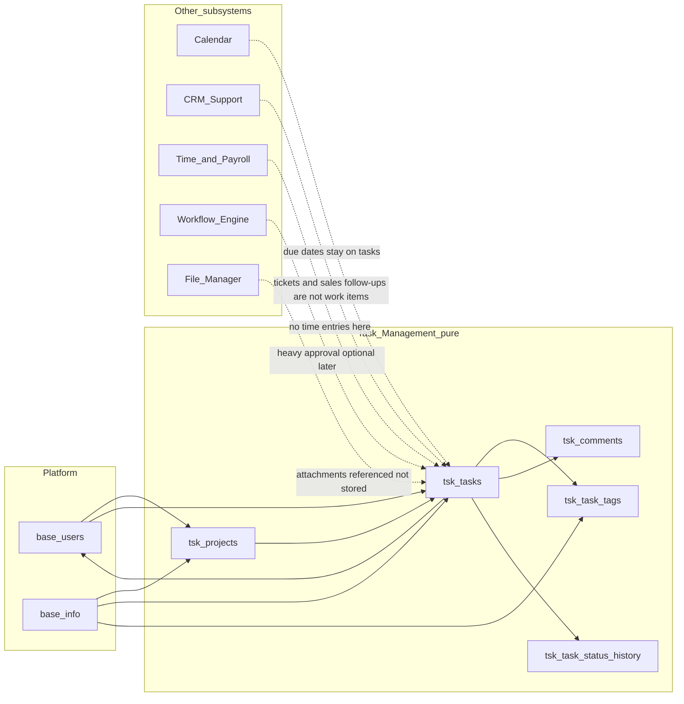
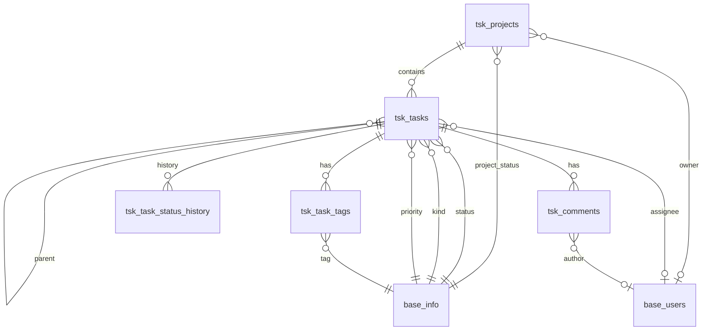

<div dir="rtl" lang="fa" class="hwy-parity-doc">
<style>
  .hwy-parity-doc { text-align: right; unicode-bidi: plaintext; }
  .hwy-parity-doc h1, .hwy-parity-doc h2, .hwy-parity-doc h3, .hwy-parity-doc h4, .hwy-parity-doc p, .hwy-parity-doc li { text-align: right; }
  .hwy-parity-doc table { direction: rtl; text-align: right; width: 100%; border-collapse: collapse; margin: 0.75rem 0; }
  .hwy-parity-doc th, .hwy-parity-doc td { border: 1px solid #c4c4c4; padding: 0.35rem 0.5rem; vertical-align: top; text-align: right; }
  .hwy-parity-doc th { background: #f6f6f6; font-weight: 600; }
  .hwy-parity-doc blockquote { text-align: right; border-right: 3px solid #ccc; border-left: none; padding-right: 1rem; margin-right: 0; }
  .hwy-parity-doc ul, .hwy-parity-doc ol { padding-right: 1.25rem; padding-left: 0; }
  .hwy-parity-doc pre, .hwy-parity-doc code { direction: ltr; text-align: left; unicode-bidi: embed; }
</style>

<p><strong>خلاصه برای operatore:</strong> این سند جزو <strong>plans</strong> است (p-packages-task-management). ستون وضعیت در <a href="../p-00-packages-index.md">index مربوطه</a> مرجع «شروع شده / design / تمام» است.</p>
<p><strong>راهنمای خواندن:</strong> بخش‌های انگلیسی برای agent/dev هستند؛ جداول وضعیت و یادداشت‌های فارسی را اول بخوانید.</p>


# p-packages-task-management — Task Management: پروژه · تسک · کانبان

> **Package:** **Task Management** (#8 · سابق «Project & Kanban») — [p-packages-backlog.md](../p-packages-backlog.md)
> **اولویت پیاده‌سازی:** 1 — package track (ریلیز فعال · ۲۰۲۶-۰۹-۱۵)
> **پوشه اجرا:** [`plans/packages/todo/tsk-package/`](./) — [README](./README.md) · [پرامپت‌های فاز](tsk-phase-execution-prompts.md) · [بررسی و بنچمارک](tsk-plan-review-and-benchmark.md)
> **مسیر اجرا:** اسکوپ دامنه در backlog پکیج‌ها (نه zip Package Manager · نه feature built-in) — کنترل: [p-00-packages-index.md](../p-00-packages-index.md)
> **وضعیت:** 🟡 فعال در `packages/todo` — design only، منتظر «شروع کن» فاز ۱
> **آخرین به‌روزرسانی:** ۲۰۲۶-۰۹-۱۵ (بازبینی پلن · هم‌ترازی با کد BC کانبان · شکاف‌های اجرایی R8–R11 · ادغام تفکیک نام/هوک‌های بعد از v1 از core/next p-70 و حذف آن پلن)
> **وابستگی:** — (پیوست تسک به File Manager ارجاع می‌دهد؛ File Manager الزامی برای شروع نیست. CRM مستقل است — activity نوع `task` در CRM کار پیگیری فروش است، نه work item این پکیج)
> **استانداردها:** `AGENTS.md` · [`package-ui.md`](../../../../docs/standards/package-ui.md) · [`package-base-info-vocab.md`](../../../../docs/standards/package-base-info-vocab.md) · [deep-linking.md](../../../../docs/standards/deep-linking.md) · [data-model.md](../../../../docs/standards/data-model.md) · Greenfield · Data Studio / Sequelize

این سند قرارداد طراحی پکیج **Task Management** است: پروژه ظرف کار می‌شود، هر آیتم همان یک رکورد `tsk_tasks` است، و برد کانبان فقط نمای روی **وضعیت** است — نه موجودیت جدا.

AppEndO از ابتدا پلتفرم‌محور است، نه ابزار تسک. بنابراین این پکیج فقط کارهای داخلی تیم را دنبال می‌کند و عمداً تقویم، تیکت مشتری، حضور و غیاب، یا تأیید چندمرحله‌ای را داخل خودش نمی‌گیرد؛ اگر لازم شد به ماژول‌های دیگر **ارجاع** می‌دهد.

برای مرزبندی ایده‌ها از محصولات شناخته‌شده **الگو گرفته‌ایم، نه اسکیما**: Linear، Jira، Asana، Trello (تجاری) و Plane، OpenProject، Taiga (متن‌باز). هر چیزی که عمداً کنار گذاشته شده در §دردهای کلاسیک و §خارج از اسکوپ توضیح داده شده است.

### اصل سخت: Task Management بخشی از Core نیست — و Package Manager zip هم مسیر ساخت نیست

کلمهٔ **Package** اینجا یعنی **اسکوپ دامنه در backlog** — **نه** zip Package Manager و **نه** ماژول `core:*` / feature هسته.

**تست پذیرش تحویل:** اگر یک دولوپر همان کار را فقط با UI Studio (Data Studio · Base Info · Server Functions · Client Components · **Platform Pages / Navigation**) انجام می‌داد، خروجی باید **همان شکل** را داشته باشد — در Server Functions به‌عنوان function سفارشی دیده شود، در Client Components به‌عنوان کامپوننت سفارشی دیده شود، و همهٔ صفحات در **نویگیشن اصلی Studio** داخل **یک گروه مستقل `Tasks`** ظاهر شوند — **نه** پرتال/segment جدا، **نه** قاطی‌شده زیر Records/Operations/Development.

<table dir="rtl">
<thead><tr><th>کار</th><th>مسیر درست (developer-built)</th></tr></thead>
<tbody><tr><td>جداول / associations / studio-meta</td><td><strong>Data Studio</strong> (Edge models + Sequelize)</td></tr>
<tr><td>LOVها</td><td><strong>Base Info</strong> زیر روت Task Management</td></tr>
<tr><td>API / منطق دامنه</td><td><strong>Server Functions</strong> سفارشی روی Edge / Sequelize (<code dir="ltr" style="unicode-bidi: embed;">DATA_API</code> یا معادل غیر-<code dir="ltr" style="unicode-bidi: embed;">db.query</code>) — در Studio → Server Functions <strong>قابل دیدن و ویرایش</strong>؛ <strong>نه</strong> route Express چسبیده به bootstrap به‌عنوان built-in</td></tr>
<tr><td>UI لیست و جزئیات</td><td><strong>Client Components</strong> (Component Designer) — publish → page-module با <code dir="ltr" style="unicode-bidi: embed;">loaderKind: "designer"</code></td></tr>
<tr><td>صفحات / URL</td><td><strong>Platform Pages + route bindings</strong> — دو جفت binding (Projects · Tasks) + Settings؛ هرکدام مثل Workflows: لیست + <code dir="ltr" style="unicode-bidi: embed;">…/edit/*</code></td></tr>
<tr><td>ناوبری اصلی</td><td>گروه مستقل <strong>Tasks</strong> در <code dir="ltr" style="unicode-bidi: embed;">studio</code> navigation — <strong>نه</strong> Records · <strong>نه</strong> Operations · <strong>نه</strong> Development</td></tr>
</tbody></table>

**ممنوع (سخت):**

1. `core:Tasks` / `core:Kanban` · `loaderKind: "core"` · ثبت در `resolvers.ts` / `lazyPages.tsx`
2. `src/features/task-management/` به‌عنوان feature هستهٔ Studio
3. `mountTaskRoutes` / هر route ثابت داخل `bootstrapFullRuntime` به‌عنوان API built-in
4. Server Functions از نوع / برچسب **built-in** برای منطق این دامنه
5. UI فقط با React feature بدون اینکه کامپوننت در **Client Components** ظاهر شود
6. **لیست و ویرایش روی یک صفحه / split-pane** — ممنوع؛ فقط دیپ‌لینک لیست → `…/edit/{id}`
7. ناوبری زیر Records / Operations / Development — باید **گروه مستقل Tasks**
8. Package Manager zip install · `db.query` · seed داخل `controlPlaneSeed` / bootstrap
9. `src/core/packages/task-management/` به‌عنوان ماژول هسته
10. Kanban CSS دست‌نویس وقتی `UiKanbanBoard` / palette `viz.kanban` وجود دارد

### دسترسی داده (سخت) — فقط Sequelize / Edge — نه `db.query`

- منبع حقیقت مدل: Edge models جدول‌های `tsk_*` در Data Studio.
- خواندن/نوشتن از **Sequelize Edge** (از جمله از داخل Server Functions) — **`db.query` ممنوع**.
- منطق دامنه (تخصیص `task_number`، تغییر وضعیت + تاریخچه، reorder ستون کانبان، محدودیت یک‌سطح parent، آرشیو پروژه) در همان لایهٔ function/سرویس Sequelize — نه SQL خام sandbox.

### ناوبری Studio — گروه مستقل Tasks (سخت)

- همهٔ صفحات پکیج فقط زیر heading ناوبری **`Tasks`** در Studio (`studio` portal) — Projects · Tasks · Settings (واژگان).
- **ممنوع:** قاطی کردن آیتم‌ها داخل Records / Operations / Development؛ پرتال جدا.
- Studio گروه را با کلید `nav.group.<heading-lowercase>` ترجمه می‌کند → **`nav.group.tasks`: `Tasks`**. اگر ثبت نشود UI کلید خام را نشان می‌دهد — **رد است**.
- جداکنندهٔ منطقی: کاتالوگ‌های عملیاتی → separator → Settings/Vocabulary.
- chrome لیست/فرم از **الگوی بصری** صفحات Records کپی می‌شود — جای ناوبری گروه Tasks است.

### مسیریابی و ناوبری (سخت)

دو کاتالوگ مستقل + Settings، با deep-link ([deep-linking.md](../../../../docs/standards/deep-linking.md)):

<table dir="rtl">
<thead><tr><th>کاتالوگ</th><th>لیست / صفحه</th><th>ویرایش</th><th>برچسب آیتم در shell</th></tr></thead>
<tbody><tr><td>Projects</td><td><code dir="ltr" style="unicode-bidi: embed;">tasks/projects</code></td><td><code dir="ltr" style="unicode-bidi: embed;">tasks/projects/edit/{id}</code></td><td><code dir="ltr" style="unicode-bidi: embed;">title</code></td></tr>
<tr><td>Tasks</td><td><code dir="ltr" style="unicode-bidi: embed;">tasks/tasks</code> (پیش‌فرض Kanban)</td><td><code dir="ltr" style="unicode-bidi: embed;">tasks/tasks/edit/{id}</code></td><td><code dir="ltr" style="unicode-bidi: embed;">title</code> (+ کلید <code dir="ltr" style="unicode-bidi: embed;">{slug}-{task_number}</code> در content header)</td></tr>
<tr><td>Settings / vocab</td><td><code dir="ltr" style="unicode-bidi: embed;">tasks/settings</code></td><td>— (مودال واژگان)</td><td>—</td></tr>
</tbody></table>

- الگوی binding: Workflows (`…` + `…/edit/*` با `nav: null` روی edit).
- هدر shell ادیتور: `{nav group} / {list label}` (بدون آیتم) — هویت آیتم در content header؛ برگشت = `WorkspaceBackIcon`.
- Culture keys انگلیسی (حداقل): `nav.group.tasks` · `nav.tasks-projects` · `nav.tasks-tasks` · `nav.tasks-settings` (مقادیر: `Tasks` · `Projects` · `Tasks` · `Settings`).

### خارج از ساخت اولیهٔ اپلیکیشن (سخت)

- **ممنوع در ساخت اولیه:** جداول `tsk_*` · edge models · Base Info Task Management · functions/UI/nav · هر seed استارتاپ.
- **مجاز فقط وقتی:** دستور صریح پیاده‌سازی این پلن.
- اپ تازه بعد از bootstrap باید **بدون** هیچ اثری از Task Management باشد.

### دستور اجرا برای عامل (سخت · لازم نیست کاربر جزئیات را یادش باشد)

```
@plans/packages/todo/tsk-package برو جلو
@plans/packages/todo/tsk-package فاز ۱ بساز
@plans/packages/todo/tsk-package فاز ۲ بساز
@plans/packages/todo/tsk-package زیر‌فاز 3a بساز
@plans/packages/todo/tsk-package زیر‌فاز 3c-pre بساز
@plans/packages/todo/tsk-package فاز N را رولبک کن
@plans/packages/todo/tsk-package از فاز N به بعد را رولبک کن
```

**معنی «برو جلو»:** جدول «وضعیت اجرا» پایین سند را بخوان؛ **اولین ردیف ⬜** را بساز. پیش‌فرض امن: **یک ردیف در هر درخواست** مگر کاربر چند فاز را با هم بخواهد.

**ترتیب سخت ساخت (هرگز جابه‌جا یا پرش بدون پذیرش قبلی):**

<table dir="rtl">
<thead><tr><th>#</th><th>کار</th><th>شرط شروع</th></tr></thead>
<tbody><tr><td>۱</td><td>فاز ۱ — دیتابیس · Base Info · studio-meta</td><td>—</td></tr>
<tr><td>۲</td><td>فاز ۲ — Server Functions + live HTTP</td><td>فاز ۱ ✅</td></tr>
<tr><td>۳a</td><td>Nav گروه Tasks + <code dir="ltr" style="unicode-bidi: embed;">tasks/settings</code> + واژگان Labels</td><td>فاز ۲ ✅</td></tr>
<tr><td>۳b</td><td>Projects list + editor (طلایی کاتالوگ)</td><td>۳a ✅</td></tr>
<tr><td>۳c-pre</td><td>تأیید/تکمیل BC مشترک Kanban (<code dir="ltr" style="unicode-bidi: embed;">UiKanbanCard</code> غنی · <code dir="ltr" style="unicode-bidi: embed;">revertSignal</code> · تست R7) — اگر سبز است فقط smoke؛ پلتفرمی، خارج از <code dir="ltr" style="unicode-bidi: embed;">scripts/task-management-phase3/</code></td><td>۳b ✅</td></tr>
<tr><td>۳c</td><td>Tasks (<code dir="ltr" style="unicode-bidi: embed;">viz.kanban</code> → <code dir="ltr" style="unicode-bidi: embed;">UiKanbanBoard</code> + editor + bulk actions جدول)</td><td>۳c-pre ✅</td></tr>
</tbody></table>

**ترتیب رولبک:** برعکس وابستگی — UI/nav → functions → داده.

**بارگذاری اجباری برای عامل:**

1. همیشه این پلن را منبع حقیقت بدان.
2. از **اولین کار UI (۳a به بعد)** و قبل از هر scaffold:
   - [`docs/standards/package-ui.md`](../../../../docs/standards/package-ui.md) را کامل رعایت کن.
   - [`docs/standards/package-base-info-vocab.md`](../../../../docs/standards/package-base-info-vocab.md) برای واژگان.
   - `/studio/base-components` یا `get_feature_graph({ pageKey: "base-components" })` را باز کن؛ هر کنترل = بخش BC نام‌برده در §UX این سند.
3. فاز ۱–۲: [`data-model.md`](../../../../docs/standards/data-model.md) · Sequelize-only · بدون `db.query` · بدون bootstrap seed.
4. **ممنوع بدون یادآوری کاربر:** پرش به فاز ۳ قبل از ۱/۲ · همهٔ صفحات UI در یک پرامپت · Auto-CRUD · `core:Tasks` · HTML خام · Kanban دست‌نویس.

**پاسخ کوتاه عامل بعد از هر «برو جلو»:** بگو کدام ردیف را می‌سازی، پیش‌نیازها سبزند یا نه، و کدام استانداردها را بار کردی — بعد اجرا کن.

---

## هدف اصلی

Task Management فقط یک کار دارد: **ساختن ظرف پروژه → ثبت work item → پیشبرد وضعیت روی کانبان تا Done/Cancelled**.

زیرسیستم‌های دیگر بیرون می‌مانند؛ این پکیج فقط در صورت نیاز به آن‌ها **ارجاع** می‌دهد:

<table dir="rtl">
<thead><tr><th>دغدغه</th><th>مالک</th></tr></thead>
<tbody><tr><td>رویداد / جلسه / رزرو / قرار ملاقات</td><td>Calendar</td></tr>
<tr><td>تیکت پشتیبانی / رشتهٔ گفتگو با مشتری</td><td>CRM &amp; Support (<code dir="ltr" style="unicode-bidi: embed;">crm_tickets</code> + messages)</td></tr>
<tr><td>کار پیگیری فروش (Call/Email/Meeting/Task روی مشتری)</td><td>CRM <code dir="ltr" style="unicode-bidi: embed;">crm_activities</code> با <code dir="ltr" style="unicode-bidi: embed;">activity_type_code</code> — <strong>این پکیج نیست</strong></td></tr>
<tr><td>حضور · زمان‌کاری · حقوق</td><td>Time &amp; Payroll</td></tr>
<tr><td>زنجیرهٔ تأیید چندمرحله‌ای سنگین</td><td>Workflow Engine (اختیاری، بعداً)</td></tr>
<tr><td>تأیید انسانی روی گام وورک‌فلو (<code dir="ltr" style="unicode-bidi: embed;">my-inbox</code> / <code dir="ltr" style="unicode-bidi: embed;">base_work_items</code>)</td><td>inbox وورک‌فلو (Human Workflow shipped) — <strong>این پکیج نیست</strong></td></tr>
<tr><td>فرم UI برای Work Item</td><td>Component Designer روی workflow — ادیتور <code dir="ltr" style="unicode-bidi: embed;">tsk_tasks</code> جداست</td></tr>
<tr><td>Cron / job سیستمی</td><td><code dir="ltr" style="unicode-bidi: embed;">scheduled-tasks</code> — در UI انگلیسی «Scheduled Task» نه «Task»</td></tr>
<tr><td>صف اجرای پس‌زمینه</td><td><code dir="ltr" style="unicode-bidi: embed;">jobs</code> — اجرای async، نه کار قابل‌واگذاری</td></tr>
<tr><td>تیکت بازخورد end-user</td><td>Embedded feedback (shipped) — triage بازخورد، نه کار تیمی</td></tr>
<tr><td>کتابخانهٔ عمومی فایل / پیوست حجیم</td><td>File Manager</td></tr>
<tr><td>هر picklist / مقدار انتخابی</td><td>Base Info (این پکیج روت و دسته‌های خودش را دارد؛ Base Info فقط ذخیره‌سازی است)</td></tr>
<tr><td>صفحهٔ سایت / ویکی / مستندات محصول</td><td>CMS · Portals · Component Designer</td></tr>
<tr><td>اتصال GitHub / SaaS خارجی</td><td>API Connectors</td></tr>
<tr><td>هویت شخص/سازمان (نام، ایمیل، حقیقی/حقوقی)</td><td>پلتفرم <code dir="ltr" style="unicode-bidi: embed;">base_users</code> + <code dir="ltr" style="unicode-bidi: embed;">base_user_profiles</code> — این پکیج دایرکتوری عضو نمی‌سازد</td></tr>
</tbody></table>

**افراد اینجا ساخته نمی‌شوند:** assignee / owner / comment author = `base_users.id`. جدول `tsk_members` با نام/ایمیل تکراری **وجود ندارد**. این دامنه مشتری/مخاطب نیست؛ الگوی Add Individual/Company مال CRM/Users است نه اینجا.

### تفکیک نام از ماژول‌های موجود پلتفرم (سخت)

کلمهٔ **Task** در Studio چند معنی دارد. این پکیج فقط work item تیمی است. مدل `WorkItem`، route `my-inbox`، و `scheduled-tasks` را **هرگز** reuse نکن:

<table dir="rtl">
<thead><tr><th>مفهوم</th><th>ماژول موجود</th><th>این پکیج</th></tr></thead>
<tbody><tr><td>تأیید انسانی روی گام وورک‌فلو</td><td><code dir="ltr" style="unicode-bidi: embed;">my-inbox</code> · <code dir="ltr" style="unicode-bidi: embed;">base_work_items</code></td><td><strong>خارج</strong> — لینک اختیاری بعد از v1 (بدون ستون polymorphic)</td></tr>
<tr><td>فرم UI برای Work Item</td><td>Component Designer برای workflow</td><td><strong>جدا</strong> — ادیتور <code dir="ltr" style="unicode-bidi: embed;">tsk_tasks</code></td></tr>
<tr><td>Cron / job سیستمی</td><td><code dir="ltr" style="unicode-bidi: embed;">scheduled-tasks</code></td><td><strong>جدا</strong> — برچسب UI: Task vs Scheduled Task</td></tr>
<tr><td>صف اجرای پس‌زمینه</td><td><code dir="ltr" style="unicode-bidi: embed;">jobs</code></td><td><strong>جدا</strong></td></tr>
<tr><td>تیکت بازخورد end-user</td><td>Embedded feedback</td><td><strong>جدا</strong></td></tr>
</tbody></table>

**قانون نام‌گذاری:** جداول `tsk_*` · گروه nav `Tasks` · کلید نمایشی `{slug}-{n}`. هرگز `base_task_*` · `core:Tasks` · مدل Prisma `WorkItem`.

---

## اصل ساخت: developer-built (جداول · سرور · کلاینت)

این پلن **باید** طوری ساخته شود که خروجی نهایی شبیه کد یک دولوپر دامنه باشد: قابل‌خواندن، صریح، قابل‌دیباگ، بدون موتور پلاگین و بدون لایهٔ «task engine جادویی». هر تصمیم اسکیما / API / UI را با این تست بسنج: *اگر یک مهندس بک‌اند/فرانت معمولی این دامنه را از صفر می‌نوشت، همین را می‌نوشت؟*

### جداول (مدل داده)

- ستون‌های **نام‌دار و ثابت** روی جدول واقعی — نه custom-field engine / `attributes` jsonb باز (پرهیز از دام ClickUp/Jira با ده‌ها فیلد سفارشی).
- نام‌گذاری: `*_code` برای Base Info، `*_id` برای FK جدول عادی؛ پیشوند دامنه `tsk_`؛ بدون پیشوند `base_` روی جداول دامنه.
- **یک شکل رکورد** برای work item (`tsk_tasks` با `kind_code`) — نه جدول جدا برای Story/Bug/Epic/Issue (تلهٔ Taiga / Jira issue-type fork).
- تاریخچهٔ باریک و عمدی: فقط تغییر `status_code` snapshot می‌شود (`tsk_task_status_history`) — نه لاگ حسابرسی نامحدود.
- بدون فیلد polymorphic (`related_type` / `related_id`).
- ساب‌تسک = `parent_id` خودارجاع، **حداکثر یک سطح** — نه درخت هفت‌طبقهٔ ClickUp.
- ستون کانبان = همان `status_code` — جدول `tsk_boards` / `tsk_columns` وجود ندارد.

### لایهٔ سرور

- منطق دامنه به‌صورت **Server Functions سفارشی** روی **Sequelize Edge models** — در Studio قابل دیدن؛ **نه** built-in · نه Express mount هسته · نه `db.query`.
- قوانین دامنه صریح: تخصیص `task_number` یکتا در پروژه، `change-status` (+ تاریخچه + `completed_at`)، reorder داخل ستون، رد parent تو در تو، آرشیو پروژه.
- کلید نمایشی `{project.slug}-{task_number}` **محاسبه‌ای در API** است — ستون مشتق ذخیره نمی‌شود.
- payload تخت از ستون‌های جدول اصلی (+ joins associations).

### لایهٔ کلاینت

- کامپوننت‌ها در **Client Components** ساخته و publish می‌شوند.
- Projects = کاتالوگ کارت؛ Tasks = نمای پیش‌فرض **Kanban** (`UiKanbanBoard`) + toggle جدول — هرکدام لیست + ویرایش جدا.
- ناوبری لیست‌ها + Settings در گروه مستقل **Tasks**.
- **فقط Base Components** برای همهٔ کنترل‌ها؛ کپی انگلیسی؛ LOV از Base Info.



---

## دردهای کلاسیک Task Management و تصمیم‌های ما

<table dir="rtl">
<thead><tr><th>درد کلاسیک</th><th>علت</th><th>تصمیم AppEndO Task Management</th></tr></thead>
<tbody><tr><td>Story / Task / Bug / Issue در چهار جدول موازی (Taiga) یا issue-type با اسکیمای جدا (Jira)</td><td>هر نوع کار را «موجودیت» دیدن</td><td><strong>یک جدول <code dir="ltr" style="unicode-bidi: embed;">tsk_tasks</code></strong> با <code dir="ltr" style="unicode-bidi: embed;">kind_code</code> برچسب (Task / Bug / Epic) — kind ادیتور را عوض نمی‌کند</td></tr>
<tr><td>Epic → Story → Sub-task درخت سه‌طبقه</td><td>مدل‌سازی سلسله‌مراتب برنامه‌ریزی به‌جای کار قابل‌انجام</td><td><strong>حداکثر یک <code dir="ltr" style="unicode-bidi: embed;">parent_id</code></strong>؛ اگر child خودش child می‌خواهد باید به تسک مستقل ارتقا یابد</td></tr>
<tr><td>Subtask تزئینی / چک‌لیست قاطی‌شده با کار قابل‌واگذاری (ClickUp / Jira)</td><td>جزئیات DoD را به‌جای فیلد متن، ردیف کردن</td><td>ساب‌تسک فقط وقتی assignee جدا دارد؛ جزئیات ریز در <code dir="ltr" style="unicode-bidi: embed;">body</code> می‌ماند — جدول checklist وجود ندارد</td></tr>
<tr><td>ده‌ها Status سفارشی per پروژه و برد شلوغ</td><td>کپی فرآیند کاغذی بدون بازطراحی جریان ارزش</td><td><strong>یک دستهٔ Task Status سراسری و بسته</strong>؛ ستون کانبان = همان وضعیت‌ها؛ بدون <code dir="ltr" style="unicode-bidi: embed;">tsk_columns</code></td></tr>
<tr><td>Custom field engine (Jira/ClickUp تا ده‌ها فیلد اجباری)</td><td>پاسخ به هر تیم با EAV/متادیتا</td><td>ستون نام‌دار ثابت؛ بدون <code dir="ltr" style="unicode-bidi: embed;">attributes</code> jsonb؛ برچسب آزاد فقط از Base Info Labels</td></tr>
<tr><td>Workspace → Project → Board → List سلسله‌مراتب Plane/Trello</td><td>چندظرف تودرتو قبل از اولین تسک</td><td><strong>اپ = workspace پلتفرم</strong>؛ فقط <code dir="ltr" style="unicode-bidi: embed;">tsk_projects</code> به‌عنوان ظرف؛ برد = view روی status نه موجودیت</td></tr>
<tr><td>Sprint / Cycle / Version به‌عنوان موجودیت اجباری (Jira)</td><td>اجایل سنگین را پیش‌فرض کردن</td><td>v1 <strong>بدون</strong> <code dir="ltr" style="unicode-bidi: embed;">tsk_sprints</code> / cycles — due date روی تسک کافی است</td></tr>
<tr><td>چند assignee بدون owner واحد</td><td>مسئولیت پخش می‌شود</td><td><strong>یک <code dir="ltr" style="unicode-bidi: embed;">assignee_id</code></strong> → <code dir="ltr" style="unicode-bidi: embed;">base_users</code>؛ watchers خارج از v1</td></tr>
<tr><td>Gantt / وابستگی / مسیر بحرانی (OpenProject)</td><td>PM کلاسیک را داخل tracker کشیدن</td><td>v1 بدون <code dir="ltr" style="unicode-bidi: embed;">blocked_by</code> و بدون نمودار گانت — Calendar رویداد زمان‌بندی می‌کند</td></tr>
<tr><td>Time tracking داخل تسک</td><td>قاطی کردن کار با حضور/حقوق</td><td>Time &amp; Payroll مالک است؛ ستون estimate/actual اینجا نیست</td></tr>
<tr><td>تیکت پشتیبانی را «تسک» نامیدن</td><td>یک اینباکس برای همهٔ کارها</td><td>CRM مالک تیکت است؛ این پکیج work item داخلی است</td></tr>
<tr><td>جدول member با نام/ایمیل موازی User</td><td>کپی الگوی «همه یک Contact هستند»</td><td>assignee/owner/author = <code dir="ltr" style="unicode-bidi: embed;">base_users</code> — بدون <code dir="ltr" style="unicode-bidi: embed;">tsk_members</code></td></tr>
<tr><td>Autocomplete / پیشنهاد کار از AI داخل اسکیما</td><td>موتور جادویی به‌جای CRUD صریح</td><td>خارج؛ بعداً از لایهٔ AI پلتفرم اگر لازم شد</td></tr>
<tr><td>Automation rule engine داخل پکیج</td><td>جایگزین فرآیند نامشخص با قوانین شکننده</td><td>Workflow Engine برای زنجیرهٔ سنگین؛ v1 فقط verbهای صریح سرور</td></tr>
<tr><td>ذخیرهٔ کلید نمایشی <code dir="ltr" style="unicode-bidi: embed;">PROJ-12</code> در ستون جدا + number</td><td>دو منبع حقیقت برای یک هویت</td><td>فقط <code dir="ltr" style="unicode-bidi: embed;">task_number</code> ذخیره می‌شود؛ <code dir="ltr" style="unicode-bidi: embed;">key</code> در API ساخته می‌شود</td></tr>
<tr><td>کانبان دست‌نویس CSS در هر محصول</td><td>نبود primitive مشترک</td><td><strong>فقط <code dir="ltr" style="unicode-bidi: embed;">UiKanbanBoard</code></strong> (BC <code dir="ltr" style="unicode-bidi: embed;">kanban</code> · palette <code dir="ltr" style="unicode-bidi: embed;">viz.kanban</code>)</td></tr>
</tbody></table>

---

## بنچمارک با نمونه‌های جهانی و تصمیم نهایی

جدول‌های «دردهای کلاسیک» و «خارج از اسکوپ» مرزهای عمدی این پکیج را در برابر Jira/ClickUp/OpenProject/Taiga (پیچیدگی بیش‌ازحد) مشخص کرده‌اند. این بخش الگوهای **مثبت** Linear · Asana · Trello · Plane را — چیزهایی که این ابزارها را «جذاب و کارا» می‌کنند — در برابر همان مرزها می‌سنجد و برای v1 تصمیم می‌گیرد؛ هیچ‌کدام قاعدهٔ سخت بالا را نمی‌شکنند.

<table dir="rtl">
<thead><tr><th>الگو</th><th>منبع</th><th>تصمیم v1</th><th>دلیل</th></tr></thead>
<tbody><tr><td>Bulk select + bulk status/assignee/label روی جدول Tasks</td><td>Linear · Jira · Asana</td><td>✅ اضافه شد</td><td><code dir="ltr" style="unicode-bidi: embed;">AppTableGrid</code> از قبل <code dir="ltr" style="unicode-bidi: embed;">selectionMode="multiple"</code> دارد (<a href="../../../../src/shared/ui/AppTableGrid.tsx#L181">AppTableGrid.tsx:181</a>) — فقط wiring دامنه، بدون BC جدید؛ جزئیات در §صفحهٔ لیست Tasks و T11</td></tr>
<tr><td>کارت کانبان غنی (priority icon · assignee avatar · due badge · label chips)</td><td>Linear · Trello · Plane</td><td>✅ — primitive در <code dir="ltr" style="unicode-bidi: embed;">UiKanbanCard</code> موجود است</td><td>wiring در scaffold Tasks + map دامنه؛ جزئیات §کار پایه‌ای Base Components</td></tr>
<tr><td>Overdue visual cue روی کارت/ردیف (<code dir="ltr" style="unicode-bidi: embed;">due_at</code> گذشته و status باز)</td><td>همه</td><td>✅ اضافه شد</td><td>هزینهٔ کم، ارزش عملیاتی بالا؛ بخشی از همان تکمیل BC</td></tr>
<tr><td>«Assigned to me» quick filter</td><td>Asana · Linear</td><td>✅ از قبل در پلن بود (فیلتر assignee در §صفحهٔ لیست Tasks)</td><td>تأیید شد؛ تغییری لازم نبود</td></tr>
<tr><td>Search روی عنوان + کلید محاسبه‌ای (<code dir="ltr" style="unicode-bidi: embed;">PROJ-12</code>)</td><td>همه</td><td>✅ گسترش جزئی</td><td>search قبلاً روی <code dir="ltr" style="unicode-bidi: embed;">title</code> بود؛ الان match روی <code dir="ltr" style="unicode-bidi: embed;">key</code> هم در همان endpoint لیست</td></tr>
<tr><td>Command palette سراسری (<code dir="ltr" style="unicode-bidi: embed;">⌘K</code> / quick-add)</td><td>Linear</td><td>❌ v1</td><td>Primitive پلتفرمی مشترک است نه مال یک پکیج؛ اگر پلتفرم آن را ساخت این پکیج actionهایش (Create task/project) را ثبت می‌کند — الان اختراع محلی نمی‌کنیم</td></tr>
<tr><td>Saved / shared filter views</td><td>Linear · Jira</td><td>❌ v1 → بک‌لاگ</td><td>نیازمند جدول جدید (<code dir="ltr" style="unicode-bidi: embed;">tsk_saved_views</code> یا user-preference عمومی پلتفرم) — خارج از پنج جدولِ تصمیم‌گرفته‌شده در §مدل دامنه</td></tr>
<tr><td>Swimlane grouping (by assignee/priority) روی برد</td><td>Trello Power-Up · Jira</td><td>❌ v1 → بک‌لاگ</td><td><code dir="ltr" style="unicode-bidi: embed;">UiKanbanBoard</code> گروه‌بندی ثانویه ندارد؛ افزودنش قبل از دومین مصرف‌کنندهٔ واقعی زودهنگام است</td></tr>
<tr><td>WIP limit enforcement per column</td><td>Personal Kanban کلاسیک</td><td>❌ v1 (خاموش)</td><td>تصمیم قبلی سند تأیید شد؛ فیلد <code dir="ltr" style="unicode-bidi: embed;">wipLimit</code> در تکمیل BC اضافه می‌شود ولی مقدار پیش‌فرض صفر/خاموش می‌ماند</td></tr>
<tr><td>Multi-assignee / watchers</td><td>Asana</td><td>❌ v1 (قبلاً رد شده در §دردهای کلاسیک)</td><td>تأیید مجدد — یک <code dir="ltr" style="unicode-bidi: embed;">assignee_id</code> واحد</td></tr>
<tr><td>Activity feed کامل (نه فقط تغییر status)</td><td>Jira · ClickUp</td><td>❌ v1 (قبلاً رد شده)</td><td>تأیید مجدد — «تاریخچهٔ باریک و عمدی» در <code dir="ltr" style="unicode-bidi: embed;">tsk_task_status_history</code></td></tr>
</tbody></table>

**نتیجه:** فقط سه مورد واقعاً روی UX این v1 اثر می‌گذارند — bulk actions · کارت کانبان غنی · overdue cue — و هرسه بدون شکستن جدول «ممنوع (سخت)» بالا قابل‌ساختن‌اند. primitive کارت غنی در `UiKanbanCard` **در پلتفرم موجود است**؛ کار باقی‌مانده wiring در scaffold پکیج و (اختیاری) `wipLimit` ستونی است.

### بک‌لاگ بعد از v1 (ثبت عمدی — خارج از اسکوپ فعلی)

<table dir="rtl">
<thead><tr><th>ایده</th><th>چرا الان نیست</th></tr></thead>
<tbody><tr><td>Saved / shared filter views</td><td>جدول یا preference جدا — §بنچمارک</td></tr>
<tr><td>Swimlanes (assignee / priority)</td><td><code dir="ltr" style="unicode-bidi: embed;">UiKanbanBoard</code> گروه ثانویه ندارد</td></tr>
<tr><td>Move task بین پروژه‌ها</td><td><code dir="ltr" style="unicode-bidi: embed;">project_id</code> قفل — کلید می‌شکند</td></tr>
<tr><td>RBAC per-action (مثلاً فقط Owner آرشیو؛ یا سیاست mine/assigned)</td><td>R4 — تصمیم بعدی در همین سند</td></tr>
<tr><td>Command palette (<code dir="ltr" style="unicode-bidi: embed;">⌘K</code>)</td><td>primitive سراسری پلتفرم</td></tr>
<tr><td>وابستگی / Gantt / time on task</td><td>مالک Time &amp; Payroll / بک‌لاگ PM</td></tr>
<tr><td>Home widget (شمارش باز/overdue + top 5)</td><td>زیرساخت HOMEW در core ✅ (registry + grid واحد) — Phase 3 tsk: layout id <code dir="ltr" style="unicode-bidi: embed;">module:&lt;tasksPageKey&gt;:my-open</code> / <code dir="ltr" style="unicode-bidi: embed;">:team-overdue</code> (D6: نه <code dir="ltr" style="unicode-bidi: embed;">collection:tsk_tasks</code> در v1) · spec <a href="../../../specs/home-module-widgets/02-decisions.md"><code dir="ltr" style="unicode-bidi: embed;">02-decisions</code></a></td></tr>
<tr><td>«Ask AppEndO about this task» روی row / detail</td><td>قرارداد CACL در <a href="../../../core/next/p-72-ai-backlog.md">p-72</a> — این پکیج فقط surface است</td></tr>
<tr><td>لینک اختیاری به Work Item / Start workflow</td><td>فیلد یا دکمهٔ جدا — نه <code dir="ltr" style="unicode-bidi: embed;">related_type</code>/<code dir="ltr" style="unicode-bidi: embed;">related_id</code> polymorphic</td></tr>
<tr><td>اعلان تخصیص / موعد</td><td>reuse کانال notification پلتفرم وقتی آماده شد</td></tr>
</tbody></table>

---

## بازبینی ریسک و ابهام (اضافه‌شده در بازبینی ۲۰۲۶-۰۸-۲۹)

این سند از نظر کامل‌بودن مدل و بنچمارک قوی است؛ نکات زیر شکاف‌های اجرایی مشخصی هستند که پیش از فاز ۲/۳ باید تصمیم صریح داشته باشند — نه چیزی که عامل هنگام کدنویسی حدس بزند.

<table dir="rtl">
<thead><tr><th>#</th><th>ابهام/ریسک</th><th>تصمیم صریح (این بازبینی)</th></tr></thead>
<tbody><tr><td>R1</td><td>مرتب‌سازی پیش‌فرض Projects catalog و Tasks table مشخص نشده («پیشنهاد: <code dir="ltr" style="unicode-bidi: embed;">title</code>/<code dir="ltr" style="unicode-bidi: embed;">updated_at</code>» فقط گزینه‌هاست، نه پیش‌فرض)</td><td><strong>مرتب‌سازی پیش‌فرض:</strong> Projects catalog = <code dir="ltr" style="unicode-bidi: embed;">updated_at</code> نزولی؛ Tasks table = <code dir="ltr" style="unicode-bidi: embed;">updated_at</code> نزولی (Kanban ترتیب <code dir="ltr" style="unicode-bidi: embed;">sort_order</code> داخل هر ستون است، بدون تغییر)</td></tr>
<tr><td>R2</td><td>«Hide completed» به‌صورت «پیشنهاد» نوشته شده (§صفحهٔ لیست Tasks) نه تصمیم قطعی</td><td><strong>قطعی شد:</strong> فیلتر «Hide completed» در نمای <strong>جدول</strong> پیش‌فرض <strong>on</strong>؛ در نمای <strong>Kanban</strong> پیش‌فرض <strong>off</strong> (تا ستون Done دیده شود) — کاربر می‌تواند toggle کند</td></tr>
<tr><td>R3</td><td>Bulk action (T11) روی چند ردیف انتخاب‌شده «متوالی/موازی» endpointهای تک‌رکوردی را صدا می‌زند اما رفتار خطای جزئی (بعضی رکورد موفق، بعضی رد) تعریف نشده</td><td><strong>تصمیم:</strong> فراخوانی‌ها <strong>موازی با <code dir="ltr" style="unicode-bidi: embed;">Promise.allSettled</code></strong>؛ نتیجه = toast خلاصه «N/M بروزرسانی شد» + لیست شناسه‌های ناموفق در جزئیات toast؛ گرید بعد از پایان همه، صرف‌نظر از موفقیت/خطا، رفرش می‌شود</td></tr>
<tr><td>R4</td><td>دسترسی (RBAC) برای اکشن‌های حساس (archive project، change-status، bulk) صریحاً نوشته نشده</td><td><strong>دسترسی (v1، صریح):</strong> همهٔ endpointهای این پکیج فقط نیاز به دسترسی سطح-پکیج Studio دارند — بدون RBAC per-action در v1؛ شامل Archive/Change-status/Reopen/Bulk. محدودیت نقشی بعدی (مثلاً فقط Owner پروژه مجاز به Archive) تصمیم مجزا و مستندشده در همین فایل خواهد بود</td></tr>
<tr><td>R5</td><td>Hard-delete برای <code dir="ltr" style="unicode-bidi: embed;">tsk_tasks</code> در API لیست نشده اما در UI هم صریحاً رد نشده</td><td><strong>صریح شد:</strong> بدون endpoint حذف سخت برای Task در v1 — فقط <code dir="ltr" style="unicode-bidi: embed;">Cancelled</code> (نرم). حذف سخت فقط برای Project و فقط با صفر تسک (طبق <code dir="ltr" style="unicode-bidi: embed;">DELETE /api/tasks/projects/:id</code> موجود)</td></tr>
<tr><td>R6</td><td><code dir="ltr" style="unicode-bidi: embed;">owner_id</code> روی <code dir="ltr" style="unicode-bidi: embed;">tsk_projects</code> بدون محدودیت نقش مشخص شده اما این حذف/عدم‌حذف صریح نیست</td><td><strong>صریح شد:</strong> <code dir="ltr" style="unicode-bidi: embed;">owner_id</code> در v1 محدودیت نقشی ندارد (هر کاربر Studio با دسترسی پکیج می‌تواند owner هر پروژه باشد) — محدودیت آینده تصمیم مجزا</td></tr>
<tr><td>R7</td><td>تست پذیرش 3c-pre برای مشکل شناخته‌شدهٔ optimistic-state کانبان (مشترک با CRM) به‌صورت روایی نوشته شده، نه الزام تست خودکار</td><td><strong>صریح شد:</strong> پذیرش 3c-pre باید شامل یک تست خودکار <strong>red-before-fix / green-after-fix</strong> برای سناریوی «drag → Cancelled → Cancel در <code dir="ltr" style="unicode-bidi: embed;">ConfirmDialogShell</code> → برد باید دقیقاً به آرایش قبل از drag برگردد» باشد؛ بدون این تست، 3c-pre «تمام» تلقی نمی‌شود (دقیقاً همان الزامی که در بازبینی CRM برای Opportunities اضافه شد)</td></tr>
<tr><td>R8</td><td>شکل پاسخ <code dir="ltr" style="unicode-bidi: embed;">GET /api/tasks/tasks</code> برای Kanban و ترتیب ستون‌ها</td><td><strong>تصمیم:</strong> API همان <strong>لیست تخت</strong> فیلتر‌شده برمی‌گرداند (<code dir="ltr" style="unicode-bidi: embed;">success</code> + <code dir="ltr" style="unicode-bidi: embed;">data[]</code> + <code dir="ltr" style="unicode-bidi: embed;">count</code>/<code dir="ltr" style="unicode-bidi: embed;">meta</code> استاندارد Data Studio). <strong>کلاینت</strong> با ترتیب seed دستهٔ Task Status ستون‌های <code dir="ltr" style="unicode-bidi: embed;">UiKanbanBoard</code> را می‌سازد و کارت‌ها را با <code dir="ltr" style="unicode-bidi: embed;">status_code</code> + <code dir="ltr" style="unicode-bidi: embed;">sort_order</code> داخل هر ستون مرتب می‌کند. endpoint جدا با شکل <code dir="ltr" style="unicode-bidi: embed;">{ columns: [...] }</code> در v1 <strong>نیست</strong>.</td></tr>
<tr><td>R9</td><td>رفتار حذف و <code dir="ltr" style="unicode-bidi: embed;">ON DELETE</code> برای FKها</td><td><strong>تصمیم:</strong> <code dir="ltr" style="unicode-bidi: embed;">tsk_tasks.project_id</code> → <code dir="ltr" style="unicode-bidi: embed;">RESTRICT</code> (حذف پروژه فقط وقتی صفر تسک). <code dir="ltr" style="unicode-bidi: embed;">parent_id</code> → <code dir="ltr" style="unicode-bidi: embed;">SET NULL</code> یا <code dir="ltr" style="unicode-bidi: embed;">RESTRICT</code> (ترجیح <strong>RESTRICT</strong> تا ساب‌تسک یتیم نشود؛ حذف والد ممنوع تا فرزندان Cancelled/Done شوند یا جدا شوند). <code dir="ltr" style="unicode-bidi: embed;">tsk_task_tags</code> · <code dir="ltr" style="unicode-bidi: embed;">tsk_comments</code> · <code dir="ltr" style="unicode-bidi: embed;">tsk_task_status_history</code> → <strong>CASCADE</strong> با حذف تسک (در v1 حذف سخت تسک نداریم؛ CASCADE برای یکپارچگی اسکیما و ابزار مدلر). آرشیو پروژه تسک‌ها را حذف نمی‌کند.</td></tr>
<tr><td>R10</td><td>جستجو روی <code dir="ltr" style="unicode-bidi: embed;">key</code> محاسبه‌ای در لیست Tasks</td><td><strong>تصمیم:</strong> همان پارامتر <code dir="ltr" style="unicode-bidi: embed;">search</code> لیست. اگر ورودی با <code dir="ltr" style="unicode-bidi: embed;">LATIN_SLUG_RE</code> + <code dir="ltr" style="unicode-bidi: embed;">-</code> + عدد صحیح مطابقت داشت (مثلاً <code dir="ltr" style="unicode-bidi: embed;">acme-12</code>) → فیلتر <code dir="ltr" style="unicode-bidi: embed;">project.slug</code> + <code dir="ltr" style="unicode-bidi: embed;">task_number</code>. در غیر این صورت → <code dir="ltr" style="unicode-bidi: embed;">title</code> (و در صورت نیاز <code dir="ltr" style="unicode-bidi: embed;">task_number</code> خام اگر فقط عدد بود). بدون endpoint جستجوی جدا.</td></tr>
<tr><td>R11</td><td>ثبت Studio nav / صفحات در مسیر developer-built (بدون zip)</td><td><strong>تصمیم:</strong> فاز ۳a مثل CMS از <strong>platform-registry</strong> استفاده می‌کند: <code dir="ltr" style="unicode-bidi: embed;">page-modules</code> + <code dir="ltr" style="unicode-bidi: embed;">route-bindings</code> + culture keys + patch ناوبری Studio (الگو: <a href="../../../../scripts/cms-phase3/cmsStudioNav.ts"><code dir="ltr" style="unicode-bidi: embed;">cmsStudioNav.ts</code></a> → <code dir="ltr" style="unicode-bidi: embed;">scripts/task-management-phase3/tskStudioNav.ts</code> با <code dir="ltr" style="unicode-bidi: embed;">TASKS_STUDIO_GROUP_HEADING = 'Tasks'</code> و پیشوند مسیر <code dir="ltr" style="unicode-bidi: embed;">tasks</code>). <strong>نه</strong> bake کردن صفحات در <code dir="ltr" style="unicode-bidi: embed;">src/config/platform-registry/navigation/studio.json</code> shipped؛ <strong>نه</strong> zip Package Manager برای این track.</td></tr>
</tbody></table>

---

## اطلاعات پایه (Base Info) — ریشهٔ Task Management

در **اطلاعات پایه** ابتدا یک **روت** ساخته می‌شود به نام **Task Management**.

بعد، هر جا در دامنه فیلد `*_code` داریم که باید به اطلاعات پایه وصل شود، زیر همان روت یک **دسته** ساخته می‌شود و **آیتم‌های مربوطه** زیر همان دسته قرار می‌گیرند — نه ریشهٔ جدا برای هر LOV.

```
Base Info
└── Task Management                 ← روت پکیج
    ├── Project Status              ← دسته ← status_code (tsk_projects)
    │   └── Active, On Hold, Archived
    ├── Task Status                 ← دسته ← status_code (tsk_tasks) · ستون‌های کانبان
    │   └── Backlog, Todo, In Progress, In Review, Done, Cancelled
    ├── Task Kinds                  ← دسته ← kind_code
    │   └── Task, Bug, Epic
    ├── Task Priorities             ← دسته ← priority_code
    │   └── Low, Medium, High, Urgent
    └── Task Labels                 ← دسته ← tag_code (via tsk_task_tags)
        └── Frontend, Backend, Design, Docs, Research, Blocked
```

قواعد:

1. فقط **یک روت** برای پکیج: عنوان `Task Management` (seed **فقط هنگام پیاده‌سازی پکیج**؛ نه در bootstrap اولیهٔ اپ؛ id نهایی از همان seed پکیج).
2. به‌ازای هر اتصال `*_code` → Base Info، یک **دسته** زیر Task Management.
3. مقادیر قابل‌انتخاب = **فرزندان مستقیم همان دسته** (آیتم‌ها).
4. FK ستون‌های `*_code` به `base_info.id` همان آیتم اشاره می‌کند؛ UI options با `root=` همان **دسته** (نه روت پکیج مگر برای مرور درختی).
5. عنوان‌ها انگلیسی؛ `shortName` لاتین؛ `ui_html` مثلاً `<i data-lucide="…"></i>`.

اگر بعداً `*_code` جدیدی به دامنه اضافه شد: دستهٔ جدید زیر همین روت + آیتم‌ها — روت جدید نساز.

### صفحات واژگان vs enum بسته (سخت)

<table dir="rtl">
<thead><tr><th>دسته</th><th>صفحهٔ واژگان زیر Settings</th><th>دلیل</th></tr></thead>
<tbody><tr><td><strong>Project Status</strong></td><td>❌ ندارد</td><td><code dir="ltr" style="unicode-bidi: embed;">archived</code> رفتار فیلتر پیش‌فرض و آرشیو را قفل می‌کند</td></tr>
<tr><td><strong>Task Status</strong></td><td>❌ ندارد</td><td>ستون‌های <code dir="ltr" style="unicode-bidi: embed;">UiKanbanBoard</code> و <code dir="ltr" style="unicode-bidi: embed;">change-status</code> روی shortNameها قفل است (<code dir="ltr" style="unicode-bidi: embed;">done</code>/<code dir="ltr" style="unicode-bidi: embed;">cancelled</code> پایانی)</td></tr>
<tr><td><strong>Task Kinds</strong></td><td>❌ ندارد</td><td>برچسب شکل رکورد است نه ادیتور جدا؛ seed ثابت می‌ماند</td></tr>
<tr><td><strong>Task Priorities</strong></td><td>❌ ندارد</td><td>ترتیب/رنگ معنایی Low→Urgent در UI قفل است — گسترش آزاد = دام ClickUp</td></tr>
<tr><td><strong>Task Labels</strong></td><td>✅ catalog + <code dir="ltr" style="unicode-bidi: embed;">form.base-info-record</code></td><td>برچسب آزاد اپراتور</td></tr>
</tbody></table>

مقادیر enum بسته فقط از seed فاز ۱؛ در UI به‌صورت select/badge/Kanban column. **ممنوع:** ساخت صفحه/آیتم nav برای enum بسته.

### دسته: Project Status → `status_code` (`tsk_projects`)

<table dir="rtl">
<thead><tr><th>#</th><th>Title</th><th>shortName</th><th>Lucide icon</th><th>نقش</th></tr></thead>
<tbody><tr><td>1</td><td>Active</td><td><code dir="ltr" style="unicode-bidi: embed;">active</code></td><td><code dir="ltr" style="unicode-bidi: embed;">FolderKanban</code></td><td>پروژهٔ جاری — در فیلتر پیش‌فرض برد</td></tr>
<tr><td>2</td><td>On Hold</td><td><code dir="ltr" style="unicode-bidi: embed;">on_hold</code></td><td><code dir="ltr" style="unicode-bidi: embed;">PauseCircle</code></td><td>متوقف؛ تسک‌ها در برد پیش‌فرض پنهان نمی‌شوند مگر فیلتر پروژه</td></tr>
<tr><td>3</td><td>Archived</td><td><code dir="ltr" style="unicode-bidi: embed;">archived</code></td><td><code dir="ltr" style="unicode-bidi: embed;">Archive</code></td><td><strong>پایانی عملیاتی</strong> — لیست/برد پیش‌فرض این پروژه را پنهان می‌کند</td></tr>
</tbody></table>

### دسته: Task Status → `status_code` (`tsk_tasks`)

ستون‌های کانبان = همین شش مقدار، به همین ترتیب.

<table dir="rtl">
<thead><tr><th>#</th><th>Title</th><th>shortName</th><th>Lucide icon</th><th>نقش</th></tr></thead>
<tbody><tr><td>1</td><td>Backlog</td><td><code dir="ltr" style="unicode-bidi: embed;">backlog</code></td><td><code dir="ltr" style="unicode-bidi: embed;">CircleDashed</code></td><td>وارد جریان کار نشده</td></tr>
<tr><td>2</td><td>Todo</td><td><code dir="ltr" style="unicode-bidi: embed;">todo</code></td><td><code dir="ltr" style="unicode-bidi: embed;">CircleDot</code></td><td>آمادهٔ شروع — <strong>پیش‌فرض create</strong></td></tr>
<tr><td>3</td><td>In Progress</td><td><code dir="ltr" style="unicode-bidi: embed;">in_progress</code></td><td><code dir="ltr" style="unicode-bidi: embed;">Loader</code></td><td>در حال انجام</td></tr>
<tr><td>4</td><td>In Review</td><td><code dir="ltr" style="unicode-bidi: embed;">in_review</code></td><td><code dir="ltr" style="unicode-bidi: embed;">SearchCheck</code></td><td>منتظر بازبینی</td></tr>
<tr><td>5</td><td>Done</td><td><code dir="ltr" style="unicode-bidi: embed;">done</code></td><td><code dir="ltr" style="unicode-bidi: embed;">CheckCircle2</code></td><td><strong>پایانی موفق</strong> — <code dir="ltr" style="unicode-bidi: embed;">completed_at</code> پر می‌شود</td></tr>
<tr><td>6</td><td>Cancelled</td><td><code dir="ltr" style="unicode-bidi: embed;">cancelled</code></td><td><code dir="ltr" style="unicode-bidi: embed;">XCircle</code></td><td><strong>پایانی بدون انجام</strong> — <code dir="ltr" style="unicode-bidi: embed;">completed_at</code> خالی می‌ماند</td></tr>
</tbody></table>

### دسته: Task Kinds → `kind_code`

صریحاً **نوع اسکیما نیستند** — فقط برچسب روی همان `tsk_tasks`.

<table dir="rtl">
<thead><tr><th>#</th><th>Title</th><th>shortName</th><th>Lucide icon</th><th>نقش</th></tr></thead>
<tbody><tr><td>1</td><td>Task</td><td><code dir="ltr" style="unicode-bidi: embed;">task</code></td><td><code dir="ltr" style="unicode-bidi: embed;">ListTodo</code></td><td>کار عادی — <strong>پیش‌فرض create</strong></td></tr>
<tr><td>2</td><td>Bug</td><td><code dir="ltr" style="unicode-bidi: embed;">bug</code></td><td><code dir="ltr" style="unicode-bidi: embed;">Bug</code></td><td>نقص؛ همان ستون‌ها</td></tr>
<tr><td>3</td><td>Epic</td><td><code dir="ltr" style="unicode-bidi: embed;">epic</code></td><td><code dir="ltr" style="unicode-bidi: embed;">Layers</code></td><td>برچسب ظرف منطقی؛ فرزندان با <code dir="ltr" style="unicode-bidi: embed;">parent_id</code> یک‌سطح — نه جدول Epic جدا</td></tr>
</tbody></table>

### دسته: Task Priorities → `priority_code`

<table dir="rtl">
<thead><tr><th>#</th><th>Title</th><th>shortName</th><th>Lucide icon</th><th>نقش</th></tr></thead>
<tbody><tr><td>1</td><td>Low</td><td><code dir="ltr" style="unicode-bidi: embed;">low</code></td><td><code dir="ltr" style="unicode-bidi: embed;">ArrowDown</code></td><td>اولویت پایین</td></tr>
<tr><td>2</td><td>Medium</td><td><code dir="ltr" style="unicode-bidi: embed;">medium</code></td><td><code dir="ltr" style="unicode-bidi: embed;">Minus</code></td><td><strong>پیش‌فرض create</strong></td></tr>
<tr><td>3</td><td>High</td><td><code dir="ltr" style="unicode-bidi: embed;">high</code></td><td><code dir="ltr" style="unicode-bidi: embed;">ArrowUp</code></td><td>اولویت بالا</td></tr>
<tr><td>4</td><td>Urgent</td><td><code dir="ltr" style="unicode-bidi: embed;">urgent</code></td><td><code dir="ltr" style="unicode-bidi: embed;">TriangleAlert</code></td><td>فوری</td></tr>
</tbody></table>

### دسته: Task Labels → `tag_code`

فهرست قابل‌انتخاب — **بدون جدول `tsk_labels`**. تخت؛ مدیریت در Base Info؛ اتصال با `tsk_task_tags.tag_code` → `base_info.id` آیتم زیر همین دسته.

<table dir="rtl">
<thead><tr><th>#</th><th>Title</th><th>shortName</th><th>Lucide icon</th></tr></thead>
<tbody><tr><td>1</td><td>Frontend</td><td><code dir="ltr" style="unicode-bidi: embed;">frontend</code></td><td><code dir="ltr" style="unicode-bidi: embed;">AppWindow</code></td></tr>
<tr><td>2</td><td>Backend</td><td><code dir="ltr" style="unicode-bidi: embed;">backend</code></td><td><code dir="ltr" style="unicode-bidi: embed;">Server</code></td></tr>
<tr><td>3</td><td>Design</td><td><code dir="ltr" style="unicode-bidi: embed;">design</code></td><td><code dir="ltr" style="unicode-bidi: embed;">Palette</code></td></tr>
<tr><td>4</td><td>Docs</td><td><code dir="ltr" style="unicode-bidi: embed;">docs</code></td><td><code dir="ltr" style="unicode-bidi: embed;">BookOpen</code></td></tr>
<tr><td>5</td><td>Research</td><td><code dir="ltr" style="unicode-bidi: embed;">research</code></td><td><code dir="ltr" style="unicode-bidi: embed;">FlaskConical</code></td></tr>
<tr><td>6</td><td>Blocked</td><td><code dir="ltr" style="unicode-bidi: embed;">blocked</code></td><td><code dir="ltr" style="unicode-bidi: embed;">OctagonX</code></td></tr>
</tbody></table>

**admin UI:** catalog cards تحت `tasks/settings/labels`؛ create/edit via shared Base Info record form (`form.base-info-record`)؛ CRUD API scoped through `DataSourceDefinition` (list children of this category id).

### صریحاً نوع محتوا / موجودیت جدا نیستند

<table dir="rtl">
<thead><tr><th>مورد</th><th>مالک</th></tr></thead>
<tbody><tr><td>کاربر داخلی (assignee / owner / author)</td><td><code dir="ltr" style="unicode-bidi: embed;">base_users</code></td></tr>
<tr><td>تیکت مشتری</td><td>CRM</td></tr>
<tr><td>جلسهٔ تقویم</td><td>Calendar (<code dir="ltr" style="unicode-bidi: embed;">due_at</code> روی تسک می‌ماند؛ رویداد ساخته نمی‌شود)</td></tr>
<tr><td>اسپرینت / cycle</td><td>خارج از v1</td></tr>
<tr><td>ستون کانبان به‌عنوان رکورد</td><td>وجود ندارد — status LOV است</td></tr>
</tbody></table>

---

## مدل دامنه

> **developer-built:** اسکیما مثل مدل دامنهٔ دست‌نویس — جدول و ستون صریح؛ بدون meta لایه و بدون «قابلیت کانبان» پنهان.

### تصمیم

1. **`tsk_projects`** — ظرف کار (title، slug، status، owner)
2. **`tsk_tasks`** — یک شکل work item (kind برچسب است؛ `parent_id` ساب‌تسک یک‌سطح؛ `task_number` هویت انسانی داخل پروژه)
3. **`tsk_task_tags`** — واسط task ↔ برچسب Base Info
4. **`tsk_comments`** — یادداشت‌های پیوست‌شده به تسک (append-only در v1)
5. **`tsk_task_status_history`** — **فقط تاریخچه**؛ هر تغییر `status_code` یک ردیف

جداول `tsk_workspaces`, `tsk_boards`, `tsk_columns`, `tsk_sprints`, `tsk_epics`, `tsk_stories`, `tsk_issues`, `tsk_members`, `tsk_checklists`, `tsk_time_entries`, `tsk_custom_fields` **وجود ندارند**.
`status_code` / `kind_code` / `priority_code` / `tag_code` از Base Info Task Management.
Done/Cancelled دو مقدار پایانی همان دستهٔ Task Status هستند — ستون `is_closed` جدا نداریم.



### `tsk_projects` — ظرف پروژه

<table dir="rtl">
<thead><tr><th>#</th><th>Column</th><th>Native</th><th>Runtime</th><th>Null</th><th>نقش</th></tr></thead>
<tbody><tr><td>1</td><td><code dir="ltr" style="unicode-bidi: embed;">id</code></td><td><code dir="ltr" style="unicode-bidi: embed;">bigint</code></td><td><code dir="ltr" style="unicode-bidi: embed;">INTEGER</code></td><td>no</td><td>PK</td></tr>
<tr><td>2</td><td><code dir="ltr" style="unicode-bidi: embed;">title</code></td><td><code dir="ltr" style="unicode-bidi: embed;">text</code></td><td><code dir="ltr" style="unicode-bidi: embed;">STRING</code></td><td>no</td><td>نام پروژه</td></tr>
<tr><td>3</td><td><code dir="ltr" style="unicode-bidi: embed;">slug</code></td><td><code dir="ltr" style="unicode-bidi: embed;">text</code></td><td><code dir="ltr" style="unicode-bidi: embed;">STRING</code></td><td>no</td><td>UNIQUE · <code dir="ltr" style="unicode-bidi: embed;">LATIN_SLUG_RE</code> · بخش کلید تسک</td></tr>
<tr><td>4</td><td><code dir="ltr" style="unicode-bidi: embed;">status_code</code></td><td><code dir="ltr" style="unicode-bidi: embed;">text</code></td><td><code dir="ltr" style="unicode-bidi: embed;">STRING</code></td><td>yes</td><td>→ Base Info · Task Management / Project Status</td></tr>
<tr><td>5</td><td><code dir="ltr" style="unicode-bidi: embed;">owner_id</code></td><td><code dir="ltr" style="unicode-bidi: embed;">bigint</code></td><td><code dir="ltr" style="unicode-bidi: embed;">INTEGER</code></td><td>yes</td><td>→ <code dir="ltr" style="unicode-bidi: embed;">base_users.id</code></td></tr>
<tr><td>6</td><td><code dir="ltr" style="unicode-bidi: embed;">note</code></td><td><code dir="ltr" style="unicode-bidi: embed;">text</code></td><td><code dir="ltr" style="unicode-bidi: embed;">STRING</code></td><td>yes</td><td>یادداشت داخلی</td></tr>
<tr><td>7</td><td><code dir="ltr" style="unicode-bidi: embed;">next_task_number</code></td><td><code dir="ltr" style="unicode-bidi: embed;">integer</code></td><td><code dir="ltr" style="unicode-bidi: embed;">INTEGER</code></td><td>no</td><td>شمارندهٔ اتمیک تخصیص <code dir="ltr" style="unicode-bidi: embed;">task_number</code>؛ پیش‌فرض <code dir="ltr" style="unicode-bidi: embed;">1</code></td></tr>
<tr><td>8</td><td><code dir="ltr" style="unicode-bidi: embed;">created_by</code></td><td><code dir="ltr" style="unicode-bidi: embed;">bigint</code></td><td><code dir="ltr" style="unicode-bidi: embed;">INTEGER</code></td><td>yes</td><td>→ <code dir="ltr" style="unicode-bidi: embed;">base_users.id</code></td></tr>
<tr><td>9</td><td><code dir="ltr" style="unicode-bidi: embed;">created_at</code></td><td><code dir="ltr" style="unicode-bidi: embed;">timestamp with time zone</code></td><td><code dir="ltr" style="unicode-bidi: embed;">DATE</code></td><td>yes</td><td>audit</td></tr>
<tr><td>10</td><td><code dir="ltr" style="unicode-bidi: embed;">updated_by</code></td><td><code dir="ltr" style="unicode-bidi: embed;">bigint</code></td><td><code dir="ltr" style="unicode-bidi: embed;">INTEGER</code></td><td>yes</td><td>audit</td></tr>
<tr><td>11</td><td><code dir="ltr" style="unicode-bidi: embed;">updated_at</code></td><td><code dir="ltr" style="unicode-bidi: embed;">timestamp with time zone</code></td><td><code dir="ltr" style="unicode-bidi: embed;">DATE</code></td><td>yes</td><td>audit</td></tr>
</tbody></table>

قواعد:

- Create: dialog Title (+ slug پیشنهادی از title، قابل‌ویرایش قبل از persist) → پیش‌فرض `status = active`.
- `slug` بعد از create **قفل** است — کلیدهای `{slug}-{n}` نباید بشکند. استثنا وجود ندارد.
- `next_task_number` **هرگز از کلاینت نمی‌آید** و در هیچ فرم/گریدی نمایش داده نمی‌شود؛ فقط سرور آن را طی INSERT هر تسک اتمیک افزایش می‌دهد (تخصیص دقیق در §`tsk_tasks`).
- **Archive:** `status_code = archived` — بدون `archived_at` جدا. لیست/برد پیش‌فرض پروژه‌های Archived را پنهان می‌کند.
- ترجیح آرشیو بر hard-delete. حذف سخت فقط وقتی تسکی وجود ندارد (فاز ۲ confirm).
- `owner_id` اختیاری؛ نمایش از `base_users` نه ستون نام تکراری. بدون محدودیت نقشی در v1 — هر کاربر Studio با دسترسی پکیج می‌تواند owner هر پروژه باشد (R6).

### `tsk_tasks` — واحد کار

<table dir="rtl">
<thead><tr><th>#</th><th>Column</th><th>Native</th><th>Runtime</th><th>Null</th><th>نقش</th></tr></thead>
<tbody><tr><td>1</td><td><code dir="ltr" style="unicode-bidi: embed;">id</code></td><td><code dir="ltr" style="unicode-bidi: embed;">bigint</code></td><td><code dir="ltr" style="unicode-bidi: embed;">INTEGER</code></td><td>no</td><td>PK</td></tr>
<tr><td>2</td><td><code dir="ltr" style="unicode-bidi: embed;">project_id</code></td><td><code dir="ltr" style="unicode-bidi: embed;">bigint</code></td><td><code dir="ltr" style="unicode-bidi: embed;">INTEGER</code></td><td>no</td><td>→ <code dir="ltr" style="unicode-bidi: embed;">tsk_projects.id</code></td></tr>
<tr><td>3</td><td><code dir="ltr" style="unicode-bidi: embed;">task_number</code></td><td><code dir="ltr" style="unicode-bidi: embed;">integer</code></td><td><code dir="ltr" style="unicode-bidi: embed;">INTEGER</code></td><td>no</td><td>شمارهٔ ترتیبی داخل پروژه؛ UNIQUE با <code dir="ltr" style="unicode-bidi: embed;">project_id</code></td></tr>
<tr><td>4</td><td><code dir="ltr" style="unicode-bidi: embed;">parent_id</code></td><td><code dir="ltr" style="unicode-bidi: embed;">bigint</code></td><td><code dir="ltr" style="unicode-bidi: embed;">INTEGER</code></td><td>yes</td><td>خودارجاع · حداکثر یک سطح</td></tr>
<tr><td>5</td><td><code dir="ltr" style="unicode-bidi: embed;">title</code></td><td><code dir="ltr" style="unicode-bidi: embed;">text</code></td><td><code dir="ltr" style="unicode-bidi: embed;">STRING</code></td><td>no</td><td>عنوان</td></tr>
<tr><td>6</td><td><code dir="ltr" style="unicode-bidi: embed;">body</code></td><td><code dir="ltr" style="unicode-bidi: embed;">text</code></td><td><code dir="ltr" style="unicode-bidi: embed;">TEXT</code></td><td>yes</td><td>شرح کار (Markdown)</td></tr>
<tr><td>7</td><td><code dir="ltr" style="unicode-bidi: embed;">kind_code</code></td><td><code dir="ltr" style="unicode-bidi: embed;">text</code></td><td><code dir="ltr" style="unicode-bidi: embed;">STRING</code></td><td>yes</td><td>→ Base Info · Task Kinds</td></tr>
<tr><td>8</td><td><code dir="ltr" style="unicode-bidi: embed;">status_code</code></td><td><code dir="ltr" style="unicode-bidi: embed;">text</code></td><td><code dir="ltr" style="unicode-bidi: embed;">STRING</code></td><td>yes</td><td>→ Base Info · Task Status · ستون کانبان</td></tr>
<tr><td>9</td><td><code dir="ltr" style="unicode-bidi: embed;">priority_code</code></td><td><code dir="ltr" style="unicode-bidi: embed;">text</code></td><td><code dir="ltr" style="unicode-bidi: embed;">STRING</code></td><td>yes</td><td>→ Base Info · Task Priorities</td></tr>
<tr><td>10</td><td><code dir="ltr" style="unicode-bidi: embed;">assignee_id</code></td><td><code dir="ltr" style="unicode-bidi: embed;">bigint</code></td><td><code dir="ltr" style="unicode-bidi: embed;">INTEGER</code></td><td>yes</td><td>→ <code dir="ltr" style="unicode-bidi: embed;">base_users.id</code> · یک نفر</td></tr>
<tr><td>11</td><td><code dir="ltr" style="unicode-bidi: embed;">due_at</code></td><td><code dir="ltr" style="unicode-bidi: embed;">timestamp with time zone</code></td><td><code dir="ltr" style="unicode-bidi: embed;">DATE</code></td><td>yes</td><td>موعد — رویداد Calendar ساخته نمی‌شود</td></tr>
<tr><td>12</td><td><code dir="ltr" style="unicode-bidi: embed;">completed_at</code></td><td><code dir="ltr" style="unicode-bidi: embed;">timestamp with time zone</code></td><td><code dir="ltr" style="unicode-bidi: embed;">DATE</code></td><td>yes</td><td>زمان رسیدن به <code dir="ltr" style="unicode-bidi: embed;">done</code></td></tr>
<tr><td>13</td><td><code dir="ltr" style="unicode-bidi: embed;">sort_order</code></td><td><code dir="ltr" style="unicode-bidi: embed;">integer</code></td><td><code dir="ltr" style="unicode-bidi: embed;">INTEGER</code></td><td>yes</td><td>ترتیب داخل ستون کانبان</td></tr>
<tr><td>14</td><td><code dir="ltr" style="unicode-bidi: embed;">created_by</code></td><td><code dir="ltr" style="unicode-bidi: embed;">bigint</code></td><td><code dir="ltr" style="unicode-bidi: embed;">INTEGER</code></td><td>yes</td><td>audit</td></tr>
<tr><td>15</td><td><code dir="ltr" style="unicode-bidi: embed;">created_at</code></td><td><code dir="ltr" style="unicode-bidi: embed;">timestamp with time zone</code></td><td><code dir="ltr" style="unicode-bidi: embed;">DATE</code></td><td>yes</td><td>audit</td></tr>
<tr><td>16</td><td><code dir="ltr" style="unicode-bidi: embed;">updated_by</code></td><td><code dir="ltr" style="unicode-bidi: embed;">bigint</code></td><td><code dir="ltr" style="unicode-bidi: embed;">INTEGER</code></td><td>yes</td><td>audit</td></tr>
<tr><td>17</td><td><code dir="ltr" style="unicode-bidi: embed;">updated_at</code></td><td><code dir="ltr" style="unicode-bidi: embed;">timestamp with time zone</code></td><td><code dir="ltr" style="unicode-bidi: embed;">DATE</code></td><td>yes</td><td>audit</td></tr>
</tbody></table>

قواعد:

- UNIQUE `(project_id, task_number)`. تخصیص **اتمیک** با یک نوشتار: `UPDATE tsk_projects SET next_task_number = next_task_number + 1 WHERE id = :projectId RETURNING next_task_number - 1 AS task_number` داخل همان تراکنش Sequelize که ردیف `tsk_tasks` را INSERT می‌کند — نه `SELECT MAX(task_number)+1` (شرط مسابقه زیر بار هم‌زمان) و نه شمارش از کلاینت. دو درخواست POST هم‌زمان روی یک پروژه هرگز نباید `task_number` تکراری بگیرند — سناریوی پذیرش فاز ۲ (#۲) همین را تست می‌کند.
- نمایش `key` = `{project.slug}-{task_number}` فقط در API/UI؛ ستون جدا ذخیره نمی‌شود.
- `project_id` بعد از create **قفل** است — جابه‌جایی بین پروژه کلید را می‌شکند. v1 بدون move-project.
- `kind_code` ادیتور را عوض نمی‌کند؛ بعد از create **قابل تغییر** است (همان storage).
- Create defaults: `kind = task` · `status = todo` · `priority = medium`.
- `parent_id`: والد نباید خودش `parent_id` داشته باشد؛ فرزند نباید فرزند بگیرد — سرور رد می‌کند. ساب‌تسک همان جدول است نه type جدا.
- هر تغییر `status_code` (شامل مقداردهی اول) → یک ردیف `tsk_task_status_history`.
- رسیدن به `done` → `completed_at = now()`؛ خروج از `done` (Reopen یا drag) → `completed_at = null`. `cancelled` `completed_at` را پر نمی‌کند.
- Drag کانبان فقط از Server Function `change-status` (+ اختیاری `sort_order`). Drop روی `cancelled` → `ConfirmDialogShell`.
- یک `assignee_id`؛ خالی = Unassigned.
- ترجیح Done/Cancelled بر hard-delete.

### `tsk_task_tags` — واسط task ↔ برچسب Base Info

<table dir="rtl">
<thead><tr><th>#</th><th>Column</th><th>Native</th><th>Runtime</th><th>Null</th><th>نقش</th></tr></thead>
<tbody><tr><td>1</td><td><code dir="ltr" style="unicode-bidi: embed;">task_id</code></td><td><code dir="ltr" style="unicode-bidi: embed;">bigint</code></td><td><code dir="ltr" style="unicode-bidi: embed;">INTEGER</code></td><td>no</td><td>→ <code dir="ltr" style="unicode-bidi: embed;">tsk_tasks.id</code> · بخشی از PK مرکب</td></tr>
<tr><td>2</td><td><code dir="ltr" style="unicode-bidi: embed;">tag_code</code></td><td><code dir="ltr" style="unicode-bidi: embed;">text</code></td><td><code dir="ltr" style="unicode-bidi: embed;">TEXT</code></td><td>no</td><td>→ <code dir="ltr" style="unicode-bidi: embed;">base_info.id</code> (Task Labels) · بخشی از PK مرکب</td></tr>
</tbody></table>

PK مرکب: `(task_id, tag_code)`. فهرست قابل‌انتخاب در UI از `/api/base-info/options?root=<id دستهٔ Task Labels>`.

### `tsk_comments` — یادداشت روی تسک

<table dir="rtl">
<thead><tr><th>#</th><th>Column</th><th>Native</th><th>Runtime</th><th>Null</th><th>نقش</th></tr></thead>
<tbody><tr><td>1</td><td><code dir="ltr" style="unicode-bidi: embed;">id</code></td><td><code dir="ltr" style="unicode-bidi: embed;">bigint</code></td><td><code dir="ltr" style="unicode-bidi: embed;">INTEGER</code></td><td>no</td><td>PK</td></tr>
<tr><td>2</td><td><code dir="ltr" style="unicode-bidi: embed;">task_id</code></td><td><code dir="ltr" style="unicode-bidi: embed;">bigint</code></td><td><code dir="ltr" style="unicode-bidi: embed;">INTEGER</code></td><td>no</td><td>→ <code dir="ltr" style="unicode-bidi: embed;">tsk_tasks.id</code></td></tr>
<tr><td>3</td><td><code dir="ltr" style="unicode-bidi: embed;">author_id</code></td><td><code dir="ltr" style="unicode-bidi: embed;">bigint</code></td><td><code dir="ltr" style="unicode-bidi: embed;">INTEGER</code></td><td>no</td><td>→ <code dir="ltr" style="unicode-bidi: embed;">base_users.id</code></td></tr>
<tr><td>4</td><td><code dir="ltr" style="unicode-bidi: embed;">body</code></td><td><code dir="ltr" style="unicode-bidi: embed;">text</code></td><td><code dir="ltr" style="unicode-bidi: embed;">TEXT</code></td><td>no</td><td>متن</td></tr>
<tr><td>5</td><td><code dir="ltr" style="unicode-bidi: embed;">created_at</code></td><td><code dir="ltr" style="unicode-bidi: embed;">timestamp with time zone</code></td><td><code dir="ltr" style="unicode-bidi: embed;">DATE</code></td><td>no</td><td>زمان ارسال</td></tr>
</tbody></table>

قواعد:

- v1 **immutable** بعد از ارسال — اصلاح = کامنت جدید. (رشتهٔ تیکت CRM نیست؛ تمایز customer/agent نداریم.)
- ترتیب نمایش: `created_at` صعودی.
- حذف تسک → cascade کامنت‌ها.
- پیوست فایل از File Manager ارجاع می‌شود، نه bytea روی این جدول.

### `tsk_task_status_history` — فقط تاریخچهٔ تغییر وضعیت

<table dir="rtl">
<thead><tr><th>#</th><th>Column</th><th>Native</th><th>Runtime</th><th>Null</th><th>نقش</th></tr></thead>
<tbody><tr><td>1</td><td><code dir="ltr" style="unicode-bidi: embed;">id</code></td><td><code dir="ltr" style="unicode-bidi: embed;">bigint</code></td><td><code dir="ltr" style="unicode-bidi: embed;">INTEGER</code></td><td>no</td><td>PK</td></tr>
<tr><td>2</td><td><code dir="ltr" style="unicode-bidi: embed;">task_id</code></td><td><code dir="ltr" style="unicode-bidi: embed;">bigint</code></td><td><code dir="ltr" style="unicode-bidi: embed;">INTEGER</code></td><td>no</td><td>→ <code dir="ltr" style="unicode-bidi: embed;">tsk_tasks.id</code></td></tr>
<tr><td>3</td><td><code dir="ltr" style="unicode-bidi: embed;">from_status_code</code></td><td><code dir="ltr" style="unicode-bidi: embed;">text</code></td><td><code dir="ltr" style="unicode-bidi: embed;">STRING</code></td><td>yes</td><td>→ Task Status؛ <code dir="ltr" style="unicode-bidi: embed;">null</code> برای اولین مقداردهی</td></tr>
<tr><td>4</td><td><code dir="ltr" style="unicode-bidi: embed;">to_status_code</code></td><td><code dir="ltr" style="unicode-bidi: embed;">text</code></td><td><code dir="ltr" style="unicode-bidi: embed;">STRING</code></td><td>no</td><td>→ Task Status</td></tr>
<tr><td>5</td><td><code dir="ltr" style="unicode-bidi: embed;">changed_by</code></td><td><code dir="ltr" style="unicode-bidi: embed;">bigint</code></td><td><code dir="ltr" style="unicode-bidi: embed;">INTEGER</code></td><td>yes</td><td>→ <code dir="ltr" style="unicode-bidi: embed;">base_users.id</code></td></tr>
<tr><td>6</td><td><code dir="ltr" style="unicode-bidi: embed;">changed_at</code></td><td><code dir="ltr" style="unicode-bidi: embed;">timestamp with time zone</code></td><td><code dir="ltr" style="unicode-bidi: embed;">DATE</code></td><td>no</td><td>زمان تغییر</td></tr>
</tbody></table>

قواعد:

- Append-only؛ ردیف‌های موجود ادیت/حذف نمی‌شوند.
- منبع گزارش cycle time — نه از `tsk_tasks.updated_at` تنها.
- حذف/cascade همراه تسک.

### Edge model associations — کاننیکال

<table dir="rtl">
<thead><tr><th>مدل</th><th>kind</th><th>target</th><th>through / FK</th><th><code dir="ltr" style="unicode-bidi: embed;">as</code> (الزامی)</th></tr></thead>
<tbody><tr><td><code dir="ltr" style="unicode-bidi: embed;">tsk_projects</code></td><td><code dir="ltr" style="unicode-bidi: embed;">belongsTo</code></td><td><code dir="ltr" style="unicode-bidi: embed;">base_info</code></td><td><code dir="ltr" style="unicode-bidi: embed;">status_code</code></td><td><code dir="ltr" style="unicode-bidi: embed;">status</code></td></tr>
<tr><td><code dir="ltr" style="unicode-bidi: embed;">tsk_projects</code></td><td><code dir="ltr" style="unicode-bidi: embed;">belongsTo</code></td><td><code dir="ltr" style="unicode-bidi: embed;">base_users</code></td><td><code dir="ltr" style="unicode-bidi: embed;">owner_id</code></td><td><code dir="ltr" style="unicode-bidi: embed;">owner</code></td></tr>
<tr><td><code dir="ltr" style="unicode-bidi: embed;">tsk_projects</code></td><td><code dir="ltr" style="unicode-bidi: embed;">belongsTo</code></td><td><code dir="ltr" style="unicode-bidi: embed;">base_users</code></td><td><code dir="ltr" style="unicode-bidi: embed;">created_by</code></td><td><code dir="ltr" style="unicode-bidi: embed;">createdBy</code></td></tr>
<tr><td><code dir="ltr" style="unicode-bidi: embed;">tsk_projects</code></td><td><code dir="ltr" style="unicode-bidi: embed;">belongsTo</code></td><td><code dir="ltr" style="unicode-bidi: embed;">base_users</code></td><td><code dir="ltr" style="unicode-bidi: embed;">updated_by</code></td><td><code dir="ltr" style="unicode-bidi: embed;">updatedBy</code></td></tr>
<tr><td><code dir="ltr" style="unicode-bidi: embed;">tsk_projects</code></td><td><code dir="ltr" style="unicode-bidi: embed;">hasMany</code></td><td><code dir="ltr" style="unicode-bidi: embed;">tsk_tasks</code></td><td><code dir="ltr" style="unicode-bidi: embed;">project_id</code></td><td><code dir="ltr" style="unicode-bidi: embed;">tasks</code></td></tr>
<tr><td><code dir="ltr" style="unicode-bidi: embed;">tsk_tasks</code></td><td><code dir="ltr" style="unicode-bidi: embed;">belongsTo</code></td><td><code dir="ltr" style="unicode-bidi: embed;">tsk_projects</code></td><td><code dir="ltr" style="unicode-bidi: embed;">project_id</code></td><td><code dir="ltr" style="unicode-bidi: embed;">project</code></td></tr>
<tr><td><code dir="ltr" style="unicode-bidi: embed;">tsk_tasks</code></td><td><code dir="ltr" style="unicode-bidi: embed;">belongsTo</code></td><td><code dir="ltr" style="unicode-bidi: embed;">tsk_tasks</code></td><td><code dir="ltr" style="unicode-bidi: embed;">parent_id</code></td><td><code dir="ltr" style="unicode-bidi: embed;">parent</code></td></tr>
<tr><td><code dir="ltr" style="unicode-bidi: embed;">tsk_tasks</code></td><td><code dir="ltr" style="unicode-bidi: embed;">hasMany</code></td><td><code dir="ltr" style="unicode-bidi: embed;">tsk_tasks</code></td><td><code dir="ltr" style="unicode-bidi: embed;">parent_id</code></td><td><code dir="ltr" style="unicode-bidi: embed;">subtasks</code></td></tr>
<tr><td><code dir="ltr" style="unicode-bidi: embed;">tsk_tasks</code></td><td><code dir="ltr" style="unicode-bidi: embed;">belongsTo</code></td><td><code dir="ltr" style="unicode-bidi: embed;">base_info</code></td><td><code dir="ltr" style="unicode-bidi: embed;">kind_code</code></td><td><code dir="ltr" style="unicode-bidi: embed;">kind</code></td></tr>
<tr><td><code dir="ltr" style="unicode-bidi: embed;">tsk_tasks</code></td><td><code dir="ltr" style="unicode-bidi: embed;">belongsTo</code></td><td><code dir="ltr" style="unicode-bidi: embed;">base_info</code></td><td><code dir="ltr" style="unicode-bidi: embed;">status_code</code></td><td><code dir="ltr" style="unicode-bidi: embed;">status</code></td></tr>
<tr><td><code dir="ltr" style="unicode-bidi: embed;">tsk_tasks</code></td><td><code dir="ltr" style="unicode-bidi: embed;">belongsTo</code></td><td><code dir="ltr" style="unicode-bidi: embed;">base_info</code></td><td><code dir="ltr" style="unicode-bidi: embed;">priority_code</code></td><td><code dir="ltr" style="unicode-bidi: embed;">priority</code></td></tr>
<tr><td><code dir="ltr" style="unicode-bidi: embed;">tsk_tasks</code></td><td><code dir="ltr" style="unicode-bidi: embed;">belongsTo</code></td><td><code dir="ltr" style="unicode-bidi: embed;">base_users</code></td><td><code dir="ltr" style="unicode-bidi: embed;">assignee_id</code></td><td><code dir="ltr" style="unicode-bidi: embed;">assignee</code></td></tr>
<tr><td><code dir="ltr" style="unicode-bidi: embed;">tsk_tasks</code></td><td><code dir="ltr" style="unicode-bidi: embed;">belongsTo</code></td><td><code dir="ltr" style="unicode-bidi: embed;">base_users</code></td><td><code dir="ltr" style="unicode-bidi: embed;">created_by</code></td><td><code dir="ltr" style="unicode-bidi: embed;">createdBy</code></td></tr>
<tr><td><code dir="ltr" style="unicode-bidi: embed;">tsk_tasks</code></td><td><code dir="ltr" style="unicode-bidi: embed;">belongsTo</code></td><td><code dir="ltr" style="unicode-bidi: embed;">base_users</code></td><td><code dir="ltr" style="unicode-bidi: embed;">updated_by</code></td><td><code dir="ltr" style="unicode-bidi: embed;">updatedBy</code></td></tr>
<tr><td><code dir="ltr" style="unicode-bidi: embed;">tsk_tasks</code></td><td><code dir="ltr" style="unicode-bidi: embed;">hasMany</code></td><td><code dir="ltr" style="unicode-bidi: embed;">tsk_task_tags</code></td><td><code dir="ltr" style="unicode-bidi: embed;">task_id</code></td><td><code dir="ltr" style="unicode-bidi: embed;">tags</code></td></tr>
<tr><td><code dir="ltr" style="unicode-bidi: embed;">tsk_tasks</code></td><td><code dir="ltr" style="unicode-bidi: embed;">hasMany</code></td><td><code dir="ltr" style="unicode-bidi: embed;">tsk_comments</code></td><td><code dir="ltr" style="unicode-bidi: embed;">task_id</code></td><td><code dir="ltr" style="unicode-bidi: embed;">comments</code></td></tr>
<tr><td><code dir="ltr" style="unicode-bidi: embed;">tsk_tasks</code></td><td><code dir="ltr" style="unicode-bidi: embed;">hasMany</code></td><td><code dir="ltr" style="unicode-bidi: embed;">tsk_task_status_history</code></td><td><code dir="ltr" style="unicode-bidi: embed;">task_id</code></td><td><code dir="ltr" style="unicode-bidi: embed;">statusHistory</code></td></tr>
<tr><td><code dir="ltr" style="unicode-bidi: embed;">tsk_task_tags</code></td><td><code dir="ltr" style="unicode-bidi: embed;">belongsTo</code></td><td><code dir="ltr" style="unicode-bidi: embed;">tsk_tasks</code></td><td><code dir="ltr" style="unicode-bidi: embed;">task_id</code></td><td><code dir="ltr" style="unicode-bidi: embed;">task</code></td></tr>
<tr><td><code dir="ltr" style="unicode-bidi: embed;">tsk_task_tags</code></td><td><code dir="ltr" style="unicode-bidi: embed;">belongsTo</code></td><td><code dir="ltr" style="unicode-bidi: embed;">base_info</code></td><td><code dir="ltr" style="unicode-bidi: embed;">tag_code</code></td><td><code dir="ltr" style="unicode-bidi: embed;">tag</code></td></tr>
<tr><td><code dir="ltr" style="unicode-bidi: embed;">tsk_comments</code></td><td><code dir="ltr" style="unicode-bidi: embed;">belongsTo</code></td><td><code dir="ltr" style="unicode-bidi: embed;">tsk_tasks</code></td><td><code dir="ltr" style="unicode-bidi: embed;">task_id</code></td><td><code dir="ltr" style="unicode-bidi: embed;">task</code></td></tr>
<tr><td><code dir="ltr" style="unicode-bidi: embed;">tsk_comments</code></td><td><code dir="ltr" style="unicode-bidi: embed;">belongsTo</code></td><td><code dir="ltr" style="unicode-bidi: embed;">base_users</code></td><td><code dir="ltr" style="unicode-bidi: embed;">author_id</code></td><td><code dir="ltr" style="unicode-bidi: embed;">author</code></td></tr>
<tr><td><code dir="ltr" style="unicode-bidi: embed;">tsk_task_status_history</code></td><td><code dir="ltr" style="unicode-bidi: embed;">belongsTo</code></td><td><code dir="ltr" style="unicode-bidi: embed;">tsk_tasks</code></td><td><code dir="ltr" style="unicode-bidi: embed;">task_id</code></td><td><code dir="ltr" style="unicode-bidi: embed;">task</code></td></tr>
<tr><td><code dir="ltr" style="unicode-bidi: embed;">tsk_task_status_history</code></td><td><code dir="ltr" style="unicode-bidi: embed;">belongsTo</code></td><td><code dir="ltr" style="unicode-bidi: embed;">base_info</code></td><td><code dir="ltr" style="unicode-bidi: embed;">from_status_code</code></td><td><code dir="ltr" style="unicode-bidi: embed;">fromStatus</code></td></tr>
<tr><td><code dir="ltr" style="unicode-bidi: embed;">tsk_task_status_history</code></td><td><code dir="ltr" style="unicode-bidi: embed;">belongsTo</code></td><td><code dir="ltr" style="unicode-bidi: embed;">base_info</code></td><td><code dir="ltr" style="unicode-bidi: embed;">to_status_code</code></td><td><code dir="ltr" style="unicode-bidi: embed;">toStatus</code></td></tr>
<tr><td><code dir="ltr" style="unicode-bidi: embed;">tsk_task_status_history</code></td><td><code dir="ltr" style="unicode-bidi: embed;">belongsTo</code></td><td><code dir="ltr" style="unicode-bidi: embed;">base_users</code></td><td><code dir="ltr" style="unicode-bidi: embed;">changed_by</code></td><td><code dir="ltr" style="unicode-bidi: embed;">changedBy</code></td></tr>
</tbody></table>

**نام‌گذاری `as`:**
- جمع‌های دامنه: `tasks` / `subtasks` / `tags` / `comments` / `statusHistory`
- LOVهای Base Info: stem بدون `_code` (`status` / `kind` / `priority` / `fromStatus` / `toStatus` / `tag`)
- audit/رول users: camelCase از نقش ستون (`owner` / `assignee` / `author` / `changedBy` / `createdBy` / `updatedBy`)
- خودارجاع: `parent` (belongsTo) + `subtasks` (hasMany) — **یک جفت**، نه دو `belongsToMany`

**ممنوع هنگام wiring / بازسازی:**

1. جدول `tsk_members` یا contact موازی با نام/ایمیل
2. جدول جدا برای Bug/Epic/Story
3. `tsk_boards` / `tsk_columns` به‌جای status LOV
4. FK عمومی `related_type`/`related_id`
5. دو `belongsToMany` معکوس برای parent/child
6. حذف `tsk_task_status_history` و اتکا به `updated_at`
7. ساخت جداول + seed Base Info بدون wiring صریح `belongsTo` برای `*_code`
8. تکیه به «suggest از physical FK در UI» به‌جای ثبت صریح association

### Indexes (کارایی) — طبق الگوهای پرس‌وجوی واقعی این سند

<table dir="rtl">
<thead><tr><th>جدول</th><th>ایندکس</th><th>برای کدام کوئری</th></tr></thead>
<tbody><tr><td><code dir="ltr" style="unicode-bidi: embed;">tsk_tasks</code></td><td>UNIQUE <code dir="ltr" style="unicode-bidi: embed;">(project_id, task_number)</code></td><td>یکتایی کلید نمایشی — از قبل جزو قواعد</td></tr>
<tr><td><code dir="ltr" style="unicode-bidi: embed;">tsk_tasks</code></td><td>composite <code dir="ltr" style="unicode-bidi: embed;">(project_id, status_code, sort_order)</code></td><td>برد کانبان: فچ ستون‌های یک پروژه به ترتیب</td></tr>
<tr><td><code dir="ltr" style="unicode-bidi: embed;">tsk_tasks</code></td><td><code dir="ltr" style="unicode-bidi: embed;">(assignee_id)</code></td><td>فیلتر «Assigned to me» + جدول Tasks</td></tr>
<tr><td><code dir="ltr" style="unicode-bidi: embed;">tsk_tasks</code></td><td><code dir="ltr" style="unicode-bidi: embed;">(parent_id)</code></td><td>لود ساب‌تسک‌های یک والد در ادیتور</td></tr>
<tr><td><code dir="ltr" style="unicode-bidi: embed;">tsk_tasks</code></td><td><code dir="ltr" style="unicode-bidi: embed;">(due_at)</code> جزئی (<code dir="ltr" style="unicode-bidi: embed;">WHERE due_at IS NOT NULL</code>)</td><td>overdue badge / مرتب‌سازی بر اساس موعد</td></tr>
<tr><td><code dir="ltr" style="unicode-bidi: embed;">tsk_projects</code></td><td>UNIQUE <code dir="ltr" style="unicode-bidi: embed;">(slug)</code></td><td>resolve پروژه از URL/کلید — از قبل جزو قواعد</td></tr>
<tr><td><code dir="ltr" style="unicode-bidi: embed;">tsk_task_tags</code></td><td><code dir="ltr" style="unicode-bidi: embed;">(tag_code)</code></td><td>شمارش/فیلتر معکوس از صفحهٔ Labels</td></tr>
<tr><td><code dir="ltr" style="unicode-bidi: embed;">tsk_comments</code></td><td><code dir="ltr" style="unicode-bidi: embed;">(task_id, created_at)</code></td><td>ترتیب صعودی thread هر تسک</td></tr>
<tr><td><code dir="ltr" style="unicode-bidi: embed;">tsk_task_status_history</code></td><td><code dir="ltr" style="unicode-bidi: embed;">(task_id, changed_at)</code></td><td>timeline + گزارش cycle time</td></tr>
</tbody></table>

### حذف، آرشیو و FK (R9 — خلاصهٔ اجرایی)

<table dir="rtl">
<thead><tr><th>رابطه</th><th>رفتار DB</th><th>رفتار API v1</th></tr></thead>
<tbody><tr><td>پروژه → تسک‌ها</td><td><code dir="ltr" style="unicode-bidi: embed;">RESTRICT</code> روی <code dir="ltr" style="unicode-bidi: embed;">project_id</code></td><td><code dir="ltr" style="unicode-bidi: embed;">DELETE</code> پروژه فقط با صفر تسک؛ ترجیح <code dir="ltr" style="unicode-bidi: embed;">archive</code></td></tr>
<tr><td>تسک → ساب‌تسک (<code dir="ltr" style="unicode-bidi: embed;">parent_id</code>)</td><td><code dir="ltr" style="unicode-bidi: embed;">RESTRICT</code> روی <code dir="ltr" style="unicode-bidi: embed;">parent_id</code></td><td>والد با فرزند فعال حذف/لغو نمی‌شود مگر فرزندها جدا شوند</td></tr>
<tr><td>تسک → tags / comments / history</td><td><code dir="ltr" style="unicode-bidi: embed;">CASCADE</code></td><td>حذف سخت تسک <strong>نداریم</strong>؛ Cancelled به‌جای delete</td></tr>
<tr><td>آرشیو پروژه (<code dir="ltr" style="unicode-bidi: embed;">status = archived</code>)</td><td>—</td><td>تسک‌ها می‌مانند؛ لیست/برد پیش‌فرض پروژه را پنهان می‌کند</td></tr>
</tbody></table>

---

## Data Studio / studio-meta — قرارداد کامل مدلر (فاز ۱)

هدف: هر جدول `tsk_*` در مدلر **خوانا، دسته‌بندی‌شده، و دارای Story دامنه‌ای** باشد — نه لیست تخت ستون‌ها.
این بخش منبع حقیقت برای seed استودیو-متا در فاز ۱ است (جدا از bootstrap اپ).

### مرز ذخیره‌سازی

<table dir="rtl">
<thead><tr><th>لایه</th><th>کجا</th><th>چه چیزی</th></tr></thead>
<tbody><tr><td>EdgeModel</td><td><code dir="ltr" style="unicode-bidi: embed;">runtime/edge-models</code></td><td>ستون‌ها، PK، <code dir="ltr" style="unicode-bidi: embed;">associations</code>، <code dir="ltr" style="unicode-bidi: embed;">labels.title/icon/color</code></td></tr>
<tr><td>studio-meta</td><td><code dir="ltr" style="unicode-bidi: embed;">runtime/edge-model-studio-meta</code></td><td><code dir="ltr" style="unicode-bidi: embed;">tags</code> · <code dir="ltr" style="unicode-bidi: embed;">columnMeta[]</code> · <code dir="ltr" style="unicode-bidi: embed;">associationMeta[]</code> · <code dir="ltr" style="unicode-bidi: embed;">extensions</code></td></tr>
<tr><td>extensions</td><td>داخل studio-meta</td><td><code dir="ltr" style="unicode-bidi: embed;">story</code> (Markdown) · <code dir="ltr" style="unicode-bidi: embed;">columnGroupOrder</code> · <code dir="ltr" style="unicode-bidi: embed;">columnGroupPresentation</code></td></tr>
</tbody></table>

قواعد seed:

1. **Sparse:** ویجت Auto، `searchRole: none`، لیبل `translate(col)` دست‌نخورده، و note خالی را persist نکن.
2. **گروه‌ها اجباری:** هیچ ستون معناداری نباید در Ungrouped بماند.
3. **`*_code`:** ویجت فرم روی **association** (`belongsTo`) تنظیم می‌شود نه روی خود ستون به‌صورت `select` استاتیک.
4. **`targetFilter`:** برای LOVهای Base Info حتماً `parent_id = <id دسته>` (+ `is_active = true`)؛ id دسته را هنگام seed از درخت Task Management resolve کن — hardcode نکن.
5. **Story:** انگلیسی · Markdown · منطق دامنه و قیود — نه توضیح بدیهی ستون‌به‌ستون.
6. **رولبک:** همراه حذف edge model، studio-meta همان `edgeModelId` هم پاک شود.

### کاتالوگ قابلیت‌های مدلر (تعیین تکلیف)

<table dir="rtl">
<thead><tr><th>قابلیت</th><th>تصمیم Task Management</th></tr></thead>
<tbody><tr><td>Model <code dir="ltr" style="unicode-bidi: embed;">labels.title/icon/color</code></td><td>اجباری برای هر ۵ مدل — جدول زیر</td></tr>
<tr><td>Model <code dir="ltr" style="unicode-bidi: embed;">tags</code></td><td><code dir="ltr" style="unicode-bidi: embed;">tsk</code> + تگ نقش (<code dir="ltr" style="unicode-bidi: embed;">project</code> / <code dir="ltr" style="unicode-bidi: embed;">task</code> / <code dir="ltr" style="unicode-bidi: embed;">tag</code> / <code dir="ltr" style="unicode-bidi: embed;">comment</code> / <code dir="ltr" style="unicode-bidi: embed;">history</code>)</td></tr>
<tr><td><code dir="ltr" style="unicode-bidi: embed;">extensions.story</code></td><td>اجباری — متن Story هر مدل در همین سند</td></tr>
<tr><td>Column groups + <code dir="ltr" style="unicode-bidi: embed;">columnGroupOrder</code> + presentation (icon/color)</td><td>اجباری طبق جداول گروه</td></tr>
<tr><td><code dir="ltr" style="unicode-bidi: embed;">columnMeta.displayLabel</code></td><td>فقط وقتی Title Case پیش‌فرض گمراه‌کننده است؛ وگرنه omit</td></tr>
<tr><td><code dir="ltr" style="unicode-bidi: embed;">columnMeta.icon</code></td><td>برای ستون‌های کلیدی بله؛ audit فرعی اختیاری</td></tr>
<tr><td><code dir="ltr" style="unicode-bidi: embed;">columnMeta.formWidget</code> (+ props)</td><td>صریح طبق جدول ستون؛ Auto فقط جایی که نوع DB کافی است</td></tr>
<tr><td><code dir="ltr" style="unicode-bidi: embed;">columnMeta.required</code></td><td>فقط برای nullableهایی که در فرم دامنه اجباری‌اند</td></tr>
<tr><td><code dir="ltr" style="unicode-bidi: embed;">columnMeta.searchRole</code></td><td><code dir="ltr" style="unicode-bidi: embed;">basic</code> / <code dir="ltr" style="unicode-bidi: embed;">advanced</code> / omit(<code dir="ltr" style="unicode-bidi: embed;">none</code>) طبق جدول</td></tr>
<tr><td><code dir="ltr" style="unicode-bidi: embed;">columnMeta.developerNotes</code> / <code dir="ltr" style="unicode-bidi: embed;">interfaceNotes</code></td><td>فقط برای قیود غیربدیهی (slug lock، parent depth، done→completed_at، computed key)</td></tr>
<tr><td><code dir="ltr" style="unicode-bidi: embed;">associationMeta.formWidget</code></td><td>kind-specific طبق جدول ریلیشن</td></tr>
<tr><td><code dir="ltr" style="unicode-bidi: embed;">associationMeta.attachedFields</code></td><td>برای Base Info: <code dir="ltr" style="unicode-bidi: embed;">title</code> (+ <code dir="ltr" style="unicode-bidi: embed;">ui_html</code> در صورت نیاز)؛ برای users: <code dir="ltr" style="unicode-bidi: embed;">username</code></td></tr>
<tr><td><code dir="ltr" style="unicode-bidi: embed;">associationMeta.targetFilter</code></td><td>برای هر LOV به دستهٔ مربوط زیر روت Task Management</td></tr>
<tr><td><code dir="ltr" style="unicode-bidi: embed;">associationMeta.displayLabel</code> / <code dir="ltr" style="unicode-bidi: embed;">icon</code></td><td>اجباری برای ریلیشن‌های دامنه</td></tr>
<tr><td>Diagram layout</td><td><strong>seed نشود</strong> (runtime اپراتور)</td></tr>
<tr><td>Data API routes</td><td>فاز ۲ — نه فاز ۱</td></tr>
</tbody></table>

### هویت مدل‌ها (EdgeModel.labels + tags)

<table dir="rtl">
<thead><tr><th>objectName</th><th>title</th><th>icon</th><th>color</th><th>tags</th></tr></thead>
<tbody><tr><td><code dir="ltr" style="unicode-bidi: embed;">tsk_projects</code></td><td>Tasks Projects</td><td><code dir="ltr" style="unicode-bidi: embed;">lucide:folder-kanban</code></td><td><code dir="ltr" style="unicode-bidi: embed;">text-sky-600</code></td><td><code dir="ltr" style="unicode-bidi: embed;">tsk</code>, <code dir="ltr" style="unicode-bidi: embed;">project</code></td></tr>
<tr><td><code dir="ltr" style="unicode-bidi: embed;">tsk_tasks</code></td><td>Tasks Work Items</td><td><code dir="ltr" style="unicode-bidi: embed;">lucide:list-todo</code></td><td><code dir="ltr" style="unicode-bidi: embed;">text-indigo-600</code></td><td><code dir="ltr" style="unicode-bidi: embed;">tsk</code>, <code dir="ltr" style="unicode-bidi: embed;">task</code></td></tr>
<tr><td><code dir="ltr" style="unicode-bidi: embed;">tsk_task_tags</code></td><td>Tasks Labels</td><td><code dir="ltr" style="unicode-bidi: embed;">lucide:tags</code></td><td><code dir="ltr" style="unicode-bidi: embed;">text-emerald-600</code></td><td><code dir="ltr" style="unicode-bidi: embed;">tsk</code>, <code dir="ltr" style="unicode-bidi: embed;">tag</code></td></tr>
<tr><td><code dir="ltr" style="unicode-bidi: embed;">tsk_comments</code></td><td>Tasks Comments</td><td><code dir="ltr" style="unicode-bidi: embed;">lucide:message-square</code></td><td><code dir="ltr" style="unicode-bidi: embed;">text-orange-600</code></td><td><code dir="ltr" style="unicode-bidi: embed;">tsk</code>, <code dir="ltr" style="unicode-bidi: embed;">comment</code></td></tr>
<tr><td><code dir="ltr" style="unicode-bidi: embed;">tsk_task_status_history</code></td><td>Tasks Status History</td><td><code dir="ltr" style="unicode-bidi: embed;">lucide:history</code></td><td><code dir="ltr" style="unicode-bidi: embed;">text-amber-600</code></td><td><code dir="ltr" style="unicode-bidi: embed;">tsk</code>, <code dir="ltr" style="unicode-bidi: embed;">history</code></td></tr>
</tbody></table>

---

### `tsk_projects` — Story · گروه‌ها · ستون‌ها · ریلیشن‌ها

```markdown
## Purpose

`tsk_projects` is the only container for work items in Task Management. The AppEndO app is the workspace; there is no package-level tenant/workspace table. A project has a locked Latin slug used to display task keys (`{slug}-{task_number}`).

## Lifecycle

1. **Create** — Title + slug (suggested from title). Default status `active`.
2. **Hold** — `status = on_hold`.
3. **Archive** — `status = archived`. Default boards hide archived projects.
4. **Delete** — only when the project has zero tasks; otherwise archive.

## Rules of thumb

- Slug is immutable after create so task keys stay stable.
- Owner is a platform user (`base_users`), not a package member row.
- Kanban columns are not stored here — they are the shared Task Status LOV.
```

#### گروه‌های ستون

<table dir="rtl">
<thead><tr><th>#</th><th>Group</th><th>icon</th><th>color</th><th>ستون‌ها (ترتیب)</th></tr></thead>
<tbody><tr><td>1</td><td>Identity</td><td><code dir="ltr" style="unicode-bidi: embed;">lucide:fingerprint</code></td><td><code dir="ltr" style="unicode-bidi: embed;">text-sky-600</code></td><td><code dir="ltr" style="unicode-bidi: embed;">id</code>, <code dir="ltr" style="unicode-bidi: embed;">title</code>, <code dir="ltr" style="unicode-bidi: embed;">slug</code></td></tr>
<tr><td>2</td><td>Status &amp; owner</td><td><code dir="ltr" style="unicode-bidi: embed;">lucide:folder-kanban</code></td><td><code dir="ltr" style="unicode-bidi: embed;">text-indigo-600</code></td><td><code dir="ltr" style="unicode-bidi: embed;">status_code</code>, <code dir="ltr" style="unicode-bidi: embed;">owner_id</code></td></tr>
<tr><td>3</td><td>Note</td><td><code dir="ltr" style="unicode-bidi: embed;">lucide:sticky-note</code></td><td><code dir="ltr" style="unicode-bidi: embed;">text-amber-600</code></td><td><code dir="ltr" style="unicode-bidi: embed;">note</code></td></tr>
<tr><td>4</td><td>Audit</td><td><code dir="ltr" style="unicode-bidi: embed;">lucide:clock-3</code></td><td><code dir="ltr" style="unicode-bidi: embed;">text-slate-600</code></td><td><code dir="ltr" style="unicode-bidi: embed;">next_task_number</code>, <code dir="ltr" style="unicode-bidi: embed;">created_by</code>, <code dir="ltr" style="unicode-bidi: embed;">created_at</code>, <code dir="ltr" style="unicode-bidi: embed;">updated_by</code>, <code dir="ltr" style="unicode-bidi: embed;">updated_at</code></td></tr>
</tbody></table>

#### `columnMeta`

<table dir="rtl">
<thead><tr><th>column</th><th>group</th><th>sort</th><th>formWidget</th><th>props / notes</th><th>searchRole</th><th>required</th><th>icon</th></tr></thead>
<tbody><tr><td><code dir="ltr" style="unicode-bidi: embed;">id</code></td><td>Identity</td><td>10</td><td><code dir="ltr" style="unicode-bidi: embed;">hidden</code></td><td>PK</td><td>—</td><td>(schema)</td><td><code dir="ltr" style="unicode-bidi: embed;">lucide:hash</code></td></tr>
<tr><td><code dir="ltr" style="unicode-bidi: embed;">title</code></td><td>Identity</td><td>20</td><td><code dir="ltr" style="unicode-bidi: embed;">text</code></td><td><code dir="ltr" style="unicode-bidi: embed;">maxLength</code>≈200</td><td><code dir="ltr" style="unicode-bidi: embed;">basic</code></td><td>yes</td><td><code dir="ltr" style="unicode-bidi: embed;">lucide:type</code></td></tr>
<tr><td><code dir="ltr" style="unicode-bidi: embed;">slug</code></td><td>Identity</td><td>30</td><td><code dir="ltr" style="unicode-bidi: embed;">text</code></td><td><code dir="ltr" style="unicode-bidi: embed;">LATIN_SLUG_RE</code>; locked after create</td><td><code dir="ltr" style="unicode-bidi: embed;">basic</code></td><td>yes</td><td><code dir="ltr" style="unicode-bidi: embed;">lucide:link</code></td></tr>
<tr><td><code dir="ltr" style="unicode-bidi: embed;">status_code</code></td><td>Status &amp; owner</td><td>40</td><td><code dir="ltr" style="unicode-bidi: embed;">lookup</code></td><td>relation <code dir="ltr" style="unicode-bidi: embed;">status</code></td><td><code dir="ltr" style="unicode-bidi: embed;">basic</code></td><td>yes</td><td><code dir="ltr" style="unicode-bidi: embed;">lucide:circle-dot</code></td></tr>
<tr><td><code dir="ltr" style="unicode-bidi: embed;">owner_id</code></td><td>Status &amp; owner</td><td>50</td><td><code dir="ltr" style="unicode-bidi: embed;">lookup</code></td><td>relation <code dir="ltr" style="unicode-bidi: embed;">owner</code></td><td><code dir="ltr" style="unicode-bidi: embed;">basic</code></td><td>—</td><td><code dir="ltr" style="unicode-bidi: embed;">lucide:user-cog</code></td></tr>
<tr><td><code dir="ltr" style="unicode-bidi: embed;">note</code></td><td>Note</td><td>60</td><td><code dir="ltr" style="unicode-bidi: embed;">multiline</code></td><td><code dir="ltr" style="unicode-bidi: embed;">rows</code>=3</td><td>—</td><td>—</td><td><code dir="ltr" style="unicode-bidi: embed;">lucide:sticky-note</code></td></tr>
<tr><td><code dir="ltr" style="unicode-bidi: embed;">next_task_number</code></td><td>Audit</td><td>65</td><td><code dir="ltr" style="unicode-bidi: embed;">hidden</code></td><td>server-only counter; never shown/edited in any form</td><td>—</td><td>(schema)</td><td><code dir="ltr" style="unicode-bidi: embed;">lucide:hash</code></td></tr>
<tr><td><code dir="ltr" style="unicode-bidi: embed;">created_by</code></td><td>Audit</td><td>70</td><td><code dir="ltr" style="unicode-bidi: embed;">lookup</code></td><td>relation <code dir="ltr" style="unicode-bidi: embed;">createdBy</code></td><td>—</td><td>—</td><td><code dir="ltr" style="unicode-bidi: embed;">lucide:user</code></td></tr>
<tr><td><code dir="ltr" style="unicode-bidi: embed;">created_at</code></td><td>Audit</td><td>80</td><td><code dir="ltr" style="unicode-bidi: embed;">datetime</code></td><td>server</td><td>—</td><td>—</td><td><code dir="ltr" style="unicode-bidi: embed;">lucide:clock</code></td></tr>
<tr><td><code dir="ltr" style="unicode-bidi: embed;">updated_by</code></td><td>Audit</td><td>90</td><td><code dir="ltr" style="unicode-bidi: embed;">lookup</code></td><td>relation <code dir="ltr" style="unicode-bidi: embed;">updatedBy</code></td><td>—</td><td>—</td><td><code dir="ltr" style="unicode-bidi: embed;">lucide:user-pen</code></td></tr>
<tr><td><code dir="ltr" style="unicode-bidi: embed;">updated_at</code></td><td>Audit</td><td>100</td><td><code dir="ltr" style="unicode-bidi: embed;">datetime</code></td><td>server</td><td>—</td><td>—</td><td><code dir="ltr" style="unicode-bidi: embed;">lucide:clock</code></td></tr>
</tbody></table>

#### `associationMeta`

<table dir="rtl">
<thead><tr><th>as</th><th>kind</th><th>displayLabel</th><th>icon</th><th>formWidget</th><th>attachedFields</th><th>targetFilter</th></tr></thead>
<tbody><tr><td><code dir="ltr" style="unicode-bidi: embed;">status</code></td><td>belongsTo</td><td>Status</td><td><code dir="ltr" style="unicode-bidi: embed;">lucide:circle-dot</code></td><td><code dir="ltr" style="unicode-bidi: embed;">select</code></td><td><code dir="ltr" style="unicode-bidi: embed;">title</code>→<code dir="ltr" style="unicode-bidi: embed;">status_code_title</code></td><td><code dir="ltr" style="unicode-bidi: embed;">parent_id = &lt;Project Status&gt;</code> · <code dir="ltr" style="unicode-bidi: embed;">is_active = true</code></td></tr>
<tr><td><code dir="ltr" style="unicode-bidi: embed;">owner</code></td><td>belongsTo</td><td>Owner</td><td><code dir="ltr" style="unicode-bidi: embed;">lucide:user-cog</code></td><td><code dir="ltr" style="unicode-bidi: embed;">lookup</code></td><td><code dir="ltr" style="unicode-bidi: embed;">username</code>→<code dir="ltr" style="unicode-bidi: embed;">owner_id_username</code></td><td>—</td></tr>
<tr><td><code dir="ltr" style="unicode-bidi: embed;">createdBy</code></td><td>belongsTo</td><td>Created by</td><td><code dir="ltr" style="unicode-bidi: embed;">lucide:user</code></td><td><code dir="ltr" style="unicode-bidi: embed;">lookup</code></td><td><code dir="ltr" style="unicode-bidi: embed;">username</code>→<code dir="ltr" style="unicode-bidi: embed;">created_by_username</code></td><td>—</td></tr>
<tr><td><code dir="ltr" style="unicode-bidi: embed;">updatedBy</code></td><td>belongsTo</td><td>Updated by</td><td><code dir="ltr" style="unicode-bidi: embed;">lucide:user-pen</code></td><td><code dir="ltr" style="unicode-bidi: embed;">lookup</code></td><td><code dir="ltr" style="unicode-bidi: embed;">username</code>→<code dir="ltr" style="unicode-bidi: embed;">updated_by_username</code></td><td>—</td></tr>
<tr><td><code dir="ltr" style="unicode-bidi: embed;">tasks</code></td><td>hasMany</td><td>Tasks</td><td><code dir="ltr" style="unicode-bidi: embed;">lucide:list-todo</code></td><td><code dir="ltr" style="unicode-bidi: embed;">relatedGrid</code></td><td>—</td><td>—</td></tr>
</tbody></table>

---

### `tsk_tasks` — Story · گروه‌ها · ستون‌ها · ریلیشن‌ها

```markdown
## Purpose

`tsk_tasks` is the single work-item record. `kind_code` (task/bug/epic) is a label, not a schema fork. Kanban columns are `status_code`. Human identity inside a project is `task_number`; the display key `{project.slug}-{task_number}` is computed in the API and must not be stored.

## Lifecycle

1. **Create** — identity dialog: Project + Title (+ optional Kind/Priority). Server assigns `task_number` and default `status = todo`. Writes the first status-history row (`from` null).
2. **Progress** — move status via board drop or `change-status`. Every change appends history.
3. **Done** — `status = done` stamps `completed_at`.
4. **Cancelled** — `status = cancelled` after confirm; `completed_at` stays null.
5. **Reopen** — from done/cancelled back to `todo`; clears `completed_at`.

## Rules of thumb

- `project_id` is locked after create.
- `parent_id` depth is at most one; the server rejects nested parents.
- One `assignee_id`. Subtasks are the same table.
- Prefer Done/Cancelled over hard-delete.
- Cycle-time reports read `tsk_task_status_history`, never `updated_at` alone.
```

#### گروه‌های ستون

<table dir="rtl">
<thead><tr><th>#</th><th>Group</th><th>icon</th><th>color</th><th>ستون‌ها (ترتیب)</th></tr></thead>
<tbody><tr><td>1</td><td>Identity</td><td><code dir="ltr" style="unicode-bidi: embed;">lucide:fingerprint</code></td><td><code dir="ltr" style="unicode-bidi: embed;">text-sky-600</code></td><td><code dir="ltr" style="unicode-bidi: embed;">id</code>, <code dir="ltr" style="unicode-bidi: embed;">project_id</code>, <code dir="ltr" style="unicode-bidi: embed;">task_number</code>, <code dir="ltr" style="unicode-bidi: embed;">parent_id</code>, <code dir="ltr" style="unicode-bidi: embed;">title</code></td></tr>
<tr><td>2</td><td>Classification</td><td><code dir="ltr" style="unicode-bidi: embed;">lucide:shapes</code></td><td><code dir="ltr" style="unicode-bidi: embed;">text-violet-600</code></td><td><code dir="ltr" style="unicode-bidi: embed;">kind_code</code>, <code dir="ltr" style="unicode-bidi: embed;">status_code</code>, <code dir="ltr" style="unicode-bidi: embed;">priority_code</code></td></tr>
<tr><td>3</td><td>Assignment &amp; schedule</td><td><code dir="ltr" style="unicode-bidi: embed;">lucide:user-cog</code></td><td><code dir="ltr" style="unicode-bidi: embed;">text-amber-600</code></td><td><code dir="ltr" style="unicode-bidi: embed;">assignee_id</code>, <code dir="ltr" style="unicode-bidi: embed;">due_at</code>, <code dir="ltr" style="unicode-bidi: embed;">completed_at</code>, <code dir="ltr" style="unicode-bidi: embed;">sort_order</code></td></tr>
<tr><td>4</td><td>Body</td><td><code dir="ltr" style="unicode-bidi: embed;">lucide:align-left</code></td><td><code dir="ltr" style="unicode-bidi: embed;">text-indigo-600</code></td><td><code dir="ltr" style="unicode-bidi: embed;">body</code></td></tr>
<tr><td>5</td><td>Audit</td><td><code dir="ltr" style="unicode-bidi: embed;">lucide:clock-3</code></td><td><code dir="ltr" style="unicode-bidi: embed;">text-slate-600</code></td><td><code dir="ltr" style="unicode-bidi: embed;">created_by</code>, <code dir="ltr" style="unicode-bidi: embed;">created_at</code>, <code dir="ltr" style="unicode-bidi: embed;">updated_by</code>, <code dir="ltr" style="unicode-bidi: embed;">updated_at</code></td></tr>
</tbody></table>

#### `columnMeta`

<table dir="rtl">
<thead><tr><th>column</th><th>group</th><th>sort</th><th>formWidget</th><th>props / notes</th><th>searchRole</th><th>required</th><th>icon</th></tr></thead>
<tbody><tr><td><code dir="ltr" style="unicode-bidi: embed;">id</code></td><td>Identity</td><td>10</td><td><code dir="ltr" style="unicode-bidi: embed;">hidden</code></td><td>PK</td><td>—</td><td>(schema)</td><td><code dir="ltr" style="unicode-bidi: embed;">lucide:hash</code></td></tr>
<tr><td><code dir="ltr" style="unicode-bidi: embed;">project_id</code></td><td>Identity</td><td>20</td><td><code dir="ltr" style="unicode-bidi: embed;">lookup</code></td><td>relation <code dir="ltr" style="unicode-bidi: embed;">project</code>; locked after create</td><td><code dir="ltr" style="unicode-bidi: embed;">basic</code></td><td>yes</td><td><code dir="ltr" style="unicode-bidi: embed;">lucide:folder-kanban</code></td></tr>
<tr><td><code dir="ltr" style="unicode-bidi: embed;">task_number</code></td><td>Identity</td><td>30</td><td><code dir="ltr" style="unicode-bidi: embed;">number</code></td><td>server-assigned; not client-editable</td><td><code dir="ltr" style="unicode-bidi: embed;">advanced</code></td><td>(schema)</td><td><code dir="ltr" style="unicode-bidi: embed;">lucide:hash</code></td></tr>
<tr><td><code dir="ltr" style="unicode-bidi: embed;">parent_id</code></td><td>Identity</td><td>40</td><td><code dir="ltr" style="unicode-bidi: embed;">lookup</code></td><td>relation <code dir="ltr" style="unicode-bidi: embed;">parent</code>; one level</td><td><code dir="ltr" style="unicode-bidi: embed;">advanced</code></td><td>—</td><td><code dir="ltr" style="unicode-bidi: embed;">lucide:git-branch</code></td></tr>
<tr><td><code dir="ltr" style="unicode-bidi: embed;">title</code></td><td>Identity</td><td>50</td><td><code dir="ltr" style="unicode-bidi: embed;">text</code></td><td><code dir="ltr" style="unicode-bidi: embed;">maxLength</code>≈200</td><td><code dir="ltr" style="unicode-bidi: embed;">basic</code></td><td>yes</td><td><code dir="ltr" style="unicode-bidi: embed;">lucide:type</code></td></tr>
<tr><td><code dir="ltr" style="unicode-bidi: embed;">kind_code</code></td><td>Classification</td><td>60</td><td><code dir="ltr" style="unicode-bidi: embed;">lookup</code></td><td>relation <code dir="ltr" style="unicode-bidi: embed;">kind</code></td><td><code dir="ltr" style="unicode-bidi: embed;">basic</code></td><td>yes</td><td><code dir="ltr" style="unicode-bidi: embed;">lucide:shapes</code></td></tr>
<tr><td><code dir="ltr" style="unicode-bidi: embed;">status_code</code></td><td>Classification</td><td>70</td><td><code dir="ltr" style="unicode-bidi: embed;">lookup</code></td><td>relation <code dir="ltr" style="unicode-bidi: embed;">status</code>; writes go through <code dir="ltr" style="unicode-bidi: embed;">change-status</code></td><td><code dir="ltr" style="unicode-bidi: embed;">basic</code></td><td>yes</td><td><code dir="ltr" style="unicode-bidi: embed;">lucide:circle-dot</code></td></tr>
<tr><td><code dir="ltr" style="unicode-bidi: embed;">priority_code</code></td><td>Classification</td><td>80</td><td><code dir="ltr" style="unicode-bidi: embed;">lookup</code></td><td>relation <code dir="ltr" style="unicode-bidi: embed;">priority</code></td><td><code dir="ltr" style="unicode-bidi: embed;">basic</code></td><td>yes</td><td><code dir="ltr" style="unicode-bidi: embed;">lucide:flag</code></td></tr>
<tr><td><code dir="ltr" style="unicode-bidi: embed;">assignee_id</code></td><td>Assignment &amp; schedule</td><td>90</td><td><code dir="ltr" style="unicode-bidi: embed;">lookup</code></td><td>relation <code dir="ltr" style="unicode-bidi: embed;">assignee</code></td><td><code dir="ltr" style="unicode-bidi: embed;">basic</code></td><td>—</td><td><code dir="ltr" style="unicode-bidi: embed;">lucide:user</code></td></tr>
<tr><td><code dir="ltr" style="unicode-bidi: embed;">due_at</code></td><td>Assignment &amp; schedule</td><td>100</td><td><code dir="ltr" style="unicode-bidi: embed;">datetime</code></td><td>not a Calendar event</td><td><code dir="ltr" style="unicode-bidi: embed;">advanced</code></td><td>—</td><td><code dir="ltr" style="unicode-bidi: embed;">lucide:calendar-clock</code></td></tr>
<tr><td><code dir="ltr" style="unicode-bidi: embed;">completed_at</code></td><td>Assignment &amp; schedule</td><td>110</td><td><code dir="ltr" style="unicode-bidi: embed;">datetime</code></td><td>server-maintained on <code dir="ltr" style="unicode-bidi: embed;">done</code></td><td>—</td><td>—</td><td><code dir="ltr" style="unicode-bidi: embed;">lucide:calendar-check</code></td></tr>
<tr><td><code dir="ltr" style="unicode-bidi: embed;">sort_order</code></td><td>Assignment &amp; schedule</td><td>120</td><td><code dir="ltr" style="unicode-bidi: embed;">number</code></td><td>board order within status</td><td>—</td><td>—</td><td><code dir="ltr" style="unicode-bidi: embed;">lucide:arrow-up-down</code></td></tr>
<tr><td><code dir="ltr" style="unicode-bidi: embed;">body</code></td><td>Body</td><td>130</td><td><code dir="ltr" style="unicode-bidi: embed;">multiline</code></td><td>Markdown; editor uses BC <code dir="ltr" style="unicode-bidi: embed;">markdown-editor</code></td><td><code dir="ltr" style="unicode-bidi: embed;">advanced</code></td><td>—</td><td><code dir="ltr" style="unicode-bidi: embed;">lucide:align-left</code></td></tr>
<tr><td><code dir="ltr" style="unicode-bidi: embed;">created_by</code></td><td>Audit</td><td>140</td><td><code dir="ltr" style="unicode-bidi: embed;">lookup</code></td><td>relation <code dir="ltr" style="unicode-bidi: embed;">createdBy</code></td><td>—</td><td>—</td><td><code dir="ltr" style="unicode-bidi: embed;">lucide:user</code></td></tr>
<tr><td><code dir="ltr" style="unicode-bidi: embed;">created_at</code></td><td>Audit</td><td>150</td><td><code dir="ltr" style="unicode-bidi: embed;">datetime</code></td><td>server</td><td>—</td><td>—</td><td><code dir="ltr" style="unicode-bidi: embed;">lucide:clock</code></td></tr>
<tr><td><code dir="ltr" style="unicode-bidi: embed;">updated_by</code></td><td>Audit</td><td>160</td><td><code dir="ltr" style="unicode-bidi: embed;">lookup</code></td><td>relation <code dir="ltr" style="unicode-bidi: embed;">updatedBy</code></td><td>—</td><td>—</td><td><code dir="ltr" style="unicode-bidi: embed;">lucide:user-pen</code></td></tr>
<tr><td><code dir="ltr" style="unicode-bidi: embed;">updated_at</code></td><td>Audit</td><td>170</td><td><code dir="ltr" style="unicode-bidi: embed;">datetime</code></td><td>server</td><td>—</td><td>—</td><td><code dir="ltr" style="unicode-bidi: embed;">lucide:clock</code></td></tr>
</tbody></table>

#### `associationMeta`

<table dir="rtl">
<thead><tr><th>as</th><th>kind</th><th>displayLabel</th><th>icon</th><th>formWidget</th><th>attachedFields</th><th>targetFilter</th></tr></thead>
<tbody><tr><td><code dir="ltr" style="unicode-bidi: embed;">project</code></td><td>belongsTo</td><td>Project</td><td><code dir="ltr" style="unicode-bidi: embed;">lucide:folder-kanban</code></td><td><code dir="ltr" style="unicode-bidi: embed;">lookup</code></td><td><code dir="ltr" style="unicode-bidi: embed;">title</code>→<code dir="ltr" style="unicode-bidi: embed;">project_id_title</code></td><td>—</td></tr>
<tr><td><code dir="ltr" style="unicode-bidi: embed;">parent</code></td><td>belongsTo</td><td>Parent task</td><td><code dir="ltr" style="unicode-bidi: embed;">lucide:git-branch</code></td><td><code dir="ltr" style="unicode-bidi: embed;">lookup</code></td><td><code dir="ltr" style="unicode-bidi: embed;">title</code>→<code dir="ltr" style="unicode-bidi: embed;">parent_id_title</code></td><td>same project</td></tr>
<tr><td><code dir="ltr" style="unicode-bidi: embed;">subtasks</code></td><td>hasMany</td><td>Subtasks</td><td><code dir="ltr" style="unicode-bidi: embed;">lucide:list-tree</code></td><td><code dir="ltr" style="unicode-bidi: embed;">relatedGrid</code></td><td>—</td><td>—</td></tr>
<tr><td><code dir="ltr" style="unicode-bidi: embed;">kind</code></td><td>belongsTo</td><td>Kind</td><td><code dir="ltr" style="unicode-bidi: embed;">lucide:shapes</code></td><td><code dir="ltr" style="unicode-bidi: embed;">buttonGroup</code></td><td><code dir="ltr" style="unicode-bidi: embed;">title</code>→<code dir="ltr" style="unicode-bidi: embed;">kind_code_title</code></td><td><code dir="ltr" style="unicode-bidi: embed;">parent_id = &lt;Task Kinds&gt;</code> · <code dir="ltr" style="unicode-bidi: embed;">is_active = true</code></td></tr>
<tr><td><code dir="ltr" style="unicode-bidi: embed;">status</code></td><td>belongsTo</td><td>Status</td><td><code dir="ltr" style="unicode-bidi: embed;">lucide:circle-dot</code></td><td><code dir="ltr" style="unicode-bidi: embed;">select</code></td><td><code dir="ltr" style="unicode-bidi: embed;">title</code>→<code dir="ltr" style="unicode-bidi: embed;">status_code_title</code></td><td><code dir="ltr" style="unicode-bidi: embed;">parent_id = &lt;Task Status&gt;</code> · <code dir="ltr" style="unicode-bidi: embed;">is_active = true</code></td></tr>
<tr><td><code dir="ltr" style="unicode-bidi: embed;">priority</code></td><td>belongsTo</td><td>Priority</td><td><code dir="ltr" style="unicode-bidi: embed;">lucide:flag</code></td><td><code dir="ltr" style="unicode-bidi: embed;">buttonGroup</code></td><td><code dir="ltr" style="unicode-bidi: embed;">title</code>→<code dir="ltr" style="unicode-bidi: embed;">priority_code_title</code></td><td><code dir="ltr" style="unicode-bidi: embed;">parent_id = &lt;Task Priorities&gt;</code> · <code dir="ltr" style="unicode-bidi: embed;">is_active = true</code></td></tr>
<tr><td><code dir="ltr" style="unicode-bidi: embed;">assignee</code></td><td>belongsTo</td><td>Assignee</td><td><code dir="ltr" style="unicode-bidi: embed;">lucide:user</code></td><td><code dir="ltr" style="unicode-bidi: embed;">lookup</code></td><td><code dir="ltr" style="unicode-bidi: embed;">username</code>→<code dir="ltr" style="unicode-bidi: embed;">assignee_id_username</code></td><td>—</td></tr>
<tr><td><code dir="ltr" style="unicode-bidi: embed;">createdBy</code></td><td>belongsTo</td><td>Created by</td><td><code dir="ltr" style="unicode-bidi: embed;">lucide:user</code></td><td><code dir="ltr" style="unicode-bidi: embed;">lookup</code></td><td><code dir="ltr" style="unicode-bidi: embed;">username</code>→<code dir="ltr" style="unicode-bidi: embed;">created_by_username</code></td><td>—</td></tr>
<tr><td><code dir="ltr" style="unicode-bidi: embed;">updatedBy</code></td><td>belongsTo</td><td>Updated by</td><td><code dir="ltr" style="unicode-bidi: embed;">lucide:user-pen</code></td><td><code dir="ltr" style="unicode-bidi: embed;">lookup</code></td><td><code dir="ltr" style="unicode-bidi: embed;">username</code>→<code dir="ltr" style="unicode-bidi: embed;">updated_by_username</code></td><td>—</td></tr>
<tr><td><code dir="ltr" style="unicode-bidi: embed;">tags</code></td><td>hasMany</td><td>Labels</td><td><code dir="ltr" style="unicode-bidi: embed;">lucide:tags</code></td><td><code dir="ltr" style="unicode-bidi: embed;">relatedGrid</code></td><td>—</td><td>—</td></tr>
<tr><td><code dir="ltr" style="unicode-bidi: embed;">comments</code></td><td>hasMany</td><td>Comments</td><td><code dir="ltr" style="unicode-bidi: embed;">lucide:message-square</code></td><td><code dir="ltr" style="unicode-bidi: embed;">relatedGrid</code></td><td>—</td><td>—</td></tr>
<tr><td><code dir="ltr" style="unicode-bidi: embed;">statusHistory</code></td><td>hasMany</td><td>Status history</td><td><code dir="ltr" style="unicode-bidi: embed;">lucide:history</code></td><td><code dir="ltr" style="unicode-bidi: embed;">relatedGrid</code></td><td>—</td><td>—</td></tr>
</tbody></table>

---

### `tsk_task_tags` — Story · گروه‌ها · ستون‌ها · ریلیشن‌ها

#### Story

```markdown
## Purpose

Junction between a work item and Base Info items under **Task Management / Task Labels**. There is no `tsk_labels` table.

## Rules

- Composite PK `(task_id, tag_code)` — no surrogate id.
```

#### گروه‌ها

<table dir="rtl">
<thead><tr><th>#</th><th>Group</th><th>icon</th><th>color</th><th>ستون‌ها</th></tr></thead>
<tbody><tr><td>1</td><td>Link</td><td><code dir="ltr" style="unicode-bidi: embed;">lucide:link</code></td><td><code dir="ltr" style="unicode-bidi: embed;">text-emerald-600</code></td><td><code dir="ltr" style="unicode-bidi: embed;">task_id</code>, <code dir="ltr" style="unicode-bidi: embed;">tag_code</code></td></tr>
</tbody></table>

#### `columnMeta`

<table dir="rtl">
<thead><tr><th>column</th><th>group</th><th>sort</th><th>formWidget</th><th>searchRole</th><th>required</th><th>icon</th></tr></thead>
<tbody><tr><td><code dir="ltr" style="unicode-bidi: embed;">task_id</code></td><td>Link</td><td>10</td><td><code dir="ltr" style="unicode-bidi: embed;">lookup</code></td><td><code dir="ltr" style="unicode-bidi: embed;">basic</code></td><td>(schema)</td><td><code dir="ltr" style="unicode-bidi: embed;">lucide:list-todo</code></td></tr>
<tr><td><code dir="ltr" style="unicode-bidi: embed;">tag_code</code></td><td>Link</td><td>20</td><td><code dir="ltr" style="unicode-bidi: embed;">lookup</code></td><td><code dir="ltr" style="unicode-bidi: embed;">basic</code></td><td>(schema)</td><td><code dir="ltr" style="unicode-bidi: embed;">lucide:tag</code></td></tr>
</tbody></table>

#### `associationMeta`

<table dir="rtl">
<thead><tr><th>as</th><th>kind</th><th>displayLabel</th><th>formWidget</th><th>attachedFields</th><th>targetFilter</th></tr></thead>
<tbody><tr><td><code dir="ltr" style="unicode-bidi: embed;">task</code></td><td>belongsTo</td><td>Task</td><td><code dir="ltr" style="unicode-bidi: embed;">lookup</code></td><td><code dir="ltr" style="unicode-bidi: embed;">title</code>→<code dir="ltr" style="unicode-bidi: embed;">task_id_title</code></td><td>—</td></tr>
<tr><td><code dir="ltr" style="unicode-bidi: embed;">tag</code></td><td>belongsTo</td><td>Label</td><td><code dir="ltr" style="unicode-bidi: embed;">select</code></td><td><code dir="ltr" style="unicode-bidi: embed;">title</code>→<code dir="ltr" style="unicode-bidi: embed;">tag_code_title</code></td><td><code dir="ltr" style="unicode-bidi: embed;">parent_id = &lt;Task Labels&gt;</code> · <code dir="ltr" style="unicode-bidi: embed;">is_active = true</code></td></tr>
</tbody></table>

---

### `tsk_comments` — Story · گروه‌ها · ستون‌ها · ریلیشن‌ها

#### Story

```markdown
## Purpose

Append-only operator comments on a work item. This is not a CRM ticket thread: every row has an `author_id` (platform user). No customer/agent split.

## Rules

- Immutable after create in v1 — corrections are new comments.
- Ordered by `created_at` ascending.
- Studio UI posts as the current user. Display with DirectionalText, not a chat-bubble kit.
- File attachments are File Manager references, not bytes on this row.
```

#### گروه‌ها

<table dir="rtl">
<thead><tr><th>#</th><th>Group</th><th>icon</th><th>color</th><th>ستون‌ها</th></tr></thead>
<tbody><tr><td>1</td><td>Message</td><td><code dir="ltr" style="unicode-bidi: embed;">lucide:message-square</code></td><td><code dir="ltr" style="unicode-bidi: embed;">text-orange-600</code></td><td><code dir="ltr" style="unicode-bidi: embed;">id</code>, <code dir="ltr" style="unicode-bidi: embed;">task_id</code>, <code dir="ltr" style="unicode-bidi: embed;">author_id</code>, <code dir="ltr" style="unicode-bidi: embed;">body</code>, <code dir="ltr" style="unicode-bidi: embed;">created_at</code></td></tr>
</tbody></table>

#### `columnMeta`

<table dir="rtl">
<thead><tr><th>column</th><th>group</th><th>sort</th><th>formWidget</th><th>props / notes</th><th>searchRole</th><th>required</th><th>icon</th></tr></thead>
<tbody><tr><td><code dir="ltr" style="unicode-bidi: embed;">id</code></td><td>Message</td><td>10</td><td><code dir="ltr" style="unicode-bidi: embed;">hidden</code></td><td>PK</td><td>—</td><td>(schema)</td><td><code dir="ltr" style="unicode-bidi: embed;">lucide:hash</code></td></tr>
<tr><td><code dir="ltr" style="unicode-bidi: embed;">task_id</code></td><td>Message</td><td>20</td><td><code dir="ltr" style="unicode-bidi: embed;">lookup</code></td><td>relation <code dir="ltr" style="unicode-bidi: embed;">task</code></td><td><code dir="ltr" style="unicode-bidi: embed;">basic</code></td><td>yes</td><td><code dir="ltr" style="unicode-bidi: embed;">lucide:list-todo</code></td></tr>
<tr><td><code dir="ltr" style="unicode-bidi: embed;">author_id</code></td><td>Message</td><td>30</td><td><code dir="ltr" style="unicode-bidi: embed;">lookup</code></td><td>relation <code dir="ltr" style="unicode-bidi: embed;">author</code></td><td><code dir="ltr" style="unicode-bidi: embed;">basic</code></td><td>yes</td><td><code dir="ltr" style="unicode-bidi: embed;">lucide:user</code></td></tr>
<tr><td><code dir="ltr" style="unicode-bidi: embed;">body</code></td><td>Message</td><td>40</td><td><code dir="ltr" style="unicode-bidi: embed;">multiline</code></td><td><code dir="ltr" style="unicode-bidi: embed;">rows</code>=3</td><td><code dir="ltr" style="unicode-bidi: embed;">advanced</code></td><td>yes</td><td><code dir="ltr" style="unicode-bidi: embed;">lucide:message-square</code></td></tr>
<tr><td><code dir="ltr" style="unicode-bidi: embed;">created_at</code></td><td>Message</td><td>50</td><td><code dir="ltr" style="unicode-bidi: embed;">datetime</code></td><td>server</td><td><code dir="ltr" style="unicode-bidi: embed;">advanced</code></td><td>—</td><td><code dir="ltr" style="unicode-bidi: embed;">lucide:clock</code></td></tr>
</tbody></table>

#### `associationMeta`

<table dir="rtl">
<thead><tr><th>as</th><th>kind</th><th>displayLabel</th><th>formWidget</th><th>attachedFields</th></tr></thead>
<tbody><tr><td><code dir="ltr" style="unicode-bidi: embed;">task</code></td><td>belongsTo</td><td>Task</td><td><code dir="ltr" style="unicode-bidi: embed;">lookup</code></td><td><code dir="ltr" style="unicode-bidi: embed;">title</code>→<code dir="ltr" style="unicode-bidi: embed;">task_id_title</code></td></tr>
<tr><td><code dir="ltr" style="unicode-bidi: embed;">author</code></td><td>belongsTo</td><td>Author</td><td><code dir="ltr" style="unicode-bidi: embed;">lookup</code></td><td><code dir="ltr" style="unicode-bidi: embed;">username</code>→<code dir="ltr" style="unicode-bidi: embed;">author_id_username</code></td></tr>
</tbody></table>

---

### `tsk_task_status_history` — Story · گروه‌ها · ستون‌ها · ریلیشن‌ها

#### Story

```markdown
## Purpose

Append-only history of `status_code` transitions on `tsk_tasks`. Written by the server whenever status changes (including the initial status on create, where `from_status` is null). Powers cycle-time reporting.

## Rules

- Rows are never edited or deleted directly; only inserted.
- Deleting a task cascades its status-history rows.
```

#### گروه‌ها

<table dir="rtl">
<thead><tr><th>#</th><th>Group</th><th>icon</th><th>color</th><th>ستون‌ها</th></tr></thead>
<tbody><tr><td>1</td><td>Identity</td><td><code dir="ltr" style="unicode-bidi: embed;">lucide:fingerprint</code></td><td><code dir="ltr" style="unicode-bidi: embed;">text-amber-600</code></td><td><code dir="ltr" style="unicode-bidi: embed;">id</code>, <code dir="ltr" style="unicode-bidi: embed;">task_id</code></td></tr>
<tr><td>2</td><td>Transition</td><td><code dir="ltr" style="unicode-bidi: embed;">lucide:git-commit-horizontal</code></td><td><code dir="ltr" style="unicode-bidi: embed;">text-indigo-600</code></td><td><code dir="ltr" style="unicode-bidi: embed;">from_status_code</code>, <code dir="ltr" style="unicode-bidi: embed;">to_status_code</code></td></tr>
<tr><td>3</td><td>Audit</td><td><code dir="ltr" style="unicode-bidi: embed;">lucide:clock-3</code></td><td><code dir="ltr" style="unicode-bidi: embed;">text-slate-600</code></td><td><code dir="ltr" style="unicode-bidi: embed;">changed_by</code>, <code dir="ltr" style="unicode-bidi: embed;">changed_at</code></td></tr>
</tbody></table>

#### `columnMeta`

<table dir="rtl">
<thead><tr><th>column</th><th>group</th><th>sort</th><th>formWidget</th><th>searchRole</th><th>required</th><th>icon</th></tr></thead>
<tbody><tr><td><code dir="ltr" style="unicode-bidi: embed;">id</code></td><td>Identity</td><td>10</td><td><code dir="ltr" style="unicode-bidi: embed;">hidden</code></td><td>—</td><td>(schema)</td><td><code dir="ltr" style="unicode-bidi: embed;">lucide:hash</code></td></tr>
<tr><td><code dir="ltr" style="unicode-bidi: embed;">task_id</code></td><td>Identity</td><td>20</td><td><code dir="ltr" style="unicode-bidi: embed;">lookup</code></td><td><code dir="ltr" style="unicode-bidi: embed;">basic</code></td><td>(schema)</td><td><code dir="ltr" style="unicode-bidi: embed;">lucide:list-todo</code></td></tr>
<tr><td><code dir="ltr" style="unicode-bidi: embed;">from_status_code</code></td><td>Transition</td><td>30</td><td><code dir="ltr" style="unicode-bidi: embed;">lookup</code></td><td><code dir="ltr" style="unicode-bidi: embed;">advanced</code></td><td>—</td><td><code dir="ltr" style="unicode-bidi: embed;">lucide:circle-dashed</code></td></tr>
<tr><td><code dir="ltr" style="unicode-bidi: embed;">to_status_code</code></td><td>Transition</td><td>40</td><td><code dir="ltr" style="unicode-bidi: embed;">lookup</code></td><td><code dir="ltr" style="unicode-bidi: embed;">basic</code></td><td>(schema)</td><td><code dir="ltr" style="unicode-bidi: embed;">lucide:circle-dot</code></td></tr>
<tr><td><code dir="ltr" style="unicode-bidi: embed;">changed_by</code></td><td>Audit</td><td>50</td><td><code dir="ltr" style="unicode-bidi: embed;">lookup</code></td><td>—</td><td>—</td><td><code dir="ltr" style="unicode-bidi: embed;">lucide:user</code></td></tr>
<tr><td><code dir="ltr" style="unicode-bidi: embed;">changed_at</code></td><td>Audit</td><td>60</td><td><code dir="ltr" style="unicode-bidi: embed;">datetime</code></td><td><code dir="ltr" style="unicode-bidi: embed;">advanced</code></td><td>—</td><td><code dir="ltr" style="unicode-bidi: embed;">lucide:clock</code></td></tr>
</tbody></table>

#### `associationMeta`

<table dir="rtl">
<thead><tr><th>as</th><th>kind</th><th>displayLabel</th><th>formWidget</th><th>attachedFields</th><th>targetFilter</th></tr></thead>
<tbody><tr><td><code dir="ltr" style="unicode-bidi: embed;">task</code></td><td>belongsTo</td><td>Task</td><td><code dir="ltr" style="unicode-bidi: embed;">lookup</code></td><td><code dir="ltr" style="unicode-bidi: embed;">title</code>→<code dir="ltr" style="unicode-bidi: embed;">task_id_title</code></td><td>—</td></tr>
<tr><td><code dir="ltr" style="unicode-bidi: embed;">fromStatus</code></td><td>belongsTo</td><td>From status</td><td><code dir="ltr" style="unicode-bidi: embed;">select</code></td><td><code dir="ltr" style="unicode-bidi: embed;">title</code>→<code dir="ltr" style="unicode-bidi: embed;">from_status_code_title</code></td><td><code dir="ltr" style="unicode-bidi: embed;">parent_id = &lt;Task Status&gt;</code></td></tr>
<tr><td><code dir="ltr" style="unicode-bidi: embed;">toStatus</code></td><td>belongsTo</td><td>To status</td><td><code dir="ltr" style="unicode-bidi: embed;">select</code></td><td><code dir="ltr" style="unicode-bidi: embed;">title</code>→<code dir="ltr" style="unicode-bidi: embed;">to_status_code_title</code></td><td><code dir="ltr" style="unicode-bidi: embed;">parent_id = &lt;Task Status&gt;</code></td></tr>
<tr><td><code dir="ltr" style="unicode-bidi: embed;">changedBy</code></td><td>belongsTo</td><td>Changed by</td><td><code dir="ltr" style="unicode-bidi: embed;">lookup</code></td><td><code dir="ltr" style="unicode-bidi: embed;">username</code>→<code dir="ltr" style="unicode-bidi: embed;">changed_by_username</code></td><td>—</td></tr>
</tbody></table>

---

### پذیرش بصری در Data Studio

قبل از بستن فاز ۱، در مدلر برای **هر پنج** مدل:

1. Story در پنل مدل خوانا است (Purpose / Lifecycle / Rules).
2. هیچ ستون معناداری در Ungrouped نیست؛ `columnGroupOrder` با جدول این سند یکی است.
3. هر `*_code` از association `belongsTo` به Base Info با `targetFilter` دستهٔ resolveشده انتخاب می‌شود — نه select استاتیک روی ستون خام.
4. Relations با `as` کاننیکال در دیاگرام/لیست ریلیشن دیده می‌شوند (`parent`/`subtasks` یک جفت خودارجاع).
5. labels.title/icon/color مطابق جدول هویت مدل‌هاست.
6. رولبک مدل، studio-meta را هم پاک می‌کند.

---

## خارج از اسکوپ (سخت)

- Workspace / tenant جدا از اپ AppEndO
- Board / Column به‌عنوان موجودیت (Trello list rows)
- Sprint / Cycle / Version / Milestone
- Epic/Story/Bug به‌عنوان جدول جدا یا درخت سه‌طبقه
- Checklist entity؛ custom fields / EAV / `attributes` jsonb
- Multi-assignee · watchers · workload heatmap
- Gantt · dependency / `blocked_by` · critical path · resource management (OpenProject)
- Time entries / story points / estimate vs actual → Time & Payroll / بک‌لاگ بعد
- تیکت پشتیبانی و activity فروش → CRM
- جلسه/رزرو با invite → Calendar (`due_at` اینجا رویداد نمی‌سازد)
- ویکی / Pages / CMS content
- GitHub/GitLab sync · API Connectors
- Automation rule engine داخل پکیج · Workflow Engine برای تأیید سنگین بعداً
- `my-inbox` / `base_work_items` · `scheduled-tasks` · `jobs` · embedded feedback — نام «Task» را با آن‌ها قاطی نکن (§تفکیک نام)
- Real-time presence / typing / live cursors
- Portfolio / OKR / goal rollup (Asana)
- Command palette سراسری (`⌘K`) · Saved/shared filter views · Swimlane grouping روی برد · WIP limit enforcement فعال — همگی بررسی و رد شدند در §بنچمارک با نمونه‌های جهانی
- Move task across projects در v1
- پیوست bytea روی comment/task — فقط ارجاع File Manager
- **لیست مستقل Comments / History در ناوبری** — فقط از ادیتور تسک (مودال + rail)
- حضور Task Management در **ساخت اولیه / bootstrap اپ**

---

## گروه‌بندی فیلدها — از مدل تا لیست و فرم (سخت)

فیلدها **یک‌بار در studio-meta** گروه‌بندی می‌شوند (`columnGroupOrder`) و تا آخر خط مصرف می‌شوند:

1. **لیست:** ترتیب ستون‌ها ≈ ترتیب گروه‌ها (هویت → صفات → وضعیت → audit → اکشن).
2. **فرم/ادیتور:** سکشن‌های `FormSection` با همان نام گروه‌ها (یا نگاشت صریح main/rail در UX).
3. **API `?view=`:** summary ≈ Identity + Status + Assignee؛ detail ≈ همه به‌جز تاریخچهٔ سنگین.
4. فیلد بدون گروه → اول این سند اصلاح شود، بعد کد.

---

## UX ادمین (Studio → گروه Tasks)

> **developer-built در Client Components روی پرتال Studio:** لیست/ویرایش Projects · Tasks + Settings/واژگان؛ ناوبری فقط گروه مستقل **Tasks** — نه Records؛ نه split-pane؛ نه `core:Tasks`.  
> **منبع قرارداد UI:** [`package-ui.md`](../../../../docs/standards/package-ui.md) · **Base Components** `/studio/base-components` · مرجع زنده: Users / Data Studio modeler / CMS Phase 3 scaffold.

شکل کلی: **دو کاتالوگ** — Projects اسپارس (کارت) و Tasks متراکم/جریانی (کانبان پیش‌فرض + جدول). ادیتور تسک الگوی Data Studio Column Properties است (main سفید + rail خنثی + action bar جدا).

> **وایرفریم:** مسیرهای `assets/wireframes/*.png` در مخزن **هنوز commit نشده‌اند**. تا آماده شدن، **دیاگرام‌های ASCII و جداول همین بخش** معیار چیدمان هستند — نه اسکرین‌شات. ظاهر نهایی فقط از `/studio/base-components` و صفحات مرجع (Users · Data Studio modeler · CMS Phase 3) گرفته می‌شود.

### اصل سخت: فقط Base Components (هر کنترل)

<table dir="rtl">
<thead><tr><th>الزام</th><th>ممنوع</th></tr></thead>
<tbody><tr><td><code dir="ltr" style="unicode-bidi: embed;">AppButton</code> / <code dir="ltr" style="unicode-bidi: embed;">WorkspaceBackIcon</code> / <code dir="ltr" style="unicode-bidi: embed;">ToolbarSearchInput</code> / <code dir="ltr" style="unicode-bidi: embed;">ToolbarRefreshButton</code></td><td>دکمه یا back دست‌ساز</td></tr>
<tr><td><code dir="ltr" style="unicode-bidi: embed;">AppTableGrid</code> + <code dir="ltr" style="unicode-bidi: embed;">GridPagingFooter</code></td><td>جدول HTML خام</td></tr>
<tr><td><strong><code dir="ltr" style="unicode-bidi: embed;">UiKanbanBoard</code></strong> (بخش <code dir="ltr" style="unicode-bidi: embed;">kanban</code>) برای Tasks</td><td>Kanban CSS/ستون دست‌نویس پکیج</td></tr>
<tr><td><code dir="ltr" style="unicode-bidi: embed;">CreateEditModalShell</code> · <code dir="ltr" style="unicode-bidi: embed;">FormSection</code> · <code dir="ltr" style="unicode-bidi: embed;">FormField</code> · <code dir="ltr" style="unicode-bidi: embed;">UiInput</code> · <code dir="ltr" style="unicode-bidi: embed;">UiTextarea</code> · <code dir="ltr" style="unicode-bidi: embed;">UiSelect</code> / combobox</td><td><code dir="ltr" style="unicode-bidi: embed;">&lt;input&gt;</code> / <code dir="ltr" style="unicode-bidi: embed;">&lt;textarea&gt;</code> / <code dir="ltr" style="unicode-bidi: embed;">&lt;select&gt;</code> / checkbox بومی</td></tr>
<tr><td><code dir="ltr" style="unicode-bidi: embed;">ConfirmDialogShell</code> · <code dir="ltr" style="unicode-bidi: embed;">DestructiveConfirmBody</code></td><td><code dir="ltr" style="unicode-bidi: embed;">window.confirm</code></td></tr>
<tr><td><code dir="ltr" style="unicode-bidi: embed;">AppToast</code> (top-center)</td><td>toast گوشه‌ای اختصاصی</td></tr>
<tr><td><code dir="ltr" style="unicode-bidi: embed;">form.base-info-record</code> برای واژگان Labels</td><td>فرم Base Info کپی‌شده در scaffold</td></tr>
<tr><td>Markdown body = BC <code dir="ltr" style="unicode-bidi: embed;">markdown-editor</code></td><td>textarea خام به‌جای ادیتور وقتی بخش وجود دارد</td></tr>
<tr><td>اگر Designer نتواند export موجود BC را emit کند → <strong>پل generic پلتفرم</strong> به همان BC</td><td>ویجت پایهٔ محلی داخل پکیج</td></tr>
</tbody></table>

**پیش از هر زیر‌فاز ۳:** عامل باید بخش‌های BC مربوط را باز کند و در scaffold/لاگ، section id را نام ببرد.

### نگاشت کنترل → بخش Base Components

<table dir="rtl">
<thead><tr><th>سطح</th><th>بخش BC</th><th>Export / نمونه</th></tr></thead>
<tbody><tr><td>Toolbar لیست‌ها</td><td><code dir="ltr" style="unicode-bidi: embed;">toolbar</code> · <code dir="ltr" style="unicode-bidi: embed;">search</code> · <code dir="ltr" style="unicode-bidi: embed;">buttons</code></td><td>search debounce · Create <code dir="ltr" style="unicode-bidi: embed;">intent="create"</code> · Refresh راست‌ترین</td></tr>
<tr><td>Projects catalog</td><td><code dir="ltr" style="unicode-bidi: embed;">grid</code> (<code dir="ltr" style="unicode-bidi: embed;">cardVariant="catalog"</code>)</td><td>Data Studio / CMS vocab living pages</td></tr>
<tr><td>Tasks table</td><td><code dir="ltr" style="unicode-bidi: embed;">grid</code> · paging footer</td><td><code dir="ltr" style="unicode-bidi: embed;">AppTableGrid</code> · <code dir="ltr" style="unicode-bidi: embed;">GridPagingFooter</code> + <strong>sort field/direction در فوتر</strong></td></tr>
<tr><td>Tasks board</td><td><strong><code dir="ltr" style="unicode-bidi: embed;">kanban</code></strong> · palette <strong><code dir="ltr" style="unicode-bidi: embed;">viz.kanban</code></strong></td><td><strong><code dir="ltr" style="unicode-bidi: embed;">UiKanbanBoard</code></strong> (+ confirm Cancelled از <code dir="ltr" style="unicode-bidi: embed;">confirm</code>)</td></tr>
<tr><td>Create dialogs</td><td><code dir="ltr" style="unicode-bidi: embed;">create-edit</code> · <code dir="ltr" style="unicode-bidi: embed;">text-fields</code> · <code dir="ltr" style="unicode-bidi: embed;">choice-fields</code> · <code dir="ltr" style="unicode-bidi: embed;">selection-fields</code> · <code dir="ltr" style="unicode-bidi: embed;">dialog</code></td><td>shell + <code dir="ltr" style="unicode-bidi: embed;">FormSection</code> + fields <code dir="ltr" style="unicode-bidi: embed;">sm</code></td></tr>
<tr><td>Project / Task editors</td><td><code dir="ltr" style="unicode-bidi: embed;">text-fields</code> · <code dir="ltr" style="unicode-bidi: embed;">choice-fields</code> · <code dir="ltr" style="unicode-bidi: embed;">selection-fields</code> · <code dir="ltr" style="unicode-bidi: embed;">buttons</code> · <code dir="ltr" style="unicode-bidi: embed;">chip</code> · <code dir="ltr" style="unicode-bidi: embed;">markdown-editor</code></td><td>main fields · action bar · label chips</td></tr>
<tr><td>Comment composer + feed</td><td><code dir="ltr" style="unicode-bidi: embed;">text-fields</code> · <code dir="ltr" style="unicode-bidi: embed;">buttons</code></td><td><strong><code dir="ltr" style="unicode-bidi: embed;">UiTextarea</code></strong> + Send · ردیف‌ها: stack + <strong>DirectionalText</strong> (نه حباب چت)</td></tr>
<tr><td>Archive / Delete / Cancel</td><td><code dir="ltr" style="unicode-bidi: embed;">confirm</code></td><td>danger / semantic confirm</td></tr>
<tr><td>Success/error</td><td><code dir="ltr" style="unicode-bidi: embed;">toast</code></td><td><code dir="ltr" style="unicode-bidi: embed;">AppToast</code></td></tr>
<tr><td>Vocab catalog</td><td><code dir="ltr" style="unicode-bidi: embed;">grid</code> catalog · <code dir="ltr" style="unicode-bidi: embed;">create-edit</code> · <code dir="ltr" style="unicode-bidi: embed;">form.base-info-record</code></td><td>shared Base Info form</td></tr>
<tr><td>Empty rail / loading</td><td><code dir="ltr" style="unicode-bidi: embed;">loading-error-empty</code> · <code dir="ltr" style="unicode-bidi: embed;">skeleton</code></td><td>placeholder خط‌چین · نه صفحه سفید</td></tr>
<tr><td>Back در ادیتور</td><td><code dir="ltr" style="unicode-bidi: embed;">toolbar</code> / <code dir="ltr" style="unicode-bidi: embed;">buttons</code></td><td><code dir="ltr" style="unicode-bidi: embed;">WorkspaceBackIcon</code> فقط</td></tr>
<tr><td>Date fields</td><td><code dir="ltr" style="unicode-bidi: embed;">date-time</code></td><td>due / completed</td></tr>
<tr><td>Assignee lookup</td><td><code dir="ltr" style="unicode-bidi: embed;">selection-fields</code></td><td>combobox/lookup به <code dir="ltr" style="unicode-bidi: embed;">base_users</code></td></tr>
</tbody></table>

### الگوی مرجع رابط (سخت)

<table dir="rtl">
<thead><tr><th>الگو</th><th>مرجع کد</th></tr></thead>
<tbody><tr><td>شل لیست + toolbar + grid</td><td><code dir="ltr" style="unicode-bidi: embed;">UsersPageView.tsx</code> · <code dir="ltr" style="unicode-bidi: embed;">UserFilterToolbar.tsx</code> · <code dir="ltr" style="unicode-bidi: embed;">UserTableGrid.tsx</code></td></tr>
<tr><td>کاتالوگ کارت</td><td>Data Studio object cards · CMS vocab <code dir="ltr" style="unicode-bidi: embed;">cardVariant="catalog"</code></td></tr>
<tr><td>مودال CRUD</td><td><code dir="ltr" style="unicode-bidi: embed;">CreateEditModalShell</code> · <code dir="ltr" style="unicode-bidi: embed;">RoleCreateModal.tsx</code></td></tr>
<tr><td>ادیتور main + rail</td><td><code dir="ltr" style="unicode-bidi: embed;">EdgeModelModelerSidePanel.tsx</code> · <code dir="ltr" style="unicode-bidi: embed;">RelationBadge</code> · CMS Contents editor</td></tr>
<tr><td>Settings shell + vocab</td><td>CMS settings left-rail</td></tr>
<tr><td>Scaffold Designer</td><td><code dir="ltr" style="unicode-bidi: embed;">scripts/cms-phase3/</code> → <code dir="ltr" style="unicode-bidi: embed;">scripts/task-management-phase3/</code> (نه Auto-CRUD)</td></tr>
<tr><td>CRUD Set (لیست + create/edit/delete)</td><td><a href="../../../../docs/standards/crud-set.md"><code dir="ltr" style="unicode-bidi: embed;">crud-set.md</code></a> — Tasks list body=<code dir="ltr" style="unicode-bidi: embed;">kanban</code> یا <code dir="ltr" style="unicode-bidi: embed;">grid</code></td></tr>
</tbody></table>

**قید Designer (سخت):**

<table dir="rtl">
<thead><tr><th>نیاز</th><th>منبع SoT</th><th>کار باقی‌مانده</th></tr></thead>
<tbody><tr><td><strong>Kanban</strong> + drag → <code dir="ltr" style="unicode-bidi: embed;">change-status</code> + confirm Cancelled</td><td>BC <strong><code dir="ltr" style="unicode-bidi: embed;">kanban</code></strong> → <strong><code dir="ltr" style="unicode-bidi: embed;">UiKanbanBoard</code></strong> · palette <strong><code dir="ltr" style="unicode-bidi: embed;">viz.kanban</code></strong></td><td><strong>تکمیل یک‌بارهٔ BC</strong> (§کار پایه‌ای Base Components) + wiring دامنه. <strong>ممنوع:</strong> board موازی یا CSS ستون دست‌نویس</td></tr>
<tr><td>Comment feed + composer</td><td>Composer: <code dir="ltr" style="unicode-bidi: embed;">UiTextarea</code> + Send · ردیف: stack زمانی + <strong>DirectionalText</strong></td><td>بدون kit حباب؛ Chat History مرجع thread نیست</td></tr>
<tr><td>Rail MetaField / RelationBadge / empty placeholder</td><td>کپی از modeler / CMS</td><td><strong>اختراع MetaField جدید ممنوع</strong></td></tr>
</tbody></table>

### کار پایه‌ای Base Components لازم پیش از ۳c (یک‌بار · مشترک با CRM)

**وضعیت پلتفرم (بازبینی ۲۰۲۶-۰۹-۱۵):** بیشتر کار ۳c-pre **از قبل در هسته انجام شده** (مشترک با CRM). زیر‌فاز ۳c-pre یعنی **تأیید** و تکمیل شکاف‌های کوچک — نه بازنویسی از صفر.

<table dir="rtl">
<thead><tr><th>فایل</th><th>وضعیت در کد (۲۰۲۶-۰۹-۱۵)</th><th>کار باقی‌مانده برای ۳c-pre</th></tr></thead>
<tbody><tr><td><a href="../../../../src/shared/ui/UiKanbanBoard.tsx"><code dir="ltr" style="unicode-bidi: embed;">UiKanbanBoard.tsx</code></a> — <code dir="ltr" style="unicode-bidi: embed;">UiKanbanCard</code></td><td><code dir="ltr" style="unicode-bidi: embed;">badges</code> · <code dir="ltr" style="unicode-bidi: embed;">avatar</code> · <code dir="ltr" style="unicode-bidi: embed;">meta</code> · <code dir="ltr" style="unicode-bidi: embed;">accent</code> روی کارت <strong>موجود است</strong></td><td>wiring دامنه در scaffold Task Management (map <code dir="ltr" style="unicode-bidi: embed;">key</code> / priority / assignee / due / labels به این فیلدها)</td></tr>
<tr><td>همان فایل — <code dir="ltr" style="unicode-bidi: embed;">UiKanbanBoardProps</code></td><td><code dir="ltr" style="unicode-bidi: embed;">coloredColumns</code> <strong>موجود است</strong>؛ <code dir="ltr" style="unicode-bidi: embed;">revertSignal</code> برای برگشت بعد از لغو confirm <strong>موجود است</strong></td><td>اختیاری v1: <code dir="ltr" style="unicode-bidi: embed;">columns[].wipLimit?: number</code> + نشانگر بصری (پلن WIP را خاموش نگه می‌دارد — §بنچمارک) — <strong>هنوز روی نوع <code dir="ltr" style="unicode-bidi: embed;">UiKanbanColumn</code> نیست</strong></td></tr>
<tr><td><a href="../../../../src/domain/component-designer/DesignerRuntimeKanban.tsx"><code dir="ltr" style="unicode-bidi: embed;">DesignerRuntimeKanban.tsx</code></a></td><td><code dir="ltr" style="unicode-bidi: embed;">resolveKanbanPropsFromNode</code> پراپ‌های <code dir="ltr" style="unicode-bidi: embed;">showCardCount</code> · <code dir="ltr" style="unicode-bidi: embed;">density</code> · <code dir="ltr" style="unicode-bidi: embed;">tone</code> · <code dir="ltr" style="unicode-bidi: embed;">columnWidth</code> · <code dir="ltr" style="unicode-bidi: embed;">columnLayout</code> · <code dir="ltr" style="unicode-bidi: embed;">showDescriptions</code> · <code dir="ltr" style="unicode-bidi: embed;">height</code> · <code dir="ltr" style="unicode-bidi: embed;">coloredColumns</code> را پاس می‌دهد</td><td>در scaffold Tasks، <code dir="ltr" style="unicode-bidi: embed;">revertSignal</code> را هنگام Cancel روی confirm Cancelled bump کن (الگوی تست زیر)</td></tr>
<tr><td><a href="../../../../src/domain/component-designer/visualizationDataModel.ts"><code dir="ltr" style="unicode-bidi: embed;">visualizationDataModel.ts</code></a></td><td><code dir="ltr" style="unicode-bidi: embed;">DesignerKanbanCard</code> با همان فیلدهای غنی <strong>هم‌گام است</strong></td><td>—</td></tr>
<tr><td><a href="../../../../src/domain/component-designer/__tests__/vizKanbanCancelRevert.test.tsx"><code dir="ltr" style="unicode-bidi: embed;">vizKanbanCancelRevert.test.tsx</code></a></td><td>تست R7 <strong>موجود است</strong></td><td>اگر سبز است، ۳c-pre فقط smoke + عدم شکستن رندر title/description قدیمی</td></tr>
</tbody></table>

**نکتهٔ فنی برای پیاده‌ساز 3c (Cancelled confirm):** بعد از fix پلتفرم، `UiKanbanBoard` با `revertSignal` و `DesignerVizKanban` با bump همان signal روی Cancel در `ConfirmDialogShell` باید برد را به `data` bound برگرداند — نه با hope کردن به تغییر reference `data`. تست [`vizKanbanCancelRevert.test.tsx`](../../../../src/domain/component-designer/__tests__/vizKanbanCancelRevert.test.tsx) معیار است.

**ممنوع:** ساخت کارت کانبان اختصاصی Task Management با CSS دست‌نویس به‌جای تکمیل BC مشترک (نقض ردیف ۱۰ جدول «ممنوع (سخت)»).

**چک‌لیست پذیرش رابط** — همهٔ ردیف‌های baseline در [`package-ui.md`](../../../../docs/standards/package-ui.md) (از جمله ۲۱–۲۴) به‌علاوه:

<table dir="rtl">
<thead><tr><th>#</th><th>قاعدهٔ دامنه</th></tr></thead>
<tbody><tr><td>T1</td><td>Create تسک: dialog Project + Title (+ Kind/Priority اختیاری) → POST → <code dir="ltr" style="unicode-bidi: embed;">tasks/tasks/edit/{id}</code>؛ <code dir="ltr" style="unicode-bidi: embed;">project_id</code> و <code dir="ltr" style="unicode-bidi: embed;">slug</code> پروژه در rail قفل</td></tr>
<tr><td>T2</td><td>Tasks Kanban = palette <strong><code dir="ltr" style="unicode-bidi: embed;">viz.kanban</code></strong> → <strong><code dir="ltr" style="unicode-bidi: embed;">UiKanbanBoard</code></strong>؛ drag فقط از <code dir="ltr" style="unicode-bidi: embed;">change-status</code>؛ Cancelled → confirm</td></tr>
<tr><td>T3</td><td>کلید نمایشی <code dir="ltr" style="unicode-bidi: embed;">{slug}-{task_number}</code> در content header ادیتور و روی کارت — ذخیرهٔ ستون <code dir="ltr" style="unicode-bidi: embed;">key</code> ممنوع</td></tr>
<tr><td>T4</td><td>Comments = stack + DirectionalText + <code dir="ltr" style="unicode-bidi: embed;">UiTextarea</code>؛ بدون ادیت کامنت قبلی در v1</td></tr>
<tr><td>T5</td><td>Labels = چیپ در rail از دستهٔ Task Labels؛ vocab فقط همین دسته</td></tr>
<tr><td>T6</td><td>Related روی Project = شمارندهٔ واقعی API <code dir="ltr" style="unicode-bidi: embed;">taskCount</code> → Open board؛ روی Task = N comments / N subtasks با badge واقعی</td></tr>
<tr><td>T7</td><td>Archive پروژه ≡ <code dir="ltr" style="unicode-bidi: embed;">status = archived</code>؛ بدون ستون archive جدا</td></tr>
<tr><td>T8</td><td><code dir="ltr" style="unicode-bidi: embed;">nav.group.tasks</code> + culture keys §مسیریابی ثبت شده‌اند</td></tr>
<tr><td>T9</td><td>هر کنترل به بخش BC نگاشت شده؛ بدون HTML خام</td></tr>
<tr><td>T10</td><td>ساب‌تسک از ادیتور (لیست فشرده + Add) با همان جدول؛ UI نباید parent تو در تو پیشنهاد کند</td></tr>
<tr><td>T11</td><td>نمای جدول Tasks: <code dir="ltr" style="unicode-bidi: embed;">AppTableGrid selectionMode="multiple"</code> + نوار bulk action (Status · Assignee · Label) روی ردیف‌های انتخاب‌شده؛ هر عملیات bulk از همان endpointهای تک‌رکوردی (<code dir="ltr" style="unicode-bidi: embed;">change-status</code> / <code dir="ltr" style="unicode-bidi: embed;">PATCH</code> / <code dir="ltr" style="unicode-bidi: embed;">PUT tags</code>) به‌صورت متوالی/موازی صدا می‌زند — <strong>بدون</strong> endpoint bulk جدید در v1</td></tr>
<tr><td>T12</td><td>کارت کانبان: <code dir="ltr" style="unicode-bidi: embed;">key</code> + آیکون priority + avatar/initials assignee + due badge (رنگ <code dir="ltr" style="unicode-bidi: embed;">danger</code> وقتی گذشته و status باز است) + تا ۲ چیپ label اول (+<code dir="ltr" style="unicode-bidi: embed;">N more</code>) — طبق تکمیل BC بالا</td></tr>
</tbody></table>

**نگاشت صفحات به الگو:**

<table dir="rtl">
<thead><tr><th>صفحه</th><th>الگو</th><th>تفاوت مجاز</th></tr></thead>
<tbody><tr><td>Projects list</td><td><strong>P4 catalog cards</strong> (<code dir="ltr" style="unicode-bidi: embed;">presentation="cards"</code> <code dir="ltr" style="unicode-bidi: embed;">cardVariant="catalog"</code>)</td><td>فیلتر status/owner؛ Create dialog؛ Open board؛ Edit → deep link</td></tr>
<tr><td>Projects editor</td><td>modeler main+rail (P9)</td><td>main = Title/Note؛ rail = slug قفل / status / owner / audit / N tasks</td></tr>
<tr><td>Tasks list</td><td><strong>Kanban اول‌کلاس (P kanban)</strong> + toggle Users-style grid (P3)</td><td>ستون = Task Status؛ فیلتر project/assignee/kind/priority/label؛ footer sort روی جدول</td></tr>
<tr><td>Tasks editor</td><td>modeler main+rail (P9+P10)</td><td>main = Title/Body/Subtasks/Comments؛ rail = Identity (key, project locked, kind, status, priority, assignee, due)</td></tr>
<tr><td>Settings <code dir="ltr" style="unicode-bidi: embed;">tasks/settings</code></td><td>CMS settings shell</td><td><strong>فقط</strong> Task Labels — بدون General خالی</td></tr>
<tr><td>Vocab Labels</td><td>CMS vocabulary (P8)</td><td><code dir="ltr" style="unicode-bidi: embed;">form.base-info-record</code></td></tr>
</tbody></table>

**Closed vs manageable (تکرار برای عامل UI):**

<table dir="rtl">
<thead><tr><th>دسته</th><th>صفحه</th></tr></thead>
<tbody><tr><td>Project Status · Task Status · Task Kinds · Task Priorities</td><td><strong>هیچ</strong> — seed + badge/Kanban</td></tr>
<tr><td>Task Labels</td><td><code dir="ltr" style="unicode-bidi: embed;">tasks/settings</code> catalog + shared form</td></tr>
</tbody></table>

### صفحهٔ لیست Projects — `tasks/projects` (P1+P2+P4)

- شل Users کامل؛ **بدون** عنوان داخل صفحه.
- Presentation: **catalog cards در همهٔ viewportها** — هر پروژه title + حدود ۲–۳ صفت فشرده (status chip، owner، task count). جدول پیش‌فرض رد است (چگالی پایین).
- Card roles: title=`title`؛ meta=status + owner؛ actions=Edit · Open board · Archive.
- Toolbar چپ = search + فیلتر status (پیش‌فرض Active+On Hold) + owner؛ راست = Create + Refresh.
- بدون `GridPagingFooter` اگر مجموعه کوچک و `pagination: false` عمدی؛ اگر paging روشن شد **sort در فوتر** اجباری است. v1: paging روشن با page size 50 + footer sort. **مرتب‌سازی پیش‌فرض:** `updated_at` نزولی (R1).
- Create → dialog: Title · Slug (پیشنهادی، editable) · Owner? → POST → `tasks/projects/edit/{id}`.
- کلیک کارت / Edit → deep link. **Open board** → `tasks/tasks?projectId={id}`.

### صفحهٔ ویرایش Project — `tasks/projects/edit/{id}` (P9+P10)

```
┌─ Action bar (WorkspaceBack · title · Save · Archive) ───────────────────────┐
├─ Main (white · scroll)                     │ Rail w-80 border-s bg-slate-50  │
│  FormSection "Project"                     │  FormSection "Identity"         │
│    Title                                   │    Slug (locked)                │
│  FormSection "Note"                        │    Status                       │
│    note یا placeholder خط‌چین              │    Owner                        │
│                                            │  ── divider ──                  │
│                                            │  FormSection "Audit trail"      │
│                                            │  FormSection "Related"          │
│                                            │    N tasks → Open board         │
└────────────────────────────────────────────┴─────────────────────────────────┘
```

- `slug` در Identity **قفل**؛ بدون dialog تغییر slug در v1.
- Status از rail (یا action Archive)؛ Archived از لیست پیش‌فرض می‌رود.
- Related count از `GET /api/tasks/projects/:id/related-counts` — **هرگز** از طول صفحهٔ جاری.
- MetaField لیبل/مقدار **inline مقابل هم**.
- موفقیت مودال (اگر Archive confirm): close → toast → refresh.

### صفحهٔ لیست Tasks — `tasks/tasks` (Kanban + grid)

- پیش‌فرض **Kanban**: `statusField` / ستون‌ها = آیتم‌های Task Status به ترتیب seed؛ کارت = `key` + title + آیکون priority + avatar assignee + due badge (overdue = `accent="danger"`) + تا ۲ چیپ label (§کار پایه‌ای Base Components → `UiKanbanCard.badges/avatar/meta/accent`).
- `UiKanbanBoard`: `height=full` · `columnLayout=scroll` · `showCardCount` on · `coloredColumns` on · `interactive` on · `enableKeyboardMove` on · `wipLimit=0` (خاموش در v1؛ پراپ بعد از تکمیل BC موجود است).
- Drag بین ستون‌ها → فقط `POST .../change-status` (+ history). Drop روی `cancelled` → confirm؛ در صورت Cancel از دیالوگ، برد باید به آرایش قبل از drag برگردد (نکتهٔ فنی revert در §کار پایه‌ای Base Components). بعد از `done`/`cancelled` drag تا Reopen مجاز است (برخلاف CRM Won/Lost lock سخت) — Reopen از ادیتور یا drag به `todo`.
- Toggle toolbar به نمای **جدول** (P3): ستون‌ها Key (computed) · Title (link) · Project · Kind · Status · Priority · Assignee · Due · Updated · Actions. `GridPagingFooter` + **sort field + sort direction در فوتر** (نه toolbar). **مرتب‌سازی پیش‌فرض:** `updated_at` نزولی (R1). `presentation="auto"` برای phone. `selectionMode="multiple"` + نوار bulk action (Status/Assignee/Label) وقتی ≥۱ ردیف انتخاب شود (T11) — کانبان bulk ندارد، فقط drag تکی. اجرای bulk = `Promise.allSettled` روی endpointهای تک‌رکوردی؛ toast خلاصه «N/M بروزرسانی شد» + شناسه‌های ناموفق؛ گرید در پایان صرف‌نظر از نتیجه رفرش می‌شود (R3).
- فیلتر: project (از query `projectId`) · assignee (شامل Assigned to me) · kind · priority · label · hide done/cancelled. **قطعی:** فیلتر «Hide completed» در نمای جدول پیش‌فرض **on**، در نمای Kanban پیش‌فرض **off** تا ستون Done دیده شود (R2).
- Search toolbar روی `title` **و** `key` محاسبه‌ای (مثلاً تایپ `PROJ-12` هم باید تسک را پیدا کند) — همان debounce موجود، بدون endpoint جدا.
- Create → dialog: **Project** (lookup، از query پیش‌پر) · **Title** · Kind (default Task) · Priority (default Medium) → POST → edit route. Status در dialog نیست (همیشه `todo`).
- Card click → deep link ادیتور.

### صفحهٔ ویرایش Task — `tasks/tasks/edit/{id}` (طلایی P9+P10)

```
┌─ Action bar (Back · KEY · title truncated · Save · Reopen if terminal) ─────┐
├─ Main                                      │ Rail                            │
│  FormSection "Task"                        │  FormSection "Identity"         │
│    Title                                   │    Key (computed, read-only)    │
│  FormSection "Description"                 │    Project (locked)             │
│    body = markdown-editor                  │    Kind                         │
│    یا placeholder خط‌چین                   │    Status · Priority            │
│  FormSection "Subtasks"            [+ Add] │    Assignee · Due               │
│    compact list (یک سطح)                   │    Completed at (if done)       │
│  FormSection "Comments"            [+ Send]│  FormSection "Labels"    [+Add] │
│    stack DirectionalText + UiTextarea      │  FormSection "Audit trail"      │
│                                            │  FormSection "Status history"   │
│                                            │    N changes → (dialog)         │
└────────────────────────────────────────────┴─────────────────────────────────┘
```

- Pre-create در لیست انجام شده؛ این صفحه هرگز `edit/new` بدون id نیست.
- Kind در rail **قابل تغییر** (همان storage؛ تبدیل خاموش داده نداریم چون فیلد جدا نیست).
- Status در rail نمایش است؛ تغییر عملیاتی از کانبان یا action صریح — PATCH مستقیم `status_code` از فرم ادیتور **رد** است (باید `change-status` بزند تا history نوشته شود).
- Project قفل.
- Labels = `RelationBadge` chips + Add از دستهٔ Task Labels.
- Subtasks: compact در main (استثنای صریح مجموعهٔ مرتبط پرکاربرد)؛ Add → dialog title → POST با `parent_id`؛ کلیک → همان ادیتور. UI کنترل parent برای رکوردی که خودش child است نشان نمی‌دهد.
- Comments compact در main؛ Send → `POST .../comments`؛ badge count واقعی.
- Status history: یک ردیف خلاصه در rail → مودال timeline.
- موفقیت مودال: close → visible toast → refresh همهٔ ناحیههای همان data source (rail counts هم).

### Settings + واژگان — `tasks/settings`

- Route: **`tasks/settings`** — shell چپ با **فقط** Task Labels.
- **بدون** سکشن General خالی و بدون جدول `tsk_settings` در v1.
- بخش = P4 catalog + P8 shared form؛ DS id مثلاً `vocabTaskLabels`.
- Enumهای بسته در این shell **نیستند**.
- بعد از separator از Tasks در nav گروه Tasks.
- Reorder کارت → move endpoint وقتی editable.

### قواعد UX (اجباری)

1. جداسازی لیست / ویرایش — فقط دیپ‌لینک برای Projects و Tasks.
2. Projects = catalog cards؛ Tasks = کانبان پیش‌فرض + جدول با footer sort.
3. الگوی بصری Records + `package-ui`؛ ناوبری = گروه **Tasks**.
4. نوشتن status فقط از Server Function؛ قید Designer Kanban بالا.
5. `slug` پروژه و `project_id` تسک بعد از create قفل.
6. Comments = نوار زمانی ساده؛ متادیتا در rail؛ composer = `UiTextarea`.
7. Labels روی Task = چیپ در rail.
8. هیچ گردش «کپی دستی id» — lookup / typeahead.
9. موفقیت مودال: close → toast → refresh.
10. کپی UI انگلیسی؛ `nav.group.tasks` ثبت شود.
11. `publishedFormAssist: false` روی صفحات designer پکیج.
12. Archive پروژه = status Archived (T7).
13. **فقط Base Components** (T9) — قبل از scaffold بخش BC را باز کن.
14. Tasks board = `UiKanbanBoard`؛ comment reply = `UiTextarea` — بدون کنترل موازی.
15. Create تسک: dialog هویت → persist → `{list}/edit/{id}` (T1).

---

## شکل API (headless) — از مسیر Server Functions

> **developer-built:** مسیرها قرارداد رفتارند؛ نام function/folder در Server Functions آزاد است تا وقتی URL پایدار بماند — **نه** Express mount هسته · **نه** `db.query`.
> Envelope: `{ success: true, data, count?, meta?, source }`. Filter DSL استاندارد Data Studio.

**دسترسی (v1، صریح):** همهٔ endpointهای زیر فقط به دسترسی سطح-پکیج Studio نیاز دارند — بدون RBAC per-action در v1. این شامل Archive (project)، `change-status`، `reopen`، `reorder`، و هر فراخوانی bulk (سری از همین endpointهای تک‌رکوردی) می‌شود. محدودیت نقشی آینده (مثلاً فقط Owner پروژه مجاز به Archive) باید تصمیم جداگانه و مستندشده در همین فایل باشد (R4). بدون endpoint حذف سخت برای Task در v1 — فقط `change-status → cancelled` (R5).

### Projects

<table dir="rtl">
<thead><tr><th>Method</th><th>Path</th><th>نقش</th></tr></thead>
<tbody><tr><td><code dir="ltr" style="unicode-bidi: embed;">GET</code></td><td><code dir="ltr" style="unicode-bidi: embed;">/api/tasks/projects</code></td><td>list + filter (status · owner · search) · `?view=summary\</td></tr>
<tr><td><code dir="ltr" style="unicode-bidi: embed;">GET</code></td><td><code dir="ltr" style="unicode-bidi: embed;">/api/tasks/projects/:id</code></td><td>detail</td></tr>
<tr><td><code dir="ltr" style="unicode-bidi: embed;">GET</code></td><td><code dir="ltr" style="unicode-bidi: embed;">/api/tasks/projects/:id/related-counts</code></td><td><code dir="ltr" style="unicode-bidi: embed;">{ tasks }</code> برای badge rail — عدد واقعی</td></tr>
<tr><td><code dir="ltr" style="unicode-bidi: embed;">POST</code></td><td><code dir="ltr" style="unicode-bidi: embed;">/api/tasks/projects</code></td><td>create (default status active؛ validate slug)</td></tr>
<tr><td><code dir="ltr" style="unicode-bidi: embed;">PATCH</code></td><td><code dir="ltr" style="unicode-bidi: embed;">/api/tasks/projects/:id</code></td><td>update title/note/status/owner — <strong>رد</strong> تغییر <code dir="ltr" style="unicode-bidi: embed;">slug</code></td></tr>
<tr><td><code dir="ltr" style="unicode-bidi: embed;">POST</code></td><td><code dir="ltr" style="unicode-bidi: embed;">/api/tasks/projects/:id/archive</code></td><td>set status archived</td></tr>
<tr><td><code dir="ltr" style="unicode-bidi: embed;">DELETE</code></td><td><code dir="ltr" style="unicode-bidi: embed;">/api/tasks/projects/:id</code></td><td>فقط اگر صفر تسک</td></tr>
</tbody></table>

### Tasks

<table dir="rtl">
<thead><tr><th>Method</th><th>Path</th><th>نقش</th></tr></thead>
<tbody><tr><td><code dir="ltr" style="unicode-bidi: embed;">GET</code></td><td><code dir="ltr" style="unicode-bidi: embed;">/api/tasks/tasks</code></td><td>لیست تخت (جدول + منبع دادهٔ Kanban) · filter project · assignee · kind · status · priority · label · parent · <code dir="ltr" style="unicode-bidi: embed;">search</code> (R10)</td></tr>
<tr><td><code dir="ltr" style="unicode-bidi: embed;">GET</code></td><td><code dir="ltr" style="unicode-bidi: embed;">/api/tasks/tasks/:id</code></td><td>detail + computed <code dir="ltr" style="unicode-bidi: embed;">key</code> + comment/subtask counts</td></tr>
<tr><td><code dir="ltr" style="unicode-bidi: embed;">POST</code></td><td><code dir="ltr" style="unicode-bidi: embed;">/api/tasks/tasks</code></td><td>create — server assigns <code dir="ltr" style="unicode-bidi: embed;">task_number</code> (atomic <code dir="ltr" style="unicode-bidi: embed;">next_task_number</code> increment روی <code dir="ltr" style="unicode-bidi: embed;">tsk_projects</code>) · default todo/task/medium · first history row</td></tr>
<tr><td><code dir="ltr" style="unicode-bidi: embed;">PATCH</code></td><td><code dir="ltr" style="unicode-bidi: embed;">/api/tasks/tasks/:id</code></td><td>title/body/kind/priority/assignee/due/parent — <strong>رد</strong> <code dir="ltr" style="unicode-bidi: embed;">project_id</code> · <strong>رد</strong> <code dir="ltr" style="unicode-bidi: embed;">status_code</code> · <strong>رد</strong> <code dir="ltr" style="unicode-bidi: embed;">task_number</code></td></tr>
<tr><td><code dir="ltr" style="unicode-bidi: embed;">POST</code></td><td><code dir="ltr" style="unicode-bidi: embed;">/api/tasks/tasks/:id/change-status</code></td><td>body <code dir="ltr" style="unicode-bidi: embed;">{ toStatusCode, sortOrder? }</code> — writes history · done stamps <code dir="ltr" style="unicode-bidi: embed;">completed_at</code> · cancelled clears it if set</td></tr>
<tr><td><code dir="ltr" style="unicode-bidi: embed;">POST</code></td><td><code dir="ltr" style="unicode-bidi: embed;">/api/tasks/tasks/:id/reopen</code></td><td>status <code dir="ltr" style="unicode-bidi: embed;">todo</code> · clear <code dir="ltr" style="unicode-bidi: embed;">completed_at</code></td></tr>
<tr><td><code dir="ltr" style="unicode-bidi: embed;">POST</code></td><td><code dir="ltr" style="unicode-bidi: embed;">/api/tasks/tasks/:id/reorder</code></td><td>body <code dir="ltr" style="unicode-bidi: embed;">{ statusCode, sortOrder }</code> — same-column order after drag</td></tr>
<tr><td><code dir="ltr" style="unicode-bidi: embed;">PUT</code></td><td><code dir="ltr" style="unicode-bidi: embed;">/api/tasks/tasks/:id/tags</code></td><td>sync label set</td></tr>
<tr><td><code dir="ltr" style="unicode-bidi: embed;">GET</code></td><td><code dir="ltr" style="unicode-bidi: embed;">/api/tasks/tasks/:id/comments</code></td><td>thread ascending</td></tr>
<tr><td><code dir="ltr" style="unicode-bidi: embed;">POST</code></td><td><code dir="ltr" style="unicode-bidi: embed;">/api/tasks/tasks/:id/comments</code></td><td>author = current user</td></tr>
<tr><td><code dir="ltr" style="unicode-bidi: embed;">GET</code></td><td><code dir="ltr" style="unicode-bidi: embed;">/api/tasks/tasks/:id/status-history</code></td><td>append-only timeline</td></tr>
</tbody></table>

پاسخ list شامل `key` محاسبه‌ای است.

**Kanban (R8):** همان `GET` با فیلترهای toolbar (مثلاً `projectId`). هر آیتم `status_code` و `sort_order` دارد. UI ستون‌ها را از ترتیب seed **Task Status** می‌سازد و کارت‌ها را bucket می‌کند — سرور شکل `columns[]` برنمی‌گرداند.

**جستجو (R10):** پارامتر `search` — اگر الگوی `{slug}-{n}` باشد فیلتر slug+number؛ وگرنه `title` (و عدد تنها → `task_number` در همان پروژه وقتی `projectId` در query است).

**ممنوع:** `db.query` · built-in · `mountTaskRoutes` در bootstrap · کلاینت مقداردهی `task_number`.

---

## هم‌راستایی با پلتفرم

- Task Management **built-in / core نیست**؛ تحویل = Data Studio · Base Info · **Server Functions سفارشی** · **Client Components** · Platform Pages/Nav · گروه مستقل **Tasks**.
- دسترسی داده: **فقط Sequelize / Edge models** — `db.query` مردود.
- دو کاتالوگ + Settings، لیست/ویرایش **دیپ‌لینک**؛ ناوبری در گروه **Tasks** (نه Records).
- در **حالت اولیهٔ اپ** حضور ندارد؛ bootstrap / `controlPlaneSeed` نباید این دامنه را بسازد.
- Project/Task status · kind · priority = **enum بسته**؛ Task Labels = واژگان با فرم مشترک Base Info در `tasks/settings`.
- جداول edge/domain بدون پیشوند `base_`.
- افراد = `base_users`؛ بدون دایرکتوری عضو پکیج و بدون `person_type` در Base Info این پکیج.
- یک شکل رکورد برای work item؛ ساب‌تسک یک‌سطح؛ بدون board/column table.
- تاریخچهٔ وضعیت append-only.
- کلید نمایشی محاسبه‌ای؛ slug پروژه قفل.
- پیوست از File Manager؛ بدون bytea.
- کپی UI انگلیسی؛ `nav.group.tasks` اجباری.
- studio-meta فاز ۱ اجباری.
- UI از [`package-ui.md`](../../../../docs/standards/package-ui.md)؛ بدون Auto-CRUD؛ scaffold `scripts/task-management-phase3/`؛ قید Designer برای Kanban.
- صفحات واژگان = shared record form + injected `DataSourceDefinition.operations` ([`package-base-info-vocab.md`](../../../../docs/standards/package-base-info-vocab.md)).
- Archive پروژه = status Archived؛ بدون ستون archive جدا.

---

## فازهای پیاده‌سازی (۳ فاز · زیر‌فازهای UI)

> **اپراتور:** فقط `@plans/packages/todo/tsk-package برو جلو` کافی است.

ترتیب سخت ساخت: **۱ → ۲ → ۳a → ۳b → ۳c-pre → ۳c**.
ترتیب رولبک: **۳c…۳c-pre…۳a → ۲ → ۱**.

**قبل از هر کار UI (۳a+):** عامل **خودش** [`package-ui.md`](../../../../docs/standards/package-ui.md) + §Base Components این سند + `/studio/base-components` را بار می‌کند. Kanban = palette **`viz.kanban`** → **`UiKanbanBoard`** (§کار پایه‌ای Base Components پیش از 3c، سپس فقط wiring دامنه).

### فاز ۱ — ایجاد دیتابیس و اطلاعات

هدف: اسکیما + Base Info + edge associations + studio-meta از **Data Studio**.

**اسکریپت توصیه‌شده (مثل CMS):** `scripts/task-management-phase1/` — نصب/رولبک idempotent (schema + seed Base Info + studio-meta + associations). تا ساخته نشود، عامل می‌تواند دستی در Data Studio پیش رود؛ خروجی باید با §پذیرش بصری یکی باشد.

- پنج جدول `tsk_*` و associations طبق همین سند (شامل خودارجاع `parent`/`subtasks`؛ FKها طبق R9)
- Base Info روت Task Management + **۵** دسته/آیتم‌ها؛ enum بسته بدون صفحه
- studio-meta کامل + **پذیرش بصری** (هر ۶ بند)
- **ممنوع:** Package zip · `src/core/packages/task-management/` · seed bootstrap

خروجی پذیرش: مدل‌ها در Data Studio با گروه‌ها/Story/Relations درست؛ LOVها در Base Info؛ Ungrouped خالی.

**رولبک فاز ۱:** studio-meta · edge models · جداول `tsk_*` · درخت Base Info Task Management.

### فاز ۲ — Server Functions (Sequelize · غیر-built-in)

هدف: منطق دامنه روی Edge Sequelize؛ URLهای §شکل API.

**اسکریپت توصیه‌شده:** `scripts/task-management-phase2/` — ثبت/حذف Server Functions و smoke HTTP (الگو: `scripts/cms-phase2/`).

سناریوهای پذیرش (حداقل):

1. `POST` project · PATCH rejects `slug` · archive → archived
2. `POST` task assigns monotonic `task_number` per project via atomic `next_task_number` increment · response includes computed `key` · **N درخواست هم‌زمان روی یک پروژه → N شمارهٔ یکتای متوالی، بدون تکرار/gap غیرمنتظره** (concurrency test — ببین §`tsk_tasks`)
3. PATCH rejects `project_id` and raw `status_code`
4. `change-status` history می‌نویسد؛ `done` → `completed_at`؛ `reopen` پاک می‌کند
5. `parent_id` تو در تو ۴xx
6. `related-counts` عدد واقعی
7. comments append-only با `author_id` = کاربر جاری
8. همه با توکن ادمین واقعی ۲۰۰ (یا ۴xx عمدی برای lockها)

**ممنوع:** `db.query` · `mountTaskRoutes` · built-in

**رولبک فاز ۲:** حذف functions؛ جداول فاز ۱ بمانند مگر «از فاز ۱ به بعد».

### فاز ۳ — Client Components + Pages + Nav (گروه Tasks · دیپ‌لینک)

هدف: UI در Client Components؛ `loaderKind: "designer"`؛ گروه ناوبری **Tasks**.

**مسیر scaffold:** `scripts/task-management-phase3/` (الگوی `scripts/cms-phase3/` — `buildTaskManagementVocabularyPage` + `buildVocabDataSource` مثل `buildCmsVocabularyPage`).  
**ممنوع:** Auto-CRUD · `core:Tasks` · `src/features/task-management` به‌عنوان مسیر تحویل · split-pane · nav خارج گروه Tasks · فرم Base Info دست‌ساز · شروع 3c بدون primitive.

#### Vocabulary pages (Base Info categories)

- Builder: `buildTaskManagementVocabularyPage({ pageName, title, categoryId, settingsSectionId })`
- Data source: `vocabTaskLabels` با injectable `operations` به Base Info API (children of Task Labels category id)
- Modal body: single `form.base-info-record` node — **forbidden:** hand-copied Base Info fields in designer nodes
- Reference: CMS `buildCmsVocabularyPage` in `scripts/cms-phase3/cmsDesignerScaffold.ts`
- Contract tests: mirror `cmsDesignerScaffoldContracts.test.ts`

#### زیر‌فاز 3a — Nav + Settings + واژگان

- گروه `Tasks` + `nav.group.tasks` + keys لیست‌شده (R11)
- `page-modules` + `route-bindings` برای `tasks/projects` · `tasks/tasks` · `tasks/settings` (لیست + `…/edit/*` طبق §مسیریابی)
- `scripts/task-management-phase3/tskStudioNav.ts` (patch ناوبری Studio — الگوی `cmsStudioNav.ts`)
- `tasks/settings` با **فقط** Task Labels
- **پذیرش:** CRUD واژگان زنده؛ enum بسته صفحه ندارد؛ culture درست؛ گروه Tasks در Studio جدا از Records/Operations/Development

#### زیر‌فاز 3b — Projects (طلایی کاتالوگ)

- Catalog cards + create dialog + editor main/rail · Archive · related-counts · Open board
- **پذیرش:** package-ui + T6/T7/T8؛ browser روی `tasks/projects` + edit؛ contract test

#### زیر‌فاز 3c-pre — تکمیل BC مشترک Kanban (پیش‌نیاز 3c)

- **اگر** [`vizKanbanCancelRevert.test.tsx`](../../../../src/domain/component-designer/__tests__/vizKanbanCancelRevert.test.tsx) و رندر غنی کارت **از قبل سبزند** (وضعیت ۲۰۲۶-۰۹-۱۵): فقط تأیید smoke + اختیاری `wipLimit` روی `UiKanbanColumn` — **کار تکراری ممنوع**.
- در غیر این صورت: تکمیل طبق §کار پایه‌ای Base Components (کارت غنی · `coloredColumns` · `revertSignal` در Designer).
- **پذیرش:** تست R7 سبز؛ رندر legacy (title/description فقط) نشکند؛ `coloredColumns` از Designer قابل روشن شدن باشد. `wipLimit` ستونی اگر اضافه شد، پیش‌فرض خاموش (۰).
- خارج از `scripts/task-management-phase3/` — تغییر پلتفرمی مشترک، نه کد اختصاصی این پکیج.

#### زیر‌فاز 3c — Tasks (کانبان + ادیتور طلایی)

- Kanban (کارت غنی از 3c-pre) + grid toggle با bulk actions + create identity dialog + editor (پس از قید Designer)
- **پذیرش:** T1–T5 · T9–T12؛ live-verify change-status + Cancelled confirm با revert صحیح + computed key؛ footer sort روی جدول؛ bulk status/assignee/label روی چند ردیف انتخاب‌شده

**Live-verify فاز ۳ (نام‌دار):** مرورگر روی `tasks/projects` · `…/edit/{id}` · `tasks/tasks` (drag + toggle grid) · `tasks/tasks/edit/{id}` · `tasks/settings` + HTTP فاز ۲ سبز.

**رولبک فاز ۳ / زیر‌فاز:** فقط خروجی همان لایه.

---

### چرخهٔ اصلاح پلن (عمدی)

هدف: خطای طراحی را در **همین سند** درست کنیم، بعد دوباره بسازیم — نه وصله روی UI غلط.

1. **توقف و رولبک** — فاز / زیر‌فاز را نام ببر.
2. **اصلاح پلن** — همین فایل منبع حقیقت بماند.
3. **ساخت دوباره** — «فاز N» یا «زیر‌فاز 3x».

قواعد عامل (agent):

- وقتی کاربر می‌گوید **«برو جلو»** بدون نام فاز: جدول وضعیت اجرا → **اولین ⬜** را طبق ترتیب سخت بساز (یک ردیف در هر درخواست مگر خلافش گفته شود).
- از ۳a به بعد **حتماً** `package-ui` + Base Components را بار کن — حتی اگر کاربر یادآوری نکرد.
- رولبک خروجی پیاده‌سازی را پاک می‌کند؛ **این سند را پاک نکن**.
- greenfield؛ بدون dual-format.
- **هرگز** این پکیج در bootstrap / zip / `db.query` / `core:Tasks` / `src/features/task-management` به‌عنوان تحویل / built-in functions.
- **هرگز** UI بدون Client Components و بدون `loaderKind: "designer"`.
- **هرگز** list+editor روی یک URL؛ **هرگز** ناوبری خارج از گروه **Tasks**.
- **هرگز** Auto-CRUD / فرم واژگان کپی‌شده / تغییر slug بعد از create / raw HTML input / ویجت پایهٔ محلی خارج از Base Components.
- **هرگز** Kanban دست‌نویس وقتی `viz.kanban` → `UiKanbanBoard` هست؛ **هرگز** پرش فاز بدون ✅ قبلی.
- قبل از ادعای اتمام زیر‌فاز: contract test + live-verify + تأیید نگاشت کنترل→BC.

وضعیت اجرا:

<table dir="rtl">
<thead><tr><th>فاز</th><th>وضعیت</th></tr></thead>
<tbody><tr><td>۱ دیتابیس و اطلاعات</td><td>⬜</td></tr>
<tr><td>۲ Server Functions (Sequelize)</td><td>⬜</td></tr>
<tr><td>۳a Nav + واژگان</td><td>⬜</td></tr>
<tr><td>۳b Projects (کاتالوگ طلایی)</td><td>⬜</td></tr>
<tr><td>۳c-pre تکمیل BC مشترک Kanban</td><td>⬜</td></tr>
<tr><td>۳c Tasks (Kanban + editor + bulk actions)</td><td>⬜</td></tr>
<tr><td>Live-verify فاز ۳</td><td>⬜</td></tr>
</tbody></table>

---

تا قبل از پیاده‌سازی، این سند منبع حقیقت است. پذیرش کلی: خروجی شبیه کار دولوپر با Data Studio + Server Functions + Client Components + **گروه ناوبری Tasks** — نه feature هسته، نه built-in، نه zip، نه list+editor روی یک صفحه — و UI گیت [`package-ui.md`](../../../../docs/standards/package-ui.md) را پاس می‌کند.

</div>
