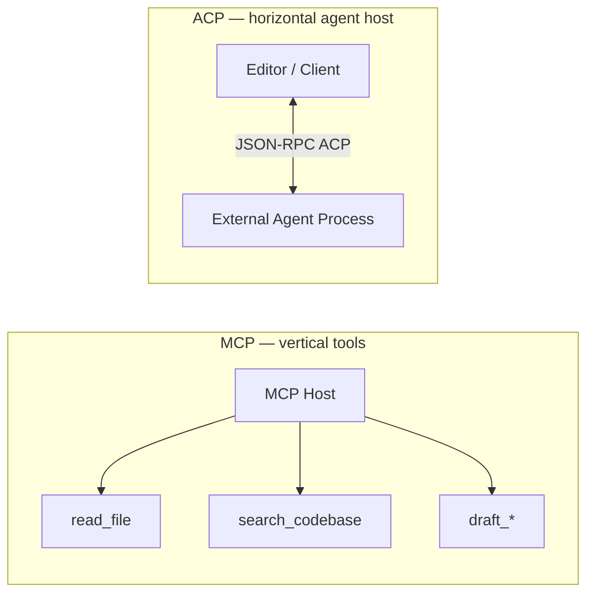

# Zed ACP → AppEndO Mapping

> **Benchmark:** [`docs/architecture/vibe-coding-benchmarks.md`](../../docs/architecture/vibe-coding-benchmarks.md)  
> **تحلیل Zed:** [`docs/architecture/zed-lessons-for-appendo.md`](../../docs/architecture/zed-lessons-for-appendo.md)  
> **Spec:** [`01-spec.md`](./01-spec.md)

---

## ACP vs MCP — دو محور متفاوت

| Protocol | نقش | AppEndO |
|----------|-----|---------|
| **MCP** | host ابزارها (read, grep, draft) | in-process builtin packs + Inbound `/api/mcp` |
| **ACP** | host agent (UI ↔ agent process) | **الهام معماری** — UI (`AiPanel`) جدا از loop (`AgentOrchestrator`)؛ Inbound MCP برای client خارجی |

AppEndO **ACP server عمومی** نمی‌سازد؛ از روحیهٔ جداسازی UI/agent و tool permission Zed الهام می‌گیرد.

---

## Concept mapping

| Zed concept | Source (Zed) | AppEndO equivalent | Phase |
|-------------|--------------|-------------------|-------|
| `AcpThread` | `crates/acp_thread/` | `base_ai_chat_sessions` + Agent SSE stream | exists |
| Native agent | `NativeAgentServer` | `AgentOrchestrator` + in-process MCP | exists |
| External agent | ACP JSON-RPC client | Inbound MCP host `/api/mcp` | exists (extend doc) |
| `ReadFileTool` | built-in | `read_file` (`appendo-files`) | exists |
| `GrepTool` | built-in | `search_codebase` (`appendo-codebase`) | exists |
| `EditFileTool` | built-in | `draft_file_patch` → proposal | exists · VC-7 multi-diff UX |
| `TerminalTool` | built-in | — (gap) | VC-4 `run_tests` on **live runtime** (not a new engine) |
| `WebSearchTool` | built-in | `appendo-web` / web search MCP | exists |
| `SpawnAgentTool` | subagents + depth limit | — | VC-7 backlog (doc only) |
| `ToolPermissionDecision` | per-tool allow/deny | `mcpAccess` + `writeRequiresConfirm` | exists |
| `MentionUri` (`@file`, selection) | agent_ui mentions | `pageContext` only | VC-1.3 / VC-2.5 |
| `agent_diff` | multi-buffer review | single-file proposal UI | VC-5 |
| `ThreadStore` (SQLite) | persistence | Prisma chat sessions + rollback | exists |
| `.agents/skills` | repo skills | `docs/standards/` shards + `get_project_standards` | exists · VC-6 workflows |
| Tree-sitter chunks | `crates/language` | ripgrep → hybrid index | VC-3 |
| Live code execution | `TerminalTool` + local build | **Unified live runtime** — same Node/React after apply | exists (doc) |

---

## Tool catalog → `capabilityPacks.ts`

| Zed built-in | AppEndO pack | Tools |
|--------------|--------------|-------|
| Read / list files | `appendo-files` | `read_file`, `list_directory`, `draft_file_patch` |
| Grep | `appendo-codebase` | `search_codebase`, `get_feature_graph` |
| Standards / rules | `appendo-standards` | `get_project_standards` |
| Page / layout context | `appendo-context` | `get_page_context` |
| Server Functions | `appendo-server-functions` | `list/get/test/draft_server_function` |
| Designer | `appendo-designer` | designer MCP tools, `draft_component_layout` |
| Web / HTTP | `appendo-web`, `appendo-http` | `web_search` · `fetch_url` · `screenshot_url`; HTTP allowlisted hosts |
| Git (optional) | `appendo-git` | draft git ops + confirm |

Canonical catalog: `src/shared/api/contracts/ai/capabilityPacks.ts`.

---

## Inbound MCP ↔ ACP spirit

| Zed BYO Agent | AppEndO Inbound MCP |
|---------------|---------------------|
| Editor hosts ACP session | AppEndO hosts Streamable HTTP MCP |
| External agent brings tools | Client uses **AppEndO builtin tools** (pack intersection + RBAC) |
| Tool permission UI | Settings MCP grants + confirm gate on writes |

Implementation: `src/server/services/ai/mcp/inbound/` · spec in [`docs/standards/ai-mcp.md`](../../docs/standards/ai-mcp.md).

---

## Gaps → VC phases

| Gap | Zed reference | AppEndO target |
|-----|---------------|----------------|
| Mentions `@layoutId` / attachments | MentionUri | `contextAttachments` in AiPanel (spec VC-2.5) |
| Multi-file diff review | `agent_diff.rs` | VC-5 proposal UI |
| Mandatory retrieve→draft | tool gating in thread | VC-2 `VibeHarness.ts` |
| `src/server/` writes | EditFile anywhere in project | VC-1 allowlist |
| Subagents | SpawnAgentTool | VC-7 backlog |

---

## Non-goals

- Zed ACP registry integration
- GPUI / Rust agent runtime
- Multiplayer shared buffers
- Replacing Cursor for power-user local dev
- **Separate AppEndO vibe execution engine** — generated server/client code runs on the existing platform runtime ([`01-spec.md`](./01-spec.md) § Unified live runtime)

---

## References

- [Zed ACP](https://zed.dev/acp)
- [Zed — Bring Your Own Agent](https://zed.dev/blog/bring-your-own-agent-to-zed)
- [Zed GitHub — agent, acp_thread, agent_ui](https://github.com/zed-industries/zed)
- AppEndO: [`03-implementation-roadmap.md`](./03-implementation-roadmap.md)
