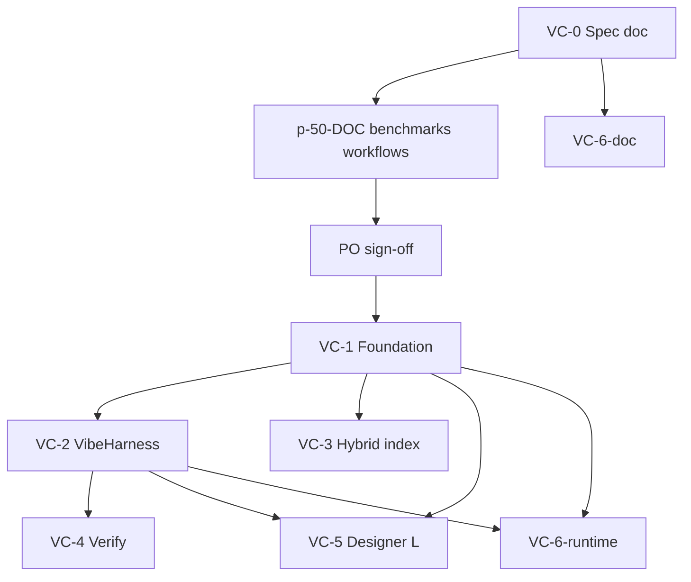

# Vibe Coding — Implementation Roadmap (VC-0..VC-7)

> **Plan:** this folder is the authority (p-50 plan deleted after ship)  
> **Spec:** [`01-spec.md`](./01-spec.md)  
> **Benchmark:** [`docs/architecture/vibe-coding-benchmarks.md`](../../docs/architecture/vibe-coding-benchmarks.md)  
> **Workflows:** [`docs/standards/vibe-coding-workflows.md`](../../docs/standards/vibe-coding-workflows.md)  
> **Zed mapping:** [`02-zed-acp-mapping.md`](./02-zed-acp-mapping.md)

---

## Gate

**شروع VC-1 (کد)** فقط پس از sign-off PO روی:

- [`vibe-coding-benchmarks.md`](../../docs/architecture/vibe-coding-benchmarks.md)
- [`vibe-coding-workflows.md`](../../docs/standards/vibe-coding-workflows.md)
- [`zed-lessons-for-appendo.md`](../../docs/architecture/zed-lessons-for-appendo.md)

فاز doc (p-50-DOC) **بدون** `VibeHarness.ts`، allowlist، یا tools جدید — جز ثبت shard در `getProjectStandards.ts`.

### PO sign-off checklist

قبل از شروع VC-1 code، PO / tech lead این موارد را تیک می‌زند (جزئیات در [`01-spec.md`](./01-spec.md) § PO gate):

- [ ] **PO-1** Benchmark matrix: موقعیت AppEndO vs Cursor/Zed برای WF-1..4 قابل دفاع است
- [ ] **PO-2** WF-1..4: ترتیب tool و preconditions برای تیم داخلی واضح است
- [ ] **PO-3** Unified live runtime: بدون sandbox جدا — PO می‌پذیرد
- [ ] **PO-4** VC-3 fallback: اگر semantic index در v1 نرسد، rg + `get_feature_graph` کافی است
- [ ] **PO-5** محدودیت proposal: `vibeMaxFilesPerProposal` / `vibeMaxLinesPerProposal` برای full-stack (WF-4: پیشنهاد 12 فایل) تأیید شده
- [ ] **PO-6** سناریوی دستی: یک dev با نقش DEVELOPER WF-1 را در staging امتحان کرده (حتی اگر apply شکسته باشد — baseline documented)

**اجرا:** [`01-spec.md`](./01-spec.md) · [`docs/standards/vibe-coding-workflows.md`](../../docs/standards/vibe-coding-workflows.md)

**خروجی gate:** تاریخ sign-off در header [`01-spec.md`](./01-spec.md) (`VC-1 code start: YYYY-MM-DD`).

---

## Known baseline gaps (قبل از VC-1)

وضعیت کد امروز — VC-1..4 این شکاف‌ها را می‌بندند:

| Gap | وضعیت کد امروز | VC |
|-----|----------------|-----|
| `server_function` draft → changeSet | [`changeSetBuilder.ts`](../../src/core/ai/validation/changeSetBuilder.ts) فقط `edge_function` را map می‌کند؛ `server_function` به «Unknown draft» می‌افتد | VC-1.2 |
| Allowlist full-stack | [`pathAllowlist.ts`](../../src/core/ai/tools/pathAllowlist.ts) فاقد `src/server/`، `src/domain/`، `src/components/`، `workspace/server-functions/` | VC-1.1 |
| Default session packs | [`capabilityPacks.ts`](../../src/shared/api/contracts/ai/capabilityPacks.ts): `appendo-designer` و `appendo-server-functions` بدون `defaultEnabled: true` (RBAC DEVELOPER در [`mcpAccessSeed.ts`](../../src/server/services/ai/mcpAccessSeed.ts) جداگانه seed شده) | VC-1.4 |
| VibeHarness | فایل وجود ندارد؛ harness در spec «not yet enforced» | VC-2 |
| post-apply verify UI | [`changeSet.service.ts`](../../src/server/services/ai/changeSet.service.ts) `verifyAppliedChangeSets` را صدا می‌زند؛ [`AiPanel.tsx`](../../src/components/AiPanel.tsx) `verification` را نمایش نمی‌دهد | VC-4.2 |
| `run_tests` tool | وجود ندارد (فقط در standards ذکر شده) | VC-4.1 |
| `changeSetBuilder` test | فقط `component_layout` — بدون `server_function` | VC-1.2 + Testing |

---

## Unified live runtime (اصل معماری)

AppEndO برای اجرای کد تولیدشده **انجین جدا نمی‌سازد**:

- **Server:** managed Server Functions در `workspace/server-functions/` — پس از apply بلافاصله API/route از همان Node process.
- **Client:** layouts در `workspace/designer/drafts/` — preview و UI از همان React app (Component Designer).
- **VC-4:** `run_tests` و post-apply verify روی همین runtime — نه sandbox/container جدید.

**Non-goal:** vibe execution engine اختصاصی (sidecar · VM · deploy pipeline per draft).

---

## Phase table

| Phase | Title | Output (doc / code) | Depends on | Risk | Benchmark link |
|-------|-------|---------------------|------------|------|----------------|
| **VC-0** | Spec + tracker | doc: `01-spec.md`, p-50, indexes | — | Low | Scope row in benchmarks |
| **VC-1** | Foundation | **code:** allowlist · `server_function` apply · pageContext · default packs · RBAC doc | VC-0 · PO sign-off | Medium — wrong apply path | AppEndO baseline gaps |
| **VC-2** | VibeHarness | **code:** `VibeHarness.ts` · retrieve gate · validation-repair | VC-1 | Medium — over/under gate | Cursor/Claude hooks · Zed tool policy |
| **VC-3** | Hybrid index | **code:** ripgrep + local semantic fallback (or documented fallback) | VC-1 | High — index drift | Cursor hybrid search |
| **VC-4** | Verify loop | **code:** `run_tests` · post-apply verify UI · extend postApplyVerify | VC-2 | Medium — flaky tests | Claude/Cursor verify |
| **VC-5** | Designer L | **code:** designer MCP depth · multi-changeSet preview · WF-3 E2E | VC-1 · VC-2 | Medium — UX complexity | Zed `agent_diff` |
| **VC-6-doc** | Workflows documentation | **doc:** workflows shard · how-to FA · `ai.vibe.*` rules | VC-0 (parallel) | Low | AI Factory skills |
| **VC-6-runtime** | Workflow enforcement | **code:** contextAssembly WF rules · shard keys in retrieve gate | VC-1.5 · VC-2 | Low | Harness alignment |

---

## VC-0 — Spec + tracker

| Item | Type | Status |
|------|------|--------|
| `specs/vibe-coding/01-spec.md` | doc | done |
| `specs/vibe-coding/01-spec.md` | doc | done |
| Benchmark + Zed + workflows + mapping + roadmap | doc | p-50-DOC |

**DoD:** PO can explain AppEndO vs Cursor/Zed without reading code.

---

## VC-1 — Foundation

| Task | Deliverable | Files (indicative) |
|------|-------------|-------------------|
| VC-1.1 | Allowlist: `src/server/`, `src/domain/`, `src/components/`, `workspace/server-functions/` | `pathAllowlist.ts` |
| VC-1.2 | `server_function` → `function_source_patch` in changeSet builder | `changeSetBuilder.ts`, `proposalValidator.ts` |
| VC-1.3 | Rich `pageContext` on Server Functions workspace | `contextAssembly.ts`, routes |
| VC-1.4 | Default packs: `appendo-server-functions`, `appendo-designer` (`defaultEnabled: true`) | `capabilityPacks.ts` |
| VC-1.5 | Workflow rules in agent context (pointers to WF-1..4) | `contextAssembly.ts` |
| VC-1.6a | RBAC doc: DEVELOPER role in `mcpAccessSeed` includes vibe packs; USER does not | `mcpAccessSeed.ts`, p-50 |
| VC-1.6b | Trace: proposal/apply/verify visible in agent run trace (existing fields — no new feature) | `AgentOrchestrator.ts`, trace UI |

**Risk:** applying patches to wrong artifact type (`edge_function` vs `server_function`).

**Benchmark:** closes allowlist + managed Server Functions advantage.

**Tests (required):**

- `changeSetBuilder.test.ts` — `server_function` draft mapping
- `pathAllowlist.test.ts` — new roots
- smoke: `draft_server_function` → proposal (integration or pack test)

---

## VC-2 — VibeHarness

| Task | Deliverable | Files (indicative) |
|------|-------------|-------------------|
| VC-2.1 | Phase state machine `retrieve` → `plan` → `draft` → `finalize` | `VibeHarness.ts` |
| VC-2.2 | PreToolUse gates — block `draft_*` before retrieve satisfied | `AgentOrchestrator.ts`, `VibeHarness.ts` |
| VC-2.3 | Structured plan fields on `AgentPlanPayload` (intent · targetFiles · steps) | agent types, orchestrator |
| VC-2.4 | Validation-repair loop (max 2) via `validateProposal` | `AgentOrchestrator.ts` |
| VC-2.5 | Defaults: utility-guided retrieval; optional LLM segment H | `contextAssembly.ts` |

**Benchmark:** Claude hooks + Zed `ToolPermissionDecision` alignment.

**Tests (required):**

- `VibeHarness.test.ts` — gate scenarios (block draft before retrieve; allow after)
- `AgentOrchestrator.test.ts` — harness integration

---

## VC-3 — Hybrid index

| Task | Deliverable | Files (indicative) |
|------|-------------|-------------------|
| VC-3.0 | **Spike (3 days max):** POC chunk index; success = recall@5 on 10 internal queries ≥ rg-only | spike branch / notes in p-50 log |
| VC-3.1 | Keep ripgrep | `searchCodebase.ts` (current) |
| VC-3.2 | Local semantic fallback (Tree-sitter-inspired chunks — not Zed fork) | new index module |
| VC-3.3 | Merge with `get_feature_graph` | `getFeatureGraph.ts`, search merge |

**Risk:** maintenance cost vs Cursor cloud index.

**Fallback v1:** If VC-3.0 spike fails → ship with rg + feature graph only; full semantic index → VC-7.4.

**Tests (required):**

- index unit tests
- regression: search results vs baseline query set

---

## VC-4 — Verify loop

Build on existing [`postApplyVerify.service.ts`](../../src/server/services/ai/postApplyVerify.service.ts) (already called from [`changeSet.service.ts`](../../src/server/services/ai/changeSet.service.ts)).

| Task | Deliverable | Files (indicative) |
|------|-------------|-------------------|
| VC-4.1 | Tool `run_tests` — wrapper `npm run test:critical` or configurable subset; live runtime | new native tool |
| VC-4.2 | AiPanel: display `AgentApplyResult.verification` (pass/fail per changeSet) | `AiPanel.tsx` |
| VC-4.3 | Extend postApplyVerify for `function_source_patch` / managed server functions | `postApplyVerify.service.ts` |
| VC-4.4 | (optional) standards lint hook in verify | `standardsProposalValidator.ts` |

**Acceptance UX:** After apply — green/red banner + checklist of checks + existing rollback button.

**Not in scope:** separate vibe sandbox, container spin-up, or deploy step between apply and first API/UI availability.

**Benchmark:** Claude/Cursor verify; AppEndO verify targets the **managed platform runtime**, not a generic shell.

**Tests (required):**

- extend `postApplyVerify.service.test.ts` for server function patches
- AiPanel component test or e2e fragment for verification display

---

## VC-5 — Designer L

| Task | Deliverable | Files (indicative) |
|------|-------------|-------------------|
| VC-5.1 | Designer MCP: `designer_set_prop`, insert palette (WF-3) | `designerPack.ts`, MCP tools |
| VC-5.2 | Multi-changeSet preview in proposal UI (Zed `agent_diff` inspired) | proposal UI components |
| VC-5.3 | E2E modify-existing: `layoutId` in pageContext → draft → apply → Designer handoff | e2e test |

**Acceptance UX:** User sees diff for multiple changeSets before confirm; handoff URL `/client-components?load=…`.

**Benchmark:** Zed multi-buffer diff review.

**Tests (required):**

- E2E WF-3: extend [`e2e41WritePipelineSmoke.test.ts`](../../src/server/services/ai/__tests__/e2e41WritePipelineSmoke.test.ts) or dedicated `e2e*vibe*designer*` test

---

## VC-6 — Workflows (doc vs runtime)

### VC-6-doc (p-50-DOC) — done

| Task | Deliverable | Status |
|------|-------------|--------|
| `vibe-coding-workflows.md` | WF-1..4 | done |
| `get_project_standards({ shard: "vibe-coding-workflows" })` | STANDARDS_SHARDS | done |
| `ai.vibe.*` in `projectStandards.ts` | machine-readable mirror | done |
| `docs/archive/internal/vibe-coding-howto-fa.md` | team how-to | done |

### VC-6-runtime (remaining v1)

| Task | Deliverable | Files (indicative) |
|------|-------------|-------------------|
| VC-6.1 | WF-1..4 rules and retrieve-gate pointers in system context | `contextAssembly.ts` |
| VC-6.2 | Shard keys `vibe-server-function` / `vibe-crud` / `vibe-designer-edit` referenced in retrieve flow | harness + contextAssembly |

**Note:** Doc artifacts shipped early in p-50-DOC; runtime enforcement depends on VC-1.5 + VC-2.

---

## VC-7 — Post-v1 backlog

| ID | Title | Priority post-v1 |
|----|-------|------------------|
| VC-7.1 | Subagents (`SpawnAgentTool`) | P2 |
| VC-7.2 | Rich mentions (`contextAttachments`) | P2 |
| VC-7.3 | Multi-buffer diff parity (Zed-grade) | P1 if VC-5 preview insufficient |
| VC-7.4 | Full semantic index (if VC-3.0 spike failed) | P1 |
| VC-7.5 | Orchestration rewrite (VIBE2 — ex p-59) | P1 — tracked in [`p-72-ai-backlog`](../../plans/core/next/p-72-ai-backlog.md) Appendix VIBE2 |

---

## Cross-plan dependencies

| Plan | Relationship to p-50 |
|------|----------------------|
| Shell Studio (cancelled) | **Parallel** — generated app/site shells are not required for WF-2 CRUD in v1; designer presets may update after BC-GATE |
| Redis cache testing | ✅ done — RCT integration |
| Workflow engine | ✅ shipped — WF-4 harness ≠ workflow engine |
| [p-61 appendoo backlog](../../plans/core/next/p-72-ai-backlog.md) | VIBE2 orchestration rewrite (ex p-59) — supersedes incremental p-50 orchestration fixes |

---

## Testing strategy

| Phase | Required tests |
|-------|----------------|
| VC-1 | `changeSetBuilder.test.ts` + `server_function`; `pathAllowlist.test.ts` new roots; smoke `draft_server_function` → proposal |
| VC-2 | `VibeHarness.test.ts`; gate integration in `AgentOrchestrator.test.ts` |
| VC-3 | index unit tests; regression search vs baseline queries |
| VC-4 | extended `postApplyVerify`; AiPanel verification display |
| VC-5 | E2E WF-3 modify-existing layout |
| v1 gate | `npm run test:critical` green |

### WF E2E matrix (v1 DoD)

| WF | Test scenario |
|----|---------------|
| WF-1 | `draft_server_function` → apply → `test_server_function` |
| WF-2 | `draft_component_layout` → Designer handoff |
| WF-3 | modify existing layout with `baseLayoutId` |
| WF-4 | WF-1 + WF-2 in one proposal or two sequential applies |

---

## Product success metrics (v1)

- Internal dev (DEVELOPER role) completes WF-1 end-to-end without Cursor in **< 30 minutes** (including confirm)
- WF-3: change an existing grid column via Agent + successful apply
- Zero applies without confirm in E2E tests
- Rollback of last apply from AiPanel works (regression in DoD — API exists today)
- `get_project_standards({ shard: "vibe-coding-workflows" })` called in retrieve gate before `draft_*`

---

## Dependency graph

---

## Definition of Done (v1 product)

### Foundation (VC-1)

- [ ] VC-1.1 Full-stack allowlist roots
- [ ] VC-1.2 `server_function` → `function_source_patch` fixed + test
- [ ] VC-1.3 Rich pageContext on Server Functions workspace
- [ ] VC-1.4 Default session packs enabled
- [ ] VC-1.5 Workflow rules in contextAssembly
- [ ] VC-1.6 RBAC documented · trace fields verified

### Harness (VC-2)

- [ ] VC-2.1–2.5 VibeHarness enforced retrieve→draft pipeline + validation-repair

### Search (VC-3)

- [ ] VC-3.1 ripgrep retained
- [ ] VC-3.2 semantic index **or** documented VC-3 fallback (VC-7.4 backlog)

### Verify (VC-4)

- [ ] VC-4.1 `run_tests` tool
- [ ] VC-4.2 AiPanel verification UI
- [ ] VC-4.3 postApplyVerify for server functions

### Designer (VC-5)

- [ ] VC-5.3 WF-3 modify-existing E2E

### Docs / runtime (VC-6)

- [x] VC-6-doc workflows shard · how-to · `ai.vibe.*`
- [ ] VC-6-runtime harness + shard keys in retrieve flow

### Quality

- [ ] WF E2E matrix (WF-1..4) covered
- [ ] Product success metrics (§ Product success metrics) met on staging
- [ ] `npm run test:critical` green

---

## p-50-DOC acceptance (complete)

- [x] Benchmark matrix (Cursor / Claude / Zed / aweb / AppEndO)
- [x] Zed deep-dive FA
- [x] WF-1..4 workflows shard
- [x] Zed ACP mapping spec
- [x] VC-0..6 roadmap with doc/code split
- [x] Hub index updates + how-to FA
- [x] `vibe-coding-workflows` registered in `getProjectStandards.ts`
